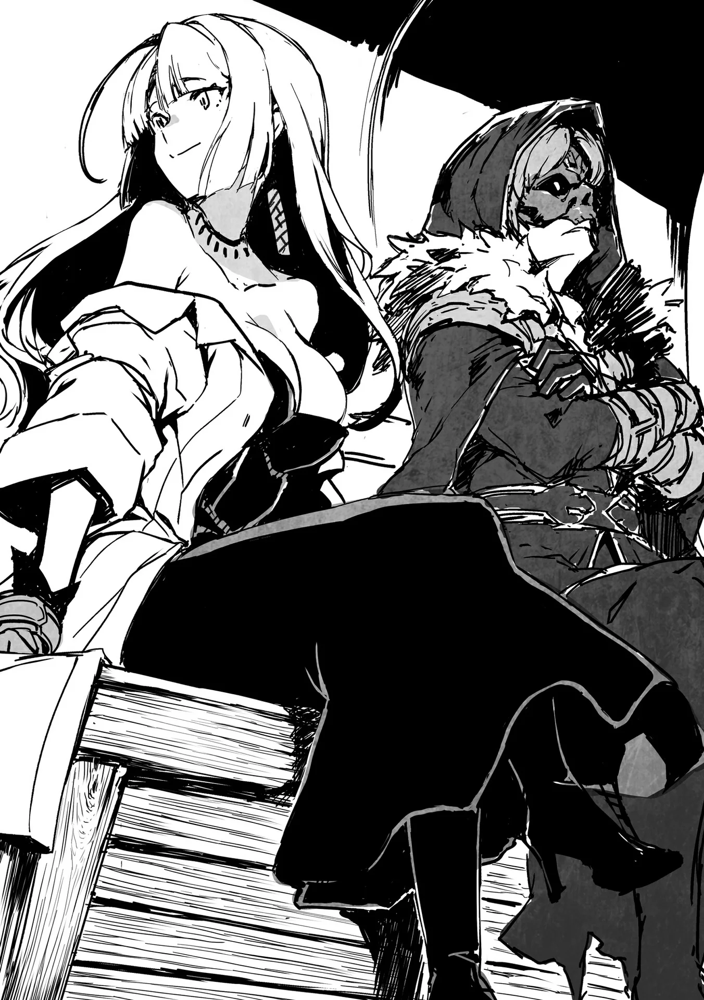

# Chương 133: Tập 5 Chương 4 - Chuyến Hành Trình (4)

Mấy hành khách cùng chuyến dường như chẳng hay biết chuyện gì đã xảy ra. Từ vụ bầy Zombie, chuyện chúng tôi (à thì, thực ra chỉ có Lorraine) dọn sạch chúng, cho tới việc Hilde ghé lại khu trại suốt đêm, họ đều mù tịt. Lũ Zombie vốn chết rồi nên chẳng có chút hơi thở sự sống nào, còn Hilde là mạo hiểm giả lão luyện, thừa biết cách ẩn mình trước người bình thường. Thành ra trong mắt mọi người, cả đoàn vừa trải qua một đêm cắm trại êm đềm. À thì, hình như bác đánh xe có nhận ra điều gì đó, nhưng người dám đánh xe qua những cung đường đất mấp mô này ắt hẳn cũng có chút bản lĩnh. Bác ấy mà nhận ra thì cũng là lẽ thường.

Cỗ xe bon bon dưới nắng sớm rồi tới một thị trấn ngay trước khi mặt trời lặn. Lần này chẳng có chuyện gì bất trắc xảy ra, làm cả tôi lẫn Lorraine thở phào nhẹ nhõm. Tôi đâu có đi làm hộ vệ, nên tránh được nỗi phập phồng của cái nghề đó chừng nào thì hay chừng nấy. Không phải đám cướp đường trên mấy lối đi thôn quê này khó xơi gì cho cam. Quái vật lởn vởn dọc đường cũng chẳng phải mối đe dọa gì lớn, chỉ là đụng độ chúng thì thêm việc nhọc thân.

"Tuyệt thật, xem ra tối nay tôi được ngủ trên giường rồi," Lorraine nói khi bước xuống xe.

Ngồi xe suốt cả buổi làm người ngợm cứng đờ. Chúng tôi vừa bước đi vừa vươn vai, các khớp xương kêu răng rắc.

Đoạn đường ở đây gập ghềnh kinh khủng. Con đường đi về phía tây được tu sửa tử tế, không có đá tảng cản đường xe cộ nên chuyến đi êm hơn nhiều. Tôi cũng ước người ta chăm chút cho con đường này như vậy, nhưng tính đến thời gian lẫn tiền bạc cần bỏ ra, tôi chẳng dám mơ có ngày đó. Nếu có tiền thì tôi đã tự bỏ tiền túi ra tài trợ rồi, ngặt nỗi tôi lại rỗng túi. Đành chịu vậy thôi.

"Tôi thì mong chờ đồ ăn hơn," tôi nói. Đồ ăn ở phần lớn các thị trấn cũng chỉ bình thường, nhưng ngôi làng này lại có mấy món đặc sản mà tôi đã kể trước đó. Tôi nóng lòng muốn xem phản ứng của Lorraine ra sao, nhưng rồi cô lại nói một câu tôi không ngờ tới.

"À phải rồi, ngôi làng này nổi tiếng với món Solest và Gettamba nhỉ. Tôi cũng đang nóng lòng muốn nếm thử đây."

Tôi thầm nghĩ mấy cái tên lạ hoắc ấy nghe cứ như thần chú ma pháp.

Lorraine khẽ chau mày. "Sao thế? Chẳng phải anh từng ghé qua thị trấn này mấy lần rồi à? Món trứng ếch mùa đông gọi là Solest, còn bọ ngựa Curtis Mant non chiên giòn là Gettamba đấy thôi."

Nói mới nhớ, đúng là tôi từng nghe mấy cái tên đó rồi. Có điều tên gọi không để lại ấn tượng mạnh bằng chính món ăn, nên chẳng đọng lại trong đầu tôi. Trứng ếch mùa đông thì nhìn rõ mồn một cả nòng nọc bên trong, còn bọ ngựa Curtis Mant chiên giòn dù nấu chín rồi vẫn nguyên hình con bọ ngựa, một đĩa bưng ra tầm năm sáu con. Phụ nữ mà dám ăn mấy món này thì một là người thị trấn này, hai là phải gan cùng mình. Đa phần hẳn sẽ giật mình kinh hãi tới mức chẳng dám đưa lên miệng. Nhưng Lorraine thì có vẻ khác.

"Cô cũng muốn nếm thử mấy món đó thật á? Chuyện đó... chà, tôi chẳng biết phải nói sao nữa," tôi lúng túng chẳng biết nói gì.

Lorraine đoán được ý tôi. "Anh thấy kỳ quặc lắm hả? Ừ thì anh nghĩ thế cũng chẳng sai, nhưng mấy món này có ghi trong cuốn sách dạo nọ tôi mua ở gánh hàng rong đấy. Thấy gần đây có bán nên tôi muốn nếm thử xem sao," cô nói, làm tôi nhớ lại chuyện cô từng mua một cuốn sách dạy nấu ăn từ quái vật.

Tôi cứ ngỡ Lorraine mua mọi cuốn sách bất kể thể loại chỉ để thỏa mãn cơn khát tri thức, chứ không ngờ cô lại thực sự hứng thú với nội dung trong đó. Cơ mà hiểu tính Lorraine thì có khi chính khát khao tri thức ấy lại khiến cô cởi mở đón nhận gần như mọi thứ. Dù tốt hay xấu, cô hiếm khi để định kiến xen vào bất cứ chuyện gì. Đó cũng là lý do cô vẫn chấp nhận tôi khi tôi biến thành Undead. Có điều, cô đâu nhất thiết phải rộng lượng đến thế với cả đồ ăn thức uống. Bản thân tôi còn chẳng rõ mình có ăn nổi không, bởi đã lâu lắm rồi tôi chưa đụng tới mấy món này. Ít nhất thì vị của chúng cũng ổn. Thôi thì, cứ chờ tới bữa tối rồi tính.

Thế là chúng tôi đi về phía quán trọ. Bác đánh xe đã đặt trước chỗ nghỉ cho cả đoàn, nên chúng tôi có đến muộn cũng chẳng sao. Mà thật ra đến vào lúc nào cũng được, bởi thị trấn này vốn nằm cách xa chốn văn minh quá đỗi.

◆◇◆◇◆

Bát canh bốc khói nghi ngút có những quả trứng núng nính bọc trong lớp màng nhầy như thạch, trong suốt tới mức nhìn rõ cả những con nòng nọc khổng lồ bên trong. Đó chính là Solest. Bên cạnh là chiếc đĩa lớn chất đống không phải chỉ năm sáu con mà tới hai ba chục con bọ ngựa chiên giòn. Cảnh tượng quả là đáng gờm. Thậm chí mới nhìn thôi tôi đã hết cả thấy đói. Tôi chẳng muốn đụng vào món Gettamba chút nào.

Ngồi cạnh tôi, Lorraine gắp đầy đĩa rồi ăn ngon lành như bao món bình thường khác. "Sao thế, Rentt, anh không ăn à? Chà, chắc không có máu thì anh chẳng thấy ngon miệng đâu nhỉ," cô nói, nhưng đủ tinh tế để hạ giọng thì thầm câu cuối.

Vấn đề không phải ở chỗ đó. Đơn giản là tôi không ưa nổi vẻ ngoài của món ăn thôi. Ở Hathara chưa từng có thứ ẩm thực hoang dã lộ liễu đến mức này. Dù vậy, quanh vùng Hathara hầu như chẳng có ếch mùa đông hay Curtis Mant, nên chắc đó cũng là một phần lý do. Người dân quanh vùng này ăn lũ quái vật đó một phần để giảm bớt số lượng khi chúng còn nhỏ, còn ở nơi vốn không có bóng dáng chúng từ đầu thì đâu cần làm vậy.

"Không, không phải chuyện đó đâu. Tôi ăn mà, thề đấy," tôi quả quyết, trong lòng khóc thầm khi gắp một nhúm trứng ếch ít ỏi bỏ vào đĩa mình. Đám trứng săn chắc, và tôi có thể thấy những con nòng nọc khổng lồ bên trong vẫn đang ngọ nguậy. Hơi cắn rứt vì lấy đi mạng sống của chúng, tôi đưa vào miệng rồi chạm đầu lưỡi vào lớp màng nhầy như thạch. Cảm giác trong miệng khá lạ, mềm mại mà thấm đẫm nước hầm nên vị rất ngon. Tôi lấy hết can đảm ăn tiếp, cắn vào một con nòng nọc. Trái ngược hẳn với vẻ ngoài phát ớn, một hương vị thanh dịu lan tỏa khắp khoang miệng. Vị ngọt nhẹ hòa cùng phần nước dùng đậm đà. Giá mà trông chúng bình thường như mấy món khác thì tôi ăn bao nhiêu cũng không chán.

Tiếp theo là món Curtis Mant chiên giòn. Đáng ngạc nhiên là món đó cũng chẳng còn lại bao nhiêu. Tôi ngồi chung bàn với Lorraine và các hành khách khác, ai nấy đều ăn ngon lành chẳng chút e dè. Nãy giờ nghe tiếng nhai giòn rụm rôm rốp và biết thừa là tiếng nhai bọ ngựa, nên đĩa vơi đi cũng là lẽ đương nhiên. Tôi vươn tay nhặt một con Curtis Mant lên, vô tình chạm mắt với nó. Thấy rờn rợn và không tài nào chịu nổi cảnh ngồi nhìn chằm chằm con bọ trong im lặng thêm nữa, tôi đút thẳng đầu nó vào miệng rồi nhai đứt làm đôi. Cảm giác giòn tan lập tức lan tỏa, kèm theo vị thanh mát khác hẳn đồ chiên thông thường. Tôi thấy món này rất ngon, nhắm với bia thì hợp phải biết, mà đúng là bác đánh xe với người đàn ông trung niên cũng đang uống bia mạch nha kèm món này thật. Tôi hơi lo cho chuyến xe ngày mai, nhưng loài rùa khổng lồ vốn đủ khôn để kéo xe chở chúng tôi đi êm xuôi, dù bác đánh xe có quất roi bừa bãi đi nữa.

Rốt cuộc tôi cũng vượt qua được cảm giác ghê sợ và ăn uống bình thường như bao món khác. Có điều lần sau ghé lại thị trấn này, chắc tôi sẽ lại phải trải qua cảm giác đó từ đầu. Lorraine bảo muốn có dịp quay lại đây ăn tiếp, nên rất có thể chúng tôi sẽ ghé vào lúc về. Từ giờ đến lúc đó tôi phải chuẩn bị sẵn tinh thần mới được.

◆◇◆◇◆

"Nhờ hai người mà suốt chuyến đi này chúng tôi được ăn ngon! Sau này có gặp lại ở Maalt, chúng tôi nhất định sẽ đãi hai người một bữa thật ngon!" cô gái trẻ nói sau khi bước xuống xe.

"Cha con tôi mang ơn hai người nhiều lắm," người cha đứng cạnh cô nói thêm. "Tôi nghe nói có đêm hai người còn đánh đuổi cả quái vật nữa. Chút này chẳng đáng là bao, nhưng xin cứ cầm lấy." Ông đưa cho chúng tôi một đồng xu đồng.

"Không đâu, chúng tôi chỉ tự vệ thôi mà. Nếu muốn cảm ơn thì khi nào quay lại Maalt, giả sử hai người có quay lại, hãy đãi chúng tôi một bữa ngon nhé," Lorraine gợi ý.

Chúng tôi trò chuyện với người đàn ông trung niên và cô gái trẻ khá nhiều, đủ để biết họ đang về ngôi làng nơi mẹ và ông bà cô gái sinh sống. Bình thường họ ở Maalt làm việc, có kỳ nghỉ mới về thăm làng. Người mẹ thì ở nhà chăm sóc ông bà. Đó là chuyện thường gặp ở vùng này.

"Hai người chắc chứ? Thường thì mạo hiểm giả Ngân Cấp phải được trả bằng đồng xu bạc cơ mà," người đàn ông nói.

Ngân Cấp và Đồng Cấp là những danh hiệu tiện lợi ở chỗ giúp ước chừng mức giá thuê một mạo hiểm giả. Trước đây mạo hiểm giả Ngân Cấp thường lấy một hai đồng xu bạc, nhưng giờ vật giá leo thang nên thù lao của họ còn đắt hơn. Mạo hiểm giả Đồng Cấp từng chỉ lấy một đồng xu đồng, nhưng dĩ nhiên sau này mức giá cũng tăng theo. Dù vậy, chúng tôi kiếm nhiều lắm cũng chỉ được một hai đồng xu bạc. Túi tiền của mạo hiểm giả Đồng Cấp chẳng bao giờ dư dả.

"Không sao đâu. Chúng tôi đi chuyến này đâu phải vì công việc. Cũng chẳng phải vì lòng tốt gì cho cam. Bản thân chúng tôi cũng đang đi đường, có người trò chuyện cùng thế này là vui rồi. Hẹn gặp lại nhé."

"Chà, thời buổi này hiếm thấy mạo hiểm giả nào hào phóng vậy đấy. Thôi được, vậy hẹn lần sau nhé," người đàn ông trung niên nói. Ông vẫy tay chào tạm biệt rồi cùng con gái đi vào làng.

"Đến giờ đi rồi," bác đánh xe lên tiếng rồi cho xe lăn bánh. Đây mới là ngày thứ ba của cuộc hành trình, vẫn còn ba bốn ngày đường nữa. Hành khách còn lại trên xe giờ chỉ có chúng tôi, bác đánh xe và đôi vợ chồng già.

◆◇◆◇◆

"Tôi biết là mình cứ trêu quê nhà anh hẻo lánh thế nào, nhưng có khi tôi nói vậy vẫn còn nhẹ đấy," Lorraine nói khi thò đầu ra ngoài xe.

Cô nói chẳng sai chút nào. Bốn bề quanh chúng tôi chẳng có gì ngoài núi non và rừng rậm. Cho tới chỗ hai cha con kia xuống xe, đường sá vẫn còn giống đường đi quanh các làng mạc. Nhưng giờ đây chỉ toàn là núi, núi, núi, rừng cây, rồi lại thêm bao nhiêu là núi. Mặt đường được san phẳng vừa đủ cho một cỗ xe đi lọt, nhưng cũng chỉ vừa khít. Bác đánh xe vững tay lái, cỗ xe cũng đủ chắc chắn để chịu được, nhưng đoạn đường này lúc nào cũng đáng sợ. Xe mà hỏng giữa chừng thì chúng tôi chỉ còn nước cuốc bộ.

Nhắc mới nhớ, đôi vợ chồng già đã xuống xe hôm qua rồi. Từ đường cái vào tới chỗ của hai cụ phải đi bộ một quãng khá xa, nên tôi và Lorraine đã cõng hai cụ đi nốt chặng đường còn lại. May sao bác đánh xe bảo sẽ đợi chúng tôi quay lại. Bác ấy còn bảo nếu hôm đó chúng tôi không về kịp thì sẽ hạ trại ngay tại chỗ để chờ. Đó là một điểm cộng dễ chịu của những cung đường thôn quê; xe đi về hướng tây chẳng bao giờ linh hoạt được như thế. Xe bên đó thường chở kín chỗ, mà dân thành thị lúc nào cũng canh cánh chuyện phải đến nơi đúng giờ. Tới trễ một chút là hứng cả đống lời phàn nàn, khách còn đòi trả lại tiền vé. Trên tuyến đường này thì chẳng bao giờ có chuyện đó. Một phần có lẽ vì người nhà quê vốn đủng đỉnh hơn, nhưng phần nữa là có chuyện gì bác đánh xe cũng chẳng màng kiếm nhiều tiền, còn hành khách thì cứ tùy cơ ứng biến.

"Thì đấy, nếu không phải vì đường sá xa xôi cách trở quá thì tôi đã về thăm nhà thường xuyên hơn rồi. Đi đến đây tốn biết bao thời gian, mà trước giờ tôi làm gì có thời gian. May mà giờ không phải làm việc liên miên cũng sống được, chứ cho tới gần đây tôi vẫn phải cật lực làm lụng mỗi ngày chỉ để kiếm đủ ăn," tôi nói.

Đó là cảnh chung của đám mạo hiểm giả Đồng Cấp. Có tổ đội thì làm việc hiệu quả hơn và tránh được cảnh túng thiếu đó, ngặt nỗi tôi lại đi một mình. Cơ mà nghĩ đi nghĩ lại, chắc một phần cũng tại tôi hơi thích tiêu tiền vô bổ. Tôi vốn mê mấy món ma cụ trông có vẻ vô dụng mà.

"Nếu anh chịu mở lời bảo mình đang gặp khó khăn thì tôi đã cho anh vay tiền không lấy lãi rồi."

"Làm sao tôi mở miệng xin vay như thế được? Tôi muốn đứng ngang hàng với cô cơ mà."

Tôi cũng sợ cảnh túng quẫn sẽ đẩy mình vào chỗ bị cô lập với xung quanh, nhưng nếu Lorraine đã bảo sẵn lòng cho vay tiền thì chắc chắn cô sẽ làm thật. Dù vậy, tôi không muốn mở miệng xin xỏ. Ít nhất là chừng nào mình vẫn còn cách khác. Cùng đường lắm thì có thể tôi buộc phải gạt lòng tự trọng sang một bên, nhưng khi ấy tôi sẽ cố gắng suốt phần đời còn lại để trả nợ cho cô. Bạn bè lâu năm là điều vô cùng quý giá với tôi.

"Anh đâu cần phải cứng đầu đến thế. Mà thôi, có lẽ tính anh vốn vậy rồi," cô thừa nhận.

Đúng vậy thật, tôi sống theo cách mình muốn. Từ bỏ điều đó thì tôi chẳng khác nào đã chết. Cũng vì thế mà dù đã là Undead, tôi vẫn coi mình đang sống. Ý chí của tôi vẫn còn đó.

◆◇◆◇◆

Cỗ xe đi tiếp chừng nửa ngày nữa. "Sắp tới nơi rồi," bác đánh xe lẩm bẩm.

Lorraine và tôi nhìn ra ngoài, thấy con đường dần mở rộng và thoáng đãng hơn. Chúng tôi đã tới đoạn đường mà dân làng Hathara thường qua lại, nên cũng được tu sửa đôi chút. Có một con sông chảy dọc theo đường đi, chắc đó cũng là nguyên nhân. Tôi nhận ra khung cảnh quen thuộc quanh vùng này.

"Cuối cùng cũng tới," Lorraine nói, vẻ mệt nhoài. Ngay cả cô cũng khổ sở vì xe xóc nảy suốt dọc đường. Cô vốn là người thành phố, nên tôi không nghĩ cô từng ngồi cỗ xe nào lắc lư dữ dội đến thế.

"Tôi thấy rồi. Làng Hathara kìa," tôi thì thầm.

Lorraine cũng nhìn thẳng về phía trước. "Hàng rào gỗ sao? Trông có vẻ hơi thô sơ nhỉ."

"Nhìn vậy thôi, chứ bà lão bốc thuốc ở Hathara đã quét lên hàng rào đó một loại thuốc xua đuổi quái vật cực kỳ công hiệu đấy. Còn nếu có con quái vật nào lọt qua được thì đã có các thợ săn lo liệu. Phòng thủ của làng ổn lắm."

Nếu có con gì quá mạnh xuất hiện thì dân làng phải gọi mạo hiểm giả, nhưng trong làng có đủ người hạ được đám Goblin hay Slime. Kể cả ở sâu trong núi, con người vẫn sống được.

"Tôi cũng nghe kể vậy rồi, nhưng ngôi làng này đúng là hơi lạ. Có những thành phố tự trị tự trang bị hệ thống phòng thủ chống quái vật đã đành, chứ không mấy ngôi làng nhỏ trong núi làm được như thế đâu. Hoặc có khi tại tôi chưa biết, chứ đây là chuyện bình thường ở các làng miền núi."

"Tôi cũng không chắc nữa. Hồi trước tôi cứ tưởng thế là bình thường, nhưng giờ nghĩ lại thì thấy đúng là hơi lạ thật. Thuốc của bà lão bốc thuốc công hiệu khác thường, mà mấy người thợ săn cũng mạnh hơn mức hợp lý."

"Còn có cả ngôi đền bí ẩn nơi anh nhận được ban phước nữa. Tôi đã lấy cớ tò mò để nói với Hilde rằng mình đi theo anh, nhưng nghe qua thì đúng là thú vị thật. Tôi nóng lòng muốn tìm hiểu xem sao rồi," Lorraine hào hứng nói.

Tôi thì chẳng bận tâm, nhưng trong mắt tôi, đây chỉ là một ngôi làng bình thường. Tôi không hình dung nổi cô sẽ tìm thấy gì ngoài ngôi đền kia, nhưng chuyện đó cứ để tới nơi rồi tính. Nghĩ vậy, chúng tôi chờ cỗ xe đi vào làng.

