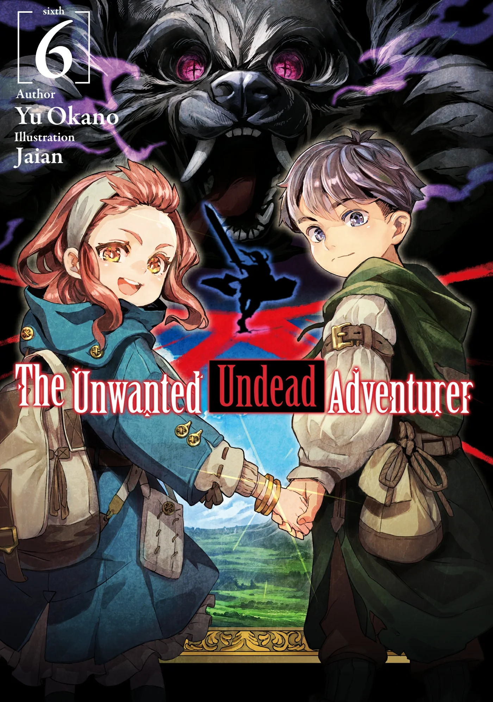
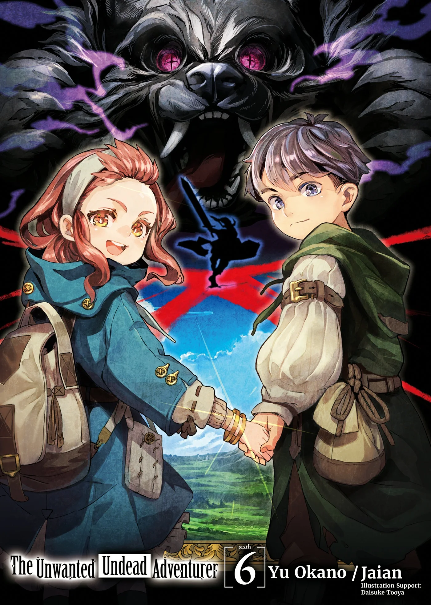
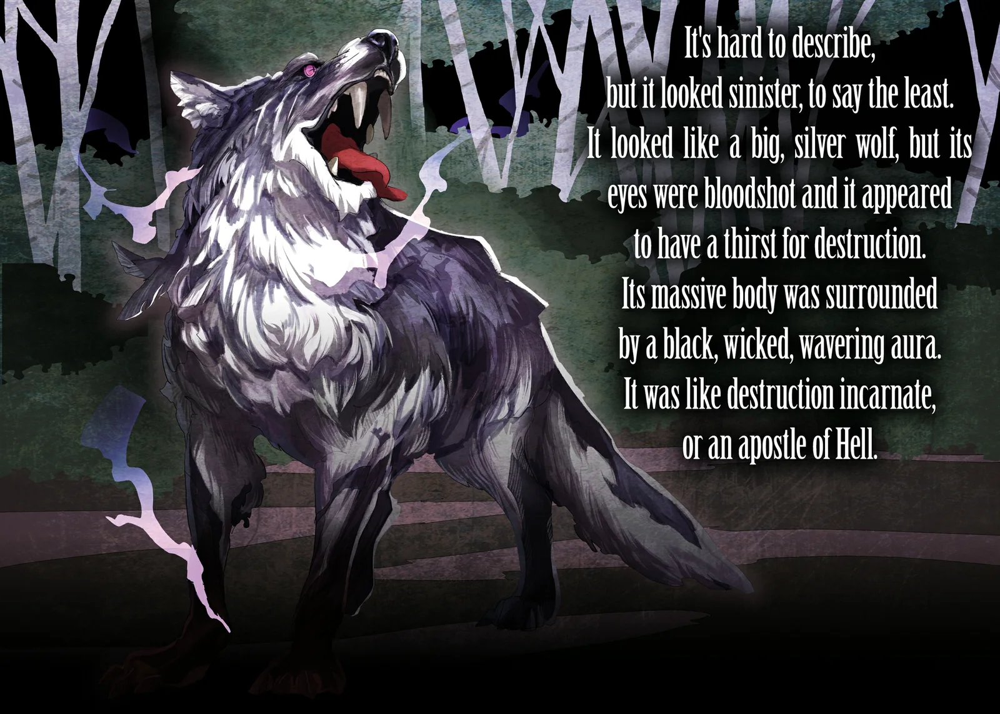
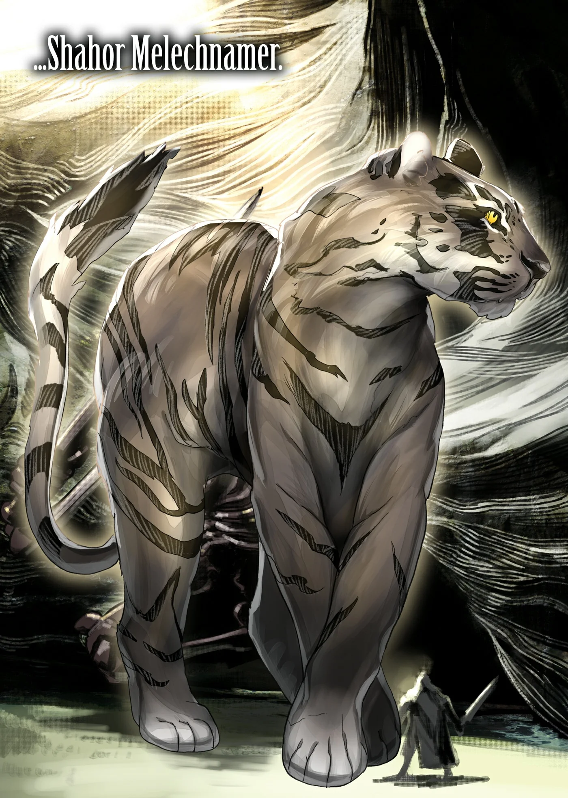
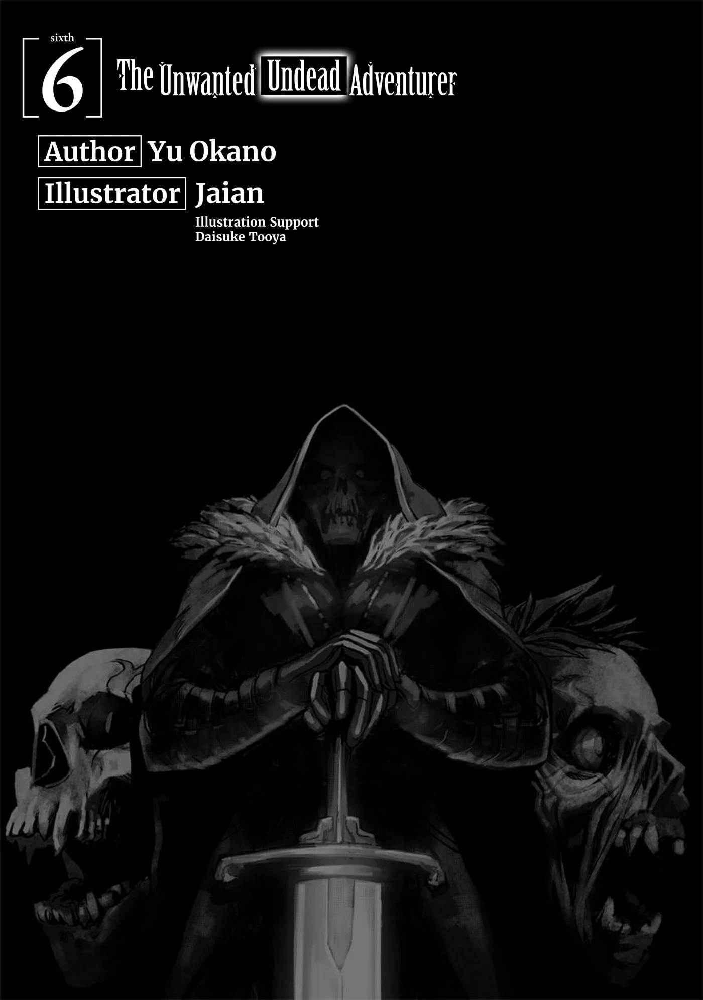
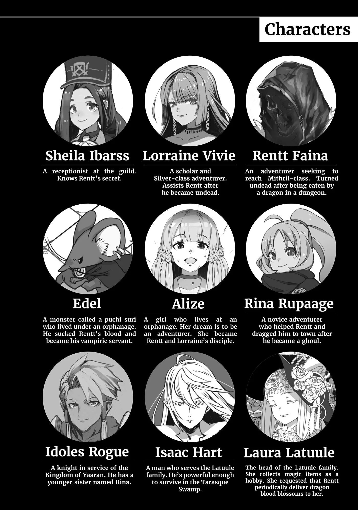
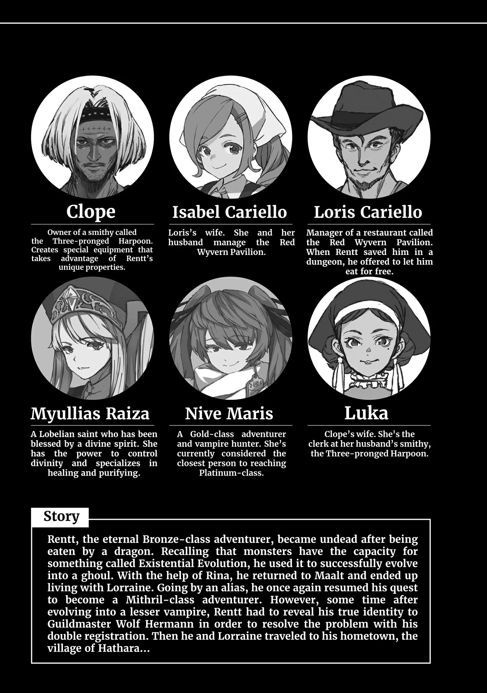
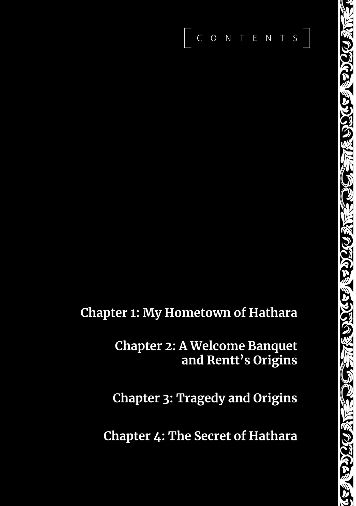
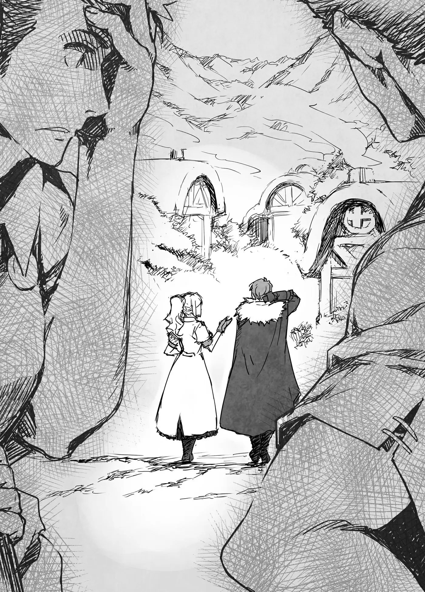

# Chương 134: Tập 6 Chương 1 - Quê Nhà Hathara Của Tôi (1)

Ở giữa hàng rào gỗ sừng sững một cánh cổng thô sơ. Chúng tôi tiến lại gần và bắt gặp hai thanh niên đang đứng canh gác. Cả hai đều nhìn về phía tôi ngay khi vừa thấy chúng tôi.

"Đứng lại. Hai người có việc gì ở Hathara?" một người trong số họ cất tiếng hỏi.

"Tôi về quê thôi. Jal, Dol, hai cậu không nhận ra tôi à?" tôi hỏi rồi mỉm cười. Nhưng nụ cười ấy đã bị che khuất dưới chiếc mặt nạ, nên những gì họ thấy chỉ là đôi mắt híp lại của tôi.

Hai cậu thanh niên, một người gầy gò tên là Jal và một người thấp bé tên là Dol, tò mò nhìn chằm chằm vào tôi. Một lát sau, mắt họ chợt mở to hết cỡ.

"Khoan đã, Rentt?! Cậu đấy à?!" họ cùng thốt lên.

"Ừ, hai cậu không nhận ra thật à?"

"Không, lần trước về trông cậu giống mạo hiểm giả bình thường hơn cơ," Jal nói. "Kiểu như kiếm sĩ hay đại loại thế. Còn cái áo choàng mờ ám với chiếc mặt nạ kia là sao vậy?" Cậu ta vừa hỏi vừa khẽ chau mày.

"Tôi đã trải qua nhiều chuyện lắm. Dù sao thì, cho tôi vào đi," tôi trả lời để lảng tránh câu hỏi. Giải thích ra thì rắc rối vô cùng, vả lại tôi cũng chẳng có ý định kể hết mọi chuyện cho họ nghe.

"Thôi được rồi, chắc thế cũng ổn. Khoan, ai kia?" Dol hỏi khi nhận ra Lorraine.

"Tôi là mạo hiểm giả đi cùng," Lorraine cất lời tuyên bố. "Tên tôi là Lorraine Vivie. Tôi cũng là học giả ở Maalt nữa. Rất vui được gặp hai cậu." Cô bắt tay hai người họ.

Cả hai đều có vẻ bối rối khi bắt tay đáp lại, nhưng chỉ một giây sau họ đã kéo tôi sang một bên rồi thì thào vào tai tôi bằng chất giọng kìm nén gần như hét lên.

"Này! Cô nàng xinh đẹp bốc lửa kia là ai thế?! Đừng bảo với tôi là cậu kết hôn rồi đấy nhé! Cậu lấy vợ rồi à?!" Jal dồn dập hỏi.

Dol nhanh nhảu bồi thêm, "Về đây để báo tin lấy vợ à?! Vì thế nên cậu mới về đúng không?! Chuyện này trọng đại lắm đây. Tụi này phải đi báo cho bác trưởng làng mới được!" Cậu ta vừa nói vừa ù té chạy tót vào trong làng.

"Này, khoan đã! Cậu hiểu lầm tai hại rồi!" tôi hốt hoảng kêu lên, nhưng đã quá muộn. Vốn là người dân vùng núi sâu, cậu ta sở hữu đôi chân dẻo dai và chạy nhanh thoăn thoắt. Chỉ chớp mắt một cái, bóng dáng cậu ta đã mất hút.

"Ai mà ngờ được một trong những kẻ khó gần nhất làng lại dẫn vợ về cơ chứ. Riri với Fahri mà biết chuyện này thì chẳng vui vẻ gì đâu. Nhưng chí ít thì thế này bọn tôi mới có cơ hội với hai cô ấy," Jal lầm bầm.

Riri và Fahri được xem là những cô gái xinh đẹp nhất nhì trong làng. Hai người họ cũng là bạn thuở nhỏ của tôi, nhưng lại kém tôi tầm bảy tuổi, nên tôi chỉ coi họ như những cô em gái nhỏ. Dù ở thành phố thì khác, nhưng theo tiêu chuẩn ở làng quê thì tuổi của họ đã hơi quá lứa lỡ thì đối với phụ nữ chưa chồng. Chuyện đó cũng có phần đáng lo ngại thật. Dẫu vậy, họ sở hữu nhan sắc lộng lẫy đến mức chỉ cần muốn là có thể lấy chồng ngay tắp lự, nên có lẽ tôi chẳng cần phải bận tâm làm gì.

Dù sao đi nữa, tôi cũng chẳng hiểu tại sao Jal lại nhắc tới hai cô bé. "Cậu bảo thế này mới có cơ hội với họ là có ý gì?" tôi hỏi.

"Tôi chịu cậu thật đấy," Jal nói với vẻ bất lực đến cạn lời. "Hai người họ lúc nào chẳng mê mẩn cậu. Chẳng phải họ từng tán tỉnh cậu vài lần rồi sao? Thế mà cậu lại từ chối phắt đi."

"Tôi dám chắc hai đứa chỉ đùa thôi. Hồi đó tụi nó lúc nào chả thế."

"Năm nào vào Ngày Thánh Alto hai cô ấy cũng tặng kẹo mật ong cho cậu còn gì? Rồi họ còn luôn rủ cậu ra bờ hồ vào dịp Lễ Hội Vô Danh nữa," cậu ta vặn lại.

Cả hai sự kiện ấy đều nổi tiếng là dịp dành riêng cho các cặp đôi. Dịp lễ đầu tiên được tổ chức trên khắp thế giới, trong khi dịp lễ sau lại là nét đặc thù chỉ có ở làng chúng tôi. Chúng đã in sâu vào tiềm thức của mọi người đến mức tôi cũng hiểu tường tận về chúng. Vào Ngày Thánh Alto, người ta sẽ tặng kẹo mật ong cho người mình thầm thương trộm nhớ. Đó cũng là một trong những thời điểm hiếm hoi trong năm mà việc một người phụ nữ chủ động tỏ tình với đàn ông được xem là điều hoàn toàn phải lẽ. Còn về Lễ Hội Vô Danh, nó đã được tổ chức ở Hathara lâu đến nỗi ngay cả cái tên ban đầu cũng đã bị lãng quên. Có một câu chuyện truyền thuyết gắn liền với lễ hội, và toàn bộ ngày hội đều xoay quanh câu chuyện đó. Đó là câu chuyện kể về một cặp đôi cùng nhau ra bờ hồ, nơi tình yêu của họ cuối cùng cũng đơm hoa kết trái vẹn tròn.

Quả thực tôi từng nhận được kẹo và được rủ ra bờ hồ vào những ngày lễ đó, nhưng tôi đã rời làng từ trước khi tròn mười lăm tuổi. Hồi ấy, tôi làm sao biết được mình phải đón nhận những lời tiếp cận ấy từ hai cô nhóc mới bảy, tám tuổi thế nào cho phải. Thế nhưng, chuyện đó đâu thể là lý do để coi tôi là kẻ vô tâm thờ ơ trước tình cảm của họ được chứ.

Vào những dịp hiếm hoi trở về làng, tôi đã vô cùng ngỡ ngàng khi thấy họ trổ mã xinh đẹp đến nhường nào. Và họ cũng làm những điều tương tự trong các chuyến về thăm ấy. Bất luận thế nào, tôi đã quen biết họ từ thuở họ còn đỏ hỏn, nên trong mắt tôi, họ vẫn chỉ là những cô em gái bé bỏng đáng yêu. Và nếu họ có ngưỡng mộ, hướng về tôi như một người anh trai lớn thì cũng chẳng có gì là lạ.

"Hai đứa bảo chẳng có ai khác nên mới chọn tôi để chí ít cũng được trải nghiệm không khí ngày lễ," tôi giải thích. Hẳn là vì chuyện đó nên Jal mới hiểu lầm tai hại như vậy. Rõ ràng hồi đó hai đứa còn quá nhỏ. Tôi chẳng hề có thành kiến gì với chuyện chênh lệch tuổi tác trong mối quan hệ giữa những người trưởng thành, nhưng khi đã biết một người từ thuở ẵm ngửa, thật khó để nhìn nhận họ như một đối tượng khác giới. Tôi cứ ngỡ hai đứa cũng nhìn nhận tôi theo cách tương tự.

"Và cậu cứ thế tin sái cổ lời tụi nó luôn à?" Jal nhổ toẹt một tiếng. "Thôi, sao cũng được. Cậu dắt vợ về tận đây rồi thì mọi chuyện coi như ngã ngũ. Giờ thì đám trai làng tha hồ mà theo đuổi Riri với Fahri."

Hóa ra đó là ý của cậu ta khi bảo có cơ hội. Ừ thì, dù hai cô bé có nói đùa hay không, tôi cũng chẳng hề có tình cảm lãng mạn lứa đôi với họ. Dù tôi cũng chẳng hề kết hôn với Lorraine, nhưng xem chừng có giải thích thì Jal hay Dol cũng chẳng thèm lọt tai. Xét đến chuyện của Riri và Fahri, có lẽ đây lại là một sự hiểu lầm tiện lợi, nên tôi cũng chẳng buồn cất công đính chính làm gì.

"Hai người đang thì thầm to nhỏ chuyện gì thế? Có gì thú vị không?" Lorraine cất tiếng hỏi.

Cô bất thình lình xuất hiện từ phía sau khiến Jal giật thót mình. Tuy nhiên, tôi đã nhận ra sự hiện diện của cô ngay từ khoảnh khắc cô bước tới gần. Sẽ là chuyện khác nếu cô dùng ma pháp che giấu tung tích, nhưng ngoài trường hợp đó ra thì tôi có thể dễ dàng phát hiện ra cô mà chẳng gặp chút khó khăn nào. Còn với Jal thì không được như vậy.

"Cũng chẳng có gì đâu ạ," cậu ta đáp. "Dù sao thì, cũng chẳng có lý do gì phải đứng tán gẫu ngoài này mãi. Hay là chúng ta vào trong làng đi? Có vài người muốn chào hỏi cậu đấy."

"Ồ, phải rồi," Lorraine đáp lời. "Cậu tên là Jal đúng không nhỉ?"

"Vâng, có chuyện gì thế ạ?"

"Tôi biết Rentt được phép vào rồi, nhưng tôi thì sao?" cô hỏi. Đáng lẽ chuyện đó chẳng có vấn đề gì chừng nào cô còn đi cùng tôi, nhưng việc gặng hỏi cho chắc chắn vốn là thói quen thường thấy của cô.

"Vâng, không vấn đề gì đâu. Cô là... à thì, cô biết đấy, của Rentt mà."

"Tôi cũng không chắc là mình hiểu ý cậu đâu, nhưng nghe cậu bảo ổn là tốt rồi. Đi thôi, Rentt," Lorraine nói rồi rảo bước lên phía trước.

"Được rồi Jal, bọn tôi đi đây. Hẹn gặp lại cậu sau nhé," tôi nói với cậu ta rồi vẫy tay bước theo Lorraine. Chúng tôi cùng nhau tiến vào trong làng.

"Vừa mới về mà đã bị vợ dắt mũi rồi cơ đấy? Gái thành phố ghê gớm thật," tôi nghe thấy tiếng Jal thì thào từ sau lưng. Có lẽ là do tôi tưởng tượng ra thôi.

Hathara hiếm khi đón khách phương xa, nên tôi chẳng rõ dân làng sẽ phản ứng ra sao trước sự xuất hiện của Lorraine, nhưng những người chúng tôi bắt gặp dọc đường đều tỏ ra khá niềm nở. Hầu như ai nấy đều có phản ứng tương tự như Jal và Dol. Họ cứ liên tục gặng hỏi liệu Lorraine có phải là vợ tôi không, nhưng chí ít thì họ hỏi han với thái độ hết sức dễ chịu. Không như Jal và Dol, những người dân khác ý nhị hơn một chút và chịu lắng nghe khi tôi phân bua rằng cô không phải. Ai nấy đều nở nụ cười tươi roi rói một cách lạ lùng, nhưng tôi muốn tin rằng nụ cười ấy chẳng mang ẩn ý gì đặc biệt.

"Ngôi làng này làm ra sản vật gì vậy? Toàn bộ dân làng đều là nông dân với thợ săn cả à?" Lorraine vừa quan sát xung quanh vừa hỏi.

"Ừ, phần lớn là thế," tôi trả lời. "Nhưng họ không chỉ trồng mỗi lúa mì và rau củ đâu. Ở đây còn có một vườn thảo dược nữa, nên có lẽ đó là điểm tương đối độc đáo."

"Vườn thảo dược á? Họ đem bán thảo dược cho thị trấn lớn hơn hay cho thương nhân nào đó à?"

"Tôi nhớ là từng kể với cô về bà lão thầy thuốc ở làng này rồi thì phải. Bà ấy dùng thảo dược để bào chế thuốc, rồi bán lại cho các thương nhân lữ hành. Nghe đâu thuốc có hiệu nghiệm rất cao và bán được giá đắt đỏ lắm. Nhờ vậy mà cuộc sống ở ngôi làng hẻo lánh giữa chốn đồng không mông quạnh này cũng không đến nỗi nào. Thỉnh thoảng họ cũng săn bắt ma vật nữa, nên họ còn bán cả Ma Tinh."

"Tôi vẫn luôn thắc mắc tại sao ngay từ đầu anh đã quen thuộc với công việc mạo hiểm giả đến thế. Nghe qua thì hóa ra anh đã làm những việc chẳng khác nào mạo hiểm giả ngay tại ngôi làng này rồi."

"À thì, đại khái là vậy đấy. Hồi đó tôi phụ giúp việc xẻ thịt ma vật rất nhiều, rồi tự nhiên nắm được cách di chuyển trong rừng sâu. Ồ kìa, kia là nhà của trưởng làng đấy."

Tôi phóng tầm mắt về phía trước và nhìn thấy một ngôi nhà có kích thước bề thế hơn hẳn những căn nhà xung quanh. Chúng tôi rảo bước tiến về phía đó. Khi ghé thăm những ngôi làng kiểu này, theo lệ thường người ta phải tới chào hỏi trưởng làng trước tiên.

Đó không phải là lý do duy nhất khiến tôi tới đó, nhưng lại là một cái cớ hoàn hảo.

◆◇◆◇◆

Tôi gõ cửa, và cánh cửa từ từ hé mở. Một người phụ nữ trung niên ngó đầu ra từ phía bên kia. Đã lâu lắm rồi tôi mới lại nhìn thấy gương mặt bà; bà đã già đi trông thấy, nhưng vóc dáng vẫn thanh mảnh và dung mạo vẫn đượm vẻ đẹp năm nào. Vừa nhìn thấy tôi, mắt bà chợt mở to. Vài giọt nước mắt khẽ lăn dài trên má.

"Rentt, mừng con đã trở về. Mẹ đã lo cho con biết bao nhiêu. Khi Hội báo tin con mất tích, mẹ cứ ngỡ con sẽ chẳng bao giờ quay về nữa. Tạ ơn trời đất là mẹ đã lầm," bà nghẹn ngào thốt lên.

Hội Mạo Hiểm Giả vốn chẳng tử tế đến mức cất công báo tin về tận quê nhà khi một mạo hiểm giả mất tích, nhưng hẳn là Hội Trưởng Wolf đã đích thân thu xếp chuyện này. Giờ ông ấy đã biết tôi còn sống, nhưng chắc hẳn vẫn chưa kịp liên lạc báo tin về đây. Dẫu có những phương thức liên lạc bằng sinh vật bay lượn, người ta cũng chẳng đời nào dùng chúng cho một ngôi làng hẻo lánh nơi vùng sâu vùng xa thế này. Xe ngựa là lựa chọn duy nhất. Có khi cỗ xe đưa chúng tôi đến đây cũng đang chở theo một lá thư như vậy. Song tôi chẳng rõ việc báo tin tôi còn sống xét theo đúng nghĩa liệu có hoàn toàn chuẩn xác hay không, và có lẽ bản thân Wolf cũng chưa chắc chắn, nên ai mà biết được ông ấy đã nghĩ đến chuyện gửi thư hay chưa.

"Chuyện cũng phức tạp lắm ạ, nhưng như mẹ thấy đấy, con vẫn hoàn toàn khỏe mạnh. Mà mẹ này, cha đâu rồi ạ?"

"À, ông ấy ở trong nhà. Mau vào đi con, với lại... ôi? Ai đây con?"

"Dạ đây là Lorraine, bạn con ở Maalt. Cô ấy là học giả ạ," tôi đáp.

Trông Lorraine như thể có cả đống điều muốn nói về cách giới thiệu ấy, nhưng cô quyết định kìm lại là tốt nhất. "Cháu là Lorraine Vivie. Cháu là học giả như Rentt đã nói, đồng thời cũng là mạo hiểm giả, và cháu cũng có nghiên cứu đôi chút về thuật giả kim nữa. Rất hân hạnh được gặp bác. Dạ thưa, bác là...?"

"Học giả sao? Thú vị thật đấy. Bác xin lỗi vì đã không tự giới thiệu sớm hơn. Bác là Gilda Faina, vợ của trưởng làng Ingo Faina. Bác cũng rất vui được gặp cháu."

"Faina ư?" Lorraine kinh ngạc lặp lại. "Đừng nói với cháu bác là..."

"Ừ, mẹ tôi đấy. Trưởng làng là cha tôi. Còn bà lão thầy thuốc mà tôi từng kể là em gái của bà nội tôi, nếu tôi nhớ không nhầm."

◆◇◆◇◆

"Ta không ngờ con lại dẫn một cô gái về làng đấy. Không phải ta phàn nàn gì đâu. Thực lòng thì, ta mừng khi thấy chuyện này lắm," Ingo cất tiếng.

Ông đang ngồi bên bàn nước, nên tất cả chúng tôi cũng quyết định ngồi xuống theo. Sau khi màn chào hỏi giới thiệu hoàn tất, chúng tôi bắt đầu trò chuyện. Cuộc trò chuyện chủ yếu diễn ra theo một chiều, khi tôi và Lorraine kể cho hai người nghe về những chuyện tôi đã trải qua ở Maalt. Đổi lại, Ingo và Gilda cũng chia sẻ đôi chút về tình hình sự vụ trong làng.

Một trong những chủ đề được bàn tới là chuyện dân làng lần lượt dựng vợ gả chồng. Họ bảo rằng hầu hết những đứa trẻ mà ngày trước tôi từng chăm sóc nay đều đã có đôi có lứa. Không ít người trong số đó thậm chí đã có con bồng con bế. Hơn một năm trước khi tôi về thăm, dường như quả thực đã có rất nhiều người quấn quýt, thân thiết với nhau. Hẳn đó chính là mùa yêu đương đơm hoa.

Giờ ngẫm lại mới thấy, có khá nhiều người trạc tuổi tôi đã kết hôn khoảng hai ba năm sau khi tôi rời làng. Thỉnh thoảng tôi lại bắt gặp con cái của họ chạy nhảy tung tăng khắp nơi hệt như tôi thuở trước. Điều đó khiến tôi cảm thấy dường như mình đã chọn một lối rẽ khác thường trong cuộc đời. Quả thực tôi có cảm thấy đôi chút chạnh lòng cô đơn, nhưng trên hết thảy, tôi thấy mừng vì ngôi làng vẫn luôn phát triển yên bình.

Vào khoảng thời điểm chúng tôi bắt đầu bàn luận về chuyện cưới xin, ánh mắt Ingo và Gilda nhìn Lorraine đã có chút đổi khác.

"Phải đấy, ngày trước dù ai có rủ đi chơi con cũng chỉ cắm đầu vào luyện tập. Mẹ cứ sợ con sẽ chẳng bao giờ chịu lấy vợ cơ. Ít nhất thì mẹ cũng thấy mừng khi con tìm được một cô gái xinh xắn nhường này ở ngoài làng," Gilda nói.

Tôi vốn chẳng phải kẻ tinh tế, nhạy bén gì cho cam, nhưng ngay cả tôi cũng nhìn ra mẹ đang bóng gió điều gì. Mẹ đinh ninh Lorraine là vợ tôi. Thế nhưng phụ nữ ở ngôi làng này đều là những bậc thầy trò chuyện và thừa biết cách nói vòng vo quanh chủ đề chính. Mẹ chỉ muốn tôi xác nhận hay phủ nhận chuyện đó mà không cần phải gặng hỏi thẳng thừng. Xét theo một góc độ nào đó thì có lẽ mẹ đang ý tứ giữ kẽ, song cảm giác lại chẳng khác nào bắt tôi phải đi trên thảm đinh.

Trái ngược với tôi, Lorraine chẳng hề tỏ ra bối rối chút nào. Trái lại, cô vẫn giữ vẻ điềm tĩnh và thản nhiên lạ thường. "Ở Maalt anh Rentt quen biết khá nhiều phụ nữ đấy ạ," cô cất lời. "Nào là Rina, Sheila, cháu, Lillian, Alize... cháu còn có thể kể thêm nữa cơ..."

Cách cô liệt kê vanh vách từng người nghe thật đầy ác ý. Chỉ cần xướng tên họ ra như thế thôi cũng đủ khiến người ta dễ dàng mường tượng rằng tất cả đều là những mỹ nhân đang ở độ tuổi cập kê, nhưng với tôi thì Rina thậm chí còn giống một cô em gái hơn cả Riri hay Fahri, còn Lillian thì lớn tuổi hơn tôi rất nhiều. Rồi còn Alize nữa, con bé rõ ràng chỉ là một đứa trẻ xét theo bất kỳ tiêu chuẩn nào. Sheila thì đúng là một phụ nữ trạc tuổi tôi thật, nhưng tôi chỉ quen biết cô ấy qua công việc. Chúng tôi gắn bó vì hoàn cảnh đưa đẩy, nhưng chỉ dừng lại ở đó mà thôi. Chí ít thì dưới góc nhìn của tôi là như vậy.

Tuy nhiên, về phần Lorraine, việc tôi sống chung dưới một mái nhà với cô khiến tôi khó lòng biện bạch trước cách nhìn nhận của dân làng về mối quan hệ giữa hai chúng tôi. Nhưng ở Maalt, đầy rẫy mạo hiểm giả khác giới sống chung trong một ngôi nhà đấy thôi. Chuyện đó đâu có gì to tát lắm. Chắc vậy. Có lẽ chỉ mỗi mình tôi nghĩ thế. Dù thế nào đi nữa, Lorraine, Ingo và Gilda cũng chẳng cho tôi lấy một cơ hội để giãi bày những điều này.

"Ôi dào, nó quen biết ngần ấy phụ nữ cơ à? Thế thì xem ra bác đã lo bò trắng răng rồi. Bác nói thật đấy chứ chẳng đùa đâu, bác từng nghĩ thằng bé sẽ chẳng bao giờ chịu lấy vợ cơ."

"Thật vậy sao ạ? Cháu biết anh ấy giao tiếp xã hội hơi vụng về, nhưng chắc chắn là có không ít phụ nữ chủ động tiếp cận anh ấy. Cháu cũng không thấy anh ấy thuộc tuýp người cố chấp từ chối tất cả đâu."

"Nghe như thể cháu hiểu Rentt rõ lắm vậy. Đúng là thế thật, nhưng trước giờ chẳng có ai trong làng này tiến xa được đến bước này với nó cả."

"Dạ sao cơ ạ?" Lorraine hỏi rồi nghiêng đầu thắc mắc, nhưng câu hỏi của cô đã bị gạt phắt sang một bên.

"À phải rồi, giờ Rentt đã về, ta nghĩ làng mình nên tổ chức một bữa tiệc chào mừng. Bà chuẩn bị giúp ta được không, Gilda?"

"Vâng, tất nhiên rồi ông nó. Hai đứa cứ tự nhiên nhé. Tôi đi báo cho dân làng đây," Gilda nói rồi đứng dậy bước ra khỏi nhà.

"Ta cũng đi đây," Ingo cất lời thông báo với chúng tôi ngay khi bà vừa rời đi. "Làng mình tuy nhỏ nhưng dân cư cũng khá đông đấy. Một mình Gilda đi báo tin cho mọi người thì vất vả lắm." Ông cất bước theo Gilda ra ngoài cửa.

Lorraine dõi mắt nhìn theo hai người họ. "Này, Rentt," cô thì thào.

"Gì thế?"

"Tôi có lỡ lời nói điều gì không nên nói không?"

"Không, hoàn toàn không phải đâu. Tôi mới là vấn đề ở đây. Hai người họ lo lắng cho tôi nhiều đến mức khiến tôi thấy hơi khó lòng chịu nổi."

"Sao anh lại cảm thấy như thế?"

"À thì, hai người họ không phải cha mẹ ruột của tôi, mà là nhận nuôi tôi."

"Anh là con nuôi ư? Thế cha mẹ ruột của anh đã xảy ra chuyện gì?" Lorraine hỏi.

Lorraine chẳng bao giờ vòng vo tam quốc, ngay cả với một câu hỏi hóc búa, tế nhị. Tôi biết cô không cố ý tỏ ra vô tâm; Lorraine chỉ đơn thuần có thói quen đi thẳng vào vấn đề. Nếu tôi bảo rằng mình không muốn nói về chuyện đó, nhiều khả năng cô sẽ gác chủ đề ấy lại và chuyển sang chuyện khác. Nói cách khác, tuy cô gặng hỏi, nhưng đó chỉ là để cho tôi quyền lựa chọn có muốn giãi bày hay không mà thôi.

Đó cũng chẳng phải điều gì mà tôi khăng khăng muốn né tránh, nên tôi cứ thế giãi bày với cô. "Họ mất lâu lắm rồi. Chuyện xảy ra hồi tôi mới lên năm," tôi giải thích.

Đó là sự thật hiển nhiên, và việc nhắc lại chuyện ấy giờ đây cũng chẳng còn khiến tôi quá đỗi đau lòng. Dẫu vậy, đó sẽ mãi là một nỗi buồn khôn nguôi. Tôi chưa từng quên gương mặt của họ, và tôi sẽ luôn khắc ghi những tháng ngày chúng tôi sống bên nhau. Họ là những người tốt. Tôi ước gì họ vẫn còn sống trên đời, nhưng số phận lại chẳng chiều lòng người.

"Tôi hiểu rồi. Họ bị bệnh sao?"

"Bị ma vật tấn công. Chuyện ấy xảy ra như cơm bữa ấy mà," tôi nói, cố tỏ ra không quá nghiêm trọng, nhưng tôi nhận thấy giọng mình đã run run.

Kể từ ngày biến thành Undead, tôi đã đinh ninh cơ thể mình chẳng thể rơi lệ được nữa. Hóa ra sự thực lại không phải như vậy. Khi soi mắt mình trong gương, chúng cũng ẩm ướt hệt như đôi mắt của con người. Tôi đồ rằng chẳng có lý do gì khiến tôi không thể khóc được. Giờ đây, tôi cảm thấy nước mắt mình có thể chực trào ra bất cứ lúc nào.

"Đó là lý do anh muốn trở thành mạo hiểm giả sao?"

"Ừ, phần lớn là vì thế. Nhưng đó cũng không phải lý do duy nhất. Dù sao thì, khi tôi thổ lộ với cha mẹ nuôi về ước muốn của mình, hai người họ đã hết lòng ủng hộ. Thực ra thì, xin lỗi cô nhé Lorraine, nhưng tôi cũng phải ra ngoài một lát. Cô có phiền ngồi đợi ở nhà này một lúc được không? Tôi biết ngồi lại trong nhà người khác thế này chắc chẳng thoải mái gì cho cam."

"Hử? Ồ, anh không thấy phiền thì tôi cũng chẳng bận tâm đâu. Anh muốn tôi trông coi nhà của gia đình anh à?"

"So với bất kỳ ai khác, tôi tin tưởng giao cho cô nhất đấy. Hẹn gặp lại cô lát nữa nhé," tôi nói rồi bước ra khỏi nhà.

Tôi biết làm vậy chẳng phải là cách hay nhất, nhưng nếu cứ ở lại lâu hơn, có lẽ tôi đã bật khóc nức nở mất rồi. Chuyện đó sẽ chỉ khiến Lorraine khó xử mà thôi. Suốt một thập kỷ quen biết cô, tôi chưa từng một lần rơi lệ trước mặt cô. Thực ra, giờ ngẫm lại thì có khi tôi từng khóc rồi cũng nên, nhưng chuyện đó không việc gì phải tái diễn lần nữa. Đó là vấn đề lòng tự tôn đàn ông ít ỏi của tôi. Tôi sẽ đi dạo quanh làng một chút cho ráo khóe mắt, rồi sau đó tôi sẽ quay về. Tôi không muốn để cô phải đợi quá lâu.
