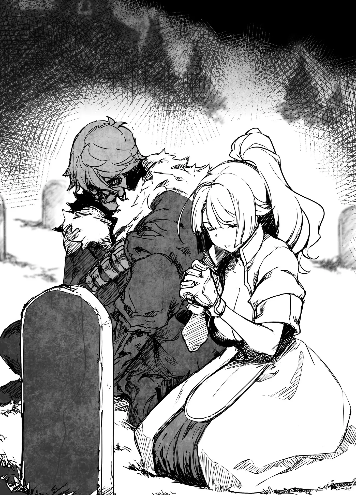

# Chương 139: Tập 6 Chương 2 - Tiệc Chào Mừng Và Nguồn Gốc Của Rentt (2)

"Xin lỗi vì tôi xen ngang nhé," Lorraine lập tức đáp. Khi đang tưởng nhớ người đã khuất, có thêm người khác ở bên dễ gây phiền. Rentt đang trò chuyện với người đã khuất, và Lorraine không hề muốn làm phiền anh. Chẳng ai nên quấy rầy giây phút ấy cả.

"Không sao đâu," Rentt nói rồi giữ tay cô lại khi cô toan quay bước. "Chắc là ba bảo cô tôi ở đây đúng không."

Chắc hẳn anh đang nói tới Ingo, nhưng lúc trước Rentt vẫn gọi ông là "cha". Lorraine tự hỏi liệu có phải vì đang đứng trước mộ cha mẹ ruột nên anh mới chủ ý đổi cách gọi thành "ba" hay không. Còn nếu chỉ là buột miệng vô thức, cô nghĩ tốt nhất không nên đào sâu làm gì.

"Sao anh biết hay thế? Bộ không nghĩ là tự tôi tìm được tới đây à?"

"Chỗ này nằm cách khá xa làng, với lại cô biết đấy, từ khi thành Undead thì người ta rất khó cảm nhận được dấu vết của tôi. Đến cả cô cũng đâu dễ gì tự lần ra tôi nhanh thế. Vả lại ba biết thừa mỗi lần về thăm nhà tôi đều ra đây. Ở đây làm tôi hay quên cả thời gian, lúc nào cũng ngồi lâu đến mức thế nào cũng phải có người ra gọi về."

Có lẽ đó là lý do Ingo không hề đả động gì tới chuyện đây là nghĩa trang. Nếu ông nói trước, hẳn Lorraine đã ngại không tới. Nhưng nếu đúng như lời Rentt nói thì việc phải ra đây tìm anh là chuyện cơm bữa, cô cũng chẳng có lý do gì để thấy áy náy. Nghĩ vậy, Lorraine quyết định nán lại và ngồi xuống bên cạnh.

"Với lại, đã cất công về đây rồi thì cô cũng nên cùng tôi viếng cha mẹ một chuyến chứ," Rentt nói tiếp. "Cô là người bạn thân nhất của tôi ở ngoài làng mà. Chắc chắn cha mẹ tôi sẽ mừng lắm khi được gặp cô."

"Thế à. Vậy thì tôi xin phép nhé," Lorraine nói rồi quỳ trước những tấm bia đá, chắp hai tay cầu nguyện. "Cháu chào hai bác, cha mẹ của Rentt. Cháu tên là Lorraine Vivie, làm bạn với con trai hai bác suốt mười năm qua rồi." Cô giới thiệu bản thân rồi kể về những kỷ niệm hai người từng trải qua ở Maalt. "Sau này Rentt và cháu vẫn sẽ còn gặp nhau nhiều lắm. Cháu cầu mong hai bác trên trời dõi theo phù hộ cho chúng cháu," cô khép lại lời nguyện cầu.

"Giờ nghe lại tôi mới thật sự thấy hai đứa mình cùng trải qua biết bao nhiêu chuyện," Rentt lẩm bẩm. Tự anh đã trải qua tất cả những chuyện đó và cũng nhớ như in từng ký ức, nhưng nghe người khác kể lại dưới góc nhìn của họ thì cảm giác lại thật lạ lùng.

"Tại cái tính anh hay tự rước rắc rối vào người đấy thôi. Cơ mà so với hàng đống rắc rối dạo gần đây, thì mấy chuyện ngày xưa cũng chỉ là thứ mạo hiểm giả nào cũng gặp."

"Cũng đúng. Tôi chưa từng nghĩ có ngày bản thân đã là người chết mà lại đi viếng mộ người chết. Thật tình là tôi cũng có đôi chút mong đợi đấy chứ."

"Sao cơ? Bộ lần này thì khác gì so với trước kia à?"

"Tôi cứ ngỡ biết đâu giờ mình lại nhìn thấy được linh hồn để gặp lại cha mẹ. Tiếc là vỡ mộng rồi."

"Linh hồn á? Thế thì khó đấy. Nghe đâu phần lớn các linh hồn đều đi qua Cổng Cõi Chết chứ không vương vấn lại trần thế. Trừ khi là pháp sư Tử Linh, bằng không chẳng có cách nào gọi họ về được đâu. Mà ngay cả trường hợp đó thì người ta cũng không dám chắc thứ được gọi lên có đúng là linh hồn thật hay không."

"Ừ thì tôi biết chứ, cũng đâu có nghiêm túc đến thế. Không sao đâu mà," Rentt thanh minh, nhưng trông anh có vẻ hơi hụt hẫng. Hẳn là anh đã nuôi nhiều hy vọng hơn những gì ngoài miệng chịu thừa nhận.

"Xin lỗi vì khơi lại chuyện này, nhưng chẳng phải cha mẹ anh mất vì quái vật sao?" Lorraine hỏi, cảm thấy ngồi bên mộ hai người mà lờ tịt chuyện đó đi thì cũng kỳ. Nếu không muốn kể thì anh chẳng việc gì phải nói ra. Còn nếu Rentt không muốn, cô tin chắc anh sẽ tự biết cách lái sang chuyện khác.

"Ừ, đúng thế thật," Rentt đáp, giọng thản nhiên hơn nhiều so với dự đoán của Lorraine.

"Hồi đó cha mẹ tôi sang làng bên để bán đặc sản của làng. Thật lòng mà nói thì đen đủi thôi. Bình thường mọi người sẽ bán cho một thương nhân lữ hành để ông ấy tự chở sang bên đó, ngặt nỗi đợt ấy ông ta lại tới muộn. Mùa đông sắp đến, cả làng đang rất cần tiền sắm nhu yếu phẩm. Thế là cha mẹ tôi, tôi, cùng mẹ và con gái trưởng làng mới cùng nhau sang ngôi làng bên cạnh."

◆◇◆◇◆

"Tên cha mẹ tôi khắc ngay trên bia mộ này đây. Cha tôi là Locusta, còn mẹ là Melissa. Ông Locusta có gương mặt phong trần và vóc người vạm vỡ. Bản thân tôi chưa từng thấy mình giống ông, nhưng cha mẹ nuôi vẫn bảo tôi có đôi mắt của ông ấy. Còn về vóc dáng thì tôi giống mẹ nhiều hơn, chỉ khác là mẹ tôi vừa đẹp lại vừa được nhiều người mến mộ. Dù cha mẹ tôi đã cưới nhau một thời gian, khối người đàn ông vẫn nửa đùa nửa thật ngỏ lời hỏi cưới bà. Dĩ nhiên là mẹ tôi từ chối hết.

"À phải rồi, còn có mẹ của trưởng làng, tức là bà nội nuôi của tôi nữa. Bà tên là Pravda, trông khá giống bà lão làm thuốc mà tôi từng kể. Hai người là chị em ruột nên cũng dễ hiểu thôi. Bà lão làm thuốc mà mặt thon hơn một chút với bớt vẻ độc địa đi nhiều thì trông y hệt bà Pravda luôn. Cơ mà tả thế chắc cô cũng chẳng hình dung được gì. Tối nay ở bữa tiệc không thấy bà ấy đâu, nhưng mai chúng ta qua gặp bà là cô sẽ hiểu ý tôi ngay. Ai mới gặp bà Gharb cũng nghĩ bà là một bà lão cay nghiệt, mà tiếp xúc với bà một dạo thì thấy đúng là chẳng sai chút nào. Hầu hết lũ trẻ trong làng đều sợ bà ấy. Thỉnh thoảng bà cũng tốt bụng đến bất ngờ đấy, thôi nhưng tạm gác chuyện bà ấy lại đã.

"Chúng tôi đưa một bà cụ lớn tuổi như vậy đi cùng chỉ vì bà Pravda giữ vai trò đại diện cho gia đình trưởng làng. Con gái trưởng làng đi theo để xem bà nội mình làm việc, với lại cô bé đi cũng vì có tôi đi cùng. Hai đứa chúng tôi vốn là bạn thân từ nhỏ. Mà có thể nói là hai đứa coi như đã có hôn ước từ bé cũng được. Cha mẹ tôi lớn lên cùng cha mẹ cô bé, thân nhau cả đời, ai cũng muốn hai đứa lớn lên cưới nhau. Tôi hoàn toàn có thể từ chối, nhưng hồi ấy mới năm tuổi nên tôi chẳng nghĩ ngợi gì nhiều. Cơ mà tôi cũng quý cô bé thật. Có lẽ lớn lên tôi cũng sẽ cân nhắc chuyện đó, chỉ tiếc là giờ đây, tôi chỉ biết tự hỏi mọi chuyện sẽ ra sao nếu không có biến cố ấy.

"Dù sao thì đoàn chúng tôi gồm những người như thế đấy. Lúc ấy tôi cứ chắc mẩm đây sẽ là một chuyến đi thú vị. Điểm đến là ngôi làng gần làng tôi nhất, nên xét về khoảng cách thì chẳng biết gọi là 'chuyến đi' có đúng không nữa. Dù vậy, ngựa ở Hathara chẳng con nào đủ dai sức để kéo xe đường dài, nên đi cũng mất hai ba ngày. Còn về kết cục sau cùng của chuyến đi đó, tôi nghĩ cô cũng đoán ra rồi."

◆◇◆◇◆

"Rentt, Jinlin, hai đứa xếp đồ xong chưa nào?" mẹ hỏi tôi và con gái trưởng làng. Khuân vác đồ đạc lên xe đã có cha tôi cùng cánh trai làng lo, nên Jinlin với tôi chẳng có việc gì mấy để làm.

"Vâng, chúng con xong rồi ạ," tôi đáp.

"Xong xuôi hết rồi ạ! Lúc nào đi cũng được hết!" Jinlin nhanh nhảu đáp theo.

"Được rồi, thế thì hai đứa lên xe đi nào. Đồ đạc chắc cũng chất xong gần hết rồi đấy," mẹ tôi mỉm cười bảo.

Tôi cùng Jinlin lon ton bước lại cỗ xe. Cô bé vừa đi vừa liến thoắng. "Này Rentt, cậu nghĩ làng bên kia trông thế nào nhỉ? Tớ chưa sang làng khác bao giờ cả. Háo hức quá đi mất!"

Tôi cũng chưa từng bước chân ra khỏi làng, mà hầu hết lũ trẻ dưới mười tuổi ở đây cũng thế. Ngoài kia có thể có quái vật hoặc kẻ cướp. Chẳng mấy tên cướp thèm bén mảng tới một ngôi làng hẻo lánh như Hathara, nhưng quanh vùng này vẫn có vài kẻ lưu vong vất vưởng kiếm sống. Còn quái vật thì khác, chúng thấy ai là tấn công người nấy, chẳng cần biết có kiếm chác được gì hay không. Người lớn gặp quái vật tầm thường thì còn chạy thoát được, chứ trẻ con thì tốt nhất cứ ở nhà.

Nhưng vẫn có ngoại lệ. Những đứa trẻ được kỳ vọng sau này gánh vác việc làng thì từ bé đã được cha mẹ hay họ hàng dẫn ra ngoài làng. Jinlin chính là một trường hợp như thế.

Cha mẹ tôi chẳng phải người đứng đầu gì cả, vả lại cha tôi cũng không phải người gốc làng này. Ông từng phiêu bạt suốt một thời gian dài trước khi định cư ở Hathara, nên dân làng rất coi trọng vốn kinh nghiệm của ông. Mỗi khi làng có việc cần đi ra ngoài, ông thường được chọn làm đại diện. Mẹ tôi thì muốn đi cùng cha, nên hai người chẳng nỡ bỏ tôi lại một mình (trừ khi gửi ai đó trông giúp như trước đây). Nhưng lúc đó tôi đã năm tuổi rồi, cha mẹ nghĩ cũng đến lúc cho tôi tập làm quen với những chuyến đi xa. Họ hy vọng một ngày nào đó tôi sẽ thay cha đảm nhận những chuyến đi như thế này.

Có điều hồi ấy tôi chỉ là một đứa trẻ nhỏ, chẳng biết gì để nói cho Jinlin nghe. "Tớ cũng không biết nữa," tôi bảo. "Nhưng ngoài đó chắc đáng sợ lắm. Mong là tụi mình không gặp con quái vật nào."

"Cậu đúng là đồ nhát cáy, Rentt! Cứ nói là cậu sẽ đập cho lũ quái vật một trận tơi bời đi chứ!" Jinlin hét lên. Cô bé thuộc kiểu trẻ con nghịch ngợm và hiếu động, thích trèo cây và chơi trò đánh kiếm gỗ. Trái lại, tôi hồi ấy lại hướng nội, chỉ thích ngồi ngoan ngoãn chơi trò xếp gỗ ở nhà.

◆◇◆◇◆

"Bất ngờ thật đấy," Lorraine nói. "Biết tính anh, tôi cứ tưởng ngay từ hồi đó anh đã cầm kiếm gỗ vung vẩy khắp nơi rồi cơ."

"Không hề đâu," tôi cười cay đắng đáp. "Cơ mà cô đoán cũng chẳng lệch là bao. Ngay sau chuyện này tôi đã bắt đầu tập luyện rồi. Dù sao thì hồi đó tôi đúng là đứa trẻ như thế đấy."

"Một đứa trẻ ngoan hiền, rụt rè ấy à?"

"Vẻ ngoài của tôi hồi đó trông cũng giống con gái lắm, mà không phải tôi cố tình thế đâu. Tới giờ phần nào trông tôi vẫn vậy, nhưng hồi bé cứ để tóc dài là ai cũng bảo tôi trông như con gái. Tôi cũng nhút nhát nữa, chẳng bao giờ tự mình đi trèo cây cả."

Theo trí nhớ của tôi thì tính cách tôi hồi đó cũng mềm yếu như con gái. Chẳng biết từ đó đến giờ điều ấy có thay đổi nhiều hay không, nhưng tôi không thể tưởng tượng nổi có ai nhìn vào tôi lúc đó mà đoán được sau này tôi sẽ trở thành một mạo hiểm giả.

"Bất ngờ thật đấy. Chà, gương mặt anh có thể từng mang nét con gái, nhưng bao năm làm mạo hiểm giả sẽ rèn cho người đàn ông trở nên rắn rỏi, nên chắc chuyện đó cũng đã thay đổi rồi," Lorraine nói.

"Thế tức là mặt tôi giờ cũng toát lên cái chất của mạo hiểm giả rồi chứ gì?" tôi nửa đùa nửa thật hỏi.

"Đang đeo cái mặt nạ thế kia thì ai mà biết được," cô đáp.

"Tiếc ghê. Thôi được rồi, để tôi kể tiếp."

◆◇◆◇◆

"Ồ, cháu định đánh bại quái vật giúp mọi người đấy à, Jinlin?" bà Pravda hỏi giữa lúc hai đứa tôi đang trò chuyện.

"Vâng ạ!" Jinlin reo lên. "Hôm nọ cháu chơi trò mạo hiểm giả với Jal và Dol. Hai cậu ấy đóng vai Goblin, còn cháu làm mạo hiểm giả. Cháu đánh gục sạch bách hai cậu ấy luôn đấy ạ!"

"Có thật thế không, Rentt?" bà Pravda quay sang hỏi tôi.

"Dạ vâng. Cháu đóng vai tiếp tân ở Hội ạ," tôi đáp.

Bà Pravda nghiêng đầu. "Bà thấy hai đứa đổi vai cho nhau mới đúng chứ," bà lẩm bẩm.

Nghĩ lại thì bà nói đúng thật. Có điều hai đứa đều được nhận vai mình thích, nên chẳng ai phàn nàn gì—ngoại trừ Jal với Dol, hai đứa suốt ngày chỉ biết kêu ca. Hai cậu ấy toàn thua oẳn tù tì nên làm gì có quyền chọn. Nước ra của hai cậu ấy dễ đoán vô cùng, thế nên Jinlin lúc nào cũng thắng. Cô bé thông minh một cách kỳ lạ. Còn tôi thì cứ làm theo lời Jinlin dặn, thành ra cũng toàn thắng theo. Tính ra hai đứa tôi hơi thông đồng bắt chẹt hai cậu ấy một chút, nhưng mà vui lắm.

"Jinlin à, quái vật trong trò đóng giả thì dễ đánh đấy, chứ quái vật thật sự đáng sợ lắm cháu ạ," bà Pravda nghiêm giọng dặn. "Trong chuyến đi này mà lỡ bị tấn công, cháu phải hứa với bà là bỏ chạy ngay đấy nhé."

Bình thường bà Pravda lúc nào cũng hiền hòa, điềm đạm, nhưng riêng lần này giọng bà lại nghiêm khắc khác hẳn. Nghĩ đến chuyện đang bàn thì bà nghiêm như vậy cũng phải thôi.

Jinlin vốn chẳng mấy khi chịu ngoan ngoãn nghe lời, nhưng lần này có vẻ cô bé cũng chịu lắng nghe. "Cháu biết rồi mà, hôm qua cháu cũng nghe dặn y hệt thế này rồi. Cháu sẽ không sao đâu ạ!" cô bé quả quyết.

"Rentt, bà cũng định dặn cháu câu đó, nhưng bà tin chắc cháu sẽ tự biết đường mà chạy thôi."

"Dạ vâng, dĩ nhiên rồi ạ. Chẳng có gì quý hơn mạng sống cả."

"Tốt lắm. Nhưng là con trai mà cháu chẳng có chút chí tiến thủ nào cả. Jinlin, cháu thích thằng bé ở điểm gì thế?"

"Cháu thích vì cậu ấy dũng cảm ạ," Jinlin đáp. Hồi đó thật khó mà nhìn ra chút dũng cảm nào ở tôi, nên bà Pravda nghe xong chỉ biết ngơ ngác.

Một lúc sau, bà nhìn tôi chằm chằm. "Bà chẳng thấy vậy chút nào," bà nói. "Ở thằng bé có nét thú vị thật đấy, nhưng bảo dũng cảm á? Thôi thì cháu đã nói vậy thì biết vậy. Nào, sắp đến giờ khởi hành rồi. Lên xe đi hai đứa."

◆◇◆◇◆

Từ lúc khởi hành vào sáng hôm đó, cỗ xe chạy một mạch không nghỉ cho tới tận đích. Jinlin say xe đến mức mặt mày xanh mét, trông mệt lả đi, hỏi tôi xem đã đến nơi chưa. Vừa nãy còn mạnh miệng khoe khoang là thế, ai ngờ cô bé lại yếu ở những khoản chẳng ai ngờ tới. Tôi cũng lần đầu đi xe ngựa, vậy mà suốt cả chặng đường dài lại chẳng hề hấn gì. Cho đến tận bây giờ tôi vẫn có thể ngồi đọc sách trên xe mà không bị say. Nhìn vào tính cách hai đứa thì ai cũng nghĩ phản ứng phải ngược lại mới đúng, cơ mà cơ thể con người đúng là khó hiểu thật.

"Ừ, tới nơi rồi đấy Jinlin. Cậu có sao không? Khó chịu quá thì cứ nôn ra đi," tôi bảo.

"Tớ ổn mà," Jinlin vừa bụm miệng vừa cố cãi, "nhưng cháu muốn ra ngoài hít thở chút khí trời. Được không bà?"

"Trời đất ơi, cháu giống hệt cha cháu hồi nhỏ," bà Pravda nhận xét. "Được rồi, ra ngoài đi. Nhưng mọi người sắp dỡ đồ rồi đấy, đừng có đi xa quá nhé."

Bình thường thì hẳn Jinlin đã chạy lăng xăng khám phá xung quanh rồi, nhưng tình trạng của cô bé lúc này chẳng cho phép làm thế. Chúng tôi bước xuống xe, thấy mình đang đứng ở khu bốc dỡ hàng của một thương hội nào đó. Trời đã muộn đến mức xung quanh chẳng còn cỗ xe nào khác. Vốn dĩ đây chỉ là một thị trấn nhỏ nên cũng hiếm ai mang hàng tới đây bán. Bến bốc dỡ này khá nhỏ, chủ yếu để các thương nhân chất hàng lên xe.

May sao sản vật của Hathara mang tới thị trấn nào cũng bán được giá cao. Cha tôi nhờ những chuyến đi đây đi đó nên cũng nắm rõ giá cả hàng hóa khắp vùng, đến đâu chúng tôi cũng bán được mức giá hợp lý. Bằng không, nếu cất công lặn lội đến tận một thành phố như Maalt thì kể cả trừ chi phí đi lại, số tiền kiếm được vẫn sẽ nhiều hơn. Khổ nỗi đi xa như thế lại dễ đụng độ cướp đường hay quái vật hơn, nên cái gì cũng có mặt được mặt mất. Vả lại thực lòng mà nói, Hathara cũng chẳng lớn đến mức cần nhiều tiền của hay tài nguyên đến thế.

"Ư, tớ thấy khó chịu quá," Jinlin rên rỉ ngay cả khi hai đứa đã ra ngoài.

Bến bốc hàng có mái che nên không được thoáng cho lắm, tôi nghĩ tìm chỗ nào rộng rãi hơn thì cô bé sẽ thấy dễ chịu hơn. "Jinlin, đi lối này," tôi bảo rồi kéo cô bé đi theo. Dĩ nhiên là không đi xa, vì tôi vẫn nhớ lời bà Pravda dặn. Ít nhất từ chỗ đó hai đứa vẫn nhìn thấy cỗ xe.

Ra tới chỗ thoáng đãng hơn, Jinlin cuối cùng cũng dần bình tâm lại. Cô bé hít sâu vài hơi và vượt qua cơn say xe. "Chắc giờ tớ ổn rồi đấy," cô bé nói.

"Thế thì tốt rồi. Tụi mình quay lại nhé?"

Mặt Jinlin lộ vẻ không bằng lòng. "Nhưng tụi mình đã cất công tới tận đây rồi mà! Tớ muốn đi xem thị trấn cơ! Đi thôi, Rentt," cô bé vừa nói vừa nắm tay lôi tôi đi.

"Không được đâu! Bà Pravda đã dặn không được đi xa quá rồi mà."

"Tụi mình đâu cần phải nghe lời bà già ấy. Lúc nào bà cũng bắt tớ phải làm thế này thế kia. Thỉnh thoảng để bà lo lắng một chút thì có sao đâu," Jinlin cãi. Dĩ nhiên, tôi không nghĩ cô bé nói thật lòng. Trông cô bé lúc đó bồn chồn hơn là tức giận, hờn dỗi hơn là ghét bỏ.

Jinlin là con gái duy nhất của trưởng làng, nên một ngày nào đó cô bé sẽ buộc phải gánh vác trọng trách dẫn dắt ngôi làng. Giờ ngẫm lại, việc nuôi dạy cô bé chắc hẳn rất khắt khe. Mới năm tuổi đầu mà cô bé đã biết khá nhiều thứ: đọc viết được ở mức cơ bản, lại nắm rõ mọi đặc sản của làng, cách làm ra chúng, và nhà nào làm ra thứ gì. Những điều đó chỉ có thể đến từ sự giáo dục nghiêm khắc. Tôi dám cá cô bé không ít lần ghen tị khi thấy lũ trẻ đồng trang lứa chạy nhảy nô đùa trong khi mình phải ngồi học. Thảo nào mỗi lần có dịp được vui chơi là cô bé lại tỏ ra bướng bỉnh nổi loạn đến thế.

Hồi đó còn nhỏ nên tôi không nghĩ ngợi nhiều về chuyện ấy, nhưng ít nhiều tôi cũng lờ mờ hiểu được những nỗi giằng xé trong lòng Jinlin, đâm ra chẳng nỡ thẳng thừng từ chối cô bé. Cuối cùng tôi đành đi theo chiều ý Jinlin dạo quanh thị trấn. Nghĩ lại mới thấy, đáng lẽ hồi ấy tôi phải giữ vững lập trường của mình.

"Bây giờ anh chắc chắn đã khác xưa rồi, nhưng nghe chừng từ trước đến nay anh luôn có cái dớp bị lôi vào rắc rối nhỉ," Lorraine nói.

Tôi gật đầu đồng tình với cô. "Hồi đấy tôi chẳng bao giờ tự mình quyết định điều gì. Tính tôi thụ động và hay nhường nhịn, còn Jinlin thì hoàn toàn ngược lại, nên mọi chuyện thường diễn ra như thế. Còn bây giờ, nói đúng hơn thì chính tôi mới là người tự rước rắc rối vào thân."

Chuyện tôi đụng độ Rồng hay chạm trán Nive Maris có lẽ đã chẳng bao giờ xảy ra nếu không vì tính tò mò kỳ lạ của tôi. Dù vậy, với cái vận rủi của mình, không chừng tôi cũng sẽ vướng vào một tai họa nào khác mà thôi.

"Thôi nào, mạo hiểm giả nào mà chẳng có lúc gặp hiểm nguy. Nghề này vốn dĩ là thế mà," Lorraine nói, cố an ủi tôi.

Đúng là nguy hiểm luôn đi liền với nghề mạo hiểm giả. Nếu không chấp nhận được điều đó thì tức là đã chọn nhầm nghề. Muốn sống sót cần phải cẩn trọng, và tôi nghĩ mình đã đủ thận trọng rồi. Nếu thế mà vẫn mất mạng thì tôi cũng chẳng thể trách ai được. Mạo hiểm giả vốn sống bên bờ vực hiểm nguy, bởi thế người đời mới coi họ như những kẻ thô lỗ liều mạng.

"Nhưng mà, hồi đó tôi đã làm mạo hiểm giả đâu. Đáng lẽ tôi phải ngăn Jinlin lại."
