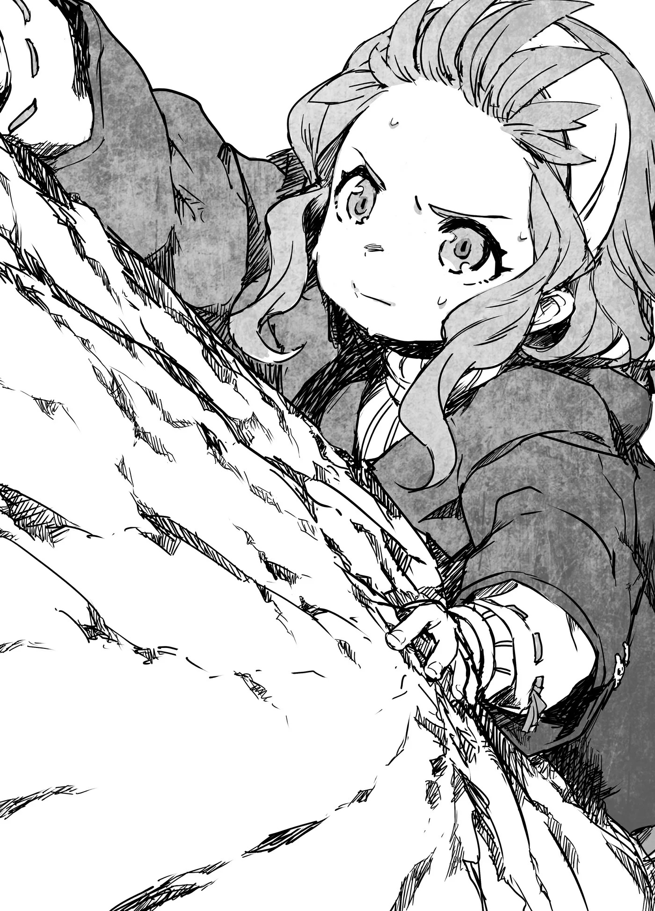

# Chương 140: Tập 6 Chương 2 - Tiệc Chào Mừng Và Nguồn Gốc Của Rentt (3)

Cảnh tượng thị trấn lúc đó làm tôi hoa cả mắt. Dĩ nhiên, nó còn chẳng lớn bằng Maalt, huống chi là các thành phố khác. Nhưng với tôi hồi ấy, cảm giác chẳng khác nào vừa đặt chân đến chốn đô hội phồn hoa. Các cửa tiệm bày bán đủ thứ mà ở làng chẳng hề có, người ta ăn mặc đẹp hơn bất cứ ai ở quê tôi, còn nhà cửa thì cao hơn mọi thứ tôi từng thấy trên đời.

Jinlin và tôi rôm rả bàn tán về những tòa nhà ấy, tự hỏi liệu có quý tộc nào sống bên trong không, rồi lâu đài của nhà vua thì còn đồ sộ đến mức nào. Vui thì vui thật, nhưng cảnh ấy cũng làm tôi thấy Hathara quê mình nhỏ bé và vô danh biết bao. Có điều, nó không khiến tôi chán ghét quê hương, mà chỉ cho tôi thấy thế giới ngoài kia còn rộng lớn biết chừng nào.

Tôi chẳng rõ Jinlin nghĩ gì, nhưng chắc cậu ấy cũng thấy vậy. Giờ nhìn lại, tôi mừng vì hồi đó mình đã nhận ra nét hay của cả Hathara lẫn chốn thị thành. Không ít ngôi làng nghèo xơ xác, sống rất chật vật, còn Hathara dẫu hẻo lánh nhưng vẫn đủ sống. Cơ mà lúc đó hai đứa đang mải phấn khích, hơi đâu nghĩ sâu xa được như vậy.

Đi loanh quanh một hồi, vừa lúc hai đứa bắt đầu thấy mỏi chân thì Jinlin hỏi, "Rentt, cậu có nghe thấy tiếng ai không?"

"Không, tớ có nghe thấy gì đâu," tôi đáp. Nhưng chỉ một thoáng sau, chính tai tôi cũng nghe thấy tiếng ai đó đang hét lên cầu cứu. Tiếng kêu the thé kỳ lạ, nghe chẳng giống giọng con người chút nào.

Giật mình, tôi dáo dác nhìn quanh tìm xem tiếng kêu phát ra từ đâu. Jinlin cũng ngó nghiêng khắp nơi, nhưng hai đứa chẳng thấy bóng dáng ai cả.

"Có khi ai đó bày trò trêu mình thôi," tôi đoán.

Jinlin lắc đầu. "Làm gì có chuyện đấy! Rõ ràng tớ nghe thấy mà!"

Tiếng kêu ấy quả thực rất to và rõ, mà dù có là trò đùa đi nữa thì ắt hẳn nó cũng phải phát ra từ đâu đó. Hai đứa lùng sục khắp nơi, một lúc sau thì cái giọng kia có vẻ hết chịu nổi, bèn bảo hai đứa ngước lên. Tôi còn chẳng nhận ra nãy giờ hai đứa chưa hề nhìn lên, cơ mà con người vốn hiếm khi để ý đến những gì ở trên đầu mình.

Hai đứa làm theo lời chỉ dẫn thì thấy một cành cây dài vươn ra. Ở đầu cành, vạt áo của một người tí hon bị móc vào, cả người cứ thế đung đưa giữa không trung. Bảo là tí hon, chứ ý tôi không phải đứa trẻ con đâu nhé. Người đó chỉ cao chừng mười lăm phân, trông hệt như một món đồ chơi.

Tôi trố mắt kinh ngạc, nhưng Jinlin thì không. Cô bé biết ngay mình đang nhìn thấy gì. "Rentt! Nàng tiên đấy! Mẹ tớ bảo họ chẳng mấy khi chịu xuất hiện trước mặt con người đâu!" cô bé hào hứng reo lên.

Tôi thì chẳng hào hứng nổi như vậy. "Sao tụi mình không cứu người ta đi? Trông như không tự gỡ ra được kìa."

◆◇◆◇◆

"Bộ trên đời này không có gì làm anh hào hứng được à? Hồi năm tuổi mà gặp được nàng tiên thì tôi cũng sướng rơn như Jinlin thôi. Như một đứa trẻ bình thường ấy," Lorraine nói.

"Thì ít ra tôi cũng có hào hứng một chút mà, nhưng trông nàng tiên lúc đó khổ sở lắm. Ý tôi là, người ta cứ hét ầm lên suốt từ nãy đến giờ, nên tôi thấy mình lo thế là biết nghĩ đấy chứ," tôi nói. Đó chẳng phải tôi chống chế đâu, là sự thật đấy.

"Chà, nghe anh nói thế thì tôi cũng hiểu được phần nào rồi."

"Đúng không? Thôi nghe tiếp này."

◆◇◆◇◆

"Ừ nhỉ, phải cứu người ta chứ! Nhưng làm cách nào bây giờ?" Jinlin nói.

May mà hồi ấy Jinlin và tôi đều là trẻ con nên bụng dạ thật thà, thực lòng muốn cứu người ta. Ngặt nỗi nàng tiên lại mắc trên cành của một cái cây rất cao. Tầm với của hai đứa con nít thì chịu rồi, mà ngay cả người lớn có khi cũng thấy khó. Dù vậy, người cao lớn hơn thì cơ hội với tới vẫn nhiều hơn, nên tôi mới bảo:

"Đi gọi người lớn đi," tôi bảo. "Có khi họ với tới đấy." Đó có vẻ là cách tốt nhất lúc bấy giờ.

Jinlin đồng ý, thế là hai đứa thử đi nhờ mấy người lạ quanh đó. Giờ nghĩ lại thì làm thế khá liều lĩnh, may mà thị trấn có vẻ hiền hòa, chí ít hai đứa không bị bắt cóc. Nhưng khổ nỗi, hai đứa cố giải thích rằng có một nàng tiên đang lơ lửng trên cành cây mà chẳng ai hiểu nổi. Người ta nhìn lên cành cây rồi làm như chẳng thấy gì hết.

Bây giờ tôi mới biết loài tiên có nhiều chủng loại, có loài ai cũng thấy được, nhưng có loài chỉ những người có Ma Lực mới nhìn ra. Khổ nỗi hồi đó hai đứa chẳng biết điều ấy, thành ra cứ như những kẻ nói dối. Rõ ràng là có thật, vậy mà chẳng ai chịu tin hai đứa cả.

Buồn thì buồn thật, nhưng hai đứa nhất quyết không chịu bỏ cuộc. Nàng tiên bắt đầu đuối sức rồi, nên hai đứa phải cứu người ta thật nhanh.

Jinlin sốt ruột hơn cả tôi. "Rentt, để tớ trèo lên cứu!" cô bé bảo.

"Jinlin, nguy hiểm lắm! Dừng lại đi!" tôi hét với lên từ bên dưới khi thấy cô bé bắt đầu trèo lên thân cây, nhưng cậu ấy chẳng thèm nghe.

Tôi chỉ mong sao cậu ấy đừng có chuyện gì cũng xốc nổi như thế, nhưng ở Hathara cô bé trèo cây cừ lắm, cừ đến bất ngờ so với một đứa trẻ lên năm. Ngặt nỗi cậu ấy toàn trèo một loại cây quen thuộc, chứ đâu đã quen với giống cây này. Cây cối trong làng tôi khá thấp, bên dưới lại là đất xốp phủ cỏ, nên lỡ có ngã cũng chẳng hề hấn gì nhiều. Người lớn vẫn cho trèo miễn là có người đứng trông chừng. Nhưng cái cây này thì khác hẳn. Nó cao chót vót, mặt đất bên dưới lại nện cứng ngắc để xe cộ qua lại. Trẻ con mà ngã từ trên đó xuống thì chấn thương nặng như chơi.

Mặc kệ tôi can, cô bé vẫn cứ trèo lên.

◆◇◆◇◆

Đáng lẽ tôi phải đi gọi người lớn. Thấy một đứa trẻ đang trèo lên cái cây cao như thế, chắc chắn người ta sẽ dễ giúp hơn nhiều. Nhưng lúc đó tôi cũng chỉ là một đứa con nít, đầu óc đâu nghĩ ra được nước ấy. Tôi chỉ biết cậu ấy đang gặp nguy hiểm và mình phải bảo cậu ấy tụt xuống, thế là cứ đứng dưới gốc cây mà hét với lên.

Nhưng Jinlin bướng lắm, chẳng chịu nghe lời đâu. Có lẽ cô bé mải mê leo trèo để cứu nàng tiên đến mức chẳng màng nghe thấy tiếng tôi. Tôi lo sốt vó, nhưng tài trèo cây của Jinlin thì phải công nhận là cừ thật. Sau mấy lần thử, cô bé đã bắt được nhịp với giống cây mới này. Cậu ấy thoăn thoắt đu người lên như khỉ, chẳng mấy chốc đã tới được cành cây nơi nàng tiên mắc kẹt. Tiếp đó, dĩ nhiên là cô bé định men theo cành để ra tận đầu ngọn. Thú thật thì cành cây ấy cũng không đến nỗi quá mảnh, trông đủ sức đỡ nổi một đứa trẻ con—nhưng cùng lắm cũng chỉ đến thế mà thôi. Bò ra ngoài đó chắc chắn là nguy hiểm, vậy mà Jinlin cứ thế bò ra ngon ơ.

Tiếng cành cây kêu răng rắc nghe mà thót cả tim, tôi cứ ngỡ nó sắp gãy lìa đến nơi. Jinlin càng bò ra gần đầu ngọn, cành cây lại càng oằn xuống. Vậy mà cô bé vẫn cứ tiếp tục rướn tới.

Cô bé chìa tay về phía nàng tiên. "Ngoan nào, tớ cứu cậu đây," Jinlin thì thầm. Trông cô bé chẳng mảy may sợ ngã chút nào, nói đúng hơn là dường như còn phấn khích nữa là đằng khác. Cứu được nàng tiên này làm cô bé hào hứng tột độ.

Nàng tiên thấy bàn tay chìa ra thì có vẻ hơi sợ sệt. Chắc là sợ bị bóp nát chăng. Ở tầm vóc tí hon của một nàng tiên, một đứa trẻ con loài người cũng chẳng khác nào kẻ khổng lồ. Jinlin dường như cũng nhận ra điều đó nên đổi ý, rướn thêm một đoạn nữa dọc theo cành cây. Cô bé từ từ gỡ nàng tiên ra, nhưng đúng lúc ấy...

Cành cây gãy rắc một tiếng.

"Jinlin!" tôi hét lên rồi lao vụt tới ngay bên dưới chỗ cô bé. Chẳng còn thời gian đâu mà nghĩ ngợi, đầu óc tôi cũng không mảy may thoáng nghĩ chuyện này nguy hiểm và mình nên né ra. Tôi chỉ biết Jinlin đang gặp nạn và mình phải làm gì đó.

Trong lúc rơi xuống, Jinlin ôm chặt lấy nàng tiên, ghì sát vào trước ngực. Chắc cô bé muốn che chở cho người ta. Bình thường loài tiên đều bay được, nhưng nàng tiên này kiệt sức nên chẳng cất cánh nổi.

Ngay trước khi Jinlin chạm đất, tôi đã kịp nhào tới ngay bên dưới. Nhưng hồi đó tôi còn bé quá, làm sao đỡ cho khéo được. Dù vậy, chí ít tôi cũng đỡ bớt cú ngã cho cô bé. Cả người cậu ấy rơi đè nặng lên hai tay và ngực tôi. Giữ không nổi, tôi ngã lăn quay ra đất. Tiếng cành cây rơi xuống đất nghe êm đến bất ngờ, nhưng nó vốn nhẹ tới mức gãy dưới sức nặng của một đứa trẻ, nên thế cũng là lẽ đương nhiên.

Nằm đè lên người tôi, Jinlin rên lên vì đau.

"Jinlin, cậu có sao không?" tôi hỏi, cơn đau nhức nhối chạy dọc khắp người.

"Ừm, cũng không đau lắm đâu," cô bé đáp.

Ngó kỹ lại, thấy cô bé có vẻ không có vết thương nào nặng, lúc ấy tôi mới biết mình đã làm đúng. Rồi tôi tự kiểm tra mình, thấy bản thân cũng chẳng hề hấn gì mấy. Chỉ bị vài vết trầy xước và bầm tím, chẳng tệ hơn mấy lần ngã trầy da tróc vảy khi chạy nhảy nô đùa quanh làng.

"Từ giờ đừng bao giờ làm trò nguy hiểm như thế nữa đấy," tôi bảo. Đáng lẽ tôi phải quát cho cô bé một trận, nhưng hồi đó tôi nào làm nổi việc ấy. Tôi chỉ biết nói được đến thế. Chắc hẳn vẻ mặt tôi lúc ấy trông buồn bã lắm. Trong bụng thì giận sôi lên, nhưng bản tính tôi vốn chẳng phải kiểu người hay để lộ sự tức giận ra ngoài.

"Ừm, tớ biết rồi. Tớ xin lỗi mà," Jinlin đáp.

"Jinlin, cậu chịu nghe lời thật đấy à?" tôi ngạc nhiên hỏi.

"Ừ, tại thấy cậu đang giận mà."

"Thì... chắc là vậy."

"Bởi thế tớ mới xin lỗi mà."

Tôi chẳng rõ việc lấy cơn giận của mình làm lý do để cô bé xin lỗi thì có đúng không, nhưng chỉ cần cậu ấy nhận ra lỗi thì với tôi thế là ổn rồi. Ít nhất thì cô bé cũng bảo sẽ không tái phạm nữa.

Tôi quyết định không cằn nhằn thêm nữa. "Được rồi, tha lỗi cho cậu đấy."

"Thật hả? Cậu hết giận rồi à?"

"Hết rồi, nhưng nếu cậu còn làm thế nữa thì tớ lại giận đấy. Lần sau hễ tớ bảo dừng lại là phải dừng lại ngay, nhớ chưa."

"Biết rồi mà," Jinlin gật đầu.

Tôi thôi không rầy la nữa, khẽ mỉm cười. "Thế nàng tiên sao rồi?"

"À, phải rồi," cô bé nói rồi xòe tay ra, để lộ nàng tiên bé xíu.

◆◇◆◇◆

Nàng tiên khẽ rên lên vì đau. Tiếng nói ấy nghe chẳng giống con người chút nào, nhưng lại ngân vang một cách kỳ lạ. Nàng tiên cao chừng mười lăm phân, mặc bộ quần áo mỏng nhẹ sặc sỡ cùng đôi cánh tựa cánh chuồn chuồn. Tôi cứ ngỡ đó là giống cái, cơ mà một số chủng tộc tiên hoàn toàn vô tính nên cũng khó khẳng định chắc chắn. Dẫu vậy, người này có mái tóc dài và trông hệt như một cô gái.

"Cậu có sao không? Có bị thương ở đâu không?" Jinlin hỏi.

"Tôi không sao! Chẳng bị thương gì đâu. Ôi thôi chết, tôi phải đi gấp!" nàng tiên nói, rồi quay sang nhìn Jinlin. "Cảm ơn cậu đã cứu tôi! Tôi là Tilya! Sau này gặp lại, tôi nhất định sẽ đền ơn cậu!" Nói rồi, Tilya vỗ cánh bay vút đi.

"Này, đợi đã!" Jinlin hét với theo, nhưng nàng tiên bay nhanh quá, thoắt cái đã mất hút. Loài tiên trông chẳng có chút sức lực nào, nhưng bay thì nhanh thoăn thoắt.

"Tiếc thật, bay mất rồi. Cơ mà trông có vẻ cô ấy đang vội việc gì đấy," tôi nói.

Jinlin phồng má hờn dỗi. "Tớ còn muốn nói chuyện thêm cơ mà! Ít ra cũng phải đền ơn gì đó chứ."

"Cậu muốn nhận phần thưởng đấy à?"

"Đâu có, tớ chỉ... ôi, thôi kệ đi. Dù sao tụi mình cũng phải về rồi."

"Ồ? Biết đường mò về rồi cơ đấy à?" giọng một người phụ nữ cất lên. "Vậy là bà khỏi phải lôi cổ hai đứa về nữa rồi nhỉ?"

Giọng nói hơi khàn khàn, nghe rõ mười mươi là của một bà lão, nhưng lại toát ra thứ uy áp rợn người. Hai đứa biết tỏng là ai rồi, nhưng sợ đến mức chẳng dám quay đầu lại ngó. Cơ mà trốn sao nổi, cuối cùng vẫn phải đối mặt thôi.

Jinlin và tôi nhìn nhau một cái, rồi chầm chậm quay đầu lại. Quả đúng y như rằng.

"Bà nội..." Jinlin lí nhí trong tuyệt vọng.

Đó chính là bà Pravda, và trông bà đang giận tím mặt. "Hai cái đứa này!" bà quát lớn làm hai đứa giật bắn mình, đứng thẳng tắp như khúc gỗ. "Đường sá ở đây thì không biết, tự tiện chạy đi lung tung làm cái trò gì thế hả?! Người lớn phải nhắc bao nhiêu lần nữa hai đứa mới chịu hiểu là bên ngoài làng nguy hiểm thế nào?! Đâu phải chỉ có mỗi dọc đường đi, mối nguy rình rập ở khắp mọi nơi đấy! Hai đứa lỡ bị bắt cóc thì sao! Rồi còn có cả những kẻ điên cuồng giết người mua vui nữa! Bà dắt hai đứa theo chỉ vì nghĩ hai đứa hiểu chuyện hơn lũ trẻ bình thường, thế mà hai đứa nỡ phụ lòng tin của bà à! Đã hiểu chưa hả?!"

Sau đó, bà còn tiếp tục giáo huấn hai đứa một hồi lâu nữa.

◆◇◆◇◆

Nằm trên giường ở quán trọ, Jinlin lẩm bẩm, "Từ giờ tớ chừa, không bao giờ làm trò như thế nữa đâu."

Cả đoàn chúng tôi chia làm hai phòng: cha mẹ tôi ở một phòng, còn bà Pravda, Jinlin và tôi ở phòng kia. Bà Pravda đã ngủ say tự lúc nào, có lẽ vì mệt lả sau trận lôi đình ban nãy. Dù sao thì đến cuối cùng, thấy hai đứa bình an vô sự, bà cũng mừng và ôm chặt lấy cả hai. Cha mẹ tôi cũng rầy la vài câu, nhưng lúc hai đứa về tới nơi thì họ đã mệt lử rồi, nên chỉ nhắc nhở qua loa chứ không mắng mỏ dông dài. Tôi biết hai đứa làm thế là sai, nên bị mắng cũng đáng. Có điều bà Pravda đáng sợ thật, và chắc hẳn đó là lý do khiến Jinlin hối hận đến vậy.

"Thế là biết khôn đấy," tôi nói. "Đừng đụng vào mấy trò nguy hiểm nữa."

"Ừ! Đợi bao giờ lớn rồi tớ mới làm," cô bé quả quyết.

"Ý cậu lớn rồi mới làm là sao cơ?"

"Người lớn thì thích đi đâu chẳng được, đúng không? Cho nên tớ sẽ làm mạo hiểm giả!"

Tôi ngạc nhiên nhìn cậu ấy. "Jinlin, chẳng phải sau này cậu sẽ làm trưởng làng sao? Cha mẹ cậu toàn bảo thế mà."

"Đâu nhất thiết phải làm trưởng làng ngay lập tức đâu. Với lại cũng chẳng bắt buộc cứ phải là tớ, tớ còn mấy anh chị em họ có thể làm được mà."

Đúng là cha mẹ Jinlin còn có thể tiếp tục trông nom việc làng cho tới lúc già, và chẳng có lý do gì mà các anh chị em họ của cô bé lại không thể kế nhiệm sau đó. Tính ra thì ý của cậu ấy cũng hợp lý thật.

Dù vậy, tôi vẫn thấy có gì đó là lạ. "Cậu không thích làm trưởng làng à?" tôi hỏi.

"Không phải là tớ không muốn, mà là tớ muốn làm mạo hiểm giả cơ! Tớ muốn đi ngắm nhìn thế giới. Cậu có biết mấy thứ tụi mình xem trong sách tranh thực ra đều có thật ở ngoài kia không? Có bao nhiêu là điều kỳ thú, nào là thác nước đổ xuống từ những hòn đảo lơ lửng giữa trời, những thành phố nằm lọt thỏm giữa bốn bề sông nước, rồi cả những tòa lâu đài thoắt ẩn thoắt hiện như ảo ảnh nữa!"

Bây giờ thì tôi biết tất cả những thứ đó đều có thật, nhưng hồi ấy nghe chúng chẳng khác nào chuyện cổ tích. Làng tôi làm gì có thứ nào kỳ ảo đến thế, bảo sao lúc đó tôi không thể tin nổi chúng có thật trên đời.

"Đó chỉ là mơ mộng thôi, Jinlin à," tôi bảo. "Cậu không thể cứ suốt ngày mơ mộng hão huyền khi còn phải học hành để làm trưởng làng được đâu. Dù sao thì mai tụi mình cũng phải dậy sớm hơn, ngủ thôi. Tớ mệt lắm rồi." Lúc ấy tôi thực sự mệt rã rời, một cảm giác mà đã lâu lắm rồi tôi không còn được nếm trải lại.

Nói là vậy chứ tôi cũng phải trằn trọc một hồi lâu mới ngủ được, nhưng trước lúc chìm vào giấc ngủ, tôi lại nghe thấy tiếng Jinlin làu bàu thêm một lần nữa.

"Trời ạ, cậu ngốc chết đi được! Thế thì sau này tớ chẳng thèm dắt cậu đi theo nữa đâu!" cô bé nói.

Bụng bảo dạ không rõ có thật là cô bé từng tính dắt mình theo trên những chuyến phiêu lưu hay không, tôi dần dần chìm vào giấc ngủ.
