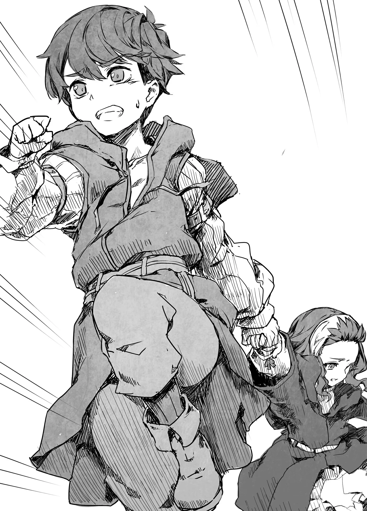

# Chương 141: Tập 6 Chương 3 - Bi Kịch Và Nguồn Gốc (1)

"Ừm, nãy tôi kể đến đâu rồi nhỉ?"

"Anh vừa kể tới chỗ Jinlin bảo ước mơ của cô bé là làm mạo hiểm giả."

"À, phải rồi."

Nhắc lại chuyện từ quá khứ xa xôi làm đầu óc tôi hơi mông lung, miệng cứ thế nói ra như chẳng qua suy nghĩ. Cảm giác như thể tôi vừa mất đi ý thức và ngất đi một lúc. Ký ức này tuy vui, nhưng lại gắn liền với những ký ức đau thương, nên có lẽ tôi đã cố tình để tâm trí mình lơ đãng đi. Nhưng câu chuyện này đã ăn sâu vào tâm trí tôi đến mức chẳng cần nghĩ ngợi gì cũng kể ra được.

Câu chuyện đang dần đi tới hồi bi thảm. Tôi chẳng muốn nhớ lại chút nào.

◆◇◆◇◆

Sáng hôm sau, cả đoàn phải sửa soạn lên đường nên chẳng có thời gian đi ngắm cảnh trước khi khởi hành về nhà. Tôi thức dậy ở quán trọ, ăn sáng cùng Jinlin và bà Pravda rồi ra bến bốc dỡ hàng. Cha mẹ tôi đã ở đó từ trước. Đêm qua hai người đi ngủ trước chúng tôi vì sáng nay phải ra đó sớm giải quyết một số công việc. Họ tính toán tiền bán số hàng đã dỡ xuống hôm qua, đồng thời đóng gói những nhu yếu phẩm sẽ mang về Hathara. Hai đứa tôi là "món hành lý" cuối cùng được nhét vào trong, sau đó ngựa sẽ được quất roi để cỗ xe lăn bánh.

"Rentt, Jinlin, sắp đi rồi đấy. Lên xe đi hai đứa," bà Pravda bảo.

Hai đứa gật đầu rồi trèo lên xe. Cả hai răm rắp nghe lời như kỵ sĩ tuân lệnh cấp trên, phần nhiều là nhờ bài giáo huấn của bà Pravda ngày hôm trước. Chẳng đứa nào muốn bị bà nổi nóng quát tháo như thế nữa. Hai đứa nhanh nhẹn đến mức cỗ xe sẵn sàng khởi hành từ khá sớm.

"Thế thì đi thôi," cha tôi ngồi trên ghế đánh xe cất tiếng. "Sẵn sàng cả chưa?"

Mọi người đều đã yên vị trên xe, hành lý cũng đã chất xong. "Vâng, bên này ổn cả rồi," mẹ tôi đáp. "Đi thôi anh."

Cha tôi quất roi vào ngựa, cỗ xe từ từ lăn bánh. Chuyến ghé thăm tuy ngắn ngủi nhưng lại hóa thành một cuộc phiêu lưu lớn đối với tôi và Jinlin. Đúng là hai đứa suýt bị thương nặng, nhưng lại được gặp một nàng tiên, chừng đó đã là quá đủ cho một cuộc phiêu lưu của trẻ con. Giờ đã làm mạo hiểm giả, tôi mới biết các nàng tiên hiếm gặp đến nhường nào. Trên đường về, bà Pravda có bảo tôi là nàng tiên hiếm lắm, nhưng lúc đó tôi chỉ nghĩ chắc cũng hiếm cỡ hoa saria mà thôi. Nhân tiện thì hoa saria là loài hoa nở theo mùa ở Hathara, chỉ nở rộ dưới ánh trăng tròn. Chúng khá hiếm, nhưng nếu muốn đi hái thì vẫn gom được rất nhiều. Còn các nàng tiên thì ngược lại, rất khó bắt gặp.

Jinlin muốn khoe ngay chuyến đi của hai đứa với Jal và Dol ngay lúc vừa về tới làng. Ở chừng mực nào đó, tôi cũng muốn vậy. Dù lúc đầu có ngần ngại đến đâu, nhưng nghĩ lại chuyến đi chơi ngắn ngủi ấy, tôi phải thừa nhận là rất vui. Tôi thì sẽ không khoe khoang, nhưng tôi muốn kể cho hai cậu ấy nghe chuyện xảy ra ở thị trấn, về cuộc phiêu lưu lớn lẫn thất bại lớn của Jinlin. Nói tóm lại, chặng đường trở về nhà rất vui và tôi có bao điều để mong đợi. Ít nhất là cho tới một thời điểm nào đó.

◆◇◆◇◆

"Hai đứa đã giúp một nàng tiên ư? Vì thế mà hai đứa tự đẩy mình vào nguy hiểm đấy à?" bà Pravda hỏi.

Cỗ xe chòng chành lắc lư trong lúc hai đứa kể lại chuyện xảy ra ở thị trấn. Bà dĩ nhiên rất ngạc nhiên. Tôi thì run rẩy vì sợ bà lại nổi giận, còn Jinlin thì tỏ ra như chẳng có gì đáng lo. Chắc cô bé đã quen làm bà Pravda nổi giận, hoặc có lẽ cô bé vốn gan dạ bẩm sinh. Chắc là cả hai.

"Dạ vâng, thì tại cô ấy cứ kêu cứu mãi mà bà," Jinlin phân bua.

"Nàng tiên cực kỳ hiếm thấy đấy. Lần đầu ra khỏi làng mà đã tận mắt nhìn thấy một nàng tiên quả là trải nghiệm khác thường," bà Pravda trầm trồ nói. "Có khi hai đứa được một vì sao nào đó yêu thương chiếu mệnh rồi. Thôi, bỏ qua chuyện đó đi. Nếu một trong hai đứa có tình cờ gặp lại nàng tiên lần nữa, nhất định phải tránh xa ra đấy."

"Ý bà là vì nàng tiên nguy hiểm ạ?" tôi hỏi, ngạc nhiên trước lời dặn nghiêm khắc của bà.

Bà Pravda lắc đầu. "Không, không phải thế. À thì cũng có phần vì lý do đó, nhưng quan trọng hơn là hai đứa không được cứ thế tiếp cận một nàng tiên. Lối suy nghĩ của họ khác hẳn chúng ta từ trong cốt lõi. Chẳng thể biết trước họ sẽ làm gì đâu. Dĩ nhiên không phải nàng tiên nào cũng vậy và bà cũng không vơ đũa cả nắm, nhưng hai đứa không thấy có điểm gì kỳ lạ ở nàng tiên này sao?"

Jinlin và tôi nhìn nhau. Rồi tôi chợt nhớ ra hình như đúng là có chỗ hơi khác thường. Nàng tiên ấy chẳng mấy hứng thú nói chuyện với hai đứa, cũng chẳng mảy may bận tâm xem chúng tôi có an toàn hay không. Có lẽ vì nàng tiên suy nghĩ khác với con người.

"Có nghĩ ra điều gì không?" bà Pravda hỏi lại.

Jinlin dường như cũng đi đến kết luận giống tôi. Hai đứa lặng lẽ nhìn nhau, ngầm hiểu là mình đều đã nhận ra điều gì đó.

"Ý bà muốn nói là, ngã từ trên cây xuống đâu phải mối nguy hiểm duy nhất mà hai đứa tự chuốc lấy. Hai đứa đâu muốn bị tráo đổi với những đứa trẻ thế thân, đúng không?"

Hai đứa nhớ lại hồi trước cha mẹ và các anh chị em họ từng dọa rằng nếu hai đứa làm chuyện gì xấu thì sẽ bị thay thế bằng những đứa trẻ thế thân. Có điều họ chưa từng nói rõ ai sẽ làm chuyện đó.

"Đó là chuyện mà các nàng tiên hay làm ạ?" Jinlin hỏi.

"Đúng vậy," bà Pravda đáp. "Khi không có ai để ý, các nàng tiên sẽ đổi chỗ với trẻ con loài người. Họ có thói quen đó đấy. Với chúng ta, đem con mình đi tráo với con người khác, đã thế lại còn khác giống loài, là chuyện không thể tưởng tượng nổi. Nhưng đó chính là điều bà muốn nói khi bảo họ không nghĩ giống chúng ta. Họ rất khó hiểu được con người."

◆◇◆◇◆

Khi cỗ xe tiếp tục lăn bánh, Jinlin và tôi đã quen với độ rung lắc hơn hôm qua nhiều. Jinlin vốn dễ say xe nên chẳng bao giờ quen hẳn được, nhưng bà Pravda đã mua thuốc chống say ở thị trấn và cho cô bé uống trước lúc khởi hành. Bà cũng cho tôi một ít, dù tôi vốn chẳng sao cả nên có lẽ không cần uống cũng được. Thuốc cực kỳ đắng và khổ sở lắm mới nuốt trôi, nhưng với Jinlin thì cơn say xe còn tệ hơn thế nhiều nên cô bé chẳng đắn đo mà ực một hơi hết sạch. Thế nhưng một lúc sau cuộc trò chuyện về các nàng tiên, thuốc ngấm làm hai đứa buồn ngủ. Người ta đã dặn trước là thuốc có thể gây cảm giác hơi mệt, và tôi nhớ lúc đó mình đã nhận ra chắc chắn là do thuốc gây nên. Tôi cố thức thì vẫn được, nhưng chẳng có lý do gì để không ngủ cả. Dù sao mẹ và bà Pravda vẫn còn thức. Tôi xuôi theo cơn buồn ngủ và mặc cho mình chìm vào thế giới của những giấc mơ.

◆◇◆◇◆

Tôi tỉnh giấc bởi một tiếng va đập lớn, hoàn toàn mù tịt không rõ đã bao lâu trôi qua. Tôi cảm giác như mình bị hất tung lên không trung, rồi mọi thứ xung quanh đảo lộn hết cả. Tôi không thể nhìn ngó xung quanh, nhưng lại thấy toàn bộ cảnh tượng ấy kỳ lạ đến cuốn hút. Tôi nhớ như in những quả trái cây lơ lửng giữa không trung. Tôi nhớ rõ từng ngọn cỏ trông ra sao. Tôi gần như có thể vẽ lại thành tranh được.

Thời gian trôi đi chậm chạp đến đáng sợ, nhưng chẳng mấy chốc nỗi kinh hoàng thật sự bắt đầu ập tới. Tôi chẳng biết chuyện gì vừa xảy ra. Đến khi tôi nhận ra có lẽ cỗ xe đã bị lật, thì toàn bộ hành lý đã văng tung tóe thành một mớ hỗn độn. Tôi bị đập mạnh vào mấy chiếc thùng gỗ và thành xe, hễ cố cử động là từng cơn đau dữ dội lại nhói lên khắp người.

Nóng lòng muốn biết mọi người ra sao, tôi quan sát xung quanh. Người đầu tiên tôi tìm là Jinlin. Trong mắt tôi khi ấy, cha mẹ và bà Pravda dường như là bất khả chiến bại, còn cô bé thì không. Cô bé luôn tạo cảm giác như thể tôi có thể đánh mất cô bé bất cứ lúc nào, nên tôi lo cho cô bé quá mức. May sao, tôi tìm thấy cô bé khá dễ dàng. Cô bé đang nằm dưới mấy chiếc thùng gỗ, nhưng vẫn còn thở.

"Ư... Rentt," cô bé rên lên.

May mà trong thùng không có gì quá nặng, nên cả một đứa trẻ như tôi gắng sức một chút cũng đẩy chúng sang một bên được. Cô bé không phải là không bị thương, nhưng vẫn tự mình đứng dậy được.

"Jinlin! Cậu có sao không?! Cậu đi được không?" tôi lập tức hỏi.

"Ừ, tớ không sao," cô bé nói. Mồ hôi lạnh đang túa ra ròng ròng trên mặt cô bé.

"Người lớn đâu cả rồi?"

Đó là lần đầu tiên bản thân tôi tự hỏi câu đó. Không phải tôi quên mất họ, mà kỳ lạ ở chỗ họ vẫn chưa tới tìm hai đứa. Chúng tôi là trẻ con, và người lớn lúc nào cũng lo lắng cho sự an toàn của chúng tôi. Nếu có tai nạn lớn xảy ra, chẳng hạn như lật xe, việc đầu tiên họ làm hẳn phải là đi tìm hai đứa. Chúng tôi cũng chẳng thể văng đi quá xa nhau được, họ chỉ cần tìm quanh cỗ xe là thấy ngay.

Khi nhận ra họ không tới, tôi thấy bất an. Cực kỳ bất an. Jinlin dường như cũng có cùng cảm giác ấy.

Đúng lúc tôi gần như không thể ngồi yên được nữa, một tiếng nổ lớn vang lên từ phía bên kia cỗ xe. Sững sờ, tôi quay về hướng đó thì thấy một cột lửa bốc lên. Lúc ấy tôi mù tịt không biết đó là gì, nhưng Jinlin thì biết.

"Ma pháp ư?!" cô bé bật thốt rồi chạy về phía ấy. Tôi chạy theo sau cô bé.

Cảnh tượng trước mắt làm cả hai đứa chết sững. Thật khó diễn tả, nhưng ít nhất cũng phải nói là nó trông vô cùng hung hiểm tà ác. Trông nó giống một con sói bạc to lớn, nhưng đôi mắt lại đỏ ngầu như máu và thân hình đồ sộ được bao phủ bởi một luồng hắc khí tà quái chập chờn. Nó toát lên vẻ khát máu cuồng sát, chẳng khác nào hiện thân của sự hủy diệt hay sứ đồ của Địa Ngục.

Hai đứa cũng nhìn thấy bà Pravda đang cầm một cây trượng. Chính bà là người đã thi triển ma pháp. Tôi không biết bà có thể dùng ma pháp, nhưng Jinlin thì biết. Có lẽ bà Pravda đã dạy cho cô bé đôi chút để dùng khi khẩn cấp.

Bà Pravda nhận ra hai đứa và quay lại. "Hai đứa?! Các cháu còn sống à?! Chạy đi! Bà sẽ cản con quái vật này không cho―"

Đó là những lời cuối cùng của bà. Trước cả khi tôi kịp hiểu chuyện gì vừa xảy ra, móng vuốt con sói đã đâm xuyên qua lưng bà trồi ra ngoài. Bà Pravda hộc máu, ánh sáng trong đôi mắt vụt tắt. Rồi bà tắt thở.

Tôi từng nhìn thấy xác chết trước đây, nhưng đây là lần đầu tiên tôi tận mắt chứng kiến khoảnh khắc một người lìa đời. Đầu óc tôi trống rỗng trong giây lát. Nhưng rồi tôi sực nhớ ra mình phải chạy. Tôi nắm lấy tay Jinlin và cố chạy thật xa khỏi con sói hết mức có thể.

"Rentt?! Rentt, còn bà nội thì sao?!" Jinlin hét lên, giọng cô bé trống rỗng không chút cảm xúc.

Tôi dĩ nhiên hiểu cô bé muốn nói gì, nhưng bà Pravda đã mất rồi. Hai đứa phải sống sót, nên phải chạy. Chẳng còn làm được gì hơn nữa.

"Còn cha mẹ cậu thì sao?!" Jinlin hỏi tiếp, nghĩ rằng họ chắc chắn phải ở đâu đó quanh đây.

Jinlin chắc hẳn hoang mang rối loạn hơn tôi nhiều. Cô bé hẳn đã không nhìn thấy hai cái xác còn lại nằm cạnh con sói, nhưng tôi thì thấy. Hai đứa tôi là những người duy nhất còn sống sót.

Có lẽ tôi hơi nhẫn tâm. Trong tình cảnh đó, đứng chết trân như Jinlin mới là phản ứng bình thường. Nhưng tôi nhất quyết không để cô bé phải chết.

◆◇◆◇◆

Tôi chạy. Tôi chạy để sống sót. Tôi chạy để về được nhà. Tôi chạy để bảo vệ người bạn thanh mai trúc mã của mình.

Tôi chẳng rõ hai đứa đã chạy được bao lâu. "Chắc thế này là đủ xa rồi," tôi thì thào giữa những hơi thở nặng nhọc, khi đã cách cỗ xe bị lật một quãng xa. Nhưng rồi Jinlin lắp bắp gọi tên tôi, giọng run rẩy, ngón tay chỉ thẳng về phía trước.

Thứ đang ở đó hiển nhiên đến mức tôi cảm thấy chẳng cần phải giải thích thêm, nhưng đó chính là con sói tàn độc ấy. Đôi mắt đỏ ngầu của nó nhìn hai đứa đầy lạnh lùng vô cảm. Giờ ngẫm lại, thật kỳ lạ khi một đứa trẻ con lại có thể chạy xa đến thế khỏi con quái vật đó. Con sói chắc chắn chỉ đang đùa bỡn với hai đứa. Nó thừa sức giết chết chúng tôi trong chớp mắt, nhưng lại muốn xem chúng tôi sẽ chạy trốn được bao xa. Giờ thì giờ chơi đã hết. Suốt lúc chạy tôi chẳng hề thấy bóng dáng nó đâu, nên một khi nó đã lộ diện lúc này, ắt hẳn là nó đã thấy chán rồi.

Lúc ấy tôi đâu hiểu được điều đó, chỉ nghĩ rằng mình phải chạy tiếp. Khổ nỗi hai chân tôi chẳng chịu nghe lời nữa. Jinlin xem chừng cũng chẳng bước thêm nổi một bước nào. Hai đứa đã bị dồn vào đường cùng.

Tôi chẳng biết lúc ấy điều gì đã thúc đẩy mình, chỉ thấy mình lê từng bước nặng nhọc về phía con sói rồi đứng chắn trước mặt nó. Đó chẳng phải quyết định khôn ngoan nhất, và có lẽ cũng hoàn toàn vô ích, nhưng đó là tất cả những gì tôi có thể làm để bảo vệ Jinlin. Là tất cả những gì tôi có thể làm để cứu mạng cô bé. Tôi nghĩ cô bé có thể chạy thoát trong lúc con sói giết chết tôi.

Nhưng con sói đang dõi mắt nhìn hai đứa. Nó thừa biết chúng tôi không có cách nào trốn thoát. Tôi có hy sinh bản thân cũng chẳng thay đổi được gì, nhưng lúc đó tôi lại không hề biết điều ấy.

Tôi dang rộng hai tay và nhìn chằm chằm vào con sói. "Jinlin, chạy đi," tôi giục. "Để con quái vật này cho tớ."

Jinlin lắc đầu. "Không, Rentt! Tớ, tớ―"

"Cứ chạy đi! Tớ sẽ cầm chân nó!"

Hai đứa giằng co qua lại một lúc cho tới khi con sói rốt cuộc cũng hết kiên nhẫn. Nó thở dài một hơi rồi giơ chân trước lên. Chậm rãi, nó vươn những chiếc móng vuốt sắc nhọn ra, máu của bà Pravda và cha mẹ tôi vẫn còn phủ đầy trên đó. Chính bộ móng vuốt này đã đâm xuyên và xé xác họ. Chỉ vài giây nữa thôi, điều tương tự cũng sẽ giáng xuống đầu tôi. Nhưng nếu tôi câu kéo được đủ thời gian cho Jinlin chạy thoát thì bấy nhiêu là đủ rồi. Nghĩ vậy, tôi thấy vững lòng khi đứng đó.

Tôi nhắm mắt lại và cảm nhận một luồng gió rít khi con sói vung chân trước bổ xuống. Nhưng rồi có thứ gì đó xô tôi ngã. Những móng vuốt kia không hề chạm tới người tôi. Tự hỏi chuyện gì vừa xảy ra, tôi mở mắt ra. Thứ tôi nhìn thấy lại là kết cục tồi tệ nhất mà tôi có thể tưởng tượng, và là điều cuối cùng mà tôi muốn thấy trên đời.

Jinlin thì thào gọi tên tôi, máu rỉ ra từ khóe miệng. Tôi nhìn xuống thấp hơn và thấy một chiếc móng vuốt sắc nhọn đang xuyên qua ngực cô bé. Đáng lẽ nó phải đâm xuyên người tôi, nhưng Jinlin đã chịu thay chỗ tôi. Con sói từ từ rút móng vuốt ra, máu từ người Jinlin phun ra xối xả. Cô bé ngã gục xuống đất trong vũng máu đỏ thẫm.

"Jinlin! Jinlin! Này! Jinlin!" tôi hét lên và chạy vội tới bên cô bé. Tôi chẳng còn bận tâm tới con sói nữa. Nó có giết tôi hay không tôi cũng chẳng màng. Jinlin quan trọng hơn. Tôi phải tìm cách nào đó cứu lấy cô bé. Nhưng máu cứ không ngừng trào ra, sắc mặt cô bé tái nhợt đi từng giây. Tôi cố nghĩ ra cách nào đó để giữ mạng cho cô bé, nhưng tất cả đều vô vọng.

Cô bé vẫn còn nói được, nhưng giọng đã yếu ớt và chậm chạp. "Rentt, tớ xin lỗi, tớ―"

"Jinlin, đừng nói nữa! Cậu sẽ chết mất, cậu sắp chết rồi đấy!"

"Bảo với cha mẹ tớ là tớ xin lỗi nhé. Cậu phải sống tiếp đấy, Rentt. Trước khi chết, tớ muốn cậu biết là tớ từng muốn... ừm, sau này được cưới cậu."

"Tụi mình làm được mà, Jinlin. Cậu chỉ cần sống thôi."

"Ôi, Rentt à," cô bé bật cười khẽ, "cậu có thể sống thật hạnh phúc bên một người khác mà."

Cái chết ập đến quá nhanh. Cơ thể Jinlin nhanh chóng mềm nhũn đi, và chẳng mấy chốc, cô bé không còn đáp lại lời tôi nữa.

"Jinlin, Jinlin! Tại sao chứ?!" tôi khóc gào lên. Tôi chẳng còn màng đến bất cứ thứ gì nữa. Đến lời nhắn gửi của cô bé tôi cũng chẳng thể chuyển đi được, bởi con quái vật sói kia vẫn còn đứng đó. Có thứ gì đó trong tôi đứt phăng, tôi nhặt một cành cây lên để đối đầu với con sói. Thật ngu xuẩn. Không đời nào tôi thắng được, và cơ hội sống sót của tôi thậm chí còn thấp hơn cả việc cố bỏ chạy. Nhưng nếu đằng nào cũng phải chết, tôi muốn chết trong lúc chiến đấu.

Con sói nhìn tôi đầy thích thú, rồi nó đứng thẳng người lại và đối diện với tôi như một con thú săn mồi. Đó là lúc tôi nhận ra trước đó nó chỉ đang bày trò đùa giỡn. Đến tận bây giờ tôi vẫn không hiểu tại sao nó lại thấy cần phải vào thế chiến đấu, nhưng có lẽ con sói cảm thấy làm vậy mới là đúng phép. Giờ ngẫm lại, con sói cũng từng cảnh giác đề phòng trước bà Pravda. Cơ mà muốn biết chắc thì chỉ có nước đi hỏi chính con quái vật đó.

Tôi vung vẩy cành cây trong tay. Tư thế của tôi tệ hại vô cùng, chân cũng chỉ chạy được với tốc độ lạch bạch chậm chạp. Đánh nhau với quái vật mà như thế thì chẳng ra làm sao cả. Nhưng có hề gì. Tôi lao vào đâu phải để chiến đấu, mà đúng hơn là đang cố tìm đến cái chết. Chẳng rõ con sói có biết điều đó hay không, nhưng trông nó có vẻ rất khoái chí khi ngoác rộng cái miệng và tiến lại gần tôi. Trông nó như thể sắp ngoạm đứt đôi người tôi ra, nhưng tôi chẳng hề sợ hãi.

Cái miệng của nó tiến lại ngày càng gần. Tôi nghĩ nếu mình tấn công vào cái họng đang ngoác rộng của nó thì biết đâu cũng gây ra được chút sát thương, dù chỉ bằng một cành cây. Tôi đâm vào đó, và bất ngờ thay, tôi lại cào xước được lợi của nó một chút. Tôi chẳng biết là do ăn may, do con sói không để ý, hay nó cố tình để mặc chuyện đó xảy ra, nhưng tôi đã thấy thỏa mãn. Ít ra tôi cũng trả đũa được nó phần nào.

Chấp nhận số phận, tôi chờ đợi bị nghiền nát trong hàm răng nó. Nhưng đúng lúc ấy, tôi nghe thấy một tiếng "keng" chói tai vang lên. Có thứ gì đó đã bảo vệ tôi khỏi hàm răng của con sói.
