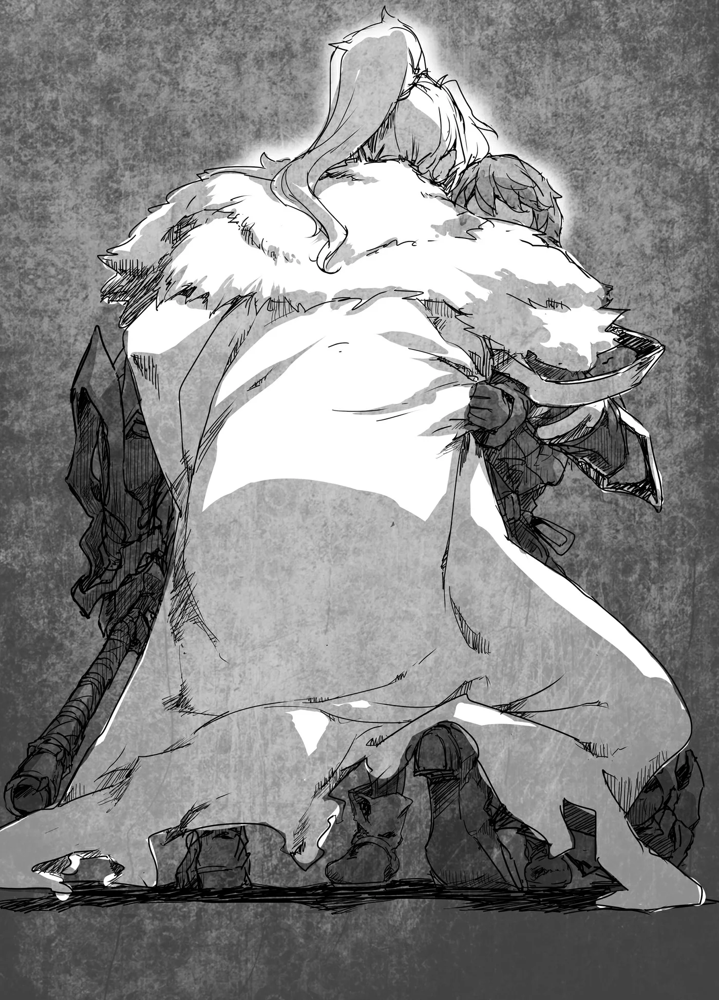
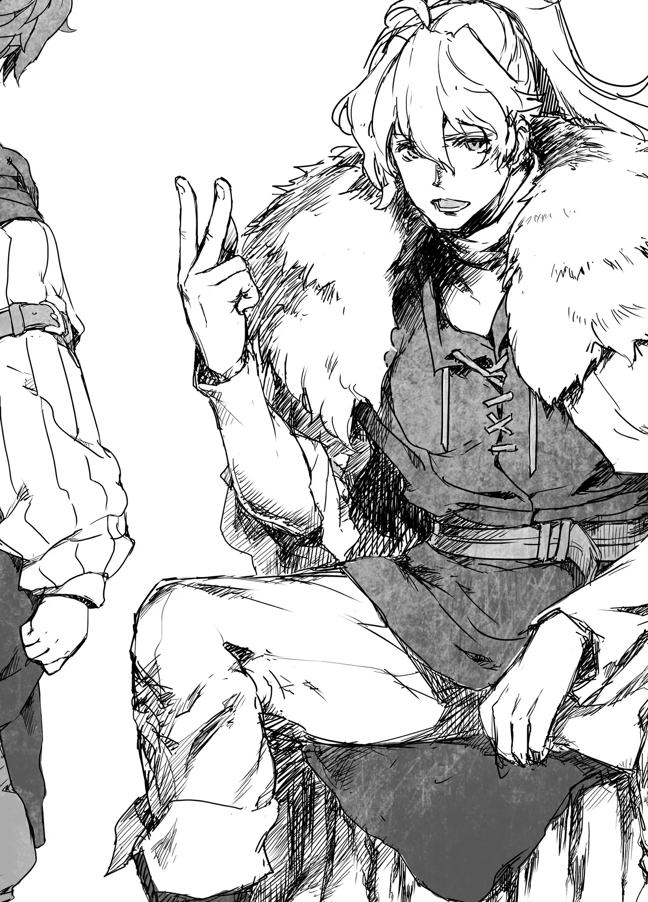

# Chương 142: Tập 6 Chương 3 - Bi Kịch Và Nguồn Gốc (2)

Tôi ngước nhìn lên và thấy một người đàn ông trưởng thành. Chú ấy cầm một thanh đại kiếm còn to hơn cả người tôi, vung lên để cầm chân con sói.

"Lùi lại mau," chú ấy nói, kìm nén cơn giận, "để chú xử lý chuyện này."

Tôi lúc ấy hoảng loạn đến mức chẳng thể suy nghĩ được gì, nên chỉ biết răm rắp làm theo. Con sói toan vồ lấy tôi, nhưng người đàn ông vung thanh đại kiếm ép nó phải lùi lại. Ngay cả bây giờ, tôi vẫn thấy chú ấy là một chiến binh kiệt xuất. Vào thời điểm đó, tôi chưa biết chút gì về chiến đấu, nhưng những động tác đẹp mắt của chú khiến tôi nhìn qua là biết ngay đây là một bậc thầy.

Trận quyết chiến giữa người và sói nổ ra ngay sau đó. Con sói chồm vào người đàn ông, còn chú ấy vung kiếm chém trả. Cả hai chuyển động nhanh đến mức mắt tôi không tài nào theo kịp. Tôi nhận ra con sói nãy giờ đã nương tay với tôi đến nhường nào, đồng thời cũng hiểu được người đàn ông tài ba đến mức nào. Cảm giác như trận chiến đang diễn ra trong một thế giới của riêng nó. Đôi bên ngang tài ngang sức. Con sói lách mình tránh lưỡi kiếm chỉ trong đường tơ kẽ tóc hoặc dùng nanh chặn đòn. Người đàn ông dùng thanh đại kiếm gạt phăng móng vuốt và răng nanh của nó, hoặc né tránh nhanh đến mức mắt thường không thể bắt kịp.

Khi thể lực của cả hai cuối cùng cũng chạm tới giới hạn, người đàn ông đã giành được chiến thắng. Con sói chỉ lơ là phòng bị trong một tích tắc, và người đàn ông liền áp sát tung một nhát chém rạch toạc ngực nó. Con sói rú lên đau đớn. Nó vung chân trước đánh bạt người đàn ông ra xa, nhưng chú ấy đã kịp dùng kiếm đỡ đòn liều mạng đó và thoát hiểm mà không hề hấn gì.

Máu sẫm màu nhỏ giọt tong tỏng từ lồng ngực con sói, đọng lại thành một vũng đỏ lòm. Hơi thở nó trở nên đứt quãng, và đôi mắt ngập tràn sát khí cuồng loạn đảo quanh tìm kiếm. Tôi đứng cách xa nơi đó, nhưng vẫn phải rùng mình lùi lại. Người đàn ông thì trái lại, hoàn toàn chẳng hề nao núng.

Con sói và người đàn ông trừng mắt gườm nhau thêm một hồi lâu cho đến khi bầu không khí căng thẳng bị phá vỡ và con sói lùi bước. Rồi trước sự ngỡ ngàng của tôi, con sói quay đầu bỏ chạy thục mạng ra xa. Tôi đứng gần đó chứng kiến toàn bộ sự việc mà chết lặng cả người. Con sói trông chẳng hề có vẻ gì là giống loài sẽ tháo chạy, nhưng nó lại làm đúng điều đó trước mặt người đàn ông này.

Người đàn ông tiếp tục cảnh giác thêm một lúc, nhưng khi tà khí bất tường của nó hoàn toàn biến mất, chú ấy liền chạy lại chỗ tôi. "Cháu có sao không?!" chú hỏi dồn.

Tôi vừa được cứu thoát trong gang tấc trước móng vuốt quái vật. Câu hỏi của chú là điều hoàn toàn tự nhiên, nhưng lúc ấy đầu óc tôi chẳng còn được tỉnh táo.

"Tại sao?" tôi hỏi ngược lại.

"Hử?"

"Sao chú không tới sớm hơn chứ?!"

Đó là cách đáp lại tồi tệ nhất mà tôi có thể thốt ra. Nếu bây giờ tôi cứu ai đó mà họ nói với tôi những lời như vậy, thì chẳng khác nào một cơn ác mộng. Lẽ ra tôi phải cảm ơn chú ấy. Tôi biết rõ điều đó. Nhưng khi nhìn thi thể của Jinlin nằm dưới chân mình, tôi chẳng thể thốt nên lời nào khác.

Dẫu vậy, người đàn ông vẫn rất đỗi dịu dàng. Chú ấy nhìn người bạn đã khuất của tôi. "Chú xin lỗi. Giá như chú chạy nhanh hơn một chút. Chú thành thật xin lỗi. Tất cả là lỗi của chú."

Tôi đâu thể trách cứ chú ấy. Sự thật là họ chỉ đơn thuần gặp bất hạnh. Jinlin, cha mẹ tôi và cả bà Pravda đều như vậy. Chỉ có tôi là đủ may mắn giữ được tính mạng trước con quái vật hùng mạnh đó. Và điều đó hoàn toàn là nhờ có người đàn ông này, nên tôi chẳng có tư cách gì để oán thán.

Thế nhưng người đàn ông vẫn mở lời xin lỗi. Chú ấy lau nước mắt cho tôi rồi ôm chầm lấy tôi. Điều đó chỉ càng khiến tôi khóc thét lên dữ dội hơn.

◆◇◆◇◆

"Cháu khóc xong chưa?" Người đàn ông hỏi sau khi tôi đã gào khóc thỏa thuê.

"Dạ rồi, cháu xin lỗi chú," tôi nói. Lòng tôi vẫn chưa thấy khá hơn, nhưng đã bình tâm lại đôi chút. Tôi chán chường và chẳng biết phải làm gì, đầu óc vẫn còn mông muội, nhưng tôi đã nhận ra mình không thể trách cứ người đàn ông này về bất cứ điều gì.

"Không, cháu làm tốt lắm," người đàn ông bảo. "Không phải vì chuyện cháu xin lỗi, mà vì còn nhỏ tuổi thế này mà cháu đã dám đứng lên đối đầu với con dã thú đó. Dù sao thì, ừm, về những người đồng hành đã khuất của cháu..."

"Cháu muốn mang họ về làng, nhưng chắc là không thể ạ," tôi nói.

Người chết cần phải được làm lễ an táng, nhưng vào những lúc thế này, việc để lại thi thể ngoài hoang dã cho quái vật hoặc thú hoang rỉa thịt vốn là chuyện thường thấy. Việc vận chuyển thi thể rất khó khăn, hơn nữa mùi tử khí còn có thể thu hút quái vật khiến tình hình thêm tồi tệ. Hồi đó tôi chưa biết những điều này, nhưng tôi hiểu rằng nếu không có xe cộ thì không tài nào mang họ về làng được.

"Không, không phải là không thể đâu," người đàn ông nói. "Phải mang họ đi đâu? Có phải một ngôi làng quanh đây không? Hathara, Làng Alga hay Làng Mul?" Đó đều là những ngôi làng gần đây, chứng tỏ người đàn ông này hẳn phải rất thông thuộc địa bàn vùng này.

"Dạ, Làng Hathara ạ. Cháu đang trên đường trở về đó," tôi đáp.

"Chú hiểu rồi. Thật là đau lòng."

"Chuyện đó để sau đi ạ, ý chú là sao khi bảo không phải là không thể?"

"À, chú đi xe ngựa đến đây. Chú cảm nhận được Ma Lực của con quái vật đó nên đã chạy bộ suốt cả quãng đường tới đây, nhưng nếu đợi thêm nửa ngày nữa thì cỗ xe sẽ tới. Nó có thể chở các thi thể về. May thay chú đã bao trọn cỗ xe nên ngoài người đánh xe và chú ra thì chẳng có hành khách nào khác."

Hồi đó tôi không hoàn toàn hiểu những gì người đàn ông đang nói, nhưng giờ nghĩ lại, chú ấy hẳn đã chạy bộ suốt quãng đường dài nửa ngày xe ngựa. Không hiểu bằng cách nào mà chú ấy có thể cảm nhận được khí tức của quái vật từ khoảng cách xa xôi đến vậy. Hơn nữa, chú còn cẩn thận bao trọn một cỗ xe ngựa đi qua vùng thôn quê hẻo lánh không một bóng người. Xét theo lẽ thường thì hành tung của chú vô cùng khả nghi và kỳ quặc, nhưng chú ấy đã cứu mạng tôi, nên tôi đặt trọn niềm tin nơi chú.

"Vậy họ sẽ không ngại chở hết các thi thể chứ ạ?" tôi hỏi.

"Được chứ. Thật ra chú quen biết riêng với người đánh xe. Chú có thể nhờ cậu ấy giúp thêm chút việc. Chúng ta sẽ phải đợi ở đây cho đến khi cỗ xe tới, nên chú nghĩ mình sẽ tranh thủ thời gian này để gom các thi thể lại một chỗ. Nếu họ có món đồ quý giá nào muốn giữ làm kỷ vật, cháu sẽ phải tự mình thu gom lại. Chú đâu biết họ trân quý thứ gì. Có một công việc quan trọng đang chờ cháu làm đấy."

Rất có thể người đàn ông giao cho tôi công việc đó là vì lòng tốt. Chú ấy muốn tôi bận rộn với một việc gì đó để phân tán sự chú ý. Tôi không rõ điều đó giúp ích được bao nhiêu. Có lẽ là được một chút.

"Ồ, tới rồi đây. Cậu ấy đến rồi, Rentt," người đàn ông nói khi đưa tay lên trán nhìn qua đống lửa trại. Mặt trời đã lặn từ lâu và chú vừa mới bảo cỗ xe có thể phải đến mai mới tới, nên chú rất đỗi vui mừng khi thấy nó đang đi tới.

Về phần tôi, lúc ấy tôi chỉ muốn đi lang thang trong rừng cho đến khi bị quái vật giết chết, nhưng trò chuyện với người đàn ông đã bắt đầu khiến tôi thấy khá hơn. Chú ấy là một người kể chuyện rất có duyên, và chú luôn chọn những câu chuyện mà trẻ con yêu thích. Chú kể về một vùng đất xa xôi ngập tràn đất đá và cây cối, về một con tàu bay lượn trên bầu trời, về một kẻ dại dột toan thế chỗ mặt trời, cùng cội nguồn và điểm đến cuối cùng của linh hồn con người.

Tôi hỏi người đàn ông chú là ai và tại sao chú lại biết nhiều điều đến thế.

Chú ngẫm nghĩ một lát rồi mới trả lời. "Chú là một mạo hiểm giả," chú nói. "Một mạo hiểm giả Mithril Cấp. Tên chú là Wilfried Rucker."

Vào thời điểm đó, tôi không đặc biệt ngạc nhiên khi nghe thấy điều ấy. Tôi có biết về mạo hiểm giả nhưng không rành các cấp bậc cụ thể của họ. Tôi chỉ ghi nhận rằng người đàn ông này chính là hình mẫu mà Jinlin hằng mong ước trở thành và cô bé hẳn sẽ rất vui nếu được gặp chú ấy, nhưng chỉ có vậy mà thôi. Dù vậy, giờ đây ngẫm lại, có lẽ đó chính là khoảnh khắc một mầm mống đã bén rễ trong tiềm thức của tôi. Jinlin giờ đây chẳng thể nào trở thành mạo hiểm giả được nữa, nhưng tôi đã sống sót, nên tôi cảm thấy mình phải thay cô bé thực hiện ước mơ ấy.

"Wilfried, suốt từ nãy đến giờ tôi cứ thắc mắc tại sao anh lại đột ngột nhảy xuống xe rồi chạy biến đi mất. Ở đây đã xảy ra chuyện gì vậy?" người đánh xe hỏi sau khi bước xuống cỗ xe. Đó là một chàng trai trẻ dễ mến với mái tóc dài và toát ra phong thái kỳ lạ. Anh ta đẹp trai một cách khác thường đối với một người đàn ông, và trông lạc lõng so với một người đánh xe ngựa ở vùng thôn quê. Giờ nghĩ lại, anh ta sẽ hợp làm một quý tộc hoặc một tư tế hơn.

"Chuyện đó để lát nữa tôi kể cho cậu nghe," Wilfried nói. "Dù sao thì, tôi muốn chở những thi thể này về làng của họ. Cậu có phiền không?"

Phần lớn những người đánh xe ngựa sẽ phản đối, nhưng chàng trai chỉ gật đầu. "Tôi không phiền đâu. Tôi không có quan tài, nhưng có đủ vải để bọc họ lại. Đành làm vậy thôi."

Anh ta quay lại cỗ xe rồi mang ra một đống vải vóc lớn. Trông chúng có vẻ đắt tiền, nếu đem bán dưới dạng vải cây thì đáng giá cả một gia tài, nhưng chàng trai chẳng hề đắn đo mà dùng chúng để bọc các thi thể lại. Anh ta còn làm việc đó hết sức nhẹ nhàng. Gặp được hai người này quả thực là may mắn lớn của tôi.

Sau khi tất cả đã được bọc trong vải và đưa lên cỗ xe, Wilfried giới thiệu tôi với người đánh xe.

"Đây là Azel. Azel Goth. Cậu ấy là một thương nhân lữ hành nhưng chẳng theo tuyến đường cố định nào cả. Đại loại là một kẻ thích ngao du đây đó. Đôi khi tôi thuê cậu ấy khi cậu ấy rảnh rỗi. Cậu ấy cũng làm mạo hiểm giả bán thời gian nữa, nên rất thích hợp để lập tổ đội mạo hiểm giả."

"Anh là Azel, rất vui được gặp em. Còn em là...?"

"Rentt ạ," tôi cộc lốc đáp.

"Anh hiểu rồi," Azel đáp. "Trời đã tối rồi, nên anh nghĩ mai chúng ta hẵng về làng của em. Em thấy thế nào?"

Tôi đâu thể đòi hỏi gì hơn. Tôi có thể thử tự mình đi về nhà một mình, nhưng mang theo ngần ấy thi thể thì không thể, nên tôi đành phải nghe theo lời họ.

"Như vậy được rồi ạ. Em cảm ơn anh," tôi nói.

"Không có gì đâu," Azel mỉm cười đáp. "Hôm nay em nên nghỉ ngơi đi. Anh và Wilfried sẽ canh gác." Anh ta xoa đầu tôi.

Giọng anh ta dịu dàng và đầy vẻ trắc ẩn đến mức chỉ nghe thôi cũng khiến tôi thấy buồn ngủ. Một lúc sau, mí mắt tôi trĩu nặng và tôi chìm vào giấc ngủ.

◆◇◆◇◆

Sáng hôm sau, chúng tôi lập tức lên đường trở về làng. Đến đêm, chúng tôi tới Hathara. Dân làng ngạc nhiên khi thấy cỗ xe ngựa lạ lẫm, nhưng họ còn sửng sốt hơn khi thấy tôi bước xuống. Họ thắc mắc không biết chuyện gì đã xảy ra với cỗ xe ngựa mà chúng tôi đi lúc khởi hành, nhưng tôi đồ rằng hầu hết người lớn đều đã đoán ra được.

Wilfried và Azel lập tức giải thích tình hình cho vợ chồng trưởng làng. Lũ trẻ trong làng hỏi tôi vài câu, nhưng tôi chẳng còn chút tâm trí nào để trả lời chúng. Tôi biết lẽ ra mình phải nói điều gì đó, nhưng ngay cả việc chấp nhận sự thật tôi còn chưa làm nổi, nói gì đến chuyện thuật lại cho người khác.

Những chuyện xảy ra sau đó trôi qua nhanh như một cái chớp mắt. Tin tức về cái chết của cha mẹ tôi, bà Pravda và Jinlin được thông báo, và tang lễ được tổ chức. Tôi được gia đình trưởng làng nhận nuôi. Mọi chuyện diễn ra trong vòng ba ngày, và trước sự ngạc nhiên của tôi, Wilfried cùng Azel đã ở lại làng suốt thời gian đó. Sau này khi tôi hỏi Ingo về chuyện ấy, cha bảo đó là vì họ lo lắng cho tôi. Họ muốn có ai đó trông chừng tôi vì trông tôi như thể có thể tự làm hại bản thân, trong khi dân làng thì đang bận rộn lo tang lễ. Nếu không có ai ở bên, rất có thể tôi đã nảy sinh ý định tìm đến cái chết, nên có lẽ họ đã nghĩ đúng. Đó là một cảm giác thật tồi tệ sau khi họ đã cứu mạng tôi, nhưng thảm kịch ấy đã giáng một đòn quá nặng nề vào tôi.

Một phần lý do họ ở lại cũng là vì họ muốn có thêm người giúp việc chôn cất. Hai mạo hiểm giả hóa ra lại là sự trợ giúp đắc lực. Lễ vật cho tang lễ cần phải thu gom từ trong rừng, nhưng họ đã nhanh chóng thu thập đủ. Họ quả là những con người tuyệt vời.

Khi tang lễ và các thủ tục hành chính đã xong xuôi, cuối cùng tôi cũng phải đối mặt với hiện thực. Đó hoàn toàn là nỗi đau khôn xiết. Tôi không biết mình phải làm gì tiếp theo. Giờ tôi đã là con trai của trưởng làng, nên có lẽ tôi nên nhắm tới việc trở thành trưởng làng. Nhưng Jinlin từng nói cô bé muốn làm một mạo hiểm giả và ngắm nhìn thế giới. Ước mơ của cô bé chẳng bao giờ có thể thành hiện thực được nữa, nhưng tôi vẫn có thể thực hiện nó thay cho cô bé. Xét theo góc độ lý trí hơn, có lẽ đó không phải là cách nghĩ đúng đắn nhất. Nhưng đó lại là ý nghĩ của tôi, nên tôi bèn tìm đến mạo hiểm giả gần mình nhất để xin lời khuyên.

◆◇◆◇◆

"Mạo hiểm giả ư? Tại sao chứ?" Wilfried hỏi khi tôi hỏi chú làm thế nào để trở thành mạo hiểm giả. Đó là một phản ứng hiển nhiên.

"Vì Jinlin, bạn của cháu, từng nói một ngày nào đó cậu ấy muốn trở thành mạo hiểm giả," tôi đáp.

Wilfried dường như đã đoán được phần nào. "Đó là cô bé đã qua đời sao?" chú hỏi lại cho chắc.

"Vâng ạ."

"Chú hiểu rồi."

Wilfried nhắm mắt ngẫm nghĩ một lúc. Chú im lặng trong một khoảng thời gian dài đến nghẹt thở. Tôi ngỡ rằng chú sẽ bảo tôi sai lầm khi nghĩ như vậy. Ít nhất thì việc nói với những người dân làng khác rằng tôi muốn làm mạo hiểm giả sẽ không được đón nhận nồng nhiệt. Có không ít đứa trẻ từng nói chúng sẽ làm mạo hiểm giả, và tôi luôn nhận thấy người lớn nghĩ rằng chúng không nên làm nghề đó thì hơn. Mạo hiểm giả phần lớn là những kẻ thô lỗ, nên người ta thường coi thường cái nghề này. Nhưng quan trọng hơn cả, người dân Hathara hiểu rõ rằng làm mạo hiểm giả là một công việc nguy hiểm với rủi ro mất mạng rất cao. Lần đầu tiên tôi nói với người lớn trong làng rằng mình muốn làm mạo hiểm giả, hầu hết họ đều can ngăn tôi đừng làm.

Wilfried suy nghĩ xong liền mở mắt ra. "Chú không bảo là cháu đừng thử, nhưng trước hết, cháu phải rèn luyện đã," chú điềm đạm nói. "Trước hết, cháu không thể đăng ký với hội cho đến khi đủ mười lăm tuổi. Cháu còn mười năm nữa để chờ đợi, và từ giờ đến lúc đó cháu cần phải học cách chiến đấu với quái vật."

Đó là một câu trả lời thực tế hơn nhiều so với những gì tôi mong đợi. Khi một đứa trẻ năm tuổi nói muốn trở thành mạo hiểm giả, người ta thường chẳng đáp lại theo cách ấy. Dù có nhìn nhận mạo hiểm giả thiện cảm đến đâu, người ta thông thường cũng chỉ bảo đứa bé hãy cố gắng hết sức rồi bỏ qua. Nhưng Wilfried thì khác.

"Ngoài ra, cháu cần có kiến thức," Wilfried tiếp tục. "Học đọc và học viết là điều tối thiểu. Nếu không cháu chắc chắn sẽ bị người ta lừa gạt. Cũng hãy học cả số học nữa, cùng một lý do đó thôi. Kiến thức về thảo dược và các loài thực vật khác, về các chủng loại quái vật cùng thuộc tính của chúng, và kỹ năng sinh tồn nơi hoang dã cũng vô cùng quan trọng. Hathara là một ngôi làng nhỏ, nhưng chú đã gặp bà lão làm thuốc, còn trưởng làng thì sở hữu một số cuốn sách. Có rất nhiều tri thức có thể tìm thấy ở đây. Nếu cháu khăng khăng muốn trở thành mạo hiểm giả, chú khuyên cháu hãy bắt đầu bằng việc thuyết phục họ dạy cho cháu."

Lời khuyên chi tiết này thực sự vô cùng hữu ích. "Nếu cháu làm tất cả những điều đó, cháu có thể trở thành một mạo hiểm giả vĩ đại không ạ?" tôi hỏi.

"Chú không dám chắc. Chừng đó mới chỉ đưa cháu tới vạch xuất phát mà thôi. Mọi chuyện sau đó thế nào hoàn toàn phụ thuộc vào việc cháu nỗ lực ra sao. Dù vậy, nếu cháu muốn thử thì hãy làm theo những gì chú đã nói. Ít nhất thì cháu cũng phải có khả năng tự đứng vững trên đôi chân của mình. Chỉ cần đừng chết trước khi ước mơ của cháu thành hiện thực," chú chân thành nói.

Chú hẳn đã biết rằng nếu tôi cứ sống mà không có bất kỳ mục tiêu nào, một ngày nào đó tôi sẽ lang thang vào rừng mà chết. Ngay cả một mục tiêu liều lĩnh cũng sẽ giúp tôi tiếp tục sống chừng nào tôi còn nỗ lực hướng tới nó. Tôi đoán đó là lý do chú ấy đối đãi nghiêm túc với tôi. Hồi đó tôi chưa hiểu được điều ấy, nhưng tôi biết rõ chú đang nói chuyện với tôi bằng tất cả sự chân thành.

Tôi gật đầu. "Vâng, cháu sẽ cố gắng."

◆◇◆◇◆

Tang lễ đã qua và tôi chính thức được trưởng làng nhận nuôi. Giờ đây khi ngôi làng đã yên ắng trở lại, đã đến lúc Wilfried và Azel phải rời đi.

"Rentt, nếu cháu trở thành một mạo hiểm giả cừ khôi, thỉnh thoảng hãy đến tìm chú nhé," Wilfried nói với tôi trước lúc chia tay. "Nói thật thì chú chẳng thể cho cháu biết mười năm nữa chú sẽ ở đâu, nhưng nếu còn sống, chú vẫn sẽ mạo hiểm ở một nơi nào đó thôi. Chú có thể đãi cháu một chầu bia hay thứ gì đó." Chú xoa đầu tôi.

"Lý tưởng nhất thì đến lúc đó anh sẽ có một cửa tiệm của riêng mình," Azel nói. "Nếu sau này em có nghe nói đến thương hội của anh thì nhớ ghé qua nhé. Chắc anh sẽ đặt tên nó là Thương hội Goth. Cứ cho là anh lập được đi đã." Giọng điệu của anh ta khiến người ta khó mà biết được là anh ta đang nói thật hay chỉ đùa.

Mục tiêu của hầu hết các thương nhân lữ hành là mở được một cửa tiệm của riêng mình, nên điều đó cũng chẳng có gì lạ, nhưng Wilfried lại tỏ vẻ ngán ngẩm. "Cứ lông bông thế thì đời nào mới lập được," chú nói. "Rentt này, mười năm nữa cậu ta cũng chưa tới đâu đâu. Đến tìm chú còn nhanh hơn đấy."

Đó là những lời cuối cùng họ nói với tôi trước khi rời đi. Sau đó, cuộc sống mới của tôi bắt đầu. Trước đây, tôi dành toàn bộ thời gian rảnh rỗi chỉ để chơi đùa trong nhà. Thỉnh thoảng Jinlin rủ tôi trèo cây hoặc chơi đấu kiếm gỗ, nhưng đó là tất cả những gì tôi từng làm ở bên ngoài. Giờ đây, tôi đã có một mục tiêu cụ thể: trở thành mạo hiểm giả vì Jinlin không thể. Dĩ nhiên đó không phải là tất cả. Ở một chừng mực nào đó, tôi hẳn đã muốn tiêu diệt con quái vật đã chạy thoát kia. Con sói hung ác đã sát hại Jinlin và cha mẹ tôi. Tôi sẽ không nói đó là để trả thù, nhưng con sói ấy tượng trưng cho thảm kịch. Đó là thứ mà tôi muốn vượt qua. Wilfried có thể đọ sức ngang ngửa với con sói, và chú ấy bảo mình là Mithril Cấp, nên đó chính là lúc tôi bắt đầu hành trình trở thành một mạo hiểm giả Mithril Cấp. Bất kể phải trả giá thế nào, tôi đã thề một ngày nào đó mình sẽ đạt tới cấp bậc ấy.

Tôi bắt đầu rèn luyện, nhưng trước tiên tôi phải nhờ ai đó chỉ dạy cho mình vài kỹ năng. Tôi nhờ cha mẹ nuôi dạy số học, đọc và viết, rồi nhờ các thợ săn dạy cách sử dụng dao săn và cung tên. Tôi cũng nhờ các thợ thủ công chỉ bảo vài điều, và nhờ bà lão làm thuốc dạy cho những bài học về cách phân biệt cây cỏ, cách chế thuốc và các chủng loại quái vật khác nhau. Ban đầu ai nấy đều bối rối trước những lời thỉnh cầu của tôi, nhưng sau khi tôi nài nỉ vài chục lần, họ đành phải nhượng bộ. Về sau, tất cả họ đều vui vẻ chỉ dạy cho tôi. Tôi khao khát thành công đến mức chưa từng bỏ sót một buổi học nào và luôn luyện tập thấu đáo, nên có lẽ những người thầy của tôi cũng cảm thấy hài lòng.
