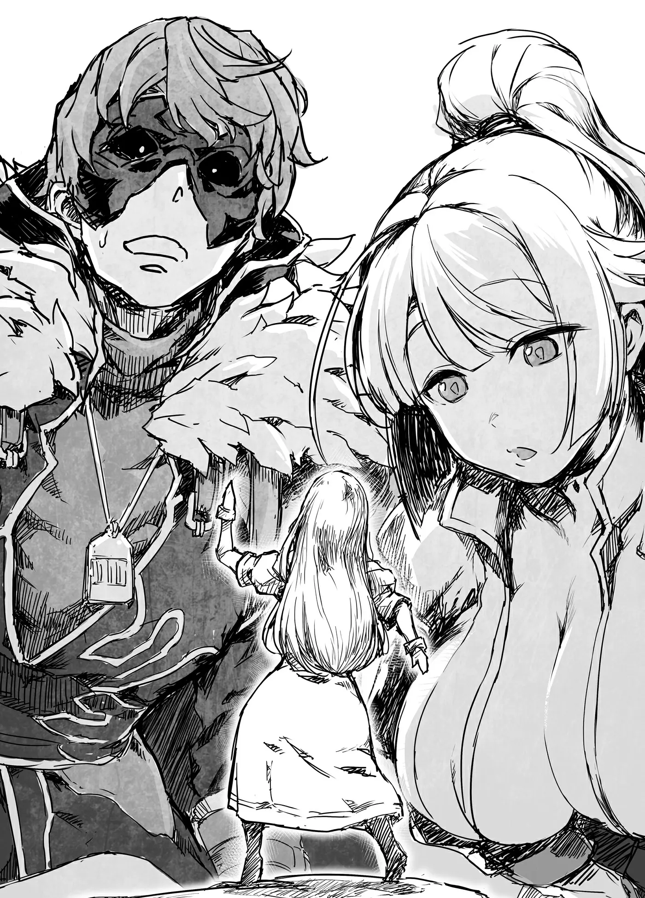

# Chương 144: Tập 6 Chương 3 - Bi Kịch Và Nguồn Gốc (4)

"Tôi đoán chỗ này chẳng mấy khi có bàn tay người chăm chút nhỉ," Lorraine nói khi chúng tôi đi quanh rìa phía tây ngôi làng vào ngày hôm sau.

Nơi này trông chẳng khác nào một cánh rừng. Chẳng có lối mòn nào để đi, bởi con đường ngày trước nay đã bị cỏ dại phủ kín. Rất dễ có thú dữ hay quái vật mò tới, nên những ngôi nhà ở đây từ lâu đã bị bỏ hoang cho mục nát. Tính ra thì chỗ này nằm ngoài rìa làng, nhưng thỉnh thoảng lũ trẻ vẫn rủ nhau tới đây để thử gan, nên người ta vẫn coi nó là một phần của Hathara. Cơ mà khoảng đất này khá quang đãng, nếu dọn sạch cỏ dại thì ở vẫn tốt.

"Hồi tôi còn nhỏ chỗ này đã thế rồi. Nghe đâu ngày xưa từng có con quái vật từ trong rừng mò ra tấn công dân làng. Kể từ dạo đó, người ta bỏ hoang cả khu này luôn."

Chuyện đó xảy ra từ rất lâu trước khi tôi chào đời, chắc là vào khoảng thời bà Gharb còn trẻ. Bà cùng mấy vị cao niên trong làng là những người hiếm hoi còn nhớ về thời đó.

"Vậy là chỉ cần đi chệch khỏi trung tâm một quãng ngắn thôi là đụng quái vật ngay được rồi à? Chỗ này đáng sợ thật đấy."

"Làng nhỏ mà, đành vậy thôi."

Lorraine hỏi thế cũng phải, vì cô vốn lớn lên ở thành phố. Ở đó quái vật gần như chẳng bao giờ bén mảng tới. Hathara đúng là đặc biệt hẻo lánh thật, nhưng hầu hết làng quê đều thường trực đối mặt với hiểm nguy rình rập. Thành phố có tường cao hào sâu cùng đội lính gác được huấn luyện túc trực ở cổng, còn ở chốn này thì hoàn cảnh hoàn toàn khác biệt.

Có người sẽ bảo sao chúng tôi không dọn hết lên thành phố mà ở, nhưng chuyện đó không thể làm được vì đủ thứ lý do. Trước hết là chỗ ở, mà tiền thuê nhà ở thành phố thì chẳng rẻ rúng gì. Ai muốn bám trụ lâu dài ở thành phố cũng cần một công việc có thu nhập khá khẩm, nhưng mấy chỗ tuyển người ở đó hiếm khi nhận kẻ chỉ có trình độ học vấn của một người nhà quê. Đó là trở ngại lớn nhất ngăn dân làng chuyển lên đó. Ai mà liều mình chấp nhận làm bất cứ nghề gì thì thường đi làm mạo hiểm giả, nhưng đó lại là một lựa chọn khắc nghiệt, kẻ nào thiếu kinh nghiệm chiến đấu sẽ mất mạng rất nhanh. Vả lại không phải ai cũng có Ma Lực hay Khí Lực, nên đa số dân làng gần như chẳng có cơ hội nào để lên thành phố lập nghiệp. Những người khác thì không muốn rời bỏ quê cha đất tổ, hoặc họ làm ra các sản phẩm từ nguồn nguyên liệu chỉ có ở vùng này, hay phải ở lại vì làm việc ở những khu lao động gần đó, cùng vô vàn lý do khác. Ở làng tuy nguy hiểm, nhưng chuyển đi nơi khác đâu phải cứ muốn là được.

"Hình như nó nằm sau ngôi nhà này," tôi nói khi dừng lại trước một trong những căn nhà xập xệ. Trông nó khá quen mắt.

Lorraine ngước nhìn căn nhà. "Trông cũng y hệt mấy căn kia thôi."

"Thì đúng rồi. Sao, cô tưởng nó phải có gì đặc biệt lắm à?"

"Phía sau nó có một ngôi đền thờ một thực thể thần thánh nào đó, nên tôi cứ ngỡ căn nhà này phải dùng vào mục đích đặc biệt nào chứ. Xem ra tôi nhầm rồi."

"Tôi hiểu ý cô, nhưng nếu thật thế thì tôi đã nhớ rõ hơn rồi. Khoan, chắc là căn đằng kia cơ."

Từng có hồi tôi hay lui tới đây, nhưng chuyện đó cũng đã nhiều năm rồi. Mỗi lần về làng, tôi cũng hiếm khi ghé lại. Bởi vậy ở đây chẳng có đường sá gì, hai đứa phải rẽ đám cây cối rậm rạp mà bước tiếp.

"Tới nơi rồi này. Đẹp đến bất ngờ đấy chứ," tôi nói khi tìm thấy nó.

"Cỡ này mà anh cũng khen đẹp được thì tôi chịu không biết trong đầu anh nghĩ cái gì nữa đấy, Rentt," Lorraine nói, nhìn tôi với ánh mắt đầy ngờ vực.

Cô nói thế cũng phải. Ngôi đền tuy chưa sập, nhưng đã bị mưa gió tàn phá, phân chim vấy bẩn, lại thêm dây leo chằng chịt bám đầy. Khen nó đẹp thì đúng là hơi quá lời thật. Cơ mà tôi vẫn thấy thế.

"So với hồi tôi mới tìm thấy thì nó đẹp hơn nhiều rồi, ít ra các phần vẫn còn ghép liền vào nhau."

"Hồi đó nó tàn tạ đến mức ấy cơ à?"

"Ừ. Mái thì mục nát hoàn toàn. Đến cả phần móng cũng bị xói mòn tới mức có chỗ mỏng manh như sợi dây. Chạm tay không khéo một cái là ngôi đền sập ngay."

"Thế mà anh vẫn cất công sửa lại cho bằng được à? Lắm lúc anh kỳ quặc thật đấy."

Lorraine ngạc nhiên khi thấy tôi lại chịu khó ôm đồm ngần ấy việc. Giờ nghĩ lại, chính tôi cũng thấy phục mình thật.

"Dù sao thì muốn sửa cũng phải biết hình dáng ban đầu của nó ra sao, nên tôi bắt đầu bằng cách cẩn thận tháo rời toàn bộ ra. Chỗ nào thấy không dùng được nữa thì tôi thay mới, mà hầu như phải thay gần hết, nên coi như dựng lại một căn nhà mới toanh rồi. Có điều vẫn còn vài phần xài được, mấy cái cột trông cũng còn trụ thêm được một thời gian. Thế là cuối cùng cũng dựng lại được thành hình khá tươm tất."

"Vậy là anh bỏ bao nhiêu công sức vào cái đền này, rồi bỏ mặc suốt mười năm không ngó ngàng, và giờ nó thành ra thế này. Chà, so với một căn nhà bình thường nhiều năm không ai trông nom thì tôi công nhận là nó cũng đẹp thật."

"Đúng thế đấy. Nào Lorraine, dọn dẹp thôi." Lorraine nghiêng đầu khó hiểu khi thấy tôi lôi xô, giẻ lau cùng mấy thứ đồ dọn dẹp ra khỏi túi ma thuật. "Cô dùng ma thuật đổ đầy nước vào xô này nhé. Tôi đi chặt bớt dây leo. Cố làm xong trước khi trời tối là được."

Tôi kéo cô vào việc này có phần hơi ép uổng, nhưng nhìn lại ngôi đền lần nữa, Lorraine có vẻ đã hiểu ra. "Dù sao thì anh còn sống được tới giờ cũng là nhờ sức mạnh của thứ đang ngự ở đây ban cho. Là bạn anh, chắc tôi cũng nên nói lời cảm ơn người ta một câu nhỉ," cô thở dài một tiếng rồi cầm lấy chiếc xô.

◆◇◆◇◆

"Dọn dẹp xong xuôi trông cũng ra dáng hẳn đấy chứ," Lorraine hài lòng nói. Mặt cô lấm lem bồ hóng, nhưng ánh mắt lại rạng rỡ dưới ráng chiều. Tôi hiểu cảm giác của cô. Mất khá nhiều thời gian thật, nhưng làm cho nơi này đẹp đẽ hơn thế này thì cũng bõ công.

Tôi cũng chẳng khá hơn, nhưng nhờ có mặt nạ với áo choàng chắn bớt nên người ngợm đỡ bẩn hơn hẳn. Chiếc áo choàng bí ẩn tôi nhặt được trong mê cung hồi ấy tốt đến khó tin. Nó không chỉ kháng lửa kháng độc, mà dường như còn chống bám bẩn nữa.

Sau đó, Lorraine dùng ma thuật tẩy sạch bụi bẩn trên người. Chỉ một thoáng sau, trông cô đã sạch sẽ như lúc chưa bắt tay vào làm.

"Nếu ban nãy cô niệm luôn Linpio lên ngôi đền thì có phải nhàn bao nhiêu rồi không," tôi nói thẳng tuột.

"Làm thế thì còn ý nghĩa gì nữa?" cô vặn lại. "Anh bảo muốn dọn dẹp để tạ ơn cơ mà. Tạ ơn thì phải tự tay mình mó vào chứ, đền thờ đạo nào chẳng thế. Vả lại Linpio cũng đâu có thần thánh đến mức ấy. Gặp mấy vết bẩn bám chặt quá là nó chịu chết ngay."

Lorraine làm mẫu bằng cách niệm Linpio lên một cành củi gần đó. Mấy chỗ xỉn màu vẫn y nguyên, nhìn chẳng sạch hơn rửa bằng nước là bao. Nó giống như bụi bặm, máu hay mực dính trên da thì tẩy được, chứ tì vết hay tàn nhang thì chịu, nỗi niềm muôn thuở của các thiếu nữ. Đến cả vảy vết thương nó cũng chẳng bóc đi được. Mà mực thì cũng phải chưa khô hẳn mới tẩy nổi.

Ma thuật nhìn thì tiện, nhưng chẳng hẳn là thế. Tất nhiên vẫn có thể dùng phép để tẩy bẩn bề mặt, nhưng lý do lớn nhất để không làm vậy chính là điều Lorraine vừa nói. Đã muốn tạ ơn thì tự tay làm lấy vẫn tốt hơn. Ngay cả tín đồ của Giáo Hội Đông Thiên, dù có người là ma pháp sư, cứ cuối mỗi mùa họ vẫn tự tay lau dọn bàn thờ. Linpio thuộc loại Ma Thuật Sinh Hoạt mà ngay cả tôi cũng dùng được, dùng ma thuật rõ ràng vừa nhanh vừa nhàn. Cơ mà phàm đã muốn tỏ lòng biết ơn thì phải chịu khó bỏ chút mồ hôi công sức.

"Dù gì thì cũng bõ công sức. Giờ nhìn vào khéo chẳng ai nhận ra ngôi đền ban nãy nữa," tôi ngắm lại một lượt rồi bảo. Mọi vết bẩn đã được kỳ cọ sạch trơn, dây leo cũng bị phạt sạch.

Bao nhiêu công dọn dẹp sửa sang sẽ đổ sông đổ biển nếu cỏ dại lại mọc um lên trong lúc tôi đi vắng, thế nên hai đứa tiện tay làm cỏ cả khu đất xung quanh luôn. Chỉ chừa lại mấy cây non, vì trông chúng có vẻ mọc vươn ra xa đền. Tôi chẳng rõ nơi này thờ ai, nhưng xét theo tính chất Thần Lực của mình thì chắc là một thần tinh linh thuộc hệ thực vật. Nếu thế thật thì tôi cũng không muốn phát quang quá nhiều cây cối làm gì. Cơ mà đám dây leo mọc bám đầy đền thì đành phải dẹp đi vì sự tiện lợi của con người. Nghĩ cũng hơi áy náy, nhưng chịu thôi, chẳng có cách nào khác.

"Nhìn tổng thể cả ngôi đền thế này, anh làm khéo tay thật đấy. Anh đúng là có khiếu đấy chứ, Rentt," Lorraine nói.

Tự nhận thì hơi kiêu, nhưng nước sơn sửa này rõ ràng hơn hẳn dân nghiệp dư làm chơi bời. Dù sao tôi cũng từng theo học một người thợ lành nghề, nên chuyện đó có gì lạ đâu. Tôi không dám vỗ ngực nhận mình giỏi giang, nhưng tay nghề chí ít cũng ngang tầm một người thợ học việc.

"Tôi học được nhiều thứ trong làng lắm, có cảm ơn thì cảm ơn mọi người ấy. Ai biết được kỹ năng nào rồi sẽ có lúc cần đến chứ. Giờ thì cầu nguyện thôi nhỉ?"

Đó vốn là mục đích chính của chuyến đi này—để cảm tạ sự che chở của vị đã ban phước cho tôi. Còn chuyện muốn biết đó rốt cuộc là ai, chắc đi hỏi mấy vị cao niên trong làng hoặc tra cứu sách cổ sẽ sáng tỏ đôi phần. Tôi không trông mong gì nhiều, nhưng thử chút cũng chẳng mất gì.

Tôi quỳ trước đền, chắp hai tay lại. Lorraine cũng làm theo. Cô chẳng cần phải làm thế, nhưng chắc là hùa theo cho vui. Biết đâu hôm nay lại thuyết phục được cô quy y theo tôn giáo của ngôi đền này thì sao. Cơ mà một thần tinh linh không có lấy một tín đồ thì chắc chẳng đủ điều kiện để coi là một tôn giáo riêng, dẫu nghĩ thế thì hơi bất kính thật.

Cầu nguyện chưa được bao lâu, tôi bỗng nghe loáng thoáng như có tiếng ai nói. "Lorraine, cô nghe thấy gì không?" tôi ngơ ngác hỏi.

Lorraine ngẩng lên nghiêng đầu. "Không, có gì đâu."

Nghĩ là mình nghe nhầm, tôi nhắm mắt cầu nguyện tiếp. "Tạ ơn ngài rất nhiều vì đã ban sức mạnh cho con suốt thời gian qua. Thú thật thì con chẳng phải kẻ sùng đạo gì, vậy mà không hiểu sao ngài vẫn luôn dõi theo con. Không có sức mạnh này, con đã chẳng thể đứng ở đây ngày hôm nay. Nếu không quá đường đột, xin ngài hãy tiếp tục chở che và ban phước cho con trên chặng đường sắp tới." Đó là đại ý lời nguyện của tôi.

Tận đáy lòng, tôi cũng muốn biết thần tinh linh này rốt cuộc là vị nào. Cơ mà đòi hỏi như thế thì khiếm nhã quá, nên tôi đành giữ kín trong bụng. Nếu có muốn hỏi thì để sau khi tìm hiểu ở làng đã rồi tính. Vả lại thần tinh linh xưa nay nổi tiếng là tính khí thất thường, nên có hỏi khéo cũng chẳng được hồi đáp. Chuyện người ta chịu ban phước cho tôi vốn đã là điều không ai ngờ tới rồi.

"Không ngờ tới à? Ngươi đã tu sửa đền cho ta kia mà. Thần tinh linh nào gặp cảnh đó mà chẳng ban phước cho ngươi, ta nghĩ thế đấy," một giọng nói có vẻ ấm ức vang lên.

Lần này thì chắc chắn không phải tôi nghe nhầm rồi. Tôi nhìn quanh, nhưng ngoài Lorraine ra thì chẳng có bóng ai.

"Rentt, tôi cũng nghe thấy rồi đấy," Lorraine nói. "Quanh đây có người ở à?"

Tôi lắc đầu. "Không, ở đây ngoài mấy căn nhà hoang cô thấy ra thì chẳng còn chỗ nào khác đâu. Họa hoằn lắm mới có mấy đứa trẻ con mò tới thám hiểm, chứ bình thường chẳng có ai bén mảng đến. Nếu làng này ở gần Maalt thì có khi bọn đạo tặc còn lấy mấy căn nhà đó làm nơi ẩn náu, chứ ở Hathara thì trốn ở đây chẳng bõ công."

Ngôi làng này quá xa xôi hẻo lánh. Trốn được người mà lại bị quái vật vồ thì cũng công cốc. Chưa kể dân Hathara thính lắm, trộm cắp nào mon men tới đây là bị tóm gáy ngay.

"Thế rốt cuộc là ai vừa nói?" Lorraine lẩm bẩm.

Tôi giật mình nhìn vào bụng cô. "Này, Lorraine..."

"Sao thế?"

"Có cái gì đang ngọ nguậy dưới áo cô kìa. Con gì thế không biết?"

"Áo của tôi á?"

Đến lúc này Lorraine mới cúi xuống và thấy có thứ đang cựa quậy.

"Gì thế?" tôi thắc mắc. "Cô lại làm thí nghiệm nhét sinh vật kỳ quái nào vào trong áo đấy à?"

Lorraine ngẫm nghĩ một chút. "Không, lúc này thì không," cô đáp. Câu trả lời đó như thể ngụ ý từng có lúc cô để mấy sinh vật kỳ lạ sống trên người mình thật. Dù tò mò muốn hỏi cho ra nhẽ, nhưng giờ chưa phải lúc.

"Thôi cứ lôi nó ra xem nào?"

"Ừ thì để xem nào," cô vừa nói vừa thọc tay vào trong áo, tóm lấy thứ gì đó rồi lôi ra.

"Chẳng phải dạo trước cô lấy món đó từ chỗ tôi à?" tôi hỏi.

"Hình như thế. Cơ mà cái quái gì thế này? Nó đang tự cử động kìa."

Đó chính là bức tượng nhỏ hình Lorraine tôi từng đẽo từ gỗ Ent Bụi Cây. Chẳng hiểu sao nó lại tự cựa quậy được. Thú thật nhìn rợn cả người.

"Có khi nào nó bị dính nguyền không?" tôi hỏi.

"Không, tôi không nghĩ thế. Tôi chẳng thấy chút tà khí nào như mấy món đồ bị nguyền cả. Dù nói đi cũng phải nói lại, cái mặt nạ của anh tôi cũng có thấy gì đâu," Lorraine nói, trong lúc bức tượng nhỏ vẫn không ngừng ngo ngoe. Cách nó chuyển động trông hơi ngượng nghịu. Tôi đã đẽo cho nó đủ cả tay chân, chí ít nó cũng phải cố cử động cho giống người một tí chứ. Là người làm ra nó, tôi thấy hơi thất vọng.

"Ngươi là kẻ vừa lên tiếng đấy à?" tôi hỏi con rối nhỏ.

Nhìn từ ngoài vào thì cảnh tượng này trông nguy hiểm vô cùng. Không phải nguy hiểm vì tôi đang tiếp xúc với một sinh vật không rõ lai lịch mà không chút phòng bị đâu nhé, mà là vì tôi đang nói chuyện nghiêm túc với một con búp bê. Thực ra trên đời vẫn có những con búp bê tự cử động được phần nào khi được truyền Ma Lực. Giới người điều khiển rối hay dùng chúng để biểu diễn hoặc đi làm mạo hiểm giả. Một con búp bê biết nói cũng không hẳn là chuyện không tưởng, nhưng miệng đời xưa nay chẳng mấy thiện cảm với những người điều khiển rối. Người ta coi họ là một lũ quái đản, và nghĩ thế cũng chẳng sai. Muốn thành một người điều khiển rối, vừa phải am tường ma thuật kỹ thuật cao cấp, vừa phải đam mê búp bê đến mức cuồng si, thành ra đầu óc họ lắm lúc cũng có vấn đề. Dĩ nhiên vẫn có người bình thường, nhưng mấy kẻ lập dị mới là thành phần đập ngay vào mắt người ta. Bản thân tôi chưa từng có ý định dính dáng đến thuật điều khiển rối, mà nếu có muốn thì cũng phải lấy hết can đảm mới dám thử.

Bức tượng quay mặt lại nhìn tôi. "Phải, ta nói đấy. Chào nhé," nó cất tiếng, nhưng giọng nói lại chẳng hề ăn khớp với khẩu hình. Câu chào nghe chẳng có gì lạ lùng, nhưng chính vì thế lại càng khiến tôi thấy rờn rợn. Lorraine với tôi đưa mắt nhìn nhau rồi mới nói tiếp.

"Thế rốt cuộc ngươi là thứ gì?" tôi hỏi. "Xét theo nơi chúng tôi đang đứng, tôi đoán ngươi chính là vị được ngôi đền này thờ phụng. Có đúng không?"

Con búp bê bất ngờ đứng bật dậy. "Đoán thế cũng gần đúng rồi đấy," nó bảo. "Cơ mà ta chỉ là một mảnh phân thân thôi. Đền chính của ta ở nơi khác, bản thể thật cũng ở đó, nên ở đây ta chẳng có mấy sức mạnh. Ta đúng là có ban phước cho ngươi, nhưng thứ lỗi vì ơn phước đó hơi còi cọc nhé. Ta chỉ có vỏn vẹn hai tín đồ thôi, nên đừng mong đợi gì nhiều."

Có quá nhiều thứ muốn hỏi đến mức tôi chẳng biết bắt đầu từ đâu.

Lorraine trầm ngâm một lát rồi hỏi, "Trước hết, chúng tôi đoán ngươi là một thần tinh linh, có đúng không?" Khởi đầu như thế là chuẩn đấy.

"Bảo thế thì cũng không hẳn là sai, nhưng như ta đã nói, ta chỉ là một mảnh phân thân của thần tinh linh thôi. Giờ thì ta giống một tinh linh bình thường hơn. Ta đã tách khỏi bản thể quá lâu nên giờ gần như là một cá thể độc lập rồi."

"Bản thể thật sự của ngươi là ai?"

"Viroget, Thần Thực Vật."

Viroget là vị thần cai quản cây cỏ và sự sinh sôi, kiêm cả chiến tranh lẫn mùa màng. Đó là một vị thần khá nguy hiểm, sẵn sàng khơi mào chiến tranh vì sự phồn vinh. Nghe đồn ngài vô cùng tàn nhẫn. Thế nhưng tinh linh trú trong bức tượng này trông lại khá hiền lành.

"Tại sao ngươi lại trú ngụ trong bức tượng này?" Lorraine hỏi.

"Chà, không có vật thể để nương náu thì khó mà hiện hình rõ ràng cho người phàm nhìn thấy được. Nếu có một đền thờ đàng hoàng thì họa may còn khác, chứ cái đền con con nơi góc núi này thì chịu. Ta muốn nói chuyện với hai ngươi nên phải tìm cách, mà bức tượng này tình cờ lại quá vừa vặn."

"Nó vừa vặn ở điểm nào?"

"Nó được làm từ vật liệu chứa Ma Lực, đúng không? Lại còn do chính tay tín đồ của ta tạc ra nữa chứ. Bọn ta không thể trú trong đồ vật làm từ vật liệu thường, nên ta mới may mắn vớ được đấy."

Lorraine tình cờ mang bức tượng bên người nên tinh linh này mới gặp được chúng tôi. Đúng là may thật, cơ mà tôi cứ băn khoăn không hiểu sao ban đầu Lorraine lại mang theo món này bên mình làm gì. Thôi để lúc khác hỏi vậy.

"À phải rồi, ngươi bảo có hai tín đồ. Là những ai thế?" tôi hỏi.

Bức tượng chỉ tay về phía chúng tôi. "Tín đồ đấy," nó nói.

Nói thật thì tôi đâu phải người sùng bái thần linh gì cho cam. Tôi có cầu nguyện đấy, nhưng suốt mười năm qua số lần cầu khấn đếm trên đầu ngón tay. Bảo tôi là tín đồ của vị tinh linh này nghe cứ gượng gạo thế nào.

Bức tượng như đọc được suy nghĩ của tôi. "Đền này có ai thèm đến nữa đâu, nên không phải hai ngươi thì còn ai vào đây. Ta biết chỗ này bị bỏ hoang rồi mà. Khoan, quan trọng hơn là ta phải ban phước cho tín đồ mới của mình chứ!" Nó bỗng reo lên rồi bay lơ lửng giữa không trung. Bức tượng phát sáng, lượn thành một vòng quanh người Lorraine, miệng lẩm bẩm những lời tôi nghe không rõ. Rồi quanh người Lorraine bắt đầu tỏa ra thứ ánh sáng mà tôi nhận ra ngay tắp lự.

"Đó là Thần Lực."

"Thần Lực á? Cái này ấy hả?" Lorraine hỏi. Cô sững sờ nhìn luồng ánh sáng đang phát ra từ người mình. Trông cô chẳng giống một tín đồ đang run lên vì sung sướng khi được thần linh ban phước chút nào. Nói đúng hơn, trông cô hệt như một học giả điên cuồng đang hí hửng vì vớ được đề tài mới để nghiên cứu. Nhìn cô chẳng bới đâu ra nửa hạt đức tin, khiến tôi không khỏi băn khoăn liệu vị tinh linh này có chọn nhầm đối tượng không. Cơ mà trông nó có vẻ đắc ý lắm.
