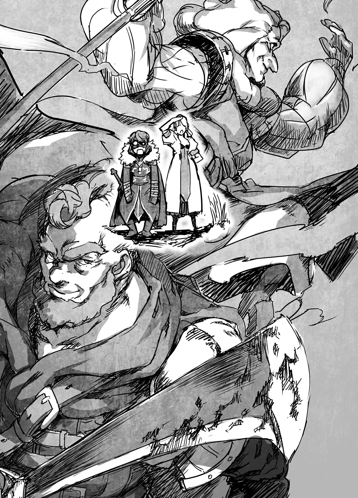

# Chương 146: Tập 6 Chương 4 - Bí Mật Của Hathara (1)

"Ồ, cuối cùng hai đứa cũng tới rồi đấy à. Có biết ta đã phải đợi bao lâu rồi không?"

Vừa đến trước nhà Gharb và gõ cửa, cánh cửa liền mở ra, để lộ bà lão tinh quái ở phía bên kia. Trong mắt tôi, trông bà lúc nào cũng đáng sợ, và ngay cả lúc này tôi vẫn không thể nghĩ khác đi được. Ở một tầng mức bản năng nào đó, cứ nhìn thấy gương mặt ấy là tôi lại chẳng dám cãi lời. Nói thế không có nghĩa là trông bà giống quái vật hay gì đại loại vậy. Huống chi, hồi còn là một con Ngạ Quỷ, trông tôi còn dễ sợ hơn nhiều.

"Nào, đừng đứng trơ ra đó nữa. Vào đi. Trong nhà ta còn có một vị khách khác đang đợi đấy," Gharb nói tiếp.

Tôi chẳng đoán nổi vị khách kia là ai. Hathara nhỏ đến mức mọi dân làng đều đối đãi với nhau như người thân trong nhà. Việc tạt qua nhà nhau ăn bữa tối là chuyện thường ngày ở huyện, nên đối với đa số mọi người thì điều này chẳng có gì lạ lùng. Thế nhưng, Gharb rất hiếm khi có khách, vì vậy tôi bắt đầu cảm thấy có gì đó mờ ám.

Chúng tôi bước vào trong và đi theo Gharb cho tới khi đến một căn phòng có kê bàn ăn. Đã có một người đàn ông ngồi sẵn ở đó, và ông ấy giơ tay lên chào. "Ồ, Rentt, cháu đây rồi. Còn cô là tiểu thư dùng ma pháp ảo ảnh đó à?"

Dĩ nhiên là tôi nhận ra ông ấy. Tối qua ông cũng có mặt ở bữa tiệc. Tên ông là Capitan, và ông là trưởng nhóm thợ săn của làng. Ông cũng là một trong những người thầy khác của tôi. Ông đã dạy tôi cách dùng dao săn và cung tên, cách băng rừng sao cho đúng lối, cũng như cách sinh tồn nơi chốn hoang dã.

Capitan đã có hai đứa con ở độ tuổi thiếu niên và tuổi tác cũng chẳng còn trẻ trung gì, nhưng bản lĩnh của ông vẫn chưa hề mai một. Những múi cơ bắp phủ kín thân hình ông hệt như một bộ giáp, đồ sộ đủ để sánh ngang với bất kỳ kiếm sĩ nào ở Maalt. Mà dẫu không có được thân hình ấy, nhiều khả năng ông vẫn có thể đánh bại bọn họ nhờ sự thuần thục tuyệt đỉnh về Khí Lực.

Khí Lực là một kỹ năng mà mọi mạo hiểm giả đáng ra đều phải có, nhưng không phải ai cũng làm được. Tuy nhiên, Capitan lại có thể vận dụng nó ở mức độ cao cấp. Toàn bộ những thợ săn dưới quyền ông đều biết cách sử dụng Khí Lực, và dẫu không thuần thục bằng ông, trình độ của họ cũng đủ dùng. Đến thời điểm hiện tại, có lẽ tôi đã đủ mạnh để đánh bại những người thợ săn đó, nhưng tôi không dám chắc mình có thể hạ được Capitan hay không. Tôi chưa từng một lần thấy ông nghiêm túc giao chiến; ông đâu cần phải làm vậy. Đây hoàn toàn không phải mẫu đàn ông chịu sống mòn trong bóng tối mờ mịt ở một ngôi làng miền núi hẻo lánh thế này, thế nhưng trông ông vẫn rất hài lòng với cuộc sống. Có lẽ ông không phải kiểu người nhiều tham vọng, nhưng quả thực ông là một người rất khó đoán. Dù thế nào đi nữa, ông cũng là một con người kỳ lạ.

Lorraine đã gặp ông ấy trong bữa tiệc tối qua. Cô kể với tôi rằng ông đã gặng hỏi rất nhiều về cách tôi chiến đấu trong ảo ảnh mà cô trình diễn. Chỉ nội việc biết điều đó thôi cũng đủ khiến tôi thấy không thoải mái rồi. Trên thực tế, cả cái tình cảnh này đều ngượng ngùng đến khó chịu. Hai người thầy của tôi đang có mặt ở đây — ba người nếu tính cả Lorraine là giáo viên dạy ma pháp cho tôi.

"Sao Capitan lại ở đây thế ạ?" Tôi nghiêng đầu hỏi.

Trong khi tôi gọi Gharb là Sư phụ thì với Capitan, tôi chỉ gọi thẳng tên ông. Từ rất lâu trước đây, hồi ông dạy tôi tất cả những kỹ năng ấy, tôi từng gọi ông là Sư phụ nhưng ông bảo danh xưng đó không hợp với mình chút nào. Có lẽ ở một chừng mực nào đó ông thực sự nghĩ vậy, song đôi khi trông ông chỉ như đang ngượng ngùng mà thôi. Thỉnh thoảng tôi vẫn cứ gọi ông là Sư phụ. Điều đó làm ông phấn khởi, nhưng đồng thời cũng khiến ông lúng túng chẳng biết nói gì. Dẫu vậy, về cơ bản ông là một người hiền lành.

Tuy nhiên, tôi vẫn không hiểu vì sao ông lại có mặt ở đây. Thật là kỳ quặc.

"Chú chỉ muốn xem dạo này cháu tiến bộ thế nào thôi," Capitan nói. "Chú vừa trò chuyện với Gharb về cháu. Rồi tiểu thư ảo ảnh đằng kia, Lorraine, cũng cho bọn chú thấy cháu chiến đấu ra sao nữa."

Lorraine đã phóng đại ảo ảnh của mình theo không ít phương diện, nhưng chí ít cô cũng đã tái hiện một cách chân thực cách thức tôi chiến đấu. Cô thậm chí còn đưa vào cả một vài chi tiết nhỏ nhặt. Tôi có phần sững sờ trước điều đó, song đồng thời tôi cũng nhìn ra được những điểm mình có thể cải thiện, nên màn trình diễn đó quả thực rất đáng xem. Thế nhưng, việc để các vị sư phụ của mình xem nó lại khiến lòng tôi dâng lên một cảm giác khó tả.

"Capitan, đừng có dọa nó," Gharb trách khéo. "Rentt, bọn ta ở đây không phải để bắt bẻ cháu đâu, đừng lo về chuyện đó. Bọn ta chỉ có vài điều muốn hỏi thôi."

Tôi cố suy đoán xem họ muốn hỏi điều gì, nhưng có quá nhiều khả năng không sao kể xiết. Tôi đưa mắt nhìn Lorraine trong lúc đắn đo xem nên nói gì. Vốn dĩ tôi cũng chẳng biết liệu mình có thể giấu giếm được điều gì trước hai con người này hay không.

"Nhưng chưa phải lúc này," Gharb nói tiếp. "Bắt hai đứa phải trả lời hết mọi thứ thì bất lịch sự quá, nên bọn ta quyết định sẽ kể cho hai đứa nghe về bí mật của ngôi làng này trước đã. Dĩ nhiên là bọn ta đã nói trước với Ingo rồi."

"Bí mật gì cơ ạ? Cháu không có ý coi thường Hathara, nhưng cháu cứ ngỡ nơi đây chỉ là một ngôi làng nhỏ trên núi thôi chứ. Thế nhưng bản lĩnh của bà và Capitan lại thuộc hàng hiếm thấy, ngay cả ở Maalt cháu cũng hiếm khi được chứng kiến."

Tôi từng thấy kỳ lạ khi có quá nhiều nhân vật như vậy tề tựu ở một ngôi làng hẻo lánh, nhưng chuyện đó không phải là bất khả thi. Người ta có thể kể ra vô số giai thoại về những mạo hiểm giả Bạch Kim Cấp đột ngột giải nghệ vào một ngày đẹp trời rồi quay về ngôi làng nơi mình lớn lên. Những câu chuyện tương tự về các tướng lĩnh quân đội và pháp sư cung đình cũng nhiều không đếm xuể. Người ta có thể tìm đến gần như bất kỳ ngôi làng nghèo khó nào và bắt gặp một nhân vật lẫy lừng khoác trên mình bộ thường phục rảo bước quanh đó. Chính vì thế, tôi luôn cho rằng chẳng có gì quá đỗi kỳ lạ về Hathara cả. Nhưng qua cách nói chuyện của Gharb, dường như có một nguyên do to tát hơn ẩn sau tất cả những chuyện này.

Tôi nhìn sang Lorraine, và cô nhìn lại tôi với nét mặt như muốn nói rằng bấy lâu nay cô đã biết nơi này có điều gì đó bất thường. Suốt từ lúc chúng tôi đặt chân tới đây, cô luôn cảm thấy có gì đó khác lạ.

"Phải, phần lớn những gì cháu nghĩ đều đúng," Gharb đáp. "Nói đúng hơn là đúng đối với đa số dân làng. Cháu chưa từng nghĩ nơi đây có gì khác ngoài một ngôi làng bình thường, đúng không? Chà, có thể cháu từng nghĩ nó hơi khác thường một chút, nhưng ta dám chắc cháu chẳng mảy may nghĩ xa hơn thế đâu."

"Cháu đúng là có thấy bà và Capitan trông hơi lạc lõng so với nơi này, nhưng cũng chỉ đến thế thôi ạ." Tài năng của họ xuất chúng đến mức ngay tại Maalt, họ cũng sẽ được người ta săn đón nồng nhiệt. Gharb sẽ được trọng vọng như một đại phu, còn Capitan sẽ được tôn sùng như một chiến binh cừ khôi. Vậy mà họ vẫn ở lại chốn này. Trong suốt những năm tháng phiêu lưu ở Maalt, tôi thường hay nghĩ về điều đó.

"Vậy nghe qua thì nơi này thực sự không phải là một ngôi làng bình thường sao?" Lorraine cất lời hỏi.

Capitan đáp, "Không, giờ thì coi đây là một ngôi làng bình thường cũng được. Đúng như bà lão đã nói, đối với phần lớn dân làng thì là vậy. Xưa nay vẫn thế, và sau này cũng sẽ mãi như thế. Nhưng với tôi, Gharb và Ingo thì lại hơi khác một chút."

Ba con người Capitan vừa liệt kê trên thực tế chính là những người nắm quyền cai quản ngôi làng. Một nơi dân cư thưa thớt như thế này đâu cần đến một hội đồng hay những chức vụ hành chính quy củ như ở Maalt. Ba người họ là những người mà dân làng tìm đến thỉnh giáo mỗi khi có chuyện xảy ra, và đối với dân làng, họ chính là những người đưa ra quyết định sau cùng. Ingo dĩ nhiên được tính vào vì ông là trưởng làng; Gharb được xem là người thông thái nhất làng; còn Capitan là thủ lĩnh của nhóm chiến binh hùng mạnh nhất.

Và đối với ba người họ, đây tuyệt nhiên không phải một ngôi làng bình thường. Tôi tự hỏi điều đó rốt cuộc có nghĩa là gì. Lẽ tự nhiên, Lorraine cũng có cùng thắc mắc. Tôi chẳng trông mong chuyện này có liên quan gì đến lý do mình biến thành Undead, nhưng có lẽ nó sẽ giải thích được vì sao ngôi đền thờ kia lại bị đối xử như thế. Tôi đã sống phần lớn cuộc đời mình ở ngôi làng này, và cái ý nghĩ rằng nó đang chôn giấu một bí mật khiến sự tò mò trong tôi trỗi dậy cồn cào.

Cả Lorraine lẫn tôi vốn dĩ đều là những kẻ mang bản tính tò mò. Nếu không như vậy, chúng tôi đã chẳng chọn làm mạo hiểm giả. Một mạo hiểm giả là kẻ sẵn sàng làm bất cứ điều gì, kể cả liều mạng, chỉ để vén màn dù chỉ một bí mật của thế giới này. Giờ đây khi đã biết ngôi làng đang che giấu một bí mật, việc rời đi trước khi nghe hết câu chuyện rõ ràng không phải là một lựa chọn.

"Vậy đối với ba người, Hathara rốt cuộc là nơi thế nào ạ?" Tôi hỏi, đi thẳng vào trọng tâm vấn đề.

"Ta có thể kể cho hai đứa nghe ngay tại đây, nhưng hai đứa sẽ chẳng thể thực sự cảm nhận được những gì ta đang nói đâu," Gharb bảo. "Ta muốn nói kỹ hơn về chuyện này vào ngày mai. Có một nơi ta muốn cả bốn chúng ta cùng đến. Đó là lý do ta bảo hai đứa ghé qua sau khi xem xong ngôi đền, nhưng giờ thì trời đã tối rồi. Đi vào thời điểm này trong đêm sẽ rất nguy hiểm. Tối nay, hai đứa cứ ở lại đây dùng bữa đi. Sáng mai lại qua đây, rồi ta sẽ kể cho nghe tất cả."

Bà lão mỉm cười.

◆◇◆◇◆

"Rốt cuộc thì bà ấy biết được những gì chứ? Tôi nôn nóng muốn biết quá đi mất," Lorraine tỏ ra thích thú nói.

Giờ đã là sáng hôm sau, và chúng tôi đang trên đường tới nhà Gharb. Tâm trạng của tôi cũng chẳng khác gì cô. Những ngôi làng trông bề ngoài có vẻ bình thường nhưng lại ẩn chứa một bí mật đặc biệt vốn là đề tài cho biết bao câu chuyện truyền tụng từ ngàn xưa. Chỉ có một số ít người may mắn mới được trải qua những chuyến phiêu lưu như thế, trong khi những mạo hiểm giả tầm thường như chúng tôi có thể sống hết cả đời mà chẳng bao giờ chạm trán điều gì ly kỳ đến vậy. Thế nhưng giờ đây nó lại đang diễn ra, mà lại ngay trong chuyến về thăm quê nhà này của tôi nữa chứ. Chẳng có lý do gì để không phấn khích cả.

"Tôi cũng thế," tôi bảo, "nhưng tôi thật sự khâm phục việc họ có thể giấu kín điều đó suốt bấy lâu nay. Mà không chỉ giấu mỗi tôi đâu, họ giấu cả toàn bộ dân làng nữa cơ."

Theo lời họ thì bí mật này chỉ có Gharb, Capitan và Ingo hay biết. Nếu đó là một bí mật trọng đại đến thế, tôi quả thực phải ngả mũ thán phục trước việc họ có thể giữ kín nó suốt ngần ấy năm trời. Có lẽ tôi không nhận ra là vì tôi đã rời làng từ khi còn nhỏ và cũng đã xa quê một quãng thời gian dài, nhưng Riri và Fahri dành gần như toàn bộ thời gian sống ở đây mà hai cô bé vẫn chẳng hề hay biết. Chuyện đó thật đáng kinh ngạc. Hoặc là vậy, hoặc bí mật kia thực chất chẳng có gì to tát cho lắm. Cơ mà như thế thì mất vui, nên tôi vẫn mong đó là một bí mật thực sự lớn.

"Họ giấu được, đúng là vậy, nhưng nghe cách họ nói thì có vẻ dù sao đi nữa điều đó cũng chẳng can hệ gì mấy đến dân làng thời nay. Có khi chỉ đơn giản là họ chưa từng thấy cần thiết phải nhắc tới mà thôi," Lorraine phỏng đoán, dù lúc này cả hai chúng tôi đều chưa rõ liệu suy đoán của cô có đúng hay không.

Tôi nhìn thẳng về phía trước và thấy nhà của Gharb. "Ồ, tới nơi rồi. Cháu chào mọi người ạ!" Tôi cất tiếng gọi lớn.

Đang đứng đợi bên ngoài cửa, bà lão và người đàn ông vạm vỡ đưa mắt nhìn về phía chúng tôi. Gharb đang mặc chiếc áo khoác mà bà chỉ diện vào những chuyến đi xa dài ngày, còn Capitan thì vận trang phục đi săn. Cả hai rõ ràng đều đã chuẩn bị sẵn sàng để lên đường đến một nơi nào đó. Bên hông Capitan thậm chí còn đeo một con dao săn, trên vai khoác cây cung và sau lưng mang theo một bao tên. Nhưng phía chúng tôi cũng trang bị kỹ càng đủ để dấn thân ra ngoài làng. Trong phần lớn thời gian ở lại thăm quê, tôi chỉ mặc thường phục nhẹ nhàng, nhưng giờ đây tôi đã khoác lên mình bộ trang bị của mạo hiểm giả. Tôi mang theo thanh kiếm bên mình, còn Lorraine cũng cầm theo cây đũa phép cùng một con dao găm.

"Được rồi, đông đủ cả rồi đấy," Gharb nói, đưa mắt nhìn bộ trang phục của tôi. "Bộ đồ đó hợp với cháu đấy, Rentt. Giờ trông cháu đã ra dáng một mạo hiểm giả thực thụ rồi."

Ý bà là chiếc áo choàng, chiếc mặt nạ và thanh kiếm — tất cả những thứ khiến tôi trông đầy vẻ khả nghi. Tôi từng kể với Gharb chuyện mình không thể tháo chiếc mặt nạ ra, nhưng những người khác lại tự suy diễn rằng đây là xu hướng thời trang ở Maalt. Tôi thầm cầu nguyện với Viro rằng nếu sau này có dịp lên Maalt tham quan vãn cảnh, họ sẽ không ai bảo ai mà đeo mặt nạ đi nhan nhản khắp phố. Rồi tôi thoáng nghĩ dường như mình vừa nghe thấy ai đó nói rằng lời cầu nguyện đó thật ngớ ngẩn và việc cầu nguyện đâu phải dùng vào mục đích ấy, nhưng có lẽ chỉ do tôi tưởng tượng mà thôi.

"Cháu đâu có muốn ăn mặc thế này đâu ạ," tôi đáp. "Nhưng chiếc áo choàng này thoải mái và tiện lợi đến bất ngờ, nên cháu rất quý nó."

"Tiện thế nào cơ?" Capitan hỏi.

Tôi không thể làm ngơ trước câu hỏi từ một trong những người thầy của mình. Tôi không phải lúc nào cũng trả lời thành thật, nhưng không thể nào không đáp lại.

"Nó bền chắc hơn cả giáp kim loại thông thường, lại còn kháng được độc tố. Với lại nó cũng chẳng hề bám bẩn nữa ạ," tôi nói, trong đầu bắt đầu tự hỏi nếu đem bán chiếc áo choàng này thì sẽ đáng giá bao nhiêu. Giờ đây thật khó mà hình dung nổi cuộc sống thiếu nó, thế nên tôi sẽ chẳng làm thế đâu, nhưng đó quả là một thắc mắc thú vị. Nếu có dịp diện kiến Thần Giám Định, có lẽ tôi cũng có thể nhờ ngài giám định luôn cả chiếc áo choàng này xem sao.

"Hử, thế chú bắn thử một mũi tên vào xem sao nhé?" Capitan thích thú hỏi.

Tôi vội vàng lắc đầu quầy quậy. "Dạ thôi, cháu can chú đấy ạ! Capitan bắn khéo lại xuyên thủng thật ấy chứ!"

Tôi nói vậy không đơn thuần chỉ để nịnh bợ ông. Khi ông nghiêm túc bắn một mũi tên, nó luôn luôn xuyên thủng mục tiêu. Bản thân cây cung không hề quá đỗi mạnh mẽ, thế nên uy lực đó hoàn toàn nhờ vào sức mạnh của Khí Lực. Việc rót Khí Lực vào kiếm, giáo và những vũ khí cầm tay khác đòi hỏi một quá trình luyện tập không nhỏ, nhưng đó là một mục tiêu khả thi. Tuy nhiên, làm điều tương tự với thứ vũ khí không còn tiếp xúc trực tiếp với cơ thể lại là chuyện vô cùng gian nan. Vậy mà Capitan lại có thể làm được. Mũi tên của ông thậm chí còn có thể bắn vỡ cả những tảng đá lớn. Dù đang khoác chiếc áo choàng này, cũng chẳng có gì bảo đảm rằng tôi sẽ toàn mạng. Có lẽ sẽ không sao đâu, nhưng việc đó không đáng để tôi phải liều mạng thử nghiệm.

Capitan trông có vẻ thất vọng trước lời từ chối của tôi. "Thế thì thôi vậy. Dù sao thì lát nữa tỉ thí một trận nhé. Chú muốn xem cháu làm được những gì rồi."

Cuộc trò chuyện này đang bắt đầu rẽ sang một chiều hướng tồi tệ hơn rồi. Thành thực mà nói, tôi chẳng muốn phải dây dưa vào vụ đó chút nào. Dù gì đi nữa, Capitan cũng là một trong những người đã dạy tôi chiến đấu. Tôi học phần lớn kiếm thuật từ vị mạo hiểm giả từng ghé qua làng, nhưng tôi lại học cước pháp di chuyển cùng những kỹ năng tương tự từ Capitan. Năng lực thể chất mới có được này của tôi có lẽ đủ để tôi giành phần thắng, nhưng tôi không dám chắc chắn trăm phần trăm. Tôi chưa từng thấy Capitan ra sao khi ông thực sự nghiêm túc.

Dù sao đi nữa, tôi cũng chẳng thể nào từ chối lời tỉ thí. Đã là học trò thì phải nghe lời thầy thôi.

"Vâng ạ," tôi thở dài nói. "Để lát nữa tính sau đi ạ. Thế rốt cuộc chúng ta đang đi đâu vậy ạ?"

"Khu rừng phía bắc," Gharb đáp. "Tận sâu chốn thâm sơn cùng cốc của nó."

Tôi có phần sững sờ. Đáng lẽ ra không một ai được phép bước chân vào khu rừng phía bắc cả. Nơi đó lúc nhúc những con quái vật hùng mạnh đến mức ngay cả những người thợ săn của Hathara cũng phải tránh thật xa.

"Đó là lý do cả hai người đều trang bị đầy đủ thế này sao ạ?" Tôi hỏi.

Cũng hợp lý thôi. Tôi chưa từng thấy Gharb chiến đấu bao giờ, nhưng theo lời Lorraine thì bà có lẽ là một ma pháp sư thượng thặng. Còn Capitan, theo đánh giá của tôi, cũng là một chiến binh cự phách. Bọn họ hoàn toàn đủ khả năng tiến vào khu rừng vốn là cấm địa đối với dân làng Hathara. Thế nhưng không hiểu sao hôm nay trông họ lại có phần căng thẳng. Có lẽ nơi đó nguy hiểm đến mức ấy thật.

"Ừ, đúng thế," Gharb nói. "Hai đứa phải hết sức cảnh giác đấy. Đây không phải một khu rừng bình thường đâu. Giờ thì đi thôi."

Gharb dẫn đầu mở đường, thế nên chúng tôi bắt đầu cất bước bám theo sau lưng bà.

◆◇◆◇◆

Capitan vung con dao săn chặt đứt phăng đầu một con Goblin. Ba con Goblin khác lao về phía ông với những con dao găm rỉ sét, toan đánh úp bất ngờ, nhưng ông nghiêng mình né sang một bên rồi vung lưỡi dao chém ngọt qua cả ba con. Cách đó không xa, Gharb liên tục phóng ra những lưỡi dao gió vào một con quái vật nhện khổng lồ mang tên Gadol Akavish, chặt đứt lìa từng chiếc chân của nó. Con nhện cố dùng những chiếc chân còn lại để tấn công Gharb, nhưng bà nhanh nhẹn khác thường so với tuổi tác của mình và thoăn thoắt né tránh từng đòn đánh. Bà là một ma pháp sư và nhiều khả năng nắm giữ các kỹ thuật cường hóa thể chất, thế nên chuyện đó cũng chẳng phải quá đỗi bất thường, nhưng việc chứng kiến một bà lão nhảy nhót thoăn thoắt như một con khỉ quả thực có phần rợn người. Chưa kể bà còn làm được tất cả những điều đó trong khi vẫn liên tục thi triển ma pháp. Phần lớn ma pháp sư thường tác chiến hệt như những khẩu đại pháo cố định một chỗ, nhưng Gharb lại khác biệt về mặt bản chất. Bà chiến đấu hệt như một ma kiếm sĩ hay một chiến pháp sư. Thậm chí đáng sợ hơn cả là những cú đấm của bà dường như còn mạnh bạo hơn cả ma pháp mà bà phóng ra.

"Hai chúng ta mới là mạo hiểm giả ở đây cơ mà, vậy mà chúng ta thậm chí còn chẳng có cơ hội để ra tay làm việc nữa," một lúc sau, khi trận chiến đã ngã ngũ, Lorraine lẩm bẩm than thở. Xung quanh chúng tôi là la liệt xác quái vật.

Từ khi còn bé, tôi đã luôn được căn dặn không được bén mảng tới khu rừng phía bắc, và quả nhiên nơi đây nguy hiểm y như những lời cảnh báo bấy lâu nay. Rất hiếm có khu rừng nào lại lúc nhúc nhiều quái vật đến thế, trừ phi xảy ra một đợt bùng phát hay quái triều. Trên thế giới này có vô số vùng lãnh địa khác thường bị coi là chốn nguy hiểm, và những nơi đó có lẽ cũng sẽ mang lại cảm giác khác lạ nếu tôi đặt chân vào, nhưng tôi chưa bao giờ ngờ rằng lại có một nơi như thế này nằm ngay gần quê hương mình.

"Làm sao Hathara có thể tồn tại bình yên với cả bầy quái vật đông đúc ở sát ngay bên cạnh thế này được chứ?" Tôi thì thầm.

Gharb nghe thấy lời tôi và bảo, "Không thành vấn đề đâu. Lũ quái vật này sẽ không bao giờ bén mảng tới Hathara đâu."

Nếu đúng là vậy thì thật yên tâm, nhưng tôi chẳng biết bà lấy bằng chứng gì để khẳng định như thế. Tôi thừa biết rằng phần lớn quái vật hùng mạnh đều có lãnh địa riêng mà chúng không bao giờ rời khỏi, thế nhưng ở đây cũng có đầy rẫy Goblin, Slime cùng những loài quái vật hạ cấp phổ biến khác. Việc chúng chỉ hoạt động giới hạn trong một khu vực nhất định quả là điều vô lý. Chúng sinh tồn dựa vào khả năng sinh sôi nảy nở hơn là sức mạnh cá thể, thế nên chúng luôn ráo riết bành trướng sang những vùng đất khác. Cái khái niệm chỉ chịu chôn chân ở một nơi là điều hoàn toàn xa lạ đối với chúng. Thỉnh thoảng Goblin cũng dựng nên những khu định cư riêng, nhưng nếu mang lòng thù địch với con người, chúng sẽ tìm cách đánh chiếm một ngôi làng của nhân loại rồi dọn vào ở sau khi bầy đàn đạt tới một quy mô nhất định. Lũ Slime thì còn đơn giản hơn thế nhiều. Chúng cứ liên tục phân chia nhân bản rồi tràn đi khắp mọi ngóc ngách. Do đó, việc chúng hiện diện ở đây đồng nghĩa với việc chúng hoàn toàn có thể dễ dàng tìm đường tràn xuống Hathara.

Thế nhưng, dẫu Gharb và Capitan dường như thấu hiểu những thắc mắc của chúng tôi, họ vẫn chỉ lẳng lặng tiếp tục tiến sâu hơn vào khu rừng. Có vẻ như họ muốn ngầm bảo rằng khi nào tới nơi thì họ sẽ kể cho chúng tôi nghe. Lorraine và tôi nhìn nhau, bất lực lắc đầu rồi tiếp tục cất bước bám theo sau.