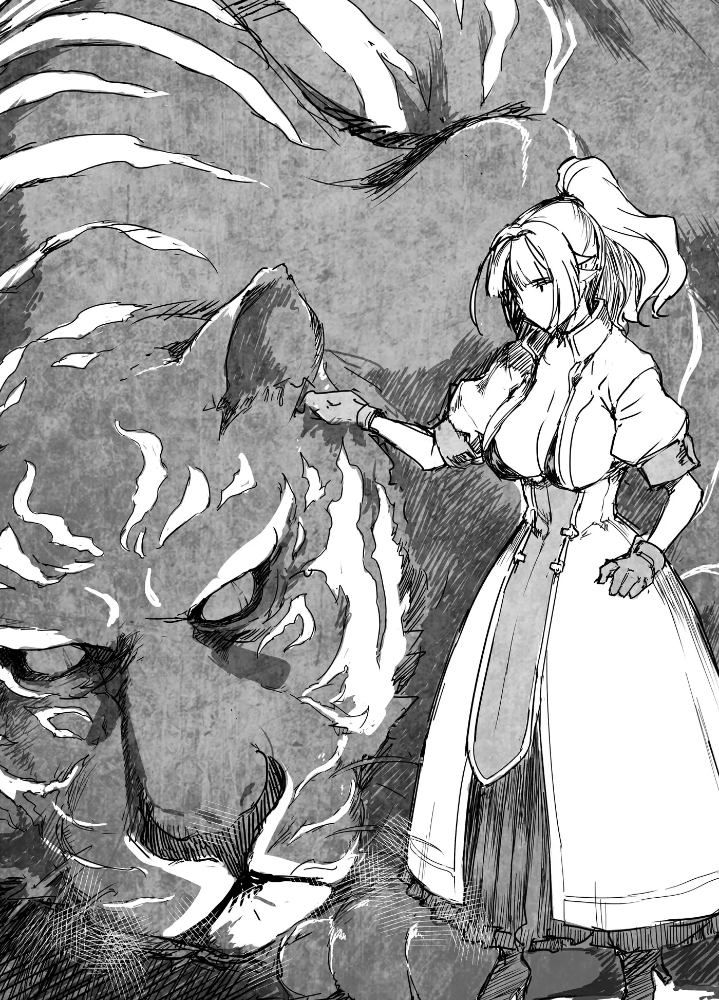

# Chương 147: Tập 6 Chương 4 - Bí Mật Của Hathara (2)

"Đến nơi rồi đấy," Gharb lên tiếng sau vài tiếng đồng hồ chúng tôi rảo bước quanh khu rừng, đúng vào lúc tôi bắt đầu cảm thấy phát ngấy.

"Đây là một pháo đài sao? Trông cổ kính thật đấy," Lorraine thì thầm.

Nhìn từ mọi góc độ, quả thực nơi đây trông giống như một dạng pháo đài. Nó tựa như một tòa lâu đài nhỏ xây bằng đá, nhưng năm tháng chẳng hề nương tay với nó. Vài phần của kiến trúc đã xuống cấp trầm trọng. Cây cối và dây leo mọc um tùm, phủ kín gần như toàn bộ bề mặt bằng một màu xanh rì. Nếu phóng tầm mắt về hướng này từ làng Hathara, người ta sẽ chỉ nghĩ nó chẳng qua là một phần của cánh rừng. Thế nhưng rõ ràng ở đây có một pháo đài.

Tôi chưa từng hay biết có thứ gì như thế này tồn tại gần Hathara, nên điều đó khiến tôi thoáng kinh ngạc. "Cô có nghĩ đây chính là bí mật của Hathara không?" tôi hỏi.

"Có lẽ vậy. Tôi khá tò mò không biết nó được xây dựng từ khi nào, nhưng dám chắc là nó chẳng hề mới mẻ gì rồi," Lorraine đáp.

Thành thật mà nói, chúng tôi có phần thất vọng khi nơi này trông chỉ như một tàn tích cổ xưa gần làng. Đứng dưới góc độ lịch sử thì đây là một bí mật tương đối quan trọng, nhưng nếu chịu khó tìm kiếm thì người ta có thể bắt gặp những tàn tích kiểu này ở bất cứ đâu. Thậm chí một vài nơi còn biến những tàn tích cổ của họ thành điểm thu hút khách du lịch. Xét đến điều đó, tôi không nghĩ bí mật này lại ấn tượng đến thế. Trừ phi bên trong những tàn tích này ẩn chứa điều gì đó đặc biệt.

Nhận ra nỗi ngờ vực của chúng tôi, Gharb và Capitan bước tiếp vào trong. "Đằng này. Đừng có hoang mang," họ bảo.

Xem chừng rốt cuộc vẫn còn điều gì khác nữa. Tôi bắt đầu nghĩ rằng có lẽ mình sẽ không phải thất vọng đâu.

Chúng tôi bước vào bên trong pháo đài. Bên trong cũng cổ kính hệt như vẻ bề ngoài, những mảng sụp đổ là thứ đập ngay vào mắt nhất. Nhưng trông nó cũng như thể đã được dọn dẹp ở một chừng mực nào đó. Có đủ khoảng trống trên sàn để người ta đi lại thong dong, điều này có phần hơi bất thường. Phỏng đoán khả dĩ nhất của tôi là Gharb và Capitan thường xuyên lui tới nơi đây và tự mình quét dọn. Dù chưa hoàn toàn rõ ràng, song phần lớn dân làng không bao giờ tới chốn này, nên đó là khả năng duy nhất nảy ra trong đầu tôi.

Đi thêm một lúc nữa, chúng tôi tới một khoảng không gian rộng rãi. "Nơi này là chỗ nào thế?" tôi hỏi.

"Nhiều khả năng là phòng yết kiến của một vị vua, lãnh chúa, hoặc một nhân vật quyền quý nào đó," Lorraine giải thích. "Có lẽ vào thời cổ đại từng có một gia tộc quyền thế sinh sống ở vùng này. Đại loại thế."

Ở phía sau căn phòng là một bậc sàn nâng cao, bên trên đặt một chiếc ghế đá. Có lẽ trong quá khứ nó từng được phủ vải gấm, nhưng giờ đây chỉ còn trơ lại bề mặt đá trần trụi. Vạn vật đều phai tàn theo thời gian. Bất kể kẻ nào từng nắm giữ quyền lực từ căn phòng này, lịch sử thậm chí còn chẳng buồn ghi nhớ về họ. Vai trò của họ giờ đây được gánh vác bởi Gharb, Capitan và Ingo, với tư cách là những người lãnh đạo ngôi làng. Dẫu vậy, tôi chẳng cảm nhận được chút tôn kính nào dành cho căn phòng này từ cả hai người đang dẫn đường cho chúng tôi.

"Đằng này. Là căn phòng này cơ," họ nói rồi tiến vào một hành lang nằm cạnh ngai vị. Rõ ràng căn phòng này chẳng có gì quan trọng.

Chúng tôi đi theo sau, và khi tới đích, cả hai đều sững sờ kinh ngạc.

"Không thể nào. Sao thứ này lại ở đây?" Lorraine lẩm bẩm, mắt dán chặt vào hình vẽ bao phủ toàn bộ mặt sàn. Đó là một ma pháp trận khổng lồ đang tỏa ra ánh sáng màu xanh lam nhạt. Tôi nhận ra ma pháp trận này, và với tư cách là một ma pháp sư, Lorraine dĩ nhiên cũng nhận ra. "Là ma pháp trận dịch chuyển," cô thốt lên đầy sửng sốt.

◆◇◆◇◆

Ma pháp trận dịch chuyển hầu như chỉ xuất hiện độc nhất trong các mê cung, nên đương nhiên chẳng có lý do gì để một cái lại hiện diện ở nơi này. Chẳng ai biết cách vẽ nó cả. À thì, có lẽ điều đó cũng không hẳn là đúng tuyệt đối. Người ta có thể sao chép nó theo một bản vẽ sơ đồ. Trên thực tế, làm thế thì dễ ợt. Nhưng dẫu có sao chép hoàn hảo đến đâu, ma pháp trận vẫn sẽ không thể kích hoạt. Đơn giản là có điều gì đó về cách vận hành của chúng mà chúng ta chưa hề thấu hiểu. Do đó, những ma pháp trận dịch chuyển mới chỉ có thể được tìm thấy trong mê cung. Một số mê cung thậm chí còn thay đổi cấu trúc bên trong qua từng ngày trôi qua, và nơi sâu thẳm của những mê cung đó, các ma pháp trận dịch chuyển có thể được sinh ra hoặc bị phá hủy.

Thế nhưng nơi đây lại chẳng hề có mê cung nào. Tòa kiến trúc này nhiều khả năng là một pháo đài do con người xây dựng, nên tôi và Lorraine không khỏi thắc mắc làm sao một ma pháp trận dịch chuyển lại có thể hiện diện ở chốn này.

Gharb và Capitan nhìn vẻ mặt bàng hoàng của chúng tôi bằng những nụ cười đầy thỏa mãn.

"Có vẻ hai đứa ngạc nhiên lắm nhỉ," Gharb nói. "Sau khi cháu mò về đây trong bộ dạng ăn mặc thế kia, lại còn dắt theo cô bạn gái này, rồi cô bé ấy còn dùng cái ma pháp ảo ảnh đó nữa chứ, cả chuyến về thăm này hai đứa toàn làm bọn ta hết kinh ngạc này đến ngạc nhiên khác. Giờ cảm giác như bọn ta đã gỡ lại được một vố rồi đấy, thế nên khoái chí thật."

Capitan gật đầu tán thành. "Chú cứ lo cháu lại bảo thứ này ở Maalt chẳng có gì đặc biệt. Bọn chú làm sao biết được ở thành phố lớn người ta đang nghiên cứu ma pháp đến đâu rồi, khéo giờ này họ đã tìm ra cách ma pháp trận dịch chuyển vận hành cũng nên."

Có quá nhiều điều tôi muốn bình luận về hai câu nói vừa rồi, nhưng sau khi đắn đo một chút, tôi quyết định hỏi câu quan trọng và thích đáng nhất. "Tại sao thứ này lại ở đây? Con người không thể nào tạo ra nó được, và chúng chắc chắn cũng không hề có ở bất kỳ thành phố nào của Vương Quốc Yaaran. Thậm chí người ta còn chẳng thể tìm thấy chúng ở những đô thị quy mô lớn hơn nhiều."

Khi nói điều đó, tôi đang nghĩ tới quê hương của Lorraine. Nếu bí mật của ma pháp trận dịch chuyển đã được hé mở, Lorraine ắt hẳn phải biết rõ. Sự bàng hoàng của cô chỉ có thể đồng nghĩa với việc ngay cả Đế Quốc Rermutt cũng không biết cách tạo ra chúng. Dù vậy, đế quốc này lấy quân sự làm trọng tâm, và giới quân sự luôn nắm giữ những thông tin cơ mật mà một học giả bình thường như Lorraine sẽ không được tiếp cận. Nhưng theo lời cô, bọn họ sẽ cố gắng thôn tính toàn bộ đại lục nếu có thể, và ma pháp trận dịch chuyển sẽ giúp họ điều động binh lính cùng quân nhu tới bất cứ đâu vào bất kỳ lúc nào. Nếu sở hữu công nghệ đó, Vương Quốc Yaaran hẳn đã bị hủy diệt từ lâu rồi. Không hẳn Đế Quốc Rermutt là quốc gia tiên tiến duy nhất trên thế giới, nhưng họ chắc chắn thuộc hàng phát triển bậc nhất, vậy mà ngay cả nghiên cứu tối tân nhất của họ cũng không thể giải thích nổi ma pháp trận dịch chuyển.

"Bọn ta cũng đâu thể tạo ra chúng, cháu phải hiểu điều đó," Gharb thong thả đáp. "Nhưng thứ này ở đây là vì giả thuyết cho rằng con người không thể tạo ra ma pháp trận dịch chuyển vốn đã sai mất một phần."

"Thế nghĩa là sao―" Tôi vừa cất lời định hỏi thì Gharb đã ngắt lời tôi.

"Chà, cứ bước vào trong rồi cháu sẽ hiểu ra ngay thôi. Ta đi trước đây. Đi nào, Capitan," bà nói rồi kéo chú ấy bước lên ma pháp trận dịch chuyển cùng mình. Nó bắt đầu phát sáng, và hình bóng hai người họ mờ dần đi cho tới khi tia sáng cuối cùng tan biến vào không khí, chỉ còn lại tôi và Lorraine.

Chúng tôi nhìn nhau.

"Tôi biết mình hay bảo nhiều thứ là thú vị, nhưng chuyện này thực sự quá đỗi hấp dẫn đấy, Rentt. Rốt cuộc ngôi làng của anh có chuyện gì vậy hả?" Lorraine nói, vẻ phấn khích hơn hẳn thường lệ. Bầu nhiệt huyết học giả của cô hẳn đã bùng cháy hừng hực.

Tôi thấu hiểu cảm giác đó bởi chính bản thân tôi cũng đang vô cùng hào hứng. Chuyện này quả thực điên rồ hết sức. Tôi từng đoán ngôi làng ắt có vài bí mật, nhưng bí mật này lại thuộc đẳng cấp thế giới. Nó tựa như thứ mà những mạo hiểm giả huyền thoại sẽ tình cờ bắt gặp trong một câu chuyện cổ xưa. Cuộc sống bước vào những mê cung tăm tối và tuyệt vọng chật vật tiêu diệt hàng tá quái vật tẻ nhạt mỗi ngày dường như đã lùi xa về dĩ vãng. Mà trên thực tế thì đúng là vậy thật, nhưng tôi lại lạc đề mất rồi.

"Tôi cũng chẳng biết nữa, nhưng đoán là chúng ta nên xem thử nó sẽ đưa mình tới đâu," tôi nói, mắt nhìn về phía ma pháp trận dịch chuyển. Tôi từng sử dụng vô số ma pháp trận dịch chuyển trong các mê cung, và tôi tin chắc Lorraine cũng vậy. Nhưng tận mắt thấy một trận pháp bên ngoài mê cung thì đây là lần đầu tiên đối với tôi. Lẽ dĩ nhiên, đây cũng sẽ là lần đầu tiên tôi sử dụng nó bên ngoài mê cung, thế nên điều đó mang lại cảm giác sợ hãi theo nhiều góc độ. Tôi chẳng có manh mối nào về việc mình sẽ đáp xuống nơi đâu, hay liệu sau đó có thể quay trở lại chốn này hay không. Gharb và Capitan chẳng hề đắn đo khi bước vào, nên hẳn là mọi chuyện vẫn ổn, song trực giác lại mách bảo tôi rằng chuyện này rất nguy hiểm. Thói quen cẩn trọng quá mức trước đây của tôi lại bắt đầu bộc lộ. Cảm giác dạo gần đây tôi đã tương đối bạo dạn hơn, nhưng từ tận sâu thẳm trong thâm tâm, tôi vẫn chỉ là một mạo hiểm giả cấp thấp nhút nhát mà thôi.

Lorraine, trái lại, lại có suy nghĩ khác. "Nếu nguy hiểm thì họ đã chẳng bỏ đi trước mà để mặc chúng ta như thế. Tôi dám chắc sẽ không có chuyện gì xảy ra đâu. Được rồi, Rentt, đi nào," cô nói rồi nắm chặt cánh tay lôi tôi bước lên ma pháp trận dịch chuyển.

Về phần mình, tôi vẫn muốn có thêm thời gian để cân nhắc đắn đo, nhưng giờ thì đã quá muộn rồi. Dẫu vậy, cô ấy nói đúng. Về mặt logic thì ở đây chẳng hề có mối nguy hiểm nào. Chẳng có lý do gì để xảy ra bất trắc cả, nhưng tôi vẫn thoáng sợ hãi đôi chút. Nó từa tựa như cảm giác nhìn xuống từ một vách đá cheo leo với sợi dây an toàn quấn quanh thắt lưng vậy. Người ta biết rõ mình sẽ an toàn, nhưng cảm giác đó vẫn thật hãi hùng.

Song giờ đây tôi đã đứng bên trên, chẳng còn đường lui nữa. Lorraine, ngược lại, trông đầy háo hức chờ đợi xem điều gì sẽ xảy ra. Kế đó, ma pháp trận bùng lên một luồng sáng cuộn trào dữ dội, và chúng tôi biến mất.

◆◇◆◇◆

Khi mở mắt ra lần nữa, tôi nghe thấy tiếng Gharb trêu chọc mình. "Ồ, hai đứa đây rồi. Ta cứ tưởng có đứa sợ chết khiếp rồi rút lui chứ."

"Lần đầu bị dắt tới đây tôi cũng sợ chết khiếp đấy chứ," Capitan lên tiếng, trách khéo Gharb. "Có mỗi bà là chẳng hề bấn loạn trước chuyện này thôi."

Tôi đưa mắt nhìn quanh và thở phào nhẹ nhõm khi thấy cả hai người họ đều bình an vô sự. Lorraine cũng có mặt ở đó và hoàn toàn ổn thỏa. Ma pháp trận dịch chuyển xem chừng đã hoạt động bình thường. Nói cho cùng, nếu nó không hoạt động thì Gharb và Capitan đã chẳng bảo chúng tôi dùng làm gì.

"Nhưng rốt cuộc nơi này là chỗ quái nào vậy?" Lorraine hỏi, tò mò ngó nghiêng xung quanh. "Tối tăm quá. Những thứ này là vách tường sao? Đây là một hang động ở đâu đó à?"

Tôi cũng quan sát xung quanh, và nơi này quả thực trông giống như một hang động. Những vách đá bóng loáng có phần hơi ẩm ướt. "Ồ, nhưng đằng kia có ánh sáng kìa," tôi nói khi phóng tầm mắt ra xa và trông thấy chút ánh sáng, phỏng chừng là rọi vào từ lối ra. Có lẽ ma pháp trận dịch chuyển được giấu kín trong hang động để người ta khó lòng tìm thấy. Điều đó sẽ giải thích lý do vì sao nó chưa từng bị phát hiện.

Trong lúc chúng tôi đang mải suy nghĩ, Gharb và Capitan đưa mắt nhìn nhau rồi cười toe toét. "Chà, chúng ta sắp tới đích rồi đấy," Gharb nói.

"Đi thôi nào."

Chúng tôi vẫn chưa rõ mình đang đi đâu, nhưng tất cả những gì có thể làm là cất bước theo sau họ. Ít nhất chúng tôi cũng biết chuyện này chẳng hề nguy hiểm.

"Cái cách bà Gharb dẫn chúng ta đi qua hang động này khiến tôi có cảm giác như mình đang bị dẫn lối sang thế giới bên kia vậy," Lorraine nói đùa khi nhìn vào bóng lưng của Gharb. Nhìn từ phía sau, trông bà có phần giống Tử Thần, một cư dân của cõi chết chuyên dẫn dắt người sống tới những chốn vô định. Đi bộ bên cạnh bà, Capitan chẳng khác nào một kỵ sĩ tử thần, một trong những tay sai thuộc hạ của Tử Thần. Thật dễ hiểu vì sao Lorraine lại nảy ra ý nghĩ đó, nhất là khi họ chẳng buồn cho chúng tôi lấy một manh mối về nơi cả nhóm sắp tới. Nhưng rõ ràng họ chẳng hề muốn chúng tôi mất mạng, nên điều đó không đáng để bận tâm. Hy vọng là thế.

◆◇◆◇◆

Tôi thoáng nghi ngờ niềm tin của mình khi chúng tôi tiến lại gần luồng sáng từ lối ra mà tôi đã thấy trước đó. Tôi nghe thấy một cơn gió rít, rồi một thứ gì đó to lớn đồ sộ xuất hiện ngay trước mắt chúng tôi.

"Cái gì?!" Lorraine hét lên và nắm chặt cây trượng của mình. Tôi cũng lập tức rút thanh kiếm ra. Nhưng kỳ lạ thay, Gharb và Capitan lại chẳng hề làm vậy. Trên thực tế, họ rảo bước tiến thẳng tới gần sinh vật vừa tiếp cận chúng tôi.

"Ngoan nào, ngoan nào," Gharb nói rồi vươn tay ra xoa đầu nó.

Tôi không thể nào tin nổi vào mắt mình. Dẫu khó tin đến đâu, Gharb và Capitan lại phản ứng như thể chẳng có gì bất thường. Nhìn tình thế ấy, xem chừng chúng tôi rút vũ khí ra là không đúng lúc rồi. Cả hai từ từ tra vũ khí lại vào bao.

"Này, sư phụ, con đó là thứ gì thế ạ?" tôi lên tiếng hỏi về sinh vật mà Gharb đang vuốt ve. Nó cao hơn con người rất nhiều, chiều cao ít nhất cũng phải năm mét, và toàn thân phủ đầy những sọc vằn đen. Sinh vật này trông hệt như một con hổ khổng lồ. Miệng nó to đến mức có thể dễ dàng ngoạm trọn không chỉ đầu của Gharb mà là toàn bộ cơ thể bà. Vậy mà nó lại đang đùa giỡn với bà như một con mèo con. Nó dường như rất thích thú khi được vuốt ve, và ánh mắt nó toát lên vẻ trung thành tuyệt đối với Gharb.

"Cháu không nhìn thấy à? Là con hổ chứ gì nữa."

"Bà đùa cháu đấy à?" tôi than phiền, chẳng thể giấu nổi vẻ bực bội.

Gharb bật cười. "Xin lỗi, ta đùa chút thôi. Dĩ nhiên nó đâu chỉ là một con hổ bình thường. Đây là một quái vật hùng mạnh có tên là Shahor Melechnamer. Ta nghĩ cháu ắt phải hiểu biết về nó nhiều hơn ta chứ."

Ý bà là với tư cách mạo hiểm giả, chúng tôi ắt phải hiểu biết sâu rộng hơn về quái vật. Vừa nhìn thấy nó là tôi đã có thể nhận ra ngay đây là loại quái vật gì, nên về điểm đó bà nói đúng. Nhưng đó không phải điều tôi định hỏi. Tôi muốn biết tại sao nó lại hành xử như một thú cưng của Gharb. Shahor Melechnamer không phải thứ người ta có thể tìm thấy ở bất kỳ môi trường sống quái vật thông thường nào, và chỉ riêng một con trong số chúng cũng đủ sức đối đầu với cả một đội quân. Tiêu diệt một con chí ít cũng phải là nhiệm vụ dành cho mạo hiểm giả Bạch Kim Cấp, nhưng lý tưởng nhất thì phải cần tới Mithril Cấp. Đó chính là cấp độ quái vật mà chúng tôi đang đối mặt ở đây. Việc Gharb cứ thế bước tới và đối đãi với nó như một con mèo nuôi bình thường thì bảo bà mất trí cũng chẳng sai chút nào.

"Cháu đâu có thắc mắc nó là loài quái vật gì," tôi nói. "Tại sao nó lại không tấn công bà? Chúng đâu phải loại thú cưng phổ biến."

Những người thuần hóa quái vật có thể thuần phục nhiều loài quái vật khác nhau, nhưng nhìn chung đó là những loài vốn có tiền lệ trở nên thân thiện với con người. Không phải quái vật nào cũng có thể thuần phục được. Cứ mỗi vài thế kỷ mới có một người làm nên kỳ tích thuần hóa được một quái vật hùng mạnh, và những người đó luôn được tán tụng với muôn vàn lời ca ngợi. Nếu Gharb là một người thuần hóa quái vật đã thuần phục được một con Shahor Melechnamer, bà ắt sẽ được coi là huyền thoại sống.

"Không hẳn là nó thích ta đâu. Thứ nó thích là dòng máu của ta đấy," Gharb nói. "Lại đây nào, Rentt."

Tôi thực sự, thực sự chẳng muốn chút nào, nhưng Gharb nào thèm lắng nghe. Tôi đứng đơ như tượng tại chỗ cho tới khi bà lôi xềnh xệch tôi tới trước mặt con quái vật. Giờ đây khi đã ở cự ly gần, tôi quan sát nó một lần nữa. Nó to lớn dị thường. Và đáng sợ khôn cùng. Từ đôi mắt nó, tôi cảm nhận được sự thông tuệ, điều đó càng khiến nó trở nên đáng sợ hơn gấp bội. Con quái vật này không hiện diện ở đây vô cớ. Nó có mục đích nào đó. Tôi chỉ hy vọng nó không có ý định gom tất cả chúng tôi lại một chỗ để ăn thịt. Nhưng nếu đó là thứ nó muốn, có lẽ nó đã làm vậy từ lâu rồi.

◆◇◆◇◆

Thật bất ngờ, thái độ của con Shahor Melechnamer chẳng hề thay đổi chút nào khi nó nhìn sang tôi. Trái lại, nó cọ đầu vào người tôi nũng nịu. Lớp lông của nó mềm mại dễ chịu hơn tôi tưởng tượng nhiều. Nó còn phát ra tiếng gừ gừ khoái chí. Dù là quái vật hay không thì tôi đoán nó vẫn thuộc họ mèo mà thôi. Nhưng tôi vẫn chẳng hiểu vì sao nó lại quấn quýt lấy tôi đến thế dù chúng tôi mới chỉ vừa gặp mặt lần đầu. Gharb bảo nó thích dòng máu của bà, nên tôi đoán điều đó có nghĩa là dòng máu người Hathara. Thế nhưng hiện giờ tôi đã là Ma Cà Rồng rồi. Dẫu vậy, có lẽ đâu đó trong cơ thể tôi vẫn còn sót lại chút dòng máu Hathara chảy qua. Dù thế nào đi nữa, con quái vật dường như chẳng hề mang lại mối đe dọa nào.

Tuy nhiên, tôi lại không rõ Lorraine sẽ phản ứng ra sao. Có lẽ cô sẽ bất ngờ sợ hãi trước con hổ to lớn này, hoặc giả cô sẽ quan sát nó với vẻ điềm tĩnh như mọi khi. Tò mò, tôi ngoái nhìn lại phía sau, và vẻ mặt của Lorraine nằm ngoài mọi dự đoán. Đó là sự pha trộn giữa bối rối và kinh ngạc, một phản ứng hoàn toàn hữu lý trước loài quái vật đặc thù này. Dẫu vậy, vẫn có điều gì đó hơi kỳ lạ. Trông cô không giống như đang phản ứng trước việc nhìn thấy một quái vật hùng mạnh.

"Này, Lorraine, sao thế?" tôi hỏi. "Trông cô lạ lắm đấy."

"Một con Shahor Melechnamer, một pháo đài cổ xưa, các ma pháp trận dịch chuyển, rồi hang động... Ồ, không có gì đâu, không thể nào là thứ tôi đang nghĩ được," cô lẩm bẩm rồi lắc đầu. "Xin lỗi, tôi hơi mất bình tĩnh một chút. Tôi chỉ thấy choáng ngợp trước tất cả những gì chúng ta vừa chứng kiến thôi."

Nghe qua thì dường như cô đã nhận ra mối liên hệ nào đó giữa tất cả những điều này, nhưng tôi chẳng thể đoán biết là gì. Tôi quyết định sẽ hỏi cô sau.

"Sư phụ, chú Capitan! Lorraine lại gần nó được không ạ?" tôi cất tiếng hỏi từ đằng xa. Lorraine không phải người gốc Hathara, nên tôi lo con quái vật có thể sẽ tấn công cô.

"Miễn là có bọn ta ở đây thì nó sẽ không làm hại cô bé đâu," Gharb nói. "Và khi nói bọn ta, ta tính cả cháu nữa đấy, Rentt. Không có gì phải lo cả." Bà vẫy tay gọi Lorraine lại.

Nếu là cô ấy, tôi đã chẳng dễ dàng tin lời như thế, nhưng Lorraine quả là có gan góc. Cô tiến lại gần con Shahor Melechnamer và vươn tay ra. Sinh vật to lớn ngoái đầu nhìn Gharb trong thoáng chốc. Khi bà lão khẽ gật đầu, con quái vật liền cúi đầu trước Lorraine. Thậm chí nó còn kêu gừ gừ khi cô vuốt ve nó. Dường như chỉ cần có một dân làng hiện diện, sinh vật này sẽ không làm hại bất kỳ con người nào. Tôi không rõ liệu nó được ra lệnh phải hành xử như vậy hay đó chỉ là bản tính tự nhiên của nó, nhưng lúc này điều đó cũng chưa quan trọng.

"Đây là bí mật của ngôi làng sao ạ? Chuyện bà nuôi thú cưng này ấy ạ?" tôi hỏi.

Gharb lắc đầu. "Không, còn thứ khác xứng đáng được gọi là bí mật hơn nhiều. Con bé này chỉ tới đây để chào đón bọn ta thôi. Đi nào," bà nói rồi rảo bước về phía lối ra của hang động.

Giờ chúng tôi đã sắp tới lối ra, và tôi đinh ninh rằng đến lúc đó cả nhóm sẽ được chiêm ngưỡng quang cảnh ngoài trời. Nhưng tôi đã lầm.

"Đây là một thành phố sao?" tôi buột miệng tự hỏi. Lời nói của tôi vang vọng nhè nhẹ.
