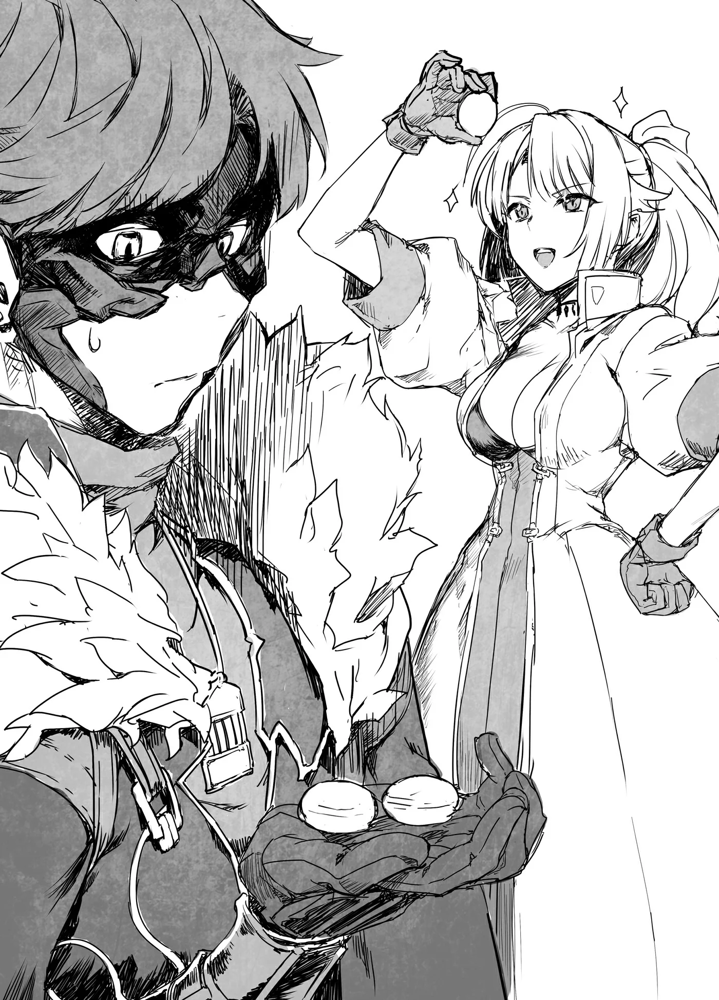

# Chương 149: Tập 6 Chương 4 - Bí Mật Của Hathara (4)

"Hai người muốn bọn cháu trông coi nơi này sao?" tôi lên tiếng, chẳng biết nên phản ứng thế nào cho phải. Lorraine trông cũng đầy vẻ khó xử, và điều đó cũng hoàn toàn dễ hiểu. Chuyện này xem chừng có phần quá sức để giao phó vào tay của chỉ hai con người.

Capitan nhìn thấu những gì tôi đang nghĩ ngợi. "Bọn chú đâu có bảo hai đứa phải là những người duy nhất chăm lo cho nơi này, hay bọn chú muốn rũ sạch chẳng dính dáng gì tới nó nữa; không có chuyện đó đâu. Đúng hơn thì nói là bọn chú muốn tuyển thêm vài tân binh vào đội, kiểu thế đấy." Có vẻ như chú ấy không muốn lời đề nghị nghe như một sự ép buộc, nhưng nếu vậy, ngay từ đầu tôi đã chẳng hiểu vì sao họ lại cần phải đưa ra yêu cầu này.

"Mọi chuyện cứ tiếp tục như từ trước đến nay không được sao ạ?" tôi hỏi.

"Cũng được thôi, nhưng có hai đứa cùng tham gia thì tốt hơn. Mấy đứa cũng sẽ nhận được phần lợi ích của riêng mình nữa," Capitan nói.

Tôi chịu chết chẳng thể hình dung nổi họ có thể mang lại lợi ích gì. Lorraine có lẽ sẽ trân trọng cơ hội được nghiên cứu thành phố mà không phải bận tâm lo lắng về lũ quái vật, nhưng hẳn đó không phải là điều chú ấy muốn ám chỉ.

"Có đúng không hả, bà lão?" chú ấy vừa nói vừa quay sang phía bà lão làm thuốc.

"Ừ, tốt nhất là cứ tận mắt cho chúng thấy. Đi xem một chút chứ?" Gharb bảo. Bà trèo lên lưng con Shahor Melechnamer rồi cúi nhìn xuống bọn tôi. "Làm cái gì đấy? Trèo lên mau."

Capitan thậm chí còn bắt đầu trèo lên từ trước cả khi bà kịp mở miệng. Xem chừng chúng tôi sẽ phải cưỡi nó rồi. Tôi có đôi chút ngần ngại, nhưng thú thực tôi cũng đã quen với sinh vật này lắm rồi. Tôi và Lorraine nhìn nhau rồi nhún vai. Kế đó, cả hai chúng tôi cùng trèo lên lưng con Shahor Melechnamer. Nó đủ to lớn để chở cả bốn người chúng tôi một cách dễ dàng, lại còn rất êm ái và mềm mại nữa. Cảm giác dễ chịu đến mức tôi suýt chút nữa thì muốn lăn ra ngủ, dù bản thân tôi hiếm khi cảm thấy buồn ngủ. Nhưng nếu tôi ngủ thật thì sẽ là một thảm họa. Chúng tôi đang cưỡi con quái vật này đến một nơi khác, nên rất có thể tôi sẽ bị ngã nhào xuống đất.

"Giờ thì đi thôi," Gharb nói, đoạn ra vài mệnh lệnh cho con Shahor Melechnamer. Nó chuyển động một cách êm ru, và chỉ trong vài giây ngắn ngủi, nó đã đạt tới một tốc độ đáng sợ.

Nó lao vút ra ngoài hang động, tức là tiến vào bên trong thành phố mê cung. Tàn tích của thành phố chết vụt qua xung quanh chúng tôi. Hang động nằm trên một bức tường khá cao cho phép chúng tôi chiêm ngưỡng các tàn tích từ trên cao. Khi nhìn chúng ở cự ly gần, các công trình kiến trúc hầu như chẳng có vẻ gì là đã mục nát. Cảnh tượng hệt như một thành phố phồn hoa đô hội mà toàn bộ cư dân bỗng chốc biến mất không dấu vết. Tôi nhìn thấy những ngọn đèn ma pháp phát sáng lung linh trong vô số tòa nhà, khiến cho thành phố hoang vắng trông sống động một cách kỳ lạ.

"Chúng ta đang đi đâu thế này?!" tôi hét lớn.

"Đừng nhìn vào thành phố, nhìn lên mấy bức tường xung quanh kia kìa!" Gharb hét đáp lại.

Tôi quay sang nhìn các bức tường và nhận thấy chúng chi chít những cái lỗ. Chúng nằm ở độ cao xấp xỉ với cái hang mà chúng tôi vừa bước ra, và kích thước trông cũng tương tự như vậy. Có nhiều lỗ đến mức tôi đếm không xuể.

"Tôi biết ngay mà," Lorraine thì thầm.

"Cô nhận ra điều gì rồi à?" tôi hỏi.

"Ừ. Anh có nhớ tôi từng nhắc chuyện Đế Quốc đã tìm thấy một ma pháp trận dịch chuyển ở đây không?"

"Có, nhưng thì sao cơ?"

"Cái họ tìm thấy không nằm trong cái hang mà chúng ta vừa đi ra đâu. Nó ở một chỗ khác. Ngay khi anh đi xuống từ tầng năm mươi chín, có một cái hang nhỏ gần lối vào thành phố. Đó chính là nơi đặt cái họ tìm thấy. Chẳng ai có thể thám hiểm xa hơn chỗ đó do lũ quái vật."

"Vậy là có nhiều ma pháp trận dịch chuyển sao?"

"Ừ, và có khi không chỉ dừng lại ở hai cái đó đâu. Tất cả những cái lỗ trên tường kia có thể đều chứa ma pháp trận của riêng chúng," Lorraine nói, cơ thể khẽ run rẩy một chút.

"Chuẩn đấy!" Gharb gào lên. "Nhưng ta chưa kiểm tra hết mọi cái lỗ đâu, nên ta chẳng thể nói cho hai đứa biết cái nào dẫn đi đâu được đâu!"

"Chỉ nghĩ đến thôi cũng thấy rùng mình rồi," Lorraine bảo. "Nếu Đế Quốc nắm quyền kiểm soát thành phố này, họ sẽ thống trị toàn bộ đại lục."

Tôi gật đầu. "Chúng ta tuyệt đối không thể để họ phát hiện ra. Mà thực ra, phải là người Hathara mới dùng được ma pháp trận dịch chuyển, nên có khi cũng chẳng sao đâu nhỉ."

"Nói đúng hơn thì, tôi nghĩ chuyện đó sẽ đẩy người Hathara vào vòng nguy hiểm đấy," cô nói.

Quả thực, nếu chính người Hathara là chìa khóa, rất có thể họ sẽ trở thành mục tiêu bị nhắm tới. Nhưng tôi không tài nào hình dung nổi làm thế nào Đế Quốc có thể đi đến kết luận đó ngay từ đầu được.

"Nhắc mới nhớ," Lorraine thì thào như sực nhớ ra điều gì, "Rentt, anh dùng được nó dẫu bản thân là một Ma Cà Rồng. Nếu anh mang theo một quyến thuộc ma cà rồng, biết đâu chúng cũng dùng được các ma pháp trận dịch chuyển thì sao. Dẫu sao Ma Cà Rồng tạo ra thuộc hạ bằng cách ban máu của mình cho sinh vật khác mà."

Nghe chừng đó là một giả thuyết thú vị, nhưng tôi sẽ phải thử thì mới biết chắc được. Giá mà tôi mang Edel theo, nhưng lúc này chú chuột lại không ở bên cạnh tôi. Dẫu vậy, đây vẫn là điều rất đáng để thử trong tương lai. Nếu hóa ra khả thi, một mình tôi có thể đóng vai trò làm chìa khóa cho mọi ma pháp trận dịch chuyển. Kéo theo hệ quả là, tôi cảm thấy bản thân lúc này đang rơi vào tình thế hiểm nguy hơn bao giờ hết. Nếu Đế Quốc mà xâu chuỗi được tất cả những điều này, họ nhất định sẽ tìm đến tôi.

◆◇◆◇◆

Cuối cùng chúng tôi cũng tới một trong vô số hang động trên vách tường, một cái nằm sâu tít phía sau thành phố. Tôi nghĩ nơi này chắc cũng có một ma pháp trận dịch chuyển.

"Cháu chẳng thấy gì cả," tôi nói với Gharb và Capitan. Cấu trúc của hang động này giống hệt cái hang đầu tiên mà chúng tôi được dịch chuyển tới. Có một hành lang dài dẫn vào một căn phòng lớn. Điểm khác biệt duy nhất là chẳng có hoa văn nào được vẽ trên mặt đất cả.

"Thì dĩ nhiên là cháu không thấy rồi," Gharb bảo. "Nhưng đúng chỗ này rồi đấy. Làm đi, Capitan."

Capitan lấy từ trong túi ra hai hòn đá. Một hòn phát ra ánh đỏ mờ ảo, còn hòn kia ánh lên sắc xanh lam đục. Chú giơ hòn đá đỏ lên rồi ném thật mạnh xuống đất. Nó vỡ toác ra, và một ma trận hoa văn nhanh chóng hiện rõ trên mặt đất.

"Cái gì cơ?! Ma pháp trận dịch chuyển ư?" Lorraine thốt lên.

"Đúng thế," Gharb gật đầu nói. "Đây là một trong những ma cụ được truyền lại cho chúng ta. Nó cho phép chúng ta tạo ra ma pháp trận dịch chuyển mới. Bà lão làm thuốc và trưởng nhóm thợ săn mỗi người nhận một cặp. Chúng ta vừa dùng một trong số đó đấy."

"Một cặp sao ạ? Nghĩa là viên đá đỏ và xanh đi liền thành một bộ ạ?" tôi hỏi.

"Ừ. Cháu dùng viên nào trước cũng được, nhưng hễ đập một viên xuống đất, nó sẽ tạo ra một ma pháp trận dịch chuyển. Lối ra sẽ được tạo bằng viên đá còn lại. Tiện lợi quá đúng không?" bà bảo.

Không chỉ tiện lợi, mà nếu thứ này được đem ra bán đấu giá, nó có thể bán được với mức giá trên trời. Tôi không biết Lorraine ra sao, nhưng bản thân tôi chưa từng thấy thứ gì như thế này bao giờ. Có lẽ họ muốn thị phạm cách nó hoạt động, nhưng đây dường như không phải thứ để đem ra dùng một cách tùy tiện.

"Cháu cầm lấy viên này đi," Capitan bảo, đoạn chìa viên đá xanh lam ra. "Đặt ma pháp trận dịch chuyển ở bất cứ đâu cháu muốn."

Hòn đá nhìn từ xa thì có vẻ vẩn đục, nhưng thực chất bên trong có vô số ký tự ma pháp tí hon đang xoay vần. Trông nó hệt như một ma cụ vô cùng cao cấp.

"Chú cho bọn cháu thứ này thật ạ?" tôi hỏi.

"Thì bọn chú đã bảo là giao thành phố này cho hai đứa trông coi rồi mà," Capitan thản nhiên đáp. "Sau khi trở về Maalt, cháu đâu muốn lần nào ghé thăm cũng phải ngồi xe ngựa về tận Hathara, đúng chứ? Thứ này sẽ đưa cháu tới đây rồi quay về trong nháy mắt. À thì, đi bộ giữa pháo đài đó và Hathara vẫn mất nửa ngày, nhưng nếu rảo bước nhanh thì chỉ tốn vài tiếng thôi. Khiến mọi chuyện dễ dàng hơn nhiều, phải không?"

Tôi rất cảm kích trước tấm lòng của họ, nhưng lại băn khoăn không biết có nên nhận hay không. Tôi nhìn sang Lorraine, cô đang im lặng dán mắt vào viên đá xanh lam, vẻ mặt như muốn chộp lấy nó khỏi tay tôi ngay tức khắc. Khi tôi chuyền nó sang cho cô, cô đưa nó lên sát rạt trước mắt rồi chăm chú nhìn vào bên trong. Cô bắt đầu lẩm bẩm về các lý thuyết ma thuật cùng những điều tương tự. Cảnh tượng ấy có đôi chút rùng mình. Nhưng dẫu cô có thành công đến đâu trên con đường học giả, việc có được một thứ như thế này hoàn toàn trông cậy vào vận may, nên hẳn là cô đang phấn khích tột độ. Tôi nghĩ nhận lấy cũng chẳng sao.

"À, hai đứa cũng cầm luôn phần của ta đi," Gharb nói rồi đưa cho bọn tôi hai viên đá đỏ và xanh của bà. "Mấy viên này vẫn còn nguyên cả bộ đấy. Xin lỗi vì Capitan đã tự tiện chọn chỗ này để đặt một viên của chú ấy nhé."

Mấy viên của bà có màu hơi khác một chút so với của Capitan, nhưng nhìn chung thì gần như y hệt. Tôi phải cẩn thận để không làm lẫn lộn chúng. Lối ra, hoặc có lẽ là lối vào nếu giữa chúng có sự phân biệt, đặt ở chỗ này cũng hoàn toàn ổn đối với tôi. Theo lời Gharb, đằng nào ở đây cũng còn rất nhiều ma pháp trận dịch chuyển khác, nên chúng tôi có thể dùng tàn tích này làm trạm trung chuyển để dễ dàng đi tới những vùng đất xa xôi. Trên thực tế, ngay cả khi được tự do lựa chọn nơi đặt từng ma pháp trận dịch chuyển, tôi cũng sẽ dùng một cái ở đây và một cái ở Maalt. Tôi chưa nghĩ ra chỗ nào thích hợp để dùng bộ còn lại, nên tốt nhất là cứ tạm thời giữ lấy chúng. Biết đâu chẳng bao lâu nữa chúng tôi sẽ tìm thấy một địa điểm trọng yếu để đặt, nhưng trước khi dùng thì vẫn cần phải suy tính kỹ càng.

"Nào, hai đứa có muốn thử dùng vài ma pháp trận dịch chuyển khác không?" Gharb hỏi. "Ta đã kiểm tra điểm đến của một số cái rồi."

Tôi và Lorraine gật đầu.

"Được rồi, thế thì trèo lên lại đi," Gharb nói rồi trèo lên lưng con Shahor Melechnamer.

Đến nước này thì chúng tôi đã quen với việc cưỡi nó rồi, nên trèo lên suôn sẻ hơn hẳn lúc trước. Khi cả bốn người đã ngồi vững vàng, con Shahor Melechnamer lại bắt đầu chạy.

◆◇◆◇◆

"Ta biết ma pháp trận dịch chuyển này dẫn đi đâu, nhưng điểm đến là một nơi hơi kỳ quặc đấy. Như thường lệ, bọn ta sẽ đi trước," Gharb bảo. Nói rồi, bà cùng Capitan bước lên ma pháp trận dịch chuyển và biến mất.

"Cô nghĩ bà ấy nói nơi kỳ quặc là có ý gì?" tôi hỏi Lorraine.

"Có thể là một bờ biển cạnh vùng biển bão tố, hoặc đỉnh của một ngọn núi lửa chăng."

"À thì, tôi rất mong là chẳng phải nơi nào trong hai chỗ đó."

Đó dĩ nhiên chỉ là câu nói đùa, nhưng để một thứ gì đó khiến những người dũng cảm cỡ như Gharb và Capitan phải bối rối, hẳn nó cũng phải thuộc dạng tương tự như thế. Thế nhưng ở lại chờ đợi thì không phải là một lựa chọn, nên chúng tôi bước lên ma pháp trận và dịch chuyển đến một vùng đất xa lạ.

◆◇◆◇◆

Khi vừa đặt chân tới nơi, tôi không kìm được mà kêu thét lên một tiếng. Thứ đầu tiên đập vào giác quan của tôi là một mùi hôi thối nồng nặc. Lorraine chẳng nói chẳng rằng, nhưng gương mặt cô nhăn nhó lại. Tôi hiểu lý do vì sao; cái mùi quả thực kinh khủng tột cùng.

"Thấy ta nói đúng chưa?" Gharb toe toét cười bảo. Capitan cũng đang mỉm cười. Nơi này quả nhiên kỳ quặc thật.

"Rốt cuộc đây là đâu vậy ạ?" tôi hỏi.

"Một đường cống ngầm," Gharb đáp. "Chính xác hơn là một căn phòng bí mật bên trong đường cống ngầm." Gharb lần tay sờ soạng quanh bức tường đá cho đến khi một phần tường trượt sang một bên với tiếng nghiến ken két chói tai. Vài giây sau, một lối đi hiện ra phía trước, phía bên kia là một dòng kênh dẫn nước. "Giờ thì đi thôi."

◆◇◆◇◆

"Cháu tự hỏi liệu nơi này đã có từ hồi thành phố kia còn phồn thịnh hay không," tôi lên tiếng khi chúng tôi rảo bước trong cống ngầm.

"Có khả năng, nhưng chắc là không đâu," Lorraine nói sau một lúc ngẫm nghĩ.

"Bà có biết không, bà Gharb?"

Gharb gật đầu. "Ừ, cô nói đúng đấy. Đường cống ngầm này không đến mức cổ xưa như thế đâu. Vẫn cổ đấy, nói cho mà biết, nhưng chỉ chừng vài thế kỷ thôi." Thành phố tàn tích kia ước chừng đã hàng nghìn năm tuổi, nên so với nó thì nơi này chẳng có mấy bề dày lịch sử.

"Nhưng ở đây lại có một ma pháp trận dịch chuyển," tôi phản bác. "Những thứ đó đâu thể tạo ra bằng kỹ thuật thời nay, nên nó hẳn phải tồn tại từ thời thành phố còn hoạt động chứ ạ?"

"Rentt, cháu có chịu để tâm lắng nghe không đấy hả?" Gharb vặn lại. "Bất cứ ai nắm giữ chức vụ đặc biệt ở Hathara đều có một bộ đá đó cả. Cơ mà vài người trong số họ đã dùng rồi. Cái này là do một tể tướng để lại, ta tin là vậy. Một tể tướng từ thời xa xưa."

Nghe cũng có lý, nhưng những người nắm giữ các vai trò đặc biệt ấy vốn phải giữ kín bí mật về tàn tích cùng mọi thứ liên quan tới nó kia mà. Tôi không tài nào hiểu nổi vì sao họ lại tạo ra một ma pháp trận dịch chuyển ở đây.

"Sắp tới lối ra rồi," Gharb bảo và chỉ tay về phía luồng sáng đằng trước. Khi lại gần hơn, tôi nhận thấy lần này không phải là ánh sáng nhân tạo. Nó phát ra từ mặt trời, và tôi có thể nhìn thấy cây cối bên ngoài hệt như chúng tôi đang ở trong một khu rừng. Ngoài ra còn có một con suối đang chảy.

"Chúng ta đang ở đâu thế này ạ?" tôi hỏi. Tôi nhìn quanh quất khắp xung quanh, nhưng chịu chết không đoán ra được.

"Đợi một chút. Ẩn mình đi, Rehesteel," Gharb niệm chú. Tôi quay nhìn lại lối ra của cống ngầm và thấy dây leo cùng cỏ dại mọc trùm lên cho đến khi nó hoàn toàn biến mất khỏi tầm mắt.

"Đó không phải là thần chú do bà Gharb thi triển đâu," Lorraine bảo. "Đúng hơn thì chính lối ra này đã được ếm ma pháp để phản ứng với một mật ngữ. Cấu trúc rất phức tạp, nên tôi không nghĩ nó có thể dễ dàng bị hóa giải đâu."

Để Lorraine phải nói ra câu đó, nơi này hẳn phải sở hữu ma pháp vô cùng cao cấp. Một ma pháp sư bình thường đi ngang qua chắc sẽ chẳng mảy may nhận thấy điều gì. Thế nhưng tôi thì mù tịt về mấy chuyện này. Có quá nhiều điều cần học hỏi về ma thuật. Tôi từng mong một ngày nào đó mình có thể đàm đạo về cấu trúc của các câu chú cùng những điều tương tự, nhưng có lẽ ước muốn ấy nằm ngoài tầm với của tôi rồi.

Chúng tôi đi theo sau Gharb thêm một đoạn nữa. Không hẳn quá xa, nhưng cũng đủ dài để cảm giác như một chặng tản bộ ra trò. Cuối cùng, chúng tôi nhìn thấy một thứ.

"Kia có phải là một tòa lâu đài không? Có nghĩa là chúng ta đang ở vương đô sao ạ?" tôi hỏi. Có một công trình kiến trúc đồ sộ, sừng sững vươn cao trước mắt chúng tôi. Nằm sừng sững giữa một thành phố được bao quanh bởi những bức tường thành cao vút, tòa công trình màu trắng toát lên vẻ uy nghiêm và tráng lệ. Chẳng có công trình nào trên khắp đất nước này tráng lệ hơn thế. Chúng tôi chắc chắn đang ở Vistelya, vương đô của Vương Quốc Yaaran. Thú thực thì tôi chưa từng đặt chân tới đây bao giờ. Tôi chỉ biết về nó qua sách vở và các câu chuyện kể, nhưng đây là lần đầu tiên tôi được tận mắt chứng kiến. Giờ thì tôi đã hiểu vì sao dân làng Hathara lại phấn khích đến thế khi tôi kể về Maalt. Đây mới thực sự là một thành phố đúng nghĩa.

Tôi quay sang Lorraine để xem cô cảm thấy thế nào, nhưng trông cô hoàn toàn thản nhiên. Cô đến từ một thành phố thậm chí còn to lớn hơn nhiều, nên có lẽ nơi này chẳng có gì quá đặc biệt trong mắt cô, nhưng sự khác biệt trong phản ứng của cô khiến tôi có chút bực mình. Giờ thì tôi nhất định phải tới thủ đô của Đế Quốc một chuyến cho biết mới được.

"Chúng ta có nên dạo quanh một chút trước khi quay về không nhỉ?" Gharb hờ hững nói.

"Đằng nào cũng có vài loại nguyên liệu ta sắp dùng cạn rồi."

"Tôi cũng có nơi muốn ghé qua đấy," Capitan bảo. "Tạm thời cứ chia nhau ra rồi lát nữa tập hợp lại sau."

Nghe giọng điệu của họ cứ như thể đây là chuyện thường ngày ở huyện vậy. "Mọi người chắc chứ ạ?" tôi nói. "Chẳng phải người Hathara bỗng dưng xuất hiện ở vương đô sẽ kỳ lạ lắm sao?"

Theo những gì tôi từng nghe, Vistelya có các cổng ở bốn phía đông, tây, nam, bắc, và bất kỳ ai tiến vào thành phố đều phải chứng minh thân phận của mình. Người ta bắt buộc phải xuất trình một loại giấy tờ tùy thân nào đó mới được thông qua, nhưng tôi chẳng rõ hai người họ sẽ dùng thứ gì.

Đúng lúc tôi còn đang thắc mắc điều đó, mỗi người họ liền rút ra một tấm thẻ bằng đồng mà tôi đã nhìn thấy không biết bao nhiêu lần trước đây.

"Chẳng phải đó là thẻ mạo hiểm giả Đồng Cấp sao ạ?" tôi hỏi. Bản thân tôi phải trầy trật lắm mới lấy được tấm thẻ của mình lần đầu tiên, dẫu lần thứ hai thì dễ dàng hơn nhiều. Thế nhưng vì sao hai người họ lại có thẻ thì tôi hoàn toàn chịu chết.

Capitan dường như nhận ra lý do vì sao tôi cứ dán mắt vào nhìn nên đã lên tiếng giải đáp thắc mắc của tôi.

"Bọn chú làm sẵn để phòng những lúc thế này đấy. Bọn chú dùng tên giả rồi đăng ký ở một thành phố cách xa Hathara. Họ sẽ chẳng nghi ngờ gì đâu. Bọn chú thỉnh thoảng vẫn nhận việc làm mạo hiểm giả, nên hồ sơ cũng có lưu lại lịch sử hành nghề hẳn hoi."

Tôi kiểm tra địa điểm của hội quán ghi trên thẻ của họ, và đúng là trên đó ghi tên của một thành phố xa xôi. Còn về việc họ đã nhận những công việc gì và làm được bao nhiêu ủy thác, tôi sẽ phải làm việc cho Hội thì mới kiểm tra được, nên tôi cũng chịu. Biết rõ thực lực của Capitan, người ta dễ dàng hình dung ra chú ấy đã làm được những điều ấn tượng đến mức nào. Gharb cũng vậy. Thẻ của bà ghi một hội quán khác với của Capitan, chứng tỏ họ đã bỏ rất nhiều tâm huyết vào từng chi tiết nhỏ. Chắc hẳn họ đã dùng các ma pháp trận dịch chuyển để tới lấy mấy tấm thẻ này, và xem chừng họ sử dụng chúng mà chẳng mấy đắn đo suy nghĩ. Tôi không rõ liệu đó có phải là ý hay nhất hay không, nhưng mặt khác, hai con người này có lẽ cũng thừa biết chừng mực để thận trọng ở một mức độ nhất định.

"Dù sao thì hai đứa cứ đi ngắm cảnh cho thỏa thích đi," Capitan bảo.

"Cháu hơi lo là bọn cháu trông cũng sẽ khả nghi đấy ạ," tôi đáp lại.

"Nếu anh dùng tấm thẻ mang tên Rentt Vivie thì chắc sẽ ổn thôi," Lorraine nói.

Có lẽ đúng là như vậy. Đằng nào thì đáng lẽ ra tôi cũng đang rời xa khỏi Maalt, nên chúng tôi hoàn toàn có thể nói rằng Rentt Faina đang ở Hathara trong khi Rentt Vivie đang ở vương đô.

"Thế còn cô thì sao hả Lorraine?" tôi hỏi.

"Tôi á? Tôi có cách riêng của mình. Chẳng có gì to tát đâu, nhưng nhìn này," Lorraine bảo rồi cho tôi xem vài tấm thẻ căn cước khác nhau đến từ Đế Quốc. Trên đó đều mang những cái tên khác nhau. Chúng rõ ràng đều là đồ giả. Một trong số đó có tên thật của cô, nhưng tôi ngờ rằng cô chẳng định dùng tới nó đâu. Thỉnh thoảng cô vẫn làm những trò như thế này, khiến tôi tự hỏi rốt cuộc Lorraine được đối đãi ra sao ở Đế Quốc, nhưng giờ hỏi chuyện đó cũng chẳng để làm gì. Huống hồ, cô vẫn là chính cô, và chẳng điều gì có thể thay đổi được sự thật ấy. Thế là ổn rồi.

"Thôi thì cháu đoán là chẳng có vấn đề gì nữa rồi. Đi thôi nào," tôi nói, rồi chúng tôi tiến bước về phía cổng thành Vistelya.
