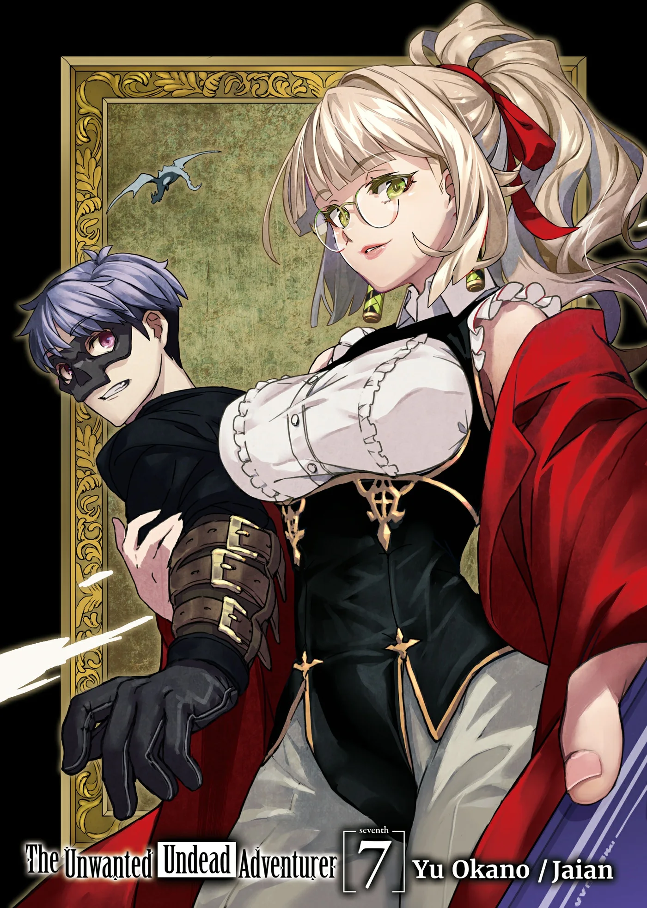
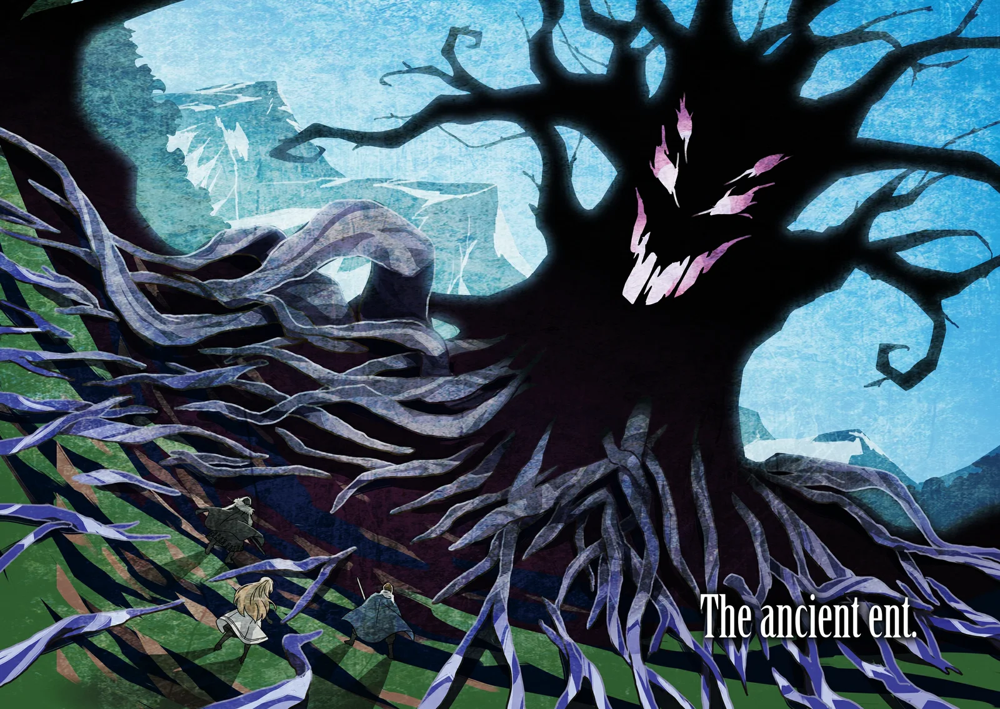
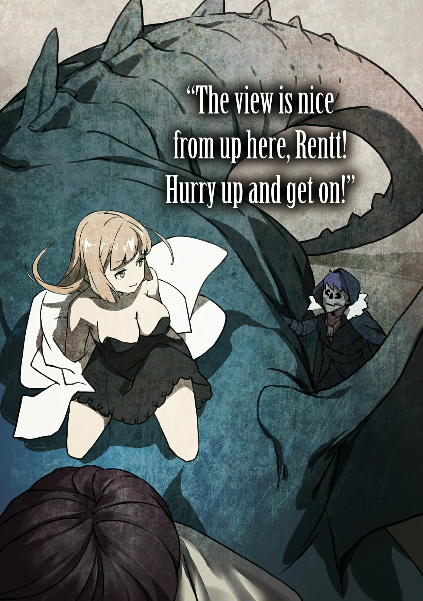
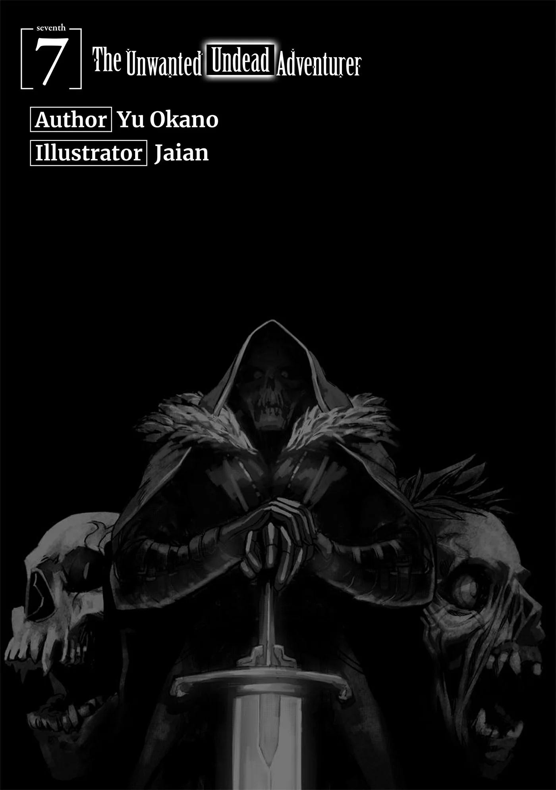
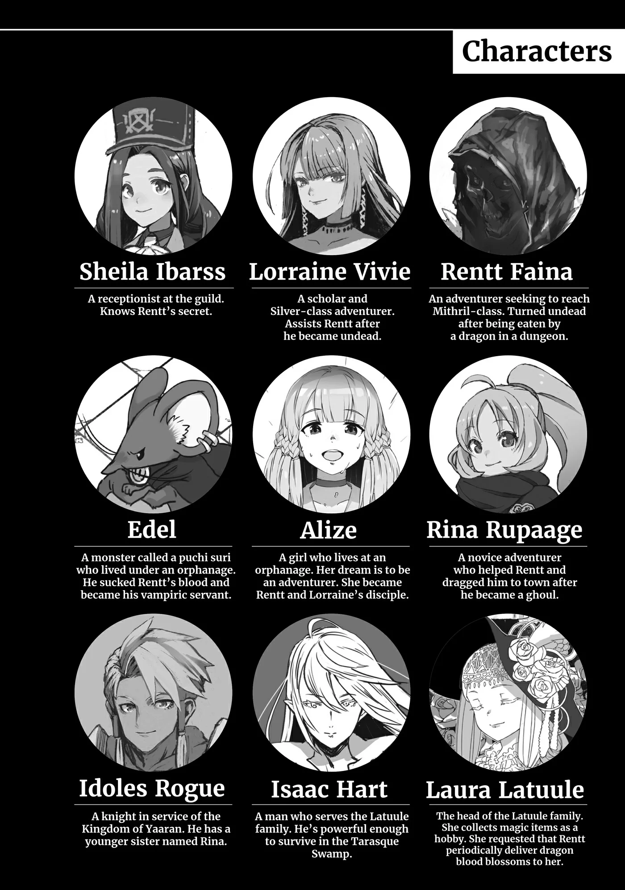
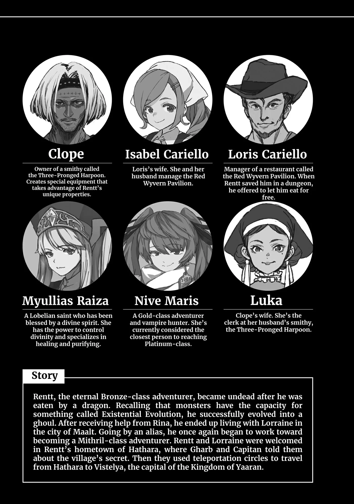
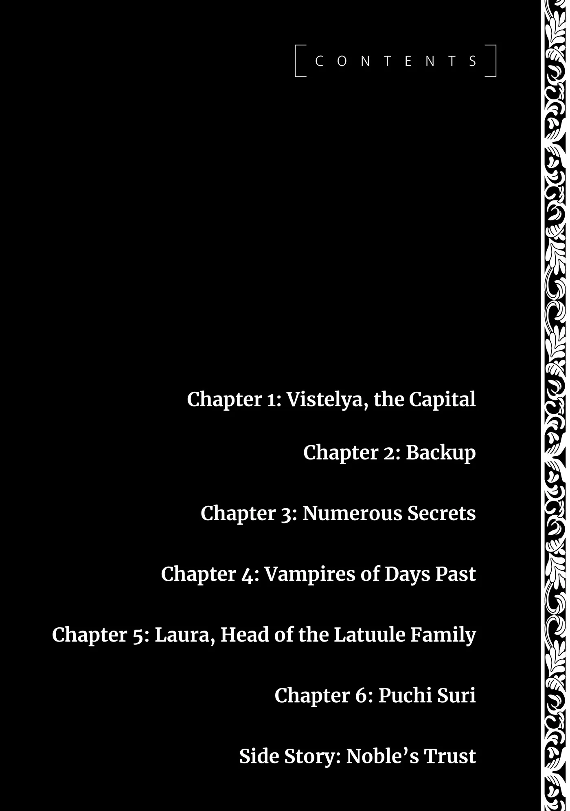
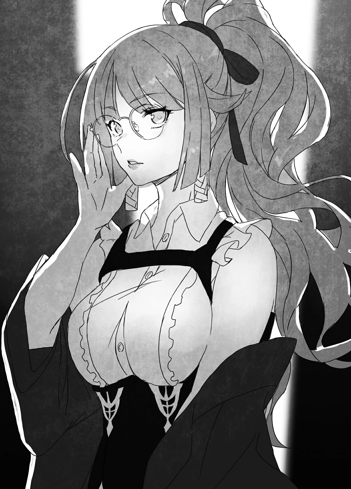
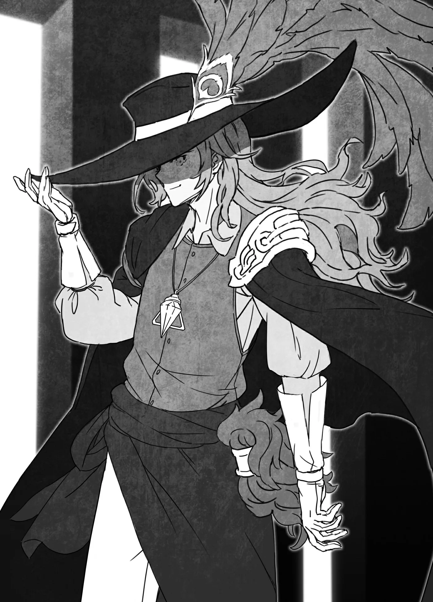

# Chương 155: Tập 7 Chương 1 - Vương Đô Vistelya (1)

Dòng người nườm nượp đổ vào rồi lại túa ra khỏi cổng vương đô. Chuyện đó cũng là lẽ đương nhiên. Dẫu Vương Quốc Yaaran có nhỏ bé đến đâu thì đây vẫn là một quốc gia đàng hoàng; lượng khách vãng lai qua lại ắt hẳn không hề ít. Tuy nhiên, vì là một đất nước kém phát triển hơn, nên công tác an ninh nơi đây ở một vài phương diện vẫn còn khá lỏng lẻo.

"Giấy tờ tùy thân của ông đâu?" Một người lính gác cổng cất tiếng hỏi người đàn ông đứng xếp hàng ngay phía trước chúng tôi. Quần áo của ông ta đã sờn rách, trên đầu đội một chiếc mũ rơm, trên tay ôm bọc rau củ gói trong mảnh vải. Trông ông ta chỉ có thể là người vừa từ một ngôi làng nhỏ nào đó tới.

"Ờ, ơ, tui làm gì có mấy cái thứ đó," ông ta đáp, giọng địa phương đặc sệt và vô cùng khó nghe.

Tuy nhiên, người lính gác dường như đã quá quen với cảnh này. Anh ta thở dài, khẽ lắc đầu rồi hỏi: "Ông từ đâu tới?"

"Tui từ tuốt ngoài Yanga tới. Lên phố để bán đống này." Người đàn ông mở bọc vải ra để khoe số rau củ của mình, khẳng định bản thân chẳng mang theo thứ gì đáng ngờ.

"Tôi biết rồi. Cứ qua đi," người lính gác gật đầu nói rồi cho ông ta bước qua cổng.

"Anh nghĩ anh lính đó làm vậy có được không?" Lorraine hỏi. "Ông ta hoàn toàn có thể giấu đồ phi pháp bên trong đống rau củ đó mà." Cô đang đánh giá dựa trên góc nhìn của một công dân Đế Quốc.

"Tôi cũng chịu. Chắc là ổn thôi. Nghe nói khi tiến vào khu quý tộc gần lâu đài, người ta mới tiến hành kiểm tra nghiêm ngặt hơn. Hơn nữa, lính gác còn có chó săn có lẽ sẽ đánh hơi được bất cứ thứ gì phi pháp," tôi vừa nhìn quanh vừa đáp, bản thân cũng chẳng dám chắc mình có đúng hay không. Thực ra các mạo hiểm giả tiền bối luôn bảo với tôi rằng an ninh ở vương đô lỏng lẻo ra sao. Xem chừng lời họ nói quả không sai.

"Tôi thấy thật ấn tượng khi họ vẫn tồn tại được ngần ấy năm mà chưa bị quốc gia láng giềng nào xóa sổ đấy," Lorraine lẩm bẩm.

"Căn bản là có xóa sổ Yaaran thì cũng chẳng mang lại lợi ích gì nhiều. Mở rộng lãnh thổ thì có thể, nhưng quanh vùng này chẳng có lấy mấy mảnh đất ra hồn."

Một vài thành phố của Yaaran thực ra cũng đủ lớn để bõ công tấn công, nhưng các quốc gia khác trong khu vực vốn dĩ cũng chẳng khác là bao. Họ sống quá thảnh thơi để dính dáng tới những cuộc tranh giành quyền lực quy mô lớn diễn ra nơi trung tâm thế giới. Ờ thì, có thể họ không thảnh thơi đến mức đó, nhưng trông họ sẽ có vẻ như vậy nếu đem so với luật lệ và quy chuẩn khắt khe của Đế Quốc. Chẳng phải ngẫu nhiên mà các quốc gia này lại không có chân trong hàng ngũ những thế lực lớn trên vũ đài thế giới.

"Người tiếp theo!" Người lính gác cất tiếng, thế là tôi bước lên. Anh ta nhìn vào mặt tôi. "Có giấy tờ tùy thân không?" Anh ta hỏi mà chẳng hề đả động gì tới chiếc mặt nạ của tôi, điều khiến tôi khá ngạc nhiên. Không ít người mang thương tích trên mặt muốn che giấu, và người lính gác này rõ ràng đủ lịch sự để không hỏi han tò mò. Tôi đưa cho anh ta xem tấm thẻ căn cước mang tên Rentt Vivie. "Ra vậy, mạo hiểm giả sao? Điều gì đưa cậu tới vương đô thế?"

Nói thật lòng thì tôi chẳng có lý do cụ thể nào để tới đây cả, ngoại trừ việc đi theo một nhóm vừa đặt chân đến đã lập tức tách ra. "Tôi tới để ngắm nhìn thành phố," tôi đáp, vì chẳng nghĩ ra được cái cớ nào hay hơn. "Tôi hành nghề mạo hiểm giả ở một thành phố khác, nhưng rốt cuộc cũng muốn tới vương đô làm việc, nên tôi nghĩ mình nên lên đây ngó nghiêng tìm hiểu trước."

"Hiểu rồi. Đồng Cấp nhỉ? Một khi đạt tới Ngân Cấp thì cậu đã thừa sức hành nghề ở vương đô rồi. Cứ tiếp tục cố gắng nhé. Được rồi, cậu có thể qua!" Người lính gác nói rồi vỗ vai tôi.

Anh ta có vẻ khá tận tụy với công việc, nhưng theo những gì tôi quan sát thì anh ta chẳng hề ghi chép lại danh tính những người ra vào. Tôi đồ rằng họ sẽ làm vậy với những ai tiến vào khu quý tộc, nhưng việc ghi lại tên của tất cả những người bước vào ngoại thành có lẽ sẽ tốn quá nhiều thời gian. Trông thì có vẻ hơi cẩu thả, nhưng Yaaran vốn dĩ là một đất nước như thế.

Sau khi tôi xong lượt, Lorraine cũng được người lính gác thẩm vấn. Tôi đã đi cách họ một đoạn khá xa, nhưng đôi tai Ma Cà Rồng của tôi vẫn đủ thính để nghe rõ mồn một cuộc trò chuyện giữa hai người.

"Giấy tờ tùy thân của cô đâu?" Người lính gác hỏi, thế là Lorraine chìa ra tấm thẻ căn cước từ Đế Quốc. "Cô... ờ, đến từ Đế Quốc sao?" Người lính gác cất lời bằng giọng vô cùng kính cẩn.

Đế Quốc nằm cách rất xa Yaaran, nhưng ai nấy đều biết đó là một cường quốc vĩ đại và hùng mạnh. Là một công dân Yaaran, tôi hoàn toàn hiểu được vì sao anh ta lại thấy e dè khi đối mặt với một vị khách đến từ Đế Quốc. Một nước đi sai lầm có thể châm ngòi cho cả một cuộc chiến tranh.

"Phải, nhưng đừng bận tâm chuyện đó. Tôi chỉ tới ngắm cảnh thôi. Chắc anh không phiền cho tôi qua chứ?" Lorraine tự tin hỏi.

"Tất nhiên là không rồi. Chỉ cần cô nhớ rằng bất kể xuất thân từ quốc gia nào, cô cũng không được phép gây rắc rối ở đây," người lính gác khẳng định, vẫn giữ lại chút tôn nghiêm của mình.

"Tôi biết rồi, tôi sẽ ngoan ngoãn. Chào anh," Lorraine nói rồi bước lại gần tôi.

"Người lính gác đó khiêm nhường quá mức cần thiết rồi đấy."

"Ừ, có lẽ vậy. Nhưng thông thường thì chẳng mấy ai từ Đế Quốc lại tới Yaaran làm gì. Giống như cảm giác của Riri và Fahri khi chúng ta từ Maalt về thăm họ vậy."

"Bởi vì tôi tới từ một đại đô thị sao? So với những người khác ở Đế Quốc thì tôi thậm chí còn chẳng hẳn là kiểu người thành thị cho lắm, nhưng mà thôi kệ đi. Chúng ta đã tới vương đô rồi, chi bằng cứ dạo quanh một vòng xem sao. Có nơi nào đặc biệt mà anh muốn tới không?"

"Tôi đoán là mình muốn ghé qua Hội xem thử. Nhưng có lẽ tôi không nên tới đó thì hơn."

Thủ tục kiểm tra căn cước đơn giản ở cổng thành là một chuyện, nhưng nếu tôi đến trụ sở Hội mạo hiểm giả trong bộ dạng này, tôi tin chắc họ sẽ ghi chép lại hồ sơ. Không phải là áo choàng và mặt nạ hiếm gặp đến thế, mà là vì chiếc mặt nạ của tôi trông giống hệt đầu lâu nên càng dễ khiến người khác e ngại.

"Nếu anh đổi màu áo choàng và dùng một tấm vải hay thứ gì đó che mặt nạ lại thì sao?" Lorraine gợi ý. "Tôi có thể đổi màu bằng ma pháp. Dù vậy, áo choàng của anh có khả năng kháng ma pháp rất cao, nên tôi không biết liệu bề mặt của nó có bị tác động hay không nữa."

Ít nhất thì nếu tôi tới thăm họ trong bộ dạng đó, lần sau họ có thể sẽ không nhận ra tôi. Chuyện này cũng đáng để thử, và nếu không thành công thì chúng tôi chỉ việc không đến Hội nữa là xong, vì thế chúng tôi rẽ vào một con hẻm vắng người.

◆◇◆◇◆

"Tôi nghĩ thế là được rồi đấy. Không tồi đúng không?" Lorraine nói. Thật may là ma pháp dường như ít nhất cũng có tác dụng lên bề mặt của chiếc áo choàng, thế nên toàn bộ màu sắc đã được thay đổi. Trước đó nó đen kịt như một khoảng hư không, nhưng giờ đã chuyển sang tông màu tím chủ đạo với những hoa văn cầu kỳ, phức tạp được vẽ bên trên.

"Tôi không ngờ cô lại có khiếu thiết kế trang phục đấy, Lorraine." Tôi cứ ngỡ cô chỉ định đổi áo choàng sang màu đỏ hay vàng gì đó, chứ không ngờ lại tạo cho nó một mẫu thiết kế đàng hoàng như thế này.

Lorraine lắc đầu. "Tôi không có đâu. Những kiểu trang phục thế này dạo gần đây đang thịnh hành ở hoàng đô thôi. Tôi không mặc chúng, nhưng thấy có vẻ phù hợp với dịp này."

Nếu phong cách này đang làm mưa làm gió ở hoàng đô, thì điều đó đồng nghĩa với việc đây là phong cách thời thượng nhất trên thế giới. Người dân Yaaran hẳn vẫn còn chưa hề quen thuộc với nó. Biết đâu tôi có thể ưỡn ngực nghênh ngang ra vẻ mình là kẻ sành điệu hợp thời cũng nên. Nghe thì có vẻ chẳng giống tính cách tôi chút nào, nhưng việc gì cũng có thời điểm thích hợp của nó cả.

Những suy nghĩ kỳ quặc cứ thế lướt qua tâm trí tôi cho tới khi Lorraine cất tiếng kéo tôi trở về với thực tại. "Dù sao thì chúng ta có đến trụ sở Hội mạo hiểm giả hay không đây?"

"À, phải rồi. Nhắc mới nhớ, chẳng phải cô cũng nên làm gì đó sao? Không giống như tôi, cô từng đến đó vài lần rồi còn gì?"

Lorraine là một mạo hiểm giả Ngân Cấp, nên cô có thể nhận những công việc hộ tống thân chủ từ Maalt tới vương đô. Ngoài ra còn có những nguyên liệu thuật giả kim không thể tìm thấy ở Maalt, nên thi thoảng cô cũng lên vương đô vì chúng. Đương nhiên trong những chuyến đi đó cô đều ghé qua trụ sở Hội mạo hiểm giả, thành thử nếu cô cứ thế bước vào mà không cải trang thì có thể sẽ nảy sinh rắc rối.

"Để xem nào, thế này thì sao?" Cô nói rồi thi triển một câu thần chú lên người mình. Đột nhiên, khí chất toát ra từ cô hoàn toàn đổi khác. Mái tóc cô uốn lượn bồng bềnh, và cô trang điểm đậm làm nổi bật những đường nét trên khuôn mặt. Cô còn đeo một cặp kính mắt, nhưng chúng chỉ càng làm tăng thêm vẻ quyến rũ của cô. Ngay cả bộ trang phục của cô cũng không còn là chiếc áo choàng lỗi thời thường ngày nữa; thay vào đó là bộ quần áo lộng lẫy vốn rất phổ biến ở các đô thị lớn. Có lẽ phong cách này cũng đang được ưa chuộng tại hoàng đô. Tôi chưa từng thấy thứ gì như thế ở Yaaran, nhưng ngay cả tôi cũng nhận ra đây là thời trang tinh tế và thanh lịch. Ấn tượng bao quát của tôi là trông cô hệt như một nữ ma pháp sư giàu có, quyền năng khôn lường với tuổi tác bí ẩn, lại phảng phất một hai thói lập dị nào đó. Cảm giác như thể nếu người ta dám lại gần cô, họ sẽ bị thiêu rụi chẳng còn gì ngoài bộ xương khô, giống như tôi của hai ba dạng biến đổi trước vậy.

"Trông... ờ, khác lạ thật đấy. Ma pháp huyễn hoặc quả là có nhiều ứng dụng đa dạng ghê," tôi nói.

Các ma pháp dùng để biến đổi ngoại hình hay trang phục của một người thường được gọi là ma pháp huyễn hoặc hoặc ma pháp biến hình. Khi mới học thì chúng gần như chẳng làm được trò trống gì, nhưng khi càng thông thạo hơn, công dụng của chúng lại càng tăng lên. Sau cùng, người ta có thể thay đổi mọi thứ về diện mạo của mình, bao gồm cả chiều cao. Nó đóng vai trò then chốt đối với các ảo thuật gia sân khấu chẳng kém gì ma pháp ảo ảnh, nhưng việc thay đổi toàn bộ diện mạo trong một khoảng thời gian dài là vô cùng khó khăn, nên nhìn chung cũng chỉ giới hạn ở việc chỉnh sửa trang phục là cùng. Thế nhưng Lorraine lại tự biến hóa bản thân một cách toàn diện. Thay vì làm một học giả hay mạo hiểm giả, tôi nghĩ tài năng của cô có thể mang lại cho cô nhiều cơ hội lớn hơn nếu theo nghề biểu diễn.

Thế nhưng Lorraine lại lắc đầu. "Anh đang nói cái gì thế? Tôi có dùng ma pháp huyễn hoặc đâu. Tôi chỉ thay quần áo, đổi kiểu tóc và trang điểm thôi mà," cô nói.

Tôi không hiểu sao chuyện đó lại có thể xảy ra được, nên tôi nhìn chằm chằm vào mặt cô. "Ồ, đúng thật. Chẳng có gì khác thay đổi cả," tôi nói. Màu tóc cô không hề đổi chút nào, dẫu nó được tạo kiểu lộng lẫy hơn. Ma pháp đã đẩy nhanh quá trình đó, nhưng cô thực sự đã thay đổi diện mạo của mình một cách hoàn toàn tự nhiên về mặt vật lý. "Một màn biến hóa bằng xương bằng thịt. Thật đáng kinh ngạc."

"Thôi đi, một khi đã muốn thì tôi thừa biết cách chưng diện nhé."

"Tôi đâu có bảo cô không làm được. Ý tôi là, cô vốn có gương mặt ưa nhìn; tôi biết chỉ cần muốn là cô sẽ trông vô cùng lộng lẫy mà. Tôi chỉ nghĩ cô cho rằng việc đó chẳng bõ công phiền phức thôi, nên tôi mới thấy ấn tượng. Này, có chuyện gì thế?" Tôi hỏi. Chẳng hiểu vì lý do gì mà trong lúc tôi đang nói, cô lại quay lưng về phía tôi. Có lẽ tôi đã lỡ lời điều gì đó, nhưng tôi đâu nghĩ mình nói điều gì quá đáng đến mức ấy? Tôi nhớ có lần các mạo hiểm giả ở Maalt đã có vợ hoặc bạn gái từng bảo tôi rằng tuyệt đối không bao giờ được nói với một người phụ nữ rằng trông cô ấy quá khác biệt khi có và không có trang điểm, nên biết đâu chừng là vì lý do đó.

"À, chẳng có gì đâu. Mau đến Hội thôi," Lorraine nói rồi cất bước đi trước.

Dựa vào ngữ điệu giọng nói, tôi đoán cô không thực sự phật ý. Trái lại, nghe giọng cô còn có phần vui vẻ là đằng khác. Tôi chẳng hiểu chuyện đó là sao nữa. Cô đã bảo không có gì, nên tôi quyết định không hỏi thêm lời nào.

Tôi sánh bước bên Lorraine khi cả hai rời khỏi con hẻm, và khác hẳn lúc bước vào, tôi nhận thấy chúng tôi đang thu hút vô số ánh nhìn. Cứ ngỡ sự chú ý của họ bị cuốn hút bởi nét đẹp kiều diễm nổi bật của Lorraine, nhưng các ma pháp sư dường như lại đang dán mắt vào tôi. Chắc hẳn chuyện này có liên quan tới việc chúng tôi đang diện những bộ trang phục theo trào lưu thời thượng mới nhất. Hẳn là chúng tôi trông rất nổi bật, nhưng nếu họ chỉ nhìn ngắm quần áo thì chúng tôi vẫn an toàn. Sẽ thật tồi tệ nếu chúng tôi gây ra rắc rối nào đó, nhưng tôi không có cảm giác là như vậy.

Chúng tôi đã tới Hội mạo hiểm giả. Nơi này đồ sộ hơn chi nhánh ở Maalt rất nhiều, đến mức chỉ đứng trước cửa thôi cũng khiến tôi run lên vì xúc động. Sau một thập kỷ nỗ lực, tôi chưa từng một lần với tới được chốn này. Dù hoàn cảnh trớ trêu đã đưa tôi tới đây vào lúc này, nhưng tôi vẫn cảm thấy vui sướng khi có cơ hội được ghé thăm.

"Vào trong thôi," Lorraine nói rồi đi lên trước. Tôi rảo bước theo sau cô.

◆◇◆◇◆

Hội mạo hiểm giả tại vương đô là cơ quan quản lý toàn bộ các hội chi nhánh ở Yaaran. Nếu có ai hỏi trụ sở Hội mạo hiểm giả ở Yaaran nằm ở đâu, người ta sẽ chỉ ngay tới nơi này. Nơi đây cũng hợp tác với các hội mạo hiểm giả ở những quốc gia khác ở một chừng mực nhất định. Họ chia sẻ thông tin về thứ hạng mạo hiểm giả cũng như tiến độ hoàn thành ủy thác, và các mạo hiểm giả thuộc hội này cũng có thể nhận ủy thác ở các quốc gia khác. Tuy nhiên, các hội không thể hợp tác sâu hơn thế do những quy định từ chính quyền sở tại của họ. Những tổ chức này thường xuyên thu thập và chuyển giao thông tin từ các quốc gia khác, nhưng quy mô của chúng lại quá lớn để bất kỳ một quốc gia đơn lẻ nào có thể kiểm soát hoàn toàn, thế nên giữa họ dường như luôn diễn ra những cuộc giằng co quyền lực không dứt. Đó là lý do vì sao chính quyền các nước thường không mấy tin tưởng hội mạo hiểm giả. Nhưng bởi vì hoạt động vô cùng hiệu quả, họ vẫn được phép tồn tại. Mấy chuyện đó chẳng có mấy ý nghĩa đối với một mạo hiểm giả thứ hạng thấp như tôi, nhưng nghe kể những câu chuyện như vậy lúc nào cũng thú vị.

Hội quán này không chỉ đồ sộ vượt trội so với ở Maalt, mà còn sạch sẽ hơn hẳn. Ngay cả quầy tiếp tân trông cũng sang trọng, trong khi quầy ở chi nhánh Maalt chỉ được làm từ gỗ rẻ tiền. Chẳng hiểu sao nhiều nhân viên tiếp tân ở đây lại là những người phụ nữ xinh đẹp đến thế. Không phải các cô ở Maalt không đẹp, mà là những người ở đây mang nét quyến rũ theo phong thái thành thị hơn.

"Này, đừng có nhìn chằm chằm như thế," Lorraine nói.

"Tôi đâu có nhìn chằm chằm. Chỉ là đang nhận thấy nơi này khác biệt ra sao thôi mà."

Nói thật lòng thì tôi đúng là có nhìn chằm chằm một chút, nhưng tôi chỉ đơn thuần bị cuốn hút bởi những gì mình trông thấy mà thôi. Tôi tin chắc Lorraine cũng hiểu được điều đó. Thật may là cô chỉ khịt mũi một tiếng rồi bỏ qua.

"Dù sao thì tôi sẽ dẫn anh đi xem một vòng. Cơ mà cũng chẳng khác mấy so với những gì anh thấy ở Maalt đâu. Đằng kia là quầy bar kiêm quán ăn do Hội điều hành, đằng kia là quầy tiếp tân, chỗ kia là nơi người ta đến để mổ xẻ quái vật, bên kia là quầy thẩm định, và tôi tin là chỉ còn lại bảng thông báo ủy thác nữa thôi."

Đúng như lời cô nói, tất cả những thứ đó ở Hội Maalt đều có cả. Bàn ghế và phong cách bài trí nội thất ở đây vượt trội hơn hẳn Maalt và khiến nơi này mang lại cảm giác như một cơ sở hoàn toàn khác biệt, nhưng sau khi nghe Lorraine giới thiệu, nó nghe y hệt như những gì tôi vốn đã quen thuộc.

Tôi bước lại gần bảng thông báo ủy thác, và nó quả thực trông y hệt như bảng ở Maalt, chỉ trừ một điểm khác biệt. "Ở đây có nhiều nhiệm vụ khó nhằn thật đấy," tôi nói. "Ồ, ngoại trừ ủy thác hái thảo dược này ra; nhiệm vụ này xem chừng dễ nuốt này."

"Có thể đối với chúng ta thì dễ, nhưng xét trong số các nhiệm vụ kiểu này thì nó thuộc dạng khó đấy. Với một mạo hiểm giả tầm trung ở vương đô, việc này sẽ tương đối chật vật. Anh nhìn ngày người ta dán thông báo lên mà xem."

"Ba ngày trước sao? Cá nhân tôi thì sẽ nhận ngay nhiệm vụ này rồi đấy."

"Các mạo hiểm giả ở Maalt chắc chắn sẽ không bỏ mặc nó suốt ba ngày đâu, tôi dám chắc đấy. Nhờ công huấn luyện chỉ dẫn của anh, nhiều người trong số họ rất am hiểu về thảo dược."

Trước khi biến thành Undead, thỉnh thoảng tôi có tổ chức các buổi hướng dẫn cho tân binh tại Hội ở Maalt. Chúng chẳng có gì quá cao siêu vì tôi đâu biết cách dạy những thứ phức tạp, nhưng phần lớn mạo hiểm giả đều bắt đầu kiếm tiền bằng việc hái thảo dược. Tôi dạy họ cách phân biệt các loại thảo dược khác nhau, cách tìm kiếm nơi chúng sinh trưởng, và phương pháp tốt nhất để băng qua đồi núi và rừng rậm. Tôi thậm chí còn mang thảo dược thật tới cho họ phân loại và cho họ thử nghiệm xem chuyện gì sẽ xảy ra khi dùng nhầm các loại cây tương tự nhưng không đúng. Thậm chí nếu loại thảo dược đó chỉ khiến người ta hơi khó chịu đôi chút, tôi còn bảo các mạo hiểm giả trong buổi hướng dẫn trực tiếp nếm thử. Còn nếu chúng có khả năng gây chết người, tôi sẽ cho một con Puchi Suri ăn để làm mẫu thay thế.

Khi các mạo hiểm giả tân binh chứng kiến cảnh tượng đó, họ bắt đầu xem trọng công việc hái thảo dược. Kể từ dạo ấy ở Maalt, hễ đến mùa thảo dược là những nhiệm vụ liên quan tới thu hái đều lập tức bị giật sạch khỏi bảng thông báo. Trớ trêu thay, phần lớn thu nhập của tôi lại đến từ các ủy thác đó, nên ý tưởng ấy chẳng khác nào tự tay tôi đạp đổ chén cơm của mình. Nhưng ít nhất thì các mạo hiểm giả mới dường như cũng biết chia sẻ nhiệm vụ cho nhau. Tôi vẫn có thể nhận những yêu cầu săn lùng Goblin, Slime và Khô Lâu, thế nên không có khoản thu nhập đó tôi vẫn sống sót tốt.

"Nếu không có ai nhận thì tôi cũng muốn ôm lấy nhiệm vụ này lắm, nhưng chắc đó không phải ý hay," tôi nói. Nếu tôi nhận nhiệm vụ trong bộ dạng này, họ sẽ lưu lại hồ sơ. Tôi không muốn mạo hiểm như vậy. Đã thế Lorraine cũng chỉ mang theo thẻ mạo hiểm giả của riêng cô.

"Thôi đành chịu vậy. Chúng ta đã ngó nghiêng Hội xong chưa? Ra ngoài thôi," Lorraine gợi ý.

Đúng lúc đó, có ai đó tiến lại gần chúng tôi từ phía sau. "Chào hai vị. Vừa nãy có phải hai người bảo nhiệm vụ đó dễ không thế?" Anh ta hỏi.

Tôi quay lại xem đó là ai và bất giác nín thở. Người này đang khoác trên mình bộ trang phục sặc sỡ đến điên rồ với đủ mọi sắc màu của dải cầu vồng. Một chiếc lông công vươn dài ra từ chiếc mũ của anh ta, và chuôi thanh kiếm bên hông anh ta được chạm khắc những hoa văn rực rỡ đến lóa mắt. Tôi cũng tình cờ nhận ra gương mặt này, bởi mạo hiểm giả này từng hoạt động ở Maalt cho tới cách đây chưa lâu.

"Ờ, ừm, có lẽ thế," tôi ấp úng.

"Chà, tôi đã theo dõi nhiệm vụ đó kể từ ngày nó được dán lên, và chẳng có ai thèm nhận cả," người đàn ông nói. "Tôi chưa bao giờ mặn mà với những công việc tẻ nhạt như hái thảo dược, nên tôi luôn tránh chúng hết mức có thể, nhưng tôi thấy hơi áy náy khi thấy tờ thông báo này cứ nằm trơ trọi ở đó suốt bấy lâu. Nghe đâu việc này cũng đang là vấn đề đau đầu đối với Hội. Dẫu hái thảo dược thì dễ, nhưng hái đúng loại thì ngay cả chuyên gia thẩm định cũng thấy chật vật. Chuyện ai đó đi làm nhiệm vụ rồi phát hiện mình hái sai bét là điều thường thấy, thành thử phần lớn mạo hiểm giả đều né tránh chúng. Tôi đang băn khoăn không biết nên làm gì với vụ này đây. Thật ra trước đây tôi có quen một anh bạn cực kỳ am hiểu về mấy món này, nên tôi cũng từng tính nhờ cậu ấy, nhưng cậu ấy lại sống ở Maalt. Tôi đâu thể cứ thế bảo cậu ấy lặn lội suốt cả quãng đường dài lên tận đây được, nên biết làm sao bây giờ?"

Tôi đã quên mất anh ta thích nói nhiều đến mức nào. "Tôi nghĩ mình đã hiểu tình hình rồi. Cơ mà trước khi cam kết điều gì, anh cho tôi biết tên của anh trước đã," tôi đề nghị. Tôi vốn biết tên anh ta, nhưng tôi chỉ muốn làm anh ta ngừng huyên thuyên mà thôi.

"Ồ, phải rồi, xin lỗi nhé. Tôi là Augurey. Augurey Ars, mạo hiểm giả Ngân Cấp. Rất vui được gặp hai vị."

