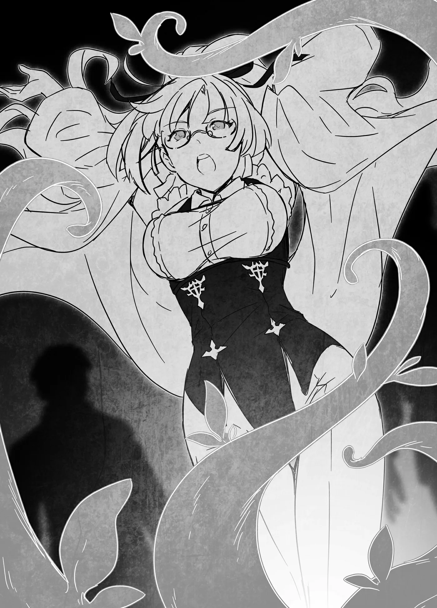

# Chương 158: Tập 7 Chương 2 - Tiếp Viện (2)

Mấy kỵ sĩ kiệt sức đến mức bảo họ dựng cỗ xe dậy lúc này e là khó. "Chúng ta có nên ra phụ một tay không?" tôi thì thầm với Lorraine và Augurey. Phía trước, Nauss cùng công chúa đang chỉ huy những người còn lại kéo dựng cỗ xe lên.

"Giờ mà chủ động giúp một tay thì khéo sau này lại có lợi nhất đấy," Augurey bảo.

"Cơ mà hai người không muốn gây chú ý đúng không? Vậy nếu cần, tôi có thể một mình vào cung, kiếm đủ ân huệ từ họ để họ đồng ý cho qua chuyện đó là êm đẹp nhất."

Nói cách khác, Augurey định tới bảo với họ là chúng tôi đã đi chỗ khác nên không vào cung được. Nhưng tôi chẳng muốn để anh ta phải làm thế. Ngay từ đầu chính tôi là người đề nghị cứu họ, giờ bắt Augurey đứng ra giải quyết hậu quả thì tôi thấy không ổn chút nào. Dù rằng cả nhóm có mặt ở đây vốn là vì yêu cầu vô lý của Augurey, nhưng người gật đầu nhận lời lại là tôi. Tôi đâu thể đổ hết trách nhiệm lên đầu anh ta được.

"Làm vậy thì tiện cho chúng tôi thật, nhưng lại ảnh hưởng đến chỗ đứng của anh ở vương đô," tôi nói. "Vả lại đôi bên cũng mới gặp nhau, tôi đâu thể đòi hỏi anh nhiều đến thế."

Augurey thoáng lộ vẻ ngạc nhiên. "Chính tôi mới là người lôi hai người vào chuyện này mà. Cậu tử tế thật đấy. Chà, tôi rất cảm kích tấm lòng của cậu, cơ mà vậy thì giờ tính sao đây?"

"Dù sao đi nữa, lấy thêm ân huệ của họ vẫn là lựa chọn đúng đắn. May sao việc dựng lại cỗ xe kia cũng dễ thôi, nếu hai người không phiền thì cứ để tôi lo," Lorraine gợi ý.

Cô định dùng ma pháp. Mấy kỵ sĩ kia chắc cũng có người biết ma pháp, nhưng do đặc thù công việc nên họ chủ yếu chỉ học ma pháp tấn công. Lorraine đương nhiên cũng rành những phép đó, nhưng cô còn biết vài câu chú tiện lợi và có công năng rất chuyên biệt.

"Tôi thì sao cũng được, nhưng đừng làm gì phô trương quá đấy nhé," tôi dặn. Mấy bộ đồ cô chọn vốn đã đủ gây chú ý lắm rồi.

"Được rồi, không phô trương đâu. Cơ mà trông có thể hơi ngoe nguẩy một chút đấy," cô đáp.

Tôi chẳng rõ ý cô là sao, nhưng miễn đừng phô trương thì tôi cũng chẳng bận lòng. Hầu hết ma pháp sư đều thủ sẵn dăm ba câu chú kỳ quặc hợp với sở thích cá nhân, nên tôi đoán ma pháp của cô chắc cũng thuộc dạng đó thôi.

"Vậy cô lo liệu nhé," tôi bảo.

Lorraine bước lại gần Nauss. "Thưa ngài Nauss, tôi có thể giúp các ngài dựng cỗ xe dậy được không?"

"Không, không đâu, các vị đã có ơn cứu mạng chúng tôi rồi, tôi không thể đòi hỏi thêm nữa. Việc này mất một lúc thật, nhưng chúng tôi vẫn sẽ kịp về vương đô trước lúc hoàng hôn thôi," Nauss khăng khăng.

Cơ mà như thế thì chúng tôi đâu lấy được ân huệ từ họ, nên Lorraine tiếp tục nói thêm.

"Với những kỵ sĩ dũng mãnh và trọng danh dự như các ngài thì chuyện này chẳng đáng bận tâm, nhưng tôi e là không nên để cô công chúa quý giá phải chờ đợi ở nơi đầy máu me này lâu đến thế. Tôi tin rằng dựng cỗ xe dậy càng sớm thì càng có lợi nhất cho các ngài. Tôi tình cờ biết chút ma pháp, trong đó có một câu chú cực kỳ thích hợp cho sự cố thế này. Nếu giao cho tôi, chỉ vài phút là xong xuôi ngay. Ngài chỉ cần mở lời một tiếng thôi."

Tôi thấy cô tâng bốc có phần hơi quá lời, nhưng trước đây cô luôn kể cho tôi nghe về những nỗ lực phối hợp làm việc với các học giả khác ở Đế Quốc. Có lẽ kỹ năng này cô học được từ hồi ấy.

Thoạt đầu Nauss có vẻ định phản đối, nhưng nghe Lorraine nhắc đến công chúa, ông liền đổi ý. Đến lúc cô bảo chỉ mất vài phút, ông lộ vẻ ngạc nhiên rồi thoáng chút đắn đo.

"Đã mang ơn cứu mạng mà lại phải nhờ vả các vị thì thật ngại quá, nhưng xin hãy giúp chúng tôi một tay. Thật ra trước đợt này chúng tôi đã phải chống đỡ một cuộc tập kích khác, nên cả thể lực lẫn Ma Lực đều đã cạn kiệt. Bình thường việc này dễ dàng với chúng tôi thôi, nhưng lúc này thì không thể," ông cúi đầu thừa nhận.

"Nhìn vết thương và Ma Lực của các ngài là tôi cũng đoán được chừng đó. Tôi hiểu gặng hỏi thêm chi tiết là mạo muội, nên tôi sẽ không hỏi đâu. Dù sao thì giờ tôi sẽ dựng cỗ xe dậy cho các ngài. Ngài bảo các kỵ sĩ lùi lại một chút được không?"

"Này, cô ấy sẽ nâng cỗ xe dậy giúp chúng ta đấy!" Nauss hô lớn với các kỵ sĩ. "Lùi lại mau!"

Đợi các kỵ sĩ làm theo lời dặn, Lorraine liền thi triển ma pháp. Với tài năng của mình, cô hoàn toàn có thể thi triển nhiều ma pháp mà chẳng cần đọc chú văn, nhưng hễ ở chốn đông người là cô thường vẫn niệm chú đàng hoàng. Một phần là để tránh phô bày hết thực lực, phần khác nghe đâu trong giới ma pháp sư thì đó cũng được coi là phép lịch sự. Ma pháp sư tài năng luôn bị giới nhà giàu và quyền thế vây quanh, nên làm vậy có lẽ cũng là để né tránh phiền toái đó.

Khi Lorraine thi triển xong câu chú, những nhánh dây leo xanh rì, to dày trườn lên từ lòng đất rồi xoắn chặt lấy nhau thành từng búi càng thêm to khỏe, chắc chắn. Sau đó, đám dây leo quấn quanh cỗ xe, nhấc bổng lên rồi đặt xuống ngay ngắn ở tư thế dựng đứng. Hóa ra ý cô bảo câu chú "ngoe nguẩy" là thế này đây. Tốc độ lại còn nhanh nữa. Nếu cô cho đám dây leo này siết cổ một người hay một con quái vật thì có lẽ đối phương sẽ ngất lịm ngay tức khắc.

Ma pháp thực vật vốn là sở trường của tộc Elf, nhưng tôi biết Lorraine cũng dùng được. Trước đây cô từng thị phạm cách dùng mấy nhánh cây nhỏ làm roi quất. Nói ngoài lề một chút, khả năng dùng Thần Lực thúc đẩy thực vật sinh trưởng của tôi có vài điểm khác biệt so với loại này. Với ma pháp, cây cối sẽ biến mất ngay khoảnh khắc không còn nhận được Ma Lực nữa. Người ta cũng có thể dùng ma pháp để thu hoạch hoa quả này nọ, nhưng chúng thường nhạt thếch hoặc có mùi vị dở tệ, nghe đâu cũng chẳng có chút dinh dưỡng nào. Ngược lại, khi dùng Thần Lực, cây cối sẽ lớn lên và giữ nguyên trạng thái trưởng thành vĩnh viễn. Đó là lý do người ta thường rất biết ơn khi được ban phước bằng Thần Lực. Đó cũng là lý do tôi có giá trị như một bao phân bón biết đi, dù tôi chưa bao giờ mong muốn cái danh phận đó cả.

"Ồ, tuyệt vời thật!" Nauss thốt lên. "Tôi nghe nói ma pháp thực vật khó thi triển lắm."

"Chẳng qua đó là lĩnh vực tôi thích nghiên cứu thôi," Lorraine khiêm tốn đáp. Cô nói đúng sự thật, nhưng điều khiển được nhiều thực vật đến thế chính là dấu ấn của một ma pháp sư xuất chúng. Ma pháp thực vật khó vì nó đòi hỏi phải kiểm soát sinh vật sống. Tộc Elf giỏi môn này là nhờ cả đời sống gắn bó mật thiết với rừng rậm, còn để Lorraine thi triển được ma pháp này thì cô phải có kỹ năng vô cùng xuất sắc.

"Không cần phải khiêm tốn thế đâu. Chà, xem ra giờ chúng ta có thể quay về vương đô ngay được rồi," Nauss nói.

"Vậy để tôi gọi chúng lại," Jia nói rồi huýt sáo một tiếng.

Đang lúc tôi thắc mắc cô bé định làm gì thì nghe thấy tiếng bước chân chạy dồn dập từ đằng xa hướng về phía chúng tôi. Nhìn sang xem là thứ gì, tôi thấy hai con kỳ lân trắng muốt. Hẳn đây là những con vật kéo cỗ xe này. Chúng rất khó huấn luyện và tính khí cực kỳ thất thường, nên hiếm khi được đem dùng như ngựa. Bù lại, cả tốc độ lẫn sức bền của chúng đều bỏ xa ngựa thường, nên kỳ lân đã qua huấn luyện được xem quý như báu vật.

Nghe Jia gọi là chạy ngay tới, xem chừng hai con kỳ lân này chỉ nghe lời cô bé. Chúng được cho là loài động vật thông minh, nên có khi Jia bảo thì chúng cũng chịu nghe lệnh người khác, nhưng tốt nhất vẫn không nên lại quá gần. Khi ở cạnh con người không phải chủ nhân của mình, chúng sẽ hành xử chẳng khác nào thú hoang.

Jia buộc hai con kỳ lân vào cỗ xe. Trông cô bé khá quen tay với việc này, đủ thấy cô không chỉ đơn thuần là một nàng công chúa được bao bọc. Lại thêm chuyện cô bé tự ý bước ra khỏi chỗ nấp trong xe bất chấp lời dặn của Nauss, Jia chẳng giống kiểu người nhu mì, dễ bảo cho lắm. Nhóm họ bị tập kích liền hai lần, thế mà cô bé vẫn tỏ ra tương đối thản nhiên.

Các kỵ sĩ bắt đầu kiểm tra cỗ xe, nhưng xem chừng không phát hiện thấy hư hại nào đáng kể. Cỗ xe khó lòng nguyên vẹn hoàn toàn sau khi bị lật nhào, song đúng là nó bền chắc như lời Nauss khẳng định. Cỗ xe sẽ có thể di chuyển hoàn toàn bình thường.

"Vậy thì tôi nghĩ đã đến lúc chúng ta lên đường rồi," Nauss nói.

"Phải rồi," tôi đáp. "Ngài có phiền nếu chúng tôi đi cùng hộ tống các ngài về vương đô không?"

Tôi đã bàn trước quyết định này với Lorraine và Augurey. Về cơ bản, đây là một bước nữa để lấy thêm ân huệ từ họ. Các kỵ sĩ chắc đã hồi phục đôi chút, nhưng chưa thể hoàn toàn. Chúng tôi không cách vương đô quá xa, song nếu các kỵ sĩ vừa phải bảo vệ cỗ xe trên đường đi vừa phải cuốc bộ thì chắc sẽ mất khoảng một tiếng đồng hồ. Ban đầu họ cưỡi ngựa, nhưng không như kỳ lân, phần lớn ngựa đều đã bị thương hoặc chết trong các đợt tập kích. Họ chỉ còn sót lại vài con, nhưng dẫu sao có vẫn hơn không.

"Các cậu sẵn lòng hộ tống chúng tôi ư?" Nauss hỏi.

"Vâng, nếu ngài không thấy phật ý trước lời đề nghị này. Tôi nghĩ làm vậy sẽ tốt nhất cho công chúa, nếu không quá phiền hà." Qua cuộc trò chuyện trước đó giữa ông ấy với Lorraine, tôi thấy rõ ông đặt sự an nguy của công chúa lên hàng đầu.

"Phải, cậu nói đúng. Nếu các cậu giúp được thì xin hãy hỗ trợ chúng tôi. Tất nhiên các cậu sẽ được hậu tạ." Quả đúng như dự đoán, hễ nhắc đến công chúa là Nauss rất dễ xuôi lòng.

"Tôi hiểu rồi. Có điều chúng tôi không phải kỵ sĩ, nên cũng lo là cả bọn sẽ gây chú ý. Nếu ngài không phiền, chúng tôi xin phép bám theo phía sau."

◆◇◆◇◆

May mắn thay, con đường về vương đô vô cùng an toàn. Vốn dĩ chuyện bắt gặp nhiều quái vật đến thế trên đường cái đã là hiếm có rồi. Chắc thứ tập kích họ đợt đầu đã để lại mùi máu khiến lũ quái vật sói đánh hơi mò tới. Khi hạ quái vật trong rừng, người ta luôn phải nhanh chóng đổi chỗ nếu không muốn bị cả bầy kéo đến bao vây. Có vẻ không còn thứ gì mò ra đường cái nữa, nhưng chừng ấy quái vật thôi cũng đã là quá nhiều rồi. Hôm nay tôi nhìn thấy sói như thế là quá đủ cho cả ngày.

"Đến đây thì họ an toàn rồi," tôi bảo.

"Ừ, tầm này tách ra có lẽ là hợp lý đấy," Lorraine tán thành.

Tôi bước lên phía trước cỗ xe, nói với Nauss: "Cũng gần tới cổng thành rồi, nên chúng tôi xin phép chia tay tại đây."

"Ồ, vậy sao?" Nauss nói. "Tôi cho rằng đến đây thì cũng chẳng còn việc gì cần phiền tới các cậu nữa. Nếu có chuyện gì xảy ra thì lính gác cổng cũng xử lý được. Cảm ơn các cậu vì tất cả. Xin hãy nhớ sớm ghé qua vương cung nhé. Tôi sẽ bẩm báo với Bệ Hạ về công lao của các cậu."

Tôi chẳng muốn chuyện đó xảy ra chút nào, nên bèn tìm cách gián tiếp từ chối: "Ồ, bảo vệ công chúa chỉ là chuyện đương nhiên nên làm thôi mà. Không cần phải làm vậy đâu. Chúng tôi xin phép tạm biệt tại đây," nói rồi tôi vội vã rời đi. Nauss xem chừng muốn nói thêm điều gì, song tôi thấy nghe thêm chỉ chuốc lấy rắc rối không cần thiết, nên cứ thế vờ như không nhận ra.

Lorraine, Augurey cùng tôi rảo bước tới đứng vào hàng dành cho thường dân. Cỗ xe dĩ nhiên đi về phía hàng dành cho đại quý tộc. Ở cổng thành có vài hàng lối khác nhau: có hàng phân chia theo giai cấp như thường dân, tiểu quý tộc và đại quý tộc; lại có hàng dành cho người đi bộ hoặc xe cộ. Bản thân cổng thành đủ đồ sộ để đáp ứng sự phân chia này.

Vào tầm này trong ngày, hàng dành cho thường dân dĩ nhiên khá đông đúc. Ngược lại, hàng mà công chúa dùng thì hầu như trống trơn. Vốn dĩ ngay từ đầu đã chẳng có mấy ai là đại quý tộc. Chúng tôi có thể đi vào cùng họ cho dễ dàng, nhưng làm thế thì người ta sẽ lưu lại ghi chép về việc nhập thành của chúng tôi. Khi dính tới quý tộc, lính gác thực sự theo dõi mọi thứ rất kỹ. Rất có khả năng họ cũng sẽ nhớ mặt vài người đi theo hộ tống, nên chúng tôi mới quyết định tốt nhất là tách nhau ra bên ngoài cổng thành.

◆◇◆◇◆

"Cuối cùng cũng quay lại được rồi," vừa vào bên trong thành, tôi liền thở dài một tiếng. Dù trước đó đã qua trót lọt một lần, tôi vẫn chẳng thấy tự tin khi dùng lại tấm giấy tờ tùy thân kia. Thực sự tôi khá lo lắng về chuyện đó.

Trái ngược với tôi, Lorraine đã quá quen với việc lui tới vương đô nên chẳng mảy may bận tâm. Chúng tôi để Augurey vào thành trước một chút, nhưng anh ta có giấy tờ tùy thân chuẩn chỉnh nên chẳng có lý do gì để gặp rắc rối.

Tôi là người vào sau cùng, vừa bước qua cổng đã hội ngộ với Lorraine.

"Anh đây rồi. Anh thực sự không cần phải căng thẳng đến thế đâu," vừa nhìn thấy mặt tôi, cô đã nói vậy vì nhận ra tâm trạng của tôi lúc này.

Tôi vốn nhát gan hết thuốc chữa, lại biết rõ mình đang làm chuyện sai trái, nên lời khuyên đó thật khó mà làm theo được. Nhưng lính gác không phát hiện ra tôi, nên dù sao thì chắc tôi cũng đã đối phó với họ đủ tốt. Nếu tôi tỏ vẻ khả nghi hơn, hẳn họ đã hỏi dồn đủ điều rồi. Ở những nơi thế này, dù trong lòng có chột dạ đến đâu thì tốt nhất vẫn cứ phải tỏ ra thật tự tin.

"Họ không nghi ngờ gì tôi cả, nên ổn rồi. Mà này, Augurey đâu rồi?" tôi hỏi. Đáng lẽ anh ta phải đợi chúng tôi, thế mà nhìn quanh chẳng thấy bóng dáng đâu.

"À, anh ta đến Hội để báo cáo hoàn thành công việc rồi. Anh ta muốn bàn với chúng ta về phần thưởng, nên bảo cứ đợi."

"Anh ta muốn chúng ta đợi ở đây á?" tôi hỏi lại. Đứng loanh quanh một chỗ suốt thời gian dài có thể khiến chúng tôi trở nên nổi bật, mà điều đó thì tôi muốn tránh.

Lorraine lắc đầu. "Không, anh ta dặn tới đợi ở một cửa tiệm. Anh ta cho tôi biết tên và địa điểm rồi, chúng ta dạo quanh một lát là tìm thấy thôi."

"Được rồi, đi thôi," tôi nói rồi cùng Lorraine cất bước.