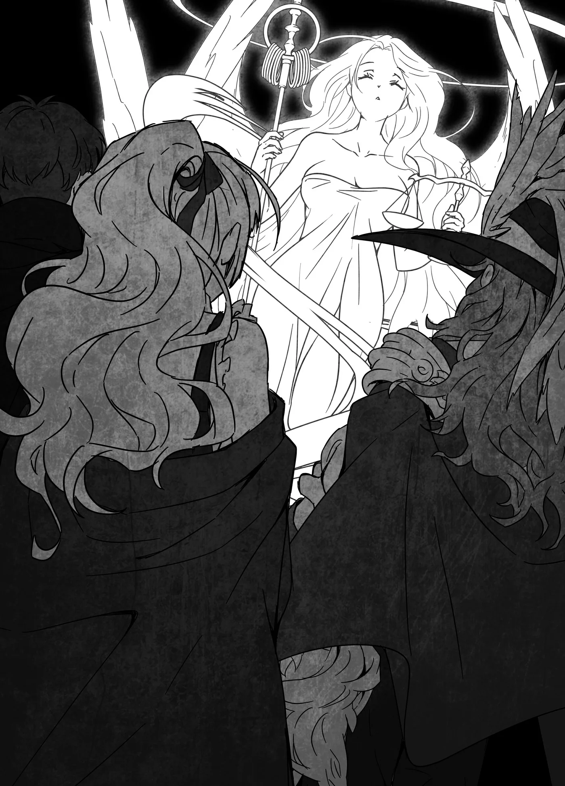

# Chương 161: Tập 7 Chương 2 - Tiếp Viện (5)

Augurey thậm chí còn ngỏ ý cho máu, nhưng tôi không định nhận. Hiện tại máu của Lorraine là đủ rồi, vả lại Sheila cũng cho tôi một ít nữa. Tôi chẳng cần thêm làm gì. Huống hồ, càng uống nhiều máu, tôi lại càng thấy mình ít giống con người hơn. Nếu được, tôi vẫn muốn giữ lại phần người nhiều nhất có thể. Hơn nữa, nếu bắt đầu uống nhiều hơn, khéo tôi lại đâm ra kén chọn. Tôi chẳng muốn biến thành một chuyên gia sành máu rồi đi phàn nàn về những nét tinh tế trong hương vị đâu. Ừ thì nghĩ cũng thấy thú vị đấy chứ. Nhưng nếu tôi làm thế thật, Lorraine khéo lại lôi tôi ra nghiên cứu tỉ mỉ về mùi vị của máu cũng nên. Tôi tuyệt đối chẳng muốn dính vào bất kỳ cuộc thí nghiệm nào kiểu đó đâu.

"Không, anh không cần phải làm thế đâu," tôi gạt những suy nghĩ ấy sang một bên để đáp lời Augurey. "Hiện tại máu của Lorraine là đủ rồi. Dù sau này có thể sẽ khác."

Tuy là một Hạ Cấp Ma Cà Rồng, chẳng hiểu sao tôi lại không cần nhiều máu đến thế. Có điều, chẳng có gì đảm bảo mọi chuyện sẽ luôn như vậy. Giống như hồi thèm khát thịt tươi rồi lao vào tấn công Lorraine trước đây, chẳng biết lúc nào bản năng quái vật của tôi lại trỗi dậy chiếm lấy tâm trí và ép tôi tấn công người khác. Hẳn Lorraine sẽ ngăn tôi lại như lần trước, nên có khi cũng chẳng đáng lo, nhưng tốt nhất là tôi vẫn nên ngăn không để chuyện tương tự xảy ra ngay từ đầu.

"Cậu chắc chứ? Cậu đã nói thế thì thôi vậy. Mà này, làm sao từ một Khô Lâu cậu lại biến thành Ma Cà Rồng được thế?" Augurey hỏi.

Tôi quên khuấy mất chưa kể phần đó. "Ồ, phải rồi. Anh đã bao giờ nghe nói về hiện tượng Tiến Hóa Bản Thể mà quái vật trải qua chưa? Nhờ nó đấy," tôi giải thích.

"Tiến Hóa Bản Thể á? Giống như Slime thường có thể biến thành Slime Ra'al mang độc ấy hả?"

"Ví dụ nghe cụ thể gớm nhỉ, nhưng ừ, chắc là thế?" tôi nói mà không mấy tự tin, rồi quay sang nhìn Lorraine để hỏi cho chắc.

"Phải, đại khái là đúng," Lorraine nói. "Nhưng khi Slime biến đổi thuộc tính thì chưa chắc năng lực thể chất của chúng đã tăng lên. Chuyện đó có nên gọi là tiến hóa hay không vẫn còn gây tranh cãi, nên ví dụ này chưa chuẩn lắm đâu. Anh cứ nghĩ nó giống như cách một Khô Lâu biến thành Khô Lâu Binh ấy."

Ví dụ đó nghe dễ hiểu hơn hẳn, lại ít chỗ để bàn cãi hơn. Ai cũng biết rõ về hai loài quái vật đó.

"Ừ, thì tại tôi thích Slime mà. Mấy sinh vật vô định hình ấy dễ thương lắm. Ngày trước tôi từng muốn nuôi một con làm thú cưng, nhưng lại chẳng tìm được cái bình chứa nào thích hợp để giữ nó," Augurey thú nhận.

Nghe thì nực cười, nhưng anh ta không phải người duy nhất nghĩ thế. Phụ nữ và trẻ em thích Slime nhiều đến bất ngờ. Chúng hay xuất hiện trong truyền thuyết và sách tranh, mà Slime trong đó trông vừa mềm mại vừa đáng yêu. Thế nhưng với đa số mạo hiểm giả, Slime lại là loài bị ghét cay ghét đắng. Lũ Slime người ta bắt gặp trong mê cung hay rừng rậm thường đang tiêu hóa dở một cái xác, có thể thấy rõ cái xác lơ lửng bên trong khối chất lỏng trong suốt. Khi chỉ còn trơ xương thì đỡ, chứ một cái xác đang phân hủy dở dang thì kinh hoàng thật sự. Thấy cảnh đó rồi thì khó mà không ghét Slime cho được. Xét theo nghĩa ấy, Augurey là một ngoại lệ hiếm hoi. Mà Lorraine cũng vậy. Cô ấy cũng thích Slime ra phết.

"Bình chứa à?" Lorraine hỏi. "Tôi nhớ Slime nuốt chửng hầu hết mọi thứ mà. Chai lọ bình thường thì làm sao giữ nổi."

"Đúng đấy!" Augurey đáp, mừng rỡ vì cô hiểu ý mình. "Tôi đã thử đủ mọi loại bình chứa, nhưng chẳng cái nào trụ được quá hai tuần. Mấy thứ tôi chưa thử thì lại quá đắt đỏ với một mạo hiểm giả Đồng Cấp nghèo rớt mồng tơi. Cơ mà có lẽ giờ thử lại một phen cũng đáng đấy chứ."

Hóa ra Augurey từng làm mấy trò thí nghiệm nguy hiểm này ngay tại Maalt. Ơn trời là cuối cùng anh ta cũng chịu từ bỏ. Cơ mà thôi, chúng tôi đang nói chuyện lạc đề mất rồi.

"Thôi, nói chuyện Slime thế đủ rồi," tôi bảo. "Tóm lại, đó là cách tôi biến thành Ma Cà Rồng. Mục tiêu hiện tại của tôi là trở lại làm người."

"Vì thế nên cậu mới tới vương đô à?"

"À thì không hẳn, nhưng chắc cũng có chút liên quan."

Thực ra mối liên hệ này khá mong manh. Tôi đúng là muốn trở lại làm người. Thế nên tôi mới về lại làng quê để tìm hiểu về cội nguồn của mình. Nhưng rồi tôi lại khám phá ra một bí mật khó tin và rốt cuộc đặt chân tới thành phố này nhờ các ma pháp trận dịch chuyển ẩn giấu bên trong bí mật đó. Có điều, cũng nhờ tạm gác lại cuộc sống săn diệt quái vật, gác lại chuyện thăng cấp mạo hiểm giả để dồn sức tìm hiểu mọi thứ trong khả năng nên tôi mới trôi dạt tới đây. Thành ra nếu gắn những nỗ lực trở lại làm người của tôi với chuyến đi Vistelya lần này thì cũng không hẳn là vô lý.

"À, thế thì tôi hiểu vì sao cậu không thể nói cho ai biết chuyện mình đang ở đây rồi. Nếu người ta phát hiện có một con quái vật vào thành phố rồi ráo riết lùng sục cậu, mà cậu lại lỡ xưng tên với ai đó thì phiền phức to."

"Phải đấy."

Chuyện đáng lẽ lúc này tôi phải đang ở rất xa nơi đây cũng là một vấn đề, nhưng tôi chưa thể bàn về chuyện đó được. Tôi không thể tự quyết định có nên tiết lộ bí mật về ma pháp trận dịch chuyển hay không trước khi hỏi ý kiến bà Gharb và Capitan. Vả lại, chút thông tin ít ỏi chúng tôi vừa chia sẻ có lẽ cũng đủ để tránh hiểu lầm khi lập khế ước ràng buộc ma pháp rồi.

Đó chính là cái khó của khế ước ràng buộc ma pháp so với những bản khế ước thông thường không áp dụng hình phạt bằng ma thuật. Nghe nói cách hiểu các điều khoản của khế ước ràng buộc ma pháp được quyết định bởi tiềm thức của những người đã ký kết. Khế ước thông thường không có ma pháp thì có thể do người đứng đầu chính quyền địa phương hoặc các thẩm phán do họ bổ nhiệm đứng ra phân xử. Nhưng với khế ước ràng buộc ma pháp, việc phán xét buộc phải diễn ra ngay khoảnh khắc điều khoản bị vi phạm, nên chẳng có thời gian cho bất kỳ quan chức tư pháp nào đưa ra phán quyết cả.

Giả sử tôi và Augurey lập một bản khế ước quy định rằng tôi sẽ không ăn bất kỳ món đồ ăn vặt nào của Augurey, và nếu vi phạm, tôi sẽ phải nhảy múa khỏa thân trước mặt anh ta. Nếu sau đó tôi ăn một món đồ ăn vặt của anh ta, bản khế ước sẽ lập tức phát huy hiệu lực. Lần tới khi ở gần Augurey, tôi sẽ bị ép phải nhảy múa khỏa thân ngoài ý muốn.

Chuyện ai là người diễn giải khế ước và diễn giải vào lúc nào vẫn còn gây nhiều tranh cãi. Có khá nhiều giả thuyết về chuyện này, nhưng phổ biến nhất là bản khế ước được chính những người liên quan diễn giải trong tiềm thức ngay khoảnh khắc nó bị phá vỡ. Nói cách khác, vì tôi biết rõ mình không được ăn đồ ăn vặt của Augurey mà vẫn cứ ăn, nên tôi sẽ bị phạt. Muốn nói dối cũng chẳng được. Người ta bảo sự thật sẽ do một vị thần định đoạt, mà thần linh thì nhìn thấu mọi sự gian dối. Vì những lý do đó, khi muốn dùng khế ước ràng buộc ma pháp mà không để xảy ra hiểu lầm, hai bên bắt buộc phải chia sẻ trước một lượng thông tin nhất định. Loại khế ước này rất khó dùng. Các học giả luật pháp, học giả ma thuật và học giả thần học vẫn đang nghiên cứu cơ chế hoạt động của chúng, nhưng với những người bình thường còn lại như chúng tôi thì cứ hiểu đơn giản là vậy. Đó là lý do chúng hiếm khi được dùng tới, mà một khi đã dùng thì phải có quyết tâm nhất định.

"Đấy, chúng tôi đã kể cho anh nghe phần lớn câu chuyện rồi," tôi nói. "Nếu anh không phiền thì tôi muốn lập khế ước ngay bây giờ."

"Tôi thấy vậy cũng ổn," Augurey nói. "Thế ai sẽ viết các điều khoản cụ thể đây?"

"Để tôi viết cho," Lorraine nhận lời. Cô bắt đầu ghi các ý tưởng lên mẩu giấy nháp có sẵn trong phòng. Sau khi Augurey xem qua và đồng ý, chúng tôi mới chuyển sang viết lên bản khế ước thật.

Dù đây là một bản khế ước ràng buộc ma pháp đặc biệt, nhưng cách dùng cũng giống như mọi bản khế ước khác. Chỉ cần viết xong các điều khoản và tất cả các bên cùng ký tên là nó sẽ kích hoạt. Chuyện ai ký trước đôi khi cũng là cả một vấn đề, nhưng chỉ khi một trong các bên không đáng tin cậy. Chẳng ai muốn đối phương cầm theo bản khế ước chưa ký hết rồi bỏ đi, để rồi họ có thể tùy ý kích hoạt bất cứ lúc nào. Dù vậy, lúc này chuyện đó không thành vấn đề. Tôi quen biết Augurey đã lâu và hiểu rõ tính cách của anh ta. Huống hồ, ngay cả khi anh ta muốn bỏ chạy, Lorraine cũng ngồi gần lối ra hơn. Nếu cô ấy niệm phép giữ anh ta tránh xa cánh cửa, thì ngay cả một mạo hiểm giả Ngân Cấp cũng chẳng thể nào thoát ra được. Nếu Augurey có vũ khí bí mật nào đó mà chúng tôi không biết thì có thể sẽ khác, nhưng lo lắng về khả năng đó cũng chẳng ích gì.

"Vậy tôi ký trước nhé," tôi nói rồi viết tên mình xuống. Lạ thay, tên tôi dường như đang phát sáng trên mặt giấy.

"Rentt, có chuyện gì thế?" Lorraine hỏi.

"Không, chẳng có gì đâu. Tới lượt anh đấy, Augurey," tôi nói rồi đưa bản khế ước và cây bút cho anh ta. Ngay cả tờ giấy này dường như cũng rất đặc biệt, cầm trên tay thấy dễ chịu đến lạ. Sờ vào thấy như giấy nhưng chẳng hiểu sao lại có cảm giác giống kim loại. Hẳn nó phải được làm ra bằng một phương pháp vô cùng độc đáo. Cứ tưởng nhìn kỹ là đoán ra được đôi chút, nhưng rốt cuộc tôi vẫn mù tịt. Mà nếu tôi nhìn bằng mắt thường cũng đoán được cách làm ra những thứ này, thì chắc chắn đến giờ người khác cũng đã tìm ra từ lâu rồi.

"Được rồi, hiểu rồi." Augurey nhận lấy bản khế ước từ tay tôi rồi ký tên mình.

"Tên dài thật đấy," tôi nói. Tôi cứ tưởng chỉ là Augurey Ars thôi, ai dè đằng sau còn kéo dài thêm cả một đoạn nữa.

"Đừng nhìn, xấu hổ lắm," Augurey làu bàu.

Cảm thấy mình như đang phạm vào quy tắc bất thành văn của giới mạo hiểm giả là không tò mò soi mói quá khứ của nhau, tôi vội rụt đầu lại. "Xin lỗi nhé. Tại tôi ít khi thấy cái tên nào dài đến vậy thôi mà," tôi nói, dù thực ra cũng từng thấy vài lần rồi. Hình như một số quốc gia cho phép đổi tên rất dễ dàng, nên có vài người quyết định đổi tên mình thành dài ngoằng đến phát sợ. Có lẽ cứ một trăm mạo hiểm giả thì lại có một người mang cái tên dài bất thường như thế. Họ nghĩ làm vậy trông mình sẽ oai nghiêm hơn hay mấy trò ngớ ngẩn đại loại thế. Trong thoáng chốc, tôi tưởng Augurey cũng thuộc nhóm người đó, nhưng trông anh ta chẳng giống kiểu người như vậy chút nào.

"Ừ thì, nếu cậu muốn nhìn thì cứ nhìn đi. Hồi nghĩ ra cái tên đó tôi còn trẻ người non dạ lắm," Augurey đáp, dường như xác nhận mối nghi ngờ ban đầu của tôi. Tôi gặp anh ta khoảng ba năm trước, và có vẻ vào thời điểm đó anh ta đã trưởng thành, trở thành một người biết điều rồi, ngoại trừ gu ăn mặc hơi kỳ quặc một chút. Thế nhưng nếu hồi đó anh ta tự giới thiệu bằng cái tên dài điên rồ này rồi bắt tôi phải nhớ, khéo tôi đã phát ngấy anh ta rồi cũng nên. May mà lúc tôi gặp anh ta, anh ta đã biết suy nghĩ hơn nhiều.

"Được rồi, thế là xong. Rentt, Lorraine, giờ thì khế ước sẽ kích hoạt và—" Augurey vừa mở lời thì bản khế ước ràng buộc ma pháp bỗng tỏa sáng rực rỡ khác thường. Tôi nhìn luồng sáng dần tụ lại, rồi một hình ảnh hiện lên ngay phía trên bản khế ước. Nó mang một hình dáng rất quen thuộc.

"Đây là Hozei sao?" Augurey hỏi.

Đó là hình ảnh mờ ảo, trong suốt của một người phụ nữ tóc dài, tay cầm cán cân và quyền trượng. Khi bà nhắm mắt lại như thể đang cầu nguyện, ánh sáng tuôn rơi từ cây quyền trượng như mưa và thấm vào từng chữ trên bản khế ước. Sau khi ánh sáng dịu xuống, hình ảnh ấy tan dần vào không trung như đang nhòe đi rồi biến mất hẳn. Thứ còn lại chỉ là bản khế ước chúng tôi vừa viết. Cảnh tượng đó hơi đáng sợ nên lúc này tôi cũng hơi ngập ngừng chưa dám chạm vào, nhưng rồi cũng phải có ai đó thử, nên tôi lấy ngón tay khẽ chọc vào nó.

"Hình như chẳng có chuyện gì xảy ra cả," tôi nói. Augurey và Lorraine cũng đưa tay chạm vào nó.

"Cái quái gì vừa xảy ra thế?" Augurey hỏi. "Ký một bản khế ước được Hozei ban phước là nó phải như thế này sao?" Tôi hiểu được sự bối rối của Augurey. Những bản khế ước ràng buộc ma pháp thông thường cũng phát sáng sau khi có hiệu lực, nên nếu coi đây chỉ là mức độ mạnh hơn của hiện tượng đó thì chẳng có gì đáng sợ cả.

Thế nhưng Lorraine lại lắc đầu. "Tôi từng thấy người ta dùng một tờ như thế này rồi, và lần đó nó cũng chỉ phát sáng như bất kỳ bản khế ước ràng buộc ma pháp thông thường nào thôi. Ánh sáng đúng là có rực rỡ hơn đôi chút, nhưng chỉ có vậy. Không hề có hình ảnh của ai hiện lên cả."

"Thế chuyện này có nghĩa là sao?" tôi hỏi.

"Đây có thể là một hiện tượng cực kỳ hiếm gặp. Tôi nghĩ bây giờ là lúc thích hợp để dùng chiếc chuông này đấy," Lorraine nói rồi chỉ vào chiếc chuông vị tư tế đã đưa cho chúng tôi.

"Nhưng ngộ nhỡ ông ấy nhìn thấy những gì chúng ta viết trong khế ước thì sao?" Augurey hỏi, nhưng rồi toàn bộ chữ viết trên đó đều biến mất. Chẳng còn lại gì trên tấm giấy da ngoài chữ ký của chúng tôi, mà ngay cả những chữ ký đó cũng mờ nhòe đến mức khó nhìn rõ. Tôi đọc ra được là nhờ biết trước mình đã viết gì, chứ không thì có khi còn chẳng nhận ra trên đó có chữ.

"Vừa chứng kiến một hiện tượng thần thánh như thế mà xem ra hai người chẳng có mấy lời để bàn nhỉ," tôi nói.

"Chắc tại tôi kinh ngạc quá nên chẳng biết nói gì đấy thôi," Augurey đáp.

Lorraine nói thêm, "Tôi chỉ đành chấp nhận rằng cứ ở cạnh anh là chuyện gì cũng có thể xảy ra thôi."

Tôi định cãi lại rằng chuyện này đâu phải tại tôi, nhưng ngẫm tới vận may của mình dạo gần đây thì tôi cũng chẳng dám chắc. Tôi nhún vai rồi nói, "Thôi thì, chắc chúng ta nên gọi vị tư tế vào thôi."
