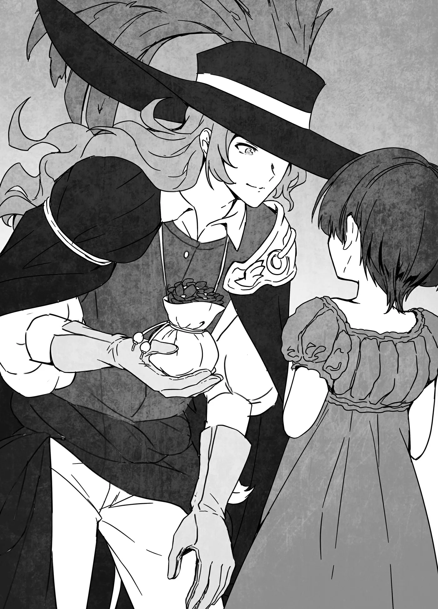

# Chương 162: Tập 7 Chương 2 - Tiếp Viện (6)

"Ngập tràn thánh khí thế này sao?!" vị tư tế thốt lên đầy kinh ngạc ngay khi vừa bước chân vào phòng. Người này xuất hiện nhanh đến mức chúng tôi vừa rung chuông xong, tôi suýt buột miệng hỏi có phải người đó đứng chực sẵn ngoài cửa từ trước không. Nhìn vẻ mặt sững sờ chết lặng kia, tôi hiểu rằng dẫu ảo ảnh vừa rồi có thực sự là Hozei hay không, thì ít nhất thứ đó cũng đã tỏa ra thánh khí.

Cảm nhận thánh khí hẳn là cần qua rèn luyện bài bản, thứ mà chúng tôi đều không có, dẫu vậy tôi vẫn nhận thấy không khí trong phòng trở nên thanh khiết đến lạ thường. Nếu ví không khí được Thần Lực thanh lọc tựa như khí trời nơi núi rừng đồng nội, thì bầu không khí lúc này lại giống với không gian vô trùng được niêm phong hoàn toàn hơn. Tôi cảm nhận được sự hiện diện của một ý chí mãnh liệt, đanh thép, tuyệt đối không khoan nhượng trước bất kỳ thứ gì tà ác. Thế nhưng bản thân tôi lại là Ma Cà Rồng — một sinh vật tà ác đúng nghĩa — nên chuyện đó nghe chừng chẳng thuyết phục cho lắm.

"Có điều gì bất thường lắm sao?" tôi hỏi vị tư tế khi thấy người đó liên tục hít sâu. Người đó liền phóng ánh mắt sắc lẹm về phía tôi rồi túm chặt lấy cổ áo tôi.

"Thế này là sao?! Rốt cuộc chuyện quái quỷ gì đã xảy ra ở đây thế hả?! Mau nói cho tôi biết!" người đó gào lên rồi lắc mạnh người tôi, trông hoàn toàn mất hết bình tĩnh.

"Có thể buông tay tôi ra trước được không?" tôi hỏi.

Vị tư tế cuối cùng cũng tỉnh trí lại. "Ôi, xin thứ lỗi. Tôi hơi kích động quá," người đó nói rồi buông tay. Tôi có cảm giác như mình vừa giữ lại được mạng sống. Không hẳn là tôi có thể bị giết chỉ vì bị túm cổ áo, nhưng tôi đoán chừng khi ấy phần hồn của mình cũng suýt bay mất rồi.

Đến lúc nhìn kỹ lại vị tư tế, hóa ra người này lại là một nữ tư tế. Chiếc áo chùng của cô rộng thùng thình, chiếc mũ trùm che khuất khuôn mặt, còn giọng nói lại mang vẻ trung tính khó phân biệt nam nữ, thành thử ban nãy tôi chẳng thể xác định nổi giới tính mà chỉ đơn thuần đoán chừng đó là một người đàn ông. Thế nhưng trong lúc lắc người tôi, chiếc mũ trùm của cô đã tuột xuống, để lộ ra gương mặt. Vì tôn chỉ của các đền thờ Hozei xoay quanh chuyện khế ước, giới tăng lữ thường tránh để lộ diện mạo, nên ắt hẳn cô không hề cố ý để xảy ra chuyện này.

"Này, mũ trùm của cô tuột rồi kìa," tôi nhắc. Vị nữ tư tế giật mình thảng thốt, vội vã kéo mũ trùm lại lên đầu rồi cố trấn tĩnh. Tôi thầm nghĩ giờ này mới làm vậy thì muộn mất rồi, song tôi chẳng muốn gợi lại chuyện đó làm gì.

"Giờ mới làm thế thì muộn quá rồi còn gì?" Lorraine lại buột miệng hỏi thẳng thừng mà chẳng thèm nghĩ ngợi nhiều.

Vị nữ tư tế tiu nghỉu buông xuôi rồi cởi mũ trùm ra lần nữa. "Có lẽ cô nói đúng," cô bảo, trông ngơ ngẩn đễnh đoảng đến lạ. Dẫu vậy, lúc dẫn đường cho chúng tôi ban nãy, cô lại hành xử hết sức trôi chảy và giải thích mọi chuyện đâu ra đấy. Có lẽ bầu không khí trong căn phòng này đã khiến bản tính thật của cô lộ ra chăng. Dù sao thì tăng lữ rốt cuộc cũng chỉ là con người mà thôi. Nhưng miêu tả về vị nữ tư tế này chừng đó là đủ rồi.

"Cô vừa nói gì về thánh khí cơ?" tôi hỏi.

"À, phải rồi. Tôi không rõ liệu có ai trong các vị cảm nhận được không, nhưng căn phòng này đang ngập tràn thánh khí. Cứ như thể thần linh vừa mới ngự nơi đây vậy. Tôi thậm chí còn muốn tuyên bố căn phòng này là thánh địa nữa kia."

Câu trả lời của cô khiến mấy người chúng tôi đưa mắt nhìn nhau. Chúng tôi ắt hẳn cũng mơ hồ cảm nhận được chút thánh khí. Tôi biết có điều gì đó khác lạ, nhưng cảm giác ấy không hề rõ ràng như khi có Ma Lực hay Thần Lực hiện hữu. Dù vậy, tôi chẳng hiểu nổi vì sao cô lại muốn tuyên bố nơi này là thánh địa. Đây vốn dĩ là một căn phòng trong đền thờ, nên nếu muốn thì họ cứ việc làm thế thôi, nhưng tôi chẳng thấy chuyện đó có ý nghĩa gì.

"Tạm gác chuyện thánh địa hay đại loại thế sang một bên đã," tôi nói, "để tôi giải thích những gì vừa xảy ra. Chúng tôi đã sử dụng khế ước ràng buộc ma pháp, rồi một ảo ảnh trông giống hệt Hozei xuất hiện và có lẽ đã ban phước cho bản khế ước hay điều gì đó tương tự. Nó đây này."

Cô nhã nhặn cúi đầu đón lấy bản khế ước từ tay tôi rồi giơ lên không trung để quan sát. "Bản khế ước này chắc chắn đã được Hozei ban phước," cô nói.

"Chẳng phải vốn dĩ chúng đều được Hozei ban phước sao?" tôi hỏi.

"Đúng là như vậy, nhưng xét theo nghĩa cụ thể hơn thì lại không phải. Những bản khế ước này do các Thánh Giả được Hozei ban phước tạo ra, nên chúng chỉ gián tiếp mang sự ban phước của Hozei mà thôi. Tuy nhiên, nếu cứ nói chung chung rằng chúng được Hozei ban phước thì nghe chừng sẽ trọng thể hơn," cô giải thích.

Đó thực sự chẳng phải điều tôi cần biết. Thế nhưng các tư tế tại đền thờ Hozei lại mang dáng dấp của những thương nhân hơn là tăng lữ thông thường, nên tôi cũng chẳng lấy làm lạ. Vả lại cũng đâu phải họ đang lừa dối người khác. Chuyện những bản khế ước này do các Thánh Giả tạo ra vốn là điều ai nấy đều biết. Điều thực sự quan trọng là chúng có phát huy hiệu quả hay không, và chúng quả thực hiệu nghiệm, thành thử chẳng có lý do gì để chỉ trích các đền thờ cả.

"Thế nhưng bản khế ước các vị vừa sử dụng lại thực sự mang sự ban phước của ngài ấy. Điều đó có thể đồng nghĩa với việc bản khế ước này quan trọng đối với thần linh."

"Đích thân Hozei ban phước cho những bản khế ước quan trọng sao?" Lorraine hỏi.

"Đúng vậy, nhưng đây là lần đầu tiên tôi được tận mắt chứng kiến. Một ví dụ tôi từng nghe kể là Hozei đã đích thân giá lâm để ban phước cho bản khế ước liên quan đến việc cho mượn một thanh thần kiếm. Còn rất nhiều ví dụ khác nữa, và tất cả đều được lưu truyền như những huyền thoại. Liệu tôi có thể mạo muội hỏi nội dung khế ước của các vị là về chuyện gì không? Lẽ dĩ nhiên tôi sẽ không ép các vị phải nói ra. Nhưng với tư cách là người phụng sự Hozei, nếu có thể thì tôi rất tha thiết muốn biết."

"Thật xin lỗi, nhưng tôi không thể nói cho cô hay được," tôi trả lời khi chẳng còn lựa chọn nào khác.

"Cơ mà nếu so với ví dụ cô vừa kể, khế ước của chúng tôi tuyệt đối chẳng có gì hệ trọng đến mức đó đâu."

"Tôi hiểu rồi," vị nữ tư tế khẽ thở dài. "Vậy thì ít nhất hãy cho tôi biết tên của các vị đi."

"Xin lỗi, chuyện đó tôi cũng không thể tiết lộ được." Giờ thì vị nữ tư tế trông như thể tuyệt vọng hoàn toàn, nhưng tôi chẳng còn cách nào khác. Dẫu vậy, tạm gác chuyện của tôi và Lorraine sang một bên, khéo Augurey lại có thể xưng tên cũng nên.

Đây là ngôi đền thờ phụng nữ thần của khế ước và công lý, nên giới tăng lữ được cho là luôn coi trọng việc giữ kín bí mật một cách tuyệt đối. Kể cả khi bị chính quyền hay các thế lực quyền uy gặng hỏi, họ cũng chưa từng để lộ bất kỳ bí mật nào. Xuyên suốt chiều dài lịch sử đã có không ít ví dụ như thế. Trong câu chuyện về thanh thần kiếm mà vị nữ tư tế vừa nhắc tới, danh tính của người tiếp nhận khi ấy vốn là một bí mật. Một quý tộc đầy quyền lực chịu sự thao túng của một trong các Ma Vương từng viện đến tầm ảnh hưởng quốc gia để ép đền thờ phải tiết lộ thân phận người nắm giữ thanh kiếm, thế nhưng họ đã thẳng thừng khước từ. Dù vậy, dẫu điều đó có là sự thật đi chăng nữa, tốt nhất chúng tôi vẫn không nên để lộ tên tuổi của mình.

Vị nữ tư tế trông có vẻ tiếc nuối, song ắt hẳn cô cũng cảm thấy việc gặng hỏi thêm nữa sẽ là hành động sai trái với tư cách người phụng sự Hozei.

"Không, các vị chẳng có gì phải xin lỗi cả. Thực ra việc tôi gặng hỏi mới là đường đột. Nhưng nếu bản khế ước của các vị xảy ra bất kỳ vấn đề gì, xin hãy liên hệ với một trong các đền thờ của chúng tôi. Dù là đền thờ chính hay chi nhánh, chúng tôi nhất định sẽ hỗ trợ các vị. Đây, chỉ cần xuất trình tấm thẻ này tại bất kỳ đền thờ nào của chúng tôi, các vị sẽ được phép đích thân trao đổi với người đứng đầu đền thờ đó. Xin hãy giữ lấy nó," cô nói rồi trao cho tôi một tấm thẻ.

Đó quả là một sự tiếp đón vô cùng nồng hậu, nhưng tôi tự hỏi tại sao cô lại nhiệt tình đến mức này. Tôi cũng thắc mắc vì sao một tư tế tình cờ gặp lại có thể sở hữu thứ đồ như vậy.

"Ôi, lẽ ra tôi phải tự giới thiệu sớm hơn mới phải," cô nói như thể đọc được thắc mắc trong lòng tôi. "Tôi là Josee Meyer, người đứng đầu ngôi đền này. Rất hân hạnh được gặp các vị."

Chúng tôi đáp lễ rồi bắt tay cô, không quên dặn lòng tuyệt đối không được xưng tên đáp lại.

Đối với một người gánh vác cả ngôi đền, cô còn quá đỗi trẻ tuổi. Trông Josee chỉ trạc độ tuổi giữa đôi mươi, xấp xỉ tuổi của Lorraine và tôi. Vương Quốc Yaaran có thể không phải một quốc gia quá bề thế, nhưng việc trở thành người đứng đầu một đền thờ tại vương đô vẫn chứng tỏ cô là người rất tài ba. Người ta thường bảo rằng một tư tế sẽ rất dễ thăng tiến nếu sở hữu Thần Lực, vả lại cô dường như cũng rất nhạy cảm với thánh khí, thành thử có lẽ cô thực sự mang trong mình Thần Lực. Nói cách khác, cô chính là một Thánh Giả. Nếu đúng là vậy, địa vị của cô cũng chẳng có gì đáng kinh ngạc, song đối với chúng tôi thì điều đó cũng chẳng tạo nên khác biệt nào. Augurey là người duy nhất phải bận tâm về việc có thể đụng mặt cô lần nữa bởi anh ta hoạt động ở vương đô, nhưng nếu chuyện đó có xảy ra thật, khéo Josee lại là người chủ động tránh né anh ta cũng nên.

Lúc này khi đã hỏi xong những điều muốn hỏi và hoàn tất những việc cần làm, đã đến lúc chúng tôi phải rời đi. Thời gian của chúng tôi không còn nhiều, vả lại Augurey cũng bảo anh ta còn có việc riêng cần giải quyết.

"Chúng tôi phải đi ngay bây giờ rồi," tôi nói.

"Ôi, vậy sao?" Josee tiếc nuối đáp lời. Trông cô như thể vẫn muốn tìm hiểu thêm, nhưng giờ thì đã quá muộn để gặng hỏi rồi. Chúng tôi rời khỏi căn phòng và rảo bước hướng về phía lối ra của ngôi đền.

◆◇◆◇◆

"Chà, bao nhiêu chuyện đã xảy ra, nhưng giờ thì chắc chẳng còn điều gì đáng lo nữa rồi," tôi nói khi chúng tôi rời khỏi ngôi đền.

"Phải đấy. Giờ thì dẫu có ai đến gặng hỏi, tôi cũng có thể lấy bản khế ước ra làm cớ để không nói gì," Augurey nói. "Thật nhẹ cả người. Tôi cảm thấy an tâm hơn hẳn khi biết rằng dù muốn hay không thì mình cũng chẳng thể nào làm lộ bí mật được." Bản khế ước vẫn chừa cho Augurey khả năng mở lời nếu tôi hoặc Lorraine cho phép, thế nhưng việc tạo ra một cơ chế ngăn ngừa những sơ suất có thể khiến anh ta phải câm lặng vĩnh viễn vẫn tốt hơn nhiều so với việc bắt anh ta phải nơm nớp lo sợ về điều đó suốt phần đời còn lại.

"Ừ thì, cũng có thể chúng ta đang lo xa quá thôi," Lorraine nói. "Đằng nào thì tôi cũng không nghĩ sẽ có ai tìm cách săn lùng thông tin mà bản khế ước này che giấu đâu, nhưng sau những gì đã xảy ra với Nive, tôi không muốn liều lĩnh chút nào."

Giờ đây khi diện mạo của tôi chẳng khác gì con người, sẽ không có mấy ai nhận ra tôi không phải đồng loại của họ. Kể cả chúng tôi không cẩn trọng đến mức này, khả năng tôi bị bại lộ cũng là cực kỳ thấp. Thế nhưng chúng tôi luôn phải lường trước tình huống đó. Đó là lý do vì sao tôi chỉ thổ lộ bí mật của mình cho những người tôi hoàn toàn tin tưởng, hoặc những người đã dùng khế ước ràng buộc ma pháp để gây dựng niềm tin ấy. Biết đâu một ngày nào đó, khi hiểu rõ hơn về cơ thể mình, tôi sẽ buộc phải giải thích mọi chuyện cho một người mà mình chẳng mấy thân quen, nhưng trước hết tôi sẽ phải suy đi tính lại thật kỹ càng.

"Nive sao? Có phải Nive Maris không?" Augurey hỏi.

"Phải đấy, cô ấy tới Maalt để truy lùng một con Ma Cà Rồng. Cô ấy từng nghi ngờ tôi khá nhiều."

"Thế thì gay go thật đấy. Nhưng theo như lời cậu kể thì rốt cuộc cô ấy cũng không gây quá nhiều rắc rối cho cậu, đáng ngạc nhiên thật."

Lẽ dĩ nhiên tôi mới là người ngạc nhiên hơn bất kỳ ai về chuyện đó. Hóa ra cô ấy vốn đang lùng sục một con Ma Cà Rồng khác. Tôi tự hỏi không biết liệu cô ấy đã tìm thấy nó hay chưa. Khi đến từ phương tây, cô ấy hừng hực nhiệt huyết săn lùng. Thị trấn Maalt tuy tương đối rộng lớn so với mặt bằng chung các đô thị ở Yaaran, nhưng nếu cô ấy ngày ngày cứ bừa bãi phóng ra luồng Thánh Hỏa đó, chẳng một con Ma Cà Rồng nào có thể ẩn nấp được.

"Dù sao thì rốt cuộc tôi vẫn bình an vô sự, và đó mới là điều quan trọng," tôi nói. "Nhân tiện, Augurey, anh bảo mình có việc cần làm mà. Anh còn bao nhiêu thời gian?"

Augurey ngước nhìn vị trí mặt trời. "Chết dở, chẳng còn nhiều đâu. Hôm nay tôi phải đi đây. Liệu tôi có cơ hội gặp lại hai người không? Tôi cũng đã trải qua nhiều chuyện kể từ ngày rời Maalt. Có cả đống thứ để hàn huyên đấy, và nếu hai người có dịp ghé lại vương đô lần nữa, tôi rất muốn được cùng hai người nhận chung một ủy thác."

Tôi nhìn chung thường gắn bó với những chuyến mạo hiểm đơn độc, nhưng điều đó là bởi tôi từng nghĩ chiến đấu một mình sẽ là cách hiệu quả nhất để trở nên mạnh mẽ hơn. Giờ đây quan điểm của tôi đã thay đổi đôi chút. Vả lại, hồi cả hai còn là những mạo hiểm giả độc hành nghèo túng ở Maalt, chúng tôi thỉnh thoảng vẫn nhận chung nhiệm vụ. Tôi chẳng có lý do gì để từ chối, và xem chừng Lorraine cũng vậy.

"Được thôi, lần tới khi đến đây tôi sẽ liên lạc với anh," tôi nói. "Lẽ ra tôi sẽ liên hệ qua Hội, nhưng tôi không nghĩ mình có thể làm thế."

"Vậy thì cứ liên hệ tới quán trọ này nhé," Augurey mau mắn đáp lời, hiểu rõ nỗi ngần ngại của tôi. "Đó là nơi tôi luôn thuê trọ. Hẹn gặp lại sau." Anh ta trao cho tôi một mẩu giấy ghi tên quán trọ cùng vị trí đại khái của nó, rồi vẫy tay chào tạm biệt và rảo bước rời đi.

◆◇◆◇◆

"Giờ chúng ta đi tới điểm hẹn luôn chứ?" tôi hỏi Lorraine.

"Tôi cũng nghĩ vậy. Vẫn chưa hẳn tới giờ hẹn, nhưng thời gian sít sao lắm rồi. Tôi chẳng muốn làm bà Gharb và Capitan nổi giận đâu."

"Nói phải đấy, mau lên thôi," tôi đáp.

Chúng tôi vội vã chạy tới điểm hẹn. Lẽ dĩ nhiên, chúng tôi không quên thay trang phục trở lại bình thường từ trước đó. Tôi chẳng đủ can đảm để bà Gharb và Capitan nhìn thấy mình trong bộ cánh lòe loẹt sặc sỡ ấy đâu. Chắc chắn họ sẽ trêu chọc tôi suốt cho mà xem.

◆◇◆◇◆

"Ồ, vừa đúng giờ đấy. Khoan đã, thực ra là quá giờ một chút rồi. Hai đứa thích thú ngắm cảnh đến thế cơ à?" bà Gharb cất tiếng hỏi khi chúng tôi vừa tới nơi. Đó xem chừng là một câu hỏi thực lòng.

"Cháu xin lỗi. Với Lorraine thì đây không phải lần đầu tới vương đô, nhưng với cháu thì đúng là vậy, nên ngắm cảnh cũng rất thú vị. Nhưng đó không phải lý do tụi cháu đến muộn đâu ạ," tôi nói.

Tôi kể cho hai người nghe về cuộc gặp gỡ với Augurey cùng toàn bộ những gì đã diễn ra sau đó. Lẽ dĩ nhiên tôi lược bỏ tất thảy những chuyện liên quan đến việc mình là Ma Cà Rồng. Để giải thích lý do vì sao chúng tôi đến đền thờ Hozei, tôi chỉ bảo rằng mình không muốn Augurey kể cho bất kỳ ai nghe về việc chúng tôi đã tới vương đô. Đó không hẳn là toàn bộ sự thật, song cũng chẳng phải lời bịa đặt dối trá. Tại một thời điểm nào đó trong câu chuyện, bà Gharb và Capitan bắt đầu nheo mắt nhìn tôi, thành thử có lẽ họ biết tỏng tôi đang giấu giếm điều gì, nhưng họ không hề nói toạc ra.

Khi tôi dứt lời, bà Gharb khẽ thở dài. "Hai đứa chỉ đi dạo thôi mà. Sao lại chuốc lấy bao nhiêu rắc rối vào người thế hả? Lorraine, cháu chắc hẳn mệt mỏi lắm rồi."

"Không đâu ạ, suốt chuyến đi cháu đều cảm thấy rất vui vẻ," Lorraine tươi cười đáp lời.

"Thế à? Ta hiểu rồi, hiểu rồi. Hai đứa không nói cho cậu ta biết về các ma pháp trận dịch chuyển đấy chứ?"

"Dạ không, chúng cháu không nói," tôi bảo. "Cháu nghĩ mình không nên nhắc tới chuyện đó khi chưa được sự cho phép của bà. Có lẽ tụi cháu đã có thể kể cho anh ta sau khi lập khế ước, nhưng cháu đã quyết định không làm vậy."

Khi nhắc tới những bí mật của riêng mình, quyền lựa chọn tiết lộ điều gì và cho ai hoàn toàn thuộc về tôi. Kết cục là, dẫu tôi có bị ai đó như Nive giết chết đi chăng nữa, tôi cũng chỉ có thể tự trách bản thân mình mà thôi. Thế nhưng các ma pháp trận dịch chuyển rốt cuộc lại là vấn đề của Hathara. Việc để lộ bí mật ấy không phải là quyết định mà tôi có quyền tự tiện đưa ra.

"Ta đã bảo là giao quyền cai quản nơi đó cho cháu rồi cơ mà? Điều đó bao gồm cả những ma pháp trận dịch chuyển ấy nữa, cháu muốn làm gì với chúng cũng được," bà Gharb nói, khiến tôi không khỏi ngỡ ngàng.

"Điều đó có nghĩa là tụi cháu có thể tùy ý chọn người để nói cho họ biết về chúng sao ạ?" Lorraine hỏi.

Capitan gật đầu. "Phải, ý của tụi này là vậy đấy. Chú đoán chắc tụi này chưa truyền đạt điều đó cho thật rõ ràng..."

"Thế nhưng nếu điều đó khiến các ma pháp trận dịch chuyển bị phát giác, làng Hathara sẽ ra sao đây ạ?" Lorraine cất giọng đầy lo ngại.

"Cô không cần phải bận tâm quá nhiều về chuyện đó đâu," tôi nói. "Trong trường hợp xảy ra bất kỳ biến cố nào, các ma pháp trận dịch chuyển bên phía Hathara đều có thể bị xóa bỏ. Có đúng vậy không ạ?" tôi hỏi rồi quay sang nhìn bà Gharb.

"Phải, ta đã được chỉ dạy cách thức rồi. Nếu muốn làm thì ta hoàn toàn có thể làm được. Sau đó, làng Hathara chỉ việc giả vờ như không biết gì là xong. Sẽ chẳng còn ma pháp trận dịch chuyển nào để mà tìm kiếm nữa, thế nên sẽ chẳng có rắc rối nào phát sinh cả."

"Ma pháp trận dịch chuyển có thể bị bàn tay con người phá hủy sao ạ?" Lorraine hỏi. Giọng cô nghe đầy kinh ngạc, nhưng điều đó hoàn toàn có lý do của nó. Những ma pháp trận dịch chuyển thông thường được tìm thấy trong các mê cung chưa từng bao giờ bị con người phá hủy. Chúng chỉ biến mất khi cấu trúc của mê cung thay đổi; còn dẫu vũ khí hay ma pháp của con người có thể tạm thời làm cạo xước hay sứt mẻ một phần vòng tròn, nó cũng sẽ lập tức tự tái tạo lại ngay. Những ma pháp trận này có sức tồn tại cực kỳ dai dẳng.

"Phải. Việc đó dễ ợt ấy mà, miễn là biết cách. Ta sẽ kể cho hai đứa nghe sau. Có khá nhiều điều ta cần truyền đạt cho hai đứa đấy, bao gồm cả những lối ra của các ma pháp trận dịch chuyển trong tàn tích thành phố ngầm kia. Hai đứa tốt nhất là nên ghi nhớ cho thật kỹ đi," bà Gharb bảo.

Giọng điệu của bà làm tôi nhớ lại quãng thời gian mình từng theo học bà. Ngay cả tới tận bây giờ, điều đó vẫn khiến tôi có chút e dè sợ sệt. Bà Gharb có thể là một người vô cùng tàn nhẫn và nghiêm khắc. Hồi đó tôi đã phải dốc hết sức bình sinh để học thuộc lòng mọi thứ, thành thử chẳng có lấy một khoảnh khắc nào để ngẫm xem nó khắc nghiệt đến nhường nào. Giờ mà bảo làm lại thì chắc chắn tôi sẽ thấy mệt mỏi lắm. Thế nhưng dẫu ngày ấy bà từng ép tâm trí tôi đến tận cùng giới hạn, nếu phải làm lại từ đầu một lần nữa, tôi vẫn sẽ sẵn lòng.

Lorraine thì trái lại, dường như xem đây là cơ hội tuyệt vời để tiếp thu những điều mới mẻ và thú vị. "Cháu nóng lòng quá rồi đây ạ!" cô nói, đôi mắt sáng rực. Nếu cô ấy có thể tìm thấy niềm vui trong chuyện này, thì hẳn cô ấy có thể tận hưởng bất cứ thứ gì trên đời.

Dẫu vậy, nếu các ma pháp trận dịch chuyển thực sự có thể bị phá hủy, điều đó có nghĩa là ngay cả khi có ai đó nghe phong phanh về chúng, làng Hathara vẫn có thể giả vờ như chẳng liên quan gì. Có lẽ mọi chuyện vẫn sẽ tồi tệ nếu ai đó phát hiện ra chúng nằm ở Hathara trước khi kịp phá hủy, nhưng khi ấy chúng tôi chỉ việc đảm bảo sao cho kẻ phát hiện ra tuyệt đối không thể tiết lộ với bất kỳ ai. Nếu có thể, tôi muốn mình có đủ khả năng phá hủy các ma pháp trận dịch chuyển trước khi xảy ra chuyện đó. Có lẽ sẽ là một ý hay nếu nghĩ ra cách nào đó để biến điều này thành hiện thực. Hoặc biết đâu chừng đã có sẵn một cách thức như thế rồi cũng nên. Tôi chẳng dám chắc, nhưng lúc này tôi cảm thấy bớt lo lắng hơn đôi chút.

◆◇◆◇◆

"Hửm?" Lorraine cất tiếng trên đường tiến về phía cổng thành.

"Có chuyện gì thế?" tôi hỏi.

"Kia chẳng phải Augurey sao?" cô đáp. Tôi nhìn theo hướng mắt cô, và Augurey quả nhiên đang đứng đó thật. Anh ta đang nói chuyện với một bé gái và cố trao cho cô bé thứ gì đó.

Nói thật thì tôi biết nghe lén là không phải phép, nhưng đây lại là giữa phố chính của Vistelya. Nghĩ bụng nghe ngóng một chút chắc cũng chẳng sao, trí tò mò đã thôi thúc tôi kích hoạt Tai Ma Cà Rồng của mình. Dù vậy, đó chẳng phải tên của một kỹ năng thực thụ nào đâu; chỉ là cách tôi tự gọi thính lực được cường hóa của mình mà thôi.

"Thiến thảo hỏa tinh linh đây rồi nhé. Cháu cầm lấy đi," Augurey nói với cô bé.

"Nhưng cháu không có tiền ạ," cô bé đáp.

"Không cần phải bận tâm chuyện đó đâu. Đây chỉ là phần thiến thảo còn thừa lại từ đợt chú hái để nhuộm bộ đồ chú đang đặt may cho mình thôi. Thú thật là thừa nhiều quá chú chẳng biết phải làm gì với nó nữa. Cháu cứ tự nhiên mà dùng đi. Mẹ cháu đang cần nó mà, phải không?"

"Dạ vâng, cháu cảm ơn chú ạ. Ôi, chú Augurey! Ờm..."

"Cháu không cần phải trả tiền đâu. Mau mang nó về cho mẹ đi cháu. Lần tới gặp lại, chú sẽ trình làng bộ cánh thời trang đỉnh cao nhất mọi thời đại của mình cho xem. Nếu có ai trong mấy đứa bị ốm thì mất vui lắm đấy. Đi nhanh đi nào," Augurey nói rồi đẩy nhẹ cô bé từ phía sau. Cô bé có vẻ dùng dằng chưa muốn rời đi, nhưng rốt cuộc cũng cắm đầu chạy biến đi đâu đó. Augurey mỉm cười dõi theo bóng lưng cô bé rồi quay gót hòa mình biến mất vào giữa dòng người đông đúc.

"Tốt bụng ghê nhỉ. Nhìn cái cách anh ta ăn mặc thì chẳng ai có thể mảy may ngờ tới điều đó cả," Lorraine nói.

"Ừ thì, tính anh ta vốn là vậy mà. Đó là lý do vì sao tôi gắn bó với anh ta nhiều đến thế," tôi đáp lời, nhưng nghe chừng Augurey đang bắt bọn trẻ phải xem buổi trình diễn thời trang của mình như một khoản thù lao đáp lễ thì phải. Nghe đúng phong cách đặc trưng của anh ta thật.

