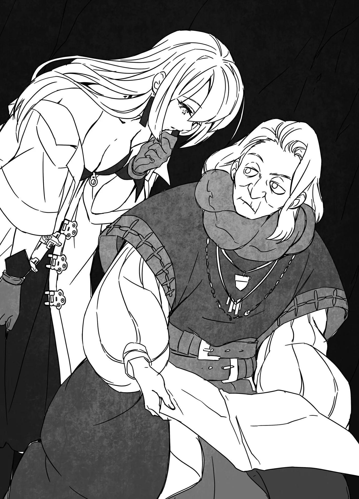

# Chương 163: Tập 7 Chương 3 - Vô Số Bí Mật (1)

"Mình về lại chỗ cũ rồi sao?" tôi hỏi khi cảnh vật xung quanh đã đổi khác hoàn toàn. Mới thoáng trước còn ở trong đường cống ngầm, giờ chúng tôi đã đứng bên trong một hang động. Đây là một trong vô số hang hốc nằm trên vách thành của thành phố tàn tích.

Bốn người chúng tôi từ Vistelya quay lại đây, và khác với lúc tới, mấy người lính gác chẳng buồn nhìn chúng tôi lấy một lần khi rời thành. Khâu kiểm tra lúc rời thành phố còn đơn giản hơn lúc vào nhiều, đến giấy tờ tùy thân chúng tôi cũng không phải xuất trình. Tôi chẳng muốn chê bai đất nước mình đâu, nhưng họ có vẻ thiếu cảnh giác thật. Tôi đoán họ chẳng buồn để tâm ai rời thành, trừ khi người đó từng bén mảng tới khu quý tộc. Lúc vào đã xét rồi thì lúc ra chẳng cần bận tâm nữa, có lẽ họ tính thế, nhưng vậy thì lỏng lẻo quá. Đó cũng là một lý do vì sao Vương Quốc Yaaran chẳng thể có vị thế lớn hơn.

"Vậy là chúng ta từ Vistelya tới mê cung ở Đế Quốc này, rồi giờ lại dịch chuyển tiếp để về Hathara sao? Nghĩ lại mới thấy, tụi mình đang vượt qua những quãng đường xa đến khó tin chỉ trong chớp mắt đấy," Lorraine khẽ nói.

Lời cô nói có điểm khiến tôi phải ngẫm lại. Không hẳn có gì kỳ lạ, nhưng có một chi tiết làm tôi chú ý.

"Mê cung ư? Không biết tôi có thể dùng Bản Đồ Akasha ở đây không nhỉ," tôi nói. Cách dùng từ của Lorraine làm tôi nhớ tới món ma cụ có khả năng tự động vẽ bản đồ mọi mê cung tôi từng đặt chân tới. Nếu năng lực của nó áp dụng cho mọi mê cung, thì hẳn cũng có tác dụng với thành phố ngầm của Hiền Vương Felt, tầng thứ sáu mươi của Mê Cung Côn Trùng Cổ ở Đế Quốc. Nhưng có lẽ chỉ vẽ mỗi tầng sáu mươi thì chẳng mấy ý nghĩa, vả lại tôi cũng chẳng có cách nào từ phía trên đi xuống đây. Dù vậy, nếu chỉ để đi lại quanh thành phố ngầm thì biết đâu nó vẫn có ích.

"Nghe anh nhắc mới nhớ, anh mở ra xem thử đi. Tôi cũng tò mò đấy," Lorraine đáp.

Bà Gharb và Capitan ngơ ngác nhìn chúng tôi.

"Bản Đồ Akasha ư? Thứ gì thế?" bà Gharb hỏi.

Tôi chẳng có lý do gì để giấu nên kể thật cho bà nghe. "À, đó là món ma cụ một người kỳ lạ tặng cháu trong mê cung. Hữu dụng lắm bà. Đây, chính là nó," tôi vừa nói vừa lấy cuộn giấy da cũ kỹ ra khỏi túi ma thuật.

"Trông với chú thì cũng chỉ như mảnh giấy da bình thường thôi mà," Capitan khoanh tay nói.

"Trông bề ngoài thì đúng là thế thật, nhưng công dụng của nó lợi hại lắm. Chú chỉ cần đi quanh mê cung là nó sẽ vẽ lại bản đồ chuẩn xác cho chú. Với mạo hiểm giả thì chẳng có món đồ nào tiện hơn thế đâu."

"Gì cơ? Chú cũng muốn có một cái. Mấy tiệm ở Maalt có bán thứ này không?" Capitan hỏi. Lời giải thích chưa cặn kẽ của tôi có vẻ khiến chú ấy hiểu nhầm. Capitan từng dùng các ma pháp trận dịch chuyển để đi khắp nơi, nên chắc chú ấy cũng thám hiểm mê cung không ít. Chú ấy hẳn biết Bản Đồ Akasha hữu dụng đến mức nào. Tiếc là tôi chẳng thể cho chú câu trả lời như ý.

"Cháu chịu thôi, Maalt nhỏ hơn Vistelya nhiều lắm. Nếu có ai làm ra được tấm bản đồ thế này thì chắc chắn ở vương đô đã bán rồi. Đằng này cháu chỉ được người ta tặng thôi. Người cho cháu món này kỳ lạ lắm. Người đó cũng cho cháu chiếc áo chùng này, mà Lorraine bảo làm ra thứ như vậy là bất khả thi. Tấm bản đồ này dĩ nhiên cũng thế," tôi đáp.

Capitan nhìn tôi vẻ thất vọng ra mặt. "Được rồi, vậy chú sẽ đấu một trận với cháu để lấy nó," chú ấy nói.

"Không đời nào. Cháu thắng thế nào được, chỉ có nước bị chú xé ra từng mảnh thôi. Tha cho cháu đi!" tôi la lên.

"Cứ theo ma pháp ảo ảnh của Lorraine mà tính thì chú không nghĩ vậy đâu. Chú chẳng bao giờ thách đấu kẻ yếu hơn mình nhiều như thế," chú ấy đáp, khiến tôi bất ngờ trước lời khen ngợi ấy. Có lẽ ngay cả trong mắt Capitan, tôi cũng thực sự mạnh lên đôi chút rồi. Tôi suýt nữa thì đắc ý, nhưng liếc sang mặt Capitan thì thấy chú ấy đang cười có vẻ ranh mãnh.

"Đây là bẫy phải không? Tha cho cháu đi, cháu làm sao có cửa thắng," tôi nói, bình thản từ chối đề nghị của chú ấy.

Capitan cũng chỉ đùa thôi. Chí ít là phần lớn câu chuyện. "Thôi được rồi, chú không đòi tấm bản đồ nữa," chú ấy bảo.

"Nhưng hai chú cháu mình vẫn phải so tài một trận. Chú cần xem cháu mạnh lên cỡ nào rồi. Vả lại chú cũng có vài thứ muốn chỉ dạy cho cháu."

Nếu không phải đem đồ ra cược thì tôi khó mà từ chối được. "Thôi được, nhưng chú nương tay cho cháu đấy nhé," tôi dặn trước, rồi mở Bản Đồ Akasha ra xem.

"Ồ, hóa ra ở đây nó cũng hoạt động thật. Nơi này đang được vẽ lại y như mọi khi. Không những thế, quãng đường mình cưỡi Shahor Melechnamer cũng được ghi lại luôn. Xem ra ngồi trên lưng thú cưỡi thì bản đồ vẫn ghi nhận," Lorraine lập tức đoán khi nhìn vào tấm bản đồ.

Phần lớn các vật phẩm thuộc loại này chỉ hoạt động khi tự đi bằng đôi chân của mình, hoặc sẽ có những giới hạn nghiêm ngặt khác. Bản Đồ Akasha dường như chẳng hề có bất kỳ giới hạn nào như thế, nên xét trong các món ma cụ thì nó tiện dụng đến đáng kinh ngạc. Nếu có thể sản xuất hàng loạt thứ này, tôi sẽ giàu to. Nhưng ngay cả Lorraine cũng chẳng biết nó được chế tạo ra sao và cho rằng việc mổ xẻ để sao chép là điều gần như bất khả thi. Tôi chỉ là người mới học ma thuật và thuật giả kim, nên việc sản xuất hàng loạt Bản Đồ Akasha chỉ là giấc mộng viển vông. Dù sao thì chuyện bản đồ ghi lại lộ trình chúng tôi cưỡi Shahor Melechnamer vẫn chưa đáng chú ý bằng một chi tiết khác lộ ra khi nhìn kỹ hơn.

"Ở đây ghi 'Đến Tàn Tích Pháo Đài Vương Quốc Cổ Đại Hathara', còn chỗ này ghi 'Đến Cống Ngầm Thời Kỳ Khai Quốc Vistelya'. Có phải đúng như những gì tôi đang nghĩ không?" tôi hỏi.

"Chà, đó đích thị là điểm đến của các ma pháp trận dịch chuyển rồi," bà Gharb bảo. "Đến cả thứ đó mà nó cũng ghi ra thì ta bất ngờ thật đấy."

◆◇◆◇◆

"Nếu mình làm một tấm bản đồ kiểu này mà ghi đủ mọi ma pháp trận dịch chuyển thì từ đây muốn đi đâu cũng dễ. Khéo mở được cả dịch vụ lữ hành ấy chứ," tôi hào hứng góp chuyện, nhưng ba người kia đang mải nghĩ ngợi nên chẳng ai buồn nghe. Tôi hiểu cảm giác của họ. Bản Đồ Akasha mang lại quá nhiều điều phải suy nghĩ. Tôi chỉ muốn khuấy động bầu không khí một chút thôi, ai ngờ đụng phải đám khán giả khó tính quá — cái kiểu khán giả đủ sức "giết chết" bất kỳ nghệ sĩ biểu diễn nào, dù chút tài góp vui của tôi còn lâu mới xứng với danh xưng đó.

"Những ma pháp trận dịch chuyển này vốn không thuộc về mê cung từ đầu đúng không bà? Là do người làng Hathara làm thêm sau này sao?" Lorraine hỏi bà Gharb.

"Ừ, đúng thế," bà Gharb nói. "Không có ghi chép nào về một ma pháp trận dịch chuyển dẫn tới Hathara, nhưng hồi dời tới nơi đó sinh sống, chắc người làng ta đã làm thêm một trận pháp để tiện đi lại giữa hai bên. Còn cái dẫn tới cống ngầm Vistelya là do vị tể tướng của làng để lại từ xưa, như ta nhớ là từng kể rồi đấy."

"Dạ, cháu hiểu rồi. Thế thì không biết Bản Đồ Akasha lấy thông tin này từ đâu ra nhỉ. Ma cụ kiểu này vận dụng đủ mọi cách thức, nhưng thường là dựa vào giác quan và hiểu biết của người dùng để thu thập dữ liệu. Có điều với tấm bản đồ này thì tôi chịu đấy," Lorraine giải thích rồi quay sang nhìn tôi.

Tôi suy nghĩ một lát rồi lắc đầu nói: "Cái này chắc khác rồi. Có thể tôi cũng lờ mờ đoán được pháo đài đó thuộc về một vương quốc cổ đại, nhưng tôi hoàn toàn không biết đường cống ngầm ở Vistelya có từ thời lập quốc. Tôi chỉ nghe nói nó đã có hàng thế kỷ nay, chứ ngoài ra chẳng biết gì hơn." Nếu tấm bản đồ thực sự dựa vào kiến thức và giác quan của tôi để lấy thông tin, thì nơi này cùng lắm chỉ được ghi là "Pháo Đài Nào Đó Gần Hathara" với "Đường Cống Cực Cổ Ở Vistelya" thôi. Tôi thì thích mấy cái tên nghe ngầu hơn chút, nhưng nếu nó lấy từ giác quan và hiểu biết của tôi thì chắc chắn chỉ ra được chừng đó.

"Tôi cũng nghĩ thế," Lorraine nói. "Đến tôi còn chẳng đoán nổi cống ngầm đó xây từ bao giờ. Anh thì chẳng có tí kiến thức nào về chuyện đó nên dĩ nhiên làm sao mà biết được. Thành ra ta có thể tin là tấm bản đồ không lấy gì từ hiểu biết của anh đâu. Nhưng nếu vậy thì rốt cuộc thông tin này từ đâu ra cơ chứ?"

Bà Gharb là người giải đáp thắc mắc của Lorraine. Bà cũng là ma pháp sư kiêm nhà giả kim, nên có hiểu biết nhất định về ma cụ.

"Trước tiên, ta nghiêng về khả năng nó dựa trên hiểu biết của người tạo ra món ma cụ," bà nói. "Nghĩa là ai làm ra tấm bản đồ này cũng đều biết về nơi đây." Đó xem chừng là cách giải thích hợp lý nhất.

Lorraine gật đầu, nhưng rồi cô lại nêu ra một khả năng khác. "Đúng vậy, nhưng cháu còn một giả thuyết khác. Nghe có vẻ điên rồ, nhưng rất có thể nó đang lấy thông tin từ Bản Ghi Akashic."

Tôi chưa từng nghe tới Bản Ghi Akashic bao giờ, và nhìn vẻ mặt Capitan thì chú ấy cũng vậy. Dường như chỉ có Lorraine và bà Gharb là biết thứ đó là gì. Hai người chúng tôi thuộc phe dùng cơ bắp hơn là đầu óc. Bình thường chúng tôi cũng suy nghĩ không ít, đôi khi còn đóng góp được vài ý kiến ra trò. Đôi khi thôi. Nhưng lúc này thì trên đầu cả hai chắc chắn chỉ toàn dấu chấm hỏi.

"Bản Ghi Akashic thực chất chỉ là một khái niệm," bà Gharb nói, ngán ngẩm trước sự mù tịt của hai chúng tôi. "Đó là nơi lưu giữ ghi chép về mọi hiện tượng tồn tại trên đời. Nhưng đây không phải nơi mắt thường nhìn thấy được. Có thể coi đó là một chiều không gian khác. Lorraine nói đúng khi bảo đây là ý tưởng điên rồ, nhưng nơi đó lại cực kỳ quan trọng với giới ma pháp sư và nhà giả kim. Mọi cơ chế vận hành sâu xa của ma pháp đều được ghi lại ở đó, nên người ta đồn rằng nếu chạm tới được Bản Ghi Akashic thì sẽ thu về lượng tri thức khổng lồ. Thế nhưng xưa nay chưa từng có ma pháp sư nào chạm tới được nó cả." Bà liếc nhìn tấm Bản Đồ Akasha của tôi. Xem chừng cái tên "Akasha" bắt nguồn từ chữ Akashic. Nếu đúng như thế thì giả thuyết của Lorraine là hoàn toàn có cơ sở.

"Chà, đây cũng chỉ là giả thuyết thôi. Tấm bản đồ khéo chỉ được đặt tên như vậy cho oai hơn thôi. Giống như người ta có thể đặt tên một thanh kiếm là Đồ Long dù nó chưa từng chém rụng một con rồng nào vậy," Lorraine nói, làm dịu bầu không khí.

Công bằng mà nói thì vũ khí và ma cụ hay có thói quen đặt tên phóng đại quá mức. Ngoài Đồ Long ra, còn đầy món mang tên Đồ Cự Nhân, thậm chí cả Đồ Thần. Mỗi lần ghé tiệm vũ khí trong thị trấn, mấy món như thế lúc nào cũng sẵn hàng. Số vũ khí mang cái tên kêu như chuông ấy khéo còn đông hơn cả số rồng, Cự Nhân và thần linh đang tồn tại trên đời. Đã vậy, mấy thực thể đó đâu dễ gì bị hạ gục bởi món đồ rèn hú họa trong một tiệm rèn nhỏ, nên những cái tên ấy chỉ có thể là bịa đặt. Dù vậy, biết đâu một chiến binh thiện nghệ vẫn có thể dùng nó để tiêu diệt chúng không chừng. Nhưng chừng nào thanh kiếm chưa thực sự chém được rồng, tốt nhất chỉ nên gọi nó là Đồ Long Trên Lý Thuyết hay đại loại thế. Tương tự vậy, Bản Đồ Akasha có lẽ chỉ sở hữu công năng đủ lợi hại để khiến người ta ngỡ rằng nó kết nối được với Bản Ghi Akashic, dù thực tế chẳng phải vậy.

"Có khi cô nói đúng," tôi bảo. "Nhưng nếu vậy thì người làm ra tấm bản đồ này hẳn phải biết về nơi đây chứ. Cô nghĩ sao về chuyện đó?"

"Phải hỏi người làm ra nó mới biết được. Rất có thể người anh gặp chính là tác giả của tấm bản đồ này, nhưng tôi e là khó mà tìm được cô ta. Chắc mình đành tạm gác thắc mắc này lại thôi," Lorraine nói.

"Phải rồi. Dù sao thì tôi cũng chẳng thể quay lại nơi mình từng gặp cô ấy được nữa."

Con đường dẫn tới tầng sâu của Mê Cung Nguyệt Ảnh đã đóng lại. Tôi không phá nổi bức tường đó, nên chẳng có cách nào quay lại được nơi ấy. Tất cả những gì tôi có thể làm là tìm kiếm manh mối ở nơi khác, nhưng hiện tại trong tay chẳng có gì. Nghĩ ngợi thêm về chuyện đó lúc này cũng bằng thừa.

"Trước mắt thì ta nghĩ cách tốt nhất là xem tấm bản đồ đó hữu dụng tới đâu," bà Gharb nói. Thấy tôi nghiêng đầu chưa hiểu ý, bà hứ một tiếng rồi giải thích: "Xem nó hiện ra cái gì khi cháu tới các ma pháp trận dịch chuyển khác ấy. Rồi khéo cháu sẽ hiểu cơ chế vẽ bản đồ của nó hoạt động ra sao."

◆◇◆◇◆

Không có đủ thời gian để kiểm tra hết vô số ma pháp trận dịch chuyển trong một ngày, nên chúng tôi chỉ thử vài cái. Bà Gharb và Capitan chọn ra những nơi chúng tôi sẽ tới. Hai người họ vốn thường xuyên dùng vài ma pháp trận dịch chuyển mà chúng tôi chưa từng đi bao giờ, nên đã biết rõ chúng dẫn tới đâu. Đây là bài kiểm tra lý tưởng để thử công dụng của Bản Đồ Akasha.

"Hừm, xem ra nó đúng là vẽ lại những nơi cháu từng đi qua thật," bà Gharb lẩm bẩm. "Có điều chừng nào cháu chưa dùng ma pháp trận dịch chuyển thì bản đồ dường như không hiện ra điểm đến của nó."

Lúc này Bản Đồ Akasha hiển thị 'Đến Albasa, Vương Quốc Lina' và 'Đến Nhà Kho Bỏ Hoang Của Thương Nhân Daris, Đảo Daris, Cộng Hòa Thorn'. Cả hai dòng chữ đều nằm bên dưới vị trí các ma pháp trận dịch chuyển, hé lộ cho chúng tôi biết vài điều.

"Nó chỉ rõ điểm đến chính xác của những ma pháp trận mình đã dùng, còn với cái chưa dùng thì hình như chỉ đưa ra thông tin chung chung như tên thành phố với quốc gia thôi," Capitan nói.

Ma pháp trận dịch chuyển tới Albasa là cái chưa ai trong chúng tôi từng dùng. Cả bọn chỉ đứng trước mặt nó thôi. Còn với Đảo Daris, chúng tôi đã qua lại bằng ma pháp trận dịch chuyển kia. Trước khi bước vào, chúng tôi có xem bản đồ nhưng lúc đó nó chỉ ghi 'Đảo Daris, Cộng Hòa Thorn'. Mãi tới khi quay về từ hòn đảo thì chi tiết cụ thể hơn mới hiện ra.

Nhân tiện thì Đảo Daris đẹp thật. Cộng Hòa Thorn là một đảo quốc phương nam gồm hàng nghìn hòn đảo cấu thành. Nghe đâu ngành vận tải đường biển ở đó phát triển lắm. Nếu có thời gian rảnh, tôi cũng muốn tới đó tắm biển một chuyến. Mà thực ra tôi cũng đâu đến mức bận rộn đến thế. Việc cần làm thì nhiều nhưng chẳng có hạn chót gấp gáp nào cả. Tôi muốn lên mạo hiểm giả Mithril Cấp càng sớm càng tốt, nhưng nếu cứ ép mình quá mức thì khéo lại tự ngáng chân. Tôi nghĩ tốt nhất là vẫn nên dành chút thời gian để thư giãn. Cơ mà biết đâu tôi chỉ đang lười chảy thây thôi cũng nên.

"Hay lúc nào đó mình thử đi hết từng cái một đi, cốt để bản đồ ghi lại chính xác điểm đến," tôi gợi ý.

Lorraine có vẻ ngần ngại. "Nếu làm được thì cũng hay đấy, nhưng mình đâu biết mọi điểm đến có an toàn hay không," cô e ngại nói.

"Lo thế cũng phải thôi," bà Gharb tán thành. "Nhưng giả sử lối ra có bị đất đá vùi lấp đi nữa thì dùng ma pháp trận dịch chuyển cũng đâu khiến mình bị dính vào đống đổ nát hay thứ gì đại loại thế. Chuyện đó thì chẳng đáng lo. Cơ mà biết đâu có cái lại đưa thẳng ta vào tận phòng ngai vàng của nước nào đó, khả năng ấy thì phải tính tới đấy."

Nghĩ tới cảnh đó mà thấy rợn người. Biết là mình sẽ không bị dịch chuyển kẹt vào trong tường hay thứ gì tương tự thì cũng đỡ lo, chứ tự dưng xuất hiện giữa phòng ngai vàng thì chẳng hay ho gì đâu.

"Xem chừng trong khi các ma pháp trận dịch chuyển tới Hathara và Vistelya mới có vài thế kỷ, thì vài cái khác có thể cổ xưa như chính thành phố này," Lorraine nói thêm. "Mà tôi đoán phần lớn đều cổ như vậy cả. Nếu đúng thế, rất có thể người ta đã xây công trình đè lên ma pháp trận dịch chuyển ở điểm đến mà chẳng hề hay biết dưới chân có gì. Chúng ta đều biết người ngoài không thể phá hủy chúng được, hay đúng hơn là có phá thì chúng cũng tự phục hồi lại. Dựa theo một số thí nghiệm thì ma pháp trận bị lấp kín sẽ dịch chuyển người ta tới vị trí an toàn gần nhất phía trên lối ra."

"Thế nghĩa là sao?" tôi hỏi.

"Đơn giản thế này nhé: giả sử ma pháp trận dịch chuyển ở đầu bên kia được vẽ trên sàn nhà, rồi sau đó bị người ta lát đá đè lên. Chuyện gì sẽ xảy ra khi anh dịch chuyển tới ma pháp trận đó?"

"Thì nó không hoạt động chứ sao? Ma pháp trận bị kẹt dưới đó rồi, làm sao mà dịch chuyển tới được nữa."

"Về lý thuyết thì nghe có vẻ hợp lý, vì trong ví dụ này ma pháp trận đã bị bít kín hoàn toàn. Nhưng nếu thử làm thật thì sẽ có một hiện tượng khá thú vị xảy ra đấy."

"Hiện tượng gì?"

"Nó sẽ đưa anh lên ngay trên mặt sàn lát đá."

Nghe thì tiện thật đấy, nhưng đứng ở vị trí của chúng tôi thì lại đáng sợ vô cùng. Nếu có tòa nhà xây đè lên trên ma pháp trận, chúng tôi có thể chui tọt vào bên trong một nơi nào đó. Như vậy thì lời bà Gharb nói về việc bị dịch chuyển thẳng vào phòng ngai vàng là hoàn toàn có thể xảy ra. Đã vậy, nếu ma pháp trận ở đầu bên kia bị bít kín thì khéo chẳng còn đường nào quay lại thành phố này nữa.

"Ta chắc là có vài ma pháp trận rơi vào cảnh đó đấy," bà Gharb nói. "Một số có khi nằm trong pháo đài cũ hay lâu đài đã được trùng tu để tiếp tục dùng cho tới tận bây giờ. Đôi khi ta nghe người ta kể về lịch sử lâu đài của quý tộc nào đó, chúng được xây dựng từ thời xửa thời xưa đến khó tin. Phần lớn thì mớ lịch sử ấy chỉ được thêu dệt cho cơ ngơi nghe oai hơn thôi, nhưng không phải ai cũng bịa. Ta nghĩ thế nào cũng có vài công trình còn giữ ma pháp trận dịch chuyển tới tận ngày nay. Cứ nhìn pháo đài ở Hathara là rõ. Ngoài kia vẫn còn những pháo đài và lâu đài tương tự, người ta có thể vẫn đang ở mà chẳng hề hay biết gì về lai lịch của chúng. Biết đâu lại có những trận pháp nằm im chỉ vì bị một tấm thảm trải đè lên."

"Nếu ma pháp trận bị thảm trải đè lên, người ta vẫn dùng được nó sao?" tôi hỏi.

"Bà ấy nói một thôi một hồi thế mà anh lại đi hỏi mỗi câu đấy à?"

Lorraine vặn vẹo tôi như thể tôi ngờ nghệch lắm không bằng. Tôi chẳng hiểu sao cô cứ phải làm thế, người ta tò mò thì hỏi thôi mà. Thấy tôi nhún vai, cô thở dài một tiếng rồi dù sao cũng giải thích cặn kẽ cho tôi. Tôi thích tính cách đó của cô.

"Nếu chỉ bị che bởi một tấm thảm hay mảnh vải nào đó, thì không như đá hay vật liệu dày cộm khác, trận pháp vẫn dùng được như bình thường. Còn nếu ma pháp trận ở đầu bên kia bị thảm phủ lên, dĩ nhiên người ta sẽ chỉ đơn giản là được dịch chuyển lên ngay trên tấm thảm. Tôi chưa làm thử chuyện này bao giờ nên không dám chắc một trăm phần trăm là mình đúng. Nhưng nếu đúng như vậy, việc mình có thể bị dịch chuyển thẳng vào phòng ngai vàng của ai đó là hoàn toàn có cơ sở."
