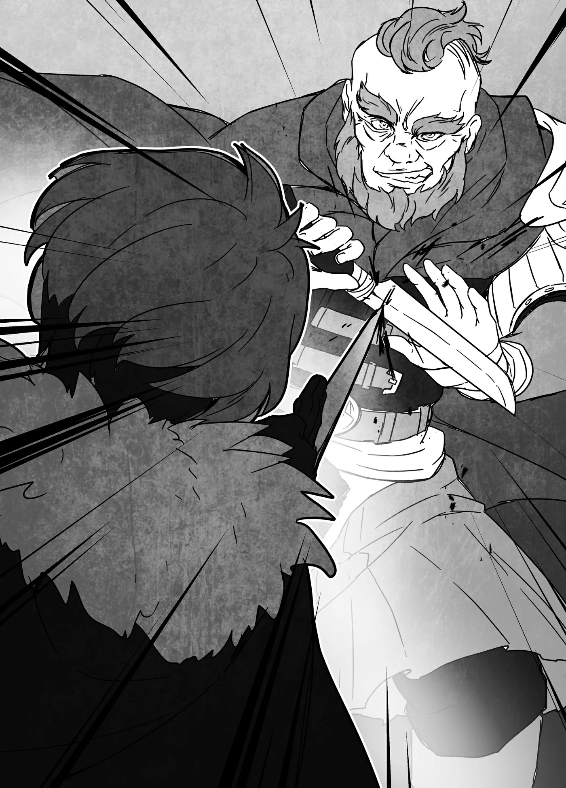

# Chương 165: Tập 7 Chương 3 - Vô Số Bí Mật (3)

"Nào, chỗ này được chưa nhỉ?" Capitan hỏi sau khi chúng tôi đi được một quãng vào khu rừng phía bắc. Tôi đoán chúng tôi đã đến khá gần pháo đài. Có điều xung quanh không hẳn là cây cối bủa vây tứ phía. Nơi này là một khoảng đất đủ rộng rãi, rất thích hợp cho mục đích chúng tôi đến đây: một trận so tài giữa Capitan và tôi.

Dĩ nhiên, chúng tôi không hề định lấy mạng nhau. Dù đây là một trận đấu nghiêm túc và nguy hiểm, nhưng cả hai sẽ dừng tay trước khi tung ra đòn chí mạng. Không hẳn là không có nguy cơ ai đó mất mạng, nhưng khả năng ấy rất khó xảy ra. Vết thương thông thường không thể giết được tôi, còn Capitan thì thừa biết cách tránh đòn hiểm. Ngay cả khi chú ấy bị thương nặng, Thần Lực của tôi vẫn có thể chữa lành. Tôi không rõ chữa được tới đâu, nhưng miễn là không chết ngay tức khắc, có lẽ tôi vẫn cứu được mạng chú ấy nếu dốc toàn lực trị thương. Có điều, sau một trận đấu với Capitan, tôi chẳng rõ mình còn lại bao nhiêu sức lực nữa.

"Vâng, trông ổn đấy. Có điều đánh trong rừng thì chú có lợi thế hơn nhiều," tôi nói.

"Chà, chuyện đó thì đành chịu thôi chứ biết sao," Capitan cười đáp.

"Dù sao cháu cũng từng được huấn luyện làm thợ săn rồi còn gì. Với lại làm mạo hiểm giả thì cháu cũng vào rừng suốt đấy thôi? Chú không nghĩ mình có lợi thế đến mức đó đâu."

Nghe thì có lý đấy, nhưng tôi vẫn thấy mình lép vế hơn. Capitan nắm rõ từng ngóc ngách của khu rừng phía bắc Hathara. Địa điểm này hoàn toàn đem lại lợi thế cho chú ấy. Dù vậy, tôi cũng có những vũ khí bí mật của riêng mình. Tính ra thì hai bên cũng xem như ngang ngửa. Capitan có là bậc thầy đến đâu đi nữa, tôi vẫn có thể uốn vặn chân tay mềm oặt như sợi mì nhúng nước. Biết đâu nhờ thế mà tôi có chút cơ hội, hay đại loại vậy. Hy vọng là thế.

Tôi cố tự lên dây cót tinh thần và làm ra vẻ tỉnh bơ khi quan sát xung quanh. Trước mắt tôi chỉ là một khu rừng hết sức bình thường. So với những cánh rừng thưa hơn bao quanh Hathara, cây cối ở đây khác cả về chủng loại lẫn kích cỡ, nhưng nhìn thoáng qua rất dễ tưởng hai nơi chẳng khác gì nhau.

"Đành rằng cháu từng được huấn luyện, nhưng cháu đâu có gắn bó cả mấy chục năm trong rừng như chú. Vả lại cháu cũng chưa từng thắng chú lấy một lần nào," tôi nói, hy vọng làm thế sẽ khiến chú ấy lơ là cảnh giác.

"Cháu nghĩ chú sẽ nương tay chắc? Chú biết tỏng là cháu đang giấu bài tẩy gì rồi. Giờ cháu đâu còn là thằng nhóc ngày xưa nữa," chú đáp. Giá mà chú ấy coi thường tôi thì cơ hội thắng của tôi còn cao hơn một chút, nhưng xem ra chuyện đó là không tưởng rồi.

Nếu ai bảo tôi hèn hạ thì cứ nhớ cho rằng thắng lợi mới là trên hết. Nói thế có hơi quá thật, nhưng thắng vẫn hơn đứt thua. Lừa được chú ấy nương tay thì tôi chẳng dại gì không làm. Thấy hở ra cơ hội nào khác, tôi cũng sẽ chớp lấy ngay. Món này là tôi học từ chính Capitan chứ đâu. Ngặt nỗi, điều đó cũng có nghĩa là chú ấy đi guốc trong bụng tôi rồi. Đành chịu thôi. Đã vậy thì chỉ còn nước đường đường chính chính mà đánh.

"Bắt đầu được chưa đấy?" bà Gharb vừa dụi mắt vừa hỏi. "Đáng ra ta làm trọng tài đấy, nhưng dạo này mắt mũi kèm nhem chẳng nhìn rõ nữa rồi. Thôi thì giao lại việc này cho Lorraine, nếu hai người không phiền."

Capitan và tôi nhìn bà Gharb, cả hai đều ngờ vực không biết mắt bà có thật sự kém đến thế không, nhưng thấy bà trừng mắt nhìn lại, hai chú cháu đành ngoảnh đi. Lúc đi xuyên qua rừng, bà còn chỉ cho Lorraine mấy con chim đậu tít đằng xa, đọc vanh vách loài nào, lông màu gì, rồi thu hoạch được những nguyên liệu gì từ chúng. Mắt tinh như thế mà bảo mắt kém thì xúc phạm người mắt kém quá. Có điều chúng tôi chẳng ai dám cả gan nói thẳng vào mặt bà.

"Tôi thì sao cũng được," Capitan nói. "Cháu thấy thế nào, Rentt? Khéo lại có lợi cho cháu đấy."

"Lorraine không thiên vị cháu chỉ vì quen biết đâu. Cô ấy xem trọng sự thật lắm."

Đó có lẽ là do nghề nghiệp của cô. Đã là học giả, cô luôn muốn biết kết quả thực tế dù đối tượng có là gì đi nữa. Có thể Lorraine sẽ cổ vũ cho tôi về mặt tinh thần, nhưng cô sẽ không đời nào phủ nhận kết quả trận đấu. Đến việc tôi biến thành quái vật mà cô còn chấp nhận được, thì chuyện tôi thua trận cũng đâu có gì khó chấp nhận. Tính cô ấy xưa nay vốn thế.

"Được đấy. Thế thì bắt đầu luôn thôi nhỉ, nếu cô thấy ổn," Capitan chẳng hiểu sao lại quay sang hỏi Lorraine thay vì hỏi tôi.

"Tôi thấy hoàn toàn ổn," Lorraine đáp gọn lỏn.

"Không chút do dự luôn à?" Capitan ngạc nhiên. "Cô tin chắc là Rentt sẽ thắng đến thế cơ à?"

"Không, tôi không nghĩ thế. Nhưng dù anh ấy có thắng hay thua, tôi vẫn luôn coi trọng anh ấy như từ trước đến giờ."

"Ra thế. Tình cảm ghê chưa kìa. Làm tôi nhớ lại hồi mới gặp Cami quá."

"Kìa, tự dưng chú lại nói chuyện gì đấy?" tôi ngắt lời trước khi chú kịp kể lể chuyện xưa. "Vào trận thôi chú."

"Chú đang nhớ lại kỷ niệm ngọt ngào mà. Cháu việc gì phải ngắt lời thế."

"Cháu xin chú đấy, chuyện chú gặp vợ thế nào cháu nghe đến cả trăm lần rồi."

"Ồ? Thế à?"

Bình thường Capitan khá điềm đạm và trầm tĩnh, chưa kể còn là một thủ lĩnh đáng tin cậy mỗi khi chúng tôi đi săn, nhưng cứ say rượu vào là chú chẳng còn ra thể thống gì nữa. Chú sẽ lải nhải đủ thứ chuyện về gia đình mình. Dạo gần đây thì hình như chú khoe về mấy đứa con nhiều hơn là về vợ. Trong bữa tiệc hôm nọ chú cũng thao thao bất tuyệt y như thế. Tôi chỉ phải chịu trận mấy câu chuyện ấy vào những dịp về thăm làng, nhưng nghĩ mà tội cho đám cấp dưới của Capitan. Chẳng ai trong chúng tôi muốn nghe cả, và người ngoài có lẽ cũng chẳng muốn biết đâu.

"Thôi thì, bắt đầu nhé?" Capitan nói, dường như cũng nhận ra chẳng ai hứng thú nghe. "Chuẩn bị đi, Rentt. Đừng có ngã gục sớm quá đấy, nghe chưa?" Chú rút dao săn ra, cầm ngược chuôi. Capitan dùng dao thành thạo cả lối cầm ngược lẫn cầm thuận. Chú từng dạy tôi những điều cơ bản về chiến đấu, nhưng chuyện đó đã từ rất lâu rồi, và tôi không nghĩ là phong cách chiến đấu của chú lại chẳng hề thay đổi chút nào từ bấy đến nay. Tôi phải theo dõi thật sát từng chuyển động của chú trong lúc giao chiến.

"Capitan, chú cũng đừng có để bị hạ sớm quá đấy nhé. Lên nào!"

◆◇◆◇◆

Tôi quát lớn một tiếng rồi lao tới nhằm phủ đầu Capitan, nhưng thoắt cái chú ấy đã áp sát ngay trước mặt tôi. Nắm đấm của chú lao đến vùn vụt, nhưng chú không hề định đấm. Vì lý do nào đó, tôi dám chắc về điều ấy. Thay vào đó, chú sẽ chém bằng dao săn. Nhưng biết được điều đó cũng không hẳn mang lại lợi thế cho tôi. Lối cầm dao ngược của Capitan khiến tôi cực kỳ khó ước lượng tầm với của đòn đánh. Chú giấu lưỡi dao nép sau cánh tay khuất khỏi tầm mắt tôi, thành ra nếu không biết từ trước, có khi tôi còn chẳng nhận ra trên tay chú có dao.

Trình độ cỡ đó chỉ có thể đạt được nhờ kinh nghiệm thực chiến với quái vật dạng người. Chúng không chỉ có hình dáng giống con người, mà tầm nhìn cũng tương tự như vậy. Tôi biết thừa điều đó, vì chính tôi cũng là một trong số chúng. Ngón đòn này của Capitan được thiết kế riêng để giấu vũ khí trước những tầm mắt như thế. Dĩ nhiên, điều này không thể tôi luyện trong một sớm một chiều. Chú phải nắm bắt được chuyển động cùng hướng nhìn của đối thủ theo phản xạ hoặc chủ đích, và có thể tung chiêu chuẩn xác bất cứ lúc nào.

Thế nhưng, tôi vẫn biết rõ con dao săn đang ở đâu và nhìn thấu từng đường đi của nó. Chuyện này chẳng phải do tôi có tài năng thiên bẩm gì đâu. Đơn giản là năng lực Ma Cà Rồng đã cho tôi lợi thế này. Mắt Ma Cà Rồng đúng là danh bất hư truyền. Cơ mà tôi có phản xạ kịp trước đòn đánh của Capitan hay không thì lại là chuyện khác.

Đòn đánh cuối cùng cũng ập tới. Keng một tiếng vang giòn, tôi may mắn dùng kiếm gạt được con dao săn của Capitan. Dù nhìn thấy đường đòn rất rõ, tôi cũng chỉ vừa kịp chặn đứng trong gang tấc. Đoán trước chuyển động và căn khoảng cách vũ khí của chú thật sự quá khó. Đã vậy chú còn nắm thóp mọi thói quen chiến đấu của tôi, và đòn vừa rồi chắc hẳn nhằm đánh thẳng vào những điểm ấy. Trận này tôi bị khắc chế nặng nề, nhưng dẫu sao thì tôi cũng đã thoát được một đòn.

Nếu giờ chú chịu đổi ý mà tạm thời lùi lại thì tốt biết mấy, nhưng đời đâu như là mơ. Thay vào đó, Capitan dường như biết tỏng tôi muốn gì nên tiếp tục dồn ép ráo riết hơn. Cả mũi dao lẫn nắm đấm của chú đều tỏa ra áp lực ngột ngạt, nhưng ưu tiên hàng đầu của tôi là phải chặn được dao. Nắm đấm của chú có thể đập nát mặt tôi, nhưng dao săn thì sẽ xẻ thịt tôi. Và xem chừng tôi cũng chẳng thể trông mong chú dừng tay trước khi tôi dính đòn chí mạng. Capitan đang nghiêm túc thực sự. Để tránh bi kịch đó, tôi vung kiếm bám sát theo từng đường dao săn của chú.

Thế rồi, nắm đấm của Capitan đột ngột dừng sững ngay trước mặt tôi. Tôi nhìn xuống và thấy con dao săn của chú đã bị kiếm của tôi chặn cứng. Chỉ cần chậm một tích tắc thôi là dao hoặc nắm đấm của chú đã giáng thẳng vào tôi gây trọng thương. Chú đã phối hợp cả hai để tạo thành một đòn liên hoàn hai tầng. Cố thì tôi cũng làm được đòn này thôi, nhưng cái đáng sợ ở Capitan là chú có thể áp sát và tung chiêu nhanh như chớp chỉ trong vài giây ngắn ngủi. Chưa hết, đợt tấn công của chú vẫn chưa dừng lại ở đó.

Capitan bật cười rồi nhảy vút lên không trung phía trên đầu tôi. Thoạt nhìn thì đây chẳng phải nước đi khôn ngoan cho lắm. Nhảy lên không trung ở cự ly giáp lá cà thường là điều tối kỵ, bởi lơ lửng giữa trời thì chẳng thể xoay xở đổi hướng được. Thấy cơ hội ngàn vàng, tôi đâm thẳng kiếm vào chỗ sơ hở nhất của Capitan: phần bụng của chú.

Nhưng ngay trước khi mũi kiếm kịp đâm xuyên bụng, Capitan bằng cách nào đó đã né được đòn đánh nhờ trượt ngang song song với mặt đất một cách kỳ dị. Mũi kiếm của tôi đâm hụt vào không khí. Tôi nheo mắt nhìn xem có chuyện gì thì thấy một vệt sáng lấp lánh theo hướng Capitan vừa lướt qua. Chắc hẳn là một sợi dây nào đó.

Tôi chợt nhớ phục vụ cho công việc thợ săn, Capitan thường mang theo một loại dây rất chắc làm từ các bộ phận quái vật. Loại dây này dùng để sửa dụng cụ hoặc treo con mồi, đủ bền để chịu được cả sức nặng của chú mà không đứt. Chắc chắn là chú vừa dùng nó rồi. Có điều tôi chưa từng thấy chú dùng dây kiểu này bao giờ. Hẳn là chú đã luyện thêm ngón nghề này trong suốt thời gian tôi rời làng. Đúng là đáng nể thật. Tôi đảo mắt nhìn quanh nhưng không thấy gì bất thường, song thấy vậy thì đoán chắc quanh đây còn đầy bẫy rập. Chính chú đã dạy tôi chỉ cần thắng thì chơi chiêu gì cũng được, và giờ chú đang đem ra xài với tôi đây. Cơ mà giá như chú nương tay với đệ tử một chút thì tốt biết mấy.

Tôi hét vang một tiếng rồi lao theo Capitan. Giờ thì tôi quyết tung hết bài ra. Kết hợp cả năng lực của quái vật lẫn Khí Lực, tôi bắt kịp Capitan chỉ trong chớp mắt. Chú thoáng vẻ ngạc nhiên, nhưng khóe môi cũng khẽ nhếch lên, như thể muốn bảo giờ cuộc vui mới bắt đầu.

Tôi cứ tưởng mình đã gỡ lại được chút thể diện sau đòn mở màn của chú, nhưng tôi nhầm to. Có khi ngay từ đầu Capitan đã tính đến nước này rồi. Dù vậy, trước đây tôi không đời nào phản công được như thế, mà Capitan thì lại quá rõ trình độ ngày xưa của tôi. Chắc chú đánh giá tôi cao lắm, chỉ là tôi chẳng biết đó là phúc hay họa. Dù sao thì tôi cũng chẳng định bỏ cuộc, mà buông xuôi lúc này cũng vô nghĩa. Đánh thì dữ dội đấy, nhưng dẫu sao đây cũng chỉ là trận so tài. Thua trận này tôi đâu có mất mạng. Chẳng có lý do gì để tôi phải giơ tay xin hàng cả.

Tôi vung kiếm chém về phía Capitan. Dù chú có tài ba đến mấy thì lúc này vẫn đang lơ lửng đu dây giữa không trung. Tôi chẳng thấy chú né đòn này kiểu gì được. Ấy vậy mà chú lại dễ dàng vượt ngoài dự đoán của tôi. Đúng lúc tôi đinh ninh kiếm đã trúng đích, tôi cảm nhận được Khí Lực ngưng tụ dày đặc trên bề mặt da của chú. Thanh kiếm chém vào người chú phát ra một tiếng keng đanh gọn như kim loại va nhau, thứ âm thanh mà cơ thể con người không đời nào phát ra được.

◆◇◆◇◆

Chẳng hiểu chuyện gì vừa xảy ra, tôi trố mắt nhìn người Capitan. Kiếm của tôi rõ ràng đã chém trúng, nhưng trên người chú chẳng có lấy một vết thương. Capitan là thợ săn nên dẻo dai hơn đàn ông bình thường rất nhiều, nhưng lãnh trọn một nhát chém nặng tay như thế mà không hề trầy da tróc vảy thì quả là quái đản. Thế mà chuyện đó lại xảy ra thật.

Thực ra tôi cũng lờ mờ đoán được ngón nghề của chú. Ngay trước khi lưỡi kiếm chạm vào người, tôi đã cảm thấy Khí Lực ngưng tụ trên da chú. Có lẽ chú đã dùng nó để tăng vọt khả năng phòng ngự. Chỉ có thể là vậy thôi, nhưng tôi vốn không biết liệu có thể cường hóa cơ thể đến mức độ khủng khiếp cỡ đó hay không.

Thực tình mà nói, hiểu biết của tôi về Khí Lực vẫn còn rất nông cạn. Tôi chỉ biết nó dùng để tăng thể lực, cường hóa sức mạnh thể chất và tốc độ hồi phục tự nhiên; xưa nay tôi vẫn xài như thế. Còn chuyện làm da cứng đến mức đánh bật cả lưỡi kiếm thì trước giờ tôi nghĩ là bất khả thi. Dù vậy, rõ ràng là Capitan vừa làm được đúng điều đó. Tôi rất muốn hỏi chú làm cách nào, nhưng hai chú cháu vẫn đang giữa trận so tài.

Thấy kiếm của tôi bị dội ra, Capitan nhận ra đòn đánh của tôi không phá nổi lớp phòng thủ nên lập tức chuyển sang thế công chủ động hơn. Những đường chém, cú đấm cùng đòn đá dồn dập của chú ép tôi phải lùi bước liên tục. Chưa hẳn là tôi đã rơi vào thế hạ phong, nhưng nếu cứ để chú dồn ép thế này mãi thì chẳng lành chút nào. Tôi phải đánh trả.

Đòn vừa rồi không ăn thua với Capitan, nhưng không có nghĩa là hết cách. Có lẽ chỉ là tôi chọn sai đòn khi đối đầu với chú mà thôi. Bình thường tôi thấy truyền Ma Lực vào kiếm là tiện tay nhất. Kiếm bọc Ma Lực chém ngọt hơn hẳn. Còn nếu bọc Khí Lực vào vũ khí, sơ sẩy không kiểm soát chuẩn xác là có thể làm đối phương nổ tung xác. Thần Lực tuy mạnh, nhưng lượng dự trữ tôi có thể tùy ý dùng lại chẳng được bao nhiêu. Chính vì thế mà ban nãy tôi mới dùng nhát chém bọc Ma Lực. Giờ tôi tự hỏi chuyện gì sẽ xảy ra nếu thử đổi sang dạng năng lượng khác xem sao.

Trước tiên, tôi quyết định rót Khí Lực vào kiếm. Trước kia tôi phải mất một lúc mới chuyển đổi qua lại giữa các nguồn năng lượng, nhưng giờ đã quen tay đến mức đổi được trong chớp mắt. Capitan khẽ hừ một tiếng, rõ ràng đã nhận ra điều khác lạ. Kiếm bọc Ma Lực vận hành khác hẳn kiếm bọc Khí Lực, nên vừa chạm vũ khí vào nhau là chú cảm thấy điểm bất thường ngay.

Capitan vốn đã quen bọc Khí Lực lên dao săn như chuyện đương nhiên, nhưng hầu hết mạo hiểm giả lại dùng Ma Lực. Hai loại năng lượng này không chỉ khác nhau về uy lực, mà ngay ở tầng căn bản nhất, cảm giác chúng mang lại cũng chẳng hề giống nhau. Chạm vũ khí vào kiếm bọc Ma Lực, người ta sẽ thấy như bị một lực hút kéo lại gần. Khí Lực thì ngược lại, tạo ra lực đẩy văng ra xa. Ai cũng có sở trường riêng, nhưng nếu không nắm được điểm khác biệt này thì gặp phải đối thủ liên tục luân chuyển giữa hai nguồn năng lượng, chắc chắn sẽ bị trở tay không kịp.

Thế nhưng Capitan lại thích ứng với tình hình nhanh đến mức đáng kinh ngạc. Tôi cứ tưởng sẽ khiến chú lúng túng thêm một chút, ai ngờ chú lại vượt ngoài dự liệu của tôi. Dù sao đi nữa, mục đích chuyển từ Ma Lực sang Khí Lực của tôi không phải để đánh lạc hướng chú. Làm được vậy thì tốt, nhưng đó chỉ là món hời kèm theo thôi. Cái chính là tôi muốn thử xem Khí Lực có đả thương được chú hay không.

Capitan xoay xở đỡ được đòn kiếm, nhưng nhịp điệu của chú đã bị chệch đi đôi chút. Chớp lấy thời cơ, tôi liền lao bổ tới. Nghĩ rằng chém bổ từ trên xuống thì chú sẽ dễ phản đòn, tôi bèn chọn cú đâm thẳng để chú càng ít thời gian xoay xở càng tốt. Thế nhưng Capitan dường như đã đoán trước được nước này, trông chú vô cùng tự tin. Chú dùng bản dao của con dao săn chặn đứng cú đâm của tôi.

Quá hiểu tính chú, tôi đã tính đến nước chú đỡ được đòn này. Dẫu sao đây cũng là người đã dạy tôi kỹ năng Khí Lực và những bài học căn bản về chiến đấu. Những gì chú thể hiện từ nãy đến giờ đều không nằm ngoài dự liệu, nhưng lúc này tôi bỗng nảy ra một ý. Tôi dồn một lượng Khí Lực khổng lồ ra sau lưng.

Capitan cứ ngỡ đã chặn đứng được kiếm của tôi, nhưng giờ thì chú bắt đầu hoảng hốt. Chú không sao ghìm lại nổi. Sức mạnh thể chất của tôi cộng hưởng với áp lực Khí Lực trên lưỡi kiếm, thêm cả lực đẩy phi nhân loại dồn mạnh từ sau lưng, bấy nhiêu đó là quá sức chịu đựng ngay cả với một người như Capitan.

Không trụ nổi nữa, chú bị đòn đánh hất văng ngược về sau. Bản thân tôi cũng bị lực đẩy kéo lao thẳng tới theo chú. Lưng chú đập sầm vào một thân cây, quật gãy nó với một tiếng ầm vang dội.

Bụi đất mù mịt lơ lửng giữa không trung, nhưng tôi vẫn nhìn đủ rõ để biết Capitan đang ở đâu. Nếu dùng thị lực thông thường thì chắc tôi cũng chẳng thấy chú đâu, nhưng đôi mắt của tôi rất đặc biệt. Dù trong bóng tối hay giữa đống đất đá mù mịt, tôi vẫn có thể định vị chính xác dấu hiệu của sinh mệnh khác. Đây là kỹ năng độc nhất vô nhị của riêng tôi.

Ra tay lúc này có hơi chơi xấu thật, nhưng tôi vẫn chớp thời cơ tung một nhát chém bổ từ trên xuống. Ngờ đâu Capitan đã kịp lăn người sang bên né đòn.

"Cái quái gì thế này?! Sao chú biết cháu ra đòn?" tôi hỏi vọng vào màn bụi đất.

"Luồng gió chuyển động. Chú dựa vào đó để bắt vị trí của cháu," chú đáp, ánh mắt nhìn thẳng vào tôi.

Bụi mù thế mà chú vẫn biết tôi đang ở đâu. Giờ thì tôi bắt đầu sợ chú chẳng có điểm yếu nào rồi đấy. Dù vậy, ít ra đòn vừa rồi cũng đủ làm chú phải giật mình.

"Còn cháu thì sao hả?" chú nói. "Vừa rồi rốt cuộc là cái trò gì thế?! Tự dưng sức mạnh của cháu lại tăng vọt lên như vậy. Đâu thể nào chỉ nhờ kiếm hay bộ pháp mà làm được. Cứ như có cả trăm người đẩy sau lưng cháu ấy. Quái lạ thật!"

Thấy Capitan kinh ngạc đến thế làm tôi sướng rơn. Từ lúc về Hathara đến giờ, cả chú lẫn bà Gharb cứ liên tục làm tôi hết bất ngờ này đến bất ngờ khác. Tôi chỉ mong trong chuyến về làng này có thể lật ngược thế cờ làm hai người tròn mắt ít nhất một lần.

Màn bụi đất lắng dần xuống. Capitan vẫn đang chằm chằm nhìn tôi, rồi ánh mắt chú nhanh chóng dời ra sau lưng tôi. "Cái gì thế kia?! Cháu làm được thế là nhờ thứ đó à?!" chú thốt lên.

Đập vào mắt chú chính là trang bị đặc biệt của tôi: một đôi cánh.