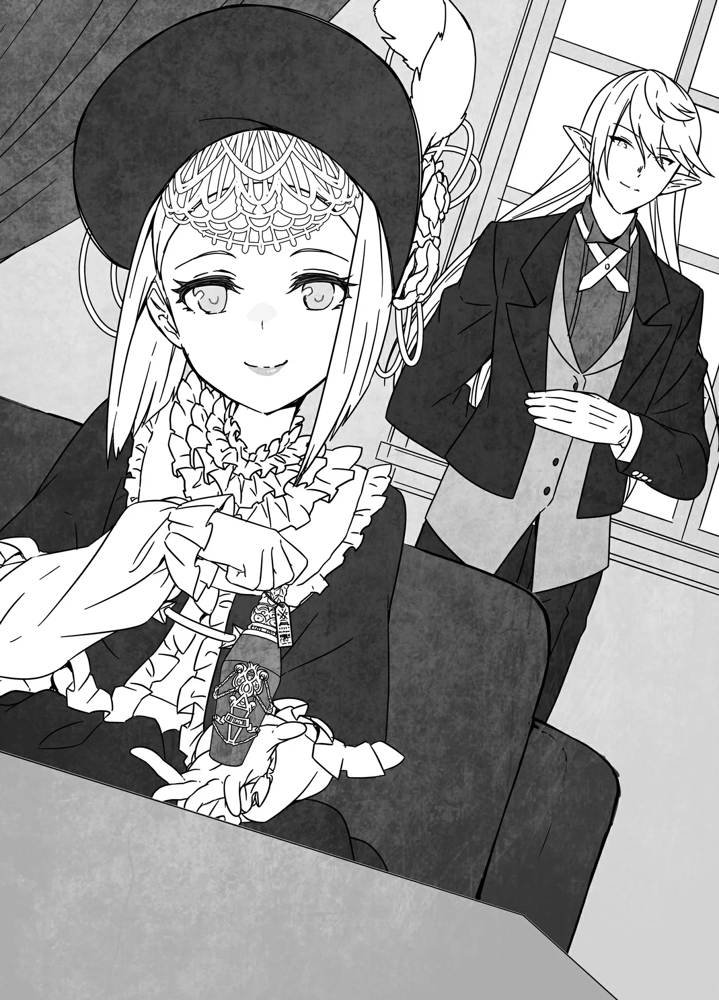

# Chương 169: Tập 7 Chương 5 - Laura, Đương Chủ Gia Tộc Latuule (1)

Ở ngoại ô Maalt có một dinh thự cổ kính, bề thế với một khu vườn khổng lồ. Những ai lần đầu tiên nhìn thấy người đứng đầu dinh thự ấy thường không khỏi ngạc nhiên. Lý do là bởi cô trông giống hệt một bé gái ốm yếu khoảng chừng mười hai, mười ba tuổi. Cô chủ yếu khoác lên mình những bộ váy kiểu cổ mang sắc đen hoặc trắng. Gia tộc của cô đã nắm giữ tầm ảnh hưởng to lớn ở Maalt qua biết bao thế hệ, và đúng như hình ảnh quen thuộc về người của các gia tộc lâu đời, hầu hết mọi người hẳn sẽ mường tượng cô là một kẻ khá u ám. Thế nhưng, rất hiếm ai từng thực sự có cơ hội gặp gỡ cô.

Nhân tiện thì, tên của cô ấy là Laura Latuule. Và vì tôi đang tự nói về bản thân mình, nên đó cũng chính là tên tôi.

◆◇◆◇◆

"Tại sao?! Tại sao cô lại không chịu giúp?!"

Trong phòng tiếp khách của dinh thự tôi, một cậu bé đang đứng đó. Cậu bé đang quát tháo vào mặt tôi. Người hầu của tôi, Isaac, đứng ngay sau lưng tôi, chăm chú nhìn cậu bé ấy cũng giống hệt như tôi.

"Tôi e là mình chẳng biết phải nói gì với cậu nữa," tôi nói. "Tôi sẽ làm những gì có thể trong khả năng. Isaac."

Khi tôi gọi Isaac, anh đưa cho tôi một lọ chất lỏng màu đỏ. Đó là loại thuốc được bào chế từ Hoa Long Huyết. Thứ thuốc này cực kỳ khó bảo quản, và hoa phải được thu hái khi còn tươi mới thì thuốc mới phát huy tác dụng, vậy nên để sở hữu được nó chẳng hề dễ dàng chút nào. Nhưng may mắn thay, tôi đã gặp một mạo hiểm giả định kỳ mang Hoa Long Huyết về cho mình. Lúc này anh ta đang vắng mặt ở Maalt, nhưng tôi có một ma cụ giúp làm chậm thời gian đối với một số vật phẩm ở một mức độ nhất định. Số thuốc tôi có sẵn lúc này vẫn đủ dùng trong một thời gian nữa.

Tôi nhận lọ thuốc Hoa Long Huyết từ tay Isaac rồi trao nó cho cậu bé. "Hãy pha loãng thứ này vào nước theo tỷ lệ một phần trăm rồi uống mỗi ngày một lần để kiềm chế cơn thèm khát. Chừng đó là đủ để cậu có thể sống thoải mái giữa con người rồi. Tuy nhiên, cậu phải rời khỏi Maalt. Một ác ma đang ở đây để lùng sục cậu đấy. Tôi không thể khuyên cậu tiếp tục ở lại thị trấn này được."

"Thứ này thì giúp ích được gì cho tôi chứ?" cậu bé nói, suýt chút nữa đã quẳng lọ thuốc sang một bên.

"Thứ thuốc đó chính là cách mà đồng loại của cậu đã dùng để sống ẩn dật giữa nhân loại suốt bấy lâu nay. Tôi dự đoán mọi chuyện giờ sẽ khó khăn hơn khi cậu có ít phương thức để kiếm thêm, nhưng chắc chắn điều đó không phải là bất khả thi. Nơi cậu đến hẳn phải có sẵn lượng dự trữ chứ.

"Nhưng tôi phải hỏi lý do tại sao một cậu bé như cậu lại quyết định rời làng để lặn lội tới tận nơi này. Cậu nói muốn chứng minh sự tồn tại của đồng tộc mình cho thế giới thấy và muốn tôi giúp đỡ. Thế nhưng nếu cậu có thể làm được điều đó, thì hẳn là những kẻ mạnh mẽ hơn cậu rất nhiều cũng đã làm như vậy rồi. Rốt cuộc thì cậu đang toan tính điều gì chứ?"

Khi tôi hỏi câu đó, cậu bé từ từ hạ cánh tay xuống trước khi kịp ném lọ thuốc đi. Rất may là có vẻ như tôi đã thuyết phục được cậu ta rằng mình thực sự cần thứ đó.

"Tôi chỉ là không thể chịu nổi cảnh phải sống trong làng thêm nữa," cậu bé nói. "Tôi ghét việc phải trốn chui trốn nhủi khỏi con người. Chúng tôi vẫn chưa bị tiêu diệt, vậy mà chúng tôi lại phải giả vờ như mình không hề tồn tại. Nhưng chúng tôi thực sự có tồn tại mà. Chúng tôi sống trong cùng một thế giới với mọi người. Tại sao mọi chuyện lại phải thành ra như thế này chứ?"

Cậu bé uất ức đến mức bắt đầu rơi nước mắt. Cảm xúc của cậu ta không hề khó hiểu chút nào. Dẫu vậy, nhìn vào tình cảnh thế giới hiện nay, việc khẳng định sự tồn tại của mình sẽ chẳng phải là một nước đi khôn ngoan.

"Ít nhất thì, tôi công nhận rằng cậu có tồn tại. Cậu đang sống và đang đứng ngay tại nơi này, thậm chí còn đang tương tác với tôi. Và hãy yên tâm đi, các cậu không phải là những kẻ duy nhất bị ép buộc phải lẩn trốn đâu. Các chủng tộc khác cũng vậy ở những mức độ khác nhau, bao gồm cả Elf, Người Lùn, nàng tiên và thú nhân. Chẳng thể nào trốn tránh được sự thật này. Nhưng bất chấp tất cả, các cậu vẫn tiếp tục sinh tồn. Tuy nhiên, nếu cậu cứ ở lại nơi đây, tôi không thể bảo vệ cậu được. Khả năng rất cao là cậu sẽ vong mạng và biến mất hoàn toàn. Cậu nghĩ sao về chuyện đó?"

Cậu bé khựng lại một thoáng trước khi nói, "Tôi không muốn chết."

"Vậy thì hãy quay về làng của cậu đi. Tôi sẽ không hỏi ngôi làng đó ở đâu, và tôi tin chắc cậu cũng chẳng muốn cho tôi biết đâu."

"Nhưng làm sao chúng ta giữ liên lạc được chứ?"

"Cậu không cần phải bận tâm về chuyện đó. Isaac."

"Vâng, thưa tiểu thư," Isaac gật đầu đáp lời rồi rời khỏi phòng.

"Cái quái gì thế này?" cậu bé hỏi.

"Chúng tôi có cách để liên lạc với đồng tộc của cậu. Việc đó sẽ mất chút thời gian, nhưng chắc chắn là có hiệu quả, nên không cần phải lo lắng đâu. Vấn đề cụ thể là ngôi làng nào thì đúng là sẽ gây ra đôi chút phiền toái, nhưng nếu họ bị lạc mất một cậu bé ở độ tuổi của cậu, tôi dự đoán họ đang ráo riết tìm kiếm cậu khắp nơi rồi. Khả năng rất cao là họ sẽ sớm liên lạc với chúng tôi thôi."

"Tôi từng nghe các trưởng lão kể về cô, nhưng tại sao cô lại biết nhiều về chúng tôi đến thế?"

"Gia tộc tôi đã sống theo cách này qua biết bao thế hệ rồi. Maalt tồn tại như một cứ điểm hoạt động của chúng tôi cho mục đích này. Vào thời điểm hiện tại thì chỉ còn gia tộc tôi ghi nhớ điều đó, nhưng không cần phải lo đâu. Tôi sẽ không phản bội các cậu."

"Cảm ơn cô rất nhiều."

"Không có gì đâu. Quay lại điều tôi vừa nói lúc trước, Maalt hiện tại đang rất nguy hiểm. Nếu cậu định đi lại quanh thị trấn, hãy hết sức cẩn thận. Dùng thứ thuốc đó sẽ giúp cậu an toàn hơn nhiều, nhưng tôi không thể bảo đảm rằng cậu sẽ không bị phát hiện. Để chắc chắn, tôi đề xuất cậu nên rời khỏi quán trọ và đến ở lại dinh thự của tôi với tư cách khách trọ. Chúng tôi cũng có thể chu cấp thức ăn cho cậu nữa."

Cậu bé gật đầu và nói sẽ về báo với quán trọ rằng mình sẽ rời đi. Rồi cậu quay người bước ra khỏi phòng. Tôi đã bảo cậu pha loãng chiết xuất Hoa Long Huyết và uống trước khi rời đi.

Trong lúc tôi dõi mắt tiễn cậu ta đi, Isaac quay trở lại phòng.

"Anh có nghĩ mình sẽ liên lạc được với họ không?" tôi hỏi.

"Vâng. Chúng ta sẽ phải chờ phản hồi, nhưng tôi ước tính câu trả lời sẽ đến vào ngày mai." Anh khựng lại một chút trước khi tiếp tục. "Cậu bé đó có phải là kẻ đứng sau những vụ mạo hiểm giả mất tích không ạ?"

Tôi ngẫm nghĩ một thoáng rồi mới trả lời. "Không, tôi không nghĩ là cậu ta đâu. Cậu ta đến từ một trong những ngôi làng đó. Có thể cậu ta không có Hoa Long Huyết, nhưng cậu ta có loại thuốc giúp kiềm chế cơn thèm khát và có thể tiếp cận con người một cách an toàn. Đúng là có vẻ thuốc của cậu ta sắp cạn kiệt, nhưng dẫu vậy, trên người cậu ta không hề có mùi máu."

"Điều đó có nghĩa là cậu ta không phải kẻ duy nhất thuộc đồng tộc của họ đang ở Maalt sao ạ?"

"Tôi nghĩ điều đó hoàn toàn có thể xảy ra. Chúng ta sẽ phải điều tra việc này."

"Vậy tôi sẽ tiến hành việc đó ngay. Xin phép tiểu thư," Isaac nói rồi một lần nữa rời khỏi phòng.

Tôi tựa lưng vào ghế sofa và thở dài. Cuộc sống của tôi dạo gần đây xảy ra khá nhiều biến cố, và mọi chuyện đang dần trở nên mệt mỏi. Giá như lúc này có ai đó xoa bóp vai cho tôi thì tốt biết mấy.

◆◇◆◇◆

"Thần Ma Khí Dung Hợp Thuật hả? Chú không ngờ lại có những kỹ thuật như thế đấy. Ngay cả Ma Khí Dung Hợp Thuật chú còn chẳng dùng nổi, nên chú không thể dạy cháu bất cứ thứ gì tương tự đâu," Capitan nói, thoáng chút thất vọng.

Thật không may, chuyện đó chẳng có cách nào thay đổi được. Ma Lực phần lớn là thứ vốn có từ khi sinh ra, còn việc có Thần Lực hay không lại hoàn toàn là vấn đề may rủi. Xuyên suốt lịch sử, nhiều tôn giáo hẳn sẽ cau mày khó chịu trước quan niệm coi việc sở hữu Thần Lực đơn thuần chỉ là sự ngẫu nhiên, nhưng thực tế hiển nhiên là như vậy.

Dẫu vậy, nói thế không có nghĩa là đức tin của một người chẳng hề liên quan gì đến chuyện đó. Thần linh đôi khi sẽ ban phước cho những người cầu nguyện đủ thành tâm hoặc tích cực làm việc thiện, từ đó ban cho họ khả năng tiếp cận Thần Lực. Ngay cả trong trường hợp của bản thân tôi, tôi cũng được ban phước nhờ việc tu sửa một ngôi đền.

Thế nhưng, nếu người ta làm việc thiện với động cơ thầm kín là muốn đạt được Thần Lực nhằm phục vụ cho ý đồ xấu xa, thông thường họ sẽ chẳng thu lại được chút kết quả nào. Có hằng hà sa số những câu chuyện để chứng minh cho điều đó. Rốt cuộc thì thần linh vẫn là thần linh, và rất có thể họ thấu suốt được tâm can của chúng ta. Tuy nhiên, ân phước từ các tà thần được cho là không thể phân biệt nổi với ân phước do các thiện thần ban tặng, vậy nên tính xác thực của những câu chuyện đó vẫn còn là dấu hỏi. Dẫu vậy, tôi chưa từng gặp ai được tà thần ban phước bao giờ, nên tôi cũng không thể biết được. Đương nhiên là chẳng có ai lại đi rêu rao khoe khoang khắp nơi rằng mình được một tà thần ban phước cả. Nhiều nhất thì họ cũng chỉ nói rằng bản thân sở hữu Thần Lực, mà Thần Lực thì vẫn là Thần Lực bất kể nguồn gốc từ đâu. Người ta hẳn sẽ nghĩ các tà thần sẽ ban cho một loại sức mạnh tà ác, dị biệt nào đó, nhưng kỳ lạ thay, họ lại không hề làm như vậy.

"Có thể chú không dùng được Thần Lực, nhưng cháu nghĩ chú hoàn toàn có thể dùng các kỹ thuật dựa trên Ma Lực chứ ạ," tôi nói với Capitan. Trái lại, việc một người sở hữu kỹ năng như chú ấy lại không thể dùng được chúng dường như là điều không tự nhiên chút nào.

"Nếu mấy cái năng lực phức tạp đó cần dùng vào việc gì, chú cứ để mặc Gharb xử lý. Dân Hathara có thể là hậu duệ của Vương Quốc Cổ Đại thật đấy, nhưng điều đó đâu có nghĩa là tất cả chúng ta đều sở hữu Ma Lực. Nghe đâu lượng Ma Lực trung bình của dân làng mình có nhỉnh hơn phần lớn những nơi khác một chút, nhưng sự chênh lệch đó không đáng kể. Những người trong làng sở hữu lượng Ma Lực dồi dào vào lúc này chỉ có cháu, Gharb và đệ tử của bà ấy là Fahri mà thôi. Chú chẳng biết chừng đó tính là nhiều hay ít, nhưng đối với chú thì dường như bất kỳ ngôi làng nào cũng hoàn toàn có thể tình cờ có ba người sở hữu Ma Lực như vậy."

Trong trường hợp của tôi, ban đầu lượng Ma Lực của tôi chỉ vừa đủ để vận dụng được chút ít, thế nên thực tế chỉ có hai người dân trong làng sinh ra đã mang trong mình lượng Ma Lực dồi dào. Xét trên quy mô dân số của ngôi làng, lẽ ra phải có nhiều hơn thế, nhưng phần lớn Ma Lực của những dân làng khác có lẽ cũng chẳng khá hơn tôi thời trước là bao. Chỉ có Gharb và Fahri là dư dả Ma Lực, nhưng biết đâu chuyện đó lại là bình thường.

"Làng mình quả là một ngôi làng kỳ lạ, nhưng cháu đoán không phải mọi thứ về làng đều bắt buộc phải kỳ lạ như thế," tôi nói.

"Ý chú là, chỉ có ba người bọn chú là vẫn còn gánh vác những truyền thống xưa cũ đó. Nhưng thế cũng chẳng sao; Hathara quá nhỏ bé để gánh vác một bí mật to lớn đến mức ấy. Có khi quên phắt nó đi lại tốt hơn cho chúng ta."

"Cháu đoán là vậy ạ."

Việc nắm rõ bí mật dường như là điều quan trọng để phòng khi có biến cố xảy ra, nhưng trong trường hợp một quốc gia thực sự can thiệp vào cuộc sống của họ, có lẽ Hathara cũng chẳng đủ tầm vóc để làm được bất cứ điều gì chống lại. Điều tối đa mà Gharb và Capitan có thể làm là đương đầu với một vài cá nhân tương đối mạnh mẽ. Nếu một mạo hiểm giả Mithril Cấp xuất hiện, ngay cả một đội quân cũng phải bất lực trong việc ngăn cản họ. Đối đầu với họ chẳng khác nào đối mặt với một thảm họa thiên nhiên. Không hẳn buông xuôi phản kháng đã là ý hay, nhưng tôi có thể hiểu được lý do tại sao họ lại rơi vào trạng thái tâm lý đó.

"Mà thôi, dù sao thì bọn chú cũng đã đưa ra quyết định liên quan đến chuyện đó rồi. Lúc này, điều chúng ta nên bàn tới là Khí Lực," Capitan nói.

"Phải rồi, vậy năng lực đó là gì thế ạ?"

"Cháu thừa biết là Khí Lực có rất nhiều công dụng rồi đấy. Những công dụng căn bản là cường hóa thể lực, vũ khí và tốc độ hồi phục của cháu. Những thứ đó tương đối đơn giản để học và sử dụng. Thế nhưng, chiêu thức chú đã dùng trong trận đấu của chúng ta thì khó hơn đôi chút. Nếu hồi đó cháu không rời làng, chú đã dạy nó cho cháu vào lúc nào đó rồi, nhưng cháu lại có ước mơ cần phải theo đuổi. Lúc đó làm gì có thời gian cho việc ấy."

Khi tròn mười lăm tuổi, độ tuổi đủ để trở thành mạo hiểm giả đăng ký tại Hội, tôi đã khăn gói lên đường tới Maalt. Tôi không đủ kiên nhẫn để nán lại Hathara thêm chút nào nữa. Suy cho cùng thì khi ấy tôi vẫn còn trẻ tuổi. Dù rằng ở vài phương diện, tôi cũng chẳng trưởng thành hơn là bao. Nếu hồi đó không có thời gian để dạy cho tôi, tôi không rõ liệu lúc này mình có thể học được nó hay không. Tôi từng dự định ở lại Hathara một thời gian, nhưng không phải là nhiều tuần liền, và chắc chắn không phải hàng tháng hay hàng năm trời. Tôi đoán mình đã là Undead và có thừa mứa thời gian trên đời, nhưng tôi thực sự muốn được dấn thân vào những chuyến phiêu lưu. Lúc này tôi về Hathara chỉ là để lánh mặt Nive mà thôi.

"Việc này sẽ mất bao lâu ạ?" tôi hỏi. "Cháu rất cảm kích vì chú sẵn lòng chỉ dạy, nhưng cháu không thể ở lại Hathara lâu đến thế đâu."

"Còn tùy vào việc cháu làm tốt đến đâu."

"Ý chú là sao cơ ạ?"

"Đó chỉ là vấn đề xem cháu thuần thục Khí Lực đến mức nào thôi. Nhưng chú không nghĩ đó là vấn đề đâu. Hồi cháu mới trở thành mạo hiểm giả mười năm trước, có lẽ cháu sẽ phải luyện tập trong đôi ba năm, nhưng giờ đây cháu hoàn toàn có thể nắm bắt được kỹ năng này trong vài tuần, thậm chí nếu không muốn nói là chỉ vài ngày. Mọi sự khổ luyện của cháu đã được đền đáp xứng đáng rồi."

Tôi từng nghĩ bản thân chẳng hề tiến bộ chút nào suốt mười năm ròng, nhưng hóa ra tôi đã trưởng thành nhiều hơn mình tưởng. Tôi có thể truyền Khí Lực vào vũ khí nhanh hơn một chút, cường hóa sức mạnh lâu hơn một chút, và hồi phục hiệu quả hơn đôi phần, đó là những minh chứng rõ ràng. Tôi chưa bao giờ cảm thấy tổng lượng Khí Lực của mình tăng lên so với thuở ban đầu, nhưng tôi cảm thấy mình đã vận dụng những gì sẵn có một cách khéo léo nhất có thể.

"Có những lúc cháu từng nghĩ mọi chuyện thật vô vọng, nhưng hóa ra tất cả đều không hề vô nghĩa," tôi lẩm bẩm.

"Chà, Khí Lực không giống như Ma Lực và Thần Lực. Nó không phụ thuộc vào thiên phú bẩm sinh nhiều bằng sự nỗ lực khổ luyện. Chỉ cần cháu kiên trì theo đuổi, cháu sẽ gặt hái được thành quả. Trong trường hợp của cháu, tổng dung lượng Khí Lực trước đây hầu như chẳng hề tăng lên, nên có lẽ thật khó để nhận ra sự trưởng thành của bản thân. Nhưng giờ thì khác rồi. Dung lượng Khí Lực của cháu đã gia tăng rất nhiều, vậy nên cháu hoàn toàn có thể làm được vô số điều với nó đấy."
