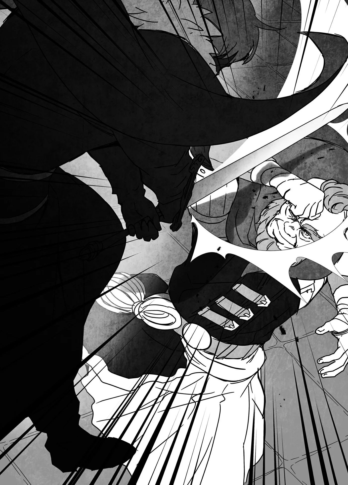

# Chương 170: Tập 7 Chương 5 - Laura, Đương Chủ Gia Tộc Latuule (2)

"Vậy nên, về cách thức thực hiện thì có lẽ thị phạm trực tiếp cho cháu thấy sẽ là dễ nhất. Chú sẽ làm thật chậm để cháu quan sát," Capitan nói rồi bắt đầu tập trung Khí Lực bên trong cơ thể. Tôi cảm nhận được thứ tương tự như lúc chú ấy thi triển kỹ năng này trong trận đấu của chúng tôi. Lượng Khí Lực khổng lồ đang ngưng tụ trên bề mặt cơ thể chú. Một lát sau, Capitan thở dài. "Xong rồi đấy, cứ chạm vào thử xem," chú vừa nói vừa đưa cánh tay phải ra.

Trông chú chẳng có vẻ gì là đã thay đổi cả. Sự khác biệt duy nhất mà tôi nhận thấy là cảm giác hiện diện của Khí Lực tăng lên đôi chút, nhưng điều đó cũng tương tự như khi vận Khí Lực để cường hóa thể lực vậy. Thế nhưng, khi tôi thực sự thử chạm vào chú, tôi lại chẳng hề chạm tới cánh tay chú chút nào. Có một tầng thứ gì đó đã cản lại. Cảm giác giống như có một luồng tĩnh điện đang đẩy lùi tay tôi ra. Khi tôi cố ấn mạnh ngược lại, luồng tĩnh điện ấy lại càng đẩy bật tay tôi ra mạnh hơn.

"Giờ thì thử dùng cái này chém vào xem," Capitan nói và đưa cho tôi một con dao găm. Lưỡi dao được mài sắc bén tinh xảo.

"Cháu không chắc đâu ạ," tôi ngập ngừng đáp. Chúng tôi đâu có đang giao đấu, nên tôi thấy ái ngại khi dùng dao chém vào người chú.

Chú ấy nhìn tôi với vẻ mặt cạn lời. "Lúc đánh nhau thì cháu lao vào chú như thể định lấy mạng chú tới nơi. Giờ sao lại nghĩ là cháu làm chú bị thương được chứ?"

Chú ấy nói đúng, nhưng dù tốt hay xấu thì giữa trận đấu tôi đâu có nghĩ ngợi nhiều về chuyện luân thường đạo lý. Sự phấn khích trong khoảnh khắc đó khiến người ta khó mà suy nghĩ thông suốt được. Có lẽ nói vậy nghe như thể ở cạnh tôi rất nguy hiểm, nhưng chiến binh nào thì cũng đều như thế cả thôi. Tuy nhiên vào lúc này, tôi lại cảm thấy bản thân điềm đạm đúng như thường ngày. Phải, tôi sẽ tự miêu tả mình là người điềm đạm.

"Chú đã bảo là không sao rồi mà," Capitan nói. "Duy trì trạng thái này quá lâu mệt lắm đấy, nên nếu cháu thực sự muốn giúp chú thì mau làm tới đi."

Nhìn bên ngoài thì không thấy rõ, nhưng thứ này xem chừng tiêu tốn sức lực hơn tôi tưởng. Nếu đã vậy, tôi quyết định kết thúc cho nhanh và vung dao găm chém xuống cánh tay Capitan. Và bởi vì muốn kết thúc thật nhanh, nên đó là một nhát chém khá dứt khoát và thần tốc. Tôi thoáng nghĩ có lẽ mình đã chém hơi quá tay, nhưng hiểu rõ thực lực của Capitan, tôi đoán chắc là chẳng sao đâu.

Hóa ra, con dao găm hoàn toàn không chém trúng cánh tay Capitan. Nó va phải một lực đẩy tương tự như lúc tay tôi chạm vào và bị hất văng theo hướng ngược lại. Có vẻ như tôi càng dùng nhiều lực thì lực đẩy phản hồi lại càng mạnh. Tôi thực sự rất ấn tượng.

"Chú bảo mau làm tới đi, nhưng cháu đâu cần phải chém mạnh tay đến mức đó chứ," Capitan cằn nhằn rồi trừng mắt nhìn tôi. Dựa vào tốc độ của con dao găm, chú ấy dường như có ấn tượng rằng tôi thực bụng muốn chém đứt cánh tay chú thật. Dù sao thì chính chú yêu cầu thế, nên tôi chỉ nhìn chằm chằm lại chú, khiến chú khẽ thở dài. Công bằng mà nói thì tôi đúng là có chém hơi mạnh tay hơn mức cần thiết. "Thôi, sao cũng được. Giờ thì cháu hiểu đại khái rồi chứ?"

"Vậy tức là tạo ra một lớp giáp bằng Khí Lực ạ?"

"Đó chỉ là cách chú vận dụng vào lúc này thôi, còn nếu muốn miêu tả một cách tổng quát hơn thì nó giống như biến Khí Lực thành thứ gì đó có thực thể vậy. Cháu cũng có thể làm điều tương tự với Ma Lực, đúng không? Chú biết là cháu có thể tạo ra Khiên Chắn bằng Ma Lực mà."

Giờ thì tôi đã hiểu ra. Ngay cả hồi Ma Lực của tôi còn yếu ớt, đó cũng là một trong những kỹ năng mà tôi có thể dùng được. Miễn là nắm được nguyên lý vận hành của nó thì việc thi triển cũng không quá đỗi khó khăn.

"Vậy là chú cũng có thể làm điều tương tự với Khí Lực sao ạ?" tôi hỏi.

"Không hẳn. Chú không phải chuyên gia ma thuật, nên đây chỉ là những gì chú nghe lỏm được từ Gharb thôi. Nhưng khi cháu tạo một tấm khiên bằng Ma Lực, cháu cần phải định hình hình dáng của tấm khiên, duy trì triển hiện nó trong bao lâu và đủ thứ linh tinh trước khi tạo ra nó, đúng chứ?"

Điều đó đúng thật. Ma thuật là một loại sức mạnh mang nặng tính lý thuyết, và nếu cấu trúc của câu thần chú không vững chắc thì nó sẽ thất bại ngay tắp lự. Kể cả khi chỉ là triển hiện một tấm khiên, người ta vẫn phải kiến tạo thần chú một cách bài bản và biết chính xác bản thân muốn làm gì.

"Khí Lực thì khác ạ?"

"Phải, nó là thứ dựa vào cảm nhận nhiều hơn là suy nghĩ. Thay vì kiến tạo thứ gì đó dựa trên logic, cháu cần phải nắm bắt cảm giác về Khí Lực nếu muốn điều khiển nó. Vậy nên nói một cách trần trụi thì ngay cả một kẻ đần độn cũng có thể học cách dùng Khí Lực nếu kiên trì luyện tập đủ lâu. Chẳng cần đến chút đầu óc nào cả."

Đó là một cách diễn đạt vô cùng bộc trực, nhưng tôi cảm thấy mình đã hiểu. Ma thuật dựa trên lý thuyết, vì thế trí tuệ đóng vai trò then chốt. Và chính bởi lý do đó, những thiên tài ma thuật cũng tương tự như những thiên tài học thuật vậy.

Trái lại, Khí Lực không phải là thứ người ta có thể tinh thông nhờ vào việc học giỏi. Trên thực tế, tuy gọi họ là kẻ ngốc thì có phần bất lịch sự, nhưng vài người sử dụng Khí Lực nổi danh nhất lại có đầu óc khá đơn giản. Toàn bộ công sức đòi hỏi để xây dựng lý thuyết trong ma thuật lại chẳng mấy quan trọng khi nhắc tới Khí Lực. Nhưng dĩ nhiên, thông minh hẳn vẫn là một lợi thế. Xem xét tất cả những điều đó, Capitan tương đối mà nói thậm chí có thể được xếp vào nhóm thông minh hơn trong số những người sử dụng Khí Lực. Thế nhưng chú ấy có lẽ sẽ chẳng coi đó là một lời khen ngợi đâu.

"Khi cháu học được cách cụ thể hóa Khí Lực thành thực thể, có rất nhiều điều cháu có thể làm," Capitan tiếp tục. "Cháu có thể tự do điều khiển hình dạng của nó. Chẳng hạn như, cháu thậm chí có thể làm thế này."

Capitan quỳ một chân xuống nhặt một cành cây ngắn. Tôi chăm chú quan sát khi chú truyền Khí Lực vào đó, và chỉ một khoảnh khắc sau, một chiếc lá rụng từ tán cây bên trên đã bị chém đứt làm đôi.

"Vừa rồi là gì thế ạ?" tôi hỏi, ngỡ ngàng trước những gì mình vừa chứng kiến.

"Trông như chẳng có thứ gì chạm vào nó, đúng không? Nhưng chú đã kéo dài một lưỡi đao Khí Lực ra từ đầu cành cây này đấy. Chính thứ đó đã cắt đôi chiếc lá," Capitan giải thích trong khi làm động tác như đang chạm vào lưỡi đao vô hình. Chú đưa lưỡi đao về phía tôi và bảo tôi chạm thử, nên tôi cẩn thận vươn tay ra. Hóa ra ở đó thực sự có một thứ gì đó. Tôi không nhìn thấy nó, nhưng cảm giác hệt như một lưỡi đao dài.

"Khi cháu thực sự nắm vững kỹ thuật này, cháu có thể làm được những việc như thế. Cháu cũng có thể tạo hình Khí Lực thành bất cứ thứ gì cháu muốn nữa. Tiện lợi chứ?"

Nghe quả thực rất tiện lợi. Nói đúng hơn, nó nghe thật hoàn hảo cho những đòn đánh lén. Có lẽ việc đó nói lên đôi điều về con người tôi khi đây là ý nghĩ đầu tiên nảy ra trong đầu, nhưng thứ này dường như là điều mà những kẻ ám sát sẽ vô cùng trân quý.

"Thế nhưng dĩ nhiên là có nhược điểm," Capitan thừa nhận. "Sử dụng nó cực kỳ kiệt sức. Nếu chỉ ở trong một trận chiến thông thường, việc đơn thuần truyền Khí Lực vào vũ khí sẽ dễ dàng hơn nhiều. Tốt nhất có lẽ nên để dành thứ này làm con bài tẩy cuối cùng."

Tôi có thể nhìn thấy những giọt mồ hôi túa ra trên trán Capitan kể từ lúc chú bắt đầu cụ thể hóa Khí Lực. Rõ ràng là việc sử dụng nó tiêu hao rất nhiều thể lực. Trình độ vận dụng Khí Lực của chú ấy vượt trội hơn tôi rất nhiều, nên nếu ngay cả chú cũng bị vắt kiệt đến mức này thì tôi chẳng biết mình có thể duy trì được bao lâu nữa.

"Dù sao thì cứ thử xem sao. Còn về cách thực hiện, chú sẽ rèn cho cháu tới nơi tới chốn; cứ tiếp tục thử đi. Nếu luyện tập đủ nhiều, cuối cùng cháu cũng sẽ ngộ ra thôi," Capitan nói, mang dáng vẻ của một người thầy nghiêm khắc tàn nhẫn như tôi từng nhớ năm xưa. Điều đó gợi lại những ký ức kinh hoàng.

◆◇◆◇◆

Sau khi Capitan giảng giải tóm tắt cho tôi cách cụ thể hóa Khí Lực, chú ấy bắt tôi tự mình thử đi thử lại hết lần này đến lần khác.

"Được rồi, giờ hãy duy trì nó như thế đi," chú bảo tôi.

Tôi đang cụ thể hóa Khí Lực theo cách vừa được chỉ dạy, nhưng tôi không thể khiến nó bao bọc khắp cơ thể mình như Capitan đã làm. Thay vào đó, tất cả những gì tôi có thể làm là để nó bao phủ lòng bàn tay mình tạo nên một lớp giáp Khí Lực vụng về. Tôi không thể nhìn thấy nó, nhưng tôi có thể cảm nhận được. Trạng thái lý tưởng là tạo ra thứ gì đó giống như một lớp da thứ hai bao bọc bên ngoài da thịt mình, thế nhưng thứ này lại giống như một chiếc găng tay dày cộp hơn.

Và nó rất giòn. Cứ mỗi lần tôi thử làm, Capitan lại dùng cành cây gõ vào chiếc găng tay Khí Lực mỏng manh của tôi, và lần nào nó cũng vỡ vụn chỉ sau một cú gõ nhẹ. Khi làm vậy, Capitan đã truyền Khí Lực vào cành cây, khiến nó cứng chẳng kém gì một thanh kiếm sắt, nên có lẽ kết quả của tôi cũng không đến nỗi quá tệ. Thế nhưng lớp giáp Khí Lực của tôi chắc chắn vẫn chưa đủ cứng. Xem chừng tôi không thể nào tinh thông thứ này trong một sớm một chiều được. Dẫu vậy, nếu kiên trì luyện tập, tôi đoán cuối cùng mình cũng sẽ nắm bắt được nó.

"Chà, ngày đầu tiên làm được thế là không tệ đâu," Capitan nói.

"Sẽ mất bao lâu để cháu có thể bao bọc toàn thân bằng lớp giáp như chú ạ?"

"Ai mà biết được chứ? Còn tùy vào mức độ nỗ lực của cháu. Nhưng với cháu thì chỉ bảo vệ một phần cơ thể thôi có lẽ cũng đã là quá đủ rồi. Dạo này thị lực của cháu xem chừng tinh tường hơn xưa thì phải."

Đúng là thị lực của tôi đã được cải thiện. Điều đó cũng giúp nâng cao phản xạ của tôi, nên dẫu tôi chỉ có thể triển hiện lớp giáp bao bọc một phần cơ thể thì có lẽ tôi vẫn có thể dùng phần đó như một dạng khiên chắn.

"Nhưng ngay cả thế thì có vẻ cũng khó lòng dùng thường xuyên được ạ," tôi nói.

"Đó là bởi cháu đang lãng phí quá nhiều năng lượng đấy. Chú bảo cháu làm cho lớp giáp mỏng hơn là vì nó sẽ tiết kiệm hao tổn hơn. Ồ, hình như lớp giáp chỗ kia có kẽ hở kìa," Capitan nói rồi thẳng tay nện một đòn bằng cành cây. Cứ phải sửa lại lớp giáp sau mỗi lần bị chú ấy phá vỡ quả là một cực hình. Sau đó, cuối cùng tôi cũng cạn kiệt Khí Lực và chẳng thể triển hiện thêm được thứ gì nữa. Tôi đã cố gắng hết sức có thể, nhưng chẳng cảm thấy chút Khí Lực nào dâng lên cả. "Xem ra hôm nay chúng ta phải dừng ở đây thôi. Nếu cháu đã cạn kiệt Khí Lực thì chẳng làm ăn gì được nữa. Chú đoán là cũng có những cách để ép thêm một ít ra đấy."

"Có cách ạ?"

"Phải, nếu cháu sẵn lòng rút ngắn tuổi thọ của mình. Nó cũng sẽ mang lại cho cháu lượng Khí Lực mạnh mẽ hơn thường lệ nữa. Nhưng vì những lý do hiển nhiên nên chú không khuyến khích đâu," chú nói. Câu trả lời của Capitan cho câu hỏi của tôi thật đáng sợ, nhưng rồi chú chợt nghĩ ra điều gì đó. "Mà thực ra, nếu đằng nào cháu cũng chẳng có giới hạn tuổi thọ thì có khi nó lại rất hợp với cháu đấy chứ. Cháu đâu có tuổi thọ, đúng không?"

Thế nhưng tôi lắc đầu để bày tỏ sự không hào hứng của mình. "Thôi, cháu xin kiếu. Có thể cháu không có tuổi thọ, nhưng cũng có thể là có; cháu chẳng rõ nữa. Ngay từ đầu cháu còn chưa biết chính xác bản thân mình rốt cuộc là thứ gì nữa kia. Nếu cháu thử làm trò gì kỳ quặc như thế thì khéo hỏng bét cả người mất."

Dẫu vậy, tôi có thể lập tức lành lại vết thương và không cần phải ngủ. Xét đến mọi đặc điểm dị thường của mình, việc nhận định tôi là một Undead và Ma Cà Rồng dường như là điều chắc chắn, nhưng tôi không thể dám chắc hoàn toàn. Nếu tôi thử nghiệm phương pháp đánh đổi tuổi thọ lấy Khí Lực này, biết đâu chừng nó lại có thể lấy mạng tôi không chừng.

"Chú đã từng dùng phương pháp đó bao giờ chưa ạ?" tôi hỏi Capitan.

"Dại gì chứ, chú còn tiếc mạng lắm. Nhưng chú đã được truyền dạy cách làm, nên nếu muốn thì chú hoàn toàn có thể. Chú cũng có thể dạy nó cho cháu nữa."

"Nghe như lại thêm một kỹ năng điên rồ nữa mà chú được kế thừa vậy."

"Nó chỉ có thể hữu dụng trong những tình thế ngặt nghèo mà thôi. Thứ đó được truyền lại như một con bài tẩy bí mật. Dẫu vậy thì chú chẳng thể nói cho cháu biết rốt cuộc đã có bao nhiêu người thực sự từng dùng kỹ năng này. Ở Hathara thật lòng chẳng có tình huống nào đòi hỏi ai đó phải dùng đến nó cả."

Họ gánh vác trọng trách bảo vệ các ma pháp trận dịch chuyển, vì thế việc họ muốn truyền lại kỹ năng này phòng trường hợp có mối đe dọa khổng lồ nào đó xâm lược là điều hoàn toàn hợp lý. Nếu Capitan sở hữu một kỹ năng như thế này thì có lẽ Gharb cũng nắm giữ thứ gì đó điên rồ không kém mà Lorraine sắp sửa theo học. Nghĩ đến điều đó có phần hơi đáng sợ, nhưng có lẽ tôi chỉ đang lo bò trắng răng mà thôi.

Capitan và tôi tiếp tục bàn luận về chuyện đó trong lúc chúng tôi quay trở về làng.

◆◇◆◇◆

"Xem chừng lại là một bữa ăn thịnh soạn nữa rồi," tôi cất lời khi về đến nhà và thấy bữa tối đã sẵn sàng. Đây là nhà trưởng làng nên chiếc bàn ăn vừa đẹp vừa lớn, thế nhưng nó đã được phủ kín hoàn toàn bởi các đĩa thức ăn. Rõ ràng chỗ thức ăn này không chỉ dành cho riêng tôi, Lorraine và cha mẹ tôi. Trên thực tế điều đó khá hiển nhiên khi nhìn vào đông đảo những người khác đang có mặt trong nhà. Ngoài tôi, Lorraine và cha mẹ tôi ra, Capitan, Gharb, Riri và Fahri cũng đều tụ họp ở đó.

"Mọi người đang làm gì ở đây thế?" tôi hỏi.

"Dạ, bà Gharb với bác Gilda bảo sẽ dạy tụi em nấu ăn ạ," Riri nói với vẻ mặt đầy quyết tâm.

"Thế à?" tôi hỏi rồi quay sang nhìn Fahri.

"Dạ phải," cô bé ngái ngủ đáp. "Bà với bác ấy bảo sẽ dạy tụi em nấu vài món ăn quan trọng ạ." Fahri định nói thêm gì đó, nhưng rồi Riri đã kéo cô bé vào bếp.

"Rốt cuộc là có chuyện gì thế nhỉ?" tôi lẩm bẩm trong lúc Lorraine bưng thêm thức ăn ra bàn.

"Thôi nào, đừng hỏi nhiều quá," cô nói. "Dù sao thì trông thế nào? Khá ngon mắt đấy chứ?"

Tôi phải thừa nhận rằng trông tất cả đều khá ngon mắt, nhưng tôi cũng có thể nhận ra không phải do mẹ Gilda làm. Nó có sự khác biệt tinh tế so với tay nghề nấu nướng của mẹ. Dĩ nhiên nói vậy không có ý rằng đây là điều dở.

"Mấy món này là do Riri với Fahri làm à?"

"Phải, và cả tôi nữa. Đây là ẩm thực truyền thống của Hathara, đúng chứ?"

"Đúng vậy. Hồi trước tôi vẫn thường ăn mấy món này suốt. Ở Hathara thì cô ghé sang nhà ai cũng sẽ được ăn những món tương tự thôi."

Thế nhưng khác với các món ăn chế biến từ côn trùng mà người ta có thể bắt gặp ở vài ngôi làng, Hathara sử dụng các loại thịt và rau củ thông thường. Đương nhiên trong đó bao gồm cả thịt ma vật, nhưng tuyệt nhiên không có sâu bọ. Nếu Hathara mà phục vụ món sâu bọ thì có lẽ tôi sẽ thích ăn chúng hơn rồi. Dẫu vậy nếu phải đưa ra quan điểm của mình, tôi buộc phải nói rằng bản thân chẳng ham hố gì cho cam.

"Tôi không biết hương vị sẽ ra sao, nhưng lát nữa hãy cho tôi biết cảm nhận của anh nhé," Lorraine nói. "Lý tưởng nhất là tôi có thể nấu thành thạo những công thức này trước khi chúng ta quay trở về Maalt."

"Ừ, tôi biết rồi," tôi đáp rồi kéo ghế ngồi xuống bàn.
