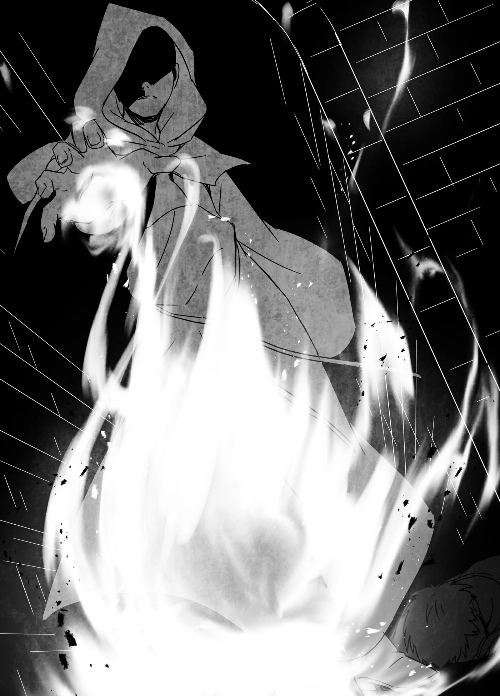

# Chương 171: Tập 7 Chương 6 - Puchi Suri (1)

Đối với chú chuột này, thế giới này vốn dĩ là chốn mạnh được yếu thua. Sinh ra với thân hình nhỏ bé, những sinh vật to lớn thường cậy kích thước mà chèn ép đồng loại của nó. Ngay cả khi may mắn kiếm được một chỗ ngả lưng, nơi đó rồi cũng bị cướp mất. Thức ăn chẳng có bao nhiêu, còn tìm được ngụm nước lại muôn vàn trắc trở. Cuộc đời chú chuột từ lúc lọt lòng vốn dĩ là như thế. Dẫu vậy, nó chưa từng đánh mất cảm xúc của mình. Có lẽ là do bản năng thôi chăng. Đôi khi chú chuột lại tự nhủ như thế.

Sống sót giữa thế giới địa ngục bằng cách chỉ biết dựa vào bản thân, nó lớn xác và khỏe mạnh hơn đồng loại bình thường. Nhưng dĩ nhiên, nó vẫn chẳng hơn gì một con chuột. Có nằm mơ nó cũng chẳng dám đọ sức với con người hay những quái vật to xác. Lần mò trong đêm tối để nhặt nhạnh chút đồ ăn thừa và kiếm chác từ những chạn bếp không người canh gác là tất cả những gì nó có thể làm để sống qua ngày.

Đôi khi con người bắt gặp và xua đuổi nó. Nếu chỉ có một hoặc hai người, thân hình to lớn cho phép nó đánh trả. Dẫu sao trên danh nghĩa nó là quái vật chứ không phải chuột thường, nên nó vẫn có chút cách đối phó với họ, dù nhỏ nhoi đến mấy. Nhưng hễ đối phương đông tới bốn, năm người, dẫu chẳng phải hạng mạnh đến rợn người gọi là mạo hiểm giả, nó cũng chỉ còn nước cắm đầu tháo chạy. Loài chuột chẳng có lòng tự trọng, bởi thần linh đâu hề ban phát thứ đó cho chúng. Tồn tại được mới là tất cả những gì chúng bận tâm.

Thế nhưng, nhờ chú chuột này to khỏe, vài con chuột khác đã tìm đến nương tựa nó để được chở che. Nhưng cũng chỉ có độ ba, bốn con. Đã thế, chúng đều là những kẻ bị trục xuất khỏi các bầy đàn khác.

Các bầy Puchi Suri có tôn ti trật tự cực kỳ khắt khe. Kẻ nào dám thách thức con đầu đàn mà bại trận đều bị tống khứ đi. Điều đó chẳng khác nào tuyên án chết đói cho con Puchi Suri ấy. Nói chúng tàn nhẫn thì dễ thôi, nhưng với loài chuột, thế giới này vốn dĩ là địa ngục đối với tất cả. Ở trong đàn hay ngoài đàn thì cũng đều như nhau cả.

Vì lẽ đó, chú chuột to xác chẳng mấy bận lòng trước đồng loại, và cũng chẳng buồn bắt chúng phải phục tùng mình. Dù vậy, ngày nào chúng cũng lẽo đẽo bám theo sau nó không rời. Chúng cùng nó lùng sục thức ăn nước uống, thậm chí còn sát cánh đụng độ con người. Chúng chia sẻ miếng ăn cho những kẻ bơ vơ không đàn đóm, thỉnh thoảng còn cưu mang lũ chuột con cho tới khi khôn lớn.

Puchi Suri có thể trưởng thành chỉ sau một tuần chào đời. Vốn dĩ chúng có thể sống thọ như các loài quái vật khác, nhưng phần lớn đều chết yểu. Hoặc là chết đói vì không kiếm ra cái ăn, hoặc bị con người săn lùng tiễu trừ. Kiếp chuột vốn là thế, nên đi lo cho mạng sống của kẻ khác là chuyện lạ lùng. Chỉ có bầy chuột này là khác biệt. Dẫu vậy, có những điều chúng chẳng bao giờ dám quên: chúng biết mình sẽ luôn bị ức hiếp, và con người thì mạnh tới mức rợn ngợp, có thể quét sạch loài chuột dễ như trở bàn tay.

Rồi một ngày nọ, khi bầy chuột đang trú ngụ dưới sàn một tòa nhà của con người, có bóng dáng kỳ dị từ phía trên đi xuống. Họ gồm hai người: một cô bé bình thường, còn người kia là gã đàn ông đeo mặt nạ khoác áo choàng, toát ra khí tức vượt khỏi giới hạn con người.

Nhìn thấy cảnh đó, chú chuột thầm nghĩ đời mình thế là toi. Nó biết ngày này sớm muộn cũng sẽ tới. Người này chắc là con người, nó đoán vậy. Hắn sở hữu năng lực vượt xa người thường, nên một con chuột bé nhỏ thì bõ bèn gì với hắn. Có những mạo hiểm giả thậm chí hạ gục quái vật khổng lồ dễ như bỡn, chuột như nó lấy đâu ra cơ hội.

Thế nhưng, chú chuột không chịu khoanh tay chờ chết. Dù sao thì giờ nó đâu còn là một con chuột đơn độc, nó đã có đàn em. Chí ít, nó phải câu đủ thời gian cho bọn chúng tháo chạy. Kể cả phải bỏ mạng thì đó cũng là điều tối thiểu nó có thể làm. Nó chưa từng có ý làm đại ca của ai, nhưng lũ đàn em đã đi theo nó, thì đây là lúc nó phải liều mạng. Đám chuột toan xông lên trước, nhưng nó phát ra thứ âm thanh chỉ loài chuột mới hiểu để lệnh cho chúng trốn đi. Đoạn, nó phóng mình lao thẳng vào tên mạo hiểm giả.

So với giống chuột thì nó khỏe thật. Gặp người thường, dẫu chẳng hạ gục được đối phương, chí ít nó cũng cắn cho vài nhát rồi tranh thủ tháo chạy. Nó tin chiêu này cũng sẽ có tác dụng với tên mạo hiểm giả. Ai ngờ hắn lại mạnh hơn nó tưởng nhiều. Hắn bắt trọn từng chuyển động của chú chuột không chút khó khăn, nhìn đường đảo mắt của hắn là thấy rõ. Người thường chẳng đời nào làm nổi việc đó.

Lưỡi dao của tên con người vung lên nhanh hơn mắt chuột kịp thấy. Chưa kịp hiểu chuyện gì, nhát dao đã hất tung nó văng đi. Sinh lực dần cạn kiệt khỏi cơ thể. Chưa từng có lần nào nó bị áp đảo đến mức này. Nhưng chú chuột nhất quyết không chịu chết ở đây. Nó gượng dậy, bụng bảo dạ chí ít cũng phải cắn trả lại tên mạo hiểm giả một phát. Bằng tất cả sự lì lợm, nó lại xông thẳng về phía hắn.

Tên mạo hiểm giả vẫn thủ thế, nhưng không như lúc trước, hắn thoáng chút ngập ngừng. Chú chuột thắc mắc tại sao, song chẳng còn sức đâu mà nghĩ ngợi. Đằng nào thì cú xông bừa của nó cũng chẳng bõ bèn gì với đối phương. Lần này, thay vì dùng dao, hắn lại vung nắm đấm. Cú đấm nện trúng hàm răng, lại hất văng chú chuột đi một lần nữa. Nó cảm giác răng mình sượt nhẹ qua nắm đấm của hắn, nhưng xem chừng đó là tất cả những gì nó làm được.

Ngẫm lại, cả đời chú chuột cũng chẳng làm nên trò trống gì. Nó từng ngỡ mình làm được chuyện này chuyện kia, nhưng hóa ra chẳng được tích sự gì. Giữ được cái mạng thôi đã quá đỗi chật vật rồi. Nhưng nó không muốn chết. Ngay khoảnh khắc ý nghĩ ấy vụt qua, nó cảm thấy một luồng nhiệt nóng rực trỗi dậy từ tận sâu trong cơ thể.

◆◇◆◇◆

Cơ thể nó đang được tái tạo. Luồng nhiệt cuồn cuộn từ sâu bên trong đang nhào nặn lại lục phủ ngũ tạng thành hình hài mới. Chẳng mất bao lâu để nó nhận ra điều đó. Dù không hiểu vì sao lại thế, nhưng tóm lại lúc này nó chưa muốn chết. Nó còn bầy đàn em cần bảo vệ, việc mà nó vẫn chưa làm trọn vẹn. Nếu nó bỏ mạng tại đây, tên mạo hiểm giả kia sẽ tóm sạch bọn chúng.

Nó cắn răng chịu đựng cơn đau cùng sức nóng hầm hập, để rồi cuối cùng, chú chuột nhận ra bản thân đã đổi khác. Giờ đây nó đã được liên kết với người đàn ông trước mặt. Đáng lẽ nó phải oán hận số phận này, nhưng những cảm xúc và ký ức ùa về qua mối liên kết ấy lại chẳng hề khiến nó thấy chán ghét.

Đúng là gã mạo hiểm giả này xuống đây để diệt chuột, nhưng cũng chỉ vì chúng đe dọa đến sự an toàn của những người sống trong nhà. Lũ chuột dọn vào đây ở mà chẳng rõ ai là chủ nhân, song qua ký ức của người đàn ông, dường như nơi này là chốn nương náu cho những đứa trẻ mồ côi. Nói cách khác, hệt như cách chú chuột này che chở cho lũ chuột non, có người đã dựng nên nơi đây để bảo bọc những con người nhỏ bé. Nghĩ thế thì việc họ xua đuổi kẻ lạ mặt xâm nhập cũng là lẽ đương nhiên. Thành thử, chú chuột chẳng còn chút oán giận nào với động cơ của gã mạo hiểm giả nữa.

Mối liên kết mới còn hé lộ cho chú chuột biết tính cách của người đàn ông. Trước giờ nó vẫn coi mạo hiểm giả là lũ quỷ lăm lăm vũ khí chuyên săn lùng đồng loại mình, song người đàn ông này dường như lại khác. Đúng là anh ta kiếm sống bằng nghề săn quái vật, nhưng không tận diệt quá mức cần thiết, thậm chí còn tha mạng cho những con không đe dọa tới con người. Dĩ nhiên, với những kẻ hại người, bất kể là con non hay trưởng thành, anh ta cũng sẽ thẳng tay trừ khử không chút nương tình. Ở điểm đó thì anh ta cũng giống bao mạo hiểm giả khác, có điều anh ta không bao giờ nhọc công lùng bắt những quái vật vô hại, dẫu chúng có bán được giá cao chăng nữa.

Vô số ký ức như thế cứ thế ùa vào tâm trí chú chuột. Nó chẳng rõ người đàn ông có thấy được ký ức của nó không, nhưng anh ta dường như nhận ra hai bên đã được kết nối. Khi bốn mắt nhìn nhau, người đàn ông lộ rõ vẻ ngạc nhiên. Chẳng cần mở lời, họ vẫn hiểu thấu suy nghĩ của nhau, thế nên chú chuột bèn truyền ý rằng nó nay đã trở thành kẻ sống để phụng sự anh ta. Người đàn ông kiểm chứng bằng cách đưa ra vài mệnh lệnh, và nó răm rắp nghe theo. Nhưng anh ta chẳng hề tỏ thái độ cưỡng ép. Đúng hơn, anh ta coi đó như một lời yêu cầu từ cấp trên, cứ như thể nó thích từ chối lúc nào cũng được. Có lẽ nếu muốn, người đàn ông hoàn toàn có thể ép nó phải phục tùng, song anh ta không làm thế. Thay vào đó, mệnh lệnh đầu tiên anh ta đưa ra chỉ là canh giữ tầng hầm. Chú chuột cùng đám đàn em đã nhận lệnh.

Kể từ hôm đó, cuộc đời chú chuột bước sang một trang hoàn toàn mới. Từ khi theo hầu người đàn ông, sức mạnh của nó tăng vọt. Theo lời anh ta giải thích, chú chuột đã uống máu anh ta và trở thành quyến thuộc Ma Cà Rồng. Nhờ vậy, nó tiến hóa thành một sinh vật mạnh mẽ hơn. Nếu cố gắng, nó thậm chí có thể mượn nguồn Ma Lực, Khí Lực và Thần Lực mênh mông của anh ta cho riêng mình. Dĩ nhiên, nó chẳng thể tự tiện cưỡng đoạt chỗ năng lượng đó, nhưng hoàn toàn có thể dùng nếu được anh ta cho phép. Được người đàn ông chia sẻ cho chút ít năng lượng để hỗ trợ việc trông nom tầng hầm, chú chuột quyết định tiện tay thâu tóm luôn toàn bộ loài Puchi Suri ở Maalt vào tay mình. Nó nghĩ làm thế sẽ giúp ích được cho những dự tính của người đàn ông.

Người đàn ông dường như ấp ủ một ước mơ: anh ta muốn trở thành mạo hiểm giả vĩ đại nhất. Để đạt được mục tiêu ấy, thu thập càng nhiều thông tin càng tốt là điều vô cùng quý báu. May thay, chú chuột có thể luồn lách khắp mọi ngóc ngách trong nhà của con người mà chẳng ai hay biết. Nó còn có thể nghe lén chuyện trò rồi truyền đạt lại cho anh ta. Chính người đàn ông đã ban cho nó những năng lực đó. Đám chuột kia dẫu vẫn chỉ là chuột thường, nhưng chú chuột to xác vẫn giao tiếp được với chúng hệt như xưa, nên việc đó chẳng thành trở ngại.

Đôi phen, chú chuột còn theo chân chàng mạo hiểm giả tên Rentt đi phiêu lưu. Cả hai kề vai sát cánh chiến đấu và tôi luyện qua từng trận thực chiến. Chúng từng đụng độ một sinh vật khổng lồ gọi là Tarasque — thứ trước kia có thể giẫm bẹp chú chuột trong chớp mắt — vậy mà nó vẫn đủ sức đánh trả. Dù đòn kết liễu là do Rentt tung ra, nhưng chú chuột cũng đã góp công không nhỏ. Nó thấy áy náy vì đã vay mượn quá nhiều năng lượng, song nó tin nếu không làm thế thì chẳng thể nào hạ nổi con quái vật kia. Vả lại với phận quyến thuộc, nó thấy mình phải là kẻ xông pha liều mạng trước tiên. Trước hành động của chú chuột, Rentt vừa choáng váng vừa nể phục, song rốt cuộc anh vẫn chấp thuận lựa chọn của nó và xoa đầu nó khen ngợi.

Chú chuột thậm chí còn được đặt tên: nó được gọi là Edel. Lần đầu tiên nó biết tên gọi là một thứ mật mã con người dùng để phân biệt người này với người nọ, song dường như nó còn mang một ý nghĩa nào đó nữa. Người phụ nữ gắn bó bên cạnh Rentt là kẻ nghĩ ra cái tên ấy, và nó mang nghĩa là cao quý. Chú chuột biết mình vượt trội hơn hẳn đồng loại, lại còn ấp ủ ý định thâu tóm toàn bộ loài chuột ở Maalt, nên có lẽ cái tên này đã tiên liệu trước tương lai rực rỡ ấy. Nó ưng cái tên đó lắm.

Bao nhiêu chuyện đã xảy ra kể từ ngày nó đi theo Rentt, và những ngày tháng đó quả thật rất vui. Nó đã thu phục được khoảng ba mươi phần trăm số chuột ở Maalt và mở rộng mạng lưới tai mắt. Giờ đây, nó đã có thể giúp ích rất nhiều cho Rentt. Trở thành quyến thuộc Ma Cà Rồng đã cho chú chuột Puchi Suri một cuộc đời hoàn toàn mới, nên nó muốn dốc hết sức thu thập mọi tin tức có thể để báo đáp ơn anh.

Thời gian gần đây, điều Rentt bận tâm nhất là về một nữ mạo hiểm giả tên Nive, cùng những chuyện liên quan tới Ma Cà Rồng. Đó đều là những đề tài nguy hiểm và dường như vô cùng khó điều tra, nhưng với Edel thì không. Nó tung đám đàn em đi nghe ngóng khắp các xó xỉnh trong thị trấn.

Rồi cuối cùng, Edel cũng nhìn thấy một manh mối qua đôi mắt của một chú chuột đàn em. Chẳng biết tự bao giờ, nó đã sở hữu khả năng nhìn xuyên qua tầm mắt của thuộc hạ từ một khoảng cách xa xôi. Nhờ vận dụng năng lực ấy, nó thấy một bóng người khả nghi đang lẻn vào mê cung. Chú chuột đàn em bám theo kẻ đó, để rồi bắt gặp một kẻ khoác áo choàng đang ngoạm cổ một mạo hiểm giả mình đầy máu me.

“Ái chà, nhìn trộm là không ngoan đâu nhé,” kẻ đó cất giọng, rồi bàn tay phóng ra một luồng lửa thiêu mù mắt chú chuột. Dù chỉ nhìn từ nơi khác, Edel vẫn cảm nhận rõ uy lực kinh hoàng của luồng bộc phá. Cơn đau đầu dữ dội ập đến giáng đòn khiến Edel bất tỉnh nhân sự dưới tầng hầm cô nhi viện.

◆◇◆◇◆

Tôi đang tiếp tục luyện tập trong rừng cùng Capitan để nâng cao năng lực Khí Lực của mình thì bỗng nhiên một cơn đau đầu ập đến. Thỉnh thoảng nhức đầu thì cũng chẳng có gì lạ, vả lại đợt tập huấn này vốn khá nặng đô, nên khéo cũng chỉ do thế mà ra. Thế nhưng kể từ ngày hóa thành Undead, tôi đâu còn biết đến nỗi đau thể xác của con người nữa. Những cơn mỏi vai, đau lưng, nhức cơ hay đau răng đều đã biến sạch, thành thử việc bỗng dưng đau đầu lúc này xem chừng là chuyện bất khả thi. Hẳn phải có lý do gì đó.

“Có chuyện gì thế?” Capitan hỏi. Đến cả chú ấy cũng nhận ra điều bất thường.

Khi cơn đau dịu đi, tôi lờ mờ cảm thấy một mối liên kết, tựa hồ có sinh vật nào đó không phải con người đang gọi mình. Nhờ vậy, tôi đoán ra manh mối của cơn đau đầu. “Chắc quyến thuộc của cháu gặp chuyện rồi. Tự dưng đầu cháu nhức buốt một thoáng,” tôi đáp.

“Quyến thuộc của cháu hả? À, cái con đang thu thập tin tức ở Maalt đấy à? Cơ mà quyến thuộc liên lạc được với chủ nhân từ khoảng cách xa tít tắp thế cơ à? Chú quen một người thuần hóa quái vật, người ta bảo đâu có tiện lợi đến thế.”

Điều đó hẳn đúng với quái vật của người thuần hóa quái vật. Bí quyết thuần hóa của họ được giữ kín như bưng, song dám chắc chẳng giống cách của tôi chút nào. Hiệu lực từ thuật thuần hóa hẳn nhiên cũng sẽ khác. Nếu muốn, một người thuần hóa quái vật có thể chặn không cho quyến thuộc rút Ma Lực hay Khí Lực của mình. Tôi cũng làm được thế nếu chủ động khóa năng lượng lại, nhưng đằng này Edel cứ hễ cần là rút. Việc đó đôi lúc khiến tôi hơi uể oải, song cũng chẳng bõ để tôi cấm cản nó. Thỉnh thoảng tôi tự hỏi rốt cuộc ai mới là chủ, ai mới là tớ, cơ mà phần nhiều tôi chỉ đùa thế thôi.

Tôi chẳng hề hay biết Capitan lại quen cả người thuần hóa quái vật. Mối quan hệ của chú ấy đúng là rộng đến khó tin. Cơ mà lúc này cũng chẳng việc gì phải gặng hỏi.

“Trường hợp của cháu khác hẳn với người thuần hóa quái vật bình thường,” tôi đáp. “Mối liên kết giữa chúng cháu thuộc dạng khác. Cơ mà thông thường thì từ khoảng cách này nó cũng chẳng liên lạc nổi với cháu đâu. Trừ phi chỉ cách nhau chừng một thị trấn, họa chăng nó mới gắng gượng truyền được chút tin tức gì đó thôi.”

“Thế thì khéo cháu chỉ tưởng tượng thôi chăng.”

Cũng có khả năng là vậy, nhưng tôi biết chắc mình vừa cảm nhận được điều gì đó. Thứ gắn kết với tôi vừa mới mất đi ý thức. Tôi không nghĩ nó đã chết, song cũng chẳng dám khẳng định chắc chắn. Dù thế nào, tôi cũng phải kiểm tra xem nó có bình an vô sự hay không. Dẫu miệng hay càu nhàu, nó vẫn là chú quyến thuộc quý giá của tôi. Việc kết nối có thể chỉ là tình cờ, song giữa đôi bên đã có mối ràng buộc khăng khít. Tôi chẳng nề hà nếu nó muốn thôi phụng sự tôi, nhưng tôi không cam lòng để đôi bên chia tay theo cách này.

“Cháu không tưởng tượng đâu,” tôi nói. “Nhưng nếu không về Maalt thì chẳng thể nào biết được chuyện gì đã xảy ra với Edel.”

“Ra vậy, thế là cháu định về ngay bây giờ à?”

“Vâng. Nhưng đi xe kéo thì sớm nhất cũng mất đứt năm ngày. Cháu phải đi chuẩn bị ngay mới được.”

Dù rất tiếc phải dở dang buổi tập, nhưng tình hình quá đỗi nghiêm trọng. Nếu tôi chần chừ lần lữa để rồi khi về tới nơi thấy Edel đã chết từ bao giờ, khéo nó dưới suối vàng cũng chẳng thể nhắm mắt xuôi tay.

“Có cách giúp cháu về tới nơi chỉ mất tầm nửa ngày thôi đấy,” Capitan bảo khi tôi đang thu dọn để quay về làng.

“Ma pháp trận dịch chuyển ư?” tôi hỏi. Nếu có một trận pháp dẫn thẳng về Maalt, khéo tôi có thể có mặt ở đó chỉ trong chớp mắt.

Nhưng Capitan lắc đầu bảo, “Không, có cách khác cơ.”

“Cách khác sao?”

“Giờ cứ về làng rồi tính tiếp là tốt nhất. Cháu đang vội, đúng không?” Capitan vừa nói vừa rảo bước. Tôi cuống cuồng bám theo sau chú ấy.

Nếu có cách nào nhanh hơn thì bất luận là gì, tôi cũng nhất định phải thử. Tôi thực sự đang lo thắt ruột cho Edel.

◆◇◆◇◆

“Gì cơ, Edel gặp chuyện á?” Lorraine kinh ngạc thốt lên.

Vừa về tới làng, việc đầu tiên chúng tôi làm là ghé ngay nhà trưởng làng, nơi bà Gharb đang truyền dạy cho Lorraine. Không như hai chúng tôi, họ chẳng ra rừng tập luyện. Ma thuật nào cũng khởi đầu từ lý thuyết, mà lý thuyết thì học trong không gian như phòng học là tốt nhất. Alize và tôi dạo trước cũng học căn bản từ Lorraine theo kiểu như thế. Kể cả với ma thuật cao cấp hơn, nền tảng hẳn vẫn vậy.

“Ừ, tôi không rõ đích xác chuyện gì, nhưng chắc chắn là có biến,” tôi nói. “Trước giờ chưa từng bị thế này bao giờ.”

“Liệu có khi nào nó chỉ đang ngủ thôi không?” Lorraine phỏng đoán.

Nếu đúng thế thì trên lý thuyết cũng giải thích được vì sao tôi hoàn toàn mất dấu nó, nhưng tôi vẫn lắc đầu: “Không, nếu chỉ ngủ thì tôi đâu bị đau đầu. Vả lại từ khi làm quyến thuộc của tôi, nó hầu như chẳng cần ngủ nghê mấy, chỉ là theo thói quen nên mỗi ngày vẫn chợp mắt độ hai tiếng thôi. Những lúc ấy, mối liên kết giữa tôi với nó chỉ như lắng dịu đi, còn lần này thì hệt như sợi dây liên kết bị người ta dùng sức mạnh bạo lực giật phăng ra vậy.”

Tôi chẳng biết diễn tả sao cho rành rọt. Xưa nay hiếm có ai từng trải qua cảm giác này. May ra chỉ có người thuần hóa quái vật mới hiểu, khổ nỗi tôi lại chẳng quen ai làm nghề đó.

Lorraine gật đầu: “Thế thì phải tức tốc quay về Maalt thôi. Bạn của chúng ta đang gặp nguy hiểm.”

Tôi cứ ngỡ cô chỉ coi Edel như thú nuôi trong nhà, nhưng xem chừng với cô nó cũng rất quan trọng. Bản thân tôi cũng nghĩ vậy, nên lòng thấy nhẹ nhõm khi nghe cô đồng tình.

“Ừ,” tôi gật đầu đáp.

“Cơ mà đi xe kéo thì mất đứt năm ngày mới tới nơi. Giá mà có ma pháp trận dịch chuyển dẫn thẳng về Maalt thì đỡ biết mấy, tiếc là chúng ta vẫn chưa rõ liệu có cái nào như thế không.” Lorraine cũng lập tức nghĩ ngay tới chuyện đi lại.

“À, có một cách đấy chứ,” Capitan đáp lời cô.

◆◇◆◇◆

“Đó là cách gì thế?” Lorraine nghiêng đầu hỏi.

Capitan dời mắt khỏi cô, nhìn sang cha nuôi tôi, Trưởng Làng Ingo Faina: “Nhờ cả vào anh đấy nhé?”

Tôi chẳng tài nào mường tượng nổi cha Ingo sẽ giúp được việc gì. Nghĩ thế về cha khéo hơi bất kính, nhưng quả thực trong đầu tôi chẳng nảy ra ý niệm nào. Mang danh trưởng làng thì trong phạm vi làng cha cũng có tiếng nói thật đấy, cơ mà ngoài chuyện đó ra tôi chẳng biết cha còn làm được gì khác.

Nhìn nét mặt tôi, dường như cha Ingo đọc thấu tâm can đứa con trai. “Rentt này, cha cũng kế thừa một phần lịch sử của ngôi làng này đâu kém gì Capitan với Gharb,” cha có vẻ cụt hứng khi thấy tôi hoài nghi.

Cha có vẻ hơi chạnh lòng vì đứa con trai chẳng thèm trông cậy vào mình. Nghĩ thế tôi cũng thấy có lỗi ghê gớm. Đâu phải tôi không kính trọng cha, ngặt nỗi tôi thực lòng không nghĩ cha có thể giúp được gì trong tình cảnh này.

Nói thêm một chút, căn phòng lúc này chỉ có cha Ingo, Capitan, Lorraine, bà Gharb và tôi. Mẹ Gilda đã ra ngoài buôn chuyện với mấy bà cô trong làng, còn Riri và Fahri thì đang bận tập luyện để làm thợ săn với người hái thuốc. Đáng lý Capitan và bà Gharb phải trực tiếp chỉ bảo hai đứa, nhưng đám đàn em của Capitan đã gánh vác thay chú ấy, còn bên nghề thuốc thì có mấy khâu chuẩn bị mà người học có thể tự xoay xở một mình. Thành thử, toàn bộ những người có mặt ở đây đều đã rõ bí mật của làng, chúng tôi có thể thoải mái bàn bạc mà chẳng cần giữ kẽ.

“Đáng lẽ vai trò của cha là quốc vương, đúng không ạ? Cơ mà đâu có nghĩa là cha sẽ kế thừa năng lực đặc biệt như chú Capitan với bà Gharb,” tôi nói.

Bà Gharb và Capitan lần lượt đảm nhiệm vai trò đại ma pháp sư cùng kỵ sĩ đoàn trưởng — những chức vụ hiển nhiên gắn liền với ma thuật hay bản lĩnh thực chiến xuất chúng. Nhưng với vị trí quốc vương, tôi chịu chẳng rõ có năng lực đặc biệt nào tương tự được truyền từ đời này sang đời khác hay không. Tôi đồ rằng cha chỉ được tiếp nhận vốn kiến thức và lịch sử sâu rộng hơn những vai trò khác mà thôi.

Thế nhưng, cha Ingo thủng thẳng: “Đúng là cha không dùng được Khí Lực hay ma thuật như Capitan với Gharb. Nhưng cha cũng có kỹ năng đặc biệt của riêng mình chứ bộ. Nghe chừng con đang muốn quay lại Maalt càng sớm càng tốt phải không? Nếu vậy thì kỹ năng của cha khéo lại giúp ích được đấy.”

“Vậy đó là kỹ năng gì thế ạ?” tôi hỏi.

“Rồi con sẽ biết thôi. Mà này, hai đứa đã sẵn sàng lên đường chưa?”

“Tụi con đi Maalt được ngay bây giờ luôn sao cha?”

“Ừ. Chẳng phải con đang sốt ruột lắm sao? Nhớ kiểm tra kỹ kẻo bỏ quên đồ đạc đấy.”
