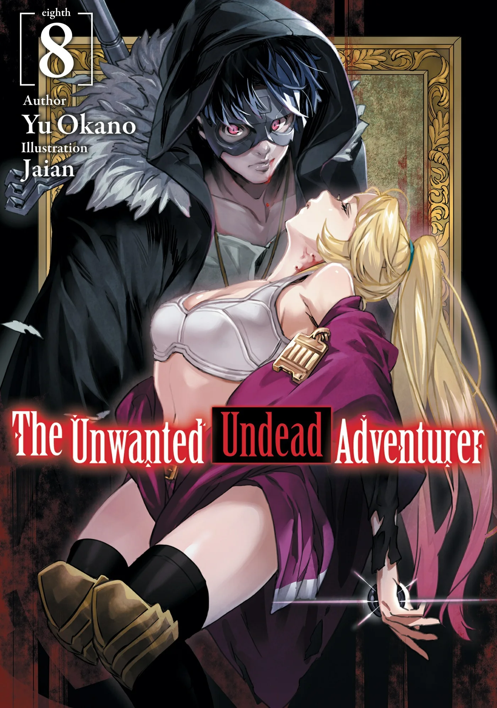
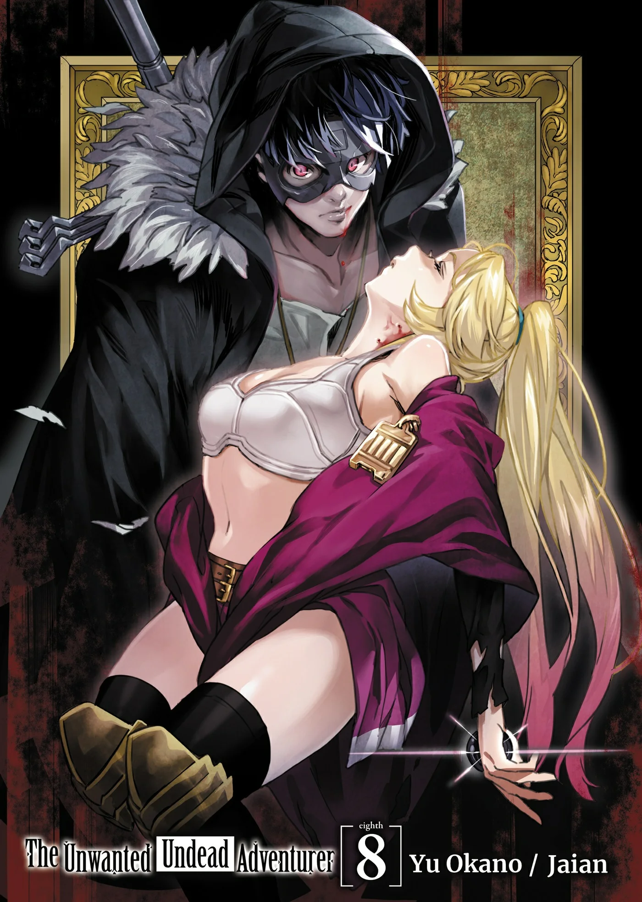
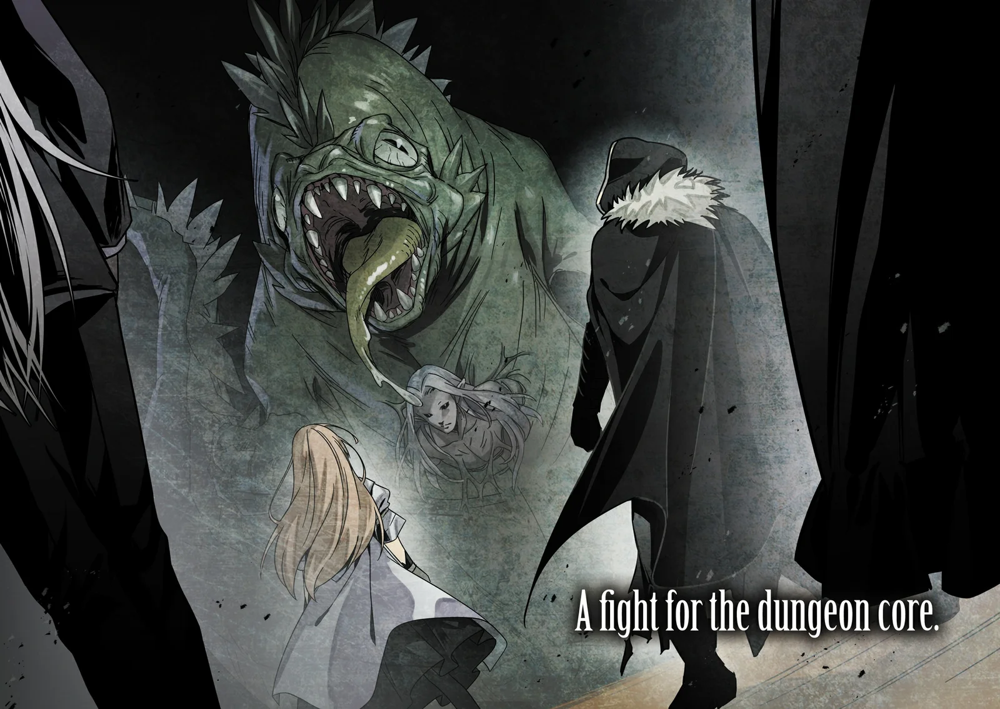
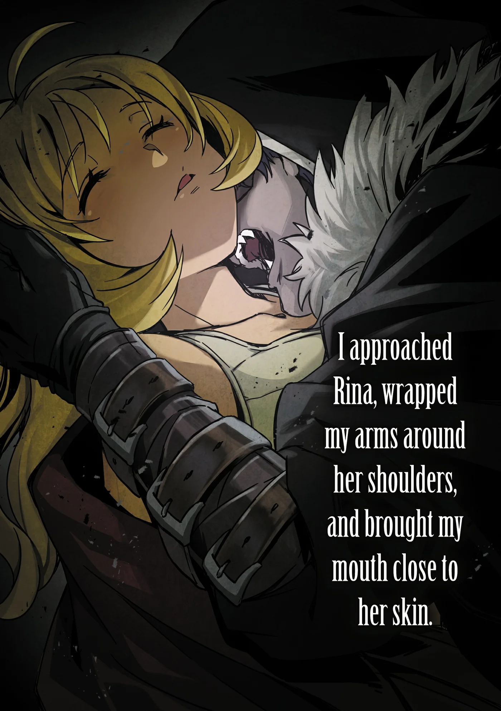
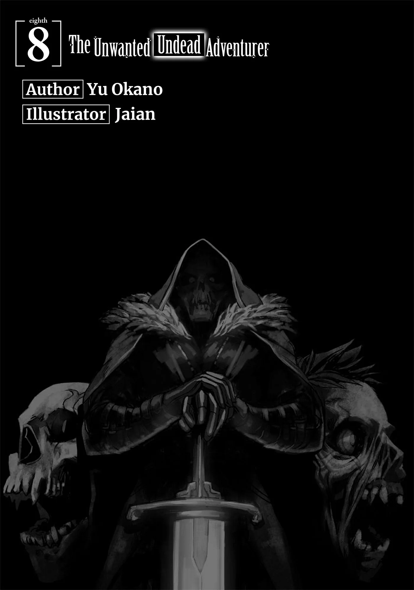
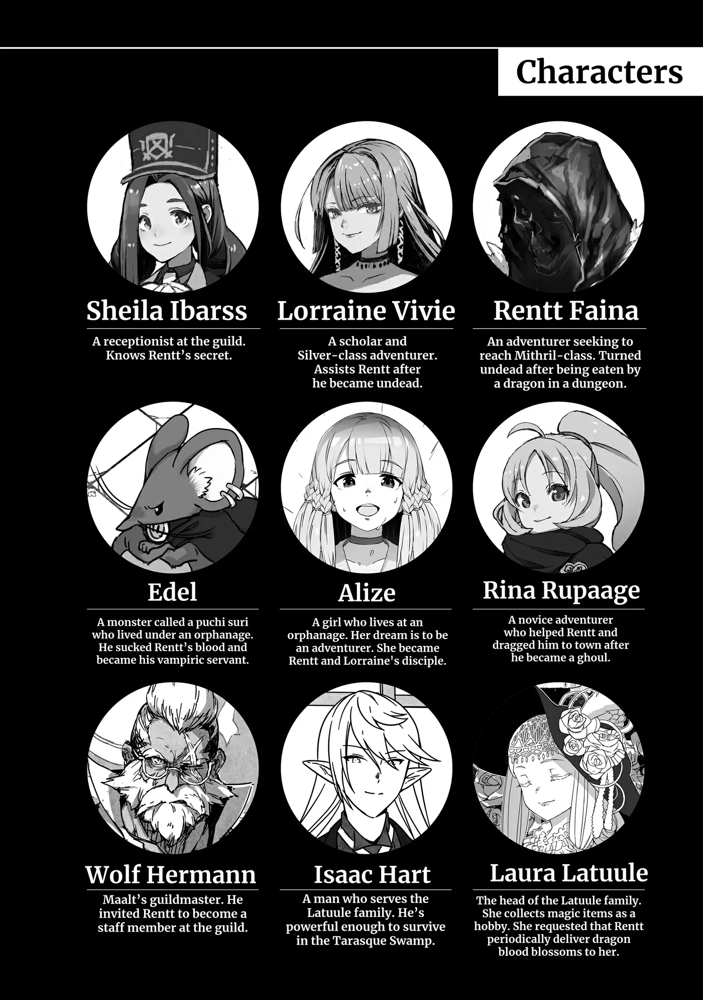
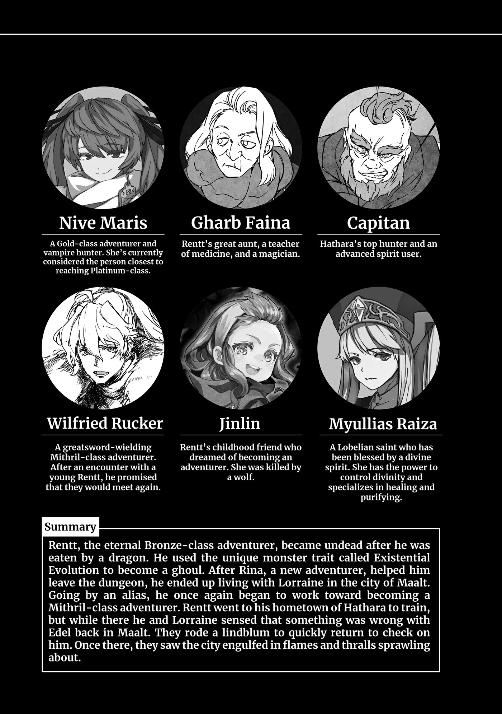
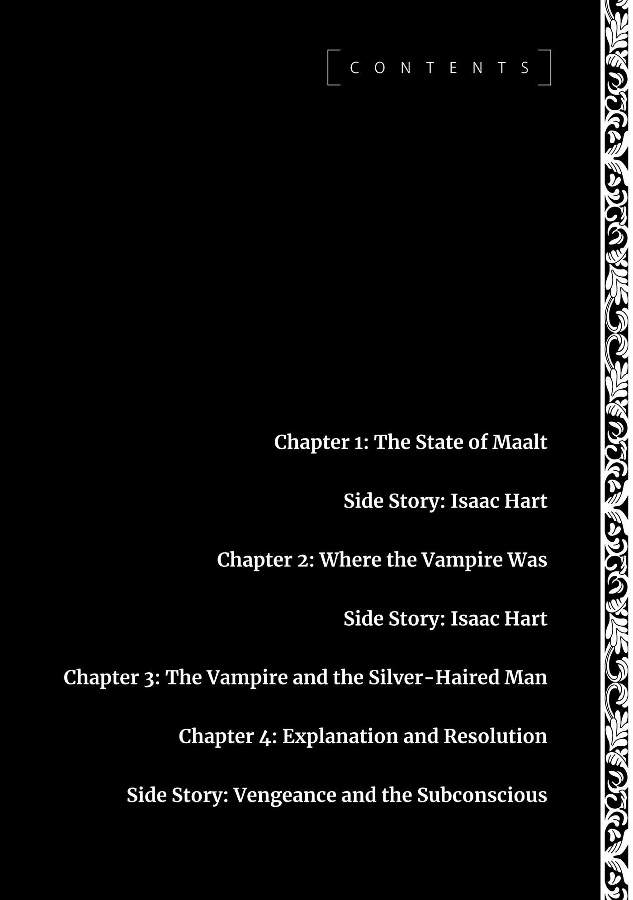
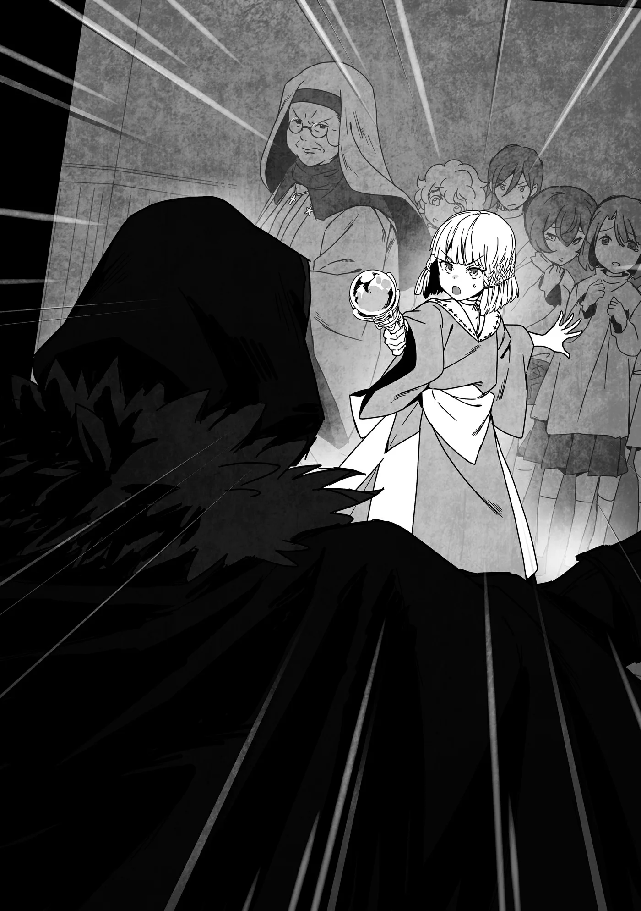

# Chương 182: Tập 8 Chương 1 - Tình Hình Maalt (1)

Wolf nhờ tôi hỗ trợ tìm kiếm Thi Quỷ và Ma Cà Rồng.

"Tôi thì không phiền đâu, nhưng ông chắc chứ?" tôi đáp lại.

"Chắc chuyện gì cơ?" ông hỏi rồi nghiêng đầu thắc mắc.

"Ông biết tôi là một Ma Cà Rồng mà. Dù tôi chẳng dính dáng gì đến mớ hỗn loạn này, nhưng ông không lo tôi sẽ gia nhập phe của bọn họ sao?"

Đó có vẻ là một mối bận tâm hoàn toàn bình thường, và Wolf nói: "Chà, chuyện đó cũng không hẳn là bất khả thi."

"Nếu vậy thì—"

"Nhưng theo những gì tôi thấy thì cậu sẽ không làm thế đâu."

Giờ thì đến lượt tôi hoang mang.

"Cậu quên mất lý do vì sao tôi từng muốn cậu gia nhập hàng ngũ nhân viên Hội rồi à?" ông thở dài nói. "Nói một cách đơn giản, tôi trân trọng mọi công việc cậu làm cho thành phố này và các mạo hiểm giả nơi đây. Tôi biết cậu đã làm được biết bao điều tốt đẹp. Lũ người kia chỉ đang chực chờ phá hủy chốn này, thế nên tôi chẳng thấy có lý do gì để cậu lại đi bắt tay với chúng, dù có cùng là Ma Cà Rồng đi chăng nữa. Rõ rành rành ra đấy rồi. Tôi nói có đúng không?"

Tôi có phần ngạc nhiên. Tôi quả thực cảm nhận được ông đánh giá rất cao về mình, nhưng tôi không nghĩ điều đó lại sâu sắc đến nhường này. Có lẽ chỉ là do tôi luôn tự đánh giá thấp bản thân. Dẫu vậy, việc một Hội Trưởng để tâm sát sao tới từng mạo hiểm giả riêng lẻ quả thực là chuyện hiếm thấy. Wolf thực sự rất đặc biệt.

Và ông đã nói đúng. Tất cả những gì tôi cảm thấy khi chứng kiến Maalt thế này chỉ là sự phẫn nộ. Nơi đây không phải thành phố lớn nhất hay tuyệt vời nhất, nhưng cuộc sống yên bình của người dân đang bị hủy hoại chỉ vì những lý do đầy vị kỷ. Tôi yêu thị trấn này, yêu những mạo hiểm giả và những thị dân nơi đây. Chứng kiến chốn này rơi vào cảnh tượng ấy khiến tôi sôi máu khôn cùng.

"Ông nói hoàn toàn đúng," tôi nói với Wolf. "Tôi hiểu rồi. Tôi sẽ tham gia tìm kiếm. Cơ mà tôi có thể tự quyết định nơi mình sẽ tới không?"

Những quyết định như thế thường do Hội đưa ra nhằm đảm bảo tính hiệu quả. Họ không phải lúc nào cũng vận hành theo cách đó, nhưng Wolf là một Hội Trưởng có năng lực và rất lý trí. Tôi đoán ông sẽ ưu tiên tính hiệu suất công việc.

"Tôi thì sao cũng được. Cậu đã nhắm chỗ nào trong đầu chưa?" trái ngược với dự đoán, ông đáp lại ngay tắp lự.

"Vâng, đại loại thế. Ngoài ra, việc tôi là Ma Cà Rồng cũng là điều đáng lo ngại. Nếu phối hợp tác chiến cùng các mạo hiểm giả khác, họ có thể sẽ sinh nghi."

"Phải, có lý đấy. Chà, tôi tin chắc cậu có thể tự lo liệu được, nhưng ra ngoài đó hãy cẩn thận. Giờ thì đi mau đi!"

Tôi lao nhanh ra khỏi phòng làm việc và hòa mình vào các con phố trong thành phố.

◆◇◆◇◆

Tôi rảo bước chạy băng qua thị trấn với điểm đến đã được định sẵn trong đầu. Thành phố đang rơi vào tình trạng nguy ngập, nên thoạt tiên tôi quan sát xung quanh để nắm bắt tình hình, nhưng tôi quay trở lại Maalt là vì Edel, thành thử nhóc ấy là ưu tiên hàng đầu của tôi. Tôi chỉ nấn ná đến tận bây giờ là vì đã xác nhận nhóc vẫn còn sống và đang ở một nơi tương đối an toàn trong chốc lát.

Không giống như những quái vật khác, Undead có thể sống sót và hồi phục sau bất kỳ mức độ tổn thương nào miễn là phần đầu vẫn còn nguyên vẹn, vì thế tôi biết Edel sẽ ổn thôi. Tôi có phần e ngại khi thử nghiệm điều đó bằng cách tự thổi bay đầu mình xem liệu bản thân có hồi sinh được hay không, nhưng biết đâu chuyện đó hoàn toàn khả thi sau một khoảng thời gian vừa đủ. Dù vậy, tôi chẳng hề có chút khao khát nào muốn thử nghiệm việc đó cả.

Về nơi tôi đang hướng tới, đó chính là Cô Nhi Viện Thứ Hai Maalt. Nơi đó là mái nhà của Alize, Lillian cùng những đứa trẻ mồ côi khác, đồng thời cũng là căn cứ hoạt động của Edel. Tôi cảm nhận được tín hiệu từ Edel, và nó phát ra từ đó. Nhóc ấy dường như vẫn còn bất tỉnh, nhưng nhóc vẫn còn sống, nên xét theo một khía cạnh nào đó thì ít nhất cũng chưa có gì nguy kịch. Tôi cũng muốn biết liệu Alize, Lillian và lũ trẻ có an toàn hay không.

Tôi hối hả băng qua thị trấn cho tới khi đến được cô nhi viện. Trên đường đi, tôi thấy người ta đang nháo nhào chạy loạn, và tôi đã giúp đỡ một vài người bị mắc kẹt dưới đống đổ nát, nhưng tôi không hề bắt gặp bất kỳ Ma Cà Rồng hay Thi Quỷ nào. Việc giúp người không tốn quá nhiều thời gian. Cơ thể này giúp tôi di chuyển các vật nặng và tránh né hiểm nguy một cách khá dễ dàng. Đó là điều mà trước đây tôi chưa từng dám mường tượng tới.

Tôi từng nghĩ sự biến đổi trong các giác quan của mình có thể hỗ trợ xác định vị trí của Ma Cà Rồng và Thi Quỷ, nhưng thực tế lại khó khăn hơn nhiều. Dường như chúng đang che giấu bản thân bằng ma pháp đúng như Wolf đã đề cập, bao gồm cả mùi hương của chúng. Bản thân tôi khô khốc đến mức chẳng có mấy mùi vị, nhưng một số Thi Quỷ được cho là ẩm ướt hơn những con khác. Tôi nghe nói chúng có thể bốc mùi khá khó chịu nếu không được hấp thụ đủ dinh dưỡng, nhưng tôi chưa bao giờ đích thân kiểm chứng xem điều đó có thật hay không.

Dù sao đi nữa, tôi chẳng buồn tốn thời gian dùng vòng gõ cửa. Tôi đẩy toang cánh cửa cô nhi viện và bước thẳng vào bên trong.

"Anh Rentt?!" Alize thốt lên.

Cô bé đang đứng ngay lối vào với cây đũa phép trên tay, chĩa thẳng về phía tôi. Tôi đoán cô bé đang cố bảo vệ cô nhi viện hết mức có thể. Lillian đứng bên cạnh em với ngọn giáo thủ sẵn trong tư thế sẵn sàng chiến đấu. Sơ là một phụ nữ trung niên đẫy đà, nhưng thế thủ của sơ lại mang dấu ấn của sự lão luyện trên chiến trường. Có lẽ sơ thực sự biết cách chiến đấu. Tôi chưa từng cảm nhận được điều đó khi sơ ốm nằm liệt giường, nhưng nhìn sơ lúc này, chuyện đó xem chừng rất có khả năng. Cứ như thể sơ đã từng kinh qua không ít trận mạc vậy.

"Alize, Sơ Lillian, hai người an toàn chứ?" tôi hỏi.

Alize chạy nhào tới ôm chặt lấy hông tôi. "Em sợ lắm," cô bé nói. Tôi xoa đầu em.

Lillian tiến lại gần tôi tiếp theo. "Chúng tôi nghe tin về đám Thi Quỷ, nên đã cùng nhau phòng thủ ở đây. Tôi có thể sử dụng Thần Lực, vậy nên lẽ ra tôi nên ra ngoài kia săn lùng chúng, nhưng tôi còn phải trông nom lũ trẻ mồ côi nữa."

Tôi không rõ chính xác Lillian mạnh đến mức nào, nhưng tôi biết sơ sở hữu lượng Thần Lực kha khá cùng với những dấu hiệu của kinh nghiệm chiến đấu mà tôi có thể nhận ra. Có lẽ sơ thừa sức đối phó với đám Thi Quỷ, nhưng tình hình lần này lại có chút đặc biệt.

"Dù lũ trẻ có an toàn khi không có sơ đi chăng nữa, tôi cũng không nghĩ sơ nên ra ngoài đó đâu," tôi nói.

"Tại sao lại không?"

"Tôi không biết sơ đã nghe ngóng được bao nhiêu, nhưng lũ Thi Quỷ dường như đang cải trang thành con người. Sơ sẽ không dễ dàng tìm ra chúng đâu."

Nếu không phải vì chuyện đó, từng giáo hội đã có thể phái những người sử dụng Thần Lực của họ ra để nhanh chóng xử lý lũ quái vật. Nhưng vì hành tung của chúng chưa rõ, việc để các mạo hiểm giả lùng sục tỉ mỉ khắp thành phố nhằm lôi chúng ra sẽ mang lại hiệu quả cao hơn.

Bên cạnh đó, những người sử dụng Thần Lực cũng muôn hình vạn trạng. Lillian có thể sử dụng vũ khí và tự vệ, nhưng hầu hết họ lại không như thế. Phần lớn chỉ đi từ thị trấn này sang thị trấn khác để ban phước lành và để lính hộ vệ chiến đấu thay mình. Khi thành phố đang trong cơn hỗn loạn như thế này, việc phái họ ra ngoài nghe chừng chẳng phải ý kiến hay ho gì. Nếu thành phố này mất đi một vài Thánh Giả, đó hẳn sẽ là một cơn ác mộng khôn lường về sau.

"Chúng cải trang ư?" Lillian hỏi. "Chúng không thể bị phát hiện bằng thần thuật sao?"

"Tôi không biết chính xác thần thuật có thể làm được những gì, nhưng sơ có thể phát hiện ra một con Thi Quỷ ở giữa đám đông không?" Nếu sơ làm được, thế thì tốt quá. Bằng không thì sơ có thể dạy tôi cách làm. Nếu đủ đơn giản, tôi có thể tự mình thử nghiệm.

"Sẽ rất khó để thực hiện trên quy mô lớn như vậy. Tôi có thể làm được, nhưng nó sẽ khiến tôi kiệt sức nghiêm trọng. Nếu có quá nhiều mục tiêu cần tìm, tôi không nghĩ mình có thể giúp được gì nhiều."

Rốt cuộc, nghe qua thì cuộc tìm kiếm của các mạo hiểm giả sẽ hiệu quả hơn. Sự chắc chắn mà sơ có thể mang lại có lẽ sẽ hữu ích, nhưng đây là tình huống khẩn cấp đến mức những người tìm kiếm có thể cứ thế xé toạc quần áo của những kẻ khả nghi ra để kiểm tra. Chẳng có lý do gì bắt sơ phải ra ngoài đó cả. Hơn nữa, Lillian còn gánh trên vai trách nhiệm bảo vệ cô nhi viện này.

"Xem ra là vậy," tôi nói. "Tất cả lũ trẻ mồ côi đều an toàn chứ?"

"Vâng. Alize đã xung phong giúp bảo vệ cô nhi viện bằng ma pháp mà con bé học được, nhưng cho đến nay vẫn chưa có kẻ xâm nhập nào."

"Vậy thì tốt rồi. Sơ có biết tình hình bên dưới cô nhi viện thế nào không?"

Tôi hỏi vì đó là nơi Edel trú ngụ. Cả Alize lẫn Lillian đều biết nhóc ấy cũng sống ở dưới đó.

"Anh muốn biết về Edel ạ?" Alize hỏi, vẫn ôm chặt lấy tôi nhưng ngước nhìn lên mặt tôi. "À phải rồi, em không thấy nhóc ấy đâu cả. Vào lúc như thế này, đáng lẽ nhóc ấy phải bò ra ngoài để nói chuyện với những con chuột khác chứ nhỉ."

Tôi biết mạng lưới liên lạc loài chuột của Edel rất rộng lớn và bầy chuột thường xuyên trao đổi với nhau. Đây dường như là thời điểm hoàn hảo để tận dụng điều đó, thế nên việc không thấy bóng dáng nhóc ấy ở đâu quả là kỳ lạ.

"Tôi sẽ xuống kiểm tra tầng hầm. Tôi nghĩ hai người tốt hơn nên trốn sâu vào bên trong. Nếu có chuyện gì xảy ra, hãy hét to gọi tôi nhé. Tôi sẽ chạy ngay lên đây," tôi nói rồi tiến về phía tầng hầm.

◆◇◆◇◆

"Này, Edel!" tôi cất tiếng gọi khi bước vào tầng hầm.

Năm chú chuột tất tả chạy lại gần tôi. Chúng là đám chuột đàn em từng tháp tùng Edel trong lần đầu tiên chúng tôi chạm trán. Có thể là do chúng phục vụ Edel, hoặc có lẽ sức mạnh của tôi đã tạo ảnh hưởng lên chúng, nhưng chúng thông minh hơn đôi chút so với một con Puchi Suri thông thường. Chúng hiểu được lời nói và cảm xúc của con người ở một chừng mực nào đó. Khi chúng vây quanh tôi, tôi biết chắc chắn đã có chuyện gì đó xảy ra.

"Edel đâu rồi?" tôi hỏi. Một trong những chú chuột liền chạy sang một bên, muốn tôi đi theo. Căn hầm không quá lớn, nhưng chất đầy đồ đạc và hơi khó để đi lại. Tôi bước vòng qua đống đồ vụn trên đường đi khi lần theo chú chuột tới chỗ một con Puchi Suri màu đen đang nằm gần chân tường. Đó chính là Edel.

"Này!"

Tôi vội vàng bước tới và đặt tay lên mình nhóc. Nhóc trông như đã chết, nhưng rõ ràng là không phải. Dẫu vậy, tôi không biết chính xác nhóc đang ở trong tình trạng thế nào. Tôi có thể cảm nhận được nhịp thở của nhóc và không thấy vết thương nào đáng kể. Mặc dù việc thở có ý nghĩa ra sao đối với Undead vẫn còn là dấu hỏi. Bản thân tôi cũng thở, nhưng chủ yếu chỉ để hòa nhập với xung quanh. Đôi khi tôi nhận ra mình ngừng thở trong những tình huống cam go, nên tôi biết tình cảnh này không đến mức quá nguy ngập đối với Edel. Nhóc ấy dường như chỉ đang bất tỉnh mà thôi.

Tôi nghĩ có lẽ sẽ an toàn nếu ép nhóc tỉnh dậy, nên tôi liền truyền Ma Lực và Khí Lực chảy vào cơ thể nhóc. Có vẻ như nhóc đang cạn kiệt cả hai thứ đó. Khoảng cách xa xôi trong chuyến đi của tôi có thể đã làm suy yếu nguồn cung cấp năng lượng mà tôi truyền cho nhóc. Tôi không thể biết chắc, nhưng tôi có thể hỏi khi nhóc tỉnh lại.

"Chítt!" Edel kêu lên một tiếng rồi đột ngột mở mắt và bật dậy. Nhóc cảnh giác nhìn quanh quất cho tới khi nhìn thấy tôi mới an tâm thả lỏng. Hẳn phải có điều gì kỳ lạ đã xảy ra thì nhóc mới căng thẳng đến thế, nhưng tôi không rõ đó là chuyện gì.

Edel đọc được suy nghĩ của tôi và truyền đạt lại những ý nghĩ của riêng mình qua các hình ảnh. Trong tâm trí, tôi có thể nhìn thấy sống động những gì nhóc từng chứng kiến. Những điều Edel có thể làm cứ ngày một nhiều thêm. Tôi không nhớ nhóc từng làm được điều này trước đây, nhưng tôi rất biết ơn vì sở hữu một quyến thuộc gương mẫu đến vậy.

"Đây là mê cung ư? Mê Cung Nguyệt Ảnh? Không, là Mê Cung Tân Nguyệt?" tôi tự hỏi thành tiếng.

Hình ảnh này có lẽ bắt nguồn từ góc nhìn của một trong những chú chuột đàn em của Edel. Nó kém nhanh nhẹn hơn nhóc ấy. Hành động của nó trông cũng chẳng thông minh hơn loài chuột thông thường là bao. Nó chạy ngoằn ngoèo không cần thiết, nhưng chắc chắn là đang hướng tới một nơi nào đó.

Rồi tôi nhìn thấy một người. Mọi chuyện sẽ chẳng có gì đáng nói, ngoại trừ việc người này đang cắn vào cổ một mạo hiểm giả, máu nhỏ giọt tong tỏng từ miệng gã. Khi phát hiện ra con chuột, gã nói rằng nhìn lén như thế chẳng lịch sự chút nào. Sau đó gã phóng ra ngọn lửa và hình ảnh tối sầm lại. Đáng buồn thay, con chuột có lẽ đã bỏ mạng. Tôi có thể cảm nhận được cơn thịnh nộ của Edel trước cái chết của thuộc hạ mình.

Tôi tự hỏi người này là ai. Tôi biết gã là một Ma Cà Rồng, xét theo việc gã đang hút máu. Dẫu vậy, đây chẳng phải người quen của tôi. Có một vài kẻ mà tôi từng nghi ngờ là Ma Cà Rồng, nhưng gã không nằm trong số đó. Bất chấp điều đó, tôi cảm thấy dường như mình từng gặp gã ở đâu đó trước đây, hoặc từng nghe thấy giọng nói của gã.

Chính vào lúc đó, tôi nhớ lại một mảnh ký ức ngắn ngủi độc nhất. Đó là từ một trong những lần tôi thám hiểm Mê Cung Tân Nguyệt. Tôi đang đi săn Orc, và khi rời khỏi mê cung, tôi đi ngang qua một người. Giọng nói của người đó y hệt như con Ma Cà Rồng này. Tôi ngạc nhiên khi nhớ ra mình từng gặp gã ở Maalt từ thuở ấy, nhưng tôi cũng nhớ lại rằng đó là khoảng thời gian các tân binh mạo hiểm giả bắt đầu mất tích. Đột nhiên, mọi chuyện bắt đầu trở nên hợp lý. Tôi từng gặp gã ở một nơi không xa chỗ hai mạo hiểm giả tân binh Raiz và Laura Satii đang chiến đấu khi tôi lần đầu nhìn thấy họ. Tôi từng nghĩ cuộc gặp gỡ giữa chúng tôi chỉ là ngẫu nhiên, nhưng xét đến bản chất thực sự của gã, biết đâu gã lại đang nhắm vào hai người bọn họ. Thế nhưng sự hiện diện của tôi ở đó đã khiến gã sợ bị bại lộ, nên gã chẳng dám làm gì... hoặc đại loại thế. Nếu đúng là vậy thì Raiz và Laura quả là may mắn. Dù thế nào đi nữa, giờ đây tôi đã nắm được danh tính của con Ma Cà Rồng và rất có thể là cả thủ phạm đứng sau những vụ mạo hiểm giả mất tích.

Tôi phải báo cáo chuyện này với Hội, nhưng tôi không biết con Ma Cà Rồng đó đang ở đâu, manh mối duy nhất mà tôi đoán được chỉ là Mê Cung Tân Nguyệt. Tôi hỏi Edel, nhưng nhóc bảo không biết. Từ những hình ảnh nhóc cho tôi xem, rốt cuộc nhóc cũng không thể nắm bắt được vị trí chính xác. Xét đến việc cú sốc khi chứng kiến qua đôi mắt con chuột lúc nó chết đã khiến nhóc ngất đi, điều đó cũng hoàn toàn dễ hiểu.

Tôi không biết chính xác nên xử lý chuyện này ra sao. Nếu tôi cứ thế đến kể với mọi người rằng có một con Ma Cà Rồng trong Mê Cung Tân Nguyệt, nghe sẽ rất đáng ngờ. Hơn nữa, tôi cũng chẳng có cách nào biết được liệu gã có còn ở đó hay không. Tôi cần một thứ gì đó có sức thuyết phục hơn.

"Cái gì cơ? Mày bảo là mày biết khá rõ lũ Thi Quỷ đang ở đâu á?" tôi hỏi Edel. Nhóc gật đầu xác nhận.

Theo lời nhóc, bầy chuột đang thông báo cho nhóc về những hành vi kỳ quặc diễn ra khắp thị trấn, từ lảng vảng rình mò cho tới phóng hỏa. Chúng có lẽ đang nhìn thấy đám Thi Quỷ. Hầu hết chuột đàn em của Edel không đặc biệt mạnh mẽ như nhóc ấy, nên chúng không thể tiêu diệt quái vật, nhưng ít nhất chúng có thể để mắt theo dõi hành tung của lũ đó.

Trong trường hợp đó, có lẽ tốt nhất là nên dọn sạch toàn bộ đám Thi Quỷ khỏi thành phố trước. Ma Cà Rồng có khả năng tạo ra thêm Thi Quỷ, nhưng chúng không thể làm điều đó một cách dễ dàng. Việc này đâu giống như nướng một chiếc bánh. Ngay cả nướng bánh cũng tốn chút thời gian, nhưng tạo ra một con quái vật thì còn tốn thời gian hơn nhiều. Trước hết chúng cần con người để làm nguyên liệu gốc, sau đó chúng phải hút cạn máu của họ rồi thay thế bằng một lượng máu của chính mình. Nhưng ngay cả khi đó, chúng vẫn phải đợi một thời gian trước khi người đó biến thành Thi Quỷ. Họ phải lên men trước đã, nói theo một cách chẳng mấy buồn cười cho lắm.

Phải mất một thời gian dài để con người biến thành quái vật, đó là lý do vì sao người ta bảo phải hỏa thiêu ngay tại chỗ bất kỳ cái xác đáng ngờ nào. Ngay cả khi chúng đang trong quá trình biến đổi thành Thi Quỷ, việc thiêu rụi chúng thành tro trước khi tiến trình hoàn tất sẽ tiêu diệt được chúng. Dẫu vậy, vẫn có những trường hợp ngoại lệ. Ma Cà Rồng cũng có thể lập tức tạo ra Thi Quỷ trong nháy mắt, nhưng điều đó tiêu tốn của chúng rất nhiều năng lượng. Tôi không biết vấn đề nằm ở Ma Lực hay máu của chúng, nhưng chuyện đó cũng chẳng quá quan trọng.

Nếu Wolf nói đúng và có tới gần một trăm con Thi Quỷ quanh đây, thì chúng không thể nào vừa mới được tạo ra lúc này. Chúng hẳn phải được tạo ra trong một thời gian dài và được cất giấu cẩn thận. Chuyện này là bất khả thi chỉ trong vòng vài giờ đồng hồ, nhưng nếu gã có nhiều tuần lễ, gã hoàn toàn có thể tạo ra cả trăm con Thi Quỷ.

"Được rồi, xem ra tao sẽ bắt đầu với đám Thi Quỷ trước. Nhưng con Ma Cà Rồng đó có thể cũng đã rời khỏi Mê Cung Tân Nguyệt và quay trở lại thị trấn rồi. Nếu tao tìm thấy gã, chúng ta sẽ ưu tiên xử lý gã trước," tôi nói với Edel, và nhóc liền đồng ý. Nhóc luôn luôn đáng tin cậy, chưa kể lại vô cùng tiện lợi khi có bên cạnh. "Mày có thể trông chừng cả cô nhi viện này được không? Nếu có bất kỳ con Thi Quỷ nào bén mảng tới, hãy cảnh báo cho Lillian và Alize càng sớm càng tốt nhé."

Nhóc bảo rằng nhóc sẽ làm, thế là đã giải quyết xong một mối bận tâm. Giờ thì tôi có thể yên tâm đi săn Thi Quỷ mà chẳng còn gì phải vướng bận. À mà, trước hết tôi cần báo cho Lillian và Alize biết rằng đàn chuột tay chân của Edel sẽ túc trực canh gác quanh cô nhi viện.

◆◇◆◇◆

"Tôi hiểu rồi, thật đáng quý biết bao. Cảm ơn cậu," Lillian nói khi tôi kể cho sơ nghe.

"Nhưng sử dụng quyến thuộc theo cách này có an toàn không? Tôi không phải chuyên gia, nhưng tôi nghe nói người ta không thể kiểm soát cùng lúc nhiều quái vật đến thế." Sơ không lo ngại về việc liệu chúng có hoàn thành nhiệm vụ hay không, mà bận tâm về việc liệu chúng có vô tình cản trở cuộc săn lùng Thi Quỷ theo cách nào đó hay không.

"Thực ra tôi chỉ điều khiển mỗi Edel thôi, còn nhóc ấy kiểm soát những con khác. Nhóc dường như có cả đàn chuột tay chân đông đảo, nên chúng có thể làm nhiều việc cùng một lúc," tôi nói.

"Tôi hiểu rồi, vậy là xét theo một cách nào đó, cậu gián tiếp nắm quyền chi phối tất cả lũ quái vật này."

Tôi đoán Lillian nghĩ tôi là một người thuần hóa quái vật. Trông sơ có vẻ rất thán phục. Bản thân tôi chẳng biết gì về họ, nên theo những gì tôi biết thì đây có thể là chuyện hoàn toàn bình thường đối với những người thuần hóa quái vật. Biết đâu ngoài kia cũng có những người thuần hóa quái vật làm điều tương tự như tôi, và nếu thế thì kỹ năng thu thập thông tin của họ hẳn phải thuộc hàng thượng thừa. Nhưng tôi vẫn muốn nghĩ rằng năng lực này là nét độc nhất vô nhị chỉ riêng Edel mới có. Dẫu vậy, tôi cho rằng tìm hiểu đôi chút về việc thuần hóa quái vật vào một ngày nào đó cũng là ý hay. Tôi có thể hỏi cha tôi về chuyện đó, nhưng ông cũng chẳng phải người bình thường cho lắm. Tôi muốn tìm một người thuần hóa quái vật bình thường nào đó để làm quen thì hơn.

"Đây là một trong những bí mật của tôi, vậy nên xin sơ đừng nói cho ai biết nhé."
