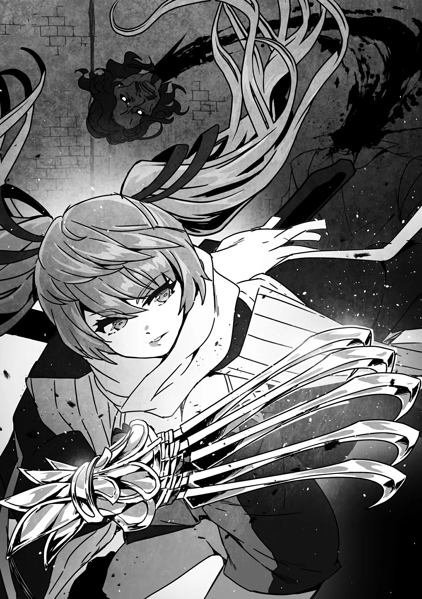

# Chương 183: Tập 8 Chương 1 - Tình Hình Maalt (2)

Tôi rời cô nhi viện rồi chạy xuyên qua thị trấn. Edel ngồi trên vai tôi, chỉ hướng tới những kẻ bị nghi là Thi Quỷ. Chú chuột nắm được tin tức nhờ nhìn qua mắt bầy chuột đàn em rải khắp Maalt. Ít ra tôi đoán vậy, chứ bản thân đâu nhận được những hình ảnh đó nên cũng chẳng dám chắc. Tự mình cố quan sát ngần ấy thứ nghe thôi đã thấy quá tải. Edel mới cho tôi xem thử một thoáng mà tôi đã mệt phờ người, thành thử tôi chẳng dại gì tự thử lại lần nữa.

Thế nhưng với Edel thì việc đó lại chẳng có gì khó khăn. Nghĩ cũng hơi lạ khi nó lại có vài năng lực vượt trội hơn cả chủ nhân, nhưng ở quyến thuộc thì chuyện đó chẳng hiếm. Cha tôi từng có một quyến thuộc biết bay, trong khi bản thân ông đâu tự bay lượn được. Ít nhất là theo những gì tôi biết. Tôi không dám loại trừ hoàn toàn khả năng ấy, nhưng nếu thấy một đôi cánh mọc ra sau lưng người cha trung niên của mình thì chắc tôi sốc nặng mất. Dù vậy, tôi đoán có lẽ bản thân mình cũng làm được điều tương tự. Dẫu sao nhìn từ góc độ ấy, Edel có những kỹ năng như vậy cũng chẳng có gì lạ. Khả năng chiến đấu của tôi mạnh hơn, nên hai bên cứ thế bù trừ cho nhau.

Tôi không ngờ Puchi Suri khắp thị trấn lại đông đến thế. Trước giờ tôi chẳng mấy khi để ý, nhưng giờ đi đâu cũng thấy chúng lấp ló ở mọi góc phố, từng ngóc ngách. Edel hẳn đang quan sát qua đôi mắt của bầy chuột ấy. Có nhiều tai mắt rải khắp nơi như vậy, việc lùng sục Thi Quỷ quả thực dễ thở hơn hẳn.

Đến gần một đám đông, Edel khẽ kêu lên vài tiếng. Có vẻ con Thi Quỷ đầu tiên đang ở quanh đây, nhưng càng tới gần, tôi càng thấy chuyện này nan giải. Nơi này là quảng trường thị trấn, và người dân dường như đang tụ tập về đây để lánh nạn hỏa hoạn. Chung quanh đông nghịt người, nhìn thoáng qua thì chịu chết không thể biết ai là Thi Quỷ. Chúng hẳn đã dùng ma thuật để ngụy trang nên tôi chẳng tài nào nhận ra được. Thế nhưng Edel dường như đã nắm rõ. Chú chuột truyền ý nghĩ qua thần giao cách cảm, chỉ đích danh cho tôi kẻ đó là ai.

Đó là một người đàn ông ngồi bên đài phun nước giữa quảng trường. Gã để râu, ngoài điểm đó ra thì chẳng có gì nổi bật giữa đám đông. Gã nhìn dáo dác xung quanh đầy vẻ cảnh giác, nhưng ai vừa thoát khỏi đám cháy mà chẳng thế. Chắc chẳng ai tin người đàn ông này là Thi Quỷ, nhưng Edel đã khẳng định chắc nịch với tôi như vậy. Đã thế thì tôi buộc phải hành động thôi.

"Làm phiền chút nhé," tôi cất tiếng gọi người đàn ông.

"Gì thế anh bạn? Cậu cũng chạy tới quảng trường này à?" gã đáp lại, giọng điệu tự nhiên như bao người khác.

Nghe vậy tôi thấy hơi bực mình. Không phải vì con Thi Quỷ này đang vờ làm người, mà là vì giọng gã nghe tự nhiên quá thể. Hồi tôi còn là Thi Quỷ, mỗi lần mở miệng nói chuyện là một lần khổ sở muốn chết. Đúng là đời chẳng có chút công bằng nào. Nhưng tôi chỉ giữ kín suy nghĩ ấy trong lòng.

"Không, tôi là mạo hiểm giả. Tôi đang truy lùng kẻ phóng hỏa," tôi nói.

Người đàn ông hơi giật nhẹ một cái nhưng ngoài ra không có phản ứng gì khác. "Hử, thế à? Vậy thì mau đi tìm chúng đi chứ. Bắt chúng phải trả giá cho những gì đã gây ra cho thị trấn này. Làm ơn đấy."

Lời gã nói chẳng có gì đáng ngờ. Chính điều đó mới đáng sợ. Lũ quái vật này có thể trà trộn giữa loài người mà không hề bị phát giác, để rồi dẫn tới mớ hỗn loạn này. Tôi chỉ muốn vạch trần chân tướng rồi trừ khử gã ngay cho xong. Nhưng trước đó, tôi nghĩ biết đâu mình có thể bắt sống gã để moi tin tức về những con Thi Quỷ khác và con Ma Cà Rồng.

"Phải, tôi sẽ làm thế. Tiện đây thì thủ phạm có vẻ là Thi Quỷ. Phiền ông cởi quần áo ra một chút được chứ?"

"Tại sao? Nhìn xem, rõ ràng tôi là con người mà."

"Tôi cũng mong là vậy, nhưng biết đâu lại không phải. Thân thể Thi Quỷ vốn thối rữa, nên ông cứ cởi đồ ra là tôi biết ngay thôi. Mau lên nào."

Người đàn ông đứng phắt dậy, bắt đầu lùi dần ra sau. "Mắc mớ gì tôi phải làm thế? Tôi là người. Tôi nói cho cậu biết, tôi là con người!"

Giọng gã nghe chẳng giống kẻ nói dối, nhưng tôi biết chắc người đàn ông này là Thi Quỷ. Tôi định dồn ép tiếp thì gã bỗng quay đầu bỏ chạy, vung tay chộp về phía một người trong đám đông.

Xem chừng nói chuyện thêm cũng chẳng ích gì. Tôi rút kiếm toan chém gã, nhưng chợt nghe thấy một tiếng nổ như đại bác. Chớp mắt sau, người đàn ông đã bốc cháy ngùn ngụt. Ngọn lửa không mang màu đỏ mà là màu xanh lam nhạt. Còn đang ngơ ngác không hiểu chuyện gì xảy ra, tôi quay đầu nhìn về hướng ngọn lửa phóng tới thì thấy một người phụ nữ.

"Ồ, xem ai đây này? Chẳng phải Rentt sao! Lâu lắm mới gặp lại đấy nhỉ?"

Người phụ nữ có mái tóc xám sẫm và đôi mắt đỏ rực như lửa. Cô toát lên vẻ nguy hiểm nhưng lại vô cùng xinh đẹp. Nhan sắc ấy là không thể phủ nhận, song tôi chẳng bao giờ có thể dùng từ thanh nhã để miêu tả cô được. Trông cô hệt như loài chim săn mồi hay dã thú ăn thịt. Thế nhưng kỳ lạ thay, sau ngần ấy nét hung hiểm, ở cô lại phảng phất vẻ thuần khiết lạ lùng. Suốt hai mươi lăm năm cuộc đời, tôi chưa từng gặp người phụ nữ nào giống như cô.

"Chào Tiểu thư Nive," tôi nói.

"Cứ gọi Nive là được rồi, cảm ơn nhé. Đều là mạo hiểm giả với nhau cả mà, cậu cứ coi tôi như đồng nghiệp là được."

Đúng là thế thật, nhưng tôi lại muốn giữ khoảng cách với cô ấy hơn. Có điều rất khó để phản bác lời cô. "Được rồi, Nive. Sao cô lại ở đây?"

"Lý do đơn giản thôi. Đây chính là lúc để tôi tỏa sáng. Cơ hội hoàn hảo để thiêu rụi lũ quái vật này thành tro bụi," cô vừa nói vừa tung chân đá văng người đàn ông đang bốc cháy ra xa. Cứ tưởng làm vậy sẽ bỏng lắm, nhưng ngọn lửa này có lẽ chẳng phải lửa thường. Bản thân tôi đứng gần đó mà cũng không cảm thấy chút hơi nóng nào. Thứ này hẳn được tạo ra từ thần thuật.

Những người khác trên quảng trường sững sờ kinh hãi nhìn hai chúng tôi. Trong mắt họ, cô là một nữ ma pháp sư vừa phóng hỏa thiêu sống một người đàn ông trung niên, còn tôi là gã đáng ngờ đeo mặt nạ khoác áo choàng lại đi trò chuyện thân thiện với cô. Họ nghĩ thế cũng phải. Nhìn phản ứng của mọi người thì người bình thường cũng thấy được ngọn lửa xanh lam nhạt này. Có lẽ đây không phải Thánh Hỏa mà chỉ là ngọn lửa được thắp lên bằng thần thuật, nên ai nhìn thấy cũng chẳng sao. Vả lại, nếu người đàn ông bỗng dưng quằn quại mà chẳng rõ nguyên nhân, khéo gã lại trông có vẻ nguy hiểm trong mắt đám đông. Biết đâu Nive đã tính trước điều đó. Dù nhìn bộ dạng thì chẳng giống cô bận tâm cho lắm.

Thế nhưng ngọn lửa ai cũng thấy được lại kéo theo mối nguy khác. Nhìn vào cứ ngỡ cô tự dưng châm lửa đốt một thị dân vô tội, khéo các kỵ sĩ lại tóm cổ cả hai chúng tôi. Tôi mất công tra hỏi gã từ trước cũng cốt để tránh cảnh này. Giờ thì tôi chịu chết, chẳng biết làm sao để kiểm soát tình hình.

"Ồ? Xem chừng thế vẫn chưa đủ hạ gục gã nhỉ. Lũ tay sai của đám bọ hút máu lúc nào cũng chịu đòn giỏi thật đấy," Nive vừa nói vừa hướng đôi mắt tròn xoe trong veo về phía người đàn ông đang bốc cháy. Ngay cả khi ngọn lửa bùng cháy dữ dội, gã vẫn trừng trừng lườm chúng tôi. Tôi chẳng hiểu sao gã lại nhìn tôi hằn học như thế; tôi đâu phải người châm lửa đốt gã. Nhưng công tâm mà nói, hễ xác nhận gã là Thi Quỷ thì tôi cũng ra tay thôi.

Tôi vào thế thủ trong khi Nive đảo mắt nhìn quanh. "Chắc hẳn chuyện vừa rồi làm mọi người giật mình!" cô hét lớn. "Nhưng người đàn ông này thực chất là một con quái vật đang trà trộn giữa mọi người! Gã là Thi Quỷ! Cứ nhìn xem, gã bị thiêu sống mà vẫn đứng sừng sững lườm chúng tôi kìa! Bằng chứng rành rành ra đó! Mọi người mau tránh xa khỏi đây! Tôi là mạo hiểm giả Kim Cấp Nive Maris, còn đây là trợ thủ của tôi, Rentt Vivie! Chúng tôi sẽ tiêu diệt con quái vật này!"

Hóa ra cô đã sớm tính đường dàn xếp ổn thỏa rồi. Cứ tưởng cô chẳng thèm nghĩ tới, nhưng có lẽ cô cố tình hãm bớt uy lực của ngọn lửa cũng vì lý do này. Thi Quỷ chịu đòn tốt hơn con người rất nhiều, chút lửa đốt chẳng thể nào lấy mạng nó được. Có điều Nive đã giáng vào nó ngọn lửa thần thánh có tính thanh tẩy. Khả năng tái tạo của Thi Quỷ xung đột với uy lực thanh trừng, khiến cơ thể gã cứ thối rữa, lành lại rồi lại thối rữa hết lần này đến lần khác. Nhìn vào cảnh tượng ấy, đố ai còn dám bảo gã là con người.

Nhận ra người đàn ông đích thị là quái vật, đám đông vội vã tản ra khỏi khu vực trung tâm quảng trường. Dù vậy họ không bỏ đi hẳn, bởi ai nấy đều tò mò muốn xem trận chiến ngã ngũ thế nào. Dân thường mấy khi có dịp tận mắt thấy mạo hiểm giả giao chiến với quái vật, huống hồ đối thủ lại là Thi Quỷ. Có thể họ từng nghe tin tức về việc Ma Cà Rồng và Thi Quỷ sát hại vô số thị dân ở các thị trấn khác, song hiếm ai từng giáp mặt chúng ngoài đời. Chắc hẳn họ muốn thấy con quái vật bị hạ gục để sau này còn có chuyện đem ra kể. Tình thế đang nước sôi lửa bỏng mà lại tò mò gan dạ đến thế thì hơi thừa, nhưng đó vốn là bản tính quen thuộc của dân thị trấn nhỏ: liều lĩnh đến mức gần như bất cẩn. Dẫu sao có biến thì họ vẫn chạy kịp, nên tôi cũng không quá lo lắng.

"Nào Rentt, lên thôi," Nive nhoẻn cười nói.

"Tôi đã nhận lời làm trợ thủ cho cô bao giờ đâu, Nive," tôi càu nhàu, nhưng vẫn quay sang đối mặt với con Thi Quỷ.

"Có hề gì đâu! Tôi trả công hẳn hoi mà!"

Nive lao vào con Thi Quỷ đang bốc cháy. Nhìn ngoài thì chẳng thấy cô cầm vũ khí gì, nhưng khi vừa tới tầm, cô liền vung mạnh cánh tay. Gã đàn ông nhảy tót sang bên né đòn. Một tiếng keng vang lên kèm theo những tia lửa tóe ra từ mặt đất.

"Móng vuốt à?" tôi hỏi.

"Phải. Kiếm thường tôi cũng dùng, nhưng riêng với lũ Ma Cà Rồng thì tôi khoái nhất cảm giác dùng mấy ngón tay xé toạc da thịt chúng," cô giải thích. Nghe bệnh hoạn phát khiếp, nhưng thốt ra từ miệng cô thì chẳng có gì lạ. "Có điều con này dai sức hơn tôi tưởng. Xem chừng thuộc hạng khá đấy. Rentt, chúng ta cùng xông lên đi."

Tôi gật đầu. Cỡ Kim Cấp thừa sức tự mình giải quyết con quái này, nhưng chắc hẳn cô có toan tính riêng. Có lẽ cô muốn dò xét năng lực thể chất của con Thi Quỷ để ước lượng sức mạnh của con Ma Cà Rồng cầm đầu chăng.

Tôi thủ thế kiếm rồi áp sát con Thi Quỷ. Gã thoáng vẻ bất ngờ, nhưng vẫn vung tay cào về phía tôi. Móng tay gã dài ngoằng dị thường, ắt hẳn là thứ vũ khí của gã. Tôi nghiêng người né đòn rồi chém đứt lìa cánh tay ấy chẳng mấy khó khăn.

Kế tiếp là Nive. Cô nhắm móng vuốt vào cổ gã đàn ông rồi quẹt một nhát nhanh đến mức mắt thường chẳng kịp thấy. Chớp mắt sau, một vệt chỉ đỏ nằm ngang hiện lên cổ gã. Chiếc đầu rụng xuống, máu đen sì túa ra từ vết chém. Ấy thế mà cái đầu lìa khỏi cổ vẫn còn sống và trừng mắt lườm Nive. Thân thể gã đã quỵ gối nhưng vẫn chưa chịu đổ rạp. Sức sống của gã quả thực đáng gờm. Hoặc vì gã vốn là kẻ đã chết, khéo tôi nên gọi bằng từ khác mới đúng. Có điều tôi chịu, chẳng nghĩ ra được từ nào. Dù sao thì gã cũng chịu đòn giỏi hơn hẳn quái vật bình thường, đúng bản chất của loài Undead. Bản thân tôi có lẽ cũng chịu đựng được cỡ đó, nhưng chỉ nghĩ đến thôi đã thấy lợm giọng rồi. Dĩ nhiên là loài quái vật này vẫn có điểm yếu để tiêu diệt. Nếu không thì Ma Cà Rồng đã xưng bá thiên hạ mất rồi.

Nive bước lại, nhấc cái đầu con Thi Quỷ lên rồi lẩm nhẩm niệm chú. Cái đầu lập tức bốc cháy rừng rực. Ngọn lửa lần này dữ dội hơn hẳn lúc trước. Không còn khả năng tái tạo, cái đầu vỡ vụn ra rồi hóa thành tro bụi. Gần như cùng lúc đó, phần thân thể cũng rã thành cát. Nếu kẻ này là con người thì làm sao có hiện tượng quái gở như thế xảy ra.

Tất cả những gì con Thi Quỷ để lại chỉ là một viên Ma Tinh. Nive thảy nó về phía tôi: "Thù lao của cậu đấy. Thứ này bán được khối tiền đấy chứ đùa."

Lấy Ma Tinh Thi Quỷ làm thù lao thì quả là không tồi chút nào. Quái vật thuộc dòng dõi Ma Cà Rồng có khả năng sống trà trộn giữa con người, thế nên Ma Tinh của chúng vừa hiếm lại vừa có giá. Ngay cả Thi Quỷ, một dạng hạ cấp của Ma Cà Rồng, cũng không ngoại lệ. Đã vậy Hội còn đang phát lệnh ủy thác khẩn cấp truy sát Thi Quỷ, thành thử giá của nó lại càng đội lên. Vào thời điểm này, viên Ma Tinh trên tay tôi có giá ngang ngửa một viên đá quý loại khá.

"Cô cho tôi thật đấy à?" tôi hỏi.

"Thật chứ sao, tôi săn Ma Cà Rồng đâu phải vì tiền. Cứ tiêu diệt được chúng là tôi thỏa mãn rồi," cô đáp.

Nghe có phần hơi bệnh hoạn. Thà cô bảo làm vì tiền thì tôi còn thấy nhẹ nhõm hơn, ít ra lúc đó cô trông còn giống con người một chút. Nói thế này chẳng khác nào cô chỉ thèm khát điên cuồng việc săn lùng Ma Cà Rồng, mà ngẫm lại thì chắc đúng là thế thật.

"Cậu không nghĩ gì thất lễ đấy chứ?"

"Không, làm gì có."

Nive nhìn tôi đầy vẻ ngờ vực. Gương mặt cô rất đẹp, nhưng ánh nhìn trong đôi mắt ấy lại khiến tôi chỉ muốn quay đi tránh né. Nó hệt như ánh mắt đỏ ngầu vằn tia máu của một con quái vật đang đói mồi. Cái nhìn như thể muốn đoạt mạng người ta vậy, bức bối đến nghẹt thở.

Ánh mắt Nive dãn ra. "Thôi bỏ đi. Dù sao thì Rentt này, tình hình đang thế này mà chúng ta lại tình cờ đụng mặt ở đây, hay là mình bắt tay hợp tác đi?" cô vừa ngỏ lời thì đã bị ngắt ngang.

"Nive!" ai đó cất tiếng gọi từ phía sau cô. Đó là một người phụ nữ trong bộ trang phục tu sĩ, có mái tóc màu bạc và đôi mắt tím như thạch anh. Cô ấy là Myullias Raiza, một Thánh Nữ của Giáo Hội Lobelia. Nive khẽ chau mày khi nghe thấy tiếng gọi, nhưng vẻ khó chịu chỉ thoáng qua rồi cô liền mỉm cười ngoái lại nhìn qua vai.

Cảm giác như tôi vừa trông thấy thứ mình không nên thấy. Tôi tự hỏi không biết quan hệ giữa hai người có xích mích gì không, nhưng chịu chết chẳng thể đoán nổi Nive đang nghĩ gì. Có khi nét mặt ban nãy chẳng mang ẩn ý gì sâu xa, hoặc giả cô cố tình làm vậy để đánh lạc hướng tôi cũng nên. Càng nghĩ sâu về chuyện này càng thấy rợn người.

"Ồ, chẳng phải Thánh Nữ Myullias đây sao? Đừng có chạy hùng hục thế chứ, trông vẻ thánh thiện rụng mất một nửa rồi kìa. Mà vốn dĩ cô có ra dáng thánh nữ bao giờ đâu," Nive buông lời mỉa mai cay độc. Giáo Hội Lobelia là một trong những tổ chức tôn giáo hùng mạnh nhất trên đại lục, cô phải to gan lắm mới dám ăn nói kiểu đó.

Myullias thoáng lộ vẻ khó chịu, nhưng rất nhanh đã lấy lại bình tĩnh. "Tôi đâu cần phải chạy nếu cô không đùng đùng biến mất," cô nói rồi đưa mắt nhìn đống tro tàn vương vãi trên mặt đất. "Cái gì đây?" Xem chừng cô ấy đã tự có câu trả lời. Giữa tình cảnh hỗn loạn này của thị trấn, một Thánh Nữ của Giáo Hội Lobelia thừa sức đoán ra chuyện gì vừa diễn ra.

"Tất nhiên là tro tàn của một con bọ hút máu hèn hạ rồi," Nive đáp.

"Tôi với Rentt vừa xử lý xong."

Cái cách cô ví chúng như sâu bọ nghe thật tàn nhẫn, nhưng đó lại là lối miệt thị mà người ta quen dùng suốt bấy lâu nay khi nói về Ma Cà Rồng. Những ai căm thù Ma Cà Rồng đều ăn nói bằng giọng điệu như thế.

"Ra vậy, thảo nào cô lại đùng đùng chạy đi."

"Phải đấy, gã ngụy trang thành người. Khó mà phân biệt được gã với người thật, nhưng Rentt đã tra hỏi khiến gã phải bỏ màn kịch. Đến lúc gã toan tấn công ai đó thì tôi liền thử thanh tẩy bằng thần thuật. Rốt cuộc đúng là một con Thi Quỷ thật. Suýt nữa thì nguy, đúng không hả Rentt?"

Hóa ra cô đã nghe lỏm cuộc nói chuyện của chúng tôi từ trước, chỉ là không biết bắt đầu từ lúc nào thôi. Nếu cô ra tay dùng thần thuật vì thấy gã toan tấn công người khác thì việc đó cũng xem như chấp nhận được.

"Nive, cô nhận ra gã là Thi Quỷ từ khi nào thế?" tôi hỏi.

"Tôi chỉ dám chắc chắn khi thấy gã toan lao vào đám đông thôi. Nhưng từ trước đó tôi đã đánh hơi thấy mùi Thi Quỷ phảng phất quanh quảng trường này rồi. Mũi tôi thính lắm đấy nhé."

Tôi chịu chẳng rõ cô nói theo nghĩa đen hay nghĩa bóng, nhưng đằng nào thì thốt ra từ miệng cô cũng đều hợp lý cả. Cô mà bảo tìm ra Thi Quỷ nhờ trực giác thì tôi cũng tin, mà bảo cô là một chuyên gia sành Ma Cà Rồng tựa như tôi là một chuyên gia nếm máu thì tôi cũng chẳng nghi ngờ. Tôi tưởng tượng ra cảnh cô dí mũi hít hà một con Ma Cà Rồng ba trăm năm tuổi rồi gật gù nhận xét xem nó đã lên men vừa độ, tới lúc giết thịt được chưa. Nghĩ tới cảnh đó thôi là tôi đã thấy phát ớn.

Myullias xem chừng cũng ngớ người chẳng kém. "Thế cơ à?" cô buông tiếng thở dài.

Dù sao đi nữa, Nive và Myullias có vẻ vẫn đang tiếp tục hợp tác cùng nhau. Nive nghe chừng chẳng mấy mặn mà, nhưng đó đâu phải việc của tôi. Đằng nào con Thi Quỷ cũng bị tiêu diệt rồi, giờ tôi chỉ muốn chuồn khỏi Nive càng sớm càng tốt.

"Tôi muốn đi xem quanh đây còn con Thi Quỷ nào nữa không, nên xin phép đi trước nhé," tôi nói. "Nguyện ánh sáng soi chiếu bước đường của hai vị." Tôi vội vàng đọc một câu chúc của Giáo Hội Lobelia rồi vội vã chạy khỏi quảng trường.

"Đợi đã Rentt! Rentt!!!" Nive gọi với theo, nhưng tôi vờ như không nghe thấy.

May là tôi không phải tự dưng cắm đầu bỏ chạy, mà còn có việc công làm cái cớ. Tôi vẫn chưa rõ mối quan hệ giữa Nive và Giáo Hội Lobelia ra sao, nhưng hy vọng cô ấy không thể bỏ mặc một Thánh Nữ để đuổi theo tôi. Chạy được một đoạn, tôi ngoái đầu nhìn lại thì chẳng thấy bóng dáng Nive đâu, có vẻ cô không đuổi theo thật. Mừng rơn vì đã an toàn, tôi tiếp tục chạy khắp thị trấn để truy lùng con Thi Quỷ tiếp theo.
