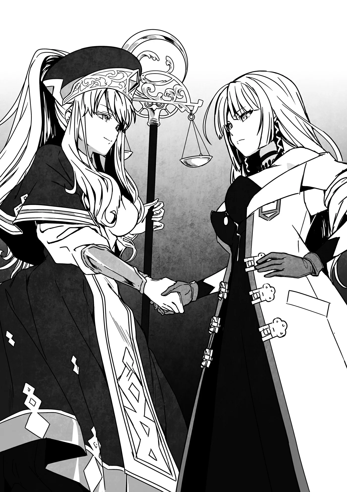

# Chương 187: Tập 8 Chương 2 - Nơi Ma Cà Rồng Hiện Diện (1)

"Ồ, chào nhé. Tôi là Nive Maris."

"Tôi là Lorraine. Vậy là từ giờ chúng ta sẽ hợp tác cùng nhau nhỉ."

Nive chìa tay ra, và Lorraine nắm lấy. Trông Lorraine có vẻ gượng gạo, nét mặt lộ rõ sự khó hiểu không biết vì sao con người này lại có mặt ở đây. Cô không hề ghét bỏ gì Nive, nhưng việc một Ma Cà Rồng như tôi lại đứng kè kè bên một Thợ Săn Ma Cà Rồng như cô ấy ắt hẳn là điều đáng để lo ngại. Bản thân tôi nếu né được thì cũng chẳng đời nào muốn dính dáng, có điều chính Nive mới là người chủ động bám lấy tôi.

Lorraine không xưng họ vì họ của cô trùng với họ tôi đang dùng, và cô muốn tránh bị gặng hỏi quá nhiều chuyện phiền toái. Dù vậy, một số mạo hiểm giả vốn chỉ thích hành nghề bằng tên riêng, trong khi những người khác lại xưng cả họ lẫn tên tùy theo sở thích. Mạo hiểm giả nhìn chung khá ồn ào náo nhiệt, nói nhẹ thì vài kẻ trong số họ còn là hạng chuyên gây rắc rối, thế nên lúc nào cũng có một bộ phận muốn giấu kín họ của mình. Đó là tập quán quen thuộc trong giới mạo hiểm giả chứ chẳng có gì lạ thường. Đa phần những ai chủ động xưng cả họ thường muốn người khác biết đến gia thế cùng địa vị của mình, hoặc muốn tạo dựng lòng tin. Nó tương tự việc cúi đầu chào ai đó thay vì chỉ buông một lời chào xã giao. Thành thử, việc chỉ xưng mỗi tên gọi cũng là điều hết sức bình thường.

"Tôi là Myullias Raiza."

"Cả Thánh Nữ nữa sao? Tôi là Lorraine. Rất hân hạnh được làm quen với cô."

Lorraine tỏ ra lịch thiệp với Myullias hơn hẳn so với Nive, bởi Myullias là một Thánh Nữ, còn Nive là một mạo hiểm giả. Giới mạo hiểm giả vốn chẳng mấy bận tâm đến lễ nghi câu nệ, ngay cả khi nói chuyện với những người có thứ bậc cao hơn. Đa phần họ đều thấy những lời lẽ khách sáo ấy thật phiền phức. Chỉ cần không quá mức thô lỗ với một mạo hiểm giả, người ta cư xử thế nào cũng chẳng ai bắt bẻ.

Thế nhưng các Thánh Giả lại là câu chuyện hoàn toàn khác. Sau lưng họ có vô số tín đồ sùng đạo cùng những thế lực tôn giáo hùng mạnh đỡ đầu. Vài vị Thánh Giả sẽ nổi trận lôi đình nếu bị đối xử như một mạo hiểm giả bình thường. Điều đó không đúng với các Thánh Giả của Giáo Hội Đông Thiên, nhưng theo những gì Lorraine từng kể, nhiều Thánh Giả thuộc Giáo Hội Lobelia và các tôn giáo khác bắt nguồn từ các quốc gia phương Tây thường có xu hướng như vậy. Vì thế, Lorraine đã rèn cho mình thói quen cư xử nhã nhặn trước mặt mọi Thánh Giả. Cô không phải người đặc biệt sùng đạo, chỉ là muốn tránh chuốc rắc rối vào thân.

Bản thân tôi cũng muốn có dịp nào đó ghé thăm các quốc gia phương Tây, nhưng tôi lại thuộc kiểu mạo hiểm giả thấy mấy chuyện lễ nghi câu nệ thật phiền toái. Tôi cần phải hỏi Lorraine xem cần lưu ý những gì trước khi đặt chân tới đó, bằng không e rằng mọi chuyện sẽ trở nên tồi tệ mất. Tôi cũng chẳng hề muốn dây dưa vào rắc rối, vì vậy phải đảm bảo bản thân không gây sự chú ý. Tất nhiên, việc hiện tại phải đi cùng Nive tới một mê cung đã chứng minh tôi né tránh rắc rối dở tệ đến mức nào rồi.

"Cô không cần phải giữ kẽ với tôi thế đâu. Cứ đối xử với tôi như những người khác là được rồi," Myullias mỉm cười nói. Xem ra cô ấy thuộc kiểu Thánh Nữ chẳng mấy bận tâm đến chuyện hình thức. Những lúc thế này, cô chắc chắn là một Thánh Nữ xinh đẹp tuyệt trần, thế nhưng cách đây chưa lâu cô nàng vừa làm ầm ĩ chẳng khác nào quỷ hannya với Nive.

Nói thêm một chút thì, hannya là một loài quái vật giống cái đến từ đảo quốc xa xôi ở Viễn Đông. Từ này được dùng ở Vương Quốc Yaaran để chỉ một người phụ nữ đang nổi cơn thịnh nộ, nhưng nguồn gốc của nó vốn từ ngoại bang. Những quái vật đó thường được gọi chung là oni, loài sinh vật tương tự Ogre nhưng nhỏ con và khôn ngoan hơn. Chúng cũng sở hữu nền văn hóa riêng biệt, và một số cá thể thậm chí còn chung sống hòa bình với con người. Tôi rất hy vọng một ngày nào đó sẽ được gặp một cá thể trong số họ. Theo những gì tôi nghe kể, họ rất xuất chúng về kỹ nghệ luyện kim và đồ thủ công chẳng kém gì Người Lùn.

"Cô chắc chứ?" Lorraine ngập ngừng hỏi Myullias. Lorraine vốn thoải mái hơn so với phụ nữ bình thường, nhưng vào những lúc thế này cô vẫn giữ ý tứ thận trọng. Có lẽ với những người đến từ Đế Quốc, việc giao thiệp với các Thánh Giả lại khó khăn đến mức ấy. Tôi chỉ có thể mường tượng xem những kẻ theo tôn giáo bên đó đã lộng quyền đến mức nào. Nghĩ đến thôi cũng thấy rùng mình.

"Trông cô có vẻ căng thẳng quá đấy. Lorraine, cô đến từ Đế Quốc sao?" Myullias hỏi.

"Cô nhận ra à?"

"Vâng, tôi biết người dân Đế Quốc thường nói chuyện với các Thánh Nữ như thế. Tôi hiểu cảm giác của cô mà. Cô cứ nói năng theo cách nào thấy thoải mái nhất, nhưng hãy cứ tự nhiên đi, tôi không để bụng đâu. Nói thật thì, cách họ cung kính với các Thánh Nữ có thể hợp lý với những vị tiền bối đạt được thành tựu lớn lao, chứ nếu xét trong hàng ngũ Thánh Nữ thì tôi cũng chẳng có gì nổi bật, nên thấy mình khó mà xứng đáng với sự đối đãi như vậy."

Lorraine nhướng mày trước thái độ ủ rũ của Myullias. Chắc hẳn cô đã nhận ra Myullias hành xử giống một thường dân hơn là một Thánh Nữ thông thường. Hơn nữa, những lời Myullias vừa nói thì hoàn toàn ổn ở Yaaran, nhưng nếu ở Đế Quốc thì rất có thể sẽ bị coi là hành vi chỉ trích Giáo Hội. Lorraine luôn bảo tôi rằng theo quy tắc, người ta buộc phải dành cho Thánh Nữ sự tôn kính tuyệt đối. Thường dân buộc phải làm thế, bằng không theo lời cô thì chẳng biết chuyện gì tồi tệ sẽ giáng xuống đầu họ đâu. Lời bộc bạch của Myullias cũng có thể gây suy giảm lòng tin đối với Giáo Hội và đẩy cô vào thế khó, thế nhưng cô vẫn nói ra. Có lẽ phần nào cô đã bị lây tính từ Nive chăng. Nive thậm chí còn ăn nói bạt mạng hơn nhiều, nên việc Myullias mất đi ý niệm giữ kẽ sau từng ấy thời gian ở cạnh cô nàng cũng là điều dễ hiểu.

"Nếu cô đã nói vậy thì được thôi," Lorraine nói. "Nhưng lần tới khi quay lại Đế Quốc, tốt nhất là tôi đừng có bị truy lùng vì tội xúc phạm Myullias Raiza đấy nhé."

"Tôi biết mấy vị phán quan dị giáo có thể ghê gớm thế nào mà," Myullias mỉm cười đáp lại. "Dĩ nhiên chuyện đó sẽ không xảy ra đâu. Dù sao thì tôi cũng đã quyết định xem quãng thời gian ở đây như một kỳ nghỉ rồi, nên muốn được tận hưởng cho thoải mái."

Đó chẳng giống những lời một Thánh Nữ thường nói chút nào, nhưng Lorraine có vẻ đã tin. Cô chìa tay ra ngỏ ý bắt tay với Myullias.

◆◇◆◇◆

"Được rồi, đằng này!" Wolf đứng ở cổng chính Maalt cất tiếng gọi chúng tôi.

Chúng tôi tiến lại gần và thấy một cỗ xe đang phi tới với tốc độ rất nhanh. Cỗ xe đó sẽ chở chúng tôi đến Mê Cung Tân Nguyệt. Đa số xe cộ lúc này đều đang tháo chạy khỏi Maalt, còn những chuyến đi tới các mê cung thì đã ngừng chạy từ lâu, nên cỗ xe này ắt hẳn rất khó tìm. Hoặc có lẽ ông ấy đã ép ai đó phải nhận chuyến.

"Cỗ xe này sẽ đưa các cậu tới thẳng đó," Wolf nói. "Lên xe mau đi. Tôi sẽ ở lại Maalt để chỉ huy phát lệnh." Nói rồi, ông nhảy xuống xe rồi rảo bước biến mất vào trong thị trấn.

Ngay khi chúng tôi vừa bước lên xe, người đánh xe lập tức vung roi quất mạnh. Con ngựa này có tới sáu chân, giống loài được cho là hậu duệ của Sleipnir, chạy nhanh vô cùng.

Khoảng cách giữa Maalt và Mê Cung Tân Nguyệt khá xa, quá xa để có thể chạy bộ tới đó, nhưng cỗ xe này sẽ đưa chúng tôi đến nơi trong chớp mắt. Tôi đoán Nive có thể chạy nhanh hơn cả cỗ xe, chứ tôi thì chịu rồi. Hoặc có lẽ tôi cũng gắng gượng chạy được, nhưng duy trì tốc độ ấy sẽ rất tốn sức, nên tôi thà ngồi xe cho khỏe. Chưa kể, Lorraine và Myullias chẳng đời nào chạy nhanh được như vậy. Nếu bỏ hai người họ lại phía sau, Nive và tôi có thể tự mình phóng như bay đến mê cung, nhưng làm thế sẽ để lộ ra vài bí mật mà tôi muốn giữ kín hơn.

Lại có thêm vài cỗ xe nữa đi tới, và một số mạo hiểm giả khác lần lượt bước lên xe. Wolf từng nói ông sẽ chọn ra những người tinh nhuệ nhất, nhưng có vẻ ông không hề trông mong chúng tôi sẽ tự mình giải quyết hết mọi việc. Tính cả nhóm chúng tôi thì có ba tổ đội tham gia thám hiểm Mê Cung Tân Nguyệt. Wolf hẳn là tin tưởng Lorraine, nhưng tôi là một quái vật, Myullias phục vụ cho Giáo Hội, còn Nive thì vẫn là Nive. Lý do ông không muốn để nhóm chúng tôi đi một mình quá đỗi rõ ràng. Nếu thuần túy xét về năng lực chiến đấu, tôi cho rằng chúng tôi gần như là đội hình mạnh nhất có thể tìm được ở Maalt, nhưng lại có quá nhiều lý do khác khiến người ta phải e ngại. Dẫu vậy, Wolf dường như vẫn gửi gắm kỳ vọng vào tôi, và việc cử thêm các mạo hiểm giả khác đi cùng chưa chắc đã là vì vấn đề lòng tin. Có lẽ ông còn phải gánh vác những nghĩa vụ nhất định trên cương vị Hội Trưởng.

"Nhóm của chúng ta trông bất an thật đấy," Lorraine lẩm bẩm. Myullias và tôi gật đầu đồng tình, còn Nive chỉ thong thả huýt sáo một mình. Đó là một giai điệu tôi chưa từng nghe thấy bao giờ. Biết đâu cô nàng còn biết sáng tác cả nhạc cũng nên. Nếu đúng thế thì tài nghệ của cô nàng quả thực đa dạng đến mức khó tin.

◆◇◆◇◆

"Nào mọi người, cuộc đi săn Thi Quỷ bắt đầu thôi!" Nive tuyên bố ngay trước lối vào Mê Cung Tân Nguyệt rồi lao thẳng vào trong. Myullias bám theo sau cô nàng, rồi tiếp đến là tôi và Lorraine.

"Myullias, cô trông không giống mạo hiểm giả, nhưng có vẻ cô đã rèn luyện thể lực không ít nhỉ," Lorraine nói trong lúc chạy xuyên qua mê cung tối tăm.

"Vâng, thực ra những Thánh Nữ sở hữu Thần Lực dồi dào hơn thì chẳng cần phải làm vậy, nhưng năng lực Thánh Nữ của tôi lại chẳng có bao nhiêu," Myullias đáp. "Tôi nghĩ mình sẽ có ích hơn đôi chút nếu học cách chiến đấu. Dù vậy, so với các mạo hiểm giả chuyên nghiệp thì tôi còn kém xa lắm."

"Cô đừng tự hạ thấp bản thân như vậy chứ. Căn bản của cô xem chừng khá vững vàng đấy, lại còn gần như bắt kịp tốc độ của Nive nữa. Nhưng cô ấy là Kim Cấp, còn Rentt và tôi đều là Ngân Cấp, hoặc ít nhất cũng có thực lực tương đương. Cô có thể sẽ thấy đuối sức đấy, nên cô có phiền nếu tôi dùng ma pháp cường hóa thể chất cho cô không?"

Lời đề nghị của Lorraine vừa là vì lòng tốt, vừa là để Myullias có thể hỗ trợ nhiều hơn trong trường hợp Nive lại nổi cơn cuồng loạn lần nữa.

"Tôi thì không ngại, nhưng cô chắc chứ?" Myullias hỏi. "Chúng ta không rõ chính xác sẽ chạm trán bao nhiêu Thi Quỷ và Ma Cà Rồng đâu. Cô nên tiết kiệm Ma Lực thì hơn."

"Cô nói không sai, nhưng Ma Lực của tôi vẫn còn dư dả. Vả lại, đằng nào Nive cũng đang dẫn đầu mở đường cho chúng ta rồi. Tụi mình chỉ cần theo kịp cô ấy là được."

Lorraine nhìn về phía Nive ở đằng trước. Khô Lâu, Slime cùng những quái vật thông thường khác liên tục xuất hiện, nhưng Nive đã dùng vuốt sắt chém nát tất cả bọn chúng thành từng mảnh. Nhìn cô nàng nghiền nát sọ lũ Khô Lâu rồi đánh chúng vỡ vụn thành từng mảnh khiến tôi có cảm giác như đang tận mắt chứng kiến đồng loại của mình bỏ mạng. Cảnh tượng ấy có chút chạnh lòng. Dù tôi không còn là một Khô Lâu nữa, nhưng đó là thân thể đầu tiên của tôi sau khi biến thành quái vật, nên có lẽ phần nào tôi cũng dành chút thiện cảm cho chúng. Các hình thái tiến hóa sau này của tôi là những sinh vật như Ngạ Quỷ và Thi Quỷ, vì thế tôi vẫn luôn hoài niệm về cái thuở bản thân chưa phải mang da thịt thối rữa.

"Xem chừng đúng là vậy thật," Myullias nói, vẻ mặt sững sờ nhìn theo bóng lưng Nive phía trước. Nive vừa xé xác thêm một con Khô Lâu nữa, nụ cười vẫn tươi rói trên môi suốt từ nãy đến giờ. Nếu còn là một Khô Lâu, chắc chắn tôi chẳng đời nào dám bén mảng lại gần cô nàng. "Vậy thì phiền cô giúp tôi nhé."

Lorraine thi triển ma pháp cường hóa thể chất lên người Myullias. Phép này phát huy hiệu quả lên bản thân người niệm tốt hơn lên người khác, nhưng việc có thể thi triển lên người khác vốn dĩ đã là một lợi thế cực kỳ lớn. Nhờ đó, người ta có thể tăng cho những ai không thuộc diện chiến đấu một lượng thể lực đáng kể. Ma pháp này phức tạp đến bất ngờ vì phải tính đến cả Ma Lực của mục tiêu lẫn Ma Lực của người thi triển, nhưng điều đó dường như chẳng làm khó được Lorraine chút nào.

"Cô thấy thế nào rồi?" Lorraine hỏi.

Myullias chạy vài bước quanh đó để kiểm tra. "Tôi thấy người nhẹ hơn nhiều rồi," cô đáp.

"Cảm ơn cô nhé."

"Thế thì tốt rồi. Giờ chúng ta đuổi theo Nive nhé? Tôi không biết có phải mình tưởng tượng không, nhưng dường như cô ấy chỉ càng lúc càng chạy nhanh hơn thôi."

Chắc chắn không phải do cô ấy tưởng tượng đâu. Có lẽ Nive đã đánh hơi thấy mùi Ma Cà Rồng hay gì đó tương tự. Tôi thì chẳng ngửi thấy mùi gì, nhưng cùng là Ma Cà Rồng, tôi cảm nhận được sự hiện diện của bọn chúng. Một con Ma Cà Rồng đang ở rất gần.

◆◇◆◇◆

"Ồ, tất cả dừng lại ở đây nhé," Nive lên tiếng khi tới khúc ngoặt nơi hành lang. Cô nàng đặt ngón tay lên môi ra hiệu cho chúng tôi giữ im lặng. Tôi rất muốn chỉ ra rằng chính cô nàng mới là người ồn ào nhất cả bọn, nhưng đành phải kìm nén thôi thúc đó lại vì đây không phải lúc để đùa cợt. Dù bụng dạ tôi thật sự muốn nói ra câu ấy lắm rồi.

"Có chuyện gì sao?" Myullias lên tiếng hỏi thay cho tất cả chúng tôi. Nive gật đầu rồi chỉ tay về phía khúc quanh. Myullias ghé mắt nhìn sang hướng đó. "Ra là vậy..." Cô trầm ngâm nói rồi ra hiệu cho tôi và Lorraine cùng nhìn sang.

"Những mạo hiểm giả mất tích sao?" Lorraine vừa nhìn vừa nói.

"Phải, có vẻ là vậy," tôi đáp. "Tôi có quen vài người trong số này."

Đó là một căn phòng rộng lớn, nơi có chừng mười người đang đứng bất động như tượng gỗ. Chếch sang một bên, còn có vài người trông tiều tụy ốm yếu đang bị trói ngồi bệt dưới sàn. Hai người trong số họ chính là những mạo hiểm giả từng chung đội với tôi trong kỳ thi thăng hạng Đồng Cấp.

"Raiz, Laura, sao lại ra nông nỗi này?"

◆◇◆◇◆

"Đây là hai người anh từng kể với tôi sao?" Lorraine hỏi. "Nhưng tôi nhớ họ còn lập đội cùng cả Rina nữa mà."

"Đúng là có lập đội thật, nhưng tôi chẳng thấy bóng dáng Rina ở đâu cả," tôi đáp.

"Có lẽ lúc bị bắt họ chỉ đi riêng với nhau thôi."

Tôi không rõ tường tận sự tình, nhưng hai người họ là bạn thanh mai trúc mã và rõ ràng đều có tình cảm với nhau. Biết đâu Rina đã tế nhị nhường lại không gian riêng cho họ cũng nên. Nếu bị bắt vào đúng thời điểm đó, điều ấy sẽ giải thích được vì sao Rina lại không có mặt ở đây.

"Họ đã bị biến thành Thi Quỷ rồi sao?" Tôi vô thức thốt lên thành tiếng.

Đây chính là mối bận tâm lớn nhất của tôi vào lúc này. Nếu họ đã là Thi Quỷ, thì theo những gì tôi biết chẳng có cách nào đưa họ trở lại làm người được nữa. Nive có lẽ cũng không biết cách, bằng không cô ấy đã công khai chuyện đó từ lâu rồi. Xét cho cùng, tiêu diệt Ma Cà Rồng là toàn bộ lý tưởng sống của cô ấy mà. Điều này đồng nghĩa với việc nếu họ đã hóa thành Thi Quỷ, dẫu cho có là người tôi quen biết, chúng tôi cũng buộc phải hạ sát họ.

"Mấy người đằng kia trông vẫn còn là người đấy," Nive nhận ra nỗi bận tâm của tôi liền lên tiếng. Có lẽ chỉ do tôi tưởng tượng, nhưng khi nhìn về phía họ, trông cô nàng có vẻ nhẹ nhõm. Tôi muốn tin rằng sâu thẳm trong cô vẫn còn chút tính người, nên có thể tôi chỉ đang nhìn thấy những gì bản thân mong muốn mà thôi. "Thế nhưng có vẻ những kẻ đang đứng bất động vô hồn ở phía bên kia đã hết đường cứu chữa rồi. Bọn họ chắc đang trong quá trình chuyển hóa, nhưng giờ thì vô phương cứu vãn. Tiễn bọn chúng xuống mồ thôi nào."

Một tia sáng lạnh lẽo, mang chút gì đó cuồng loạn ánh lên trong đôi mắt cô nàng. Đôi bàn tay cô bồn chồn cử động không yên, như thể chẳng thể chờ đợi thêm được giây nào để cắm vuốt vào người bọn chúng. Bỏ qua những gì tôi vừa nghĩ về cô ấy lúc nãy đi; đây mới chính là con người thật của Nive.

"Vậy thì mọi người, chúng ta hãy giải cứu những ai còn là con người và thanh trừng sạch lũ Thi Quỷ nhé. Được chứ?" Nive hỏi, quay sang nhìn từng người chúng tôi. Ý chí sắt đá trong ánh mắt cô khiến người ta khó lòng chống lại. Chỉ riêng ánh nhìn ấy thôi đã là một lời đe dọa rồi.

Cô nàng không hề sai, nhưng khi thấy họ vẫn đang ở ranh giới giữa con người và Thi Quỷ, nảy sinh hy vọng rằng họ vẫn có thể được cứu chữa cũng là lẽ tự nhiên. Có điều Nive dường như chẳng hề bận tâm đến ranh giới mong manh ấy. Không còn sự lựa chọn nào khác, tôi đành đồng ý với cô nàng. Đằng nào thì quan niệm phổ biến vẫn là một khi đã thành Thi Quỷ thì vĩnh viễn không thể trở lại làm người. Nive có thể chỉ là một kẻ tàn nhẫn, nhưng cũng có thể cô ấy chỉ đang làm những gì bản thân buộc phải làm với tư cách một mạo hiểm giả mà thôi.

"Giờ thì xuất kích thôi nào," Nive nở nụ cười thỏa mãn sau khi thấy chúng tôi gật đầu. "Khoan đã, đợi một chút."

Tôi vừa toan cất bước thì phải khựng lại, tự hỏi rốt cuộc có chuyện gì. Nive chỉ tay về phía góc phòng.

"Anh bảo này, đừng có nghĩ ngợi nhiều quá làm gì," có tiếng ai đó cất lên. Hai bóng người đang từ phía sâu trong mê cung bước về phía căn phòng rộng. Một người trông như cậu thiếu niên khoảng mười bảy, mười tám tuổi, còn người kia là một cô bé tầm mười bốn, mười lăm tuổi.

"Nhưng chúng ta thật sự nên làm chuyện này sao anh?" Cô bé cất tiếng hỏi. "Làm vậy thì chúng ta đâu có hơn gì con người chứ."

"Em có biết bọn chúng đã khiến chúng ta chịu khổ sở thế nào không?" Cậu thiếu niên nói. "Đằng nào thì bọn chúng cũng đông như kiến. Vài đứa có xảy ra chuyện thì đã sao nào?"

"Nhưng mà—"

"Anh hiểu, nhưng em đừng nghĩ ngợi nữa. Chúng ta buộc phải làm việc này. Hơn nữa, ngài Shumini đã bảo đây là việc cần thiết. Ngài ấy tuy chưa giải thích lý do, nhưng đã đánh thức sức mạnh cho chúng ta, đúng chứ? Cho nên, em biết rồi đấy."

Tôi không rõ tường tận họ đang nói về chuyện gì, nhưng cũng nắm được đôi phần. Shumini hẳn là kẻ cầm đầu hoặc đứng sau giật dây bọn họ. Hai đứa trẻ dường như cũng có phần giằng xé trước việc biến người khác thành Thi Quỷ, và bản thân chúng cũng chẳng biết lý do tại sao lại phải làm vậy.

"Xem chừng chúng ta đụng phải Ma Cà Rồng rồi," Nive nói đầy thích thú. "Cái mũi của tôi mách bảo như vậy đấy. Giết sạch bọn chúng thôi nào."
