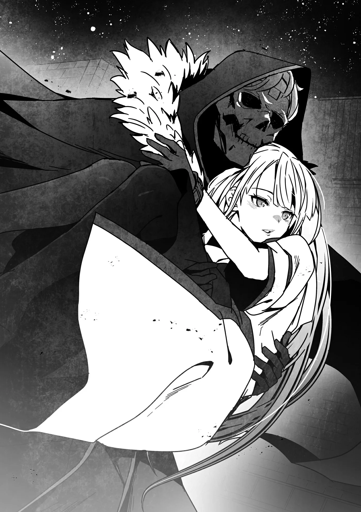

# Chương 189: Tập 8 Chương 2 - Nơi Ma Cà Rồng Hiện Diện (3)

Chúng tôi gửi Raiz, Laura Satii cùng những mạo hiểm giả bị bắt khác lại cho tổ đội của người đàn ông trung niên rồi tiến sâu hơn vào mê cung. Dù vậy, chúng tôi vẫn chỉ đang ở tầng một của Mê Cung Tân Nguyệt, và tầng này khá dễ đi. Tuy nơi đây rất rộng, nhưng Nive có tấm bản đồ tự động vẽ lại địa hình cả tầng nên chúng tôi chẳng đời nào bị lạc. Mà dù sao chính tôi cũng có Bản Đồ Akasha. Có điều lạ là dù có thể dùng nó để vẽ toàn bộ bản đồ mê cung, trên đó lại chẳng hiện ra bất kỳ Thi Quỷ hay Ma Cà Rồng nào. Bản đồ vẫn hiển thị con người kèm tên của họ, nên có khi do tôi dùng chưa đúng cách. Tôi từng bàn với Lorraine về các công năng của nó, nhưng cả hai đều không tường tận mọi thứ nên cũng đành chịu. Đợi vụ lộn xộn này lắng xuống, có lẽ tôi nên tính xem còn cách nào khác để tận dụng tấm bản đồ trong các mê cung thì hơn.

"Đằng này còn nữa," Nive nói rồi dừng lại ở một khúc quanh khác. Chắc cô ấy lại phát hiện thêm Ma Cà Rồng. "Tôi sẽ xông vào trước, hai người vào sau nhé. Lần này có mấy con Thi Quỷ đang cử động, hai người lo liệu lũ đó đi."

Tôi ngó qua khúc quanh và thấy một căn phòng rộng cỡ căn phòng trước. Bên trong có một cậu thiếu niên trông như Ma Cà Rồng, cùng một đám Thi Quỷ. Khác với cậu ta, mặt mũi lũ Thi Quỷ đã thối rữa, da thịt khô khốc và bong tróc từng mảng.

"Lên nào!" Nive hô lên rồi lao vút vào trong phòng.

"Ngươi là ai?!" cậu thiếu niên Ma Cà Rồng căng thẳng quát lên.

"Lũ Ma Cà Rồng các ngươi không xứng được biết tên ta!" Nive đáp, rồi vung mạnh vuốt sắt.

"Mạo hiểm giả ư? Ra là các ngươi đã tìm tới tận đây rồi." Cậu thiếu niên né vuốt sắt, và trận chiến bắt đầu. "Lũ Thi Quỷ đâu! Tấn công ả đàn bà này mau!"

Lũ Thi Quỷ chẳng kịp làm theo lệnh cậu ta, vì chúng tôi đã ập vào ngay sau Nive và lao tới chặn đánh. May là cả thảy chỉ có năm con. Tuy cũng là một dạng Hạ Cấp Ma Cà Rồng, chúng lại mạnh hơn Orc khá nhiều. Với hai mạo hiểm giả Đồng Cấp bình thường thì đây sẽ là một trận chiến đầy chật vật. Có điều, tuy tôi mang hạng Đồng Cấp nhưng thể xác quái vật cùng Ma Lực, Khí Lực và Thần Lực đã giúp tôi vượt trội hơn hẳn số đông. Huống hồ Lorraine còn là một mạo hiểm giả Ngân Cấp thực thụ. Dù không dám bảo trận này dễ xơi, chúng tôi vẫn thừa sức giữ chân lũ Thi Quỷ, không để chúng xen vào trận đánh giữa Nive và tên Ma Cà Rồng.

Dù vậy, Lorraine và tôi vẫn phải phối hợp tác chiến cùng nhau. Có lẽ tôi tự mình dẹp hết lũ này cũng được nếu dốc toàn bộ Thần Lực và khả năng vận động siêu phàm, nhưng làm thế sẽ để lộ năng lực trước mặt Nive và Myullias. Tôi không nghĩ họ là người xấu, nhưng cũng chẳng muốn họ biết hết mọi thứ. Kể cả họ không biết tôi là quái vật, ai mà lường được điều gì có thể biến chúng tôi thành kẻ thù trong mắt họ. Tôn giáo ở Vương Quốc Yaaran nhìn chung khá ôn hòa và thoải mái, nhưng Lorraine từng bảo Giáo Hội Lobelia có thể cực kỳ khắt khe và không khoan nhượng, nên cẩn thận trước họ chẳng bao giờ thừa. Đằng nào họ cũng sẽ nhận ra vài điều, nhưng chỉ cần không để lộ tôi có gì khác ngoài một mạo hiểm giả bình thường là được.

Tôi áp sát cận chiến trong khi Lorraine tấn công từ phía sau, lối đánh cơ bản nhất. Tôi dùng kiếm đỡ những cú cắn và vuốt cào của chúng, hễ thấy sơ hở là chém trả. Lorraine bọc lót những khoảng trống sau đòn đánh của tôi, đồng thời nã ma pháp vào bất cứ con Thi Quỷ nào toan lao về phía Nive.

Dĩ nhiên, đánh với nhiều đối thủ cùng lúc như thế này thường dễ có kết cục chẳng lành, nhưng Lorraine và tôi đã có mười năm kề vai sát cánh. Cả hai phối hợp cực kỳ ăn ý. Chẳng cần nói một lời, chúng tôi vẫn biết chính xác đối phương sắp làm gì tiếp theo. Chẳng hạn, lúc tôi chém một con Thi Quỷ, nó đỡ được nhát kiếm rồi hất tôi lùi lại một chút. Con Thi Quỷ liền xông thẳng tới tôi, nhưng tôi cảm nhận được luồng Ma Lực sau lưng nên lập tức thụp xuống, để Lorraine bắn thẳng một quả cầu lửa trúng đầu nó và thiêu rụi. Cứ thế, chúng tôi lần lượt hạ gục từng con cho tới khi chỉ còn lại một con cuối cùng.

"Xong rồi," tôi nói rồi vung kiếm chém bay đầu nó. Tôi quay lại nhìn Nive và tên Ma Cà Rồng, trận bên đó cũng sắp ngã ngũ. Tên Ma Cà Rồng trông không hề trầy xước nhưng đang thở dốc. Hẳn cậu ta đã dùng Phân Liệt để tái tạo quá nhiều lần đến mức thể lực cạn dần. Có điều, khác với hai Ma Cà Rồng trẻ tuổi ban nãy, cậu ta không bị biến thành cát.

"Xem ra ngươi không lạm dụng Phân Liệt bừa bãi nhỉ," Nive nói với tên Ma Cà Rồng. "Trông cũng chẳng có vẻ gì là đang dùng Huyết Binh."

Tên Ma Cà Rồng cười khẩy. "Sao hả, ngươi đụng độ Jiziu với Wugong rồi à? Ta không giống hai đứa đó đâu. Chúng mới gia nhập phe ta gần đây, đã được chỉ dạy mấy về sức mạnh của mình đâu."

"Tàn nhẫn thật đấy. Nếu được dạy rằng lạm dụng sức mạnh đó nguy hiểm thế nào, chúng đã chẳng phải bỏ mạng vô nghĩa như vậy," Nive đáp lại, nhưng tôi thấy điều đó thực ra không hẳn là thật. Có khi cô ấy vẫn sẽ tiêu diệt chúng bằng cách khác mà thôi.

"Bọn chúng chết rồi cơ à? Hừ. Mà bọn ta đâu có cố ý giấu chúng chuyện đó. Nếu có giấu thật, chắc chắn chúng đã cản chân được ngươi trước khi ngươi mò tới đây rồi."

Nive nhướng mày. "Định để sau này mới bảo à?"

"Rõ ràng rồi. Đợi chúng tích lũy thêm chút kinh nghiệm thực chiến đã chứ. Nhưng nói thật, ta chẳng ngờ ngươi lại có bản lĩnh cỡ này. Ở những thành phố nhỏ như Maalt, mạo hiểm giả Ngân Cấp đã là kẻ mạnh nhất thường thấy rồi. Có Phân Liệt trong tay thì chẳng bao giờ chết được, lại dễ dàng chuồn êm. Ít nhất là trên lý thuyết."

Bình thường thì tính toán của cậu thiếu niên kia cũng chẳng sai là bao, khổ nỗi chấp niệm săn Ma Cà Rồng cùng cái mũi của Nive lại khác thường quá mức. Nếu không có cô ấy, có lẽ bọn chúng đã câu kéo thêm được chút thời gian rồi tẩu thoát sau khi gây ra vụ hỗn loạn này. Song Nive đời nào chịu để bất kỳ con Ma Cà Rồng nào lọt lưới.

"Nói gì thì nói, trông ngươi vẫn còn sung sức gớm nhỉ," Nive nói. "Ra thế. Thú vị đấy."

Khách quan mà nói, cậu thiếu niên Ma Cà Rồng đã bị dồn vào chân tường. Sức lực cậu ta chẳng còn là bao, đường lui cũng không có. Vậy mà cậu ta vẫn giữ nụ cười trên môi như thể mọi chuyện đều nằm trong tính toán. Hẳn Nive cũng nhận ra điều đó.

"Ồ, ngươi nhận ra rồi à?" cậu thiếu niên Ma Cà Rồng hỏi.

"Đang câu giờ chứ gì? Ta đoán mục tiêu thực sự của các ngươi nằm trong thị trấn. Nhưng phần lớn mạo hiểm giả đều đang ở đó cả rồi. Ngươi làm trò này thì có ích gì?"

"Nive Maris, ngươi tự đánh giá thấp bản thân quá đấy. Không có ngươi, Maalt chẳng khác nào bãi săn của bọn ta. Chà, nói thế có lẽ hơi quá. Dạo gần đây ta mới biết cái thành phố nhỏ này lại có lắm mạo hiểm giả tài năng đến bất ngờ. Dù vậy, hầu như chẳng ai trong số họ tóm được hay tiêu diệt nổi bọn ta đâu. Thành thật mà nói thì có khi ai đó giết được ta thật đấy, nhưng trước ngài Shumini thì họ hoàn toàn không có cửa đâu."

Tôi chẳng biết phải nghĩ sao về lời đó. Ở Maalt không thiếu người mạnh, vả lại tôi cũng vừa biết khả năng tái tạo của Ma Cà Rồng không phải là vô hạn. Nếu quần thảo đủ lâu, kiểu gì chúng tôi cũng tiêu diệt được chúng. Nhưng chiến đấu trong một mê cung chật hẹp là một chuyện, còn chiến đấu ở bên ngoài lại là chuyện hoàn toàn khác. Ở không gian ngoài kia, chúng có thể tận dụng Phân Liệt để tẩu thoát. Nive có thể có cách đối phó, chứ mạo hiểm giả ở Maalt chẳng ai chuyên đi săn Ma Cà Rồng cả. Hội Trưởng Wolf chắc cũng nắm vài biện pháp ứng phó chung, nhưng chỉ có Thợ Săn Ma Cà Rồng mới biết cách khai thác điểm yếu của chúng. Mạo hiểm giả phải đối đầu với đủ loại quái vật chứ đâu riêng Ma Cà Rồng, nên hiếm ai chỉ tập trung vào mỗi một loài như thế.

Hai Ma Cà Rồng lúc trước từng nhắc tới thủ lĩnh tên Shumini, nhưng cậu thiếu niên này rõ ràng không phải là hắn. Nghe qua thì có vẻ tên cầm đầu đang ở trong thị trấn.

"Ra thế. Vậy thì được thôi," Nive nói. "Ta sẽ giết ngươi, rồi quay thẳng về thị trấn giải quyết cho xong chuyện này."

"Ngươi nghĩ ta sẽ để ngươi làm thế chắc?"

Cậu thiếu niên bật cười, thoắt cái đã rút từ hư không ra một thanh kiếm liễu màu đỏ rồi rót đầy Ma Lực vào đó. Thanh kiếm liễu tỏa ra một luồng năng lượng rợn người chảy vào cơ thể cậu thiếu niên và làm biến đổi cậu ta. Thân hình mảnh khảnh, thanh tú bỗng phát ra những tiếng tanh tách khi bắp tay, lồng ngực và bắp đùi phồng to lên, làm bung rách bộ quần áo may đo vừa vặn trên người.

"Cái quái gì thế này?" tôi thì thầm.

"Đó là sức mạnh của Huyết Binh," Nive giải thích. "Công dụng của nó chẳng khác gì cách các thánh kiếm cường hóa cho con người. Chúng là vũ khí bí mật của Trung Cấp và Thượng Cấp Ma Cà Rồng, nhưng bản thân Huyết Binh vốn rất hiếm nên ít khi nhìn thấy. Dù sao thì gay go rồi đây. Một khi Trung Cấp Ma Cà Rồng làm vậy, sức mạnh của chúng sẽ sánh ngang với Thượng Cấp Ma Cà Rồng."

Cậu thiếu niên không còn vẻ ngoài của một Ma Cà Rồng nữa, thay vào đó lại giống thứ gì đó gần với Ogre hơn. Song khác với loài Ogre, ánh mắt cậu ta vẫn lộ rõ vẻ thông minh, từng cử động cũng toát lên sự lanh lợi. Đó tuyệt đối không phải là Ogre. Kẻ này nguy hiểm hơn thế rất nhiều.

"Cô thắng nổi không?" tôi hỏi Nive.

"Được chứ, nhưng chắc sẽ mất chút thời gian. Vào lúc khác thì chẳng sao, có điều tình thế hiện giờ lại không mấy thuận lợi. Rentt, cậu và Lorraine quay về thị trấn trước được không? Hãy tìm và tiêu diệt tên Ma Cà Rồng đầu sỏ đi."

"Cô chắc chứ?" Tôi cứ đinh ninh cô ấy sẽ muốn tự tay làm việc đó.

"Chà, tôi đâu thể ôm đồm hết mọi việc được. Nhưng ngay khi tiêu diệt xong con Ma Cà Rồng này, tôi sẽ quay về thị trấn. Nếu tới lúc đó tên Ma Cà Rồng đầu sỏ vẫn còn sống, tôi sẽ lao vào xử lý hắn luôn," cô vừa nói vừa cười toe toét. Khoảnh khắc ấy trông cô ấy cũng ngầu thật, có điều tôi chẳng nói ra miệng đâu.

Tôi quay người lại và bảo, "Lorraine! Chúng ta quay về thị trấn thôi!"

"Được!"

Chúng tôi lao ra khỏi căn phòng lớn, chạy dọc theo hành lang.

"Ồ, các ngươi không đi đâu được đâu," con Ma Cà Rồng dạng Ogre gầm lên. Thoắt cái hắn đã áp sát ngay cạnh chúng tôi.

"Đi được chứ sao không!" Nive quát lớn. Cô xuất hiện ngay sau con Ma Cà Rồng dạng Ogre, vung móng vuốt đánh bật hắn trở lại căn phòng trước khi hắn kịp chạm vào chúng tôi.

"Đi mau!"

"Hẹn gặp lại sau nhé!" tôi gọi với lại rồi không nói thêm gì nữa. Trong tình huống này, cô ấy thực sự hành xử rất ra dáng một mạo hiểm giả chín chắn. Tôi thầm nể điều đó, nhưng cũng chẳng nói ra lời.

Myullias vẫn nán lại ở hành lang và chỉ dõi theo trận chiến giữa Nive với tên Ma Cà Rồng. Tôi từng nghĩ cô ấy có thể sẽ đi cùng chúng tôi, nhưng cô ấy phải ở lại để thanh tẩy tên Ma Cà Rồng sau trận chiến. "Hai người cẩn thận nhé!" cô ấy dặn dò chúng tôi.

Chúng tôi vẫy tay chào cô ấy rồi rời đi.

◆◇◆◇◆

Tôi không nghĩ Nive thực sự tin rằng tôi đánh bại được tên đầu sỏ. Đúng hơn thì tôi đoán cô ấy muốn đảm bảo toàn bộ Ma Cà Rồng trong và quanh Maalt đều bị tiêu diệt sạch. Thế nhưng tên ở Mê Cung Tân Nguyệt này lại tương đương một Thượng Cấp Ma Cà Rồng, và dù tôi đã mạnh hơn trước đây, tôi cũng chẳng dám chắc mình sẽ thắng dù có dốc hết toàn lực. Hẳn Nive biết chuyện đó là quá sức với tôi, nên cô ấy mới quyết định tự mình giải quyết.

Chúng tôi chưa rõ tại sao tên Ma Cà Rồng lại có mặt ở Maalt hay hắn đang mưu tính điều gì, nhưng chắc chắn hắn phải có mục tiêu nào khác ngoài việc xua lũ Thi Quỷ đi càn quấy. Bất kể hắn muốn làm gì, việc đó cũng tốn thời gian đến mức hắn phải dụ Nive tới Mê Cung Tân Nguyệt và dùng Huyết Binh cầm chân cô ấy ở đây.

Cậu thiếu niên Ma Cà Rồng nói không sai ở chỗ lực lượng của Maalt khó mà trông cậy hoàn toàn được, nhưng có lẽ họ vẫn đủ sức cầm cự câu giờ để Nive hạ gục cậu ta rồi quay về Maalt. Tôi nghĩ đó cũng là điều cô ấy muốn tôi làm. Cô ấy nói cứ như thể tôi đánh bại được tên Ma Cà Rồng đầu sỏ, nhưng nhiều khả năng chỉ là để thuyết phục tôi quay về mà thôi. Ngay cả trước một Trung Cấp Ma Cà Rồng tôi đã phải chật vật rồi, làm sao thắng nổi một kẻ địch có khi còn mạnh hơn thế. Dù vậy, có lẽ tôi vẫn cầm chân hắn được một lúc. Tôi chỉ cần ngáng đường hắn và chờ Nive tới nơi. Ít nhất tôi cũng phải thử xem sao. Chừng ấy việc thì có lẽ tôi vẫn xoay xở được.

◆◇◆◇◆

Khi về tới Maalt, chúng tôi nghe thấy một tiếng nổ lớn.

"Rentt! Tiếng nổ phát ra từ quảng trường trung tâm!" Lorraine nói rồi lao vội về hướng đó. Tôi chạy theo sau cô. Cô chạy chậm hơn tôi nhiều, nhưng tôi lại cần đến ma thuật của cô để đối phó với tên Ma Cà Rồng đầu sỏ.

"Tăng tốc thôi," tôi nói, rồi vừa chạy vừa bế thốc Lorraine lên.

"Rentt! Xin lỗi anh nhé," cô ấy nói, nhưng tôi chỉ làm điều hợp lý thôi. Có sẵn cơ thể quái vật lại thêm nền tảng rèn luyện của một kiếm sĩ, thể lực của tôi dĩ nhiên vượt trội hơn hẳn. Còn Lorraine là ma pháp sư, vốn thuộc kiểu hỏa lực mạnh nhưng thể chất mỏng manh.

"Cô trả nợ cho tôi lúc đánh với tên Ma Cà Rồng đầu sỏ là được," tôi bảo.

"Ừ, tất nhiên rồi."

◆◇◆◇◆

Cảnh tượng hỗn loạn kinh hoàng. Khắp quảng trường trung tâm, các mạo hiểm giả nằm la liệt, vừa lăn lộn vừa rên la trên mặt đất. Người thì đầm đìa máu me, kẻ thì thương tích đầy mình. Có những người bị gãy xương, thậm chí có người còn thủng cả lỗ trên cơ thể. Các thầy trị liệu hớt hải chạy đôn chạy đáo khắp nơi. Nhưng giữa bao nhiêu người bị thương ấy, vẫn có một người đàn ông đứng vững và lớn tiếng chỉ huy.

"Wolf!" tôi gọi lớn, đặt Lorraine xuống rồi chạy về phía ông.

"Rentt đấy à? Tình hình ở Mê Cung Tân Nguyệt thế nào rồi? Còn Nive Maris đâu?"

Ông vẫn đứng vững, nhưng khắp người chằng chịt vết thương. Máu nhỏ giọt từ da thịt ông. Tôi không thể phung phí quá nhiều Thần Lực, nhưng ít nhất cũng dùng thần thuật cầm máu cho ông.

"Có cậu đúng là tiện thật đấy," Wolf mở to mắt nói. Nhìn ông đã hồi phục được phần lớn.

Đây có lẽ là lần đầu tiên ông thấy tôi sử dụng Thần Lực. Dù vậy, ông chỉ hơi ngạc nhiên đôi chút, có lẽ vì giờ đây tôi có làm gì cũng chẳng khiến ông bất ngờ thêm được nữa. Dù sao chuyện này vẫn bình thường chán so với việc một con người biến thành quái vật.

"Rốt cuộc đã xảy ra chuyện gì vậy? Ai đã gây ra nông nỗi này?" Lorraine hỏi Wolf. Có những dấu vết cho thấy thứ gì đó vừa phát nổ, nhưng chẳng thấy bóng dáng thủ phạm đâu ở quảng trường trung tâm.

"Chắc là một Thượng Cấp Ma Cà Rồng," Wolf đáp. "Chỉ nhìn bề ngoài thì không đoán được hắn là Trung Cấp hay Thượng Cấp Ma Cà Rồng, nhưng sức mạnh của hắn thì khủng khiếp vượt bậc."

"Có lẽ là tên Ma Cà Rồng đầu sỏ đấy," tôi nói. "Bọn tôi đã chạm trán vài tên Ma Cà Rồng phục tùng hắn ở Mê Cung Tân Nguyệt. Một đứa trong số đó bảo rằng hắn đang mưu tính làm chuyện gì đó ở Maalt. Nive vẫn đang giao chiến với tên Ma Cà Rồng kia, nhưng xong việc cô ấy sẽ quay về ngay."

"Xua ngần này Thi Quỷ tàn phá thị trấn đã đủ tệ rồi, thế mà hắn vẫn còn trò khác sao? Tôi phải làm gì đó mới được," Wolf vừa đáp vừa ho ra máu. Phép trị liệu nhẹ tôi vừa dùng chỉ giúp được đến thế. Tôi giơ tay định chữa tiếp cho ông, nhưng Wolf đã ngăn lại. "Để dành sức đi. Tôi không biết tên Ma Cà Rồng đó là kẻ nào, nhưng hắn chạy về hướng kia rồi. Những mạo hiểm giả còn lành lặn đã đuổi theo hắn, tôi muốn cậu cũng đuổi theo đi. Hạ gục hắn. Cho hắn thấy mạo hiểm giả của Maalt làm được những gì."

"Nhưng Wolf, phải có ai đó trị thương cho ông trước chứ."

Xung quanh có sẵn các thầy trị liệu. Lẽ ra họ nên ưu tiên chữa cho ông trước tiên. Dù sao ông cũng là Hội Trưởng. Người đứng đầu mà bị thương nặng thế này thì gay go to.

"Những người khác bị thương nặng hơn tôi nhiều," Wolf nói. "Phải ưu tiên cứu chữa cho họ trước. Hơn nữa, ở Maalt không đủ thầy trị liệu để chữa lành hoàn toàn cho tất cả mọi người ở đây đâu. Đằng nào giờ tôi cũng chẳng giúp được gì trong việc đánh đấm, có chữa cũng phí công. Nhưng đầu óc tôi vẫn còn tỉnh táo, vẫn chỉ huy anh em được. Thế là đủ rồi. Vả lại chính cậu cũng vừa chữa cho tôi rồi còn gì."

Ông nhất quyết không chịu nghe tôi. Dù vậy, tôi hiểu ý ông, và nhìn vào ánh mắt ấy, tôi biết mình chẳng thể nào thuyết phục được ông.

"Tôi hiểu rồi. Vậy tôi sẽ đuổi theo tên Ma Cà Rồng đó. Ông liệu mà giữ mạng đấy."

"Dĩ nhiên rồi." Wolf toét miệng cười, nụ cười hung tợn như một con thú ăn thịt.