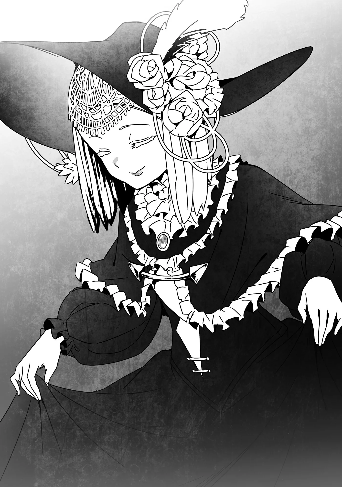

# Chương 193: Tập 8 Chương 4 - Giải Thích và Giải Quyết (1)

"Sao cô bé lại biết chuyện đó?" tôi hỏi.

Có khi Laura chẳng biết gì mà chỉ buông câu dò hỏi thôi. Nếu thế thì câu hỏi vừa rồi của tôi coi như tự nhận rồi còn gì, nhưng dù sao tôi cũng đâu định giấu chuyện về Edel. Chính Laura cũng làm được điều tương tự, nên cô bé biết hay không cũng chẳng khác gì nhau. Huống hồ cô bé còn có thể chia sẻ tầm nhìn của động vật cho người khác, vượt xa những gì tôi làm được. Tôi còn bắt bẻ cô bé nỗi gì nữa.

Vả lại, nếu Laura muốn hại tôi thì cô bé đã khiến tôi hết đường sống ở Maalt từ lâu rồi. Bình thường tôi chẳng mấy khi để ý vì cô bé đối xử với tôi rất tốt, nhưng tầm ảnh hưởng của cô bé ở Maalt lớn đến mức chẳng khác nào lãnh chúa vùng này. Nếu thực sự muốn ra tay với tôi, cô bé đã tống cổ tôi khỏi thị trấn rồi. Thế nên tôi hoàn toàn có thể tin tưởng vào ý tốt của cô bé.

"Chuyện đó giải thích hơi dài dòng, để giải quyết xong xuôi mọi chuyện rồi tôi kể cho ngài nghe nhé," Laura nói. "Còn bây giờ, ngài nhìn xuống dưới xem. Tôi biết ngài có thể quan sát toàn bộ Maalt, nhưng ngài có nhận ra điều gì lạ không?"

Tôi có thể gặng hỏi tiếp, nhưng lúc này chẳng có thì giờ đâu mà lần lữa. Cô bé đã hứa kể sau thì tôi cũng tạm gác lại. Tôi làm theo lời Laura, nhìn xuống Maalt.

"Kia là ma pháp trận sao?" tôi hỏi. Dưới mặt đất thị trấn Maalt có những mảng phát ra ánh sáng lờ mờ. Nhìn tổng thể, những vệt sáng ấy dường như đang tạo thành một ma pháp trận khổng lồ.

"Đúng vậy, đây là một ma pháp trận cổ đại. Nó lớn hơn và hiệu quả hơn nhiều so với loại thời nay. Tôi không ngờ đến giờ vẫn còn người biết về ma pháp trận này đấy."

"Chuyện đang xảy ra ở Maalt là do ma pháp diện rộng gây ra sao? Thi triển thứ này hẳn phải tốn kém khủng khiếp," Lorraine lên tiếng, giọng cô ấy như vọng ra từ hư không. Nghe tiếng người ngay sát bên mà không thấy mặt mũi đâu quả là kỳ quặc. Xem ra tôi phải tập quen dần thôi.

"Đúng thế," Laura đáp. "Chắc mọi người đều rõ cái giá ấy là gì rồi. Những người bị biến thành Thi Quỷ, máu của những vật tế đó, và khi chừng ấy vẫn chưa đủ..."

"Shumini đã lấy mạng mình ra tế để bù vào phần còn thiếu," Isaac trầm giọng nói.

"Tôi đoán gã còn dùng rất nhiều Ma Tinh và ma cụ nữa. Kích hoạt ma pháp này khó đến thế đấy. Chỉ tiếc là gã lại làm được mất rồi."

Nếu bỏ qua việc làm tàn độc này thì đây đúng là một kỳ tích. Nhưng tôi chẳng tài nào khen nổi một ma pháp biến người dân trong thị trấn thành quái vật.

"Nhưng rốt cuộc Shumini làm trò này để được cái gì chứ?" tôi hỏi.

"Gã muốn phá hủy Maalt sao?"

Laura lắc đầu. "Tôi đoán là không. Tác dụng của ma pháp này, nói đơn giản thì là tạo ra một mê cung. Hẳn là gã muốn làm Chủ Nhân Mê Cung của nơi đó."

"Gã tạo ra một mê cung ư?!" Lorraine kêu lên kinh ngạc. "Ma pháp làm được cả chuyện đó sao? Chuyện như thế mà cũng có thể à?"

"Có rất nhiều loại mê cung, nhưng loại chúng ta thấy ở đây được tạo ra bằng ma pháp. Loại này chắc chắn có thật, nên chúng ta đành phải chấp nhận là chuyện này hoàn toàn có thể thôi."

"Nhưng tại sao người dân lại bị biến thành quái vật?" tôi hỏi. "Tôi cứ nghĩ quái vật trong mê cung là do triệu hồi ra, hoặc tự nhiên sinh ra chứ."

"Điều đó đúng với những mê cung đã hoàn thiện. Có điều như đã nói, cái giá của ma pháp này rất đắt. Shumini chắc đã dốc hết những gì gã có để trả, nhưng vẫn không thấm vào đâu. Dù vậy ma pháp vẫn phát động, và mê cung đang rút nốt phần còn thiếu từ vạn vật xung quanh. Thậm chí tôi dám cược là Shumini thừa biết chuyện này sẽ xảy ra nhưng vẫn cứ kích hoạt ma pháp. Mọi người nhìn kìa."

Laura cho chú chim sà xuống thấp hơn. Một tia sáng như sấm sét lóe lên, cản không cho nó xuống quá sâu. Tiếp đó chú chim thử lượn quanh Maalt tìm đường vào trong, nhưng từ mọi hướng và ở bất kỳ độ cao nào, nó đều bị một bức tường vô hình đánh bật ra.

"Cái này là gì thế?" tôi hỏi.

"Ma pháp mê cung chặn không cho ai ra vào cả," Laura nói.

"Ít nhất là chừng nào mê cung chưa hoàn thành."

Khi chú chim lượn quanh Maalt, tôi thấy có người đang lao rầm rầm vào bức tường vô hình để cố lọt vào trong. Trong số đó có một gương mặt quen quen.

"Khó khăn lắm mới về tới nơi, thế mà lại có bức tường quái quỷ nào chắn đường thế này!" cô ấy hét lên.

"Rentt! Tôi vào ngay đây! Đừng có diệt tên Ma Cà Rồng mà không đợi tôi đấy nhé!"

Trông cô ấy giống hệt một mạo hiểm giả Kim Cấp mà tôi quen, nhưng khéo lại do tôi tưởng tượng thôi. Đùa đấy, chính là Nive, và ngay cả cô ấy cũng không sao phá nổi bức tường kia. Rào chắn này hẳn phải đáng sợ lắm.

"Giờ phải làm sao đây? Liệu tiêu diệt con quái vật do Shumini biến thành có chặn đứng được ma pháp không?" tôi hỏi.

Quy tắc cơ bản của ma pháp là nếu không có người thi triển duy trì sự ổn định của Ma Lực thì ma pháp sẽ thất bại. Khi ấy ma pháp có thể không phát động được, phát động sai lệch, hoặc biến thành một ma pháp hoàn toàn khác. Đằng nào thì nó cũng không thể vận hành như ý muốn ban đầu.

"Một khi ma pháp này đã phát động, nó sẽ tự động tiếp diễn cho đến khi hoàn tất," Laura nói. "Giết kẻ thi triển cũng chẳng thay đổi được gì đâu."

Nghe như thể chẳng có cách nào ngăn lại được. Tôi chỉ sợ đây là ngày tàn của Maalt.

"Nhưng thế không có nghĩa là hết cách," Laura nói tiếp. "Mê cung nào cũng có một thứ gọi là lõi."

"Vậy chỉ cần phá hủy nó là xong à?" tôi đoán thử.

"Ngài đừng vội thế chứ. Không được phá hủy nó đâu. Thay vì vậy, chúng ta phải nắm lấy quyền điều khiển nó. Như thế mê cung sẽ ngừng bành trướng, chấm dứt cảnh hỗn loạn này."

"Điều khiển được sao?" Tôi chưa từng nghe nói về Lõi Mê Cung bao giờ, càng không biết làm cách nào để điều khiển một thứ như vậy.

"Được chứ. Ngài phải tiêu diệt kẻ đang điều khiển chiếc lõi rồi chạm vào nó để trở thành chủ nhân mới."

"Và hiện tại Shumini đang điều khiển nó à?" Lorraine hỏi.

"Chắc là vậy. Gã là người dùng ma pháp mê cung, chẳng có lý gì lại giao quyền điều khiển cho kẻ khác."

Đúng là Shumini đã dày công bày mưu tính kế cho chuyện này. Có điều nó cũng biến gã thành sinh vật quái dị kia, nên tôi vẫn thấy gợn gợn. Dù sao thì trước đó gã có nói muốn giao phó mọi chuyện cho Isaac. Nghĩ thế thì cũng chẳng lạ, nhưng tôi không dám chắc đây có đúng là kế hoạch của gã hay không. Đằng nào thì lúc này cũng đành gác chuyện đó lại đã.

Tôi nảy ra một ý nên hỏi Laura luôn: "Hay là chúng ta bắt đại một con Puchi Suri nào đó làm chủ nhân mới đi?"

Shumini vốn khá điên cuồng, biết đâu gã lại từng nghĩ tới chuyện biến một con Puchi Suri nuôi trong nhà thành Chủ Nhân Mê Cung cũng nên. Mà thôi, chắc chẳng có chuyện đó đâu. Đùa chút vậy chứ nếu Chủ Nhân Mê Cung là thứ gì đó khó bị phát hiện thì sẽ chẳng ai chiếm lại mê cung được. Tôi thấy ý này cũng có lý đấy chứ.

"Không phải ai cũng điều khiển được Lõi Mê Cung đâu," Laura nói. "Yêu cầu cụ thể thế nào còn tùy vào quy mô của mê cung, nhưng nơi này tương đối lớn nên một người bình thường khó lòng gánh nổi. Tôi nghĩ Shumini chẳng còn cách nào khác ngoài việc tự mình làm chủ nhân. Nếu có kẻ khác mạnh tương đương thì câu chuyện đã khác, nhưng gã đã phải trông cậy vào anh Isaac thì chắc chẳng còn ai đâu."

"Mà giả sử mê cung này đủ nhỏ để một con Puchi Suri điều khiển được, thì dù Shumini có chọn cách đó cũng chẳng làm khó được chúng ta. Đánh bại con Puchi Suri ấy rồi thay thế nó thì quá đơn giản, giống như việc chúng ta đang định làm bây giờ vậy. Chưa kể một kẻ mạnh hơn Puchi Suri chỉ cần chạm vào chiếc lõi là có thể giành lấy quyền điều khiển của nó rồi. Nhưng cách đó chỉ hiệu quả khi Chủ Nhân Mê Cung yếu hơn ngài rất nhiều, mà về sau còn nảy sinh đủ thứ rắc rối nữa. Giờ Shumini đang là Chủ Nhân Mê Cung thì chuyện đó lại càng khó."

Thông tin thì nhiều, nhưng tóm lại là chỉ cần hạ được Shumini thì kiểu gì cũng có cách giải quyết. Mục tiêu của chúng tôi vẫn chẳng có gì thay đổi. Nhưng nếu không biết trước chuyện này, có khi đánh bại Shumini xong thấy tình hình chưa êm xuôi thì chúng tôi lại phát hoang mang. Cũng may là Laura đã nói cho cả nhóm biết.

"Giờ thì rõ việc phải làm rồi," tôi nói. "Đến lúc đi gặp Shumini thôi nhỉ." Isaac và Lorraine gật đầu đồng tình.

"Nếu mọi người không phiền thì cho tôi đi cùng với nhé," Laura nói. "Tôi hứa sẽ không làm vướng chân ai đâu."

Tôi chẳng thể hình dung nổi mặc cái váy đầm ấy thì cô bé đánh đấm kiểu gì. Dù vậy, cô bé biết nhiều thật. Hiểu biết của cô bé vượt xa người bình thường. Huống hồ cô bé còn là chủ nhân của Isaac, nên việc cô bé bảo sẽ không làm vướng chân chắc chắn là thật. Vẻ ngoài hiền lành, lễ phép kia ắt hẳn chỉ là lớp ngụy trang thôi.

"Tiểu thư mạnh hơn tôi rất nhiều," Isaac nói, xác nhận luôn nghi ngờ của tôi. Nghĩa là cô bé mạnh hơn tôi cả một trời một vực, thế thì tôi còn phàn nàn gì được nữa.

Nghĩ lại thì Lorraine với Nive cũng mạnh gớm. Cứ như ở Maalt này, phụ nữ mạnh hơn đàn ông là chuyện đương nhiên vậy. Là mạo hiểm giả thì thế cũng hơi chật vật cho tôi thật, nhưng biết làm sao được, sự thật rành rành ra đấy. Ở Maalt có dễ đến cả chục câu tục ngữ khuyên chớ dại làm trái ý phụ nữ, có khi ở đây thành lệ mất rồi cũng nên.

"Vậy cùng đi nhé," tôi nói. "Cô thấy sao, Lorraine?"

Lorraine nhún vai: "Được thôi, còn hơn là cả nhóm chỉ toàn mấy gã đàn ông nhếch nhác."

Tôi đâu thấy hai chúng tôi nhếch nhác đến thế. Isaac trông bảnh bao thế kia cơ mà. Còn tôi thì mang tiếng đáng ngờ thật đấy, nhưng làm gì đến mức "nhếch nhác". Mà thôi, cô ấy chỉ nói đùa ấy mà.

"Cảm ơn mọi người đã cho tôi đi cùng," Laura nói rồi nhún gối cúi chào. Động tác vừa đáng yêu vừa tao nhã, thế mà cô bé lại mạnh hơn cả tôi lẫn Isaac nhiều. Tôi phải học cách đừng trông mặt mà bắt hình dong thôi. Cô bé cũng chẳng mang theo vũ khí gì, nhưng hỏi chuyện đó thì khiếm nhã quá.

Tôi quyết định để dành mấy chuyện chi tiết hỏi sau, chỉ hỏi nốt một câu quan trọng.

"Nhân tiện, Lõi Mê Cung trông ra làm sao thế?" tôi hỏi. Không biết hình dáng nó thế nào thì làm sao mà kiểm soát hay phá hủy được. Dù chúng tôi đâu được phép phá hủy nó.

Laura lộ vẻ mặt như thể vừa sực nhớ ra. "Có nhiều loại lắm, nhưng thường thì trông như những quả cầu màu đen. Cũng có những dạng hiếm hơn, nhưng nhìn ma pháp trận này thì chắc chẳng có gì đặc biệt đâu. Ngài không phải lo, còn nếu nó rơi vào dạng khó nhận biết hơn thì chỉ cần nhìn thấy là tôi nhận ra ngay."

Ít nhất thì một quả cầu đen nghe có vẻ không phải thứ tôi dễ lỡ tay đập vỡ. Chẳng biết có phải do cơ thể mới này không, nhưng dạo gần đây tôi cứ hay nổi hứng muốn đập phá. Thôi thì tôi đành để dành ham muốn đập phá ấy cho Shumini vậy.

"Thế chúng ta đi nhé?" tôi hỏi. Cả nhóm gật đầu rồi cùng bước vào căn nhà. Cảm giác đội hình của chúng tôi hơi lộn xộn một chút, nhưng tình huống này thì cũng đành chịu thôi.

◆◇◆◇◆

Chúng tôi đi xuống lòng đất. Lối đi ngầm đã đổi khác hoàn toàn so với lúc chúng tôi rời đi, khiến cả bọn không khỏi kinh ngạc. Lúc chúng tôi đi qua đây lần đầu, nơi này chỉ là một đường hầm ngầm bình thường lát đá, xây dựng kiên cố và bền vững suốt bao năm qua. Thế nhưng con đường thẳng tắp khi nãy giờ lại ngoằn ngoèo uốn lượn, đầy những khúc quanh kỳ dị, mặt sàn gồ ghề từng khối lớn. Dù vẫn làm bằng vật liệu nhân tạo, nhưng thỉnh thoảng nó lại nhấp nhô như một sinh vật sống. Lại còn có những thứ trông như mạch máu to bằng đường ống dẫn, nhìn kỹ thì thấy chúng đang đập phập phồng.

"Xem ra không còn nhiều thời gian đâu," Laura nói.

"Do ma pháp mê cung gây ra đấy à?" Lorraine vừa đi tiếp vừa hỏi.

"Phải. Ma pháp này vận hành bằng cách biến mê cung thành một sinh vật sống, và nó sẽ không ngừng mở rộng nếu chúng ta không chặn lại. Đây là một dạng đơn giản nhưng cực kỳ nguy hiểm của ma pháp này. Ôi chà, quái vật cũng mạnh lên rồi kìa."

Quái vật nhảy bổ ra từ góc ngoặt, và lần này chẳng phải Goblin hay Slime nữa. Đó là ba con Lizardman mang trang bị sắt. Chúng không phải quái vật quá mạnh, nhưng so với Goblin thông thường thì khỏe hơn hẳn. Trong Mê Cung Tân Nguyệt, phải từ tầng bốn trở đi mới thấy Lizardman. Có điều, bảo chúng đe dọa được nhóm này thì e là hơi khó.

Chẳng cần nói với nhau lời nào, cả nhóm lập tức vào thế chiến đấu. Isaac và tôi lao lên vung kiếm chém toạc khiên của hai con Lizardman. Thấy sơ hở, Lorraine liền phóng ra mấy ngọn Thạch Thương, tung đòn dứt điểm.

Đến đó thì mọi thứ vẫn bình thường, nhưng con Lizardman cuối cùng lại do Laura xử lý. Cô bé hướng lòng bàn tay về phía con quái vật, lập tức một khoảng không đen ngòm xuất hiện ngay bụng nó, ép trọn cả cơ thể nó vào trong. Tiếng xương gãy rôm rốp lẫn tiếng kim loại bẹp rúm vang lên. Viên cầu tí xíu từng là con Lizardman rơi đánh bộp xuống sàn.

"Đi tiếp thôi nhỉ?" Laura nói.

Chiêu cô bé vừa tung ra khá giống Thần Ma Khí Dung Hợp Thuật của tôi, nhưng chỉ một lần thi triển thôi cũng đã vượt quá tổng năng lượng tôi có rồi. Vậy mà Laura làm cứ như không. Giờ thì tôi hiểu tại sao Isaac lại khen cô bé mạnh đến vậy. Tôi muốn hỏi cho ra nhẽ lắm, nhưng đành để sau thôi. Cả nhóm vội vã lao về phía trước, sốt ruột muốn giải quyết mớ rắc rối này cho kịp giờ.

◆◇◆◇◆

"Có vẻ tới nơi rồi," Laura cất tiếng ngay bên ngoài căn phòng mà chúng tôi từng chạm trán Shumini.

"Thì tôi vẫn nhớ đại khái vị trí mà," tôi đáp. "Lần này đường ngoằn ngoèo hơn, nhưng lộ trình nhìn chung vẫn thế."

"Đúng là vậy. Ma pháp mê cung sẽ làm thay đổi cấu trúc mê cung theo thời gian, may mà chúng ta không chần chừ quá lâu. Nếu mọi người đã sẵn sàng thì tôi muốn vào trong ngay bây giờ."

Căn phòng bên trong có lẽ vẫn giữ nguyên, nhưng ma pháp đã dựng thêm một cánh cửa ở bên ngoài. Trông nó chẳng khác gì cửa phòng Thống Lĩnh Tầng ở các mê cung khác, chỉ có điều cánh cửa này lòe loẹt hơn và đính đầy hoa văn trang trí. Biết đâu phòng của Chủ Nhân Mê Cung lại khác với phòng Thống Lĩnh Tầng cũng nên.

"Ừ, đã đến tận đây rồi," tôi nói. "Đành liều một phen vậy."

"Chẳng biết đời này còn mấy dịp được tận mắt nhìn thấy kẻ thống trị mê cung với Lõi Mê Cung ở cự ly gần thế này nữa," Lorraine nói. "Tôi mong chờ lắm đấy."

"Nếu được, tôi muốn tự tay tiễn gã xuống mồ," Isaac nói. "Nhưng tôi không đòi phải là người tung đòn cuối cùng đâu, mọi người đừng vì thế mà nương tay."

Tôi vốn đang tính xem có nên nhường vinh dự đó cho anh ấy không, nên nghe vậy cũng thấy nhẹ cả người. Như thế thì lúc đánh nhau tôi sẽ dễ xử hơn.

Đôi khi mạo hiểm giả vẫn nhường nhau tung đòn kết liễu vì đủ loại lý do. Có khi đòn hạ gục đó sẽ quyết định ai được hưởng chiến lợi phẩm của Thống Lĩnh Tầng. Cũng có lúc chỉ vì chuyện cá nhân, như tình huống của chúng tôi lúc này. Dĩ nhiên bảo toàn tính mạng cho cả nhóm vẫn là trên hết, nên đâu phải lúc nào cũng nhường được.

"Vậy thì vào thôi," Laura vừa nói vừa đặt tay lên cánh cửa. Cả nhóm nắm chặt vũ khí, hít sâu một hơi rồi mường tượng xem thứ gì đang chờ đợi mình ở phía bên kia.
