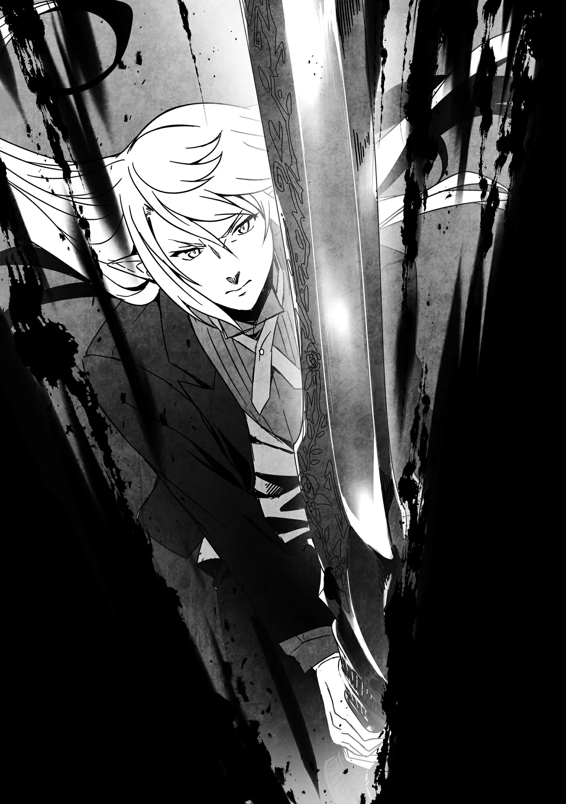

# Chương 194: Tập 8 Chương 4 - Giải Thích và Giải Quyết (2)

"Nó to hơn hẳn rồi đấy," Lorraine nói.

Con quái vật khổng lồ sừng sững ngay trước mắt, và so với lúc chúng tôi rời đi, nó lại to thêm một bậc. Trước đó nó cao tầm mười mét, nhưng giờ đã lên chừng mười một hoặc mười hai mét, bề ngang cũng bè ra hơn. Chỗ duy nhất không đổi là khuôn mặt Shumini ở ngay trên bụng nó.

Vừa thấy chúng tôi bước vào phòng, con quái vật đã gầm lên một tiếng vang dội, chói óc làm rung chuyển cả khu vực. Tôi chẳng còn cảm nhận được chút nhân tính nào từ con dã thú này nữa. Giờ nó thuần túy là một con quái vật, nên tôi cũng không phải chần chừ như khi đối đầu với kẻ địch dạng người. Mà nghĩ lại thì Goblin cũng tính là dạng người đấy thôi, có thấy tôi chùn tay bao giờ đâu. Tôi chỉ thấy gợn khi chứng kiến người ta bị biến thành quái vật như ngoài thị trấn lúc nãy thôi. Chứ lăn lộn làm mạo hiểm giả đủ lâu rồi, người ta cũng chẳng còn ngần ngại mấy chuyện đó nữa.

Con quái vật cá sấu đứng thẳng lao về phía chúng tôi nhanh đến không ngờ so với cái thân hình đồ sộ của nó, rồi ngoác rộng chiếc mồm đỏ lòm. "Mọi người tản ra!" Laura hô lên, và cả nhóm lập tức dạt sang hai bên phòng. Thật ra dù cô bé không nhắc thì chúng tôi cũng làm vậy, bởi ai cũng thừa hiểu không được biến mình thành miếng mồi ngon cho nó.

Trận chiến bắt đầu.

◆◇◆◇◆

Isaac là người mở màn. Con quái vật rít lên chói tai như muốn làm sụp cả căn phòng ngầm, nhưng Isaac vẫn lao thẳng tới mà không hề sợ hãi. Hoặc có khi trong lòng anh cũng đang sợ thật. Đứng trước một sinh vật khổng lồ, lì đòn và đầy sức mạnh thế này, cảm xúc trong anh hẳn đang giằng xé dữ dội, pha lẫn nỗi xót xa khi phải xuống tay tiêu diệt một người quen cũ, thậm chí từng là bạn bè. Lúc này tôi chưa thể tìm hiểu cặn kẽ vì sao Shumini lại vứt bỏ mạng sống để tạo ra mê cung này rồi làm Chủ Nhân Mê Cung, nhưng biết đâu Isaac đã lờ mờ hiểu được. Nghĩ rằng những gì Shumini làm chỉ là vô ích, anh siết chặt chuôi kiếm, tự trách mình đã không ngăn nổi bạn. Tôi nhìn vào thì thấy vậy, nhưng cũng có khi là do mình nghĩ quá nhiều thôi.

Dù sao thì Isaac cũng vừa nhanh vừa tấn công dồn dập. Trước một đối thủ to lớn dị thường, tốc độ của anh ngỡ như không cần thiết đến thế, nhưng con quái vật cũng chẳng hề ỳ ạch cậy xác. Trái lại, nó xoay trở khá linh hoạt so với thân hình đồ sộ, và chỉ cần lơ là một chút thôi là Isaac có thể bị nó ngoạm trọn ngay. Chiếc đuôi dài ngoằng dẻo quẹo của nó cũng quất loạn xạ tứ phía hòng đánh trúng chúng tôi. Rất khó để áp sát, nhưng Isaac đã căn chuẩn từng khoảnh khắc né đuôi rồi dần dần rút ngắn khoảng cách với con quái vật cá sấu.

Vừa vào tầm đánh, Isaac lập tức vung thanh đại kiếm đỏ như máu. Nhát kiếm vừa chém xuống, con quái vật cá sấu đã rú lên một tiếng chát chúa nhức óc. Nó quay ngoắt sang Isaac, há toác cái mõm khổng lồ. Isaac giật mình nhảy lùi lại đúng lúc từ miệng nó bắn ra một luồng sáng. Thứ đó nhìn giống tia laser hơn là hơi thở lửa, quét qua thiêu rụi mặt sàn và để lại một vệt đất đá tan chảy. Trúng một phát đấy chắc người tôi thủng một lỗ lớn. Cơ mà chắc vẫn chưa giết nổi tôi đâu. Trừ phi nó bắn trúng đầu. Lúc đó thì nguy to thật đấy.

Có điều dường như nó không thể xả chiêu đó liên tiếp. Thay vào đó, con quái vật ngậm mồm lại rồi lao bổ về phía Isaac toan đè bẹp anh. Đôi mắt đỏ ngầu vằn tia máu của nó trừng trừng găm vào anh. Có lẽ ký ức thời còn là Shumini vẫn còn chút ảnh hưởng, nên trông nó cứ chăm chăm nhắm vào mỗi Isaac. Thấy cũng tội cho anh thật, nhưng ít ra nhờ vậy mà đường đi nước bước của nó lại dễ đoán hơn.

Lorraine dường như cũng nhận ra điều đó nên đã bắt đầu cất giọng niệm một ma pháp uy lực với câu chú khá dài. Thế tức là phần việc của tôi là phải kìm chân con quái vật. Tôi lập tức lao về phía con quái vật cá sấu. Chiếc đuôi quất túi bụi cản đường tôi, nhưng vì chỉ mải nhắm vào Isaac nên đòn thế của nó lộ rõ sơ hở. Tôi không mất nhiều công sức để áp sát rồi vung thanh kiếm đã tích đầy Ma Lực.

Lớp da của con quái vật rất khó xuyên thủng, nhưng không phải là không thể. Lưỡi kiếm của tôi rạch qua lớp da, và tôi cảm nhận rõ nó ngập vào thớ thịt bên dưới. Vết thương không sâu lắm, nhưng dù sao đây mới là đòn mở màn. Tôi còn đang phân vân nên bồi thêm nhát nữa hay rút lui thì con quái vật đã nhận ra vừa bị chém, lập tức bổ cái đầu hộ pháp tới toan húc tôi. Tôi chọn phương án hai, né được cú húc đầu của nó.

Tôi nhảy phắt lên đầu nó, chém thẳng xuống hộp sọ. Khác với lúc nãy, nhờ nhồi thêm một lượng lớn Ma Lực, tôi cảm nhận rõ lưỡi kiếm lướt ngọt vào bên trong. Hao tổn Ma Lực như thế không hề nhỏ, nhưng kiểu gì tôi cũng phải chém thủng được con quái vật này. Có hiệu quả thế này thì cũng hoàn toàn bõ công.

Tôi cứ ngỡ đâm thủng đầu là kết liễu được nó rồi, nhưng ý nghĩ đó chỉ thoáng qua trong chớp mắt. Con quái vật cá sấu rú lên một thứ âm thanh nửa như thét gào, nửa như gầm gừ đe dọa, cả thân hình đồ sộ của nó rung chuyển dữ dội. Biết tỏng nó đang muốn lắc mình hất văng tôi, tôi quyết định chiều ý nó mà nhảy luôn xuống. May thay lưng nó chỉ dốc đứng chứ không thẳng tuột, nên tôi vẫn kịp trượt xuống dưới.

Tôi vừa dãn ra được một khoảng cách an toàn thì Lorraine cũng hoàn tất câu chú, phóng ra một cơn lốc sấm sét từ cây đũa phép của cô. Đó là ma pháp cao cấp mang tên Barrack Ceara, uy lực thừa sức thiêu rụi cả trăm con Goblin. Đây là một trong những ma pháp thuộc hàng mạnh nhất của Lorraine. Dù là quái vật khổng lồ đi nữa thì dính trọn đòn này cũng đừng mong lành lặn.

Luồng ma pháp xé toạc cơ thể con quái vật cá sấu, sấm sét đánh thẳng vào tận lục phủ ngũ tạng của nó. Đòn sấm kéo dài hơn mười giây, khiến cả căn phòng nồng nặc mùi thịt cháy khét lẹt. Cảnh tượng có phần gớm ghiếc, nhưng quái vật cỡ này mà không dùng đòn nặng đô thế thì chắc nó chẳng buồn gục ngã.

Đến khi sấm sét dứt hẳn, trước mắt chúng tôi chỉ còn trơ lại một tảng thịt cháy đen khổng lồ. Tôi thầm nghĩ không biết nó đã chết chưa, nhưng cũng chẳng phải đợi lâu để có câu trả lời.

"Vẫn chưa xong đâu!" Laura hô lên đúng lúc con quái vật cá sấu bắt đầu tái tạo. Da thịt nó liền lại như thể thời gian đang quay ngược, và cuối cùng trở về y nguyên trạng thái ban đầu.

"Chà, tôi cũng chẳng dám mong mọi chuyện dễ ăn thế," tôi lẩm bẩm.

"Nhưng có vẻ đòn vừa rồi ít nhất cũng đả thương được nó đôi chút," Isaac đã đứng cạnh tôi từ lúc nào lên tiếng. Anh chỉ vào một chỗ trên thân con quái vật vẫn chưa kịp hồi phục.

"Chắc cứ cố thêm chút nữa là hạ được nó thôi."

"Vâng."

Chúng tôi lại tiếp tục lao vào tấn công con quái vật cá sấu.

◆◇◆◇◆

Chẳng biết do đòn đánh vừa rồi hay vì lý do gì khác, con quái vật bỗng hạ thấp người xuống, bò bằng cả bốn chân. Vốn dĩ trông nó đã giống một con cá sấu khổng lồ, nên tư thế này nhìn tự nhiên hơn hẳn. Cơ mà nếu tưởng nó giống cá sấu thường mà dễ ăn thì chắc chắn sẽ bị nó đánh úp cho trở tay không kịp, nên tôi lập tức thủ thế đề phòng. Mười năm kinh nghiệm dạy tôi lúc nào cũng phải thận trọng, dù ba người kia cũng chẳng ai lơ là.

Con quái vật bắt đầu chuyển động. Lúc đứng thẳng nó đã chẳng chậm chạp gì, nhưng có vẻ tư thế này mới hợp với nó nhất. Nó trườn lướt trên sàn rồi xoay tít, chiếc đuôi quất vun vút nhanh hơn lúc nãy rất nhiều. Tôi thật sự muốn hỏi ban đầu nó đứng thẳng làm cái trò gì không biết, cơ mà chắc chỉ có nó mới hiểu, mà tôi thì cũng chẳng mong nó trả lời.

Isaac và tôi cố áp sát chém con quái vật, nhưng chẳng ăn thua. Nó thoăn thoắt né đòn của chúng tôi bằng cách lăn mình sang một bên.

"Tránh xa nó ra!" Laura hét lên.

Chúng tôi vừa dạt ra thì một quả cầu đen đã xuất hiện ngay phía trên con quái vật. Nhìn nó y hệt hố đen Laura từng dùng lên con Lizardman ngoài hành lang, nhưng quả cầu này dường như lại mang tác dụng hoàn toàn khác. Nó không nén con quái vật vào tâm điểm. Do không thể làm thế hay đơn giản là cô bé không muốn, tôi cũng chịu. Vừa xuất hiện, quả cầu đã đè nghiến con quái vật xuống sàn. Tôi nghe thấy tiếng răng rắc và thấy mặt đất hơi lún xuống, hẳn là quả cầu đang dằn nó xuống với một áp lực kinh hồn.

Nhận thấy cơ hội tấn công đã đến, Isaac và tôi nhìn nhau rồi cùng lao về phía con quái vật. Ngay khi chúng tôi áp sát trước mặt nó, Laura liền giải trừ quả cầu đen. Có lẽ ma pháp của cô bé gây ảnh hưởng lên mọi thứ trong một bán kính nhất định, nên cô bé đã hủy nó trước khi chúng tôi bước vào tầm tác động. Đã cận kề thế này thì không thể trượt được nữa. Isaac và tôi cùng vung kiếm chém xuống, và không như lúc nãy, cả hai chúng tôi đều đánh trúng đích.

Isaac chém toạc một mắt của con quái vật, khiến nó rú lên đau đớn rồi quằn quại lăn lộn. Thân hình nó quá đồ sộ nên mỗi vòng lăn đều làm rung chuyển cả căn phòng. Đoán rằng nó sẽ sớm hồi phục, nhưng nếu tiếp tục dồn ép thì vẫn có thể gây thêm nhiều tổn hại, chúng tôi lập tức đuổi theo. Thế nhưng vừa đuổi tới nơi thì nó bỗng ngừng lăn hẳn.

Phần bụng của nó phơi thẳng về phía chúng tôi. Nhìn kỹ vào khuôn mặt Shumini, tôi thấy đôi mắt vốn nhắm nghiền nãy giờ đã mở to, trừng trừng gườm chúng tôi. Miệng gã mấp máy như đang niệm chú. Dù không nghe được trọn câu, Isaac và tôi vẫn kịp bắt được đoạn cuối cùng.

"Địa Ngục Hỏa," Isaac thốt lên đúng lúc một ma pháp trận khổng lồ hiện rõ trên mặt sàn.

Ma pháp trận lớn đến mức bao trùm cả căn phòng, và với phạm vi khủng khiếp nhường ấy thì tình thế của chúng tôi chẳng mấy êm đẹp rồi. Isaac, Laura với tôi thì có khi còn gượng được, chứ Lorraine thì tôi không dám chắc. Tôi toan lao lại chỗ cô thì bắt gặp cô đang nhìn chúng tôi mỉm cười. Trông bộ dạng ấy thì chắc cô chẳng hề hấn gì đâu. Ma thuật vốn là ngón nghề tủ của Lorraine, đụng tới mấy trò niệm chú này thì tôi lo cho cô chỉ tổ thừa. Giờ tôi lo cho cái thân mình trước thì hơn.

Ngặt nỗi trong căn phòng này thì làm gì có chỗ nào để trốn. Tôi đành dựng một lớp Khiên Chắn quanh người rồi vận Khí Lực cường hóa thân thể. Giờ thì chí ít cũng giữ được mạng.

Vừa chuẩn bị xong thì ma pháp trận bừng sáng cùng một tiếng gầm vang trời. Biển lửa hừng hực nuốt chửng toàn bộ căn phòng. Xung quanh tôi biến thành một màu trắng xóa điểm sắc đỏ thẫm, phá nát Khiên Chắn của tôi. Ngọn lửa táp thẳng vào da thịt, nhưng nhờ có Khí Lực nên cũng không đến mức quá tệ. Thật may là xưa nay tôi đã khổ luyện chăm chỉ. Mặt tôi vẫn đau rát, nhưng lớp khiên đã giúp tôi không phải chịu trận quá lâu.

Lửa tắt, cảnh vật xung quanh dần lấy lại màu sắc. Tôi kiểm tra lại người thì thấy chỗ nào không được áo choàng che đều bị bỏng nặng. Kỳ lạ là chiếc áo choàng lại chẳng hề bị cháy sém chút nào. Các vết bỏng cũng lành lại chỉ sau chưa đầy một phút.

Cả căn phòng bị thiêu cháy đen thui. Dù vậy Laura vẫn bình an vô sự, còn Lorraine xem chừng cũng chẳng hề hấn gì. Isaac thì nhìn như một cái xác chết cháy thành than, nhưng anh lập tức tái tạo lại ngay trước mắt tôi. Tôi đã thấy vết thương của mình tự lành nhiều lần rồi, nhưng giờ đứng ở góc nhìn của người ngoài mà xem thì trông gớm ghiếc thật sự. Chớp mắt một cái, anh đã trở lại vẻ bảnh bao thường ngày. Quần áo của anh cũng từng bị thiêu rụi, thế mà giờ lại lành lặn trên người. Tôi tự hỏi làm sao mà được như thế, nhưng lúc này chuyện đó chẳng quan trọng.

Tôi đảo mắt tìm con quái vật thì thấy nó đang bám chặt trên trần nhà, trừng trừng nhìn chúng tôi. Nó thở dốc hồng hộc, có vẻ đã kiệt sức sau đòn vừa rồi. May mà nó không tung cùng một phép liên tiếp được, chứ không thì tôi toi mạng chắc. Laura với Lorraine trông vẫn chịu được, nhưng Isaac mà cứ bị nướng thành than hết lần này tới lần khác thì chắc cũng gay go. Đã đến lúc kết thúc chuyện này rồi.

Cái trò liên tục tái tạo của nó đúng là phiền toái, nhưng chúng tôi cứ phải đánh dồn dập cái đã. Không ăn thua thì tới lúc đó hẵng tính tiếp. Giờ đã nắm được phần lớn ngón nghề của nó, chúng tôi hoàn toàn có thể chấp nhận chút mạo hiểm. Có khi tôi hơi lạc quan quá, nhưng để trận chiến dây dưa kéo dài thì còn rủi ro hơn nhiều. Đáng để thử một phen.

Tôi bắt đầu lao lên. Lorraine giáng một ma pháp sấm sét vào con quái vật, đánh trúng khiến nó rớt từ trần nhà xuống. Giờ đến lượt tôi, ngặt nỗi tôi vẫn chưa nghĩ ra cách nào trị một kẻ địch cứ liên tục hồi máu tái tạo. Dù vậy theo quan sát của tôi, thể lực và khả năng hồi phục của con quái vật này đâu phải vô hạn. Ngay cả Ma Cà Rồng cũng chẳng thể tái tạo mãi mãi, nên nếu năng lực phục hồi của nó bắt nguồn từ Shumini thì chắc chắn không thể kéo dài vĩnh viễn. Lúc nãy cũng có những chỗ trên người nó chưa lành lặn hoàn toàn, chứng tỏ nhiều khả năng nó còn chẳng hồi phục bằng một Ma Cà Rồng thực thụ. Tôi quyết định chọn cách đơn giản nhất: cứ thế mà lao vào đánh tiếp.

Isaac và tôi liên tục vung kiếm chém tới tấp vào con quái vật. Chúng tôi chia nhau người đánh đầu kẻ đánh đuôi, phần vì chưa thống nhất được một mục tiêu chung, phần vì đứng sát cạnh Isaac thì rất gò bó do cây đại kiếm của anh. Ban đầu tôi chưa rõ ai nên lo góc nào, nhưng Isaac đã nhanh chóng chọn phần đầu. Đó là khu vực nguy hiểm hơn, nhưng với thực lực của anh thì đó là quyết định hoàn toàn chuẩn xác. Trong căn phòng này, tôi nhiều khả năng là kẻ yếu nhất. Dạo này tôi có mạnh hơn trước đôi chút thật, nhưng điều đó đâu ngăn được việc tôi trở thành mắt xích yếu nhất trong một tổ đội. Trong nhóm này thì đúng là tôi đội sổ, chứ ở phần lớn các tổ đội khác thì chí ít tôi cũng thuộc dạng khá khẩm. Hoặc ít ra tôi hy vọng là vậy. Mà thôi, bàn về cái sự thiếu tự tin của bản thân bấy nhiêu là đủ rồi.

Dù sao thì Isaac lo tấn công phần đầu, còn tôi vòng ra sau chém vào nửa thân dưới của nó. Đòn đánh của chúng tôi chuẩn xác hơn trước rất nhiều nhờ con quái vật đã chậm đi trông thấy. Nó vẫn đang tái tạo, nhưng sinh lực đã cạn dần. Tôi đoán đó là lý do nó không thể di chuyển nhanh như lúc đầu nữa. Có điều những cú quất đuôi của nó vẫn cực kỳ ghê gớm. Hiện tại tôi vẫn còn né được tương đối ổn, nhưng dính trọn một đòn đó thì bay người như chơi.

"Rentt, Isaac!" Lorraine hét lên.

Cô vừa niệm xong ma pháp. Cảm nhận được luồng ma thuật sau lưng, Isaac và tôi vội dạt sang bên. Hàng chục ngọn Băng Thương thanh mảnh ồ ạt phóng tới cắm phập vào con quái vật. Chúng không chỉ găm ngập vào da thịt mà còn làm đông cứng những chỗ bị đâm trúng, giam hãm nó trong một khối băng dày. Giờ con quái vật đã hoàn toàn bất động, Laura liền chạy tới trèo lên lưng nó. Cô bé chĩa tay xuống người nó, phóng một quả cầu đen vào thẳng cơ thể nó.

Tôi cứ ngỡ nó sẽ bị nén bẹp dí như con Lizardman lúc nãy, nhưng sự việc lại diễn ra hoàn toàn trái ngược. Ban đầu là một tiếng nổ chát chúa, kế đó lớp băng vỡ vụn và thân xác con quái vật nổ tung thành trăm mảnh. Những tảng thịt của nó văng tung tóe khắp căn phòng. Tôi đinh ninh nó không thể nào gượng dậy nổi sau đòn đó, thế nhưng những mẩu thịt vụn trên sàn bỗng bắt đầu trườn đi, cố tụ lại một chỗ. Chúng dịch chuyển cực kỳ chậm chạp, dĩ nhiên chẳng đời nào hồi sinh ngay được, nhưng tôi có linh cảm nếu không làm gì thì các mảnh thịt kia sẽ lại ráp nối vào nhau.

"Đốt hết mấy mảnh thịt này đi thôi," Laura nói.

Chúng tôi tiếp cận những tảng thịt lớn nhất trước, thiêu rụi chúng thành tro. Đến khi Isaac bước lại gần một tảng thịt to khác thường, anh khẽ nhăn mặt. Đó chính là phần bụng mang khuôn mặt của Shumini. Gã dường như vẫn còn chút ý thức riêng, đôi mắt đang nhìn về phía Isaac. Không hề có chút oán thù nào trong ánh mắt ấy, mà ngỡ như gã đang nhìn một người bạn tri kỷ.

"Shumini, rốt cuộc cậu đã lầm đường từ lúc nào vậy?" Isaac cất tiếng hỏi, nhưng Shumini không trả lời. Gã chỉ khẽ mỉm cười nhìn Isaac. Là do không còn nói được nữa hay đơn giản là chẳng buồn bận tâm, điều đó chỉ mình Shumini biết. Nhưng Isaac biết rõ việc mình phải làm. Anh giơ cao thanh đại kiếm đẫm máu, thứ vũ khí tương phản rõ rệt với diện mạo quý tộc của anh. "Vĩnh biệt," anh nói, rồi chém đôi khuôn mặt từng thuộc về Shumini. Gã không hề gào thét hay nguyền rủa anh. Hai nửa bị chém lìa lặng lẽ tan biến thành tro tàn.

Như thể đó chính là hạt nhân của con quái vật, những tảng thịt còn lại cũng đồng loạt hóa thành tro bụi. Chuyện này giúp chúng tôi đỡ mất công thiêu từng mảnh, nhưng nét mặt Isaac chẳng có vẻ gì là vui mừng. Hẳn trong lòng anh đang ngổn ngang trăm mối. Tôi không ở vào vị thế có thể lên tiếng, nên chỉ biết lặng lẽ đứng nhìn.

Một lát sau, dường như Isaac đã trấn tĩnh lại được cảm xúc. "Chúng ta đã hạ được Shumini rồi. Giờ chẳng phải nên đi tìm Lõi Mê Cung sao, thưa tiểu thư?" Isaac hỏi Laura.

Cô bé khéo léo tránh nhắc tới những gì Isaac vừa làm. "Phải, chắc nó ở quanh đây thôi. Chúng ta tiến sâu vào trong thôi," cô bé nói.

Chỉ có một lối đi duy nhất dẫn sâu vào mê cung. Lõi Mê Cung chắc chắn nằm ở hướng đó. Chúng tôi liền cất bước đi theo con đường.
