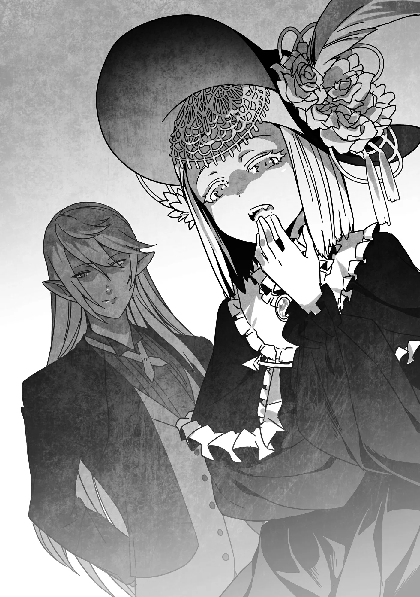

# Chương 195: Tập 8 Chương 4 - Giải Thích và Giải Quyết (3)

"Có vẻ chính là nơi này rồi," Laura nói.

Chúng tôi đang đứng trước một cánh cửa màu xanh lam. Tôi cảm nhận được một áp lực kỳ quái tỏa ra từ nó. Khác với cánh cửa dẫn vào căn phòng của Shumini, cánh cửa này không quá to lớn đồ sộ, nhưng tôi vẫn cảm thấy một luồng năng lượng lạ lùng khi đứng trước mặt nó. Có lẽ tôi đang cảm nhận được sự hiện diện của Lõi Mê Cung.

"Mọi người đã sẵn sàng chưa? Tôi sẽ mở nó ra đây," Laura nói.

Khi chúng tôi gật đầu, cô bé đặt một tay lên cánh cửa. Cửa mở ra dễ dàng hơn tôi tưởng nhiều. Và rồi chúng tôi trông thấy những gì nằm phía sau nó.

"Thật ngoài dự tính," cô bé lẩm bẩm.

Tại đó, chúng tôi tìm thấy một quả cầu đen đúng như Laura đã miêu tả, nhưng nó lại bị vùi sâu vào bàn tay trái của Rina Rupaage.

◆◇◆◇◆

"Sao Rina lại ở đây?!" tôi buột miệng thốt lên.

Laura dời mắt khỏi Rina rồi nhìn sang tôi. "Ngài quen cô ấy sao?" cô bé hỏi.

"Đúng vậy, cô ấy là một mạo hiểm giả mới vào nghề mà tôi đã gặp trong mê cung. Không có cô ấy, tôi thậm chí còn chẳng thể bước chân vào thị trấn."

Nếu Rina không chấp nhận tôi và nhìn nhận mọi chuyện một cách tích cực như vậy, tinh thần của tôi có lẽ đã suy sụp từ lâu. Ở cạnh cô gái ấy, người ta rất dễ giữ được sự lạc quan. Và dù mới chập chững bước vào nghề mạo hiểm giả, kiếm thuật của cô ấy vẫn rất sắc bén và tràn đầy tiềm năng.

"Rốt cuộc chuyện quái quỷ gì đang diễn ra ở đây vậy?" tôi hỏi. "Quả cầu đen trên tay cô ấy là Lõi Mê Cung sao?" Tôi cũng rất muốn biết liệu Rina có an toàn hay không.

"Đúng vậy," Laura căng thẳng trả lời. "Đó chắc chắn là Lõi Mê Cung. Nhưng nói một cách chính xác hơn thì nhiều khả năng cả Rina lẫn quả cầu đều đang đóng vai trò là Lõi Mê Cung."

"Vậy Rina sẽ ra sao? Cô ấy có thể cứu được không?"

"Trước tiên, tôi phải kiểm tra xem Rina có còn là con người hay không đã."

Nghe vậy chúng tôi đều sửng sốt, nhưng rõ ràng Rina đã bị Shumini bắt cóc. Dù vậy, tôi không rõ chuyện đó xảy ra vào lúc nào. Raiz và Lola cùng tổ đội với cô ấy, nhưng lúc trước tôi chưa có nhiều cơ hội để trò chuyện với họ. Chắc hẳn hai người họ đã tới đây để tìm Rina rồi cũng bị bắt giữ.

Hơn nữa, Shumini vốn là một Thượng Cấp Ma Cà Rồng. Tôi không biết chính xác những gì đã xảy ra, nhưng nếu Rina ở đây trong vai trò là Lõi Mê Cung, có lẽ Shumini đã bắt cô ấy phải tuân theo mệnh lệnh của gã. Nếu quả thực như vậy, biến cô ấy thành quyến thuộc của mình sẽ là cách nhanh nhất để làm được điều đó.

Laura đợi chúng tôi ngẫm ra kết luận đó rồi mới tiếp tục. "Nếu cô ấy không còn là con người, chúng ta sẽ phải giải quyết vấn đề đó trước, và việc này sẽ mất một chút thời gian. Nhưng xin chớ lo lắng. Dù có chuyện gì xảy ra đi nữa, tôi vẫn có thể giúp Rina trở lại là chính mình," Laura nói.

Nghe vậy tôi thở phào nhẹ nhõm vô cùng. Tôi không biết Laura rốt cuộc là ai hay là sinh vật gì, nhưng tôi tin cô bé có thể làm được những gì mình đã nói.

Laura tiến lại gần Rina rồi chạm vào cô ấy. Rina khẽ cựa quậy. Cô gái đang lơ lửng giữa không trung nên chuyển động trông có phần kỳ dị. Lẽ dĩ nhiên, Laura không để Rina tuột khỏi tay mình mà nắm chặt lấy cánh tay cô ấy. Đoạn, Laura dùng móng tay rạch một vết lên cánh tay Rina. Cô bé nhìn vết máu, đôi mắt chợt lóe lên sắc đỏ trong thoáng chốc. "Ấy chết," cô bé thì thầm, và đôi mắt lại trở về màu xanh da trời. Laura nhìn vết cắt thêm vài giây, rồi vết thương biến mất. Tốc độ hồi phục đó chậm hơn so với tôi hay Isaac, nhưng chẳng một con người bình thường nào có thể tái tạo nhanh đến mức ấy.

"Quả nhiên là vậy. Hắn đã biến Rina thành quyến thuộc của mình," Laura nói.

"Vậy Rina là một Thi Quỷ sao?" tôi hỏi. Khi Ma Cà Rồng tạo ra quyến thuộc, thường thì đó sẽ là Thi Quỷ. Về sau chúng có thể tiến hóa thành Hạ Cấp Ma Cà Rồng, nhưng Hạ Cấp Ma Cà Rồng được cho là không thể tạo ra ngay từ đầu.

Nhưng Laura lắc đầu. "Không, Rina dường như là một Hạ Cấp Ma Cà Rồng. Tôi không thấy dấu hiệu hoại tử nào trên cơ thể cô ấy, và dẫu không phải thật, cô ấy vẫn có dòng máu tuần hoàn mô phỏng."

"Nhưng tôi cứ nghĩ Ma Cà Rồng không thể trực tiếp tạo ra Hạ Cấp Ma Cà Rồng chứ," Lorraine chỉ ra. "Dù sao thì người ta vẫn nói như vậy mà." Là một nhà nghiên cứu ma vật, chuyện này hẳn phải khiến cô vô cùng hứng thú.

"Việc đó tiêu tốn rất nhiều năng lượng, nhưng thực tế một số Ma Cà Rồng vẫn có khả năng tạo ra Hạ Cấp Ma Cà Rồng. Tuy nhiên, họ chỉ có thể làm điều đó một hoặc hai lần trong đời. Cách này thường chỉ dùng cho bạn đời hoặc người mà họ đặc biệt yêu thích. Dù khó lòng tin rằng Shumini lại có tình cảm kiểu đó với Rina, nhưng tôi đoán đây là bước bắt buộc để kết nối cô ấy với Lõi Mê Cung. Như tôi đã nói lúc trước, việc kiểm soát Lõi Mê Cung đòi hỏi phải có một mức độ sức mạnh nhất định. Một con người bình thường hay một Thi Quỷ sẽ khó lòng kham nổi. Chỉ có Hạ Cấp Ma Cà Rồng mới miễn cưỡng làm được điều đó."

"Tại sao gã không tự mình kiểm soát nó luôn đi?" tôi hỏi.

"Chủ Nhân Mê Cung phải chịu một số hạn chế nhất định. Tôi đoán gã muốn tránh những điều đó. Để một quyến thuộc làm thay cho phép gã thao túng mê cung mà không vướng phải các giới hạn ấy, vì vậy đó là một quyết định hợp lý. Phương pháp này đã được sử dụng từ thời xa xưa rồi."

"Từ thời xa xưa ư?" Lorraine bối rối lặp lại, nhưng Laura không giải thích thêm.

"Dù sao đi nữa, việc để cô ấy tiếp tục làm quyến thuộc của Shumini sẽ gây rắc rối cho chúng ta," Laura nói. "Ngay cả khi chủ nhân đã chết, quyến thuộc của Ma Cà Rồng ở chừng mực nào đó vẫn phải tuân theo ý chí của họ. Sau khi chúng ta tước bỏ vai trò Chủ Nhân Mê Cung của cô ấy, tôi không dám đảm bảo cô ấy sẽ không tiếp tục thực hiện mưu đồ của Shumini. Hãy giải thoát cho cô ấy."

Nếu không gây hại gì cho ai thì trông thấy Rina hành xử như Shumini có lẽ cũng khá buồn cười, nhưng rõ ràng chuyện đó sẽ làm hại tới người dân Maalt. Bản thân Rina chắc chắn cũng chẳng đời nào muốn làm một việc như thế.

"Nhưng bằng cách nào chứ?" tôi hỏi. "Làm gì có cách nào biến một Thi Quỷ trở lại thành con người. Cớ sao lại có cách làm được điều đó với Ma Cà Rồng?" Và nếu thực sự có cách, tôi sẽ muốn thử nghiệm lên chính bản thân mình trước tiên. Xét cho cùng, mục tiêu tối thượng của tôi chính là trở lại làm người mà.

"Tôi nói mình có thể biến Rina trở lại làm người từ khi nào thế?" Laura hỏi lại.

"Hả? Nhưng cô bé vừa bảo sẽ cứu cô ấy mà."

"Đúng vậy, nhưng điều đó không đồng nghĩa với việc biến cô ấy trở lại làm người. Lẽ dĩ nhiên tôi sẽ làm nếu có thể, nhưng tôi chịu thôi. Tất cả những gì tôi làm được là giải thoát cho cô ấy khỏi thân phận quyến thuộc của Shumini."

Tôi chẳng biết nên cảm thấy thế nào về chuyện đó nữa. Cô ấy sẽ không phải tuân theo mệnh lệnh của Shumini và làm những điều mình không muốn, nhưng cô ấy vẫn sẽ mắc kẹt trong hình hài phi nhân loại. Tôi hiểu rõ cảm giác đó bởi bản thân cũng từng trải qua, và nó đã để lại trong tôi biết bao nỗi u uất ngậm ngùi. Đối với Rina, tôi e rằng điều này sẽ vô cùng khó khăn. Nhưng nghe chừng Laura cũng chẳng thể làm gì hơn. Nếu đã vậy, ngăn không để ý chí của Shumini khống chế cô ấy là điều tối thiểu chúng tôi có thể làm.

"Chúng ta có thể giải thoát Rina khỏi sự khống chế của Shumini bằng cách nào?" Lorraine hỏi. "Tôi nghe nói một khi đã trở thành quyến thuộc của Ma Cà Rồng, họ sẽ bị trói buộc như thế suốt cả cuộc đời."

"Hoàn toàn có thể thay đổi được điều đó, chỉ là bản thân họ không thể tự mình làm được thôi," Laura trả lời. "Tôi cũng không nắm rõ toàn bộ các quy tắc liên quan đến việc này, nhưng giữa các Ma Cà Rồng với nhau thì không được phép nhòm ngó quyến thuộc của người khác. Chính vì lẽ đó mà các Ma Cà Rồng quyến thuộc rốt cuộc phải phục vụ một chủ nhân duy nhất mãi mãi, nhưng trên thực tế, một Ma Cà Rồng vẫn có thể đoạt lấy quyến thuộc của kẻ khác về cho riêng mình."

Nói cách khác, chỉ cần một người khác nhận Rina làm quyến thuộc của mình. Cụ thể hơn, một Ma Cà Rồng khác sẽ phải ra tay thực hiện điều đó. Điều này đồng nghĩa với việc chúng tôi phải đề cập đến một chuyện mà bấy lâu nay chưa từng được đem ra chất vấn.

"Tôi dám chắc mọi người đều đã nhận ra rồi. Cả tôi và Isaac cũng đều là Ma Cà Rồng. Đó là lý do tại sao tôi biết tất cả những điều này," Laura thản nhiên nói. Chuyện đó vốn đã quá đỗi rõ ràng, nên có lẽ cô bé cũng chẳng buồn che giấu nữa.

"Cô bé cũng biết chuyện về tôi rồi sao?" tôi ướm hỏi.

"À thì, phải rồi. Thứ máu đó có ích cho ngài lắm, đúng không?"

Ý cô bé là lọ máu Ma Cà Rồng mà cô bé từng đưa cho tôi trước đây. Hóa ra cô bé đã biết từ tận hồi đó, và đó là lý do cô bé mang thứ máu ấy ra cho tôi xem. Diễn xuất của cô bé tự nhiên đến mức suốt bấy lâu tôi chẳng hề hay biết gì.

"Ừm, tôi cũng muốn nói thêm về chuyện đó lắm, nhưng hiện tại chúng ta hãy tập trung vào Rina trước đã," tôi nói.

"Đúng vậy. Dù sao thì, nếu một Ma Cà Rồng khác nhận Rina làm quyến thuộc, rắc rối đó sẽ được giải quyết. Vấn đề còn lại chỉ là ai nên làm việc này thôi. Ngài Rentt, tôi nghĩ tốt nhất là ngài nên làm."

"Tôi đoán mình có thể làm được. Dù vậy, tôi chưa từng làm chuyện đó bao giờ cả," tôi đáp lời, nhưng chú chuột trên vai liền gõ cồm cộm lên đầu tôi. "À thì, tôi mới chỉ làm chuyện đó với một con Puchi Suri thôi. Và đó cũng chỉ là tình cờ ngẫu nhiên, nên tôi chẳng biết mình phải làm gì nữa."

"Chúng tôi sẽ giúp ngài việc đó."

"Chẳng phải sẽ dễ thành công hơn nếu cô bé hoặc Isaac làm chuyện này sao?"

Nếu lỡ tay làm hỏng, tôi sẽ chẳng bao giờ tha thứ được cho chính mình. Tương lai phía trước của Rina còn dài, và tôi không hề muốn hủy hoại tương lai đó. Dẫu rằng, tôi không rõ một tương lai ra sao đang chờ đón cô ấy trong hình hài Ma Cà Rồng. Nhưng bản thân tôi cũng ở trong hoàn cảnh tương tự và tôi thực sự chẳng muốn bận tâm nghĩ ngợi nhiều về điều đó. Ít nhất thì, tôi vẫn chưa hề từ bỏ bất cứ điều gì.

"Không, làm vậy không được đâu," Laura nói.

"Tại sao chứ? Cả hai người đều mạnh hơn tôi rất nhiều mà."

"Điều đó không sai, nhưng cũng chẳng hoàn toàn đúng. Cả tôi lẫn Isaac đều là Ma Cà Rồng, nhưng ngài thì hơi khác một chút, ngài Rentt ạ. Sự khác biệt đó nhiều khả năng sẽ định đoạt chuyện sống còn của Rina."

"Tôi khác biệt sao? Ý cô bé là tôi không phải Ma Cà Rồng ư?"

"À thì, về chuyện đó—" Laura đang nói thì bị ngắt lời bởi một tiếng ầm ầm vang lên. Những bức tường đập thoi thóp dữ dội hơn và căn phòng bắt đầu phình rộng ra. "Chúng ta không còn thời gian nữa rồi. Nếu không hành động ngay, toàn bộ Maalt sẽ bị biến thành mê cung mất. Ngài Rentt, hãy gác lại chi tiết sang một bên và nhanh lên thôi."

"Nhưng tôi phải làm gì đây?"

"Hãy hút một ít máu của cô ấy, rồi truyền một lượng máu của ngài vào cơ thể cô ấy qua răng nanh. Đơn giản vậy thôi."

Tôi không rõ có phải vì đang vội hay không mà Laura chẳng giải thích tường tận gì nhiều. Tôi đoán mình không còn thời gian để gặng hỏi thêm chi tiết, bèn tiến lại gần Rina, vòng tay qua vai cô ấy và ghé miệng sát vào làn da cô. Tôi cắn xuống và cảm nhận làn da rách ra. Vị máu tràn vào miệng—một cảm giác đê mê ngây ngất—nhưng đây không phải lúc để nhấm nháp thưởng thức. Chuyên gia nếm rượu máu hôm nay không làm việc rồi.

Sau khi hút một ít máu, tôi tập trung tinh thần để truyền một phần máu của mình vào người cô ấy qua răng nanh. Tôi tự hỏi liệu cách này có hiệu quả hay không, nhưng thật bất ngờ, tôi đã có thể khiến máu chảy ra từ đầu răng nanh của mình. Dù vậy, tôi không rõ liệu mình làm thế đã đúng cách hay chưa. Tôi hút khoảng một phần mười lượng máu của Rina và truyền lại cho cô ấy một lượng máu tương đương của mình.

Giống như trải nghiệm với Edel dạo trước, tôi có cảm giác mình đã kết nối với một thứ gì đó, nhưng không được rõ ràng như lần trước. Có lẽ là do Rina đang bất tỉnh. Tôi lo lắng không biết mọi chuyện đã thành công hay chưa, bèn đưa mắt nhìn sang Laura.

"Mọi chuyện đều ổn thỏa rồi," cô bé nói. "Rina giờ đã là quyến thuộc của ngài. Bây giờ chỉ còn một việc cuối cùng nữa thôi." Laura nhìn chăm chú vào Lõi Mê Cung đang chìm sâu trong bàn tay Rina.

Hóa ra tôi thực sự có thể biến Rina thành quyến thuộc của mình, nhưng tôi hoàn toàn chẳng biết phải làm gì với Lõi Mê Cung. Người ta nói rằng có thể kiểm soát nó bằng cách chạm vào, nhưng Lõi Mê Cung này dường như đã dung hợp hoàn toàn với Rina. Điều đó dường như là bất khả thi để thay đổi bằng những phương thức thông thường.

"Chúng ta nên làm gì bây giờ?" tôi hỏi Laura.

"Chẳng có gì quá phức tạp đâu. Đơn giản là một ai đó phải tự mình hấp thụ Lõi Mê Cung vào cơ thể. Nhưng điều đó sẽ rất khó đối với ngài, ngài Rentt, còn Lorraine hay Isaac thì chắc chắn lại càng không thể làm được. Với một Lõi Mê Cung bình thường thì sẽ khác, nhưng tôi không thể chỉ cho ngài cách hấp thụ thứ này khi nó đã dung hợp với Rina. Tôi sẽ phải tự mình ra tay, nhưng giá như tôi có thêm một chút thời gian thì tốt biết mấy. Ngài Rentt, hãy nhìn sang bên này một lát."

Tôi nghiêng đầu quay sang nhìn Laura. Đột nhiên cô bé cào rách cổ tay mình, cạy miệng tôi ra và để máu tuôn vào bên trong. Tôi vô cùng kinh ngạc, nhưng cơn khát máu bẩm sinh của loài Ma Cà Rồng buộc tôi phải nuốt ực xuống. Trông thấy tôi đã nuốt trọn số máu đó, vẻ mặt Laura lộ rõ vẻ ăn năn sâu sắc.

"Tôi xin lỗi, nhưng thời gian gấp rút quá rồi. Tôi buộc phải hơi thô bạo một chút," cô bé nói rồi rút cánh tay ra khỏi tôi.

Lẽ dĩ nhiên, vết thương của cô bé lập tức lành lại ngay tức khắc. Khả năng tái tạo của cô bé còn nhanh hơn cả tôi hay Isaac. Cảnh tượng ấy trông chẳng khác nào một màn ảo thuật ma thuật. Tôi biết chúng tôi không còn thời gian vì thị trấn đang biến đổi thành một mê cung, nhưng tôi không hiểu tại sao Laura lại làm như vậy.

Laura bước tới chỗ Rina, cầm lấy cánh tay trái của cô ấy và chạm vào Lõi Mê Cung.

"Ngài Rentt, có rất nhiều điều tôi muốn giải thích cho ngài nghe, nhưng xem ra chuyện đó khó lòng thực hiện được rồi. Ít nhất tôi xin gợi ý rằng ngài hãy du ngoạn tới các đền thờ và di tích trên khắp thế giới để thu thập những truyền thuyết từ thời cổ đại. Điều đó sẽ giúp ngài tiến gần hơn tới mục tiêu của mình. Ngài cũng sẽ có thể vươn tới Mithril Cấp nữa, một mũi tên trúng hai đích," cô bé nói với tôi.

Tiếp đó, cô bé quay sang nhìn Lorraine. "Lorraine, tôi hy vọng cô có thể hỗ trợ ngài Rentt nếu được. Kiến thức uyên thâm của cô chắc chắn sẽ rất hữu ích. Và điều này có thể sẽ phiền toái đôi chút, nhưng nếu mọi chuyện rơi vào tuyệt vọng, tôi có thể giải quyết giúp cho hai người. Xin đừng suy nghĩ quá sâu xa về chuyện đó nhé," cô bé nói một cách lấp lửng.

Cuối cùng, cô bé nhìn sang Isaac. "Đây đã là lần thứ tư rồi. Tôi sẽ sớm chạm tới giới hạn của mình, vì vậy nhiều khả năng tôi sẽ phải chìm vào giấc ngủ trong một khoảng thời gian. Trong lúc đó, mọi chuyện nhờ cậy vào anh chăm lo nhé."

Dứt lời, Laura lại đưa mắt nhìn Lõi Mê Cung trên người Rina. Nó phát ra một luồng sáng u ám rồi lập tức bao bọc lấy Rina. Dường như nó không hề nhúc nhích dịch chuyển, nhưng Laura đã dần dần hấp thụ nó vào cơ thể mình. Khi toàn bộ ánh sáng đã được hút trọn vào lồng ngực Laura, Lõi Mê Cung liền biến mất. Rina không còn lơ lửng nữa và ngã xuống sàn. Dù không hiểu tường tận từng chi tiết, nhưng tôi đoán Lõi Mê Cung đã được chuyển giao sang Laura.

Trông Laura như sắp sửa ngã quỵ, tôi liền định chạy tới đỡ lấy cô bé, nhưng Isaac đã lao tới với tốc độ nhanh hơn tôi nhiều và giữ chặt lấy vai cùng eo của cô bé để đứng vững.

Thán phục trước phản xạ đó, Lorraine và tôi tiến lại gần Laura cùng Rina. Rina vẫn còn thở, và tôi cảm nhận được sợi dây liên kết với cô ấy rõ ràng hơn trước. Có lẽ bấy lâu nay Rina vẫn luôn có ý thức, nhưng vì lý do nào đó mà Lõi Mê Cung đã ngăn chặn sợi dây liên kết này.

"Laura ngủ rồi sao?" tôi hỏi.

Mắt cô bé đã nhắm nghiền, phát ra tiếng ngáy nhè nhẹ. Vốn dĩ trông cô bé đã giống hệt một con búp bê, nhưng giờ đây khi nằm bất động hoàn toàn thì lại càng giống hơn. Trông cô bé như một tử thi xinh đẹp, có lẽ là bởi cô bé thuộc loài Undead. Trong trường hợp đó, tôi tự hỏi tại sao cô bé vẫn cần phải thở, nhưng quả thực vẫn có máu chảy trong huyết quản của cô bé, và nếu cứ đào sâu thắc mắc thì sẽ chẳng bao giờ có hồi kết. Laura từng bảo thứ máu đó không phải là thật, nên tôi cũng chỉ biết dựa vào bấy nhiêu thông tin mà thôi.

"Xem chừng là vậy," Isaac trả lời. "Tuy nhiên, tôi không tài nào đoán trước được khi nào tiểu thư mới tỉnh lại."

"Tại sao lại thế?"

"Tiểu thư đã hấp thụ nhiều Lõi Mê Cung hơn giới hạn cho phép. Hiện giờ người đang ở trong tình trạng tương tự như Rina lúc nãy."

"Giới hạn của cô bé sao?"

Laura từng đề cập rằng cần phải có một mức độ sức mạnh nhất định mới kiểm soát được Lõi Mê Cung, nhưng một Hạ Cấp Ma Cà Rồng như Rina cũng chỉ vừa vặn đủ sức gánh vác. Tôi cứ nghĩ một Ma Cà Rồng hùng mạnh hơn nhiều như Laura sẽ chẳng gặp chút trở ngại nào chứ.

"Tính cả Lõi Mê Cung này, người đang nắm quyền kiểm soát tổng cộng bốn cái. Tôi cho rằng ai ai cũng có giới hạn của riêng mình."

"Cái gì cơ?!" Tôi định gặng hỏi thêm thì một cơn chóng mặt dữ dội bất thình lình ập đến.

"Rentt?!" Lorraine hoảng hốt kêu lên rồi lao tới đỡ lấy tôi trước khi tôi ngã quỵ. Nhưng cơn choáng váng vẫn không hề thuyên giảm.

"Chắc hẳn là do tác động từ máu của tiểu thư," Isaac nói. "Ngài sẽ ổn thôi, ngài Rentt. Hãy nghỉ ngơi đi. Đó là Tiến Hóa Bản Thể."

Giọng nói của Isaac dường như xa dần vào cõi mịt mù khi tôi chìm vào cơn bất tỉnh.
