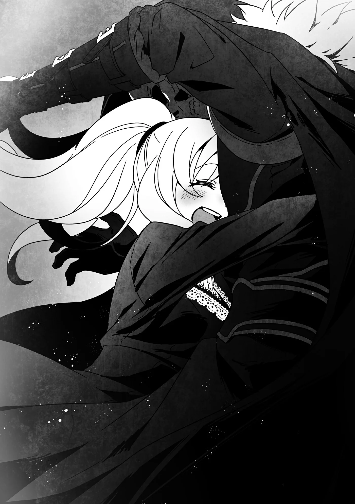

# Chương 196: Tập 8 Chương 4 - Giải Thích và Giải Quyết (4)

Khi tỉnh lại, tôi nhận ra mình không còn ở trong căn phòng ngầm nữa. Tôi cảm nhận được thứ gì đó êm ái bên dưới lưng mình. Khác với bầu không khí lạnh lẽo và sặc mùi nội tạng kỳ quái của căn phòng ngầm kia, không khí nơi đây phảng phất hương hoa thơm ngát.

Tôi ngồi dậy và thấy mình đang nằm trên một chiếc giường lộng lẫy xa hoa. Trông nó quá đỗi đắt đỏ đối với túi tiền của một thường dân, và mọi thứ xung quanh tôi dường như cũng có giá trị tương tự. Đây rõ ràng là phòng ngủ trong dinh thự của một người giàu có, nhìn qua một cái là nhận ra ngay. Nhưng nó lại không hề quá mức lòe loẹt. Trái lại, các tông màu đều nhã nhặn và đem lại cảm giác êm dịu.

"Mình đang ở đâu thế này?" tôi thì thầm, nhưng chẳng có ai quanh đây để trả lời. Tôi cần phải kiểm tra xem cơ thể mình đang ở trong trạng thái nào, nên tôi dùng tay này nắm lấy tay kia rồi sờ lên mặt. Xem chừng tôi vẫn bình an vô sự.

Tôi nhớ lại những lời Isaac đã nói trước khi tôi bất tỉnh. Theo lời anh ta thì tôi khó lòng duy trì được ý thức là do ảnh hưởng của Tiến Hóa Bản Thể. Tôi không thể biết chắc liệu mình có thực sự tiến hóa hay không, nhưng cơ thể tôi cảm thấy nhẹ nhõm hơn hẳn so với trước lúc ngất đi. Tôi bước xuống giường và vận động một chút, nhưng cũng chẳng nhận ra được gì nhiều. Tôi vặn cổ đủ để nhìn thấy lưng mình trước khi nhận ra độ dẻo dai của mình vốn chẳng có ý nghĩa gì cho lắm. Ngay từ đầu tôi đã có thể cử động như thể mình không hề có khớp xương, nên tôi vốn đã dẻo dai hết mức có thể rồi.

Nếu còn điều gì khác để tôi có thể thử nghiệm thì đó chính là sức mạnh của mình, nhưng làm chuyện đó ở đây thì khó khăn thật đấy. Tôi không nắm rõ giới hạn của mình hiện tại là bao nhiêu. Mà ngay cả khi tôi biết giới hạn hiện tại, tôi vẫn có thể gia tăng chúng bằng cách luyện tập hoặc đánh bại quái vật, nên điều đó cũng chẳng đem lại cho tôi một khái niệm chính xác. Tôi cũng có thể kiểm tra bằng cách nhấc một tảng đá nặng lên hoặc thử bóp nát nó trong tay, nhưng xem ra ở đây chẳng có thứ gì mà tôi có thể yên tâm phá hủy mà không lo hậu quả cả. Tôi chẳng còn lựa chọn nào.

Mọi thứ xung quanh tôi đều vô cùng giá trị, và tôi sẽ chẳng thể nào đền bù nổi nếu làm hỏng hóc. Dù tôi rất muốn nói rằng giờ đây mình đã đủ khả năng chi trả, nhưng tôi đã sống trong cảnh nghèo túng quá lâu đến mức không nỡ lãng phí dù chỉ một đồng. Tôi sẵn sàng bỏ ra một khoản tiền cho chiếc túi ma thuật, nhưng khi nhắc tới việc mua sắm những món đồ thông thường, tôi lại là một kẻ căn ke từng đồng từng cắc.

Dù sao thì tôi cũng đã kiểm tra xong cơ thể và quyết định tìm hiểu xem chuyện gì đang diễn ra. Tôi tiến lại gần cửa sổ xem mình có nhận ra đây là đâu không. Một khu vườn rộng lớn trải rộng bên ngoài. Những hàng rào cây xanh tạo thành một mê cung uốn lượn ngoằn ngoèo. Tôi trông thấy một cánh cổng ở phía xa và một lính gác đang đứng phía trước. May thay, chẳng mất bao lâu để tôi nhận ra vị trí của mình. Đây chính là dinh thự của gia tộc Latuule. Hẳn là có ai đó đã đưa tôi đến đây sau khi tôi bất tỉnh. Tôi muốn tìm Isaac, nên liền mở cửa rời khỏi phòng.

"Chít!" có tiếng gì đó kêu lên.

Tôi cúi xuống nhìn và thấy Edel đang đứng bằng hai chân sau, ngước lên nhìn tôi. Tôi thoáng nghĩ có khi nào nhóc cũng tiến hóa rồi chăng, nhưng xem chừng chẳng có gì thay đổi nhiều ở nó cả. Hay có lẽ chỉ là ngoại hình của nó không đổi thôi? Nhưng theo những gì tôi thấy thì nhóc vẫn chỉ là một con Puchi Suri to lớn như thường lệ.

Khi tôi tự hỏi vì sao nó lại đứng đây đợi mình, nó liền trả lời rằng nó vừa đi thám thính dinh thự Latuule và mới quay trở lại. Hóa ra chẳng phải vì nó chu đáo muốn tránh làm tôi thức giấc gì cho cam. Tôi không để bụng, nhưng tôi nghĩ bụng Edel hoàn toàn có thể thám thính dinh thự Latuule vào bất kỳ lúc nào khác mà.

Rồi Edel nói với tôi rằng bình thường thì việc đột nhập vào dinh thự này là bất khả thi. Nó đã cố tìm đường vượt qua mê cung hàng rào, hoặc tìm cách đào hầm chui qua bên dưới, nhưng dù làm cách nào thì cũng đều bị chặn đứng bên ngoài. Trước đây tôi từng thắc mắc vì sao một kẻ giàu có ở một thị trấn nhỏ lại sở hữu một hệ thống phòng thủ đáng kinh ngạc đến mức này, nhưng giờ tôi đã biết Laura và Isaac đều là Thượng Cấp Ma Cà Rồng. Thiết lập nên thứ như vậy đối với họ là chuyện quá đỗi dễ dàng.

Nhưng giờ đây Edel lại có được cơ hội hiếm hoi này để khám phá. Tôi không rõ liệu nó có nên làm vậy mà chưa xin phép hay không, nhưng dường như Isaac đã bảo rằng cứ tự nhiên. Nó cũng không được phép đi lung tung khắp mọi nơi. Có rất nhiều cánh cửa nó không thể mở và những khu vực nó không thể tiếp cận. Edel chỉ được phép xem những gì họ sẵn lòng để lộ ra mà thôi.

"Vậy mày có biết Isaac đang ở đâu không?" tôi cất tiếng hỏi, dù đằng nào nó cũng có thể đọc được suy nghĩ của tôi.

"Chít..." nó đáp lại rồi thoăn thoắt chạy đi, giờ đã hạ cả bốn chân xuống đất. Có vẻ như Edel muốn tôi đi theo nó.

Chúng tôi rảo bước qua dinh thự và bắt gặp một số người hầu. Tất cả họ đều nép sang một bên hành lang và cúi đầu chào khi nhìn thấy tôi, chờ tôi đi qua. Hoặc cũng có thể họ làm vậy là vì Edel. Tôi không chắc liệu họ có phải là con người hay không. Họ có thể là Thi Quỷ hoặc Hạ Cấp Ma Cà Rồng. Người đứng đầu gia tộc này là một Ma Cà Rồng, nên những người bình thường hẳn sẽ thấy việc sinh sống ở đây khó khăn về nhiều mặt.

Tôi tự hỏi liệu điều đó có đồng nghĩa với việc những người hầu cũng không thể là con người hay không. Tôi có thể sống chung hòa thuận với Lorraine, nhưng hầu hết con người sẽ chẳng chịu làm việc ở đây nếu biết được sự thật. Tuy nhiên nhìn từ khuôn mặt của họ, những người hầu này không phải là Thi Quỷ. Khuôn mặt của Thi Quỷ vốn rất dễ nhận biết. Dù vậy, đôi khi tôi chẳng thể nhận ra được khi họ được ngụy trang bằng ma pháp, như những gì tôi đã rút ra được từ sự cố lần này. Tôi quyết định sẽ hỏi Isaac về chuyện đó sau.

Chúng tôi tiếp tục tiến về phía trước một hồi cho đến khi Edel dừng lại. Chúng tôi đang đứng trước một cánh cửa, và nó nhìn tôi như thể muốn bảo tôi hãy mở nó ra. Tôi nghĩ bụng đáng lẽ người hầu của tôi phải là kẻ mở cửa cho tôi mới phải, nhưng với cấu tạo cơ thể của Edel thì chuyện đó e là hơi khó. Chà, nhóc ta có lẽ cũng có thể nhảy lên rồi dùng răng cắn chặt lấy quả đấm cửa để dùng sức nặng cơ thể vặn nó, nhưng ngay cả những quả đấm cửa trong ngôi nhà này cũng được chạm khắc tinh xảo và rõ ràng là rất đắt giá. Tôi không muốn mạo hiểm làm hỏng chúng, nên tự mình nắm lấy quả đấm cửa.

Thật không may, tôi đã bóp nát vụn quả đấm cửa trong lòng bàn tay. Khối gỗ chạm khắc tuyệt đẹp giờ đã biến thành một đống mảnh vụn. Tôi bắt đầu hoảng hốt khi thấy ba người hầu từ đâu bỗng tiến lại gần mình.

"À, ừm, tôi có thể giải thích được mà," tôi nói, nhưng họ chẳng hề đáp lại tôi câu nào. Họ thay một quả đấm cửa mới, rồi hai người trong số họ cúi đầu chào tôi trong khi người thứ ba mở cửa và cũng cúi chào theo. Tôi cảm thấy vô cùng ngượng ngùng và xấu hổ vì chuyện đó. Thậm chí nếu họ nổi giận với tôi thì có lẽ tôi còn thấy nhẹ nhõm hơn.

Tôi cảm ơn họ vì đã phải vất vả xử lý rắc rối, rồi bước vào trong phòng. Edel thì đã biến mất từ lúc nào. Nhóc ta đã bỏ rơi tôi mà phóng tót vào phòng ngay khi tôi gặp rắc rối. Hành xử thế thì chẳng ra dáng một người hầu chút nào. Chà, nếu tôi gặp phải hiểm cảnh thực sự thì hẳn là nhóc sẽ giúp thôi, nên tôi cũng chẳng thể phàn nàn gì được.

Khi tôi bước vào phòng, tôi nghe thấy tiếng cánh cửa khép lại êm ru. Người hầu vừa mở cửa đã đóng nó lại giùm tôi. Họ phục vụ chu đáo đến mức khiến tôi gần như cảm thấy áy náy.

Tôi đưa mắt nhìn quanh phòng và trông thấy Isaac trong bộ đồng phục quản gia được là ủi phẳng phiu hoàn hảo. Rina cũng ở đó, mặc kiểu trang phục xa hoa lộng lẫy giống như Laura từng mặc. Rina đang ngồi trên một chiếc ghế, còn Isaac đứng cạnh và có vẻ như đang phục vụ cô. Chiếc bàn trước mặt Rina đặt một tách trà cùng rất nhiều món đồ ngọt trông thật ngon miệng. Xem ra Rina cũng đang được tiếp đãi vô cùng chu đáo chẳng kém gì tôi.

Họ nghe thấy tiếng tôi bước vào liền quay đầu lại nhìn. Rina đứng dậy và thoăn thoắt chạy bước nhỏ lại gần. Căn phòng này rất rộng, nên nếu chỉ thong thả bước đi thì sẽ mất một lúc. Quy mô của nơi này rộng lớn hơn nhiều so với bất kỳ quán trọ tồi tàn nào tôi từng trọ lại, hay thậm chí cả căn nhà của Lorraine.

Nhưng tôi đoán nghĩ như vậy về nhà của Lorraine thì hơi khiếm nhã thật, nhất là khi tôi đang ăn nhờ ở đậu tại đó. Dù sao thì nhà của Lorraine cũng đâu có nhỏ đến thế. Nó chỉ đem lại cảm giác chật chội vì những chồng sách vở và tài liệu chất cao như núi mà thôi. Tôi hiếm khi được sống ở một nơi có không gian thoáng đãng đến nhường này. Nhưng thôi, sao cũng được.

"Anh Rentt!" Rina kêu lên rồi nhảy bổ vào vòng tay tôi. Tôi đỡ lấy cô, và cô bé nhẹ bẫng. Có lẽ Tiến Hóa Bản Thể đã tăng cường sức mạnh của tôi lên rất nhiều. Lúc làm vỡ quả đấm cửa tôi cũng khó lòng kiểm soát được lực tay của mình, thế nên tôi không thể tùy tiện chạm vào người khác mà thiếu đi sự cẩn trọng cao độ. Tôi cần phải làm quen với điều này thêm một chút nữa.

"Rina, cô có sao không? Ý tôi là, cô đã phải trải qua nhiều chuyện như vậy mà," tôi nói.

Rina đã bị Ma Cà Rồng bắt giữ, bị biến thành Ma Cà Rồng, rồi còn bị dung hợp với Lõi Mê Cung, thế nên cô bé đã trải qua một chuyến phiêu lưu chẳng hề tầm thường chút nào. Xét đến việc cô bé cũng từng đụng độ với một con Ngạ Quỷ nào đó nữa, tôi đành phải cho rằng Rina mang số bị nguyền rủa rồi. Tôi cảm thấy chúng tôi là những kẻ đồng bệnh tương lân trên phương diện ấy. Nhưng tôi không biết Rina đã nắm được bao nhiêu phần sự thật, nên tôi đành nói năng một cách lấp lửng mơ hồ.

"Tôi ổn mà," Rina đáp. "Tôi thấy khỏe khoắn và chẳng có vấn đề gì đặc biệt cả. Dù thỉnh thoảng có những khoảnh khắc người khác trông cứ như đồ ăn đối với tôi vậy."

Những suy nghĩ ấy nghe thật kinh hãi làm sao, nhưng tôi hiểu cảm giác của cô. Đôi khi nhìn một ai đó, một phần não bộ của tôi sẽ vô thức nghĩ rằng họ trông có vẻ khá ngon lành, hay dòng máu của họ ắt hẳn sẽ êm mượt như lụa, hoặc họ sẽ là một nguồn dinh dưỡng dồi dào, hay thịt của họ sẽ mang một hương vị đậm đà. Rina có lẽ cũng đang trải qua điều tương tự. Cảm giác này không phải là bất khả thi để kìm nén, nên nó cũng chẳng phải là vấn đề quá to tát.

"Ra vậy, thế cô biết chuyện gì đã xảy ra trong lúc mình bất tỉnh rồi à?" tôi hỏi.

"Vâng, giờ tôi là một Ma Cà Rồng rồi, đúng không anh?"

Isaac tiến lại gần tôi sau Rina. "Chào buổi sáng, ngài Rentt."

"Ồ, chào buổi sáng. Anh đã kể hết mọi chuyện cho Rina nghe rồi à?"

"Vâng. Cô Lorraine cũng vừa ở đây cho đến tận lúc nãy, nhưng giờ cô ấy đang vùi mình trong thư viện rồi. Cô ấy đã vô cùng hào hứng khi trông thấy nơi đó."
