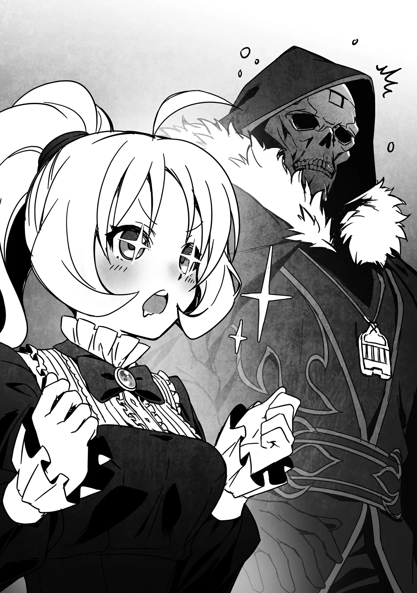

# Chương 197: Tập 8 Chương 4 - Giải Thích và Giải Quyết (5)

Thấy tôi ngó nghiêng tìm người, Isaac hẳn đã đoán ra tôi đang tìm Lorraine. Nhưng nếu cô ấy đang ở trong thư viện thì chắc còn lâu mới chịu ra ngoài. Cứ để mặc thì cô ấy có thể đọc liền tù tì mấy ngày. Tôi chẳng nhớ nổi đã bao lần cô ấy bị suy dinh dưỡng sau những đợt đọc sách quên ăn quên ngủ như thế, làm tôi lại phải lăn vào bếp nấu cho cô ấy ăn. Tôi thầm dặn lòng lát nữa phải ghé qua xem sao, tránh để lần này lại xảy ra chuyện tương tự.

"Vậy ngài thấy trong người thế nào rồi? Trông ngài có vẻ rất khỏe khoắn," Isaac nói.

"Ừm, tôi không sao cả," tôi đáp. "Nhưng khó kiểm soát sức mạnh quá. Thật ra tôi vừa làm hỏng cả một quả đấm cửa. Xin lỗi anh nhé."

"Ngài đừng bận tâm về chuyện đó," Isaac khẽ cười. "Ma Cà Rồng trải qua Tiến Hóa Bản Thể hay gặp chuyện như vậy lắm. Chuyện của tôi thì đã từ lâu lắm rồi, nhưng tôi vẫn còn nhớ những tai nạn tương tự. Tôi đoán trước kia Tiểu thư Laura cũng từng trải qua điều này."

"Laura sao rồi? Cô bé vẫn còn ngủ à?"

"Vâng, nhưng ngài không cần quá lo lắng cho tiểu thư đâu. Tiểu thư Laura vượt trội hơn tôi rất nhiều, nên chuyện này không đe dọa đến tính mạng của người. Có điều dạo gần đây sức mạnh của tiểu thư bị suy giảm, nên người sẽ cần chút thời gian để hấp thụ Lõi Mê Cung."

"Sao sức mạnh của cô bé lại suy giảm?" tôi hỏi.

Thường thì Ma Cà Rồng đâu có già đi. Nghĩa là chỉ cần ăn uống đầy đủ, cô bé sẽ không phải chịu cảnh suy yếu vì tuổi tác.

"Ngài còn nhớ chuyện chúng tôi từng nhờ ngài thu thập Hoa Long Huyết chứ? Loài hoa đó dùng để thanh tẩy oán niệm, rất hữu ích trong việc kìm hãm sức mạnh của Ma Cà Rồng. Có điều đó là khi thu thập một lượng vừa đủ thôi. Dùng quá nhiều sẽ khiến Ma Cà Rồng suy yếu. Suốt nhiều năm qua, Tiểu thư Laura vẫn luôn dùng máu Hoa Long Huyết nguyên chất chiết từ những bông Hoa Long Huyết."

"Sao cô bé lại làm thế chứ?" Nếu lời Isaac nói là thật thì hành động đó chẳng khác nào tự sát.

"Tôi cũng không rõ," Isaac đáp. "Có lẽ vì đã sống quá lâu nên người thấy chán chường với cuộc đời, hoặc có lẽ người có lý do khác. Nhưng từ khi gặp ngài Rentt, tiểu thư không còn dùng nhiều như trước nữa. Người đang dần lấy lại sinh lực, nên tôi nghĩ qua một thời gian nữa người sẽ tỉnh lại thôi."

"Khi nào thì cô bé tỉnh lại? Ngày mai sao? Hay ngày kia?" Tôi có biết bao điều muốn hỏi Laura.

"Tôi xin lỗi nếu đã làm ngài mừng hụt, nhưng có thể sẽ mất vài tháng, thậm chí là vài năm."

Hầu hết Ma Cà Rồng đều sống rất thọ, và hai người họ có lẽ cảm nhận thời gian khác hẳn một Ma Cà Rồng non trẻ như tôi. Vài tháng hay vài năm đối với họ chắc cũng chỉ như một thoáng chốc.

Tiếc là giờ tôi chẳng thể nói chuyện với Laura được nữa. Ít ra Laura đã nghĩ tới điều đó và dặn tôi vài điều trước khi hấp thụ Lõi Mê Cung. Cô bé có nhắc tới chuyện đến các đền thờ và di tích để thu thập truyền thuyết, nhưng tôi chịu chẳng hiểu ý cô bé là gì.

"Laura đã làm điều cô bé phải làm," tôi nói. "Cô bé hấp thụ Lõi Mê Cung để bảo vệ Maalt, chuyện đó ngoài cô bé ra thì chẳng ai làm nổi."

"Cảm ơn ngài đã nói vậy. Tôi cũng muốn giải thích cho ngài càng nhiều càng tốt, nhưng tiếc là tôi cũng không biết nhiều lắm. Ngài có điều gì muốn hỏi không?"

"Anh có biết ý cô bé là gì khi bảo tôi đi thu thập các truyền thuyết cổ xưa không?"

"Tôi cho rằng cứ hiểu đúng như câu chữ thôi. Đó là điều ngài nên làm vì bản thân và tương lai của ngài."

"Thì, ý tôi hỏi đâu phải chuyện đó." Tôi muốn biết vì sao mình phải làm vậy, và chính xác thì những truyền thuyết cổ xưa đó là gì. Tôi đoán chắc Isaac biết rõ.

"Tôi có thể trả lời ngài đôi phần, nhưng trước đây tôi từng hiểu sai những thông tin này. Tôi tin Shumini cũng vậy. Nếu giờ tôi cố giải thích, tôi nghĩ mình sẽ mắc phải sai sót. Tôi khuyên ngài nên tự mình điều tra và tự rút ra kết luận. Tôi hình dung Tiểu thư Laura cũng sẽ bảo ngài như vậy."

Rốt cuộc Isaac vẫn không trả lời tôi, nhưng tôi hiểu ý anh ấy. Nếu chuyện này bắt nguồn từ thời cổ đại thì theo năm tháng, thông tin tự nhiên sẽ bị thất truyền hoặc sai lệch đi. Tôi phải tự mình thu thập những truyền thuyết đó và tự giải mã lấy. Nhưng ngay cả cách hiểu của riêng tôi cũng có thể có sai sót. Chắc Isaac muốn nói rằng bản thân anh ấy từng trải qua chuyện này. Ý anh ấy muốn nhắc là tôi có thể đi vào vết xe đổ của anh ấy. Ít ra thì tôi rút ra được như vậy. Anh ấy muốn tôi tự tìm thông tin đó và tự suy ngẫm lấy. Nếu vậy thì đây không phải là chuyện tôi có thể hỏi Isaac rồi.

Việc cần làm đã rõ ràng, tôi chỉ việc lên đường bắt đầu chuyến hành trình đó. Đền thờ và di tích có ở khắp nơi trên thế giới. Có điều xưa nay tôi chỉ làm mạo hiểm giả quanh quẩn ở Maalt, mà những chuyến đi đó đâu thể tính là hành trình đường dài. Mạo hiểm giả Đồng Cấp đi một mình chẳng bao giờ nhận được nhiệm vụ hộ tống, mà sang các vùng khác tôi cũng chẳng có mấy cơ hội kiếm tiền. Ngay cả chi phí đi lại thôi cũng đã nặng gánh lắm rồi. Nhưng giờ tôi đã đủ mạnh để nhận nhiệm vụ hộ tống hoặc nhận ủy thác từ các chi hội trên khắp thế giới để vừa đi vừa kiếm tiền.

Tôi thấy hào hứng, nhưng cũng sẽ nhớ Maalt lắm. À thì, chắc tôi có thể dùng các ma pháp trận dịch chuyển để quay về đó từ một số nơi, nhưng rồi người ta có thể sẽ thắc mắc sao tôi lại ở Maalt trong khi đáng lẽ phải đang đi xa. Tôi sẽ phải hạn chế dùng chúng hết mức có thể. Vả lại tôi cũng mong mỏi được đi du hành bằng xe kéo. Cứ dịch chuyển qua lại thì chẳng mấy thú vị, cũng chẳng có cảm giác của một chuyến hành trình.

"Được rồi, tôi hiểu rồi," tôi nói. "Vậy chuyện đó tôi không hỏi thêm nữa. Còn gì nữa không nhỉ? À đúng rồi, anh bảo tôi đã tiến hóa, nhưng rốt cuộc tôi đã tiến hóa thành thứ gì? Anh có biết không?" Tôi chịu chẳng biết. Tôi vẫn chưa thử nghiệm bất cứ thứ gì nên chuyện đó vẫn là một ẩn số. Trông tôi có vẻ khỏe hơn một chút, nhưng cũng chỉ có thế mà thôi.

"Nếu ngài còn nhớ thì ngài có đôi chút khác biệt so với chúng tôi," Isaac nói.

"Ừ, Laura có nhắc tới chuyện đó."

"Đúng vậy, nên tôi không thể nói cụ thể ngài là loại quái vật nào. Tuy nhiên, tôi có thể cho ngài biết ngài sẽ thuộc cấp bậc nào nếu là Ma Cà Rồng. Nếu ngài muốn tôi xác định điều đó, trước tiên ngài phải cho tôi xem sức mạnh của mình đã."

Chắc chỉ riêng sức mạnh thể chất thôi thì chưa đủ để đánh giá. Ma Cà Rồng cùng cấp bậc vẫn có thể khác nhau ở điểm đó, giống như con người vậy.

"Rina cũng không phải Ma Cà Rồng bình thường sao?" tôi hỏi.

"Ơ, tôi không phải là Ma Cà Rồng sao?" Rina bàng hoàng thốt lên, nhưng tôi cần phải hỏi rõ chuyện này. Tôi thì chẳng thấy vấn đề gì nếu cô ấy là một Ma Cà Rồng bình thường, nhưng Nive nhiều khả năng vẫn còn ở Maalt. Kết giới kia chắc giờ đã biến mất, nên biết đâu Nive đang lùng sục quanh thị trấn. Nếu Rina bị bắt gặp, Nive sẽ dùng móng vuốt xé xác cô ấy ra mất.

"Nhiều khả năng là không phải đâu cô Rina," Isaac đáp. "Cách dễ nhất để nhận biết là dựa vào khí tức. Con người sẽ không phân biệt được, nhưng Ma Cà Rồng chúng tôi có thể cảm nhận thấy nhau. Có điều cô và ngài Rentt lại không hề phát ra khí tức của chúng tôi."

"Vậy Rina và tôi không phải Ma Cà Rồng ư? Nhưng tôi vẫn uống máu và thèm khát con người mà. Cô không thế sao?" tôi quay sang hỏi Rina.

"Con người trông ngon mắt lắm anh!" cô ấy đáp.

Nghe thế quả thật hơi rợn người. Ý tôi là cô ấy nói đâu có sai, nhưng đó chẳng phải chuyện nên nói to ngoài thị trấn. Cô ấy sẽ bị coi là quái vật ăn thịt người hoặc là kẻ điên mất. Tôi chẳng muốn điều nào xảy ra với Rina cả. Lát nữa tôi phải nhắc cô ấy về chuyện này mới được.

"Tất nhiên, tôi không thể nói hai người hoàn toàn khác biệt," Isaac nói. "Ngài và cô ấy có thể là một chủng loài có họ hàng gần với Ma Cà Rồng, nhưng phải thỉnh cầu Thần Giám Định mới biết chắc được. Tuy nhiên, tôi không dám đảm bảo thần linh sẽ chịu giám định cho ngài đâu."

Thần Giám Định hiếm khi đích thân giám định thứ gì. Dù vậy, việc cất công tới đền thờ vì chuyện đó cũng chưa hẳn là phí thời gian, vả lại còn có chuyện chiếc mặt nạ của tôi nữa. Tôi đoán ngài ấy sẽ chịu xem xét nó. Dù sao thì tinh linh ở Hathara từng bảo nó giống như một món Thần Cụ. Nếu tôi có thể nhân tiện hỏi luôn mình thuộc chủng loài nào thì đúng là tiện cả đôi đường.

"Dù sao thì cũng có vài điều tôi biết rõ và có thể kiểm tra giúp ngài," Isaac nói. "Tôi là một Ma Cà Rồng đã sống khá lâu, và trong khoảng thời gian đó tôi đã trau dồi được một số kỹ năng. Biết đâu ngài có thể dùng được vài chiêu trong số đó đấy, ngài Rentt. Chúng ta ra vườn đi. Tôi chắc là cô Lorraine cũng muốn xem, nên có lẽ chúng ta nên ghé qua thư viện trước."

Nếu anh ấy sẵn lòng dạy cho tôi vài kỹ năng thì tôi vô cùng cảm kích. Những kỹ năng duy nhất tôi đặc biệt thành thạo chỉ có kiếm thuật, Ma Thuật Sinh Hoạt và tấn công bằng Khí Lực. Có cơ hội học hỏi thêm thì tôi hết sức hoan nghênh. Thật ra tôi luôn mong mỏi được học nhiều loại kỹ năng khác nhau. Nhưng tôi biết mình không được vì muốn học kỹ năng mới mà bỏ bê những điều căn bản, nên chưa từng có ý định làm vậy.

Qua trận chiến dưới lòng đất vừa rồi, sau khi chứng kiến sức mạnh của Laura, Isaac và cả Lorraine, tôi biết mình vẫn còn kém xa. Chẳng còn nghi ngờ gì nữa, tôi chính là người yếu nhất trong số họ. Có lẽ tôi có thể thắng Lorraine nhờ tận dụng sức mạnh thể chất và khả năng hồi phục, nhưng cô ấy lại biết tôi là một dạng Ma Cà Rồng. Chắc cô ấy sẽ dội ma pháp liên tiếp khiến tôi chẳng thể nhúc nhích nổi, đến gần còn chẳng xong. Thôi bỏ đi, tôi làm sao có cửa thắng được Lorraine.

"Nghe được đấy," tôi nói. "Mỗi lần tiến hóa trước đây, tôi đều nhờ Lorraine xem giúp. Lần này chắc cô ấy cũng là người thích hợp nhất để nhận ra những thay đổi. Hẳn cô ấy cũng sẽ có vài nhận định xem tôi thuộc chủng loài nào. Tôi vẫn tự thấy mình hiểu biết kha khá về quái vật, nhưng chẳng gì qua được chuyên gia cả."

"Phải rồi, cô Lorraine nghiên cứu về quái vật mà. Tôi biết rất nhiều về giống loài của mình, nhưng các loài quái vật khác thì chỉ biết chừng mực thôi. Vậy chúng ta đi gọi cô Lorraine nhé?"

Chúng tôi rời phòng và đi về phía thư viện.

◆◇◆◇◆

"Ồ, Rentt, anh tỉnh rồi à? Cơ thể anh sao rồi? Trong người thấy khỏe chứ?" Lorraine hỏi.

Khi bước vào thư viện, chúng tôi thấy Lorraine đang ngồi bên chiếc bàn chất đầy sách. Hóa ra trong đầu cô ấy vẫn còn chừa đủ chỗ để nghĩ về tôi chứ không chỉ toàn sách là sách.

"Ừ, hiện giờ thì tôi thấy chẳng có vấn đề gì. Mà công nhận sách ở đây nhiều thật đấy."

"Đây mới chỉ là một phần nhỏ trong số những cuốn tôi muốn đọc thôi. Nơi này tuyệt vời thật. Chẳng có mấy thư viện có nhiều sách đến mức này đâu. Ngay cả quý tộc ở đế đô cũng không có thư viện nào tầm cỡ thế này. Đã vậy những cuốn sách này đều rất quý hiếm. Tôi muốn sống ở đây luôn quá."

Tôi đâm sợ cái viễn cảnh Laura hoặc Isaac thực sự đồng ý chuyện đó. Nhà của Lorraine vốn dĩ đã giống chỗ để cô ấy chất sách hơn là một ngôi nhà đúng nghĩa để ở rồi. Có lẽ chuyển vào sống trong thư viện này đối với cô ấy cũng chẳng khác là bao.

"Thôi, đùa thế thôi, chắc anh tới đây là có việc cần hả?" Lorraine nói. Hóa ra cô ấy không nói thật. Lúc nãy trông mặt cô ấy nghiêm túc đến phân nửa, nhưng chỉ ra điểm đó thì tôi sẽ gặp rắc rối mất. Tôi đành vờ như không nhận ra.

"Ừ, Isaac bảo anh ấy sẽ xem chúng tôi thuộc cấp bậc nào nếu là Ma Cà Rồng, với lại sẽ dạy cho chúng tôi vài kỹ năng của Ma Cà Rồng nữa. Chúng tôi chuẩn bị ra vườn thử nghiệm vài thứ, nên nghĩ cô cũng nên ra xem thử có nảy ra ý kiến gì không."

"Vậy rốt cuộc anh không phải là Ma Cà Rồng à? Là loài có họ hàng gần chăng? Hay một phân loài? Biết đâu anh lại là một thứ hoàn toàn khác. Trò chuyện với Isaac về vụ này chắc sẽ thú vị lắm đây." Rõ ràng Lorraine cũng không nghĩ tôi là Ma Cà Rồng điển hình. Dù sao chúng tôi cũng từng bàn về chuyện đó mấy lần rồi, nên điều này cũng chẳng có gì lạ.

"Tôi không hiểu biết nhiều về quái vật như cô, nên không rõ liệu có đáp ứng được kỳ vọng của cô hay không," Isaac nói. Nhưng từ góc nhìn của Lorraine, cô ấy đang có cơ hội hỏi một Ma Cà Rồng thực thụ về loài Ma Cà Rồng. Chừng đó thôi cũng đủ đáp ứng kỳ vọng của cô ấy rồi. Dạo gần đây tiếp xúc với bao nhiêu Ma Cà Rồng làm người ta dễ quên mất, chứ hầu hết mạo hiểm giả chưa từng chạm trán Ma Cà Rồng bao giờ. Ngay cả Hạ Cấp Ma Cà Rồng đã vậy, huống chi là những Ma Cà Rồng cấp cao còn hiếm hơn rất nhiều.

"Tôi được trò chuyện với một Ma Cà Rồng cấp cao cơ mà," Lorraine nói. "Đó đâu phải chuyện ngày nào cũng có dịp làm. Tôi rất sẵn lòng nắm lấy cơ hội này, Isaac."
