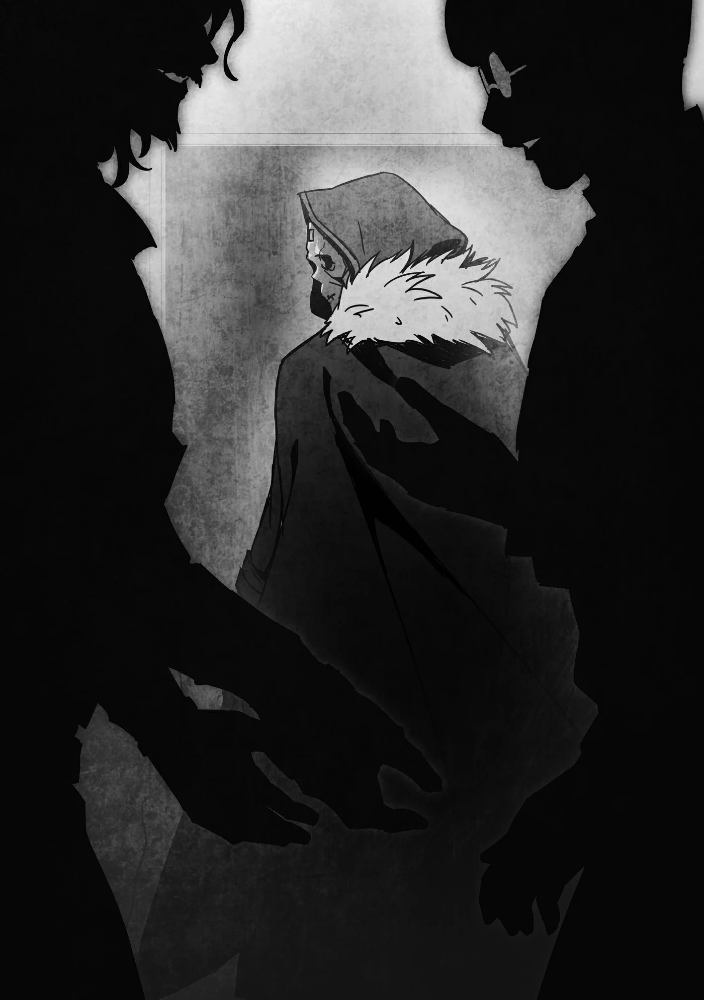

# Chương 198: Ngoại truyện Tập 8 - Báo Thù Và Tiềm Thức

"A, Rentt. Xin lỗi nhé, nhưng anh mang rác ra ngoài vứt giúp tôi được không? Tôi gom hết để ở cửa rồi. Trong lúc đó tôi sẽ làm bữa sáng."

Đó là một buổi sáng bình thường như bao ngày khác. Tôi rời phòng ngủ trên tầng hai nhà Lorraine rồi bước xuống phòng khách, nơi cô vừa ngỏ lời nhờ vả tôi như thế. Cô đang bận rộn nấu nướng tối mày tối mặt. Tôi đang ở nhờ nhà cô mà chẳng tốn một xu, nên lẽ ra tôi phải là người vừa nấu bữa sáng vừa mang rác đi vứt mới phải, nhưng Lorraine vẫn sẵn lòng san sẻ bớt vài việc vặt. Trừ những lúc cô kiệt sức hay mải mê vùi đầu vào nghiên cứu hay việc gì đó tương tự. Vả lại chúng tôi cũng chẳng phân chia công việc rạch ròi theo một khuôn mẫu cố định nào. Cả hai cứ tùy nghi làm phần việc cần thiết của mình, và thấy cách đó là thoải mái nhất. Đã quen biết nhau ngót nghét mười năm trời, chúng tôi hiểu cách phối hợp ăn ý mà chẳng cần phải nói với nhau quá nhiều lời.

"Được rồi, tôi biết rồi," tôi đáp lời mà chẳng hề phàn nàn lấy một câu. Tôi thậm chí còn chẳng buồn hỏi phải vứt ở đâu, cứ thế xách túi rác bước ra ngoài.

Tôi rảo bước đến nơi cư dân thị trấn Maalt tập kết rác thải. Tùy theo từng ngày trong tuần mà nơi này tiếp nhận các loại rác khác nhau, và hôm nay là ngày thu gom đồ kim loại. Chúng sẽ được đem đi nung chảy rồi tái chế. Nếu cứ để hớ hênh trước cửa nhà người dân thì thể nào cũng bị trộm mất, thành thử mọi thứ đều được đem gom lại ở đây. Còn ai là người đến thu gom thì tùy thuộc vào từng bãi tập kết.

"Ồ, mọi người vất vả rồi. Hôm nay gom được nhiều đồ ghê. A, Rentt," một vị tư tế cất tiếng khi vừa bước tới.

Anh ta là Adela, một tư tế của Giáo Hội Giả Kim đến để thu gom các nguyên liệu kim loại này. Giáo Hội Giả Kim tin rằng bản thân các kỹ thuật giả kim là thần thánh và xứng đáng được tôn thờ. Họ có đôi chút kỳ lạ. Vị thần của họ là Dayla, Thần Giả Kim. Phần lớn tín đồ của họ là người bình thường, giống như bao tôn giáo khác, nhưng các tư tế của họ lại là những nhà giả kim cao cấp. Đó là lý do họ chuộng việc quyên góp nguyên liệu hơn là tiền bạc. Lorraine không phải tín đồ của tôn giáo này, nhưng cùng là nhà giả kim, thỉnh thoảng cô cũng đem cho họ những thứ mình không cần dùng đến. Nhưng người thường xuyên mang đồ đến bãi tập kết này lại là tôi, nên tôi quen mặt Adela hơn cả cô. Adela là một nhà giả kim khá có tài, nhưng tôi vẫn chưa từng tận mắt chứng kiến anh ta trổ tài năng lực của mình.

"Chào Cha Adela," tôi cất tiếng rồi cúi đầu chào.

"Chỗ nguyên liệu này đều là của hai người à?" anh ta hỏi.

"Của Lorraine nhiều hơn là của tôi."

"Phải rồi, dĩ nhiên rồi. Vẫn cảm ơn hai người như mọi khi nhé. Hai người cung cấp không ít nguyên liệu có giá trị rất cao, nên các thành viên của chúng tôi lúc nào cũng tranh giành nhau."

"Tôi thấy cũng chẳng có gì to tát lắm, nhưng được anh nói vậy thì cảm ơn nhé."

"Đứng từ góc nhìn của chúng tôi thì thế này là nhiều lắm rồi. Phần lớn số này mà bảo tôi tự tay kiếm thì khó lòng kiếm nổi."

Lorraine và tôi đã thu thập được rất nhiều nguyên liệu từ các mê cung hoặc vùng đồi núi. Chúng tôi vốn định tự mình sử dụng, nên chỉ chọn lựa những thứ có phẩm chất cao nhất, và phần nhiều trong số đó còn tốt hơn đồ bán ngoài tiệm. Phần lớn mạo hiểm giả thậm chí còn chẳng thể nhận biết nổi một vài loại trong số nguyên liệu này, và chúng cũng hầu như không được lưu hành trên thị trường. Tôi hiểu điều Adela muốn nói.

"Lorraine và tôi tự mình thu thập những thứ này, nên chắc chắn có không ít món khác thường trong đó."

"Đúng vậy, nhưng giới giả kim thuật thì ai cũng biết rõ chúng. Tiếc là không có nhiều mạo hiểm giả có thể nhận ra được."

"Mạo hiểm giả thường có xu hướng chỉ lấy những thứ dễ nhận biết và dễ thu thập nhất, đúng là vậy. Rất khó để ghi nhớ những loại nguyên liệu hiếm khi dùng tới nhưng lại có giá trị cao."

"Ra là vậy. Thật tốt khi được nghe ý kiến từ một mạo hiểm giả. Có lẽ chúng tôi nên lưu tâm điều đó khi gửi yêu cầu tới hội."

Chúng tôi tiếp tục trò chuyện trong lúc có thêm nhiều nguyên liệu khác được mang tới. Đám đông quanh đó dần dần thưa thớt bớt.

"Cũng đến giờ rồi, Rentt," Adela nói. Anh ta chuẩn bị mang mọi thứ về giáo hội.

"Được rồi, vậy chào anh nhé."

Chúng tôi chia tay nhau.

◆◇◆◇◆

"A, anh về rồi đấy à. Bữa sáng xong rồi đây," Lorraine cất tiếng rồi cởi chiếc tạp dề ra khi tôi về tới nhà.

Chiếc tạp dề của cô chẳng phải loại kiểu cách đáng yêu mà những người phụ nữ quanh thị trấn ưa chuộng. Nó vốn dùng cho các thí nghiệm và được làm từ chất liệu bền chắc, không hề bị tan chảy hay bắt lửa trước loại axit cực mạnh. Dĩ nhiên là trông nó chẳng có lấy một nét quyến rũ nào, nhưng lại vô cùng hợp với Lorraine. Nó đáp ứng hoàn hảo về mặt công năng. Vấn đề duy nhất là nó hay bị bám bẩn bởi các chất cặn bã từ những cuộc thí nghiệm, nhưng cô luôn giặt giũ nó kỹ càng trước mỗi lần sử dụng. Nguyên nhân chủ yếu là vì nếu không làm vậy thì sẽ ảnh hưởng đến công việc của cô. Sự tỉ mỉ cẩn trọng kiểu đó là điều tối quan trọng đối với các nhà nghiên cứu.

Toàn bộ thức ăn trên bàn trông đều vô cùng ngon miệng. Món ăn được nêm nếm theo cách hoàn hảo nhất để khơi dậy cơn đói trong tôi. Nói cách khác, nó đã được nêm thêm một chút máu của Lorraine. Tôi nghĩ dù thế nào thì mùi vị của nó cũng rất ổn, nhưng sự hiện diện của máu tạo nên một sự khác biệt to lớn. Nó cũng giúp tôi no bụng hơn hẳn, nên xét về mặt hiệu quả, tôi thực sự rất cảm kích.

"Trông ngon đấy," tôi nói. "Chúng ta ăn luôn chứ nhỉ?"

"Ừ, ăn thôi."

Chúng tôi ngồi vào bàn ăn. Trong lúc dùng bữa, tôi kể lại câu chuyện vừa xảy ra ban nãy.

"Cha Adela nói vậy thật à?" Lorraine hỏi. "Hừm, anh ta đâu cần phải cảm ơn chúng ta làm gì."

"Tôi cũng nói y như vậy, nhưng anh ta là người lịch sự mà."

"Thì anh ta lúc nào chẳng thế. Với tài năng đó, đáng lẽ anh ta có thể nổi tiếng hơn hiện tại nhiều, vậy mà lại chọn sống ở thị trấn nhỏ này."

"Thật vậy sao?"

"Đúng thế, nếu thích thì anh ta có thể kiếm được một công việc ở Vistelya, hoặc thậm chí tìm được việc làm ở Đế Quốc ấy chứ. Dĩ nhiên là anh ta chẳng thể nào sánh bằng tôi rồi."

Lorraine tự đánh giá bản thân rất cao, nhưng nếu trình độ giả kim của anh ta chỉ kém cô một chút thì vẫn thuộc dạng khá tài ba. Xét về thực lực của Lorraine, tôi cũng chẳng hoàn toàn hiểu nổi tại sao cô lại chọn sống ở Maalt.

"Dù sao nếu anh ta đang sống ở Maalt, thì có lẽ là do Giáo Hội Giả Kim không mấy ưa anh ta chăng," tôi nói.

"Chà, đó là khả năng cao nhất rồi. Rốt cuộc thì những tổ chức kiểu này tổ chức nào cũng biến chất cả thôi. Giáo Hội Giả Kim ngoài miệng tuyên bố ưu tiên khoa học, nên thật đáng buồn khi ngay cả họ cũng có cái chiều hướng tương tự."

"Nghe chừng vất vả thật."

"Tôi cũng đoán thế, nhưng anh ta hoàn toàn có thể rời khỏi Giáo Hội Giả Kim rồi gia nhập một đội nghiên cứu nào đó cơ mà. Tôi đồ rằng anh ta ở lại với họ là vì bản thân anh ta muốn thế, nên chúng ta chẳng có tư cách gì để bàn tán về hoàn cảnh của người ta cả."

"Có lẽ vậy."

Đôi khi những người rơi vào hoàn cảnh bất lợi vẫn chấp nhận ở lại vì lý do của riêng họ. Những lý do ấy có thể thiên biến vạn hóa, nhưng nếu Cha Adela đã có lý do của mình thì chúng tôi cũng chẳng có tư cách gì để can thiệp.

◆◇◆◇◆

Một hôm nọ, có tiếng gõ cửa nhà Lorraine và ai đó lớn tiếng gọi tên tôi. Tôi mở cửa và thấy hai người, một người tôi quen còn người kia thì không. Người quen là Alize, cô đồ đệ của chúng tôi. Đứng cạnh em là một bé gái chừng mười tuổi. Nhìn qua trang phục tôi có thể nhận ra cô bé là dân thường, nhưng không phải người của thị trấn này, chắc hẳn là từ nơi khác tới đây.

"Alize, cô bé này là ai thế em?" tôi hỏi.

"Em ấy nói tên là Mimir. Em ấy bị lạc đường ạ."

"Lạc đường ư? Mà sao em lại đưa cô bé tới đây?"

"Em nghĩ anh sẽ giúp tìm được người em ấy cần tìm ạ."

"Thế cô bé đang tìm ai?" Đó có thể là cha mẹ, bạn bè, hoặc một người lính gác. Có vô vàn khả năng.

"Bố của em ấy ạ. Em ấy kể hai bố con cùng đến Maalt, nhưng đột nhiên bị lạc mất bố," Alize giải thích.

"Anh hiểu rồi. Anh sẽ giúp."

"Oa, cảm ơn anh! Chị đã bảo với em rồi mà, Mimir? Anh Rentt sẽ tìm bố cho em mà."

Chắc hẳn Mimir đã rất lo lắng về chuyện đó. Nãy giờ cô bé cứ im thin thít, nhưng giờ đây em nhìn tôi với ánh mắt nhẹ nhõm.

"Em cảm ơn anh Rentt ạ," cô bé nói.

"Không có gì đâu. Dù sao hôm nay tôi cũng chẳng có việc gì khác để làm. Nhưng nếu em lại bị lạc nữa thì chẳng giúp ích được cho ai cả, nên hai đứa cứ tìm chỗ nào đó chờ đi nhé. Thấy sao?"

"Bọn em ở lại cô nhi viện được không anh?" Alize hỏi.

"Được chứ. Nhưng trước đó, Mimir này, tôi cần hỏi em đôi điều về bố em. Được chứ?"

"Dạ được ạ!"

"Ngoan lắm."

Tôi để hai cô bé vào trong nhà Lorraine để hỏi han Mimir. Sau đó tôi tiễn hai đứa về cô nhi viện rồi bắt đầu cuộc tìm kiếm của mình. Nếu có ai thắc mắc Lorraine đang ở đâu, thì cô đã rời đi sau khi nhận được một yêu cầu khẩn cấp từ hội. Đáng lẽ cô cũng sẽ phụ giúp tìm kiếm, nhưng tiếc thay cô đang bận tối tăm mặt mũi. Dẫu vậy, tôi có mạng lưới thông tin của Edel, nên tôi đoán chắc mình sẽ xoay xở ổn thôi.

◆◇◆◇◆

"Alize, anh đến rồi đây," hai tiếng sau, tôi cất tiếng khi ghé qua cô nhi viện.

"A, anh Rentt! Mimir ơi, anh Rentt đến rồi này!"

"Anh Rentt! Anh tìm thấy bố em rồi ạ?" Mimir hỏi dồn.

"Tôi tìm ra chỗ của ông ấy rồi, nhưng hình như ông ấy đang ở ngoài thị trấn. Nghe chừng ông ấy là một mạo hiểm giả, nên tôi đoán chuyện đó cũng bình thường thôi."

Bố của Mimir là một mạo hiểm giả Ngân Cấp từ Vistelya tới, và thực lực khá cừ. Ông ấy đang thám hiểm Mê Cung Tân Nguyệt để tìm nguyên liệu cho một quý tộc và nói rằng tới tối mới quay về. Tôi nghĩ việc ông ấy để Mimir lại một mình là không phải, nhưng ông ấy chỉ có thể nán lại Maalt trong một khoảng thời gian nhất định, và vị quý tộc nọ lại đang thúc giục gấp gáp. Ông ấy đã gửi yêu cầu tìm kiếm Mimir tại hội trước khi rời khỏi thị trấn. Tôi không nghĩ là ông ấy muốn làm vậy, nhưng tình thế ngặt nghèo buộc phải thế. Dù sao Maalt cũng là một thị trấn thanh bình, và nguy cơ Mimir gặp nguy hiểm là rất thấp, nên có lẽ điều đó đã ảnh hưởng đến quyết định của ông ấy. Dẫu sao thì Mimir hiện giờ đang ở đây, và chúng tôi cũng biết bố cô bé đang ở đâu, nên tối nay hai bố con họ sẽ có thể đoàn tụ.

"May quá rồi," Mimir nói. "Vậy em chỉ cần ra hội đứng đợi thôi ạ?"

"Ừ."

"Mimir ơi, hay em cứ đợi ở đây đi?" Alize gợi ý. "Chỗ này tuy chẳng có gì sang trọng, nhưng bọn mình ăn chút gì đó lót dạ trước khi em đi nhé!"

"Ôi, em cũng không biết nữa." Mimir có vẻ không muốn làm phiền cô nhi viện thêm nữa.

"Không sao đâu mà! Dạo này cô nhi viện bọn chị đâu có thiếu đồ ăn nữa! Thỉnh thoảng Sơ Lillian còn đi săn ma vật nữa cơ!" Alize hào hứng nói.

Tôi biết căn bệnh của bà ấy đã được chữa khỏi, nhưng chưa bao giờ nghĩ bà lại khỏe khoắn đến mức ấy. Mà thôi, bà ấy sở hữu Thần Lực, nên nếu muốn thì bà hoàn toàn có thể đảm đương công việc của một mạo hiểm giả bình thường.

"Dạ được ạ!" Mimir nói. "Anh Rentt ơi, em nghĩ mình sẽ ở lại đây đợi thôi ạ."

"Nếu vậy thì tôi sẽ báo lại với hội một tiếng," tôi đáp lời.

"Em cảm ơn anh. Hẹn gặp lại anh sau nhé."

Tôi quay trở lại hội. Đang lúc rảnh rỗi, tôi tính bụng sẽ đích thân đợi bố của Mimir quay về.

◆◇◆◇◆

Màn đêm buông xuống, đã đến lúc các mạo hiểm giả trở về hội để báo cáo kết quả. Phần lớn bọn họ đều nộp báo cáo, nhận phần thưởng rồi rời đi như thường lệ, nhưng tôi trông thấy một nhóm người hớt hải xông vào hội trong cơn hoảng loạn. Lorraine cũng ở trong số đó, nên tôi càng thêm tò mò. Dẫu vậy, tôi không muốn quấy rầy cô ngay lúc này, nên đành nán lại đợi cô báo cáo xong xuôi và nhận ra sự có mặt của tôi.

"Có chuyện gì xảy ra thế?" tôi hỏi Lorraine.

"Ừ. Một con ma vật đặc thù xuất hiện và hóa đá một thành viên trong tổ đội của chúng tôi. Các phép chữa trị thông thường hay Thần Lực đều không thể giải trừ được cho anh ta, nên chúng tôi phải quay về tìm nguyên liệu điều chế thuốc. Giờ chúng tôi cần phải phối trộn chúng lại với nhau."

Hóa đá có thể do hơi thở ma vật, ma pháp hoặc lời nguyền gây ra, nhưng thông thường hóa giải chuyện đó tương đối dễ dàng. Tình huống này chắc hẳn là một ngoại lệ. Dẫu bọn họ đang hoảng loạn, Lorraine lại không hề nói rằng việc chữa trị là bất khả thi, nên chắc chắn trong đầu cô đã có sẵn phương án.

"Tôi hiểu rồi, vậy để tôi phụ một tay," tôi nói. "Chắc chắn tôi sẽ giúp ích được chút gì đó."

"Anh học rộng hiểu nhiều, nên giúp được khối việc ấy chứ. Đi thôi nhỉ?"

Lorraine chạy vụt lên phía trước, và tôi rảo bước theo sau. Tôi vốn định đứng đợi bố của Mimir, nhưng tình thế lúc này quá đỗi khẩn cấp. Tôi đã báo với hội chỗ ở của Mimir rồi, nên việc bên đó chẳng có gì phải bận tâm.

◆◇◆◇◆

"Nguyên liệu có vấn đề rồi," Lorraine lẩm bẩm trong công đoạn phối trộn thuốc cuối cùng. Cô vừa nhận ra chúng tôi không có đủ lượng cần thiết.

"Thứ này chẳng phải chúng ta vừa đem cho đi ban nãy sao?" tôi hỏi.

"Ừ, tiếc là đúng như vậy."

"Vậy tại sao chúng ta không đến Giáo Hội Giả Kim hỏi xin lại nhỉ? Chúng ta giúp họ, thì lẽ nào họ lại không chịu giúp chúng ta?"

"Có lẽ thế," Lorraine lẩm bẩm. "Lúc này mà đi thu thập tự nhiên hay tìm mua ngoài tiệm thì khó lòng kiếm kịp, nên tôi thấy chẳng còn cách nào khác."

Chúng tôi thống nhất ý kiến rồi cùng nhau tới nhà thờ. Cha Adela ra đón chúng tôi.

"Hai người cứ tự nhiên dùng đi," anh ta nói. "Mà mạo hiểm giả gặp nạn là Fazira phải không? Anh ta đã được đưa đến Viện Trị Liệu của chúng tôi rồi."

"Tôi biết anh ta được đưa tới Viện Trị Liệu, nhưng không ngờ nơi đó lại do các người quản lý," Lorraine nói. "Vậy thì tiện quá rồi."

Adela cung cấp nguyên liệu, và Lorraine bắt tay ngay vào những bước cuối cùng để điều chế thuốc.

Trong lúc làm việc, Lorraine đưa mắt nhìn chỗ nguyên liệu. "Thứ này lúc chúng tôi đem cho vẫn chưa hề qua sơ chế, nhưng giờ tôi thấy nó đã được xử lý xong xuôi rồi. Là Cha Adela làm đấy à?" cô hỏi.

"Vâng. Làm như vậy sẽ dễ bảo quản hơn. Cô thấy chưa vừa ý điểm nào sao?"

"Không, hoàn hảo lắm. Tôi sẽ pha chế xong xuôi chỗ này trong nháy mắt thôi. Thực ra thì tôi vừa xong rồi đây. Chúng ta đến Viện Trị Liệu thôi."

Lorraine đứng dậy rồi vội vã rời đi. Tôi rảo bước theo sau cô, và Cha Adela cúi đầu chào chúng tôi khi chúng tôi bước ra ngoài.

◆◇◆◇◆

"Trời ạ, phen này tôi cứ ngỡ mình đi tong rồi chứ!" Fazira vừa cười sảng khoái vừa nói khi đang nằm trên giường bệnh trong Viện Trị Liệu.

Ông ấy chính là bố của Mimir. Mimir đang ngồi cạnh giường, vẻ mặt hớn hở khi thấy bố mình đã bình an vô sự. Vào thời điểm Lorraine và tôi chạy đến nơi, ông ấy đã bị hóa đá tới tận cổ. Chúng tôi cho ông ấy uống thuốc kịp thời trong gang tấc, và giờ thì ông đã bình phục hoàn toàn. Tuy nhiên ông sẽ phải nằm lại viện theo dõi trong vài ngày tới để đảm bảo cơ thể hoạt động bình thường. Ông đã tìm đủ những thứ cần thiết cho công việc và cũng chẳng việc gì phải vội, nên đã vui vẻ chấp thuận.

"Bố ơi, bố đừng tự đâm đầu vào nguy hiểm nữa được không," Mimir phụng phịu nói.

Fazira lộ vẻ bối rối. "Thì... mạo hiểm giả ai chẳng thế hả con," ông nói rồi đưa tay gãi đầu gãi tai.

Chúng tôi chẳng còn việc gì ở đây nữa, nên Lorraine và tôi đứng dậy rời đi. Khi bước ra ngoài, chúng tôi bắt gặp Cha Adela. Đoán chừng anh ta đến đây để kiểm tra Viện Trị Liệu của Giáo Hội Giả Kim, hoặc giả chỉ là tò mò muốn biết tình hình của Fazira. Chúng tôi cúi đầu chào rồi bước lướt qua anh ta.

"Lorraine," tôi khẽ gọi.

"Ừ, tôi cũng cảm thấy có gì đó hơi là lạ. Nói đúng hơn là rất kỳ lạ."

"Chúng ta nên làm gì đây?"

"Cứ quan sát xem chuyện gì xảy ra một lát đã. Chắc anh ta tới đây để gặp Fazira đấy."

"Vậy thì tôi là người thích hợp nhất cho việc này rồi."

"Phải rồi."

Sau khi xác nhận cả hai đều nhận thấy điểm khả nghi, chúng tôi tách nhau ra để làm phần việc của mình.

◆◇◆◇◆

Căn phòng tối đen như mực khi một bàn tay chầm chậm vươn về phía người đang nằm trên giường. Bàn tay ấy nắm chặt một con dao sắc lẹm, và bất kỳ ai cũng có thể đoán ra nó sắp sửa dùng món vũ khí đó để làm chuyện xằng bậy.

"Dừng tay lại," ai đó cất tiếng trước khi điều đó kịp xảy ra, và con dao quả thực đã khựng lại.

Kẻ cầm dao nhận ra trong phòng còn có người khác ngoài mục tiêu của mình. Đó là một gã kỳ dị khoác áo choàng đen và đeo mặt nạ đầu lâu. Nói cách khác, người đó chính là tôi.

"Ồ, Rentt. Sao cậu lại ở đây?"

"Tôi lại muốn hỏi điều đó với anh đấy, Cha Adela."

Đúng vậy, kẻ đó chính là Cha Adela, còn người nằm trên giường là Fazira.

"Đơn giản thôi," Adela nói, nở một nụ cười khẩy. "Tôi có mối thù với Fazira, nên muốn lấy mạng anh ta."

"Tôi cứ ngỡ anh là người tốt đẹp hơn thế cơ đấy, Adela. Sao anh lại làm chuyện này?"

"Cậu muốn biết lý do à?"

"Nếu kể xong mà anh chịu từ bỏ thì được thôi."

"Đằng nào thì bây giờ tôi cũng chẳng còn lựa chọn nào khác ngoài việc từ bỏ rồi. Lý do, thực ra thì, trước đây tôi từng là một mạo hiểm giả. Tôi từng chung tổ đội với gã Fazira này, nhưng một ngày nọ, anh ta tuyên bố trục xuất tôi khỏi đội."

"Sao cơ, hai người cãi nhau à?"

"Không. Anh ta bảo họ chẳng cần một nhà giả kim làm gì. Anh ta bảo tôi vô dụng. Hồi đó tôi đúng là người mới nhập môn và thiếu sót nhiều kỹ năng thật, nhưng tôi vẫn đang tiến bộ từng ngày đấy thôi. Vậy mà anh ta lại nhẫn tâm ruồng bỏ tôi chẳng chút đắn đo. Suốt một thời gian tôi chẳng có nơi nào để đi, nhưng cuối cùng Giáo Hội Giả Kim đã cưu mang tôi và cho tôi một kế sinh nhai. Thế nhưng Fazira kể từ dạo ấy lại xoay xở trở thành mạo hiểm giả ở vương đô, trong khi tôi lại bị đẩy tới Maalt này."

"À, tôi hiểu rồi."

Những câu chuyện về các thành viên bị trục xuất khỏi tổ đội vốn chẳng hề hiếm gặp, và mối oán hận trong những tình cảnh như thế cũng là điều dễ hiểu. Dẫu vậy, Adela đã cố gắng gác lại lòng khát khao báo thù của mình... cho đến tận ngày hôm nay. Có những cuộc hội ngộ đem lại điều tốt lành, nhưng cũng có những cuộc gặp gỡ mang đến tai ương tàn khốc. Nếu Fazira không tới nơi này, chuyện này đã chẳng xảy ra.

"Ngay cả tôi cũng biết chuyện đó thật đáng nực cười, nhưng khoảnh khắc nhìn thấy mặt anh ta, tôi đã không sao kìm nén nổi nỗi hận thù của mình," anh ta nói. "Cậu sẽ không để tôi giết anh ta đâu nhỉ?"

Với một nụ cười vặn vẹo, Adela vung mạnh con dao. Tôi áp sát lại gần anh ta rồi túm chặt lấy cánh tay.

"Dừng lại đi."

"Sao lại bảo vệ anh ta?" Adela hỏi.

"Tôi cũng đang muốn hỏi điều đó đấy."

"Cái gì cơ?"

"Nếu anh thực sự muốn giết anh ta, anh chỉ việc không đưa cho chúng tôi số nguyên liệu đó là xong. Nhưng anh vẫn đưa. Có phải là vì giờ đây anh đã là một vị tư tế chân chính rồi không?"

Đến tận lúc này Adela mới nhận ra sự mâu thuẫn đó. Nước mắt bắt đầu tuôn rơi trên gò má anh ta. "Đúng thật, lúc đó tôi chẳng hề mảy may suy nghĩ gì cả. Đơn giản là tôi thấy mình phải làm như vậy thôi. Tôi xin lỗi, Rentt."

"Tôi mừng vì anh đã biết hối hận về những gì mình làm," tôi nói.

"Tôi cảm thấy bản thân mình chẳng bao giờ có thể làm được chuyện đó. Tôi phải gánh chịu hậu quả cho hành động này."

"Không cần thiết đâu. Cậu cũng đâu có làm gì tôi," Fazira cất tiếng. Tôi đã nhận thấy ông ấy tỉnh dậy từ một lúc trước, nhưng ông không có bất kỳ phản ứng nào nên tôi ngỡ ông vẫn còn mơ màng ngái ngủ. Hóa ra ông ấy hoàn toàn tỉnh táo.

Adela dường như không nhận ra điều đó. "Fazira, tôi cứ ngỡ anh đang ngủ say," anh ta nói.

"Tôi thức từ nãy rồi. Nhưng khi nghe những gì cậu nói, tôi nghĩ, này, có khi mình đáng chết thật đấy chứ. Nên tôi mới giữ im lặng."

"Anh nghĩ thế thật sao?" Adela ngạc nhiên hỏi.

"Adela này, tôi biết bây giờ có nói thì cũng đã muộn, nhưng cho tôi xin lỗi về chuyện hồi đó nhé. Khi ấy tôi còn quá non trẻ. Tôi biết đó chẳng phải cái cớ, nhưng hồi ấy tôi không hiểu biết nhiều về các nhà giả kim. Hôm nay cậu thậm chí còn cứu mạng tôi nữa. Tôi đúng là một thằng đần độn."

"Ôi, không sao đâu. Tôi đã từ bỏ ý định giết anh rồi. Giờ tôi phải gánh chịu hậu quả thôi."

"Tôi đã bảo là không cần thiết rồi mà," Fazira quả quyết. "Cậu đâu có thực sự giết tôi đâu."

"Anh nghiêm túc đấy chứ?"

"So với những gì tôi đã làm với cậu thì chuyện này có là gì đâu. Huống hồ, có thể nói cậu cũng đã cứu rỗi cả tương lai của con gái tôi nữa."

"Mimir ư? Con bé ngoan ngoãn lắm. Suýt chút nữa là tôi cũng đã cướp đi người cha của người khác rồi."

"Thôi nào, đừng tự dằn vặt bản thân nữa."

Nghe chừng giữa hai người bọn họ đã không còn khúc mắc gì nữa, nên tôi lẳng lặng rời khỏi căn phòng. Chưa rõ liệu họ đã hoàn toàn làm lành với nhau hay chưa, nhưng ít nhất họ cũng đang dần gạt bỏ mâu thuẫn trong quá khứ sang một bên.

