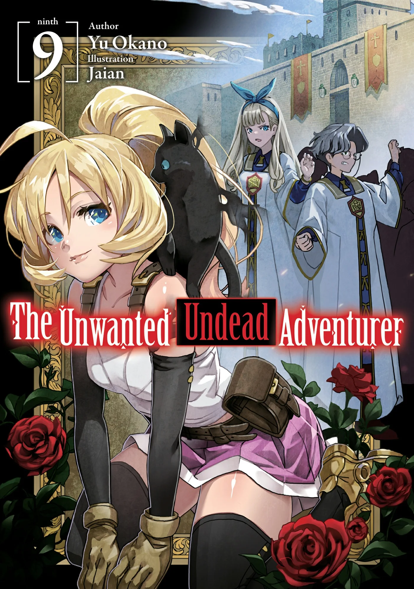
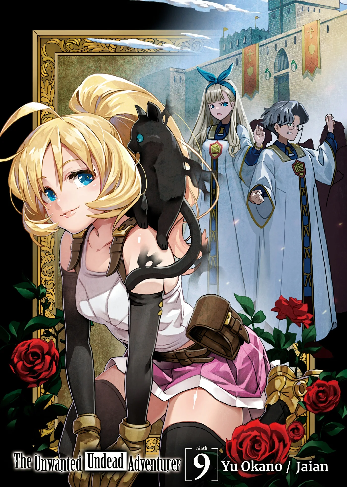
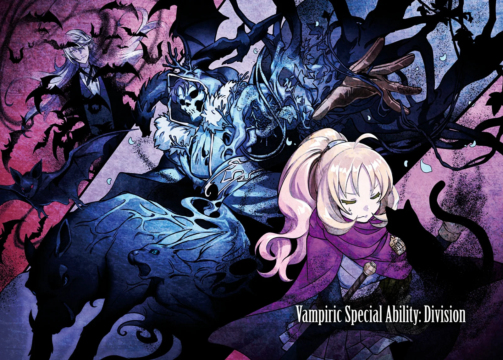
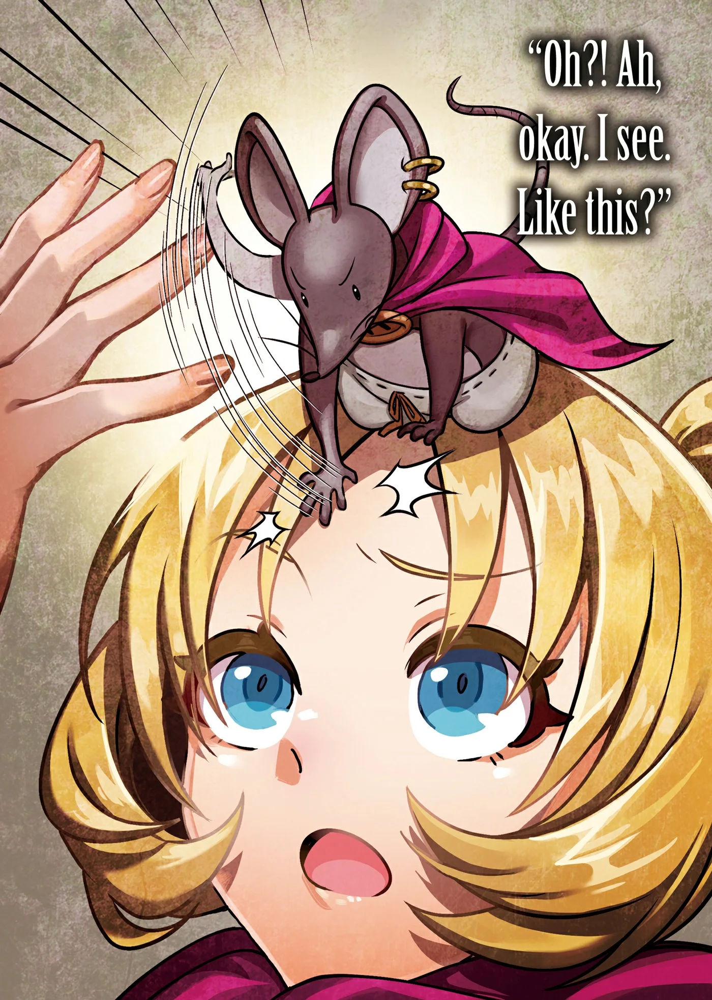
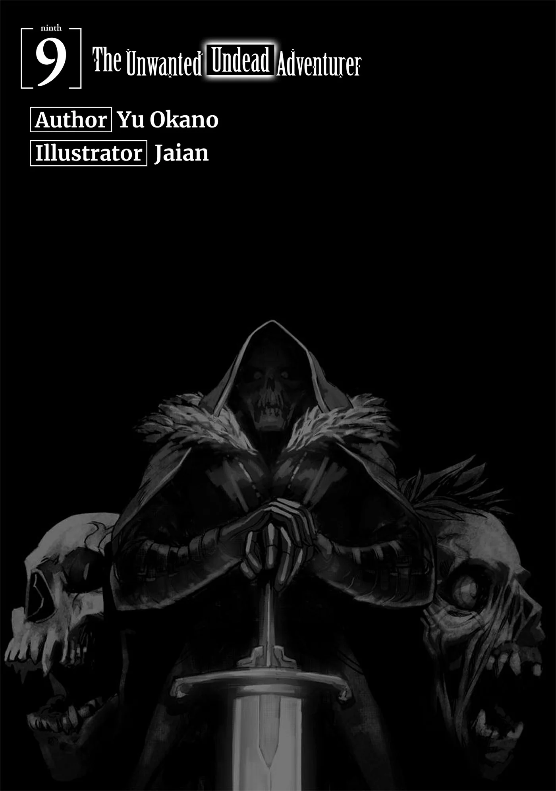
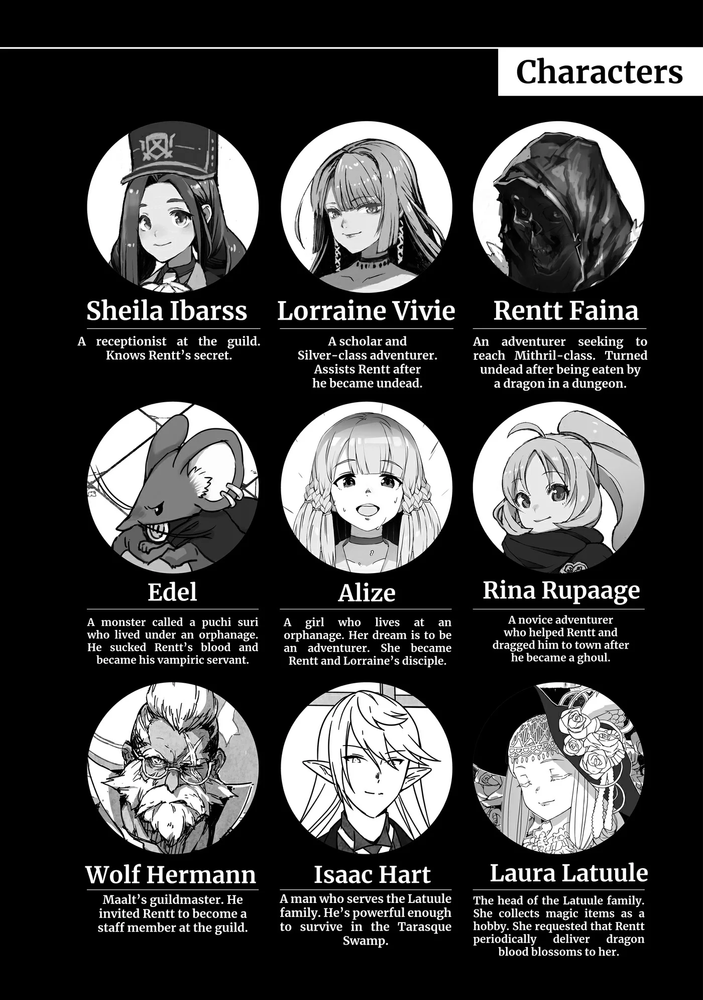
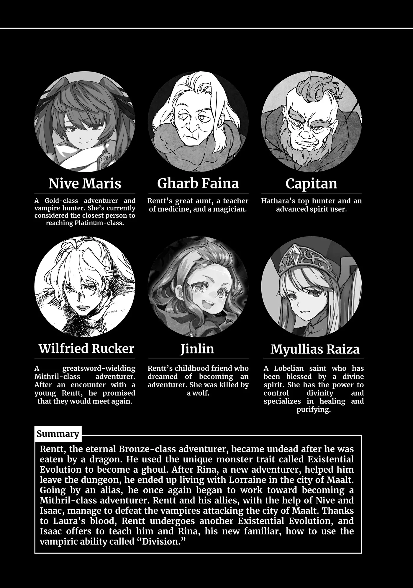
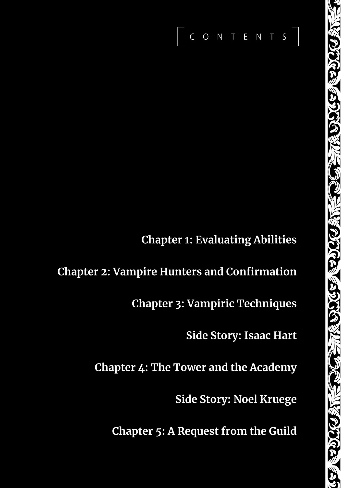
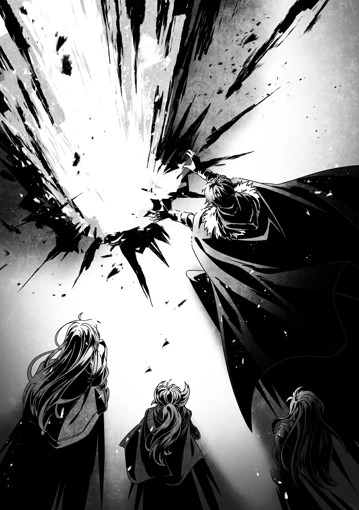

# Chương 199: Tập 9 Chương 1 - Đánh Giá Năng Lực (1)

Ở dinh thự của gia tộc Latuule, kẹp giữa tòa nhà chính và mê cung cây bụi có một khoảng đất trống gọi là "sân bãi". Phía bên kia dinh thự cũng có một khoảng sân trong, nhưng hoa lá với mấy luống thảo dược đã chiếm hết chỗ, chẳng tiện cho việc chúng tôi định làm.

Đứng trước mê cung cây bụi, Isaac giải thích: "Dù ngài có lỡ tay phá phách đôi chút thì sức mạnh của mê cung cũng thừa sức phục hồi lại. Vì vậy, xin ngài cứ thoải mái bung sức theo ý mình."

Dẫu biết giờ mới thắc mắc thì hơi muộn, tôi vẫn buột miệng hỏi: "Tôi nghe nói mê cung cây bụi này là do một ma cụ tạo nên. Có thật vậy không anh?"

"À, vâng, đúng vậy. Tôi nghe nói đó là một di vật cổ đại được tạo ra nhằm mô phỏng lại môi trường của một mê cung thực thụ theo cách nhân tạo. Có điều, nó không thể sinh ra quái vật hay mở rộng lãnh thổ như mê cung thực sự."

Nghe vậy tôi mới thấy nhẹ cả người. Chứ nghĩ đến cảnh chỗ này cũng là một mê cung có Lõi Mê Cung thì rợn thật.

Laura là Chủ Nhân Mê Cung, và vì cô bé muốn bảo vệ thị trấn Maalt nên tạm thời cũng chưa đáng lo. Nhưng biết đâu một ngày nào đó cô bé lại không muốn gánh vác vai trò này nữa. Laura đã sống qua bao năm tháng, nên chắc tôi chẳng cần lo bò trắng răng làm gì. Cơ mà cái tính tôi cứ hay nghĩ đến kịch bản xấu nhất. Dĩ nhiên, có xảy ra thật thì tôi cũng chẳng làm được gì nhiều. Thay cô bé làm Chủ Nhân Mê Cung nghe cũng không tệ, ngặt nỗi Laura từng bảo vị trí đó gò bó đủ đường. Tính ra cũng chẳng phải ý hay.

"Vậy là," tôi tiếp lời, "tôi có lỡ tay phá hỏng thứ gì cũng không sao đúng không? Biết thế thì tốt rồi."

Isaac gật đầu: "Vâng. Vậy chúng ta bắt đầu nhé? Trước hết, ta nên kiểm tra thể lực cùng các khả năng khác của ngài."

◆◇◆◇◆

Trước tiên, tôi thử kiểm tra lực tay. Tôi nhặt một hòn đá dưới đất lên rồi bóp chặt. Hòn đá lập tức nứt toác, vỡ vụn rồi nát thành bụi trong lòng bàn tay tôi.

"Tôi biết cơ thể anh giờ là của quái vật, nhưng thế này thì vẫn ấn tượng thật đấy," Lorraine đứng gần đó quan sát, lên tiếng. "Anh không dùng ma pháp cường hóa thể chất nào đấy chứ?"

"Không hề. Có vẻ tay tôi khỏe hơn trước khá nhiều, cũng phiền toái thật đấy. Lúc nãy tôi còn lỡ bóp nát cả quả đấm cửa cơ mà."

"Rentt, tốt nhất là anh đừng có làm hỏng quả đấm cửa nào ở nhà tôi đấy," Lorraine nghiêm mặt bảo.

Đâu phải tôi muốn bóp nát nó đâu. Dĩ nhiên tôi chẳng dại gì đi phá quả đấm cửa nhà Lorraine, nhưng nếu không học được cách kiềm chế lực tay thì rắc rối to.

Nghĩ vậy tôi mới sực nhớ không phải chỉ mình tôi phải làm quen với cơ thể mới. Ở đây vẫn còn một người nữa đang phải tập thích nghi với thân phận mới.

"Còn cô thì sao, Rina? Sức lực này nọ thế nào rồi?" tôi hỏi.

"A, tôi vẫn chưa thử nữa."

Tôi nhặt một hòn đá khác đặt vào tay Rina, bảo cô ấy bóp chặt lại.

"Hừm...!" Rina dồn hết sức gồng tay, cuối cùng hòn đá cũng vỡ vụn. "Oa!" cô ấy ngạc nhiên thốt lên. Thời còn là con người, chắc chắn cô ấy chẳng thể nào làm được như vậy.

Trên đời này chẳng thiếu những kẻ dị thường, và bóp nát đá bằng tay trần cũng không phải chuyện không ai làm nổi. Tôi chắc mẩm mạo hiểm giả Mithril Cấp thừa sức làm được, thậm chí vài mạo hiểm giả Kim Cấp hay Ngân Cấp có tiếng tăm cũng làm được. Nhưng trước khi biến thành Ma Cà Rồng, Rina chỉ là tân binh mới vào nghề, cô ấy tuyệt đối không thể nào bóp nát nổi một hòn đá.

"Xem ra thể lực của cô cũng tăng lên rồi đấy," tôi bảo.

Isaac gật đầu: "Tôi cho rằng cô Rina có thể sánh ngang với một Hạ Cấp Ma Cà Rồng. Ngạ Quỷ thường còn mạnh hơn thế, nhưng cô ấy vẫn khỏe hơn nhiều so với một người bình thường. Còn về Ma Lực thì hai vị cảm thấy thế nào?"

Isaac hỏi cả hai chúng tôi, nên tôi và Rina định thử dùng ma pháp xem sao. Cơ mà Rina không biết nhiều phép thuật cho lắm, nên tôi nhận làm trước.

"Để xem nào. Hỡi ngọn lửa, hãy lấy Ma Lực của ta làm nguồn nuôi dưỡng và hiển hiện trước mắt ta. Aliumage!"

Đây chỉ là một ma pháp cơ bản tôi từng dùng trước đây. Dù vậy, do lần trước thi triển nó từng giở chứng bất thường, nên mọi người đều chủ động lùi lại chừa cho tôi một khoảng rộng. Hóa ra họ cẩn thận như thế chẳng thừa chút nào.

"Thế này thì là phóng hỏa chứ mồi lửa cái nỗi gì," tôi lẩm bẩm nhìn cột lửa cháy ngùn ngụt trước mặt.

Tôi hơi lo ngọn lửa bén vào mê cung cây bụi, nhưng khi lửa liếm tới sát mép, cây cối ở đó cũng chỉ bốc khói âm ỉ. Do cây còn sống và đẫm nước, hay vì nguyên do nào khác? Lửa cháy to cỡ này thì có là cây tươi chắc cũng phải bốc cháy ngùn ngụt. Họa chăng mê cung cây bụi có đặc tính riêng giúp nó không thể bắt lửa.

Đợi ngọn lửa lụi bớt, cả ba mới bước lại gần. Rina trố tròn mắt bảo: "Tôi làm sao dùng nổi phép nào mạnh cỡ đó chứ! Anh thừa biết rồi mà, đúng không?"

"Hình như cô hiểu nhầm rồi đấy," Lorraine giải thích. "Đó là Aliumage, một phép cơ bản thuộc Ma Thuật Sinh Hoạt. Chỉ cần có đủ Ma Lực để vận hành thì ai cũng dùng được. Chẳng có lý do gì cô lại không thi triển được nó đâu, Rina."

Xem chừng trong lúc tôi ngủ say, Rina và Lorraine đã có khối thời gian trò chuyện làm quen. Cả hai có vẻ khá hòa hợp. Trông chừng Lorraine cảm thấy mình vừa có thêm một cô em gái kiêm chuột bạch thí nghiệm, còn Rina lại thấy mình vừa kiếm được một người chị kiêm miếng mồi ngon mắt. Nghe qua thì rợn cả người, nhưng hai người họ đã thấy ổn thì chắc cũng chẳng sao.

Còn đang mải nghĩ ngợi thì tôi thấy Rina kinh ngạc nhìn Lorraine: "Khoan đã, đó là Ma Thuật Sinh Hoạt thật sao? Ý tôi là, đúng là anh Rentt vừa niệm câu chú đó, nhưng Ma Thuật Sinh Hoạt mà lại đủ sức thiêu rụi cả một căn nhà như thế sao?"

"Ma Thuật Sinh Hoạt vốn chỉ tạo ra hiệu quả rất hạn chế, bù lại cũng không đòi hỏi nhiều Ma Lực. Người ta chỉ dùng chúng vào mấy việc lặt vặt thường ngày trong nhà. Mà thật ra, cái tên này chỉ là cách gọi ước lệ thiếu chính xác trong dân gian. Giới học thuật có thuật ngữ chuyên môn riêng, nhưng vì chỉ học giả mới dùng nên tạm thời gác sang một bên đã. Dù sao thì chiếu theo định nghĩa đó, ma pháp vừa rồi của Rentt đúng là Ma Thuật Sinh Hoạt mà cũng chẳng phải là Ma Thuật Sinh Hoạt."

"Quả đúng như tôi nghĩ," tôi lẩm bẩm.

Cả miếng mồi lẫn con chuột bạch đều nhìn tôi như thể tôi vừa mọc thêm cái đầu thứ hai. Theo tôi thì hai người họ hơi cay nghiệt quá rồi đấy.

Tôi chỉ đùa chút về chuyện mồi ngon với chuột bạch thôi. Cơ mà tôi đồ rằng thế nào cũng có lúc Rina cắn Lorraine một miếng, còn Lorraine thì chắc chắn sẽ đem Rina ra làm thí nghiệm. Dù sao thì chúng tôi cũng phải tiếp tục bài kiểm tra năng lực đã.

◆◇◆◇◆

Tôi nhận rõ Ma Lực của mình đã tăng lên đáng kể. Dù vậy, ngoài kia vẫn còn khối kẻ nhiều Ma Lực hơn tôi. Nhưng so với thời còn sống, sức mạnh của tôi bây giờ có khi bằng cỡ một trăm năm mươi Rentt gộp lại. À thì, đấy cũng chỉ là tôi đoán mò thôi.

Xét về cấp bậc, chắc tôi ngang ngửa một mạo hiểm giả Kim Cấp tầm trung. Nhưng ma pháp của tôi vẫn chẳng đâu vào đâu, nên nếu đụng độ thực chiến, tôi chắc mẩm mình sẽ thua một ma pháp sư Đồng Cấp. Có điều, nếu tính tổng thể năng lực toàn diện thì thế này cũng tạm chấp nhận được.

"Rina, cô không cần phải so bì với Rentt làm gì," Lorraine bảo. "Anh ấy vốn kỳ quặc đủ đường rồi. Chẳng thể xếp anh ấy vào mẫu khảo sát được đâu, vì một cá thể dị biệt như thế sẽ kéo lệch cả mức trung bình mất."

Đành rằng tôi không hợp để đem ra làm thước đo, nhưng cô ấy nói khéo hơn một chút thì chết ai. Cơ mà ngẫm lại, chuyện này xưa nay cũng chẳng có gì mới lạ.

Tôi thừa biết mình vốn là một gã lập dị, ngay từ trước khi biến thành Undead. Chẳng hạn, bản lĩnh của tôi chẳng có gì ghê gớm, nhưng lại sở hữu cả Khí Lực, Ma Lực lẫn Thần Lực. Đã thế tôi còn khăng khăng bám lấy lối đi độc hành dù bản thân còn đầy yếu kém.

Thông thường, phần lớn mạo hiểm giả ở tầm của tôi thời còn sống có lẽ đã sớm bỏ nghề đi tìm việc khác. Hoặc họ sẽ lập tổ đội với người khác, cày cuốc những ủy thác vừa sức cho tới khi gom đủ vốn để mở một quán trọ hay chuyển sang làm thương nhân. Đó mới là vòng đời bình thường của một mạo hiểm giả.

Những người bạn cũ không thể phất lên với nghề mạo hiểm giả rốt cuộc đều chọn lối rẽ ấy. Thỉnh thoảng tôi lại tự hỏi không biết giờ họ sống thế nào. Mấy ai còn bám trụ lại Maalt đâu. Mạo hiểm giả suy cho cùng cũng chỉ là lũ lãng du thích nay đây mai đó, hiếm kẻ nào chịu cắm rễ yên phận ở quê nhà.

Cơ mà tôi lại đi lạc đề mất rồi.

"Dù vậy, tôi cũng là một Hạ Cấp Ma Cà Rồng, hoặc thứ gì đó tương tự, vậy chẳng phải tôi cũng là cá thể dị biệt như anh Rentt sao?" Rina hỏi Lorraine.

Rina có vẻ bình thản đến lạ trước mọi chuyện. Hoặc cũng có thể chẳng có gì đáng ngạc nhiên cho lắm. Ngay từ lần đầu gặp tôi, dù ban đầu cô ấy có ngỡ ngàng và hơi e dè, nhưng khi đã chấp nhận con người tôi thì chẳng hề ngần ngại ra tay giúp đỡ. Lúc tôi bảo mình không thể về nhà với cái diện mạo quái vật này, Rina vẫn một mực khăng khăng là được. Bàn về độ lạc quan thì cô ấy luôn tươi vui và hướng về phía trước hơn tôi nhiều.

Lorraine suy nghĩ một lát rồi gật đầu: "Điều đó hoàn toàn có thể xảy ra, nhất là khi Rentt đã chia sẻ máu cho cô. Chuyện đó ta có thể kiểm chứng qua các bài thử. Mà nhắc mới nhớ... Giờ hỏi thì hơi muộn, nhưng cô không thấy sốc hay hoang mang khi mình biến thành Ma Cà Rồng sao, Rina? Trông cô dửng dưng đến lạ trước mọi chuyện đấy. Lúc Isaac bảo cô giống một Hạ Cấp Ma Cà Rồng, cô cũng chẳng hề hoảng hốt. Hồi nãy thì bảo chưa kịp hoàn hồn, nhưng giờ hẳn là phải tỉnh táo rồi chứ?"

"À. Nghe chị nói vậy mới thấy đúng thật," Rina đáp. "Bình thường chắc tôi sẽ hoang mang hơn nhiều. Nhưng tôi đã biết anh Rentt từ trước rồi mà. Người tốt thì dẫu có biến thành quái vật đi chăng nữa vẫn là người tốt thôi. Vả lại, hình như bây giờ cảm xúc của tôi cũng trầm lại đôi chút."

"À, ra là cô đã sớm quen với cú sốc đó vì từng gặp Rentt hồi anh ấy còn là Ngạ Quỷ. Tôi nhớ Rentt từng nhắc tới việc cảm xúc của mình bị chai sạn đi khi biến thành Undead. Hiện tượng này có phổ biến không, anh Isaac?"

"Đúng vậy," Isaac xác nhận. "Bản thân tôi sinh ra đã là Ma Cà Rồng nên chưa từng trải qua cảm giác đó. Nhưng với con người bị biến đổi thì chuyện này quả thực có xảy ra. Tất nhiên, không phải là mất sạch cảm xúc hay gì đâu. Một quý ngài tôi quen từng biến thành Ma Cà Rồng có kể lại với tôi rằng người ta sẽ trở nên điềm tĩnh hơn và suy xét mọi việc một cách lý trí hơn."

"Tôi cứ ngỡ Rentt và Rina là những trường hợp hiếm hoi cơ đấy," Lorraine tiếp lời.

"Hóa ra vẫn có con người biến thành Ma Cà Rồng sao?"

"Đúng như tiểu thư từng nói, đôi khi Ma Cà Rồng sẽ biến đổi con người để làm bạn đời," Isaac giải thích. "Tuy nhiên, theo tôi biết thì chuyện đó chẳng mấy khi xảy ra. Ma Cà Rồng thời nay phần lớn đều chọn bạn đời trong chính đồng loại. Cũng có những kẻ qua lại với con người chỉ để mua vui, nhưng ngay cả trường hợp đó thì việc biến đổi đối phương cũng cực kỳ hiếm thấy."

Nói vậy nghĩa là Ma Cà Rồng có thể sinh con đẻ cái với nhau. Tôi chẳng rành chuyện Ma Cà Rồng tạo ra bạn đời thế nào, nhưng thi thoảng vẫn nghe phong phanh mấy tin đồn về kiểu 'vui chơi' ấy. Thường thì những lời đồn về con lai nửa Ma Cà Rồng nửa người—Dampir—hầu hết chỉ là bịa đặt trắng trợn hoặc hiểu lầm.

Ở mấy làng quê hẻo lánh, thi thoảng vẫn có người bị đồn nhầm là Dampir rồi bị dân làng hắt hủi. Nhưng đến nơi thì mười mươi đều không phải Dampir thật, mà chỉ là những người sở hữu ma nhãn dị biệt không kiểm soát nổi, hoặc ai đó có quá nhiều Ma Lực rồi vô thức tỏa ma pháp ra xung quanh. Dampir xịn có khi cũng hiếm chẳng kém gì mạo hiểm giả Mithril Cấp. Tôi chưa từng tận mắt gặp ai bao giờ, dù rằng trên đời này số quái vật tôi chưa từng giáp mặt cũng nhiều không đếm xuể.

Những lời đồn về Dampir dạo ấy thường thu hút rất nhiều sự chú ý, nên tôi hay lặn lội đi xác minh kiếm chút tiền tiêu vặt. Nhiều lần tôi cũng vớ được manh mối hữu ích, chẳng hạn người sở hữu ma nhãn hay người có lượng Ma Lực dồi dào. Tất nhiên tôi chẳng có hứng làm mấy trò kinh dị như đem họ hiến tế hay móc mắt cấy ghép ma nhãn vào người mình. Tôi làm thế là vì mấy tin tức ấy rất đắt giá với các ma pháp sư đang tìm người nối nghiệp, hoặc các kỵ sĩ đoàn và quân đội đang săn đón tân binh triển vọng. Cơ mà cuối cùng thì người thực sự sở hữu dị năng cũng chẳng được mấy ai.
