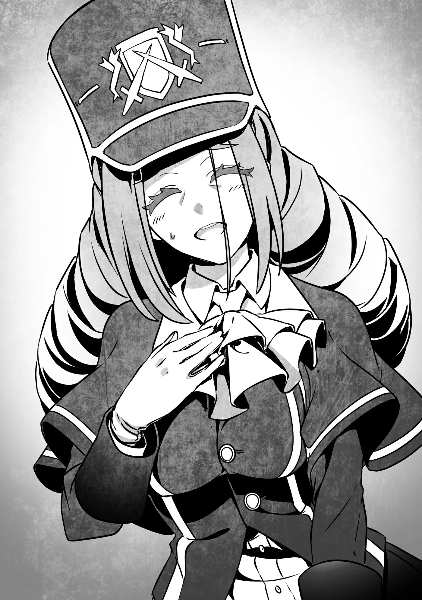

# Chương 202: Tập 9 Chương 2 - Thợ Săn Ma Cà Rồng và Xác Nhận (1)

Isaac đã đồng ý sẽ dạy thêm cho chúng tôi các kỹ năng của Ma Cà Rồng, nên chuyện đó cứ để sau khi tới Hội báo cáo rồi tính. Chứ để lâu quá, chắc chắn Wolf sẽ đứng ngồi không yên.

Maalt đã quay trở lại nhịp sống thường nhật, nên đây có lẽ cũng chẳng phải việc gì quá gấp gáp, nhưng tôi vẫn muốn lo cho xong càng sớm càng tốt. Cả nhóm cũng đã rà soát kỹ những sơ hở có thể có trong câu chuyện của mình, nên chắc sẽ ổn cả thôi. Còn về Isaac, chúng tôi quyết định anh ấy sẽ không đi cùng. Nive có lẽ vẫn còn ở đó, mà cô ấy lại có biệt tài vạch mặt Ma Cà Rồng. Chỉ cần vừa chạm mặt Isaac, thể nào cô ấy cũng chào đón anh ấy bằng Thánh Hỏa ngay tắp lự.

Rina lẽ ra cũng thế, nhưng giống như tôi, cô ấy chẳng hề thấy khó chịu trước Thần Lực. Với Ma Cà Rồng thông thường, Thần Lực chưa đến mức khiến họ bốc hơi ngay tức khắc. Vết thương do nó gây ra vẫn có thể hồi phục, có điều mất nhiều thời gian hơn, và chỉ chạm phải thôi là đã bị bỏng nhẹ rồi. Vì Rina không hề bị ảnh hưởng như thế khi dẫn truyền Thần Lực, nên nhiều khả năng Thánh Hỏa của Nive cũng chẳng làm cô ấy lộ tẩy.

Dĩ nhiên tốt nhất là Nive đừng làm thế, nhưng cô ấy đâu phải kiểu người chịu nghe lời kể cả khi tôi có can. Chừng nào còn ở trong thành phố và cô ấy vẫn chưa rời đi, chúng tôi khó lòng tránh khỏi chuyện tình cờ đụng mặt. Đã vậy thì khi giáp mặt Nive, tôi nhất định phải ở cạnh Rina. Dù có chuyện gì xảy ra, hai chúng tôi cũng sẽ cùng nhau đối mặt.

"Tính ra thì cũng chẳng hỗn loạn như tôi tưởng," tôi nói trên đường cả nhóm tiến về phía Hội.

Sau những gì đã xảy ra, tôi cứ ngỡ người dân thành phố vẫn còn hoảng loạn hay bàng hoàng lắm. Thế nhưng nhìn quanh thì chẳng thấy chút dấu hiệu nào như vậy cả. Gương mặt họ không có vẻ gì là u ám, ai nấy đều cư xử hệt như vừa trải qua một đợt thiên tai bình thường kiểu động đất hay bão lớn. Mọi người cặm cụi sửa sang nhà cửa và thu dọn đống đổ nát do quái vật, Thi Quỷ cùng các mạo hiểm giả gây ra. Tất cả chuyện này có gì đó hơi kỳ lạ.

"Anh cứ hỏi chuyện người dân trong thành phố là rõ ngay ấy mà," Lorraine gợi ý.

Lời cô ấy nói nghe hơi úp mở, nhưng tôi vẫn quyết định làm theo và bước tới bắt chuyện với một người đi đường.

"À, chuyện đó hả. Nghe bảo dưới lòng thành phố mới xuất hiện mê cung gì đó phải không? Nhưng quái vật cũng đâu có hay tràn ra ngoài lắm. Chậc, coi như xui xẻo thôi."

Tôi hỏi một người khác thì được đáp: "Quái vật hả? Nghe bảo có đám quái vật tràn ra từ mê cung. Tôi cũng biết vài người xấu số bỏ mạng vì chúng, nhưng chuyện đã rồi thì biết làm sao. Vả lại sắp tới có tiền trợ cấp từ ngài lãnh chúa nữa. Chừng đó cũng đủ để sửa sang lại cửa tiệm rồi, nên chẳng có gì to tát cả."

Một người khác nữa thì bảo: "Nhà tôi bị lũ quái vật hại chết rồi. Nhưng tôi tin chắc ông ấy đã chiến đấu tới cùng để bảo vệ gia đình. Tôi chỉ cần nhớ lấy điều đó mà ráng sống tiếp vì ông ấy thôi. Phụ nữ Maalt cứng cỏi lắm."

Ai tôi hỏi cũng nói rõ là thành phố chịu thiệt hại không ít, thế nhưng...

"Chẳng một ai nhắc gì đến chuyện người dân trong thành phố bị biến thành quái vật cả."

Khi mê cung xuất hiện, nó đã biến không ít cư dân Maalt thành quái vật. Các mạo hiểm giả chẳng còn cách nào khác ngoài việc phải ra tay giết họ với gương mặt đầy đau xót. Sự thật là vậy. Thế mà chẳng một ai trong thành phố nhắc tới chuyện ấy. Chẳng lẽ chuyện đó quá đau lòng nên không ai nỡ nhắc lại sao?

Trong lúc tôi đang điểm qua các khả năng trong đầu, Lorraine nói tiếp: "Đại khái là vậy đấy. Có vẻ chẳng ai nhớ chuyện một số người dân cùng thành phố đã bị biến thành quái vật cả. Họ cứ nghĩ là quái vật tràn ra từ mê cung rồi giết chết những người đó thôi."

"Nhưng chị với anh Rentt vẫn nhớ những chuyện đã xảy ra, đúng không?" Rina thắc mắc. "Lạ thật đấy. Cả anh Isaac cũng nhớ nữa mà."

Cô ấy nói chẳng sai. Tôi và Lorraine đều nhớ như in mọi chuyện. Thế nhưng...

Lorraine tiếp tục: "Isaac cho rằng đó là do Laura đã ra tay can thiệp với tư cách Chủ Nhân Mê Cung. Người dân có thể chấp nhận chuyện quái vật tấn công và dưới lòng thành phố giờ đây có một mê cung, nhưng họ không thể nào chấp nhận nổi chuyện chính người thân, bạn bè mình lại biến thành quái vật rồi quay sang tấn công họ. Thế nên Laura mới sửa đổi đôi chút ký ức của họ. Xem ra những Chủ Nhân Mê Cung hùng mạnh hoàn toàn có thể làm được điều đó. Nghe được điều này thực sự khá đáng sợ, nhưng có lẽ lần này làm vậy lại là tốt nhất."

Vì Laura vẫn đang bất tỉnh nên chúng tôi chưa thể chắc chắn, nhưng ý Isaac hẳn đó là khả năng cao nhất. Chính tôi cũng chẳng nghĩ ra nổi ai khác đủ sức làm được điều phi thường này. Xét việc cô bé quan tâm đến người dân thành phố nhiều đến mức nào, hành động đó hoàn toàn đúng với tính cách của Laura. Nếu đúng là vậy thì tôi thấy cũng ổn thôi. Ý tôi là, dĩ nhiên chuyện một Chủ Nhân Mê Cung có thể chỉnh sửa ký ức của người ta có chọn lọc thì chẳng ổn chút nào. Chẳng cần phải là thiên tài mới nhận ra năng lực ấy đáng nể và đáng sợ đến mức nào. Nhưng thôi, đây là chuyện không nên bận tâm đào sâu làm gì.

Vả lại, chúng tôi thì làm được gì cơ chứ? Giết cô bé sao? Tôi còn chẳng nỡ nghĩ tới chuyện đó. Nhờ có Laura mà Maalt mới giữ được tương đối nguyên vẹn. Không có cô bé, thành phố này coi như đã bị xoá sổ, biến trọn thành một mê cung khổng lồ rồi. Chừng nào cô bé vẫn còn muốn bảo vệ Maalt, tôi thấy cứ để nguyên mọi chuyện như vậy cũng chẳng sao.

Nếu một ngày nào đó Laura đổi ý, tôi cũng sẽ không đối đầu với cô bé đâu. Điều duy nhất tôi làm được là cầu nguyện với các vị thần cho tình cảnh ấy không bao giờ xảy ra. Tôi thậm chí còn chẳng hình dung nổi làm sao để thắng được cô bé khi giao chiến. Laura mạnh vượt trội hơn bất kỳ ai trong chúng tôi. Dù cả nhóm có hợp lực tấn công cùng một lúc, chúng tôi cũng chẳng có lấy một cơ hội thắng.

"Chờ lúc Laura tỉnh lại, chắc cũng nên hỏi xem một Chủ Nhân Mê Cung có thể làm được những gì. Dù có biết thì cũng chẳng thay đổi được gì đâu," tôi nói với Lorraine.

"Xem ra Chủ Nhân Mê Cung còn quyền năng hơn tôi tưởng nhiều. Hay điều đó chỉ riêng Laura mới có nhỉ? Có lẽ cũng phải có giới hạn nào đó chứ. Đấy chính là điều tôi muốn hỏi cô bé."

Laura từng nhắc qua chuyện giới hạn, nhưng chúng tôi hoàn toàn không rõ cụ thể đó là gì. Sức mạnh to lớn của Chủ Nhân Mê Cung luôn đi kèm cái giá phải sống chung với những ràng buộc ấy. Nhưng muốn biết chúng là gì thì chúng tôi đành phải đợi đến khi Laura tỉnh lại.

Cả nhóm cứ thế vừa đi vừa trò chuyện cho tới khi đến được Hội.

◆◇◆◇◆

Lúc chúng tôi tới nơi, bên trong Hội đang khá bận rộn. Mà kể cũng phải thôi, sau từng ấy chuyện vừa xảy ra cơ mà. Từ việc chi trả tiền thưởng săn Thi Quỷ cùng quái vật cho tới thu mua Ma Tinh lấy từ chúng, Hội bận đến mức chẳng ngơi tay. Nhân viên sau quầy tiếp tân ai nấy đều hối hả làm việc, phân loại từng chồng giấy tờ. Chỉ cần liếc qua mặt họ là thấy đôi mắt đã mất hết thần sắc. Đợi đợt cao điểm này qua đi, chắc họ chỉ còn nước lảo đảo lết về nhà, lăn đùng ra sàn trong cơn kiệt sức rồi ngủ liền mấy ngày đêm mất thôi.

Giữa mớ hỗn độn đó, bỗng có tiếng gọi vang lên từ phía sau tôi.

"Anh Rentt! Cô Lorraine và... cả Rina nữa à? May quá, thấy mọi người vẫn bình an vô sự."

Khi tôi quay lại, đứng đó là Sheila, cô tiếp tân viên của Hội vốn quá rõ tình cảnh của chúng tôi. Đôi mắt cô ấy đờ đẫn vì kiệt sức, trông như thể sắp ngã quỵ đến nơi khi sự mệt mỏi gần như toát ra từ từng lỗ chân lông.

"Xem chừng chỗ cô đang ngập đầu trong cả mớ bòng bong rồi nhỉ, cô Sheila," tôi thông cảm nói.

Sheila lắc đầu: "So với những người đã trực tiếp chiến đấu với quái vật thì chút việc này có đáng là bao. Có điều thêm được vài người phụ giúp thì vẫn đỡ hơn," cô ấy khẽ lẩm bẩm bằng giọng yếu ớt mệt mỏi.

Tôi cũng chẳng giúp được gì cho cô ấy. Đó toàn là việc nội bộ của Hội, mà bận rộn thế này khéo Hội lại đang kiếm bộn tiền ấy chứ.

Ma Tinh từ Thi Quỷ bán rất được giá trên thị trường, các loại nguyên liệu thu hoạch từ chúng cũng đang có nhu cầu cực lớn. Chưa kể nguyên liệu từ các loài quái vật khác có thể dùng để tái thiết thành phố cũng rất nhiều, nên chuyện làm ăn của Hội trong thời gian tới chắc chắn sẽ lên như diều gặp gió. Còn tiền đó có chảy giọt nào xuống túi các nhân viên hay không thì lại là chuyện khác, một ẩn số mà chỉ có cấp trên hay họa chăng các vị thần mới biết nổi. Tất cả còn tuỳ vào quyết định của Wolf.

"Cố lên nhé," tôi nói với Sheila. "Dù tôi cũng muốn nán lại mừng chúng ta gặp lại nhau bình an, nhưng nhóm tôi có chút thông tin mà Wolf cần nghe. Cô có biết ông ấy đang ở đâu không?"

"Ồ, đấy cũng là một phần lý do tôi ra gặp anh đấy. Hội Trưởng đang ở trong phòng làm việc, mọi người cứ lên thẳng trên đó nhé."

Tôi gật đầu với Sheila rồi đi về phía phòng làm việc của Wolf.

◆◇◆◇◆

Vừa mở cửa bước vào phòng làm việc, Wolf đã ngẩng đầu lên bảo: "Thế là cuối cùng cậu cũng chịu vác cái bản mặt khó ưa tới rồi đấy à."

Dù chỉ còn độc con mắt bên phải, ánh nhìn của ông ấy vẫn sắc bén như mọi khi. Thế nhưng nó chẳng hề mang vẻ đe dọa chút nào. Có lẽ là do trước đây chúng tôi đã giải thích nhiều chuyện với Wolf, và ông ấy cũng xem chúng tôi như người trong đàn của mình rồi. Dù vậy, tôi vẫn không dám lơ là cảnh giác. Trong lần báo cáo này, tôi vẫn định giấu kín mọi chuyện liên quan đến Laura.

Bàn làm việc của Wolf chất đầy giấy tờ, cao đến mức khiến tôi cũng phải nể độ dày của chồng tài liệu ấy. Đoán chừng toàn bộ chỗ đó đều cần chữ ký trực tiếp của Hội Trưởng. Ngay khoảnh khắc ấy, tôi thề với lòng rằng mình sẽ không bao giờ làm Hội Trưởng.

"Phải đấy. Ông có rảnh một lát không?" tôi hỏi. "Tôi tới để báo cáo tình hình đây. Cơ mà trông ông có vẻ khá bận nhỉ."

Tin tức của chúng tôi cũng chẳng gấp gáp gì, nếu ông ấy muốn cả nhóm quay lại sau thì cũng không thành vấn đề. Thành phố lúc này xem chừng không còn mối đe dọa trước mắt nào nữa, nên tôi có báo cáo muộn một chút cũng chẳng hại gì.

Chẳng chút do dự, Wolf đáp ngay: "Không, đống này để sau cũng được. Tôi nghe luôn bây giờ đây. Cậu muốn nói chuyện riêng hay là...?"

Con mắt bên phải của Wolf hướng về phía Lorraine và Rina. Không phải ông ấy muốn đuổi họ ra ngoài, mà chỉ muốn chắc chắn rằng để hai người cùng nghe cuộc trò chuyện có thể làm lộ bí mật của tôi thì vẫn ổn. Chắc ông ấy đoán tôi đã giải thích đôi phần cho Lorraine rồi, nhưng lại nghĩ tôi chưa kể toàn bộ câu chuyện cho Rina.

Tôi lắc đầu: "Không sao đâu. Cả hai đều biết hết rồi."

Tôi nhấn mạnh từ cuối cùng, khiến con mắt độc nhất của Wolf mở to kinh ngạc. "Thế thì hai người cứ tự nhiên ở lại. Nhớ đóng chặt cửa vào nhé, cô bé," ông ấy dặn Rina vì cô ấy là người bước vào sau cùng.

Cánh cửa vẫn còn hơi hé, nên Rina vội vàng khép chặt lại sau lưng.

◆◇◆◇◆

Wolf vào thẳng vấn đề: "Vậy con quái vật cậu nhắc tới giữa lúc rối ren ấy coi như chết rồi chứ?"

"Phải đấy. Chúng tôi đã xử lý hắn rồi. Bằng chứng đây."

Tôi lấy ra một viên Ma Tinh. Toàn thân Shumini gần như đã hóa thành tro bụi, chỉ sót lại viên đá này nằm lẫn bên trong. Vì Isaac từng thân thiết với Shumini nên tôi đã ngỏ ý nhường lại cho anh ấy, nhưng Isaac lại dúi trả vào tay tôi, bảo rằng tôi sẽ cần nó làm bằng chứng và sau đó tôi có đem bán đi thì anh ấy cũng chẳng bận tâm. Shumini đối với Isaac chẳng khác nào một kẻ bám đuôi dai dẳng, nên chắc anh ấy cũng chẳng thiết tha giữ lại kỷ vật gì của gã. Hoặc có khi chỉ là do tôi nghĩ nhiều quá thôi.

Wolf cầm lấy viên Ma Tinh rồi nói: "Chà chà. Viên này vừa to vừa đẹp đấy. Loại cỡ lớn thế này chẳng mấy khi thấy đâu. Hẳn đối thủ cũng thuộc hàng dữ dằn lắm đây." Giọng ông ấy lộ rõ vẻ tán thưởng.

Tuy kích thước không phải lúc nào cũng quyết định giá cả, nhưng một viên Ma Tinh to cỡ này quả thực hiếm khi xuất hiện trên thị trường. Nhìn vào sắc đá, độ trong cùng lượng Ma Lực ngậm bên trong, ai cũng nhận ra đây là hàng thượng phẩm. Muốn đo chính xác lượng Ma Lực thì cần tới dụng cụ chuyên biệt, nhưng ai từng cầm qua vài viên là có thể áng chừng được bên trong chứa bao nhiêu.

Nói về độ lớn chính xác, viên này to hơn chừng hai bậc so với viên Ma Tinh tôi từng lấy được từ con Khô Lâu Khổng Lồ. Viên trước tương đương Kim Cấp, còn viên của Shumini đây dám chắc phải đạt tầm Bạch Kim Cấp. Dù vậy, nên nhớ Ma Tinh của Khô Lâu Khổng Lồ đạt tới cỡ đó là nhờ gom góp nén Ma Lực suốt nhiều năm, thậm chí hàng thập kỷ. Trong khi viên của Shumini lại phình to chừng này chỉ sau vài tiếng đồng hồ hoá thành quái vật, đủ thấy thực lực của gã từng khủng khiếp đến mức nào. Hoặc không, thì sức mạnh kiến tạo nên mê cung quả thực vô cùng ghê gớm.

Dù sao đi nữa, chắc chắn viên Ma Tinh này cũng sẽ bán được giá rất cao. Không phải tôi mang nó tới đây để bán, nhưng vì Isaac đã đồng ý cho làm vậy rồi nên...
