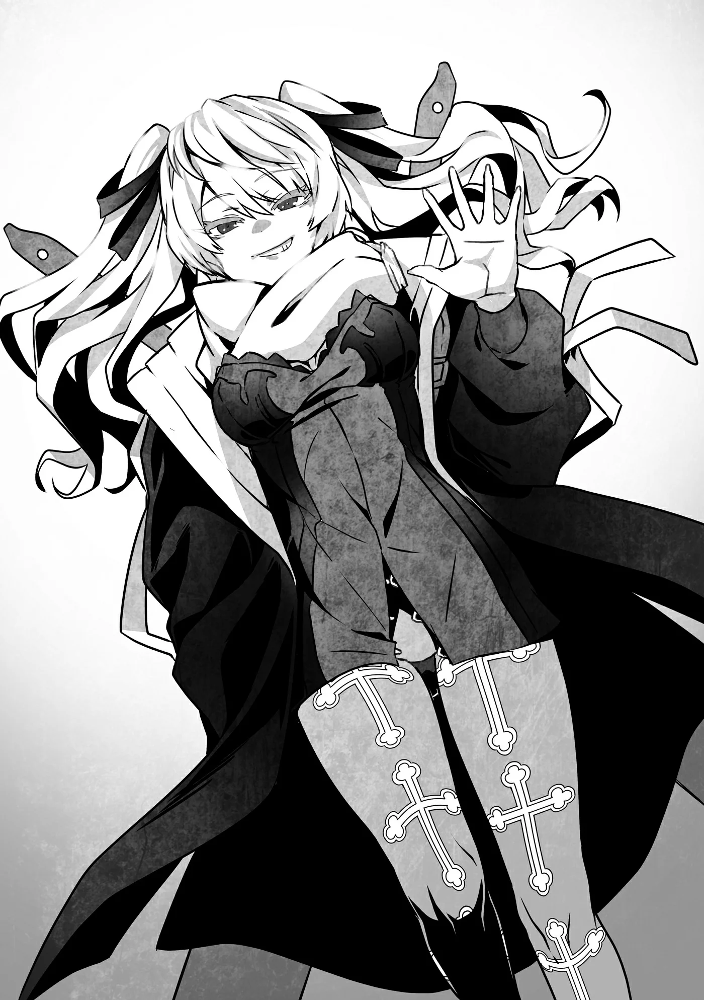

# Chương 203: Tập 9 Chương 2 - Thợ Săn Ma Cà Rồng và Xác Nhận (2)

"Được rồi, trước hết hãy bắt đầu với tình hình thành phố đã."

Wolf bắt đầu giải thích những gì đã diễn ra sau khi chúng tôi đánh bại Shumini — nói chính xác hơn là những gì đã xảy ra sau khi chúng tôi hạ gục Shumini và Laura lấy Lõi Mê Cung ra khỏi người Rina.

"Đầu tiên, đám Thi Quỷ đang hoành hành khắp thành phố bỗng nhiên trở nên chậm chạp. Nhờ thế mà việc tiêu diệt chúng dễ dàng hơn rất nhiều. Chắc chúng ta đã xử lý xong phần lớn bọn chúng rồi. Có thể vẫn còn vài con tàn dư đang lẩn trốn, nhưng giờ chúng chẳng còn là mối đe dọa lớn nữa. Theo lời Nive, khi Thi Quỷ mất đi chủ nhân điều khiển chúng, trí năng của chúng thường tụt dốc không phanh. Tôi đoán đó là những gì đã diễn ra khi cậu kết liễu Shumini."

Đúng như tôi dự đoán, Nive đã quay lại thị trấn. Tôi từng thấy cô ta tiến sát tới tận tường thành, nên việc suy đoán cô ta đã trở về khi kết giới bao quanh thành phố biến mất cũng không có gì là lạ.

"Hiện giờ Nive đang làm gì vậy?" tôi hỏi.

"Cô ta đang lùng sục tiêu diệt nốt những con Thi Quỷ còn sót lại. Việc cô ta tự giác làm mà không cần ai nhờ vả thì tốt thật đấy, nhưng tâm trạng cô ta có vẻ hơi khó ở. Đại loại như chuyện chẳng có con Ma Cà Rồng nào cả."

Dù Thi Quỷ về bản chất cũng là một dạng ma cà rồng, nhưng Nive hẳn là đang ám chỉ từ Hạ Cấp Ma Cà Rồng trở lên. Cụ thể hơn, ý cô ta là đẳng cấp như Shumini trở lên. Cô ta từng bảo mình có khứu giác đặc biệt nhạy bén với những chuyện như vậy, nên chắc hẳn đã cảm nhận theo bản năng rằng Shumini không còn nữa. Hơn nữa, thành phố cũng không còn bầu không khí căng thẳng từng bao trùm khi Shumini hiện diện.

Tôi có cảm giác cô ta sẽ đổ lỗi cho mình nếu tôi tình cờ đụng độ cô ta. Tôi thực lòng hy vọng mình sẽ không chạm mặt cô ta.

Wolf nói tiếp, "Còn về phần còn lại, lũ quái vật xuất hiện trong thành phố bỗng dưng biến mất. Tôi đoán đó cũng là nhờ cái chết của Shumini. Chuyện đó xảy ra một lúc sau khi đám Thi Quỷ chậm lại, nhưng tôi chẳng nghĩ ra được lý do nào khác. Cậu có biết manh mối gì không?"

Tôi lắc đầu. "Không, tôi cũng chẳng biết gì đặc biệt cả."

Tôi đã nói một lời nói dối vô hại. Chuyện đó xảy ra không phải do cái chết của Shumini, mà là do Lõi Mê Cung. Khi Laura tách lõi khỏi Rina rồi tự mình hấp thụ nó, cô bé đã khiến lũ quái vật biến mất. Có vẻ nguyên nhân ban đầu khiến cư dân thành phố biến thành quái vật là do mê cung, nên tôi chẳng thể nghĩ ra lý do nào khác khiến họ đột nhiên biến mất như vậy. Dù vậy, vì tiết lộ điều đó sẽ kéo theo đủ thứ rắc rối, nên tôi tuyệt đối không hé răng nửa lời.

"Hiểu rồi. Dù sao thì lũ quái vật cũng đã biến mất. Thành phố về cơ bản đang quay trở lại nhịp sống bình thường. Vẫn còn vài công trình bị hư hại và người bị thương cần chăm sóc, nhưng có vẻ mọi người đã kiểm soát được tình hình. Lãnh chúa cùng hội đồng thị trấn đã chi tiền cứu trợ, còn về những người bị thương thì các giáo hội đã phái một số nam tư tế và nữ tư tế tới. Phía hội chúng ta cũng cử vài người đi hỗ trợ. Chẳng mấy chốc mà Maalt sẽ trở lại như xưa thôi."

Sự cố vừa rồi tương đối nghiêm trọng, nhưng việc công cuộc phục hồi không mất nhiều thời gian chính là minh chứng cho sự kiên cường của cư dân nơi đây. Nói là vậy, nhưng tôi dám chắc lý do chủ yếu là nhờ phép thao túng ký ức của Laura. Dù có kiên cường như cư dân Maalt đi chăng nữa, thì người ta cũng khó lòng bám trụ lại nếu nghĩ rằng người hàng xóm của mình có thể biến thành quái vật bất cứ lúc nào.

Nếu chỉ là một cuộc tấn công bất ngờ của quái vật thông thường, chuyện đó có thể xảy ra ở bất kỳ đâu trên thế giới. Đó không phải điều người ta có thể tránh được chỉ bằng cách dọn đi nơi khác. Chính vì thế, mọi người mới sẵn lòng đồng lòng đoàn kết vì cộng đồng, nén nỗi đau buồn và cố gắng tiến bước về phía trước bất chấp gian truân. Chưa kể, giờ đây dưới lòng thành phố còn có cả một mê cung.

Lorraine chen ngang, "Nhắc tới thành phố, tình hình bên dưới nó thì sao rồi..."

Cô không gọi thẳng nó là "mê cung" vì làm thế sẽ dấy lên mối nghi ngờ. Dù có vẻ hầu hết cư dân thành phố đều đã biết về sự tồn tại của nó, chúng tôi cũng chẳng việc gì phải để lộ việc mình cũng nắm rõ chuyện này.

"Phải, chúng tôi đang điều tra chuyện đó," Wolf đáp. "Mặc dù gần như ai nấy đều đi đến kết luận rằng đó là một mê cung. Quái vật tràn ra từ đó chính là ngòi nổ cho toàn bộ mớ hỗn loạn này, nên mọi chuyện sẽ hoàn toàn khớp nếu giả định đó là đúng. Chúng tôi chẳng có manh mối nào về việc tại sao một mê cung lại đột ngột hình thành, nhưng toàn bộ cơ chế đằng sau chúng cho đến nay vẫn chỉ là giả thuyết. Chẳng thể làm gì hơn được. Giả định hiện tại là Shumini bắt đầu hành động tại thành phố này vì hắn đã đánh hơi được việc mê cung đang thành hình."

Wolf không hẳn đã nói đúng hoàn toàn, nhưng cũng chẳng lệch đi là bao. Lý do duy nhất khiến họ không cân nhắc tới khả năng Shumini đã tạo ra mê cung là vì chẳng một ai tin chuyện đó có thể xảy ra.

Dù sự xuất hiện của các mê cung là chủ đề gây tranh cãi gay gắt, phần lớn các nhà nghiên cứu đều kết luận rằng chúng hình thành một cách tự nhiên. Cũng có một số mê cung củng cố cho giả thuyết đó. Thế nhưng, dựa theo lời giải thích của Laura, mê cung có rất nhiều loại khác nhau. Điều đó đồng nghĩa với việc có những mê cung xuất hiện tự nhiên, và cũng có những mê cung được tạo ra nhân tạo. Dù vậy, tôi sẽ cần phải nói chuyện với Laura để có thêm thông tin chi tiết.

"Chúng tôi cũng đã xác nhận có quái vật lang thang bên trong đó. Nhưng khi chúng tôi lùa chúng tới lối vào, chúng lại không có dấu hiệu muốn rời đi. Người ta bảo tôi rằng đợt Lũ Tràn quái vật là do sự bất ổn định vốn có của một mê cung mới hiển hiện. Cậu có biết gì về chuyện đó không?"

"Có," Lorraine lên tiếng, trả lời câu hỏi của Wolf. "Nhưng cũng chẳng có nhiều điều để nói thêm. Trong lúc một mê cung đang hiển hiện, sự tồn tại của nó rất bất ổn định, nên nhiều hiện tượng kỳ lạ sẽ xảy ra bên trong và xung quanh nó. Chẳng hạn, nếu nó hiển hiện tại một thành phố, nó có thể nuốt trọn một phần thành phố và làm biến đổi hoàn toàn kiến trúc. Nếu nó hiển hiện trong rừng rậm hoặc trên núi, nó sẽ biến hệ động vật bản địa thành quái vật. Một ví dụ dị thường hơn có thể là... Không, tôi lạc đề rồi. Dù sao thì tôi cũng đồng ý rằng lũ quái vật ở Maalt là một phần của quá trình đó."

Tôi tự hỏi ví dụ dị thường của cô ấy là gì. Có thể là một mê cung đã nuốt chửng cả một thành phố. Hoặc có lẽ cô ấy đang nghĩ tới thành phố cổ đại mà chúng tôi từng ghé thăm. Dĩ nhiên, đó lại là một chuyện khác mà chúng tôi không thể nói ra. Tôi cảm thấy bí mật mà chúng tôi chẳng thể tiết lộ cho ai đang ngày một chất đống.

Có vẻ sự ngập ngừng của Lorraine tạm thời không khiến Wolf nảy sinh nghi ngờ. Chuyện cô ấy thao thao bất tuyệt về điều gì đó rồi đột ngột dừng lại giữa chừng vốn là cơm bữa rồi.

"Chà, tôi nghĩ chừng đó là đủ nắm tình hình rồi," Wolf nói. "Tôi không phải học giả, nên tôi chẳng rành cũng chẳng bận tâm tới mấy chi tiết tỉ mỉ; việc đó cứ để các chuyên gia lo. Nhưng tình hình ở Maalt sắp sửa bận rộn lên rồi đấy. Dù sao thì chúng ta cũng vừa có thêm một mê cung mới."

◆◇◆◇◆

Tại sao một mê cung mới lại làm tăng khối lượng công việc của hội? Trước hết, sẽ có một làn sóng mạo hiểm giả mới đổ xô tới. Dù các mê cung luôn sản sinh ra nguyên liệu mới, nhưng số lượng chúng có thể tạo ra cũng có giới hạn. Nếu có quá nhiều mạo hiểm giả cùng hoạt động trong một khu vực, mê cung có thể cạn kiệt tài nguyên để họ thu thập. Dù vậy, chuyện một mê cung cạn sạch quái vật thì gần như chưa từng nghe thấy bao giờ.

Tuy nhiên, điều đó lại không đúng với các loại kho báu rải rác khắp mê cung. Chúng vốn chẳng hề dễ tìm, và càng có nhiều mạo hiểm giả trong một mê cung thì cơ hội tìm thấy bất cứ thứ gì của bạn lại càng thấp đi. Mạo hiểm giả nhìn chung kiếm miếng ăn qua ngày bằng cách săn quái vật rồi đem bán Ma Tinh cùng các loại nguyên liệu thô của chúng, nhưng chính những mạo hiểm giả ấy cũng luôn mơ về việc đổi đời nhờ tìm thấy một món ma cụ hiếm rồi bán ra thị trường. Chuyện bắt gặp một món đồ có giá trị đủ để sống an nhàn cả đời là cực kỳ hiếm thấy, nhưng chỉ riêng niềm hy vọng đổi vận đã là một trong những động lực chính của giới mạo hiểm giả. Hiển nhiên, cơ hội khám phá ra những kho báu như vậy sẽ sụt giảm khi từng đoàn mạo hiểm giả ồ ạt kéo vào một mê cung.

Chưa kể, sẽ cực kỳ bực bội nếu một kẻ mới đến bỗng nhiên vớ bẫm ở một mê cung mà mình đã dày công lùng sục suốt bao lâu nay. Để ngăn chặn những chuyện như vậy xảy ra, hội thường âm thầm điều chỉnh số lượng mạo hiểm giả ở bất kỳ mê cung nào. Nhưng vì giờ đây Maalt đã có thêm một mê cung khác, thành phố hoàn toàn có thể tiếp nhận một lượng lớn mạo hiểm giả đổ về. Hội vẫn chưa nắm rõ quy mô của nó, nhưng tùy theo kích thước, có lẽ sẽ có vài trăm mạo hiểm giả chuyển tới thành phố này sinh sống.

Đó là lý do vì sao Wolf nói rằng ông sắp sửa bận rộn. Vì một mê cung mới hình thành là vùng đất chưa được khai phá với những kho báu và quái vật mới, tốt nhất là nên đánh phủ đầu từ sớm. Ban đầu sẽ có một làn sóng mạo hiểm giả ồ ạt kéo đến, tiếp theo là sự sụt giảm mạnh rồi dần dần tăng lên tới một mức dân số ổn định. Hội có lẽ sẽ chỉ bận rộn trong khoảng sáu tháng đến một năm đầu, nhưng dù vậy...

"Các nhà nghiên cứu và học giả cũng sẽ nằm trong số những người mới đến," Lorraine nhận xét.

"Chúng ta có thể đang ở vùng biên viễn của nền văn minh, nhưng những mê cung mới hình thành là một hiện tượng hiếm thấy. Bản thân tôi cũng muốn khảo sát kỹ lưỡng về nó."

Hướng nghiên cứu của Lorraine tập trung vào quái vật và mê cung, nên tôi hoàn toàn hiểu được mong muốn của cô. Hơn nữa, cô còn can dự sâu vào sự ra đời của mê cung này theo cách mà không một học giả bình thường nào có thể làm được, dù họ có muốn đi chăng nữa. Không nghi ngờ gì nữa, cô ấy hẳn đang muốn phi ngay xuống đó, tát cho Laura tỉnh ngủ rồi dồn dập hỏi cung cô bé. Dù thực tế cô đâu thể làm thế được.

Wolf gật đầu với Lorraine. "Ừ, tôi chắc chắn những người như thế sẽ kéo tới thôi. Ở vương đô có Học Viện và Tòa Tháp danh tiếng, nghĩa là sẽ có các giáo sư và ma pháp sư từ đó tới đây. Nhưng họ thường được nhà nước bảo trợ, và tôi dám chắc họ sẽ có kỵ sĩ cùng những người tương tự hộ tống bảo vệ. Hội có lẽ sẽ chẳng phải nhúng tay vào nhiều. Ít nhất thì đó là linh cảm của tôi. Dù vậy, tôi vẫn dự định thực hiện vài biện pháp phòng ngừa, phòng khi mình đoán sai."

Học viện là một cơ sở giáo dục bậc cao do vương quốc vận hành. Tinh hoa học giả và quan chức của Vương Quốc Yaaran đều nằm trong số các cựu sinh viên của nơi này. Toàn bộ học viên đều học ma thuật, nên đôi khi nó còn được gọi là Học Viện Ma Thuật, nhưng tên chính thức của nó đơn thuần chỉ là Học Viện. Phần lớn học viên là con em các gia đình quý tộc và các thương gia giàu có, nhưng thường dân có năng khiếu cũng được phép theo học. Về mặt tuổi tác thì không có giới hạn thực sự nào, song hầu hết người theo học đều là thanh thiếu niên ở độ tuổi mười mấy.

Mặt khác, Tòa Tháp lại là một tổ chức nghiên cứu dành cho các ma pháp sư. Tên gọi của nó khác nhau tùy theo từng quốc gia, và vài nước còn có nhiều tổ chức cạnh tranh lẫn nhau. Các ma pháp sư ở Yaaran thì không quá câu nệ, nên ở đây Tòa Tháp ám chỉ tổ chức nằm tại vương đô. Dù về mặt kỹ thuật, bên trong cơ cấu của nó có các phân ban khác nhau — chẳng hạn như các phòng nghiên cứu chuyên điều tra quái vật, các nhánh ma thuật khác nhau và mê cung — nhưng tất cả đều thuộc về một tổ chức duy nhất và được gọi chung là "Tòa Tháp".

Ở những quốc gia khác, đặc biệt là đế quốc, từ "tháp" ám chỉ nhiều tổ chức phong phú và đa dạng, nhưng... chuyện đó cũng chẳng thực sự ảnh hưởng đến chúng tôi.

"Tôi nghe nói những người đến từ Học Viện và Tòa Tháp đều hơi lập dị," tôi nói. "Hy vọng sẽ không có chuyện gì kỳ quặc xảy ra."

Wolf nhíu mày rồi cau mặt. "Tôi cũng hy vọng thế. Nhưng nếu có chuyện gì xảy ra thật, tôi sẽ trông cậy cả vào cậu đấy."

Lời nhận xét của ông khiến sống lưng tôi chạy dọc một luồng ớn lạnh kinh hãi. Những người có mối liên hệ với Học Viện hoặc Tòa Tháp hoặc là có thế lực, hoặc là quen biết với những kẻ quyền cao chức trọng. Tôi thà không dính dáng gì đến họ thì hơn. Dù vậy, đôi khi chuyện đó là không thể tránh khỏi. Nhìn chung quý tộc Yaaran khá điềm tĩnh, và miễn là bạn làm việc qua các kênh chính thống, họ có lẽ sẽ không làm điều gì quá hà khắc với bạn đâu. Họ chẳng có gì đáng lo ngại cả. Hoặc ít nhất là tôi hy vọng thế.

"Về phần mình, tôi hy vọng ông sẽ không cần đến tôi," tôi nói thêm.

"Ô kìa. Cậu là nhân viên của hội, nên cậu phải làm việc chứ. Nhưng dù sao thì đại khái cũng chỉ có vậy thôi. Mọi người còn chuyện gì muốn bàn nữa không?"

Tôi chẳng còn việc gì, và có vẻ Lorraine cũng vậy.

Mặt khác, Rina lại lên tiếng hỏi, "Dạ, những mạo hiểm giả mà mọi người tìm thấy ở Mê Cung Tân Nguyệt sao rồi ạ?"

À, phải rồi. Không biết chuyện gì đã xảy ra với Raiz và Laura, cặp đôi từng tham gia kỳ thi thăng hạng Đồng Cấp cùng tôi. Hiện giờ họ đang chung tổ đội với Rina. Lúc đó, tôi còn đang ngủ say và chúng tôi vẫn chưa thống nhất câu chuyện của mình. Chúng tôi cũng phải kiểm tra các năng lực mới của Rina trước, nên cô ấy vẫn chưa thể quay lại thành phố. Cô bé vẫn chưa biết chuyện gì đã xảy ra với hai người họ. Khi nhìn thấy họ trong mê cung, tôi đã đảm bảo giúp đỡ họ và kiểm tra kỹ xem họ có thể đi lại được hay không. Tôi đã nhờ các mạo hiểm giả kỳ cựu đưa họ về thành phố, nên họ hẳn đang ở đâu đó trong Maalt.

Đúng như phong thái của một hội trưởng, Wolf hiểu ra ngay tắp lự. "À, bọn họ sao. Cô bé là Rina, đúng không? Muốn biết tình hình của hai thành viên cùng tổ đội là Raiz và Laura chứ gì?"

Sự chuẩn xác trong câu trả lời của ông khiến tôi thực sự ấn tượng. Ông thậm chí còn nắm rõ tên tuổi của toàn bộ các tổ đội tân binh. Vì những tổ đội như vậy rất dễ bỏ mạng, phần lớn các hội trưởng chỉ có khái niệm mơ hồ về các tổ đội lính mới trong thành phố của mình. Chỉ riêng việc am hiểu tường tận về các mạo hiểm giả trong thành phố cũng đủ thấy Wolf là một hội trưởng độc nhất vô nhị và rất đáng ngưỡng mộ.

Khi Rina gật đầu, Wolf đáp: "Những người được tìm thấy ở Mê Cung Tân Nguyệt đều đã được chuyển tới các phòng khám do hội vận hành để chữa trị, vậy nên... Đợi chút, để tôi tìm danh sách đã. Đây rồi. Họ đang ở Phòng Khám Kohm. Vị trí ở đây," ông vừa nói vừa chỉ vị trí phòng khám trên một tấm bản đồ.

◆◇◆◇◆

Chúng tôi quyết định hướng về phía Phòng Khám Kohm. Khi tìm thấy Raiz và Laura trong mê cung, tôi không có cảm giác họ bị thương nặng, nhưng họ đã suy kiệt nghiêm trọng. Dù ma thuật trị liệu và Thần Lực có thể chữa lành vết thương, chúng lại không thể giải quyết cơn đói hay sự kiệt sức. Cách duy nhất để hồi phục khỏi những tình trạng đó là ăn uống và nghỉ ngơi.

Bất kể bạn có nhận được bao nhiêu phép trị liệu đi chăng nữa, nếu cơ thể đã chạm tới giới hạn thì bạn vẫn sẽ chết. Hoặc ít nhất, đó là một khả năng hoàn toàn có thể xảy ra. Đó là lý do vì sao việc dùng ma pháp trị liệu cho một người sắp chết vì tuổi già là hoàn toàn vô dụng. Vì không nắm rõ chi tiết về tình trạng của họ, chúng tôi vẫn rất lo lắng cho Raiz và Laura.

"Chính là chỗ này, phải không ạ?" Rina hỏi.

Chúng tôi đã tới Phòng Khám Kohm. Nơi này cách hội khoảng mười phút đi bộ và nằm hơi nép vào bên trong trục đường chính của thành phố, nên nó tương đối tách biệt khỏi sự ồn ào náo nhiệt của khu trung tâm. Vì phòng khám dành cho người bệnh và người bị thương, họ có lẽ cần một không gian tương đối yên tĩnh và thanh bình. Nhưng vì nơi đây thường điều trị cho một lượng bệnh nhân khá đông mỗi ngày, nó vẫn nằm gần các tuyến phố chính của thành phố phòng trường hợp đột xuất cần tiếp tế đồ dùng.

Giả sử một mạo hiểm giả bị trúng một loại nọc độc khác thường của quái vật. Dù các câu chú trị liệu có thể xử lý phần lớn những trường hợp như vậy, đôi khi người ta vẫn cần đến một dược sư lành nghề. Tuy nhiên, dược sư phải sử dụng các loại nguyên liệu thô để bào chế phương thuốc chữa trị, mà kho dự trữ của phòng khám thì có hạn. Khi cần một loại dược liệu hiếm không có sẵn tại chỗ, việc nhanh chóng tiếp cận khu chợ chính là điều vô cùng cần thiết. Có các cửa hàng ở gần đó để cung cấp nguyên liệu quý hiếm trong tình huống khẩn cấp quả là một lợi thế lớn.

Phòng Khám Kohm là một tòa nhà một tầng trông có phần thấp bè hơn những kiến trúc xung quanh. Phần lớn các tòa nhà quanh đây đều cao ít nhất hai tầng, thậm chí có vài căn ba tầng. Trông bề ngoài thì như thể phòng khám không tận dụng hiệu quả diện tích khu đất, nhưng khả năng cao đó là vì sự chu đáo dành cho các bệnh nhân. Hầu hết bọn họ đều không thể leo cầu thang. Người ta có thể lắp đặt một thang máy ma pháp như của một thương hội nọ, nhưng những thứ đó lại cực kỳ hiếm thấy và đắt đỏ. Kể cả đối với một phòng khám do hội bảo trợ, loại trang thiết bị như thế vẫn là thứ nằm ngoài tầm với. Tựu trung lại, kiểu kiến trúc này là hoàn toàn lý tưởng.

"Vậy thì, chúng ta hãy— Cái gì cơ?!"

Ngay khi chuẩn bị bước chân vào phòng khám, tôi quay lại để nói chuyện với Lorraine và Rina ở phía sau, thì bỗng nhận ra toàn thân Rina đang bốc cháy. Ngọn lửa không hề thiêu đốt cô bé bằng những làn lửa đỏ thông thường; mà giống như một ngọn lửa màu xanh lam ánh trắng đang dịu dàng bao bọc lấy cô bé, tựa như một luồng hào quang. Rina hiển nhiên không hề hay biết mình đang bốc cháy, cô bé nghiêng đầu khó hiểu khi thấy tôi trố mắt nhìn mình.

Điều đó có nghĩa là Rina không thể nhìn thấy nó sao? Chỉ riêng điều đó đã nói cho tôi biết chuyện gì đang xảy ra. Đó không phải ngọn lửa bình thường. Đó là Thánh Hỏa. Và trong khắp cả Maalt chỉ có duy nhất một người có thể sử dụng nó.

Lorraine cũng có thể nhìn thấy ngọn lửa ấy, cô liếc nhìn tôi rồi thở dài đầy ngao ngán. Rõ ràng là cả hai chúng tôi đều đã đi đến cùng một kết luận.

Khi chúng tôi nhìn dáo dác xung quanh, một giọng nói đầy thất vọng vang lên: "Hử?! Lạ thật đấy! Cô không phải là Ma Cà Rồng sao?"

Một nữ Thợ Săn Ma Cà Rồng tóc xám mắt đỏ, vũ trang tận răng bước ra từ sau góc tường và tiến về phía chúng tôi. Đó chính là Nive Maris. Rõ ràng cô ta đã bình an vô sự sống sót sau trận chiến, bởi trên người chẳng hề có bất kỳ dấu hiệu thương tích nào.

"Màn chào hỏi dữ dội thật đấy, Nive," tôi nói. "Bộ cô không thể ít nhất cũng nói một câu chào trước khi giở trò đó ra sao?"

Nive vừa mới kiểm tra xem có Ma Cà Rồng hay không bằng Thánh Hỏa. Đúng như tôi dự đoán, Rina dường như không hề bị ảnh hưởng bởi nó, nhưng việc tận mắt chứng kiến một trong những người bạn đồng hành của mình bỗng nhiên bùng lên ngọn lửa xanh lam ánh trắng vẫn là một cú sốc không hề nhỏ.

Tôi bảo Nive lần sau phải cảnh báo trước, nhưng cô ta lắc đầu rồi thản nhiên đáp: "Nếu tôi làm thế thì Ma Cà Rồng sẽ chạy mất dép rồi còn đâu. Tôi chẳng còn lựa chọn nào khác cả. Tôi biết, đùng một cái làm vậy là thô lỗ thật. Nhưng khi phải cân nhắc giữa rủi ro và phép lịch sự thì, chà..."

Tôi hiểu những gì cô ta đang nói, nhưng tôi vẫn cảm thấy bực bội. Bản thân tôi cũng chẳng rõ đó là vì cô ta nghi ngờ chúng tôi, hay vì tôi cảm thấy có chút chột dạ khi trên thực tế chúng tôi quả đúng là một dạng quái vật bán Ma Cà Rồng. Nếu xét vì lợi ích chung của toàn nhân loại, tôi phải thừa nhận rằng Nive nói có lý. Thế nhưng...

"Tôi hiểu cô muốn nói gì rồi. Nhưng dù sao thì tại sao cô lại ở đây? Tiện thể nói luôn, thật kỳ lạ khi thấy cô đi một mình mà không có Myullias đấy."

Nive chẳng có lấy một vết thương nào trên người, vậy cô ta đến một phòng khám chữa bệnh để làm gì chứ? Còn về Myullias, tôi luôn đinh ninh rằng hai người họ lúc nào cũng đi liền như một cặp.

"Dù nói thế nào đi nữa, Tiểu thư Myullias vẫn là một thánh nữ mà," Nive nói. "Hiện tại cô ấy đang ở Giáo Hội Lobelia tại đây, thuyết giảng nhằm xoa dịu những người bị ảnh hưởng bởi sự cố vừa rồi. Hơn nữa, vì về danh nghĩa là một thánh nữ, cô ấy đang làm tròn bổn phận của mình, trị liệu rồi thanh tẩy các kiểu. Tôi e là trời sắp có mưa rào bất chợt cũng nên."

Nive cố tình chêm vào những lời châm chọc chua cay như "về danh nghĩa là một thánh nữ" cùng câu cà khịa về cơn mưa — kiểu chuyện chắc chắn sẽ chọc điên Myullias nếu cô ấy có mặt ở đây — nhưng tôi phải thừa nhận rằng cô ta nói chẳng sai chút nào. Bản thân tôi chưa từng thực sự thấy Myullias hành xử giống một thánh nữ cho lắm. Dù vậy, tôi đồ rằng cô ấy sẽ nổi trận lôi đình với tôi nếu tôi dám thốt ra điều đó trước mặt cô ấy.

"Vậy, rốt cuộc tại sao cô lại ở đây?" tôi hỏi lại. "Cô vẫn chưa giải thích chuyện đó đâu."

"À, thứ lỗi cho tôi nhé. Ở đây có các mạo hiểm giả từng bị Ma Cà Rồng bắt giữ, đúng không? Tôi tới để kiểm tra xem họ có còn bị Ma Cà Rồng thao túng hay không. Nếu cậu còn nhớ, lúc đó tôi hơi bận rộn nên chưa kịp kiểm tra. Hơn nữa, đôi khi thoạt nhìn họ có vẻ bình thường, nhưng sau đó lại hóa thành Thi Quỷ. Đó là lý do tôi có mặt ở đây."
