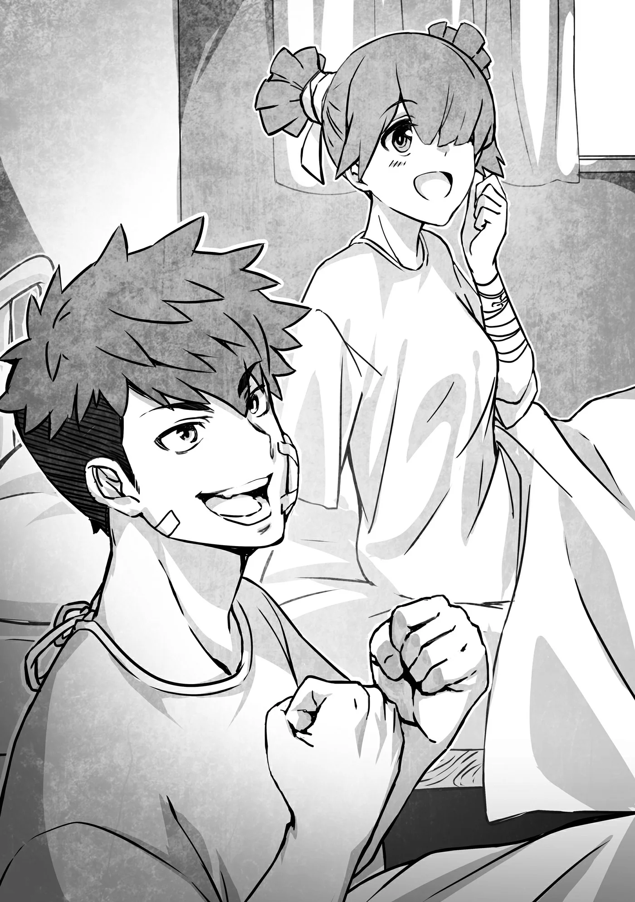

# Chương 204: Tập 9 Chương 2 - Thợ Săn Ma Cà Rồng và Xác Nhận (3)

Những lời Nive nói chẳng hề vô lý chút nào. Đã từng có những chuyện dân làng tự tay hủy diệt chính quê hương mình ngay cả khi bầy Ma Cà Rồng đã bị quét sạch, chỉ vì cánh Thợ Săn Ma Cà Rồng sơ suất không kiểm tra xem có ai bị biến đổi hay không. Việc xác nhận xem các nạn nhân có bị bí mật thao túng hay không quả thực rất quan trọng. Có điều...

"Giờ cô dập ngọn lửa đó đi được chưa?" tôi vừa nhìn Rina vừa hỏi Nive.

Nive thoáng vẻ ngạc nhiên: "Ồ, phải rồi nhỉ. Tôi cứ nghĩ nếu cô ấy không nhìn thấy thì cũng chẳng sao nên quên béng mất. Cho tôi xin lỗi nhé."

Nive giơ bàn tay lên rồi làm động tác bóp nghẹt. Ngọn lửa lam trắng bao bọc quanh Rina thu nhỏ dần rồi tắt phụt một tiếng.

Dù không nhìn thấy ngọn lửa, Rina vẫn nghe thấy tiếng nó vụt tắt. "C-Cái gì thế ạ?! Cái gì vậy!" cô bé hơi hoảng hốt kêu lên.

Có vẻ Thánh Hỏa chẳng làm tổn hại gì đến Rina, nên tôi đoán chắc mọi chuyện đều ổn cả.

"Thế có lý do gì mà cô lại nghi ngờ Rina?" Lorraine hỏi Nive.

"Đương nhiên là vì cô bé đi cùng Rentt rồi. Đùa thôi mà! Đừng lườm tôi cháy mặt thế chứ. Tôi nghe bảo Rina đi cùng hai người lúc bước ra khỏi mê cung mới, nên đoán là hai người đã cứu cô bé sau khi bị Ma Cà Rồng bắt cóc. Cứ thấy gì đáng ngờ là tôi lại muốn châm lửa đốt ngay. Khổ thế, bệnh nghề nghiệp mất rồi."

Nive quả thực rất thính mũi với mấy chuyện kiểu này. Hoặc có lẽ cô ấy sở hữu một mạng lưới thông tin đáng nể. Cũng có thể cô chỉ tình cờ nghe được lời đồn, nhưng quanh người Nive lúc nào cũng toát ra vẻ muốn xoi mói chuyện của tụi tôi. Tôi ngờ là cánh mạo hiểm giả hay mấy người dân trông thấy tụi tôi rời khỏi ngôi nhà đó đã xì xào điều gì rồi. Nghĩ lại thì bốn người đi vào mà lúc ra lại thành năm, nên người ta có nghi ngờ cũng phải. Có điều, bình thường hầu hết mọi người sẽ chỉ cho đó là chuyện hơi lạ một tí rồi bỏ qua.

Thế nhưng trong đầu Nive thì lúc nào cũng nhảy số ngay thành: "Ồ, coi chừng là Ma Cà Rồng đấy." Tôi cũng muốn cô ấy suy nghĩ bình thường hơn một chút, nhưng vì linh cảm của Nive lúc nào cũng chuẩn đến mức khó tin nên tôi chẳng thể cằn nhằn được câu nào.

Thực ra trong thâm tâm tôi cũng từng nổi hứng muốn vênh mặt lên tuyên bố rằng ở đây có tận hai đứa là Ma Cà Rồng đấy chứ. Nhưng làm sao tôi dám nói thế được. Họ thể nào cũng tìm cách lấy mạng tôi mất — "họ" ở đây chính là Nive, Laura và Isaac. Thú thật, việc bản thân chẳng có lấy nửa phần cơ hội thắng nếu lỡ đụng độ bất kỳ ai trong ba người họ khiến tôi không khỏi rùng mình.

Tôi cứ ngỡ mình đã tiến bộ được đôi chút, ai ngờ mấy người xung quanh ai cũng mạnh hơn tôi, kể cả Lorraine. Dẫu thể lực của cô ấy chẳng thấm vào đâu so với tôi, nhưng với uy lực thuần túy của một ma pháp sư cộng thêm khả năng tự bảo vệ bằng các ma pháp như Khiên Chắn, cô ấy mạnh hơn tôi rất nhiều. Tôi dám chắc cô ấy thừa sức hạ gục tôi mà chẳng trầy xước lấy một vết. Xem chừng con đường trở thành mạo hiểm giả vĩ đại của tôi vẫn còn là một chặng đèo dài dằng dặc.

"Thế giờ tụi tôi coi như cô hết nghi ngờ rồi nhé?" tôi hỏi Nive. Nếu cô ấy xác nhận ngay tại đây thì về sau sẽ tránh được bao nhiêu rắc rối.

"Ồ, được chứ. Chẳng vấn đề gì hết. Cho tôi xin lỗi nhé, cô Rina. Cô có muốn tôi bồi thường không? Đợt trước thử trên người Rentt, tôi đã trả cho cậu ấy hai mươi đồng bạch kim lận đấy."

"H-Hai mươi đồng bạch kim cơ á?! Thế là... sao cơ ạ?"

Rina nhìn tôi trừng trừng như thể tôi là quân thảo khấu hay phường lừa đảo, khổ nỗi tôi có đòi ngần ấy tiền bao giờ đâu.

"Nói cho rõ ràng nhé Rina, tôi chưa từng đòi số tiền đó đâu. Là do Nive cứ thế chất đống tiền lên đấy chứ."

Cô ấy tăng giá nhanh tới mức có cảm giác như muốn dìm tôi chết chìm trong biển tiền thật sự. Nói cho đúng ra thì lúc đó Nive mua đống nguyên liệu Tarasque từ tôi, nên cũng chẳng phải cô ấy cho không số tiền kia. Nhưng dù vậy, đó vẫn là một con số khổng lồ đến mức phi lý.

"Cô Rina có muốn lấy tiền bồi thường không?" Nive hỏi.

Rina lắc đầu: "K-Không đâu ạ. Ý tôi là, chị đã làm gì tôi đến mức phải bồi thường cơ chứ?"

Ồ, phải rồi. Tôi vẫn chưa giải thích chuyện đó cho Rina. Tất cả là tại Nive, thế nên tôi mới nhìn chằm chằm vào cô ấy. Nhân tiện thì, nhìn Nive tôi lại không kìm được mà nghĩ người đâu mà đẹp đến mức vô lý. Đi săn quái thì cần nhan sắc đến cỡ đó để làm gì cơ chứ? Thật đúng là một điều bí ẩn.

Cuối cùng, Nive thở dài một tiếng như thể chịu thua trong màn đọ mắt.

"Chẳng cần nói dông dài thì tôi vừa kiểm tra xem cô Rina có bị biến thành Ma Cà Rồng hay không thôi."

"Ồ. Nghe mọi người nói chuyện thì tôi cũng đoán được chừng đó, nhưng bằng cách nào cơ ạ? Tôi đâu thấy cảm giác gì đâu."

"Đơn giản là tôi châm lửa đốt cô thôi. Như thế này này."

Nive phóng một luồng Thánh Hỏa về phía tôi. Cô ấy ra tay đủ chậm để tôi có thể né tránh nếu muốn, chắc là vì lúc trước tôi vừa càu nhàu vụ cô bất thình lình tung chiêu. Xem chừng theo lý lẽ của Nive thì chừng nào ngọn lửa còn đủ chậm để tôi né được thì không tính là "bất thình lình". Đúng là cái logic quái gở. Mà thôi, đằng nào Thánh Hỏa cũng chẳng làm gì được tôi, nên trúng đòn cũng chẳng sao.

Thánh Hỏa ập tới bao trùm lấy tôi, trông chẳng khác nào toàn thân tôi đang bốc cháy ngùn ngụt.

Rina cuống cuồng la lên: "A-A-Anh bị cháy rồi kìa! Nước! Tìm nước mau lên!"

"Không, có nóng tí nào đâu nên tôi không sao cả. Mà ban nãy cô cũng vừa bị y hệt thế này đấy thôi."

"Hả?! Cái gì cơơơ?!"

"Đây là ngọn lửa đặc biệt được tạo ra bằng Thần Lực," Nive giải thích. "Người bình thường chạm vào nó sẽ chẳng hề bị thương hay bỏng rát gì. Thế nhưng với Ma Cà Rồng thì sức nóng này là không thể chịu nổi, và ngọn lửa cũng sẽ thiêu đốt chúng. Trừ khi là loại Ma Cà Rồng cực kỳ yếu ớt, bằng không chúng chẳng chết vì ngọn lửa này đâu, nhưng mà... Chuyện đó không quan trọng. Cái chính là cứ châm lửa đốt kiểu này thì liếc qua một cái là tôi biết ngay đối phương có phải Ma Cà Rồng hay không."

"Liếc qua một cái á? À..."

Trông Rina như muốn bắt bẻ lại câu đó. Tôi thừa hiểu cô bé muốn nói gì, rằng ngay trước mắt chẳng phải đang có một người sặc mùi Ma Cà Rồng đấy sao. Có khi cô bé còn toan bồi thêm bản thân mình cũng y như thế. Nhưng đời nào cô bé dám nói ra, thành thử đành ậm ừ gật đầu: "Ra vậy," giọng đều đều như trả bài.

Ít nhất thì cũng phải diễn cho có tâm một tí chứ! tôi thầm nghĩ.

◆◇◆◇◆

"Raiz, Laura! Hai cậu có sao không?!"

Vừa bước vào phòng khám, một nhân viên đã dẫn tụi tôi tới khu điều trị. Vừa thoáng thấy bóng dáng hai người bạn, Rina đã cất tiếng gọi rồi chạy ùa tới. Tôi thoáng giật mình sợ cô bé nói hơi to làm phiền người khác, nhưng nhìn quanh thì cả phòng bệnh dẫu kê mấy chiếc giường cũng chỉ có hai giường là có người nằm.

"Ồ, Rina!" Raiz thốt lên. "Tụi mình không sao cả, nhưng mất liên lạc làm tụi mình lo cho cậu phát sốt lên đấy."

"Cậu đã đi đâu suốt thế hả?! Tụi mình đột ngột biến mất như vậy, cứ lo là làm liên lụy đến cậu cơ đấy," Laura nói thêm.

Hai người họ bị Ma Cà Rồng bắt cóc lúc lạc mất Rina, thành thử không hay biết cô bé cũng rơi vào tay chúng, thậm chí tình cảnh còn hiểm nghèo hơn hai người họ nhiều.

"Câu đó phải để mình nói mới đúng chứ! Nhưng hai cậu bình an vô sự là mừng rồi. Tụi mình không liên lạc được là do mình cũng bị Ma Cà Rồng bắt đi đấy. Nhờ có hai người này, anh Rentt với chị Lorraine, giải cứu mình đó."

Nive không có mặt lúc tụi tôi cứu Rina, nên cô ấy không có tên trong màn giới thiệu. Đương nhiên còn hai người nữa cũng tham gia giải cứu, nhưng vì họ không ở đây nên Rina quyết định tạm thời lờ đi. Cô bé có lẽ cũng tính đến chuyện sẽ phiền phức lắm nếu Nive bắt đầu xoi mói vào các chi tiết. Ít nhất thì tôi tin chắc Rina đã hiểu Nive là tử địch nguy hiểm nhất của Ma Cà Rồng. Khổ nỗi Rina diễn kịch dở tệ. Nhưng hiện tại cô bé cũng chẳng cần phải gượng ép diễn xuất gì, nên mong là mọi chuyện sẽ êm xuôi.

"Rentt á? Ồ! Anh Rentt! Anh cứu Rina đấy ư?" Raiz hỏi.

"Cảm ơn anh Rentt nhiều lắm," Laura nói thêm. "Không những cứu tụi tôi, anh còn cứu cả Rina nữa."

Họ ngạc nhiên khi thấy tôi ở đây, nhưng lại không bất ngờ mấy trước chuyện tôi cứu Rina. Họ biết tôi chạy đôn chạy đáo khắp nơi đối phó với lũ Ma Cà Rồng mà. Dù vậy, tôi chẳng dám vơ công về mình. Nive mới là người gánh phần lớn trong trận chiến đó. Còn với Rina, công cứu cô bé chủ yếu thuộc về những người khác chứ đâu phải tôi.

"Chẳng qua là trùng hợp thôi, tôi cũng có làm được gì mấy đâu," tôi nói.

"Không cần phải cảm ơn tôi đâu. Dù sao tôi cũng mừng vì cả ba đứa đều bình an vô sự. Mà hai cậu còn nhớ Lorraine không? Cô ấy cũng có mặt lúc tụi tôi tới cứu hai người đấy. Cô ấy là... bạn tôi. Mong hai cậu sẽ hòa hợp với cô ấy."

Lorraine bước lên: "Tôi là Lorraine. Lúc ở Mê Cung Tân Nguyệt tôi chưa kịp giới thiệu đàng hoàng, nhưng tôi đã nghe Rentt kể nhiều về hai bạn rồi. Tôi là một học giả kiêm ma pháp sư, đồng thời cũng là mạo hiểm giả Ngân Cấp. Rất vui được gặp hai bạn." Nói rồi, cô đưa tay ra bắt tay họ.

Raiz trố mắt nhìn Lorraine, đôi mắt mở to trước tin cô là một mạo hiểm giả Ngân Cấp. Còn Laura thì cứ săm soi gương mặt cùng vóc dáng của Lorraine rồi lại liếc nhìn xuống chính mình. Tôi thừa đoán được cô bé đang nghĩ gì trong đầu.

"Ồ, ma pháp sư sao? Lại còn là Ngân Cấp nữa chứ? Đỉnh thật đấy! Tôi cũng ước một ngày nào đó được lên Ngân Cấp! Giờ tôi vẫn chỉ là Đồng Cấp thôi, cơ mà... chị có lời khuyên nào để leo lên Ngân Cấp nhanh hơn không?"

Rõ ràng thái độ của Raiz với tôi và với cô ấy khác nhau một trời một vực. Lúc bắt tay Lorraine, cậu ta ăn nói cung kính hẳn, chẳng khác nào đang sùng bái thần tượng. Bộ nhìn tôi thiếu khí chất đến thế cơ à? Mặt thì đeo cái mặt nạ kỳ quặc, người thì khoác tấm áo chùng mờ ám... Ừ thì, đúng là chẳng có tí uy nghiêm nào thật. Trông chỉ thấy quái đản.

Lorraine khẽ mỉm cười với Raiz rồi quay sang bắt tay Laura: "Chuyện đó thì e là tôi không có lời khuyên nào đâu. Tôi lên được Ngân Cấp chẳng phải nhờ nỗ lực gì to tát cả. Chẳng qua trong lúc theo đuổi việc nghiên cứu, tôi tình cờ đủ chuẩn mà thôi. Tôi làm bài kiểm tra năng lực rồi được thăng hạng, chỉ có vậy. Còn nếu cậu muốn học cách lên Ngân Cấp hay cao hơn nữa thì tôi nghĩ cô kia sẽ là người thầy thích hợp hơn đấy."

Lorraine ra hiệu về phía Nive, người nãy giờ vẫn đứng quan sát Raiz và Laura từ phía cuối phòng.

Dù trong thâm tâm tôi thấy một Nive dè dặt và ý tứ thế này chẳng giống cô ấy chút nào, nhưng xét đến mục đích cô có mặt ở đây thì cũng dễ hiểu thôi. Chắc cô ấy đang tìm cách quan sát Raiz và Laura mà không để hai đứa nhận ra. Nive đúng là cao thủ bám đuôi, cái kiểu người từng âm thầm săm soi tôi đến từng chân tơ kẽ tóc mà tôi chẳng hề hay biết. Dĩ nhiên nếu tôi dám nói toạc điều đó ra thì cô ấy sẽ nổi đóa lên ngay.

Tuy ấn tượng của tôi về Nive là cô ấy lúc nào cũng căng thẳng quá mức mỗi khi đụng tới Ma Cà Rồng, nhưng trong mọi chuyện khác cô lại rất điềm tĩnh và bao dung. Chính vì thế, dù có cả đống tật xấu khiến tôi bực mình, tôi vẫn không nỡ xua đuổi cô ấy.

"Phải rồi, phải rồi, rất vui được gặp hai bạn lần đầu nhé," Nive nói. "À, nói thế cũng không hẳn đúng lắm. Nhưng coi như đây là lần đầu tụi mình chính thức chào hỏi nhau đi, tôi là Nive Maris. Tôi là mạo hiểm giả, và dẫu nhìn vẻ ngoài thế này nhưng tôi là Kim Cấp đấy nhé. Rất vui được làm quen với cả hai bạn."

Giọng Nive nghe thì có vẻ đùa cợt, nhưng nụ cười lại chẳng chạm tới đáy mắt. Có điều, nếu chưa từng nếm trải lằn ranh sinh tử thì khó mà nhận ra được điều đó. Nive che giấu tâm tư rất giỏi. Bằng chứng là cả Raiz lẫn Laura đều chẳng mảy may nghi ngờ gì. Raiz nghe thấy hai chữ "Kim Cấp" thì càng phấn khích tợn, còn Laura dường như lại coi nhan sắc nghiêng nước nghiêng thành của Nive như một đòn giáng bồi thêm vào sự tự tin của chính mình.

Dù sao thì hai người họ cũng nhận ra cô ấy từ dưới mê cung. Điều đó cũng dễ hiểu, bởi bảo Nive đã cứu mạng cả hai người thì chẳng ngoa chút nào. Có điều vì phong thái của Nive lúc này khác một trời một vực so với lúc chiến đấu với Ma Cà Rồng, nên hai người phải mất một thoáng mới nhận ra cô ấy chính là cùng một người.

"Chị là người đã chiến đấu với hai con Ma Cà Rồng đó sao?" Raiz hỏi.

"Đã thế lại còn là Kim Cấp nữa á?! Trời đất ơi... Ở tầm tuổi chị sao?! Lại còn là con gái nữa chứ!"

Nhận xét của Raiz nghe qua có vẻ mang hơi hướng phân biệt giới tính, nhưng cậu ta không hề có ý xấu. Thể lực là yếu tố vô cùng quan trọng đối với một mạo hiểm giả. Dù ma pháp và Khí Thuật có thể cường hóa năng lực thể chất, nhưng xét về sức mạnh cơ bản thì đàn ông vốn dĩ vẫn khỏe hơn phụ nữ. Đó là lý do vì sao ở các thứ hạng đỉnh cao của giới mạo hiểm giả, nam giới luôn chiếm số lượng áp đảo. Ít nhất là trong mắt các thành viên Hội, nữ mạo hiểm giả thường bị xem là kém hơn nam giới một bậc.

Trên thực tế, chuyện một gã mạo hiểm giả bị dần cho một trận tơi bời chỉ vì coi thường một nữ mạo hiểm giả tài ba chẳng phải hiếm thấy. Những mạo hiểm giả khôn ngoan hay chỉ cần có chút kinh nghiệm đều không bao giờ đánh giá lẫn nhau qua giới tính. Khổ nỗi cánh lính mới thường quen đem nếp nghĩ ngoài xã hội vào chốn phiêu lưu. Định kiến phụ nữ chân yếu tay mềm thường trở thành rào cản kìm hãm họ. Và chừng nào chưa chịu rũ bỏ thành kiến ấy, họ sẽ còn mắc phải vô số sai lầm.

Tôi không nghĩ Raiz thuộc về một trong hai kiểu người đó. Cậu ta có lẽ chỉ đang tìm cách khen ngợi những thành tích đáng nể của Nive mà thôi. Vả lại, cậu ta là chàng trai duy nhất trong tổ đội của mình. Raiz đời nào lại gia nhập một đội toàn con gái nếu như cảm thấy họ kém cỏi hơn trong vai trò mạo hiểm giả.

"Tôi cũng chẳng dám nhận mình còn trẻ trung gì," Nive đáp, "nhưng tôi đã phải nỗ lực rất nhiều đấy. Tôi lăn lộn làm Thợ Săn Ma Cà Rồng suốt một thời gian dài, không ngừng tôi luyện thực lực của mình qua từng trải nghiệm thực chiến."
