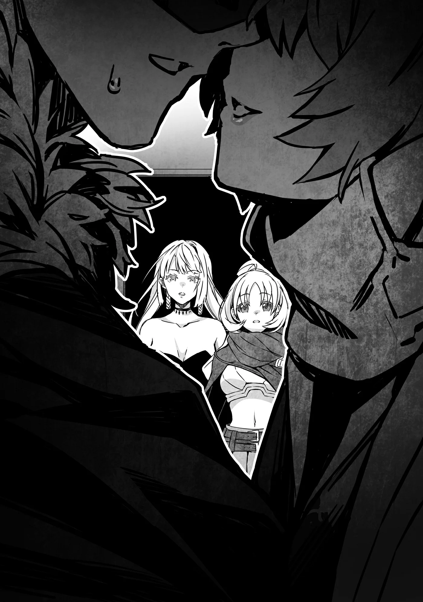

# Chương 205: Tập 9 Chương 2 - Thợ Săn Ma Cà Rồng và Xác Nhận (4)

"Phải rồi. Săn Ma Cà Rồng nghe chẳng dễ dàng gì," Raiz lẩm bẩm một mình. Đôi vai cậu chùng xuống.

Phản ứng của cậu ấy cũng dễ hiểu thôi. Yêu cầu những mạo hiểm giả Đồng Cấp mới thăng hạng đi săn Ma Cà Rồng thì cũng tệ gần như bảo họ đi săn Rồng vậy. Cả hai lựa chọn đều vượt quá xa tầm với. Dù tiêu chuẩn của tôi đã bị lệch lạc đôi chút vì Nive khiến việc đó trông như thể chẳng tốn chút công sức nào, nhưng săn Ma Cà Rồng vốn là một công việc nguy hiểm mà ngay cả các mạo hiểm giả cấp cao cũng phải tiếp cận một cách thận trọng. Đó không phải là thứ mà một mạo hiểm giả bình thường có thể tùy tiện gánh vác.

Hơn nữa, Ma Cà Rồng cực kỳ giỏi che giấu sự tồn tại của mình, và về cơ bản là bất khả thi để tìm ra chúng một khi chúng đã trà trộn vào đám đông. Ngay cả khi chạm trán được với chúng trong một trận chiến, một con Hạ Cấp Ma Cà Rồng chí ít cũng ngang ngửa với một mạo hiểm giả Ngân Cấp bậc trung. Thêm vào đó, chúng có thể liên tục tạo ra Thi Quỷ nếu cứ mặc kệ chúng muốn làm gì thì làm. Cứ cho là may mắn tìm ra được một con, chúng cũng có thể biến một ngôi làng hay cả một thành phố thành một chốn địa ngục hỗn loạn nếu không tiếp cận bằng chiến thuật thích hợp. Chúng là những mục tiêu khó nhằn đến mức quỷ quyệt, thế nên đây không phải là thứ mà các mạo hiểm giả cấp thấp có thể săn đuổi theo ý thích nhất thời.

Nive làm được điều đó chỉ vì cô ấy sở hữu khả năng nhận diện Ma Cà Rồng. Ngoài ra, cô ấy còn hiểu rõ về Ma Cà Rồng hơn bất kỳ người sống nào khác. Cô ấy có sự kiên trì dai dẳng như một chú chó sục cùng một bộ óc phân tích sắc sảo để hỗ trợ cho cuộc săn đuổi đầy ám ảnh của mình. Hiếm có mạo hiểm giả tân binh nào sở hữu sự kết hợp của những phẩm chất ấy, thế nên sự thất vọng của Raiz cũng là điều dễ hiểu.

"Raiz à, đâu phải cậu cứ phải vội vàng rồi đẩy bản thân vào chốn quá hiểm nguy làm gì đâu," Laura trấn an cậu. "Chúng ta chỉ cần kiên nhẫn và leo lên từng bước một thôi. Cậu còn nhớ những gì anh Rentt đã nói với tụi mình không?"

Tôi đã từng nói thế thật sao? Có lẽ tôi từng buột miệng nói điều gì đó trong một cuộc trò chuyện thông thường, nhưng tôi chẳng hề nhớ nổi. Nếu quả thực tôi từng nói vậy, tôi cũng sẽ không nói ra một cách bâng quơ đâu. Thâm tâm tôi thật sự cảm thấy như thế. Rốt cuộc thì, chính tôi cũng đã phải trải qua mười năm chầm chậm nhưng vững chắc từng bước leo lên phía trước.

Dù tôi trở nên mạnh mẽ hơn là nhờ vào vài sự kiện kỳ quặc và độc nhất vô nhị, nhưng nỗ lực bền bỉ vẫn là con đường hiệu quả nhất để tiến bộ. Mọi chuyện sẽ khác nếu sở hữu tài năng hay năng lực phi thường nào đó, nhưng nếu cứ trông mong một cách mơ hồ vào việc tài năng sẽ giúp mình bứt phá, người ta rất có thể sẽ phải kết thúc sự nghiệp mà chẳng bao giờ chạm tới được nơi mình mong muốn.

"Hừm, một nhận xét hay đấy. Tôi hoàn toàn đồng ý, Rentt," Nive bất ngờ lên tiếng khen ngợi tôi. "Dĩ nhiên, nếu các cậu có thể săn Ma Cà Rồng, các cậu sẽ làm được một điều tuyệt vời cho thế giới và cho toàn thể nhân loại. Thế nhưng Ma Cà Rồng là con mồi của tôi, nên có lẽ tốt hơn hết là các cậu hãy tích lũy kinh nghiệm theo một cách khác. Hãy tìm những công việc phù hợp với trình độ của mình và đều đặn hoàn thành những công việc đó. Cứ lặp đi lặp lại như thế. Cách đó dĩ nhiên là thiếu đi sự hoa mỹ, nhưng lại là con đường tốt nhất để trở thành một mạo hiểm giả lành nghề và toàn diện. Trở ngại lớn nhất đối với một mạo hiểm giả mới vào nghề chính là sự tự tin vô nghĩa và khao khát danh vọng. Ưu tiên hàng đầu chính là phải vượt qua được những thứ đó."

Nive vừa đưa ra vài lời khuyên thực sự thấu đáo. Tôi vốn đã quen với việc cô ta hành xử như thể bị rơi mất vài con ốc vít trong đầu. Nhìn vẻ mặt của Lorraine khi đang quan sát Nive, tôi có thể nhận ra cô ấy cũng đang nghĩ điều tương tự. Đồng thời, trong ánh mắt đó còn phảng phất chút khâm phục, dường như Lorraine cảm thấy ấn tượng khi Nive quả thực là một mạo hiểm giả cấp cao đúng nghĩa.

Raiz và Laura dường như vô cùng xúc động trước những lời của Nive.

"Em hiểu rồi. Vậy ra những gì anh Rentt nói là thật. Chúng ta hãy nỗ lực và tiếp tục cố gắng thôi, Laura."

"Ừm. Cậu đừng có gắng gượng quá sức đấy nhé."

Laura nhìn Nive như thể rất biết ơn những lời Nive vừa nói. Tôi đoán Raiz thường có xu hướng ép bản thân đi quá xa. Laura hẳn đã cảm thấy nhẹ nhõm khi nghe được những lời khuyên có thể kiềm chế phần nào sự bốc đồng tệ hại nhất của Raiz.

Nive tiếp tục: "Điều đó dẫn tới mục đích của tôi. Tôi muốn hai bạn tiếp tục trưởng thành với tư cách là thế hệ mạo hiểm giả kế tiếp. Dẫu vậy, có một điều tôi muốn xác nhận."

Nive chuẩn bị giải thích những gì cô ta sắp làm. Điều đó quả thật nằm ngoài dự tính. Có lẽ là vì xét một cách tích cực nhất thì cả hai người họ trông hoàn toàn chẳng hay biết gì. Có khả năng theo thời gian họ sẽ biến thành Ma Cà Rồng, nhưng lúc này thì chẳng thể nào nhận ra được. Không ai trong số họ nhận thức được rằng mình có thể sẽ trở thành Ma Cà Rồng. Nếu họ đã biến thành Ma Cà Rồng và ý thức được chuyện đó, hẳn họ đã bỏ trốn rồi. Nhưng vì họ hoàn toàn không hay biết gì... Chà, chí ít thì Nive vẫn luôn nhất quán trong cách hành sự.

"Xác nhận sao ạ? Chị muốn xác nhận điều gì thế?" Raiz hỏi.

"Rằng hai bạn chưa bị biến thành Ma Cà Rồng. Hai bạn từng bị Ma Cà Rồng bắt cóc, phải chứ? Có một khả năng nhỏ là hai bạn đã bị biến thành Thi Quỷ trong quá trình đó. Tôi muốn loại bỏ mọi mối nghi ngờ."

Nive đang mỉm cười, và chỉ xét theo vẻ bề ngoài, cô ta đang tỏ ra rất lịch thiệp. Thế nhưng, những cảm xúc phản chiếu trong đôi tròng mắt đỏ rực của cô ta lại hoàn toàn trái ngược.

Tôi chẳng hề muốn trở thành mục tiêu của ánh mắt đó chút nào, nhưng dường như Raiz và Laura chẳng thể cảm nhận được bất kỳ điều gì bất thường. Đó là một điều tốt. Hẳn họ sẽ muốn bỏ chạy thục mạng nếu có thể cảm nhận được sự thù địch ngấm ngầm của Nive.

Cả Raiz lẫn Laura đều không nhận thức được mức độ nghiêm trọng trong tình cảnh của mình, họ đưa mắt nhìn nhau rồi đáp lại một cách không chút e dè tính toán.

"Vậy thì được ạ. Laura cũng thấy ổn chứ?"

"Ừm. Miễn là không đau."

Nive xòe lòng bàn tay ra và triệu hồi một ngọn lửa màu xanh lam ánh trắng. "Sẽ không đau nếu như không có vấn đề gì đâu. Vì hai bạn đã đồng ý, xin thứ lỗi cho tôi nhé."

Một quả cầu lửa có kích thước cỡ đầu người nhảy múa trên lòng bàn tay cô ta. Raiz và Laura tò mò nhìn Nive khi cô ta ngửa lòng bàn tay lên. Những ngọn lửa màu xanh lam ánh trắng bao trùm lấy họ, như thể muốn nuốt chửng cả hai, nhưng chẳng ai có phản ứng gì. Họ cảm thấy có lẽ có điều gì đó khang khác và nghiêng đầu đầy khó hiểu, nhưng mọi chuyện cũng chỉ dừng lại ở đó. Họ không hề cảm thấy đau đớn và cũng chẳng hề bị thiêu đốt, nên mọi thứ đều ổn thỏa.

Nive trông hơi ỉu xìu một chút, nhưng dường như ngay từ đầu cô ta cũng đã nghĩ rằng khả năng này là rất thấp. Cô ta gật đầu, rồi lại hướng lòng bàn tay về phía hai người họ, làm động tác tay để dập tắt ngọn lửa. Ngọn lửa phát ra một tiếng xì nhẹ khi lụi tàn dần.

"Cảm ơn hai bạn rất nhiều," Nive nói với Raiz và Laura. "Không có vấn đề gì đặc biệt cả. Hai bạn hẳn đã thoát khỏi bất kỳ ảnh hưởng nào khác từ Ma Cà Rồng rồi." Cô ta dành cho họ một nụ cười dịu dàng và thanh thản.

◆◇◆◇◆

"Cô đâu cần phải tỏ ra thất vọng đến thế," tôi nói với Nive.

Cô ta quay sang tôi rồi nhún vai. "Cuộc sống của tôi là để săn Ma Cà Rồng mà. Lẽ đương nhiên là tôi sẽ bực bội nếu cứ ngỡ mình sắp sửa tiêu diệt được vài con, để rồi cuối cùng lại trắng tay. Không phải là tôi muốn người ta biến thành Ma Cà Rồng đâu. Tốt hơn hết là họ đừng bị biến đổi, thật lòng đấy."

Nhận xét cuối cùng của Nive nghe hợp lý đến bất ngờ. Tôi không khỏi nghĩ rằng cô ta chẳng đến mức tệ hại như những gì người ta đồn đại. Chỉ là cô ta có một nỗi ám ảnh dị thường với việc tiêu diệt Ma Cà Rồng mà thôi.

Hiện tại, Nive, Lorraine và tôi đang ở bên ngoài phòng bệnh của Raiz và Laura tại phòng khám. Rina đang ở bên trong cùng các thành viên tổ đội của mình. Chúng tôi đoán rằng họ có rất nhiều chuyện cần tâm sự để bù lại quãng thời gian vừa qua, nên chúng tôi đã bước ra ngoài. Họ cũng cần phải bàn bạc xem từ giờ trở đi sẽ phải làm những gì. Việc có người ngoài ở đó sẽ khiến mọi chuyện có phần hơi gượng gạo.

Lorraine và tôi tự hỏi liệu họ có đề cập tới tình trạng hiện tại của Rina hay không. Tôi hiểu khá rõ tính cách của Raiz và Laura qua những lần tiếp xúc với họ trong kỳ thi thăng hạng Đồng Cấp, nhưng dẫu vậy, tôi cho rằng Rina sẽ giấu nhẹm chuyện giờ đây mình đã là một quái vật. Có lẽ vào một thời điểm nào đó, để cho họ biết bí mật này cũng chẳng sao. Nhưng vào lúc này, đó lại là một gánh nặng quá đỗi to lớn để đặt lên vai một cặp mạo hiểm giả Đồng Cấp.

Raiz và Laura cũng còn đủ trẻ để tôi muốn họ tiếp tục tận hưởng niềm vui làm mạo hiểm giả. Có lẽ tốt nhất là nên đợi cho tới khi họ trở nên chai sạn như tôi. Không, chuyện đó thực ra có khi còn tệ hơn. Họ có thể làm rò rỉ thông tin cho ai đó để lấy tiền. Ít nhất thì đó là điều mà tôi sẽ làm.

"Ồ, nhắc tới Ma Cà Rồng," Lorraine xen vào, quay sang Nive, "cô đã tiêu diệt con mà mình đụng độ trong Mê Cung Tân Nguyệt chưa?"

Ồ phải rồi, chúng tôi còn chưa buồn hỏi Nive về chuyện đó nữa.

"Rồi, tôi đã đảm bảo trừ khử nó tận gốc. Vì muốn tra hỏi nó nhiều điều, tôi đã ngừng tấn công khi nó vẫn còn trả lời được, nhưng tôi phải thừa nhận đối thủ quả thật ngoan cường. Nó đã chọn cái chết và tự hóa thành tro bụi. Về cơ bản là tôi chẳng moi được chút thông tin nào từ nó cả. Thật đáng tiếc. Đó là lý do tại sao tôi đặt nhiều hy vọng vào tên trùm ở Maalt, thế nhưng bức tường đó... Thật là một nỗi thất vọng ghê gớm." Đôi vai cô ta chùng xuống trong một biểu hiện buồn bã hiếm thấy.

Tôi có thể hiểu được chuyện đó tồi tệ đến mức nào đối với một người ở vị thế của Nive. Cô ta đã tốn biết bao thời gian và tiền bạc để chuẩn bị cho sự xuất hiện của Ma Cà Rồng, để rồi cuối cùng đòn kết liễu lại bị chúng tôi cướp mất. Tôi không nghĩ Nive quá bận tâm về công trạng, nhưng vì cô ta khao khát tiêu diệt Ma Cà Rồng đến cháy bỏng, nên hai chuyện đó cũng chẳng khác gì nhau là mấy.

"Chuyện đó thì tôi chỉ biết xin lỗi thôi. Bọn tôi cũng chẳng tìm hiểu được thêm bao nhiêu đâu," tôi đáp.

Đó thực ra không hẳn là lời nói dối. Chúng tôi biết Shumini đã tạo ra một mê cung và cố gắng trở thành Chủ Nhân Mê Cung của nó, nhưng lại không biết tại sao gã lại tốn công tốn sức làm chuyện đó. Có lợi ích đặc biệt nào khi làm Chủ Nhân Mê Cung chăng? Hay là vì một lý do nào khác? Chẳng có cách nào để biết được. Chúng tôi có thể hỏi Laura, nhưng hiện tại cô bé đang ngủ giấc ngủ dưỡng nhan rồi. Chúng tôi chẳng biết khi nào cô bé mới thức dậy nữa. Rốt cuộc thì các tiểu thư quý tộc luôn rất coi trọng giấc ngủ của mình.

"Không, đó không phải lỗi của cậu đâu, Rentt," Nive lắc đầu nói. "Đơn giản là tôi đã phán đoán sai tình hình. Đáng lẽ tôi nên mặc kệ Mê Cung Tân Nguyệt như thế mà tiến thẳng tới Maalt. Dẫu vậy, nếu tôi làm thế, những mạo hiểm giả như Raiz và Laura hẳn đã trở thành nạn nhân rồi. Tôi đã không có cơ hội tiêu diệt tên trùm Ma Cà Rồng, nhưng cuối cùng cậu đã hạ gục được gã, Rentt à. Có lẽ như vậy cũng là kết cục tốt nhất rồi, thế nên tôi chẳng có lời phàn nàn nào về phương diện đó cả. Nhưng tôi thực sự nuối tiếc vì đã không thể tự tay kết liễu bọn chúng."

"Có lẽ để lần sau vậy," tôi nói. "Dù tôi hy vọng sẽ không có lần sau nào nữa."

Tôi nói với giọng nửa đùa nửa thật, nhưng Nive lại nghiêm túc gật đầu và nói thêm: "Phải rồi, không ai đáng phải bị kéo vào mưu đồ của Ma Cà Rồng lần thứ hai cả. Dẫu vậy, thành phố này hẳn sẽ bình yên trong một thời gian."

Tôi tự hỏi làm sao cô ta có thể chắc chắn về điều đó đến thế. Tôi nghiêng đầu nhìn cô ta đầy vẻ hoài nghi.

Nive nhận ra sự hoài nghi của tôi và giải thích: "Nếu chỉ là một con Trung Cấp Ma Cà Rồng thì lại là chuyện khác, nhưng khi một con Thượng Cấp Ma Cà Rồng bỏ mạng ở đâu đó, những con Ma Cà Rồng khác thường có xu hướng tránh xa địa điểm ấy. Chắc chắn là chúng có một mạng lưới liên lạc nào đó. Thông thường, người ta sẽ nghĩ rằng chúng muốn trả thù con người đã giết hại đồng loại của mình, nhưng chúng lại thông minh hơn thế nhiều. Đó chính là một phần nguyên nhân khiến chúng trở thành con mồi khó nhằn đến vậy. Và đó cũng là lý do tại sao chúng có thể ẩn mình trong bóng tối suốt bấy lâu nay mà vẫn sinh tồn được. Thế nên, dẫu sao thì vào lúc này, thành phố này vẫn an toàn."

Ra ý cô ta là vậy. Shumini vốn là một Thượng Cấp Ma Cà Rồng, nên nếu Nive nói đúng, Ma Cà Rồng sẽ không sớm quay trở lại Maalt. Dẫu vậy, cẩn trọng vẫn là điều nên làm. Nhưng Wolf có thể xử lý những chi tiết đó, nên đây không phải là chuyện tôi cần bận tâm.

"Nghĩa là cô sắp rời khỏi Maalt sao, Nive?" tôi hỏi.

Về cơ bản cô ta sống là để tiêu diệt Ma Cà Rồng, nên tôi cho rằng cô ta sẽ chẳng nán lại đây khi hầu như chẳng còn cơ hội đụng độ con nào. Tôi không hề có ý ám chỉ rằng mình muốn cô ta biến khỏi thành phố... không hẳn là vậy.

Bỏ qua nỗi ám ảnh về Ma Cà Rồng, Nive là một mạo hiểm giả vô cùng tài ba. Tôi cảm thấy có lỗi vì đã giấu giếm nhiều điều với cô ta. Sẽ tốt hơn nếu cô ta rời đi, nhưng đó chỉ là vì hoàn cảnh cá nhân của riêng tôi mà thôi. Đối với cư dân Maalt, việc có Nive ở quanh đây là điều rất hữu ích.

Thế nhưng, Nive đáp lại: "Tôi nghĩ đã đến lúc phải rời đi rồi. Tôi khá tò mò về mê cung mới, nhưng phần lớn các câu hỏi về những thứ như thế đều chẳng có lời giải đáp. Tôi không phải chuyên gia, vả lại việc điều tra nó cũng chẳng thể cho tôi biết thêm điều gì về Ma Cà Rồng cả. Tôi định sẽ âm thầm rời khỏi thành phố trước khi người từ Học Viện và Tòa Tháp bắt đầu đổ xô tới."

◆◇◆◇◆

"Nghe vậy tôi thấy tiếc quá," tôi nói. "Tôi cứ hy vọng cô sẽ nán lại lâu hơn một chút và tạo dựng danh tiếng cho mình ở Maalt này chứ."

Khi tôi nói thế, Nive nhìn chằm chằm vào mắt tôi, thở dài rồi nhún vai.

"Đó không hoàn toàn là lời nói dối, nhưng đó cũng chẳng phải cảm xúc thật trong lòng cậu đâu, Rentt à. Dẫu vậy cũng không sao. Tôi là một phụ nữ bận rộn. Vẫn còn rất nhiều Ma Cà Rồng cần phải tiêu diệt. Đừng có nhớ tôi quá khi tôi rời đi đấy nhé. Mặc dù, tôi cho rằng mọi chuyện sẽ khác nếu cậu thực sự là một con Ma Cà Rồng..."

Nive bước lại gần tôi hơn, dừng lại với gương mặt chỉ cách mặt tôi vài tấc, rồi lắc đầu. "Thật sự kỳ lạ quá đi mà. Sao cậu lại không phải là Ma Cà Rồng cơ chứ, Rentt?"

"Ý cô là thế nào chứ?" tôi hỏi.

"Đúng như những gì cậu vừa nghe đấy. Tôi biết chúng ta đã giải quyết dứt điểm chuyện này từ lâu rồi, nhưng tôi từng đinh ninh chắc chắn rằng cậu chính là một con Ma Cà Rồng đấy, Rentt."

"Đó là vì những hành tung đáng ngờ của tôi và mấy thứ tương tự, phải không?"

"Đó là một phần thôi. Nhưng rốt cuộc thì, đó là trực giác. Không phải lý trí, cũng chẳng phải Thánh Hỏa, mà chính là trực giác của tôi. Nó chưa từng phản bội tôi bao giờ. Cho tới khi tôi gặp cậu, là thế đấy. Chính vì vậy, Rentt à, tôi vẫn luôn để mắt tới cậu đấy."

Cô ta bắt đầu ghé sát lại gần hơn nữa. Cánh cửa phòng bệnh của phòng khám khẽ cạch mở, và Rina thò đầu ra ngoài. Cô bé nhìn Nive rồi nhìn tôi. Thời gian như ngưng đọng trong giây lát.

"Hả? Anh Rentt, anh với chị Nive... có quan hệ gì mờ ám sao?! Ch-Ch-Chị Lorraine! Chị thấy thế mà ổn sao?!" Rina vừa la lên vừa túm lấy hai vai Lorraine lắc qua lắc lại.

Vẻ mặt của Lorraine thật khó mà diễn tả khi để mặc cho Rina lắc người mình.

"Ổn, hay không ổn... tôi không nghĩ... mọi chuyện lại đúng như em nghĩ... đâu..."

"Vậy thì là gì chứ ạ?! Nam nữ kề sát nhau đến thế thì còn có thể làm gì được nữa cơ chứ?! Ngoại trừ, chị biết đấy, h-h-hô—"

"Hô hô?"

"H-Hôn nhau... chẳng hạn..."

"Hừm. Tôi chịu thôi. Liệu họ có làm thế không nhỉ? Rina này, chúng ta hãy xem liệu họ có làm vậy không nhé," Lorraine nói với giọng trêu chọc.

Nive quay sang tôi: "Ừm, hay là chúng ta làm thế nhé, Rentt? Tôi thì chẳng bận tâm đâu."

"Nhưng tôi thì có đấy. Làm ơn lùi lại giùm đi."

Tôi nắm lấy hai vai Nive rồi đẩy cô ta ra. Tôi chẳng biết liệu cô ta nói đùa hay thật, nhưng cô ta đã khẽ chu môi lại một chút, điều đó càng khiến tôi rợn tóc gáy hơn. Tôi cảm thấy như thể nếu cô ta thực sự hôn tôi, cô ta sẽ hút cạn sinh khí trong người tôi vậy. Nói nghiêm túc đấy. Ý tôi là, đáng lẽ tôi mới phải là kẻ làm chuyện hút đó, nhưng mà... tôi thậm chí chẳng dám tưởng tượng mình sẽ làm điều đó với cô ta.

Chẳng hiểu vì lý do gì, Rina lại có vẻ thất vọng, trong khi Lorraine bật cười khúc khích.

"Thôi nào, đừng làm khổ tôi thế chứ, Lorraine," tôi nài nỉ.

Cô ấy châm chọc lại: "Ồ, nhưng vui mà. Rina am hiểu mấy chuyện này hơn tôi tưởng đấy. Em thất vọng sao?" cô hỏi Rina.

Rina đỏ mặt và lắp bắp: "K-K-Không có chuyện đó đâu ạ! Ưm, vậy hai người... không phải ở trong mối quan hệ kiểu đó sao ạ?"

Xét đến việc Rina vẫn tiếp tục gặng hỏi câu đó, cô bé thực sự am hiểu về chủ đề này hơn những gì tôi từng nghĩ. Hoặc có lẽ cô bé chỉ đơn thuần là quá đỗi tò mò mà thôi.

"Nếu chúng tôi có mối quan hệ kiểu đó thật thì tôi cũng chẳng bận tâm đâu," Nive thủ thỉ với vẻ đắc ý.

"Làm ơn dừng lại đi. Thật khó mà biết được lúc nào cô đang nói đùa, và điều đó làm tôi sợ chết khiếp đấy."

"Cậu thật sự không biết đùa chút nào nhỉ, Rentt?" Nive lắc đầu nói. "Tôi dừng lại đây. Có quá nhiều người sẽ nổi giận với tôi nếu tôi còn lấn tới nữa. Cô Rina này, cô chỉ tình cờ bắt gặp đúng lúc tôi ghé sát lại gần cậu ấy thôi. Chẳng có gì khác ngoài chuyện đó đâu."

"Ồ, em hiểu rồi..."

Một lần nữa, tôi lại tự hỏi tại sao Rina trông thất vọng đến thế. Nếu tôi và Nive thực sự có mối quan hệ kiểu đó, những cảm xúc mâu thuẫn sẽ là vấn đề nhỏ nhặt nhất giữa chúng tôi. Đơn giản là chúng tôi quá đỗi khác biệt. Ít nhất thì đó là những gì tôi cảm thấy. Dù vậy, tôi chẳng thể nói rõ ràng cụ thể được. Cứ coi đó là trực giác của tôi đi.

"Hơn nữa, nếu chúng tôi có mối quan hệ kiểu đó," Nive tiếp tục, "chúng tôi cũng chẳng làm chuyện ấy ở chốn thanh thiên bạch nhật đâu. Chúng tôi sẽ lén lút làm ở nơi riêng tư. Kể cả việc hôn nhau trước mặt cô Lorraine cũng là hơi quá giới hạn rồi."

"Ồ, nghe cũng có lý ạ. Dù em nghe nói có vài người lại thích kiểu như thế," Rina trầm ngâm.

"Cô Rina, không phải là cô đang giả ngây giả ngô đấy chứ? Tôi bắt đầu nghi ngờ đúng là như thế rồi đấy."

"Không, không, không! Hoàn toàn không phải thế đâu ạ!"

Tôi cho rằng Nive và Rina có tính cách khá hợp nhau vì lúc này họ đang hòa thuận với nhau rất tốt. Là do tôi tưởng tượng hay Nive thực sự đang ở thế phòng thủ vậy? Điều đó thật nằm ngoài dự liệu.

Bỏ mặc hai người họ với màn trêu chọc qua lại, Lorraine bước về phía tôi. "Thế rốt cuộc anh cảm thấy thế nào? Cô ta có thể là một Thợ Săn Ma Cà Rồng điên rồ và ám ảnh, nhưng cô ta là một mỹ nhân đẳng cấp thế giới đấy. Anh chắc là mình không thấy vui vẻ gì khi gương mặt cô ta ghé sát mặt mình như thế chứ?"

Lorraine chỉ nói đùa, nhưng tôi lập tức lắc đầu. "Nói đúng hơn thì, cảm giác chẳng khác nào một con Rồng đang ghé sát lại gần tôi để chuẩn bị tung đòn hơi thở cả."

"Ồ, à, xin chia buồn nhé."

"Vả lại, dạo này tôi cũng chẳng mấy mặn mà với mấy chuyện đó. Dù tôi không nói là hoàn toàn không có."

Chúng tôi thì thầm trao đổi với nhau bằng giọng rất nhỏ. Dẫu vậy, chúng tôi vẫn đảm bảo nói năng đủ mơ hồ để có bị Nive nghe thấy cũng chẳng sao.

"À, ừ, cũng đúng," Lorraine đồng tình. "Thật thú vị khi Rina lại hứng thú với chủ đề đó đến vậy."

Lorraine nói rất có lý. Vì Rina cũng là một bán Ma Cà Rồng giống như tôi, nên tôi cứ ngỡ mọi cảm xúc cùng dục vọng của cô bé sẽ bị phai nhạt đi nhiều. Liệu có phải vì cô bé mới vừa biến thành Ma Cà Rồng? Hay là vì Shumini đã cố tình biến đổi cô bé với ý định rõ ràng là biến cô bé thành bạn đồng hành của gã? Trong trường hợp của tôi, tôi đã bắt đầu từ một Khô Lâu. Có lẽ những cảm xúc của tôi bớt mãnh liệt hơn là vì tôi đã bị cắt đứt khỏi mọi dục vọng của người sống và vẫn đang phải chịu đựng di chứng từ điều đó. Nếu quả thực là vậy, những dục vọng đa dạng ấy rốt cuộc rồi cũng có thể sẽ quay trở lại, dẫu cho có phần phai nhạt đôi chút.

"Có lẽ con bé chỉ đang ở độ tuổi đó thôi," Lorraine gợi ý. "Bạn bè của con bé cũng 'trên tình bạn, dưới tình yêu' đấy thôi, anh nhớ không?"

"Raiz và Laura sao? Ra là thế."

Trong lúc chúng tôi tiếp tục cuộc thảo luận, Nive và Rina cũng kết thúc cuộc trò chuyện của họ.

"Vậy thì, tôi xin phép cáo từ trước nhé. Ngày mai tôi sẽ rời khỏi thành phố, nên nếu muốn tới tiễn tôi thì cứ tự nhiên. Tạm biệt." Dứt lời, Nive rời khỏi phòng khám.

Đôi khi tôi thật sự chẳng hiểu nổi cô ta. Tới tiễn cô ta sao? Phải đấy, tôi thực sự phải đắn đo xem có nên đi hay không đây.
