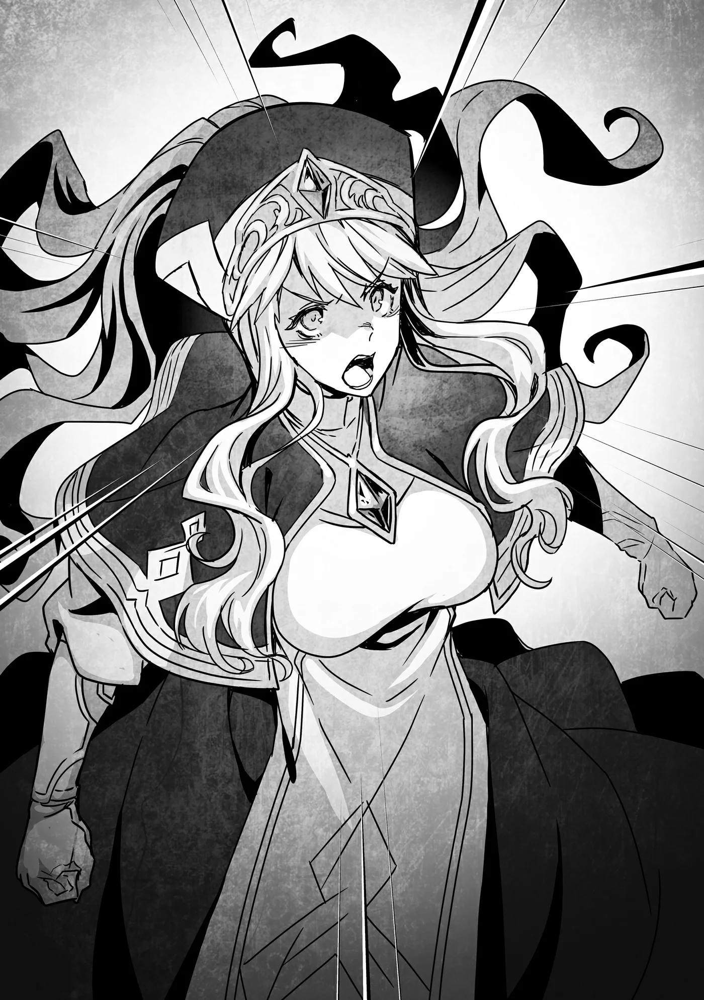

# Chương 209: Tập 9 Chương 4 - Tòa Tháp và Học Viện (1)

Sáng hôm sau, Lorraine, Rina và tôi ra bến xe. Hệt như lần trước tôi tới đây, ở đây có đủ loại "ngựa", nhìn lúc nào cũng thấy thích mắt. Nhưng so với trước thì hôm nay nơi này đã khác đôi chút.

"Ở đây đông xe thật đấy," Rina lên tiếng. "Chắc Maalt đang cần nhiều thứ lắm."

Lần trước tôi tới, bến xe tuy không vắng nhưng vẫn còn khối chỗ cho xe đỗ. Giờ thì chỗ này chật như nêm. Tôi đoán hàng hóa đang đổ về từ khắp nơi.

Đúng như Rina nói, lúc này Maalt đang cần đủ thứ vật tư và hàng tiếp tế. Thị trấn cần vật liệu xây dựng để sửa lại nhà cửa, đường sá bị hư hại khi mê cung xuất hiện. Chưa kể nhân lực ở Maalt cũng thiếu, nên rất cần người khỏe mạnh đến giúp tái thiết. Kéo theo đó, nhu cầu về các nhu yếu phẩm thường nhật như thức ăn, áo mặc cũng tăng vọt.

Vốn là một thành phố vùng biên, trừ những mặt hàng chuyên dụng hay đồ xa xỉ, bình thường Maalt gần như tự cung tự cấp. Nhưng giờ thì thị trấn buộc phải nhập đồ tiếp tế từ khắp các vùng lân cận, kéo theo lượng người và hàng hóa đổ về tăng vọt.

"Có vẻ mạo hiểm giả đến xem mê cung mới cũng đông hơn," Lorraine nhìn quanh rồi nhận xét. "Giới nghiên cứu qua lại cũng tấp nập hơn. Dù người từ Đế Quốc không nhiều, nhưng tôi đã gặp vài người quen cũ ở vương đô. Một mê cung mới xuất hiện đúng là dịp hiếm có với họ. Ngoài ra, dù người của Tòa Tháp hay Học Viện sẽ chịu trách nhiệm khảo sát nghiên cứu, nhưng cũng có khối người nhân tiện ghé qua ngó nghiêng trong chuyến đi."

Lorraine vốn là một học giả lập dị đã rời Đế Quốc để dọn tới một thành phố hẻo lánh như Maalt. Dù đã ở đây mười năm, cô ấy không hẳn là mất hết liên lạc với bạn bè đồng nghiệp. Mà cũng phải thôi. Dù sinh hoạt thường ngày khá tùy tiện, nhưng cô ấy luôn hồi âm thư từ rất nhanh. Chữ tốc ký của cô ấy khó đọc đến mức chẳng khác nào mật mã, nhưng mỗi khi ngồi xuống nắn nót viết thư, nét chữ lại rất ngay ngắn, thanh nhã và nữ tính.

Cô ấy có khá nhiều người quen trong giới học giả ở Vương Quốc Yaaran, thỉnh thoảng lại lên vương đô để trao đổi tin tức hoặc tranh luận về những đề tài cùng quan tâm. Nói cho cùng, đã kết giao được với một người khác thường như Lorraine thì bản thân họ cũng dị theo cách riêng, và không ít người nằm ngoài dòng học thuật chính thống của Yaaran.

Tòa Tháp và Học Viện là hai trung tâm nghiên cứu đầu não của Vương Quốc Yaaran, hầu hết các cuộc khảo sát đều do họ dẫn đầu. Chẳng hạn, khi có hiện tượng dị thường như mê cung mới xuất hiện gần đây chỗ chúng tôi, giới nghiên cứu từ Tòa Tháp hoặc Học Viện sẽ thuê hết mạo hiểm giả đáng tin cậy làm hộ vệ để tiến vào khảo sát. Điều đó thường khiến những người khác rất khó tự tiến hành điều tra.

Lorraine là trường hợp hiếm thấy khi vừa là học giả vừa là mạo hiểm giả. Cả hai con đường ấy đều vô cùng khắc nghiệt. Đạt tới trình độ hạng nhất ở một trong hai đã khó, nói gì đến chuyện cân bằng cả hai mà vẫn gặt hái được thành tựu nổi bật; điều đó gần như là bất khả thi. Lorraine chỉ là một ngoại lệ. Bởi vậy cô ấy mới bảo người quen của mình đến đây ngó nghiêng nhân tiện dạo chơi. Hẳn họ cũng muốn tự mình vào mê cung điều tra, nhưng khả năng được phép là rất thấp. Tôi đoán họ vẫn mò tới đây chỉ vì quá mê nghiên cứu và muốn hóng chút không khí cho bằng được. Bảo sao họ lại hợp cạ với Lorraine đến thế.

"Tôi thì chẳng rõ bên Tòa Tháp thế nào," Rina nói, vẻ ngao ngán, "nhưng học viên Học Viện thì nhiều người kênh kiệu lắm. Tôi chẳng thể nào hợp nổi với họ."

Tôi hơi nghiêng đầu hỏi: "Cô từng gặp học viên Học Viện rồi à, Rina?"

"Tính theo gia cảnh nhà tôi thì tôi có một cô bạn thuở nhỏ học ở đó. Bạn ấy hiền lành tốt bụng lắm, nhưng đám bạn cùng lớp thì tệ lắm."

Ồ, phải rồi. Rina vốn xuất thân từ vương đô, anh trai cô ấy là Idoles Rogue, một kỵ sĩ trẻ đầy triển vọng. Tôi không rõ cụ thể tước vị chính xác của nhà cô ấy, nhưng họ đúng là dòng dõi quý tộc. Muốn vào Học Viện thì hoặc phải thật giàu, hoặc phải rất có tài, nên phần lớn học viên đều là con em quý tộc hay nhà buôn khá giả. Bảo sao không ít người có tính khí khó ưa. Dĩ nhiên, không phải ai cũng vậy. Quý tộc Yaaran phần đông khá rộng lượng và khiêm nhường, một phần vì vương quốc này vốn bị coi là nơi thôn dã, một phần vì họ sùng kính Giáo Hội Đông Thiên.

Hơn nữa, ai mới bắt đầu chẳng còn non nớt. Tính theo độ tuổi nhập học trung bình, hầu hết học viên đều bước chân vào Học Viện đúng tầm dậy thì, cái tuổi nổi loạn. Tầm tuổi ấy cái tôi thường bị thổi phồng. Tôi đoán đến lúc tốt nghiệp họ sẽ hết tính đó và chín chắn hơn, nhưng tôi chưa từng tới đó bao giờ nên chẳng rõ thực tế ra sao. Bản thân tôi cũng muốn có dịp ghé thăm Học Viện một lần, chỉ tiếc là mạo hiểm giả cấp thấp như tôi thì đời nào xin được giấy phép. Đúng là tiếc thật.

"'Tệ lắm' là tệ thế nào cơ?" Lorraine hỏi Rina.

"Hình như tôi có kể là mình từng làm mạo hiểm giả ở vương đô rồi nhỉ. Hồi đang làm nhiệm vụ, tôi tình cờ gặp bạn mình. Tôi đã cố hết sức tránh mặt người quen rồi, vậy mà..."

"Đã sống cùng một thành phố thì cẩn thận mấy sớm muộn cũng chạm mặt người quen thôi," Lorraine chêm vào.

"Đúng thế thật. Nếu chỉ dừng lại ở đó thì chẳng đến nỗi nào, khổ nỗi lúc đó trang bị của tôi tả tơi hết cả, trông rách rưới lắm."

"Như hồi lần đầu tôi gặp cô à?" tôi hỏi. "Mạo hiểm giả mới vào nghề thì chuyện đó khó tránh lắm."

Lần đầu gặp Rina, tôi đã thấy rõ cô ấy rất chú ý vẻ ngoài. Quần áo của cô ấy đều được giặt sạch sẽ, bản thân cô ấy cũng luôn giữ mình tươm tất. Theo mắt tôi thì trông cô ấy chẳng đến nỗi nào, dù đồ đạc có hơi cũ và vài món đã sờn mòn. Dù vậy, khối mạo hiểm giả ngoài kia trông còn thảm hại hơn nhiều. Thậm chí thỉnh thoảng còn có người đi ngang qua bốc mùi chua thoang thoảng. Đồ của Rina có sờn cũ thế nào thì riêng chuyện cô ấy luôn giữ sạch sẽ đã hơn hẳn họ rồi. Mà nghĩ lại, có lẽ mấy người bốc mùi kia chỉ lười biếng hay luộm thuộm thôi. Dù sao thì trong mắt giới quý tộc vương đô, nhất là những người đủ giàu để học ở Học Viện, bộ dạng của Rina hẳn trông khác biệt lắm.

◆◇◆◇◆

"Nghĩ lại thì cũng dễ hiểu thôi, nhưng vừa thấy tôi là bạn ấy đã lo sốt vó xem dạo này tôi sống thế nào."

Mới vài tháng trước còn cùng nhau tới những quán cà phê sang trọng uống trà chiều, giờ đột nhiên thấy bạn mình đi lại trong bộ dạng rách rưới thì ai mà chẳng lo. Dĩ nhiên, với điều kiện hai bên phải thực sự là bạn bè. Chứ nếu tôi tình cờ đụng phải một kẻ mình ghét cay ghét đắng trong bộ dạng thảm hại ấy, chắc tôi cười thầm mất. Cảm giác hả hê trước nỗi khổ của người mình ghét thú vị lắm chứ đùa. Hay tôi là người xấu tính nhỉ? Thôi thì đành chịu vậy. Vả lại trên đời này số người tôi ghét đến mức ấy cũng chẳng có mấy.

"Cô ấy lo cho cô thì có gì không ổn à?" Lorraine hỏi.

"Cứ giải thích tình hình cho bạn cô hiểu, dù có hơi ngượng một chút rồi đường ai nấy đi là được mà."

Tình cờ gặp lại bạn cũ, nhận ra đôi bên giờ đã sống ở hai thế giới khác nhau rồi dần xa cách là chuyện thường tình. Bước chân vào nghề mạo hiểm giả, chuyện ấy lại càng hay xảy ra, nhất là với người từ quý tộc rẽ sang làm mạo hiểm giả như Rina. Còn với những ai từ dân làng đi làm mạo hiểm giả như tôi thì tình cảnh thường ngược lại. Dù chỉ nắm chút kiến thức cơ bản về Ma Lực hay Khí Lực, học cách chiến đấu rồi kiếm sống bằng nghề săn quái vật, số tiền kiếm được vẫn nhiều hơn hẳn một người dân làng bình thường.

Buồn cái là không ít mạo hiểm giả lại để chuyện đó làm cho tự đắc, rồi xem thường những người quen cũ. Nhưng về lâu về dài, làm thế rất dại. Đâu ai làm mạo hiểm giả mãi tới lúc chết được. Dù tôi vẫn hay tự nhủ mình sẽ làm mạo hiểm giả tới hơi thở cuối cùng, nhưng mọi chuyện chắc chắn không đơn giản thế. Nói cho cùng, mạo hiểm giả luôn cận kề cái chết. Đây là một nghề cực kỳ nguy hiểm.

Theo một nghĩa nào đó, chết khi vẫn đang làm mạo hiểm giả có khi lại đỡ hơn. Rắc rối là khi người ta không chết nhưng lại chẳng thể tiếp tục làm nghề, chẳng hạn như bị thương nặng lúc chiến đấu rồi mất đi một cánh tay hay một bên chân. Nói vậy không có nghĩa là hết hẳn cách chữa. Giáo sĩ cấp cao trong Giáo Hội có thể giúp tay chân đã mất mọc lại. Tuy nhiên, muốn nhận được mức trị liệu cỡ đó thì phải cúng dường một khoản tiền khổng lồ. Cái giá ấy quá cao so với phần lớn mạo hiểm giả vốn chỉ kiếm ăn qua ngày. Hơn nữa, nếu để quá lâu không chữa, thương tật đó sẽ thành vĩnh viễn. Tôi nghe nói có những bậc thánh giả chữa được cả loại vết thương như thế, nhưng mức giá họ đưa ra chắc chắn ở trên trời. Với một mạo hiểm giả bình thường bị thương kiểu đó, việc chữa lành gần như là không tưởng.

Rơi vào cảnh đó, mạo hiểm giả, hay cựu mạo hiểm giả, chỉ còn lại vài lựa chọn. Cách đơn giản nhất là về quê. Nhưng chuyện đó chỉ làm được khi người ta vẫn giữ quan hệ hòa thuận với bà con trong làng. Ngay cả khi được vậy, vẫn có khối cựu mạo hiểm giả thấy cuộc sống ở làng cũ ngượng ngập và khó ở đến lạ. Còn nếu trước lúc bị thương mà từng khoác lác mình giỏi giang, giàu có ra sao thì quên chuyện về quê đi là vừa.

Thế nên làm mạo hiểm giả mà kiêu ngạo quá thì rất dở. Phía Hội luôn lưu ý nhắc chuyện này với những mạo hiểm giả mới vào nghề, nhưng phần lớn mải ăn mừng nên chẳng mấy ai chịu nghe. Ở Maalt thì tình hình khá hơn đôi chút. Khá nhiều mạo hiểm giả của Hội sau này giải nghệ vẫn về quê sinh sống. Mà thôi, chuyện này đi quá xa chủ đề rồi.

"Tôi cũng định làm thế đấy," Rina giải thích, "nhưng bạn ấy lại hay lo lắng thái quá như mẹ chăm con vậy. Bạn ấy cứ hỏi dồn dập kiểu: 'Cậu có ăn uống đàng hoàng không đấy?!', 'Có cần tớ khâu lại chỗ áo sờn cho không?!' rồi 'Cậu đang ở đâu thế?!'. Tôi chẳng tài nào dứt ra được."

Vừa kể lại chuyện cũ, khóe môi Rina vừa thoáng mỉm cười. Hẳn cô ấy rất trân trọng sự quan tâm của người bạn đó.

Lorraine đáp: "Ra thế. Dù cư xử giống mẹ cô hơn là bạn đồng trang lứa, nhưng đó đúng là một người bạn tốt đấy."

"Đúng thế. Thế nên dù có hơi ngượng, tôi vẫn thấy vui vì tình cờ gặp lại bạn ấy. Nhưng giữa lúc hai đứa đang nói chuyện thì có mấy học viên Học Viện khác từ bên kia đường đi tới."

Rina thở dài khi kể tiếp chuyện xảy ra sau đó.

"Tôi hiểu rồi. Bọn họ chế giễu bạn cô vì nói chuyện với cô chứ gì?" tôi hỏi.

Chắc chắn là vậy rồi. Ý tôi là chuyện kiểu này xảy ra suốt ấy mà. Bản thân tôi chẳng nhớ nổi mình đã bị người ta chế nhạo bao nhiêu lần vì lý do tương tự. Tôi từng phải nghe đủ thứ lời khó chịu. Người thì bảo tôi bỏ nghề mạo hiểm giả đi, người lại kêu tôi dẹp cái thái độ đó đi. Nghe mãi phát mệt. Tôi cũng đâu có chủ động lại gần mấy người đó. Thế mà chẳng hiểu sao họ lúc nào cũng tìm ra tôi. Hễ tôi đáp lại, họ liền làm bộ phẫn nộ, khăng khăng rằng mình chưa từng nói câu nào như thế. Rồi đôi mắt rỗng tuếch của họ đờ ra và bắt đầu gào vào mặt tôi.

Đối phó với kiểu người như thế bức bối vô cùng, nhưng tôi đành phải chấp nhận là trên đời có những người như vậy. Cả họ lẫn những người xung quanh đều chẳng ai chịu sửa cái tính ấy. Thỉnh thoảng cũng có người nhận ra thiếu sót của mình mà cố gắng thay đổi, nhưng số đó ít ỏi lắm.

"Đúng thế," Rina thở dài đáp. "Bọn họ bắt đầu nói mãi về vẻ ngoài của tôi, rồi đánh đồng cả bạn tôi vào chỉ vì bạn ấy nói chuyện với tôi. Tôi cũng nể là họ nói nhiều đến thế mà không thấy mỏi miệng."

"Nể cái chuyện đấy làm gì," tôi buột miệng.

"Họ là học viên Học Viện mà, đúng không?" Lorraine chen vào. "Chắc trên lớp họ hay tranh biện lắm. Một khi đã quen tranh luận bảo vệ quan điểm thì khoản ăn nói tự khắc sẽ giỏi hơn thôi."

Nhận xét của Lorraine nghe hơi kỳ. Tôi thấy lời giải thích của cô ấy cũng có lý, nhưng cô ấy đang nhìn lệch trọng tâm rồi.

"Cô không cãi lại à?" tôi hỏi, bụng nghĩ cứ đứng im chịu trận thế thì mệt mỏi tinh thần lắm.

Rina lắc đầu. "Cãi lại chỉ phí thời gian thôi. Nhưng bạn tôi đã đáp trả họ mấy câu khá sắc sảo. Cuối cùng mấy học viên Học Viện kia cãi thua thật. Hình như bạn tôi là một trong những học viên giỏi ở đó, nên khi bạn ấy lôi chuyện đó ra nói thì họ chẳng đáp lại được câu nào ra hồn."

"À. Vậy là người chăm chỉ nỗ lực hơn cuối cùng đã thắng. Tuyệt thật," Lorraine nhận xét.

Lại một lần nữa Lorraine ấn tượng bởi một chi tiết kỳ quặc. Theo lời Rina kể, bạn cô ấy không thuộc kiểu hoạt bát sôi nổi, mà là kiểu người quyết liệt bảo vệ bạn bè.

"Tôi hiểu sao cô không mấy thiện cảm với người của Học Viện rồi," tôi nói thêm.

◆◇◆◇◆

"Chúng ta tới đây đâu phải để đón người của Tòa Tháp hay Học Viện," Lorraine nói. "Cô không cần bận tâm chuyện đó làm gì."

Vì trên danh nghĩa tôi là nhân viên của Hội, cũng có khả năng Wolf sẽ giao cho tôi việc kiểu đó, nhưng hôm nay chúng tôi đến đây không phải vì lý do ấy. Vậy chúng tôi ra bến xe làm gì? Chuyện đó thì rõ quá rồi.

"Ồ? Chẳng phải Rentt và các bạn đây sao. Cậu thật sự đến tiễn tôi đấy à? Bất ngờ thật đấy," Nive Maris, Thợ Săn Ma Cà Rồng khét tiếng, cất tiếng gọi từ sau lưng chúng tôi.

Vì cô ấy từng bảo sáng nay sẽ rời đi, nên dù tâm trạng có hơi phức tạp, chúng tôi vẫn ra tiễn. Cô ấy làm cuộc sống ở Maalt căng thẳng hơn mức tôi muốn một chút, nhưng cũng cho chúng tôi rất nhiều thông tin, và lời khuyên của cô ấy đã giúp ích không chỉ một lần. Nhất là nếu không có cô ấy, việc xử lý hàng loạt vụ việc liên quan đến Ma Cà Rồng hẳn đã vất vả hơn nhiều. Laura và Isaac có lẽ tự giải quyết được, nhưng khi ấy chúng tôi sẽ phải chật vật đối phó với cả một đám đông Hạ Cấp Ma Cà Rồng cùng năng lực tái sinh của chúng.

Nếu các mạo hiểm giả Maalt biết Ma Cà Rồng rồi cũng sẽ ngừng tái sinh, hay những con mới biến đổi gặp vấn đề về sức bền, có lẽ mọi chuyện đã kết thúc khác đi. Mặt khác, nếu lúc ấy họ không giết lũ Ma Cà Rồng trẻ tuổi kịp thời, kế hoạch của Shumini hẳn đã diễn ra suôn sẻ hơn nhiều. Và nếu điều đó xảy ra, Maalt đã bị mê cung nuốt chửng.

Ít nhất thì sự có mặt của Nive cũng mang lại kết quả có lợi cho Maalt. Bởi thế tôi mới thấy mình ít ra cũng nên đến chào tạm biệt cô ấy. Đúng là có những lúc tôi thấy cô ấy phiền thật, nhưng cùng lắm cũng chỉ đến thế. Vả lại trực giác của cô ấy nhìn chung đều đúng. Có điều nếu ai hỏi liệu Rina và tôi có phải Ma Cà Rồng bình thường không, tôi đành phải trả lời là không.

"Chúng tôi đến tiễn cô cũng được chứ sao? Chính cô bảo được mà," tôi đáp.

"Ừ thì được, nhưng tôi biết cậu chẳng ưa gì tôi mà, Rentt. Thấy cậu ở đây tôi bất ngờ đấy. Hay là cậu phải lòng tôi thật rồi?"

"Không."

"Cậu đâu cần phũ phàng từ chối nhanh thế..."

Tôi chẳng rõ cô ấy đùa hay thật, nhưng trông Nive có vẻ hơi tiu nghỉu. Dù vậy, tôi không nghĩ cô ấy thất vọng thật đâu. Tính cách của cô ấy vốn chẳng có lấy một chút lãng mạn nào.

"Thôi thì các cậu cũng đến đây rồi. Cho tôi gửi lời cảm ơn nhé. Tôi cứ tưởng chỉ có mỗi Tiểu thư Myullias ở đây thôi chứ."

Tôi nhìn sang bên cạnh và thấy Myullias Raiza, một Thánh Nữ của Giáo Hội Lobelia. Với mái tóc bạc ôm lấy gương mặt xinh đẹp, trông cô ấy đúng dáng một vị Thánh Nữ, có điều tôi vẫn thấy thấp thoáng nét mệt mỏi trên mặt cô ấy.

Dạo gần đây, tất cả các tổ chức tôn giáo, kể cả Giáo Hội Lobelia, đều bận rộn. Các tư tế và giáo sĩ tất bật chạy ngược chạy xuôi khắp thị trấn. Danh sách những việc họ phải làm như an ủi, chữa trị và thuyết giảng cho người dân Maalt chắc chẳng bao giờ dứt. Tôi đoán Myullias vẫn còn cả đống việc phải lo. Việc cô ấy có mặt ở đây hẳn cho thấy cô ấy cũng có phần quý mến Nive.

Đúng lúc tôi đang nghĩ vậy thì Myullias bỗng lớn tiếng, giọng hơi gắt: "Trường hợp của tôi là bắt buộc phải có mặt ở đây theo lệnh của Đại Giáo Phụ! Với lại tôi đâu có đến để tiễn, tôi đi cùng cô đấy!"

Thái độ ấy khác xa hình ảnh đoan trang, thuần khiết của một Thánh Nữ. Nhưng nhìn lại chẳng thấy lạc lõng chút nào, bởi tính cách thật của Myullias vốn là thế.

Nive nhìn sang Myullias rồi nói: "Cô đâu cần phải cất công đi cùng tôi làm gì. Hơn nữa, nhìn là biết cô đến để canh chừng tôi rồi. Tại sao một mạo hiểm giả tuân thủ pháp luật như tôi lại phải chịu để một Thánh Nữ của Giáo Hội Lobelia giám sát chứ?"

"Tôi cũng chẳng rõ nữa, nhưng... Dù sao đây cũng là mệnh lệnh rồi. Thế nên làm ơn bỏ cuộc đi cho xong. Chắc cô cũng chẳng muốn bị Giáo Hội Lobelia coi như kẻ bội giáo đâu."

"Ôi trời. Thôi tùy cô vậy. Cậu có muốn đi cùng luôn không, Rentt? Săn Ma Cà Rồng vừa kích thích lại vừa vui lắm đấy."

Tôi tin là thế thật, nhưng nghe cũng đáng sợ và nguy hiểm quá. Đi khắp thế gian săn lùng những kẻ cỡ Shumini chẳng khác nào tự sát. Tôi biết rồi sẽ có ngày mình phải tự tay giết được một con quái vật như thế, nhưng chuyện đó còn xa lắm. Có Nive đi cùng thì có thể an toàn hơn, nhưng lo đụng độ quái vật là một chuyện, còn lo bị cô ấy giết lúc đang ngủ lại là chuyện hoàn toàn khác. Thế nên, không đời nào.

Tôi lắc đầu. "Lần này tôi xin kiếu. Nhưng tôi cũng đâu ở Maalt mãi. Chắc chắn có ngày chúng ta sẽ gặp lại thôi."

Dù tôi mong ngày đó đừng tới sớm. Tôi nuốt mấy chữ cuối vào trong, nhưng có vẻ Nive vẫn nghe thấu.

"Định mệnh sẽ đưa chúng ta gặp lại nhau thôi. Tôi mong chờ tới ngày đó đấy. Ồ?"

Nive quay sang nhìn một đoàn xe đang tiến về phía bến đỗ. Có khoảng mười cỗ xe nối đuôi nhau, chiếc nào cũng được trang trí cùng một kiểu. Nhìn là biết ngay loại xe đắt tiền và đóng rất khéo, còn lũ ngựa kéo xe đều là giống ngựa thồ khỏe khoắn.

"Xem ra cuối cùng họ cũng tới nơi rồi. Mấy cỗ xe đó là của Học Viện," Lorraine lẩm bẩm.

Nive gật đầu. "Ừ, có vẻ thế. Người của Tòa Tháp rồi cũng sẽ tới thôi, nhưng chắc họ mang theo nhiều thiết bị hơn nên sẽ mất thêm vài ngày nữa."

Tòa Tháp thiên về nghiên cứu, còn Học Viện về cốt lõi là một cơ sở giáo dục. Chắc chắn Tòa Tháp sẽ mang theo nhiều thiết bị khảo sát chuyên dụng hơn hẳn. Các ma cụ tinh vi thường lớn và dễ vỡ, dù có tháo rời ra thì vận chuyển cũng mất nhiều thời gian. Dù hai đoàn có lẽ rời vương đô cùng lúc, nhưng Học Viện đã tới Maalt trước.

"Dẫu vậy, họ đi đông thật đấy," Nive nhìn đoàn xe, lẩm bẩm với giọng đầy vẻ chẳng lành. "Đông hơn hẳn mức bình thường. Có khi sắp có rắc rối kéo tới rồi. Ở lại thì vui đấy, nhưng mà... ở đây chẳng còn con Ma Cà Rồng nào nữa."

Nghe cô ấy nói thế, tôi không khỏi thấy hơi bất an cho tương lai của Maalt.
