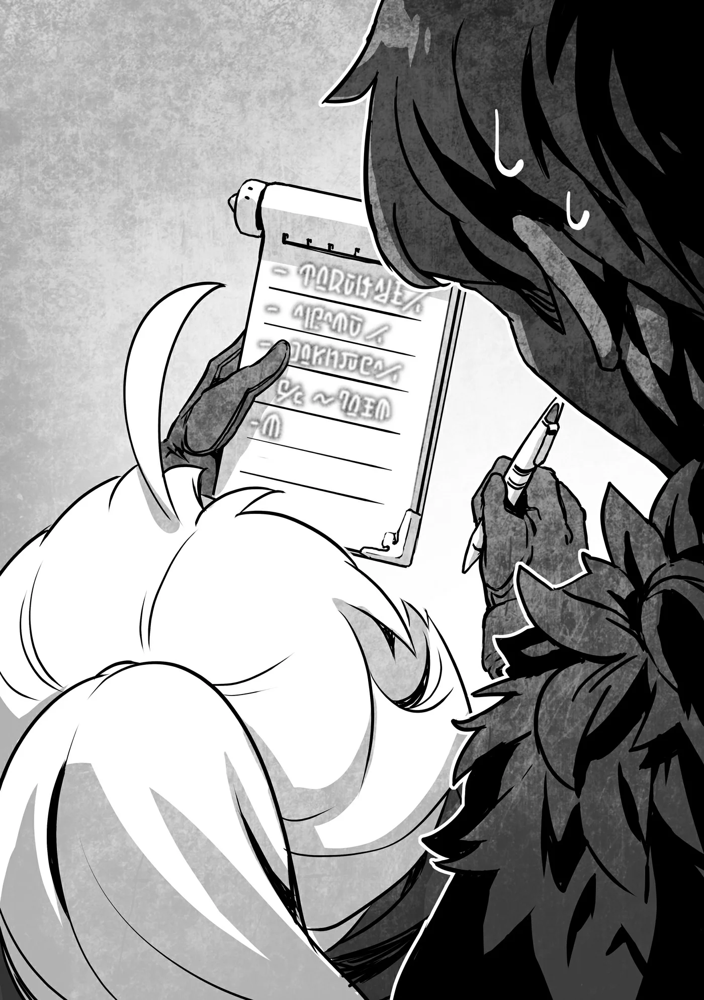
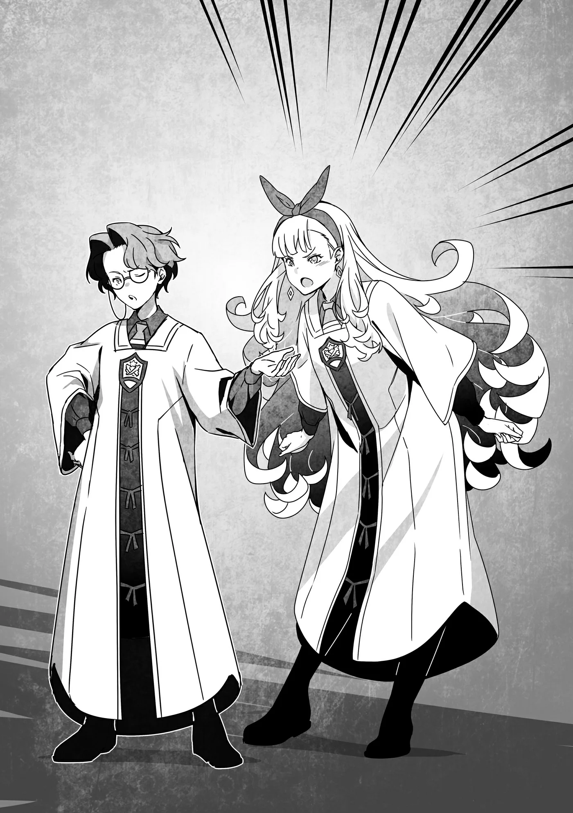

# Chương 210: Tập 9 Chương 4 - Tòa Tháp và Học Viện (2)

"Đã có duyên gặp lại nhau thế này thì lúc đó chắc cậu sẽ kể cho tôi nghe đủ chuyện náo nhiệt sắp tới đấy nhỉ, Rentt. Cũng đến lúc tôi phải đi rồi, nên thôi chào tạm biệt ở đây vậy."

Thực lòng tôi chẳng muốn có cái duyên gặp lại cô ấy chút nào, nhưng trực giác của Nive xưa nay khá chuẩn xác. Tôi tự dặn mình nhất định phải cẩn thận mới được.

Nhìn theo hướng Nive vừa nhìn, tôi thấy một người đàn ông mặt mày bực bội đang đứng trước cỗ xe. Vừa rồi Nive vừa nói vừa liếc về phía đó, nên đây hẳn là cỗ xe của cô ấy và Myullias, còn người kia chắc là người đánh xe hoặc đại loại thế.

Thấy ông ta nhìn Myullias với vẻ kính trọng, tôi đoán người đó có liên hệ với Giáo Hội Lobelia theo cách nào đó. Tôi cũng để ý thấy trên thân xe có biểu tượng của giáo hội. Cỗ xe trông không quá đắt tiền, nhưng vẫn tốt hơn xe bình thường nhiều. Thứ đó hiển nhiên vượt quá tầm túi tiền của tôi rồi.

Từ đợt chi một khoản lớn mua chiếc túi ma thuật, tôi luôn phải thắt chặt hầu bao. Dù giờ đã khá giả hơn xưa nhiều, nhưng chẳng biết trước được khi nào lại phát sinh khoản chi ngoài dự tính. Với mạo hiểm giả, quái vật càng mạnh thì chi phí bỏ ra để hạ chúng càng tốn kém. Muốn tạo dựng tên tuổi bao giờ cũng cần một khoản tích lũy nhất định. Dù vậy, vẫn có khối mạo hiểm giả giữ thói quen làm ngày nào tiêu ngày đó. Chưa kể, làm một mạo hiểm giả kiểu ấy trông lại ngầu hơn.

Hay là mình cũng thử sống kiểu ấy xem sao nhỉ. Tôi thoáng nghĩ vậy, nhưng tính tôi vốn quá cẩn trọng để sống kiểu đó, nên lập tức gạt ngay ý nghĩ ấy đi.

"Mọi chuyện êm xuôi hơn tôi tưởng một chút đấy," tôi nói với Nive, "nhưng tôi cũng cảm thấy chúng ta sẽ còn gặp lại nhau. Thế nên ít nhất từ giờ tới lúc ấy, cô nhớ giữ gìn an toàn."

Thật lòng mà nói, tôi chỉ mong cô ấy gặp đủ thứ vất vả để quên đi cái ý định giết tôi trong lúc ngủ. Nhưng hiển nhiên là tôi chẳng thể nói toẹt câu đó ra được.

"Câu đấy nghe bình thường thế. Chẳng giống kiểu của cậu chút nào, nhưng chắc cậu đang nói xã giao thôi nhỉ. Khỏi phải lo. Thứ duy nhất làm tôi nản lòng được là khi trên đời chẳng còn con Ma Cà Rồng nào để giết nữa kìa."

"À ừm."

Nghe cứ như cô ấy đang bảo chuyện đó sẽ chẳng xảy ra chừng nào tôi chưa chết vậy, nhưng mà... Không, tôi chỉ giống Ma Cà Rồng thôi chứ đâu phải Ma Cà Rồng thật sự. Hoặc ít ra tôi đã cố tự thuyết phục mình như thế.

Nive và Myullias vẫy tay chào rồi bước lên xe. Họ rời đi bình lặng đến mức người ta dễ dàng quên mất hai người từng gây ra sóng gió lớn cỡ nào trong suốt thời gian ở Maalt.

"Coi như cũng trút được một gánh nặng rồi," Lorraine lẩm bẩm khi nhìn theo cỗ xe đang rời đi.

"Chưa biết được đâu. Dự đoán của Nive, hay lời tiên tri của cô ấy, cho thấy sắp có rắc rối xảy ra rồi."

"Tiếc là có lẽ cô ấy nói đúng. Tòa Tháp, Học Viện rồi cả một mê cung cùng tụ lại một chỗ. Ngần ấy người đổ về thị trấn, kiểu gì chẳng có chuyện xảy ra. Nhưng ít ra anh cũng thấy nhẹ người hơn khi biết mình với Rina sẽ không bị nghi là Ma Cà Rồng chứ?"

"Tôi cũng mong thế, nhưng qua mấy chuyện gần đây thì thấy những người có trực giác nhạy bén ngoài kia chẳng thiếu đâu. Tôi không thể lơ là cảnh giác được."

Như trường hợp của Nive, trực giác của cô ấy được củng cố bằng kinh nghiệm và suy luận logic. Tôi không nghĩ mình sẽ sớm gặp lại ai đáng gờm như cô ấy nữa, nhưng nói vậy không có nghĩa là tôi được phép ngừng cẩn trọng.

"Tôi hiểu là không được lơ là cảnh giác, nhưng cụ thể thì chúng ta phải làm gì? Tôi chưa có kinh nghiệm chuyện này, nên chẳng biết tí gì cả," Rina nhíu mày khó nghĩ.

Cũng phải thôi. Tôi làm Undead được một thời gian rồi nên biết rõ những gì dễ khiến người ta nghi ngờ. Còn Rina thì mới thành Undead được vài ngày. Đó là những điều tôi cần chỉ cho cô ấy, mà thực ra cũng chẳng có gì phức tạp.

"Trước hết, nửa đêm đừng có đi lang thang ra ngoài," tôi dặn.

Tôi mong là điều này khỏi nói cũng rõ. Những người như chúng tôi mà cứ đi loanh quanh giữa đêm khuya thì khả nghi lắm. Hành động kiểu ấy sẽ thu hút sự chú ý của những người như Nive.

"Ưm, vâng, đúng là hợp lý thật. Còn gì nữa không?"

"Để xem nào. Điều nữa là phải tỏ ra thân thiện hết mức có thể. Đa số mọi người đều nghĩ Undead là loài u ám. Nhớ là sáng nào cũng phải chịu khó vui vẻ chào hỏi mọi người."

Tôi vẫn làm thế suốt từ ngày dọn đến sống ở nhà Lorraine. Tất nhiên cũng chẳng phải tôi giao thiệp sâu sắc gì với ai; chỉ là hễ tình cờ gặp hàng xóm lúc ra đốt rác hay làm việc vặt thì tôi chào một tiếng. Đi chợ mua đồ tôi cũng hay trò chuyện đôi câu với mấy bà cụ.

"Chào hỏi là một trong những điều căn bản nhất để làm người mà!" Rina nói thêm.

"Đúng thế. Để xem còn gì nữa nào..."

Sau khi tôi chỉ cho Rina vài điều cơ bản để hòa nhập vào xã hội con người, Lorraine nhìn tôi rồi lẩm bẩm: "Nghe cứ như lời dặn dò một đứa trẻ lần đầu tiên sống xa nhà vậy."

Nghe đâu giống thế nhỉ? Khi tôi nhìn sang Rina để tìm sự đồng tình, cô ấy đang cắm cúi chép lời khuyên của tôi vào cuốn sổ tay, một ma cụ do Lorraine tự làm rồi tặng cho cô ấy. Thứ đó nếu đem mua thì hẳn đắt lắm.

Tôi ghé mắt nhìn qua vai cô ấy xem nội dung bên trong. "Không được ra ngoài ban đêm!", "Chào hỏi là rất quan trọng!" và "Phải thân thiện với hàng xóm! v.v." Tất cả đều được viết bằng những nét chữ tròn trịa dễ thương.

Đúng là nghe giống hệt lời dặn trẻ con thật. Tôi đưa mắt từ Rina sang Lorraine và thấy cô ấy đang cười khúc khích. Trong lòng tôi cũng muốn phàn nàn thái độ của cô ấy lắm, nhưng nếu đổi vị trí cho nhau, chắc tôi cũng cười cô ấy thôi.

"Nhưng tôi nói đâu có sai, đúng không?" tôi hỏi lại cho chắc.

"Không, anh không sai. Hàng xóm quanh nhà đều nghĩ anh chỉ là một kẻ ăn bám dễ mến đang sống ở nhà tôi thôi."

Không bị ai nghi ngờ thì tốt thật, nhưng mà... một kẻ ăn bám dễ mến ư? Thế này có khi làm mất hết danh tiếng của loài Undead mất. Dù tôi cũng chẳng để tâm làm gì.

Đúng lúc tôi đang nghĩ vậy, một tiếng quát giận dữ bỗng vang lên khắp bến xe.

"Này ông kia! Ông tính trả lời chuyện này thế nào đây hả?!"

◆◇◆◇◆

"Gì thế? Có chuyện gì vậy?" Lorraine hỏi rồi quay về hướng có tiếng quát.

Rina và tôi cũng quay sang nhìn. Ở đó, chúng tôi thấy một cậu thiếu niên mặc chiếc áo choàng trông có vẻ đắt tiền và một người đàn ông trung niên trông giống thương nhân lữ hành.

"Một đứa trẻ à?" tôi lẩm bẩm.

Lorraine gật đầu. "Có vẻ thế. Trông chừng mười tuổi thôi. Nhỏ tuổi thế mà thái độ đã trịch thượng gớm, nhưng mà... À, chiếc áo choàng kia trông quen lắm. Rina cũng từng thấy rồi đúng không?"

"Đó là đồng phục của Học Viện," Rina xác nhận. "Chắc cậu bé vừa đến trên một trong mấy cỗ xe lúc nãy." Nét mặt cô ấy thoáng vẻ bối rối, có lẽ vì cảnh này gợi lại ký ức về đám học viên Học Viện thô lỗ dạo trước.

Đây là lần đầu tiên tôi thấy đồng phục của Học Viện. Cũng phải thôi, một gã nhà quê như tôi thì hiếm khi có dịp thấy người của Học Viện. Đợt trước ở vương đô có thể tôi từng gặp rồi, nhưng lại chẳng nhớ là có thấy hay không. Có lẽ do hồi ấy tôi ăn mặc kỳ quặc nên chẳng để ý người khác trông thế nào.

"Bộ đồng phục đẹp đấy nhỉ?" tôi nhận xét. Một mặt, đó chỉ là bộ đồng phục được may đo khéo léo và trông đắt tiền, nhưng dưới góc nhìn của một mạo hiểm giả như tôi thì bộ đồ ấy cũng rất tốt.

"Ừ. Nó làm từ len Ma Lực gia cố bằng thuật giả kim, lại còn thêu vài ma pháp trận bằng chỉ tơ. Học viên Học Viện thường phải đối mặt với nhiều nguy hiểm như tập ma pháp hay thí nghiệm hóa học, nên một bộ đồ đa dụng là tốt nhất. Đó là một ma cụ được chế tác rất đẹp."

Tôi cũng hơi nể khi thấy Lorraine đứng từ xa mà nhận ra được ngần ấy thứ, nhưng thuật giả kim vốn là chuyên môn của cô ấy. Còn tôi chỉ mơ hồ cảm nhận được chút Ma Lực từ nó. Tôi không thể nhìn thấy dòng chảy ma thuật hay hiểu cấu trúc ma pháp trận như Lorraine. Dù vậy, thiếu kiến thức chuyên môn thì tôi vẫn nhìn ra được khối điều. Chẳng hạn như bộ đồng phục kia trông có vẻ chịu được ma pháp, mà chất vải chắc cũng đỡ được cả đòn đánh từ vũ khí.

"Cô đoán bộ đó giá khoảng bao nhiêu?" tôi hỏi.

"Để xem nào. Tầm đó thì khoảng năm mươi đồng vàng. Nếu chỉ cần mức bảo vệ tương đương thì mua một bộ giáp bình thường sẽ rẻ hơn."

"Năm mươi đồng vàng á?" Rina há hốc miệng.

Đó là một khoản tiền lớn. Ngần ấy tiền đủ để trọ ở một quán trọ rẻ tiền suốt khoảng hai năm. Giờ thì tôi đủ tiền mua rồi, nhưng chắc chẳng đời nào tôi chịu bỏ tiền sắm một bộ. Chiếc áo choàng hiện tại của tôi chất lượng vốn rất cao, tôi chẳng cần thứ gì như thế. Nhưng nếu không có chiếc áo choàng này thì có thể tôi đã nghĩ khác. Mỗi lần ra ngoài đi dạo quanh thị trấn mà cứ phải mặc vào cởi ra cả bộ giáp thì phiền lắm. Xét về khoản đó, áo choàng tiện hơn nhiều, lại còn nhẹ nữa. Có điều nếu tôi mà mua bộ đồng phục ấy mặc vào thì chẳng khác nào một gã mặt dày giả danh học viên Học Viện.

Thực ra chuyện đàn ông chẳng phải kỵ sĩ mà ăn mặc như kỵ sĩ, hay phụ nữ ở quán rượu hóa trang thành nữ tu dù không phải nữ tu, vốn khá phổ biến. Tôi mà mặc vào thì cũng giống hệt họ. Mấy bộ đồ hóa trang ấy còn hở hang hơn đồ thật nữa. Thôi thì họ cũng chỉ mặc cho vui. Tùy tình huống mà kỵ sĩ hoặc nữ tu thật có thể ghé qua bắt giữ hay trình báo họ. Nhưng chuyện đó còn tùy thuộc vào cách xử sự của chủ quán rượu nữa.

"Còn vụ ầm ĩ đằng kia thì... À."

Tôi quay lại nhìn cậu thiếu niên và người thương nhân.

"Ông tính giải quyết chiếc áo choàng của tôi thế nào đây?!" cậu bé gắt với người đàn ông trung niên.

Người đàn ông chẳng biết phải làm sao. Trông ông ấy hơi bực mình khi nói: "Cậu bảo giải quyết là giải quyết thế nào? Tôi chỉ va nhẹ vào cậu một cái thôi. Tôi cũng xin lỗi chuyện đó rồi. Bộ cậu định bắt tôi đền tiền vì nó bị bẩn chắc?"

"Không phải vì bẩn, mà là vì ông làm hỏng nó rồi! Thứ người như ông chắc chẳng biết đâu, nhưng đây là đồng phục của Học Viện đấy! Một món đồ thủ công tinh xảo có cường hóa ma thuật cao cấp hẳn hoi. Vậy mà ông—"

"Cường hóa ma thuật cao cấp á? Thế thì làm sao chỉ va nhẹ một cái mà hỏng được. Hay là cậu mua phải đồ dỏm rồi?"

"Ông dám ăn nói thế à!"

Cuộc cãi vã nhanh chóng leo thang, người xung quanh bắt đầu xúm lại xem.

Dù Maalt là một thị trấn tương đối yên bình, chuyện cãi cọ ở đây vẫn xảy ra thường xuyên. Mạo hiểm giả nơi này cư xử biết điều hơn so với các thành phố khác, nhưng bản chất vẫn là dân thô lỗ. Ngày nào ở đâu đó tại Maalt cũng có cãi vã đánh lộn. Mà hễ có đánh nhau là người xem lại tụ tập kích động đôi bên, tiện thể đặt cược xem ai thắng.

Cuộc đụng độ giữa cậu thiếu niên và người đàn ông trung niên này sắp sửa biến thành một màn náo nhiệt giữa phố như thế, tuy nhiên...

"Xin lỗi! Cho tôi qua với!"

Một thiếu nữ chen qua đám đông đang tụ tập rồi lách vào giữa. Cô ấy cũng mặc đồng phục của Học Viện, nhìn là biết học viên ở đó. Chẳng lẽ cô ấy đến để giúp cậu bé kia?

Nhiều học viên Học Viện biết dùng ma thuật. Dù không có năng lực ấy thì vẫn có thể nhập học, nhưng nếu dùng được ma thuật thì thi đỗ sẽ dễ hơn. Trong những gia đình đủ giàu để đóng học phí, chuyện con cái có năng khiếu ma thuật cũng khá phổ biến.

Hai học viên Học Viện là mối đe dọa khá lớn, ít nhất là với người thương nhân trung niên tội nghiệp kia. Khỏi phải nói ma pháp sư nguy hiểm đến mức nào. Chỉ cần niệm một câu chú ngắn là họ đã có thể nhấn chìm một người trong lửa. Tình huống này có lẽ cần người ngoài can thiệp rồi.

Mọi người xung quanh có vẻ cũng nghĩ giống chúng tôi. Thế nhưng, thiếu nữ kia lại làm tất cả bất ngờ.

"Noel. Noel Kruege! Cậu thôi ngay cái trò gây sự với thường dân đi! Cậu đang làm mất thanh danh của cả Học Viện đấy!" cô ấy quát lớn.

◆◇◆◇◆

Khác với cậu thiếu niên kiêu ngạo ra mặt, cô gái trông điềm tĩnh và nghiêm túc hơn nhiều. Những món phụ kiện cô ấy đeo cùng áo choàng, như đôi hoa tai đung đưa trên tai và chiếc vòng tay mảnh lấp ló dưới tay áo, cho thấy cô ấy xuất thân từ một gia đình giàu có.

"Giàu có thích thật đấy, được đeo toàn đồ tinh xảo thế kia," Lorraine nói sau khi liếc nhìn trang sức của cô gái. "Hoa tai của cô bé giúp tăng cường Ma Lực, còn vòng tay thì tăng phòng ngự ma pháp. Chúng không chỉ có công năng thực tế đâu, mà còn là những phụ kiện được chế tác khéo léo và thiết kế rất đẹp. Có khi nào cô bé là quý tộc không nhỉ?"

"Hầu hết học viên Học Viện đều là quý tộc cả, nên chuyện đó cũng chẳng có gì lạ," tôi đáp.

Nhìn chung, mạo hiểm giả phải kiên trì tích góp tiền bạc để thay dần sang trang bị tốt hơn. Nhưng quý tộc thì không cần làm thế. Họ đủ tiền sắm trang bị chất lượng cao ngay từ đầu. Có điều rất nhiều món đồ đòi hỏi trình độ nhất định mới dùng được, nên đồ của họ thường đẹp mã hơn là thực dụng.

Mặt khác, những món đồ tăng cường Ma Lực mạnh lại hoàn toàn vô dụng, chưa kể còn rất nguy hiểm đối với một ma pháp sư non kinh nghiệm. Chuyện đó chẳng khác nào đưa một thanh đại kiếm nặng trịch cho một kiếm sĩ yếu sức. Một ma pháp sư mới học nghề rất dễ mất kiểm soát ma thuật rồi chết vì sự cố. Hơn nữa, nếu đeo quá nhiều món đồ tác động đến dòng chảy Ma Lực, chúng có thể nhiễu loạn lẫn nhau và gây ra hậu quả tai hại. Việc cô gái kia đeo cùng lúc áo choàng, hoa tai và vòng tay chứng tỏ cô ấy ít nhất cũng đủ trình độ để cân bằng cả ba món mà không gặp vấn đề gì.

Có lần Lorraine từng đeo nhẫn ma thuật kín cả mười ngón tay lẫn mười ngón chân, đeo năm chiếc hoa tai mỗi bên, mặc mười lớp áo choàng rồi đội chồng năm cái mũ lên đầu. Dĩ nhiên, phép đầu tiên cô ấy tung ra trong bộ dạng đó đã gây ra một vụ nổ lớn. Dù thất bại thảm hại, cô ấy vẫn kiểm soát được ngần ấy món đồ suốt gần ba mươi giây. Làm được thế tốn một lượng công sức kinh khủng, nên nó có ích trong thực chiến hay không thì còn phải bàn. Biết đâu lại dùng được trong tình huống cần hỏa lực thật mạnh chỉ trong một khoảnh khắc.

Dù sao thì đem cô gái kia ra so sánh với một học giả điên rồ như Lorraine thì bất công cho cô ấy quá.

Lorraine và tôi đang tán gẫu thì tôi nhận thấy Rina bỗng im lặng lạ thường. Tôi nhìn sang bên cạnh và thấy cô ấy đang nhìn chằm chằm vào cậu bé và cô gái của Học Viện với vẻ mặt sững sờ.

Hiếm khi thấy Rina ngạc nhiên đến thế. Dù sao cô ấy cũng đâu phải người nhút nhát yếu bóng vía. Cô ấy từng bình tĩnh chấp nhận tôi khi tôi chỉ là một đống xương, thậm chí còn nghĩ ra cách lén đưa tôi vào thị trấn. Làm cô ấy giật mình đâu phải chuyện dễ. Đành rằng cô ấy giàu biểu cảm hơn Lorraine hay tôi, nên theo một nghĩa nào đó cũng hay ngạc nhiên vì chuyện này chuyện nọ, nhưng sững sờ đến mức không nói nên lời thế này thì hiếm thấy thật.

"Rina, sao thế?" tôi hỏi.

Rina giật mình tỉnh lại, nhưng mắt vẫn nhìn chằm chằm vào hai người kia khi thốt lên: "Cô gái đó! Bạn ấy chính là người bạn mà lúc nãy tôi kể đấy!"

◆◇◆◇◆

"Đừng có xen vào, Elise Georges," cậu bé nói. "Tôi đang bận nói chuyện với gã thương nhân này. Giờ tôi không có thời gian đôi co với cô đâu."

Nghe những gì họ nói với nhau nãy giờ, tôi biết được cậu bé tên là Noel, còn cô gái là Elise.

Noel bực bội nhìn Elise rồi phẩy tay như muốn xua đi. Elise nheo mắt, trừng nhìn cậu ta sắc lẻm.

"Cậu...!"

Tôi cảm nhận được Ma Lực đang chảy vào người Elise. Nhưng cô ấy không định niệm phép. Đó chỉ là phản ứng tự nhiên do cảm xúc kích động mà thôi. Vì cảm xúc có thể làm ảnh hưởng đến độ mạnh của Ma Lực và thời điểm tung phép, nên các ma pháp sư giàu kinh nghiệm luôn rèn luyện để tránh chuyện đó. Xem ra Elise vẫn chỉ là người mới học việc. Dù cô ấy có trình độ, nhưng chưa kiểm soát được phản ứng này cũng là điều dễ hiểu.

Nhìn hai người họ cãi nhau, Lorraine xoa cằm lẩm bẩm: "Bạn của Rina hả? Thế thì tình hình hơi rắc rối rồi."

"Thật sao?" tôi hỏi. "Ý tôi là dù có chuyện gì đi nữa, họ cũng đâu đến mức tung phép vào nhau ngay tại đây. Mà kể cả có làm thế thật thì chúng ta vẫn xử lý được mà."

Bắn phép uy lực lớn giữa thành phố là điều bị cấm. Ở Yaaran cũng như phần lớn các nước khác, luật đều quy định thế. Thỉnh thoảng vẫn có ngoại lệ, nhưng tôi mong họ không liều lĩnh đến mức đánh nhau bằng ma thuật ở đây. Vả lại, tôi khá chắc Học Viện luôn tự hào về trí tuệ và phép tắc của học viên mình.

Mà nghĩ lại thì chuyện mạo hiểm giả cãi lộn vốn xảy ra như cơm bữa, và người ta thường cứ để mặc cho tới khi lính gác thị trấn phải ra mặt. Nên trừ khi phá hoại tài sản thị trấn hay làm bị thương nhiều người đứng xem vô tội, chuyện đánh lộn hiếm khi bị coi là tội nặng. Cũng vì thế mà mạo hiểm giả chẳng ngại xô xát với nhau. Không phải họ coi thường luật pháp, chỉ là họ chỉ quan tâm tới mức tối thiểu để sống được trong xã hội mà thôi. Bởi vậy người ngoài mới coi mạo hiểm giả như đám du côn thô lỗ.

Theo đó mà xét, dù Noel và Elise có tung phép ở đây thì bản thân họ chắc cũng chẳng gặp rắc rối gì lớn. Chuyện đó sẽ gây nguy hiểm cho người đứng xem, nhưng Lorraine có thể dựng kết giới ma pháp hay gì đó tương tự. Hơn nữa, tôi cũng đã nhìn quanh xem có ma pháp sư nào khác không. Gần đó có vài mạo hiểm giả là ma pháp sư, chắc họ cũng sẽ can thiệp thôi. Tôi không nghĩ tình hình nguy hiểm đến mức ấy.

Thế nhưng Lorraine lại lắc đầu nói: "Mấy đứa trẻ của Học Viện là một chuyện. Nhưng anh nhìn thứ bên hông người thương nhân kia xem."

"Ồ, cái đó là của Cộng Hòa Hàng Hải Ariana. Ra là người thương nhân đến từ đó."

Bên thắt lưng người thương nhân có đeo một thanh đoản kiếm. Nhìn kích thước và kiểu dáng thì nó dùng để làm cảnh hơn là chiến đấu. Trên chuôi kiếm có khắc hai huy hiệu rất rõ. Tôi từng thấy một cái trong số đó rồi. Đó là huy hiệu của Cộng Hòa Hàng Hải Ariana, khắc hình một con rồng biển đang cuốn chặt một con bạch tuộc khổng lồ giữa đại dương.

Cộng Hòa Hàng Hải Ariana là một quốc gia ven biển phát triển thịnh vượng chủ yếu nhờ buôn bán đường biển. Vì thế, rất nhiều công dân nước này làm nghề buôn, và người ta có thể bắt gặp họ ở gần như mọi quốc gia trên đại lục. Tuy nhiên, tôi vẫn chưa rõ tại sao chuyện đó lại thành vấn đề vào lúc này.

"Huy hiệu còn lại cho thấy ông ta thuộc Hội Thương Nhân Ariana," Lorraine giải thích. "Những thanh đoản kiếm đó chỉ được trao cho người có địa vị nhất định trong hội thôi. Xích mích với ông ta có thể rất nguy hiểm. Vả lại họ đều là người dưng, chúng ta vốn có thể mặc kệ chuyện cãi vã của họ, thế nhưng..."

Hội Thương Nhân Ariana vốn tai tiếng là sẵn sàng làm bất cứ giá nào để kiếm tiền. Họ thuê rất nhiều lính đánh thuê và mạo hiểm giả mạnh, thậm chí nghe đồn thỉnh thoảng còn dùng cả sát thủ. Đó là một tổ chức nguy hiểm với nhiều sự thật mập mờ và lời đồn đáng sợ xoay quanh. Nếu giao dịch với họ theo quy tắc thông thường thì chẳng sao, nhưng một khi đã đối đầu với họ thì phải chuẩn bị sẵn tinh thần.

Ý Lorraine là vô tình gây chuyện với họ, dù chỉ vì không biết, cũng cực kỳ mạo hiểm. Nhưng vì giờ bạn của Rina đã dính vào, nên cô ấy cũng ngầm bảo chúng tôi không thể cứ thế làm ngơ.

"Hai bên đã cãi nhau đến mức này rồi mà nhảy vào can thiệp chẳng phải hơi gay go sao?" tôi nói.

Tôi không ngại đứng ra can, nhưng nhìn thì thấy Noel và người thương nhân chẳng có vẻ gì là chịu giảng hòa. Có khi chúng tôi lại gây thêm rắc rối rồi bị cuốn luôn vào mối bất hòa của họ.

"Tôi nghĩ chúng ta sẽ ổn thôi. Lúc nhìn áo choàng của thằng bé tôi có nhận ra một điểm. Nhưng câu hỏi quan trọng là ở đây này: Rina, cô có muốn giúp họ không?"

Rina gật đầu chắc nịch rồi đáp: "Có, nếu giúp được. Như vậy có ổn không?"
