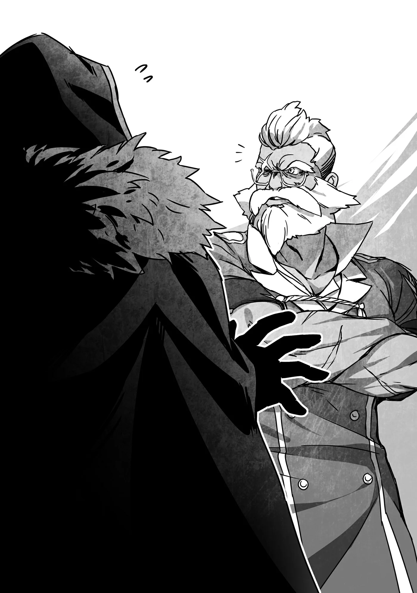

# Chương 214: Tập 9 Chương 5 - Một Ủy Thác từ Hội (2)

"Tổng Hội Trưởng sao? Khoan đã, chẳng phải ngài ấy là người đứng đầu toàn thể mạo hiểm giả ở Vương Quốc Yaaran ư? Ông có chắc tôi là người thích hợp cho việc này không đấy?"

Nghe Wolf bảo đi đón người, tôi đoán chắc hẳn là nhân vật máu mặt nào đó, nhưng thế này thì vượt xa cả những gì tôi tưởng tượng. Tôi bất giác tự hỏi lẽ ra ông ấy nên nhờ người khác, chứ sao lại là một kẻ vô danh tiểu tốt như mình.

"Tôi đâu có bắt cậu đi đánh nhau, hay đề xuất cải cách lớn gì cho Hội đâu, thì làm gì có vấn đề gì, đúng không? Cậu chỉ cần đến gặp rồi đón ngài ấy về đây thôi. Có gì quá đáng lắm đâu?" Wolf nói như thể đang nhờ tôi tạt qua cửa hàng tạp hóa đầu ngõ vậy.

Có khi ông ấy nói đúng thật. Nói đúng hơn thì, công việc này khéo lại hợp nhất với một chân sai vặt quèn như tôi.

"Tôi hiểu cậu muốn nói gì mà," Wolf tiếp lời. "Với một mạo hiểm giả bình thường thì Tổng Hội Trưởng chẳng khác nào nhân vật trong truyền thuyết. Nhưng như tôi vừa nói đấy, tôi còn cả núi giấy tờ phải giải quyết đây. Chưa kể còn bao nhiêu việc khác nữa, đâu thể cứ thế bỏ Maalt mà đi được. Cậu hiểu mà, đúng không? Trừ phi... cậu chịu nhận lời làm người kế nhiệm của tôi. Thế thì tôi sẵn lòng chỉ cho cậu mấy việc cơ bản rồi giao Hội lại cho cậu trông nom, còn tôi đi đón Tổng Hội Trưởng. Cậu thích thế hơn không?"

Đúng là một lời đề nghị rợn người. Tôi đinh ninh ông ấy chỉ nói đùa, nhưng nhìn kỹ lại thì trên mặt ông ấy đang nở một nụ cười mỉm đến phát sợ. Nét mặt ông ấy thật khó đoán. Rốt cuộc là nghiêm túc hay chỉ muốn trêu tôi? Tôi biết thừa nếu mình trả lời lệch một câu thôi, có khi ông ấy sẽ lập tức biến kế hoạch đó thành thật.

"Không, tôi xin kính cẩn từ chối," tôi đáp ngay tắp lự. "Tôi đi là được chứ gì. Tôi sẽ đi đón ngài ấy. Nhưng Tổng Hội Trưởng đang ở vương đô, đúng không?"

Chẳng đời nào một nhân vật tầm cỡ như thế lại ngồi làm việc ở một ngôi làng hẻo lánh vô danh nào đó. Người đứng đầu toàn thể mạo hiểm giả ở Yaaran chắc chắn phải ở vương đô rồi.

"Ừ, nên cậu chịu khó chạy nhanh một chuyến tới Vistelya nhé. Tôi biết chuyến này cũng chẳng 'nhanh' gì cho cam, nhưng tôi đâu có bắt cậu vượt biên giới hay gì. Cưỡi thú chạy nhanh thì tầm một tuần là tới nơi thôi. Tính cả đi cả về thì mất chừng hai tuần. Tôi sẽ lo cho cậu thù lao hậu hĩnh. Về nguyên tắc thì đây là việc của nhân viên Hội, nhưng cậu chỉ là tạm thời, nên tôi tính sẽ trả công sòng phẳng cho cậu."

Nghe vậy thì đỡ quá. Nhưng vương đô à? Nếu dùng ma pháp trận dịch chuyển ở Vương Quốc Cổ Đại, tôi chỉ mất chưa đầy một ngày là tới nơi. Có điều cách đó không được rồi. Tôi không thể dẫn Tổng Hội Trưởng tới chốn ấy. Tôi chưa từng gặp ngài ấy, cũng chẳng biết có thể tin tưởng đến mức nào. Dù nghe nói Wolf rất kính nể ngài ấy, nhưng nhìn người thì phải tự mình tiếp xúc mới biết rõ tính nết. Chúng tôi đành phải đi lại bằng cách thông thường thôi.

Hơi phiền một chút, nhưng đến Vistelya có khi lại hay. Đằng nào tôi cũng có việc cần giải quyết ở đó. Tôi phải đi gặp những người mình từng cứu trong chuyến đi Vistelya lần trước. Hồi đó tôi có hẹn sẽ ghé thăm họ sau vài ngày, nhưng tôi cũng nói trước mình là mạo hiểm giả rồi, nên chắc họ sẽ thông cảm đôi chút. Bằng không, tôi chỉ mong Augurey đã đứng ra đỡ lời giúp nếu có ai hỏi han. Dẫu vậy, tôi thấy mình cứ nên chuẩn bị sẵn một cái cớ thì hơn. Một mê cung mới xuất hiện ở Maalt sẽ là lý do hoàn hảo.

"Tôi là mạo hiểm giả mà! Mê cung mới hình thành thì làm sao tôi bỏ qua cho được! Xin lượng thứ cho tôi vì đã trót ưu tiên việc đó trước!"

Nói thế liệu có trót lọt không đây? Chắc là không rồi. Tôi đành trông cậy vào lòng tốt của họ vậy.

Tôi bảo với Wolf: "Ngày mai tôi sẽ lên đường. Tôi cần thu xếp một cỗ xe đã."

"Ồ, chịu nhận việc rồi hả? Cậu đúng là vị cứu tinh của tôi đấy."

Giọng Wolf đầy vẻ nhẹ nhõm. Có lẽ dù bận đến mấy, ông ấy cũng không muốn thất lễ với Tổng Hội Trưởng. Theo lời đồn tôi từng nghe, chính Tổng Hội Trưởng đã cất nhắc Wolf vào vị trí hiện tại sau khi ông bị thương nặng đến mức không thể tiếp tục làm mạo hiểm giả. Hẳn là Wolf luôn mang ơn ngài ấy.

"Ồ, bên này sẽ thu xếp xe cộ cho cậu, nên cứ về dọn hành lý đi. Tôi cũng sẽ lo xong giấy tờ cần thiết trước khi cậu xuất phát."

"Bận túi bụi thế mà ông lại chu đáo quá mức rồi đấy nhỉ?"

Một kẻ thiếu người đến mức phải trưng dụng cả cái xác chết biết đi mà lại chịu bỏ ngần ấy công sức. Cứ thấy gờn gợn thế nào ấy, nhưng có khi do tôi đa nghi quá thôi.

"Tổng Hội Trưởng làm gì có thời gian gặp một mạo hiểm giả ất ơ nào đó từ Maalt. Phải có thư giới thiệu thì người ta mới tiếp cậu. Cái đó chỉ mình tôi chuẩn bị được, nên đâu thể lấy cớ bận mà thoái thác. Còn xe cộ thì đây là mức hỗ trợ tối đa bên này lo được rồi. Cứ coi như chút lòng cảm ơn đi. Dù sao cậu cũng nhận một việc mà vốn dĩ chẳng có nghĩa vụ phải làm."

Dù ngoài mặt có vẻ như đang ép tôi giúp việc, nhưng tính Wolf vốn chu đáo, vẫn lo liệu từng chi tiết cho tôi. Tôi liền tin ngay lời ông ấy nói.

"Nếu vậy thì tôi xin nhận. Thôi, tôi phải về chuẩn bị đây."

"Ừ, cảm ơn cậu."

Chúng tôi trao đổi nốt vài thủ tục hành chính lặt vặt rồi tôi rời khỏi phòng làm việc của Wolf.

◆◇◆◇◆

Cánh cửa phòng Hội Trưởng khép lại sau một tiếng cạch nhẹ. Wolf thở phào một hơi. Ông chờ cho tới khi chắc chắn Rentt bên ngoài cánh cửa đã đi xa hẳn.

"Phù. Hú vía, thế mà cũng đùn đẩy sang cho cậu ấy được. Cậu ấy sắc sảo lắm, cứ sợ thế nào cũng nhận ra. Nhưng xem chừng cậu ấy lại nghĩ mọi chuyện theo hướng tốt đẹp nhất có thể. Tạ ơn thần linh."

Lời Wolf lẩm bẩm một mình nghe thật chẳng lành chút nào.

"Chúc may mắn nhé, Rentt. Có rảnh rỗi tôi cũng chẳng dại gì mà đi."

Wolf đặt chồng giấy tờ trên tay xuống bàn rồi cắm cúi làm việc tiếp.

◆◇◆◇◆

"Để xem nào. Trường kiếm chính, dao găm lột da, quần áo thay, thịt khô, muối... Đủ cả rồi chứ nhỉ? Tốt, tốt rồi."

Tôi gật gù trong lúc bày đồ ra sàn. Đây chưa phải toàn bộ đồ đạc trong túi ma thuật, nhưng là tất cả những thứ cần thiết cho chuyến đi sáng mai.

Túi ma thuật rộng thênh thang nên bên trong nhét không ít thứ linh tinh, như mấy viên đá lấp lánh nhặt bừa ở đâu đó hay mấy mẩu gỗ lũa trông hay hay. Thật tình tôi cũng chẳng hiểu sao mình lại tha chúng theo làm gì, nhưng nếu sau này cần thêm chỗ thì cứ vứt đi là xong.

"Thấy anh đang hào hứng với chuyến đi thế kia tôi cũng chẳng muốn cắt ngang đâu, nhưng anh không thấy chuyện này có gì lạ à?" Lorraine tựa người vào khung cửa, lên tiếng.

"Có chứ. Nhiều là đằng khác. Tôi biết mà."

"Thế sao anh vẫn nhận lời ông ấy rồi về thẳng nhà thế này?"

Dù Lorraine thoáng vẻ ngán ngẩm, cô ấy cũng đành chịu vì biết thừa làm những chuyện thế này rất giống tính tôi.

"Đằng nào tôi cũng phải lên vương đô giải quyết chút việc. Vả lại tôi cũng gây cho Wolf bao nhiêu rắc rối rồi, thỉnh thoảng giúp ông ấy một lần thì có mất gì đâu."

"Tôi khá chắc là anh giúp ông ấy cả đống lần rồi, chứ đâu phải chỉ 'thỉnh thoảng'."

"Thế à?"

Có lẽ Lorraine nói đúng thật. Nhưng sống ở đời thì phải biết nương tựa vào nhau chứ. Với lại để Wolf nợ mình một ân tình có khi lại có lợi sau này, coi như gieo hạt giống cho tương lai vậy.

"Dĩ nhiên rồi," Lorraine đáp. "Nhưng mà Tổng Hội Trưởng à? Tôi từng gặp Tổng Hội Trưởng Đế Quốc rồi, chứ Tổng Hội Trưởng của Yaaran thì chưa từng gặp."

"Ủa, thật á? Tôi cứ tưởng là mạo hiểm giả Ngân Cấp thì ít nhất cô cũng phải thấy mặt ngài ấy một lần rồi chứ."

"Tôi không rõ ở Yaaran thế nào, nhưng bên Đế Quốc thì Tổng Hội Trưởng chỉ tiếp mạo hiểm giả từ Kim Cấp trở lên thôi. Lần duy nhất tôi gặp ngài ấy cũng là với tư cách học giả. Nếu nhớ không nhầm thì dàn hộ vệ của ngài ấy toàn là mạo hiểm giả Kim Cấp."

"Ra thế."

Tổng Hội Trưởng là người đứng đầu toàn bộ mạo hiểm giả trong vương quốc. Lẽ ra để cả mạo hiểm giả Bạch Kim Cấp hay Mithril Cấp làm hộ vệ có khi còn hợp lý hơn. Nhưng mạo hiểm giả ở thứ hạng đó lại quá đỗi hiếm hoi và quý giá, đến mức khó mà phân định xem giữa họ với Tổng Hội Trưởng thì ai quan trọng hơn.

Dù nhiều Hội Trưởng từng là mạo hiểm giả như Wolf, nhưng xét cho cùng họ cũng chỉ là người đứng đầu mảng hành chính của Hội thôi. Hiếm khi họ là anh hùng hay nhân vật lẫy lừng. Chưa kể nhiều mạo hiểm giả Bạch Kim Cấp và Mithril Cấp lại... lập dị. Họ chưa chắc đã chịu nghe mệnh lệnh từ một Hội Trưởng, mà Hội Trưởng cũng chẳng có cách nào bắt họ phải nghe. Nive Maris giờ vẫn là Kim Cấp, nhưng sớm muộn gì cô ấy cũng lên Bạch Kim Cấp thôi. Mạo hiểm giả Bạch Kim Cấp với Mithril Cấp chính là kiểu người như thế đấy.

Khoan đã, rốt cuộc vì sao mình lại từng ngưỡng mộ mạo hiểm giả Mithril Cấp đến thế nhỉ? Tôi tự hỏi. Nhưng rõ ràng vẫn có những người tuyệt vời và đáng khâm phục thuộc hàng Mithril Cấp cơ mà. Phải rồi, đó mới là những tấm gương tôi hằng muốn noi theo. Đúng vậy.

"Hỏi để biết thêm thôi, rốt cuộc cô thấy yêu cầu của Wolf có gì đáng ngờ thế?" tôi hỏi Lorraine. Tôi không định nghe xong lý lẽ của cô ấy rồi từ chối ủy thác, nhưng tham khảo góc nhìn của Lorraine vẫn có ích hơn.

"Có vài điểm. Thứ nhất, sao Tổng Hội Trưởng không cứ thế tự mình đến đây luôn đi? Ngài ấy hoàn toàn có thể ngồi một cỗ xe sang trọng có vài hộ vệ Kim Cấp tháp tùng cơ mà."

Thỉnh thoảng mấy quý tộc từ vương đô tới đây cũng toàn đi lại kiểu đó thôi.

"Wolf bảo ông ấy muốn gửi báo cáo từ chi nhánh Maalt lên tổng bộ. Thường thì ông ấy vẫn gửi qua đường thư tín, nhưng ông ấy nghĩ để một người nắm rõ tình hình đích thân giải thích chi tiết sẽ dễ hơn. Còn tôi có nhiệm vụ mời Tổng Hội Trưởng tới Maalt, vì mê cung mới có thể phát sinh nhiều vấn đề."

"Nghĩa là chỉ mang tính hình thức thôi à?" Lorraine hỏi.

"Wolf nói vậy đấy. Nhân vật quan trọng như Tổng Hội Trưởng vướng bận đủ thứ trách nhiệm, đâu thể cứ thế đùng đùng rời khỏi vương đô được. Ngài ấy cần một lý do hợp lý để dễ bề ăn nói trước công chúng."

"Nghe thì cũng có lý, nhưng thấy vẫn hơi khiên cưỡng..."

Tôi cứ ngỡ mình đã đưa ra một lời giải thích hợp lý, nhưng Lorraine vẫn còn nghi ngại. Lẽ ra tôi phải thấy hơi bực vì cô ấy bắt bẻ kỹ quá, nhưng thật tình tôi cũng nghĩ y như vậy.

"Đúng không? Cảm giác cứ gượng ép thế nào ấy," tôi đáp.

"Vậy anh nghĩ còn lý do nào khác à?"

"Chỉ là linh cảm thôi, nhưng ừ. Có điều tôi chẳng đoán ra được là gì. Có khi do tôi đa nghi quá, mà cũng có khi là chuyện đáng lo thật. Thật lòng mà nói, không đích thân đến đó thì chẳng thể biết được đằng nào mà lần."

Đằng nào một khi đã tới vương đô, dù muốn hay không tôi cũng sẽ biết rõ thực hư thôi. Đã quyết định đi rồi thì bất kể chuyện gì xảy ra tôi cũng chấp nhận hết.

Nghe tôi giải thích thế, Lorraine bảo: "Anh đã thấy ổn thì tôi không bàn thêm nữa. Giờ chỉ còn mỗi lời hứa của anh ở vương đô thôi."

"Từ hồi chúng ta cứu vị công chúa đó đúng không? Tôi với Augurey tự vào hoàng cung cũng được thôi, nhưng nếu đi hai người thì thế nào họ cũng hỏi sao không có cô rồi bảo chúng tôi dẫn cô theo cùng. Tôi thấy tốt nhất là cô cứ đi cùng chúng tôi luôn, Lorraine. Cô thấy sao?"

"Đi xa lần nữa thì tôi chẳng ngại, nhưng còn Rina tính sao?"

◆◇◆◇◆

Lorraine lo lắng chuyện phải để Rina ở lại một mình khi cô ấy vừa mới biến thành Undead.

"Chúng ta đâu có đi lâu đến thế. Có thể nhờ Isaac để mắt trông chừng cô ấy mà," tôi gợi ý.

Dù Rina chưa hẳn là Ma Cà Rồng, nhưng cô ấy cũng gần như thế rồi, còn Isaac lại là Ma Cà Rồng đích thực. Khi cần, cô ấy có thể tìm đến anh ấy. Hiện giờ Laura đang ngủ say, còn cô bé mới là thế lực đứng sau bức màn.

Khoan đã, nghe cứ như tôi là thành viên của một tổ chức tà ác nào đó vậy. Xét về mặt bản chất thì Laura và Isaac đúng là quái vật, nhưng tâm địa họ không xấu. Họ hơi giống kiểu một ông lão thời trẻ từng là mối họa cho xã hội, nhưng giờ đã trở thành một công dân mẫu mực của khu phố. Đại loại thế. Isaac từng liên kết với Shumini, nên anh ấy từng nguy hiểm hơn nhiều so với một cậu thanh niên gia nhập băng đảng vớ vẩn nào đó, nhưng về cơ bản cũng tương tự nhau thôi, đúng không?

Dù sao đi nữa, Laura và Isaac giờ không còn thói tùy tiện tấn công người khác vô cớ nữa. Có điều nếu có lý do thì họ vẫn ra tay như thường. Bản tính Ma Cà Rồng là thế, khó lòng tránh khỏi. Nhưng rõ ràng là họ không cần quá nhiều máu, và trong thị trấn cũng chẳng hề xảy ra vụ mất tích liên hoàn nào. Dù nhiều năm qua thỉnh thoảng vẫn xảy ra vài vụ, chẳng hạn như những vụ mất tích liên quan đến Shumini, nhưng Isaac và Laura đã sống ở đây hàng thập kỷ, thậm chí hàng thế kỷ, mà chưa từng dính dáng đến vụ nào trong số đó. Để Rina lại cho họ trông nom, chúng tôi hoàn toàn có thể yên tâm.

"Chuyện Rina thế là ổn, nhưng còn Alize thì sao?" Lorraine hỏi.

Alize là đứa trẻ ở cô nhi viện. Lorraine đang dạy ma thuật cho cô bé, còn tôi thì chỉ bảo các kỹ năng làm mạo hiểm giả. Nhưng việc đó gác lại chút cũng chẳng sao. Cô bé đâu cần phải vội vã thành mạo hiểm giả hay ma pháp sư ngay trong dăm ba ngày tới.

"Hay là giao việc đó cho Rina?" tôi gợi ý.

Bản thân Rina cũng là một mạo hiểm giả. Nhờ thể lực tăng vọt cùng những dị năng mới có được, cô ấy đang tiến bộ từng ngày và là một trong những gương mặt trẻ đầy triển vọng của... Thôi, có khi nói thế hơi quá lời rồi. Dẫu vậy, xét về ma thuật lẫn kỹ năng, cô ấy vẫn đi trước Alize một đoạn khá xa.

Lorraine thấy ý tưởng này khá thú vị. "Ồ phải rồi, đó có khi là ý hay đấy. Trông Rina cứ như đang muốn có một người học việc riêng vậy."

Rina có biểu hiện như thế từ lúc nào ấy nhỉ? Dạo gần đây, Rina vẫn một mình thám hiểm Mê Cung Nguyệt Ảnh, nói đúng hơn là đi cùng quyến thuộc Edel của tôi. Rina vốn có tổ đội riêng, nhưng đồng đội của cô ấy vẫn chưa hồi phục đủ để quay lại. Cô ấy đang tận dụng dịp này để rèn luyện thêm. Cô ấy thường đi vào ban đêm, nên tuy trên danh nghĩa là đang ở nhờ nhà Lorraine, cô ấy lại không có mặt vào giờ ăn tối. Bù lại, buổi sáng lúc nào cô ấy cũng quanh quẩn ở nhà. Giống như tôi, giờ cô ấy chỉ cần ngủ rất ít. Người bình thường thì không thể và cũng không nên thử làm theo.

Dù tôi và Lorraine vẫn chỉ dạy nhiều thứ cho Rina, nhưng suy cho cùng, mạo hiểm giả học hỏi nhanh nhất vẫn là qua những chuyến thám hiểm thực tế. Có những điều chỉ khi tử chiến với quái vật thì người ta mới vỡ ra được. Đó là lý do Rina tự mình đi thám hiểm. Vả lại, cô ấy cũng cần kiếm sống bằng nghề mạo hiểm giả. Với thể lực hiện tại, cô ấy hoàn toàn có thể kiếm kha khá chỉ bằng việc dùng sức mạnh áp đảo để tấn công, nhưng giải quyết công việc sao cho hiệu quả lại là cả một nghệ thuật.

Đã là mạo hiểm giả thì phải có kỹ năng để khỏi rơi vào cảnh túng thiếu nếu chẳng may mất đi nguồn thu nhập quen thuộc. Mà chuyện đó đâu chỉ nằm ở kỹ năng chiến đấu. Người ta còn phải biết cách mổ xẻ quái vật và nhận diện bộ phận nào bán được giá nhất. Cách tốt nhất để rèn những kỹ năng đó chính là bỏ thời gian lăn lộn trong mê cung.

Để Rina đi một mình thì tôi hơi lo, nên đã bảo Edel đi cùng làm người trông nom, kiêm thành viên tổ đội tạm thời. Rina với Edel đều là quyến thuộc của tôi nên tôi nghĩ chắc cả hai sẽ hòa thuận thôi. Mà quả thật, cả hai đã cùng nhau thám hiểm mê cung suốt mà chẳng gặp rắc rối gì.

Bởi Edel có thâm niên làm quyến thuộc lâu hơn, lại vốn là quái vật từ đầu, nên khoản điều khiển Ma Lực của nó có phần nhỉnh hơn Rina. Thành ra nó đối xử với cô ấy như đệ tử học việc chứ chẳng phải đồng đội. Lần nào từ mê cung trở về, Rina cũng kể chuyện Edel nắm quyền chỉ huy ra sao, rồi ước gì một ngày nào đó mình cũng có một người học việc riêng... hoặc đại loại thế. Có điều mỗi lần nói vậy, cô ấy lại nhìn tôi với ánh mắt lấp lánh hy vọng. Thú thật, tôi chẳng muốn gánh cái kỳ vọng đó trên vai chút nào. Cô ấy cứ như một đứa trẻ đang mong có thêm em trai em gái vậy. Tôi đâu thể cứ thế tạo thêm quyến thuộc bừa bãi được. Nhưng mỗi lần tôi bảo vậy, mặt Rina lại xìu xuống trông rõ tội. Tôi đâu có làm gì xấu, thế mà vẫn không khỏi thấy áy náy.

Alize có khi lại là lời giải cho vấn đề đó. Dù không phải quyến thuộc mà chỉ là một đứa trẻ con người, nhưng đằng nào sau này cô bé cũng sẽ thành mạo hiểm giả kiêm ma pháp sư, nên hoàn toàn có thể làm người học việc của Rina.

"Anh đang nghĩ làm thế thì Rina sẽ thôi nhìn anh bằng ánh mắt như thể muốn có thêm em chứ gì?" Lorraine bật cười khúc khích.

"Ừ, một phần là vì thế đấy," tôi thú nhận.

"Đề xuất đó không tồi đâu. Nghề mạo hiểm giả thì Rina vẫn còn nhiều thứ phải học, nhưng Alize sẽ không đi vào mê cung cùng cô ấy. Tôi tin Rina sẽ rất vui lòng kèm cặp Alize nếu chúng ta bảo cô bé mỗi tuần ghé qua đây vài ngày để cô ấy chỉ dạy như một người thầy."

"Ừ, chắc là vậy. Thế mọi chuyện coi như giải quyết xong xuôi cả rồi, cô sẽ đi cùng tôi chứ, Lorraine?"

"Ừ, tôi sẽ đi cùng anh. Vả lại nếu có chuyện khẩn cấp, tôi có thể lập tức quay về từ vương đô được mà."

Cô ấy đang nói đến các ma pháp trận dịch chuyển, nhưng cách đó chỉ dành cho tình huống cực kỳ khẩn cấp mà thôi. Khả năng phải dùng đến là rất thấp, và chúng tôi sẽ ngồi xe trở về nhà.
