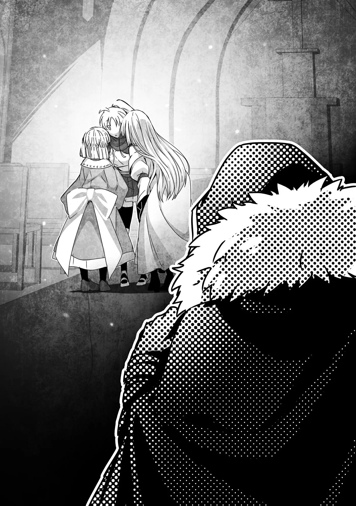

# Chương 215: Tập 9 Chương 5 - Một Ủy Thác từ Hội (3)

"Cô đã sẵn sàng chưa?" Lorraine điềm tĩnh hỏi Rina đang ngồi đối diện. Ý cô là muốn biết Rina đã sẵn sàng gặp người học việc mới hay chưa.

Tối qua, người đưa tin của Hội đã đến báo rằng họ đã thu xếp được xe cho chuyến đi của chúng tôi. May mắn là chuyến xe được xếp khởi hành vào buổi chiều, nhờ thế chúng tôi có thêm thời gian giải quyết xong xuôi mọi việc ở đây. Tôi đoán chắc Wolf đã chủ ý tạo điều kiện cho tôi. Có lẽ ông nghĩ mình đột ngột dí ủy thác không báo trước thì tôi sẽ cần thời gian thu xếp việc nhà. Quả đúng như Wolf tính, và vì ít nhất phải quá trưa mới xuất phát nên có thêm chút thời gian này đúng là quý hóa quá.

Trước hết, chúng tôi phải giới thiệu Rina với Alize đã. Sau đó mới tính đến chuyện nhờ Rina chỉ dạy cho Alize trong lúc chúng tôi vắng nhà. Nói là bàn bạc chứ các chi tiết cơ bản thì chúng tôi đã thống nhất xong xuôi cả rồi. Nhưng ngộ nhỡ Rina hay Alize không muốn hợp tác với nhau thì chúng tôi sẽ dẹp hẳn kế hoạch này. Khi ấy việc tập luyện của Alize đành phải tạm gác lại hai tuần. Bắt cô bé chờ đợi thì áy náy thật, nhưng có thế thì hẵng tính. Dù sao chúng tôi cũng đâu có giáo án cố định nào.

"V-Vâng, tôi sẵn sàng rồi. Chuẩn bị xong xuôi cả rồi!" Rina lắp bắp. Nghe cái giọng của cô ấy thì chẳng có vẻ gì là sẵn sàng cả.

Hiện tại chúng tôi đang ngồi ở Cô Nhi Viện Thứ Hai Maalt đợi Alize về. Theo lời Sơ Lillian, người phụ trách nơi này, Alize đang ra ngoài mua đồ và sẽ về ngay thôi, nên chúng tôi quyết định nán lại chờ. Chúng tôi đã giúp Rina làm công tác tư tưởng trước rồi, thế mà cô ấy vẫn bồn chồn thấy rõ. Thật ra chẳng việc gì phải căng thẳng đến thế, nhưng vì Alize sẽ là người học việc đầu tiên của Rina nên tôi rất hiểu cảm giác ấy.

Trong lúc tôi còn đang thấp thỏm không biết mọi chuyện sẽ ra sao thì có tiếng gõ cửa.

"Mời vào," tôi cất tiếng. Vốn định nói cho thật tự tin, nhưng thú thật là giọng tôi chẳng có tí uy quyền nào.

Trong lúc tôi còn đang rầu rĩ vì mình thiếu hẳn nét chững chạc uy nghiêm, Alize đã mở cửa bước vào cất tiếng chào mọi người. Thấy tôi và Lorraine, cô bé liền thở phào nhẹ nhõm, nhưng rồi lại nhận ra một gương mặt lạ hoắc trong phòng. Đôi mày cô bé khẽ nhíu lại, vẻ mặt thoáng nhăn nhó.

"Em chào anh Rentt và Học Sĩ Lorraine ạ. Nghe bảo có khách tìm em nên nãy giờ em hơi hồi hộp một tí."

Nói thì nói vậy chứ trông Alize chẳng có vẻ gì là run cả. Cô bé chỉ đang cố tỏ ra ngoan ngoãn, giữ đúng mực thước mà thôi. Tôi đoán chắc Sơ Lillian không nói rõ ai đang đợi cô bé, hoặc giả sơ đã nhờ một đứa trẻ khác nhắn lại giùm.

Là người đứng đầu cô nhi viện, Sơ Lillian lúc nào cũng bận rộn. Nhiều khả năng sơ chẳng có thời gian đứng đợi Alize về chỉ để nhắn một câu ngắn tẹo như vậy. Vả lại khách khứa cũng chỉ là chúng tôi. Tôi từng bảo Sơ Lillian rằng sơ không cần phải câu nệ khách sáo làm gì, vả chăng Alize cũng đã quá quen mặt bọn tôi rồi.

Tôi liền bảo Alize, "Tính ra thì bọn anh là khách thật, nhưng em đâu cần phải đệm danh xưng trịnh trọng thế làm gì."

"Em thêm danh xưng cho Học Sĩ Lorraine vì cô là một ma pháp sư tài giỏi mà. Còn anh Rentt... thì chỉ là anh Rentt thôi."

Nghĩ kỹ thì nghe cũng hơi chạnh lòng đấy chứ, nhưng Alize nói huỵch toẹt ra như thế là vì cô bé cảm thấy thoải mái khi ở bên chúng tôi, nên tôi chẳng nỡ trách mắng làm gì.

Lorraine đã bao lần bảo Alize không cần thêm danh xưng vào tên mình, nhưng khác với tôi, bản thân cô ấy luôn toát ra vẻ đĩnh đạc tự nhiên, dường như có muốn rũ bỏ cũng chẳng được. Thân phận học giả lại càng khiến lời nói của cô thêm phần trọng lượng. Trái lại, tôi chỉ là một gã mạo hiểm giả quèn, xưa nay hầu như chẳng ai thèm gọi bằng chức danh hay kính ngữ gì, thành thử tôi cũng quen rồi.

"Rốt cuộc là em đang có ý gì đấy hả?" tôi hỏi Alize. "Mà thôi, chuyện đó cũng chẳng quan trọng lắm."

"Thật ra cũng chẳng có ý gì xấu đâu ạ, nhưng mà ừm... Người kia là ai thế ạ?"

Alize có vẻ thực sự tò mò về Rina. Trông cô bé nói chuyện với chúng tôi thì rất tự nhiên, nhưng có lẽ cô bé đang cố trấn tĩnh lại vì trong phòng xuất hiện một người mình chưa từng gặp bao giờ.

"Ồ, phải rồi. Đây là Rina. Còn Rina, đây là Alize," Lorraine giới thiệu hết sức vắn tắt.

Nói thật thì cô giới thiệu như thế là hơi bị kiệm lời quá mức. Nhưng đó tuyệt nhiên không phải vì thiếu tôn trọng hay thô lỗ gì.

Rina gần như bật phắt dậy khỏi ghế để tự giới thiệu. "Tôi là Rina Rupaage. Tôi là mạo hiểm giả Thiết Cấp, và là đệ tử của chị Lorraine cùng anh Rentt."

Alize khẽ bật cười rồi nói, "Em là Alize. Em sống ở cô nhi viện này, và đang học nghề mạo hiểm giả cùng ma thuật từ anh Rentt với Học Sĩ Lorraine ạ."

À, hóa ra Lorraine cố tình giới thiệu ngắn gọn là để Rina và Alize tự cất lời giới thiệu bản thân.

"Về cơ bản thì cả hai đứa đều là học trò của chúng tôi," Lorraine giải thích sau khi họ chào hỏi xong. "Còn việc ai là tiền bối của ai thì lại hơi khó phân định một chút."

Lorraine nói có lý. Nếu tính theo thời gian theo học thì Alize sẽ là người đi trước. Nhưng nếu xét theo tay nghề và thực lực thì rõ ràng là Rina. Đó là chưa kể Rina lớn tuổi hơn, lại còn dính dáng sâu hơn vào những chuyện riêng của chúng tôi.

"Chuyện đó thì chẳng cần bận tâm làm gì đâu," tôi lên tiếng.

"Đúng vậy. Hôm nay chúng tôi đến đây là để hai đứa làm quen với nhau," Lorraine nói thêm.

Alize nghiêng đầu thắc mắc.

"Anh với Lorraine sắp phải đi xa một chuyến," tôi giải thích với Alize. "Chỉ tầm hai tuần thôi, nhưng quãng thời gian đó bọn anh sẽ không thể chỉ dạy cho em được. Thành thử bọn anh nghĩ hay là trong lúc bọn anh vắng nhà, em cứ luyện tập cùng Rina xem sao."

"Ơ? Bọn anh đi đâu thế ạ?" Alize hỏi.

"Lên vương đô Vistelya. Em có muốn bọn anh mang quà lưu niệm gì về cho không?"

"Lên vương đô ạ? Thế thì chắc là món gì ngon ngon... cho mọi người ở đây ạ."

Alize biết nghĩ cho lũ trẻ ở cô nhi viện chứng tỏ cô bé tốt bụng biết bao. Cô bé lúc nào cũng nghiêm túc với thiên chức làm chị cả của mình.

"Được rồi," tôi gật đầu. "Thế em thấy chuyện anh vừa nói lúc nãy sao? Đây chỉ là gợi ý thôi, không muốn thì em chẳng cần gượng ép đâu, nhưng mà..."

"Hừm... Em nói chuyện riêng với chị ấy một lát được không ạ?"

Tôi và Lorraine đưa mắt nhìn nhau. Rồi tôi quay sang Rina, "Chắc bọn tôi ra ngoài một lát nhé. Cô thấy thế có được không, Rina?"

"Vâng, tôi không phiền chút nào đâu. Alize, em thấy thế cũng được chứ?"

"Dạ được ạ."

Tôi và Lorraine để hai người họ ở lại trong phòng chờ rồi bước ra ngoài.

◆◇◆◇◆

"Ơ kìa, sao hai cậu lại đứng ngoài này thế? Tôi cứ tưởng hai người đang nói chuyện với Alize chứ."

Sơ Lillian vừa bước ra khỏi văn phòng liền tiến lại bắt chuyện với chúng tôi. Cách đây không lâu sơ còn ốm liệt giường, thế mà giờ xem chừng chẳng còn chút di chứng nào sót lại. Thấy sắc mặt sơ hồng hào, da dẻ đẫy đà trở lại, tôi cũng thấy nhẹ cả người.

"À, chuyện là thế này," Lorraine mở lời rồi tóm tắt lại tình hình.

"À, tôi hiểu rồi," Sơ Lillian gật gù. "Tính khí có hợp nhau hay không là chuyện quan trọng lắm trong mấy việc này đấy."

"Sơ thấy thế nào, thưa Sơ Lillian?" Lorraine hỏi. "Sơ có nghĩ hai đứa sẽ hợp tính nhau không?"

Thực ra Lorraine cũng chẳng trông mong một câu trả lời tường tận; cô chỉ đang gợi chuyện xã giao thôi. Hôm nay là lần đầu tiên Sơ Lillian gặp Rina, cuộc trò chuyện cũng diễn ra chớp nhoáng nên sơ khó lòng nắm bắt được tính nết cô ấy chỉ qua chừng đó.

Sơ Lillian ngẫm nghĩ một thoáng rồi nói, "Cô Rina xem chừng là một thiếu nữ rất chân thành và chất phác, nên tôi nghĩ cô ấy sẽ hợp với Alize thôi. Alize tuy không bộc trực bằng, nhưng tự đáy lòng con bé là một đứa trẻ rất mực hiền hòa. Ở bên một người như cô Rina, tôi nghĩ con bé có thể thoải mái sống thật với mình hơn là đi cùng ai đó quá đỗi nghiêm nghị hay khó tính."

Cách nhìn nhận của Sơ Lillian thấu đáo đến mức cả tôi lẫn Lorraine đều phải gật gù tán thành.

"Sơ phân tích chí lý lắm," Lorraine thừa nhận, "nhưng hôm nay sơ mới gặp Rina lần đầu thôi mà. Tôi thực sự khâm phục khi sơ nhìn ra được ngần ấy điều chỉ sau chốc lát gặp gỡ."

Sơ Lillian mỉm cười hiền hậu. "Tôi trông nom cô nhi viện này đã bao năm rồi, thành thử cũng tích lũy được chút kinh nghiệm nhìn nhận tính nết của một người trẻ chỉ qua tiếp xúc chớp nhoáng. Lẽ dĩ nhiên là chẳng phải lúc nào tôi cũng thấu suốt một đứa trẻ nhanh đến thế, và bản thân tôi cũng tâm niệm tốt nhất là không nên vội vàng định kiến. Nhưng cô Rina trông rất thành thật và thẳng thắn, còn Alize thì tôi đã hiểu quá rõ từ lâu rồi."

Bề dày kinh nghiệm hẳn đã giúp Sơ Lillian nhìn thấu tính cách một người chỉ qua màn chào hỏi ngắn ngủi. Giá mà sơ truyền cho tôi ít ngón nghề đó thì hay biết mấy. Chứ khoản đối nhân xử thế của tôi thì dở tệ. Quanh năm suốt tháng cứ lầm lũi một mình trong mấy mê cung tăm tối, tôi nào có cơ hội tích lũy vốn sống kiểu ấy.

Còn Lorraine thì tài giao thiệp lại khéo léo đến bất ngờ. Hồi mới chân ướt chân ráo tới Maalt thì đâu đã được như vậy—dạo ấy trông cô đúng chuẩn một học giả ru rú trong tháp ngà—nhưng suốt mười năm ở đây, cung cách đối nhân xử thế của cô đã tiến bộ vượt bậc. Tôi chẳng rõ cô làm thế nào, khéo lại nhờ trí thông minh sẵn có. Đơn giản là cô nhạy bén trong việc bắt sóng ánh mắt và nắm bắt cung cách ứng xử hơn tôi nhiều.

"Nghe sơ nói vậy tôi cũng nhẹ cả người, thưa Sơ Lillian," tôi lên tiếng.

"Thế ư? Nếu có điều gì làm tôi hơi băn khoăn, thì chắc là chuyện hai đứa có thể sẽ cãi cọ vì mấy việc cỏn con thôi."

Vừa thấy tôi thở phào bảo mọi chuyện sẽ ổn, Sơ Lillian liền bồi thêm một câu nhận xét kèm theo nụ cười tinh quái. Mà đó cũng là một nét duyên dáng rất riêng của sơ.

Một lát sau, Sơ Lillian nghiêng đầu như thể vừa sực nhớ ra điều gì. "Ồ, nhắc mới nhớ. Hai cậu sắp lên vương đô đúng không?"

Giọng sơ nghe chừng rất nghiêm túc, nên hai chúng tôi liền đứng thẳng người, chăm chú nhìn sơ.

"Vâng, đúng là vậy ạ," Lorraine xác nhận. "Bộ có chuyện gì sao sơ...?"

Sơ Lillian xua tay, nét mặt thoáng vẻ ngượng ngùng. "Ồ không, không có gì nghiêm trọng đâu, hai cậu chẳng cần phải căng thẳng thế. Chỉ là nếu có thời gian trong chuyến đi vương đô, tôi rất mong hai cậu chuyển giúp tôi một bức thư đến Giáo Hội Đông Thiên. Tôi sẽ gửi thù lao đàng hoàng theo đúng mức giá thông thường cho chuyến đi."

Đã là ủy thác công việc thì chúng tôi chăm chú lắng nghe ngay. So với việc săn quái vật hay làm hộ vệ, thỉnh cầu của sơ đỡ áp lực hơn nhiều vì không phải đem tính mạng ra đánh cược. Dù thế, điều đó chẳng có nghĩa là chuyến đi an toàn tuyệt đối. Dẫu sao thì chặng đường từ Maalt lên vương đô xa xôi nghìn dặm, lúc nào cũng chực chờ nguy cơ đụng độ thổ phỉ hay quái vật dọc đường. Nhưng chúng tôi vốn đã tính trước những rủi ro ấy cho cả hành trình rồi, nên thêm việc này cũng chẳng khiến bọn tôi phải chịu thêm mối nguy nào khác.

Bản thân tôi thì sẵn lòng nhận lời, nhưng nghĩ bụng vẫn nên hỏi ý Lorraine trước đã. "Cô nghĩ liệu mình có kịp thời gian không?" tôi quay sang hỏi cô.

"Trụ sở chính của Giáo Hội Đông Thiên nằm ngay vương đô. Đại Thánh Đường cũng chẳng cách Hội quá xa, nên chắc không phiền toái gì đâu. Dù có mất đứt cả ngày để đưa thư đi chăng nữa thì ủy thác của Wolf cũng đâu gấp gáp đến mức ấy."

"Ừ, cô nói phải. Tính cả thời gian đi đường thì lịch trình của chúng ta vẫn dôi ra một hai ngày phòng khi có chuyện. Chẳng vấn đề gì đâu."

"Hơn nữa tôi đâu có dính dáng gì đến ủy thác của Hội, tôi hoàn toàn có thể tự mình đi đưa thư. Nhìn chung chẳng có gì đáng bận tâm cả."

"Ờ nhỉ, cô nói chí lý."

Bên Hội chỉ giao việc cho mỗi mình tôi, thành ra Lorraine hoàn toàn có thể tranh thủ đi đưa thư trong lúc tôi bận bịu với ủy thác đó.

Lorraine quay sang Sơ Lillian bảo, "Vì Rentt vướng việc của Hội nên tôi không dám chắc anh ấy có rảnh tay hay không, nhưng nếu sơ thấy ổn việc để một mình tôi đi đưa thư thì tôi rất sẵn lòng nhận lời nhờ vả này. Giờ không còn kịp đăng ký qua Hội nữa nên đành làm theo dạng hợp đồng cá nhân thôi. Liệu như vậy có được không sơ?"

Lorraine rào trước chuyện tôi có thể không có thời gian chẳng qua là để phòng xa thôi. Nhiều khả năng tôi vẫn thu xếp đi được, chỉ là chưa thể khẳng định chắc nịch được gì. Trái lại, Lorraine thì chắc chắn đi được.

"Được thế thì còn gì bằng," Sơ Lillian nói. "Cô đã giúp đỡ Alize nhiều đến thế, cô Lorraine, nên tôi tuyệt đối tin tưởng cô. Tôi sẽ chuẩn bị xong bức thư trước lúc hai cậu lên đường, nên trước khi rời đi cô ghé qua phòng làm việc của tôi một lát được không?"

"Vâng, tất nhiên rồi," Lorraine đáp lời.

◆◇◆◇◆

"A, hai đứa kia rồi."

Trò chuyện với Sơ Lillian xong xuôi, tôi và Lorraine quyết định vào nhà nguyện của cô nhi viện ngồi đợi. Chẳng bao lâu sau, tiếng nói cười từ lối vào vọng tới. Quay đầu nhìn lại, chúng tôi thấy Alize và Rina đã đứng ở đó.

"Xem ra hai đứa đã nói chuyện xong rồi đấy," Lorraine nhận xét.

"Ừ, có vẻ thế."

Tôi đưa mắt nhìn Lorraine, rồi cả hai cùng đứng dậy khỏi băng ghế nhà nguyện. Bước lại gần Alize và Rina, thấy nét mặt hai đứa đều vui vẻ, không khó để đoán ra cuộc trò chuyện riêng vừa rồi đã diễn ra rất êm đẹp.

"Hai đứa nói chuyện xong rồi à?" Lorraine hỏi.

Cả hai cùng gật đầu.

"Vâng!" Rina reo lên với nụ cười rạng rỡ. "Tụi tôi đã quyết định sẽ cùng nhau cố gắng luyện tập rồi!"

Tôi cứ ngỡ Rina sẽ kèm cặp cho Alize chứ không phải tập luyện cùng, nhưng tính ra thì Alize vẫn học hỏi được nhiều điều. Hơn nữa từ trước đến nay Rina luôn tập luyện rất chăm chỉ, lại còn miệt mài rèn giũa những bài học tôi và Lorraine truyền dạy, nên cô ấy hoàn toàn đủ sức đảm đương.

"Ra thế. Thế rốt cuộc hai đứa đã to nhỏ những chuyện gì đấy?" Lorraine hỏi.

Alize đặt ngón trỏ lên môi. "Đó là... bí mật ạ."

"Sao lại thế?" Lorraine nghiêng đầu.

Alize khẽ liếc tôi một thoáng, còn Lorraine vốn thừa tinh ý để hiểu ngay ngụ ý đó liền phẩy tay xua tôi đi chỗ khác. Tôi lẳng lặng vâng lời, lủi thủi ra ngồi ở một góc băng ghế trong nhà nguyện.

Cảm giác bị cho ra rìa này đúng là có chút kỳ cục. Tôi trơ mắt nhìn ba người bọn họ xúm lại thì thầm to nhỏ. Dạo này tai tôi đã thính hơn trước nhiều, cứ ngỡ ở khoảng cách này vẫn nghe lỏm được, thế nhưng lúc dỏng tai lên tôi lại chẳng nghe thấy nổi một mẩu âm thanh nào. Tôi thừa biết không phải tai mình bị điếc đi, bởi ngay cả tiếng sột soạt từ quần áo của họ tôi cũng chẳng bắt được.

Nhìn kỹ lại tôi mới nhận ra Lorraine đang dùng ma thuật. Đó là một phong ma pháp có tác dụng triệt tiêu mọi âm thanh phát ra từ một vị trí chỉ định. Đang bàn chuyện bí mật với nhau thì việc Lorraine làm vậy cũng dễ hiểu.

Dù thế, tôi lại càng cảm thấy mình bị cô lập hơn lúc nãy. Tôi khẽ vòng tay ôm lấy hai đầu gối trước ngực. Nghĩ lại thấy bộ dạng của mình quả thực dị hợm: lủi thủi nơi xó nhà nguyện, khoác áo choàng đen kín mít, đeo mặt nạ đầu lâu rồi ngồi thu lu bó gối. Trông chẳng khác gì một con ác quỷ hay tà linh nào đó. Huống hồ tôi có Thần Lực kia mà, có khi trông lại gần với một thiên sứ hơn không chừng.

Một lát sau, tôi nghe thấy tiếng Lorraine gọi, "Rentt, bọn tôi xong rồi này."

Tôi ngẩng đầu lên. Dấu vết của phong ma pháp đã tan biến hoàn toàn, xem chừng họ đã nói chuyện xong xuôi. Chẳng buồn nói nửa lời, tôi lặng lẽ bước lại gần.

"Đừng có phụng phịu thế chứ," Lorraine trêu, vẻ mặt thoáng chút ngán ngẩm.

"Mà tôi xin lỗi vì đã gạt anh ra rìa như thế nhé. Nhưng phụ nữ tụi tôi cũng có những chuyện đâu thể bàn trước mặt đàn ông. Anh thừa hiểu điều đó mà, đúng không?"

Ngẫm kỹ ngụ ý trong lời cô, tôi biết tỏng cô đang nhắc khéo tôi nên bớt vô tâm vô tứ đi một chút.

"Đâu có, không sao mà. Tôi chỉ thấy hơi tủi thân tí thôi," tôi thú nhận.

Thực ra tôi cũng chẳng để bụng chuyện đó làm gì. Suốt mười năm lăn lộn trong các mê cung, tôi đã đạt tới cảnh giới làm bạn với nỗi cô độc rồi, lẽ nào lại đi tủi thân chỉ vì vài phút lẻ loi ngắn ngủi. Dù sao tôi cũng chỉ đùa chút thôi, hay ít ra là đang diễn kịch tí chút. Hơn nữa tôi thừa biết ba người họ vừa to nhỏ chuyện gì. Chắc chắn là về tôi chứ ai vào đây nữa. Chỉ có điều cụ thể họ nói xấu tôi những gì thì tôi chịu.

"Thế thì được rồi," Lorraine bảo. "Dù sao đi nữa, giờ chúng ta không cần phải lo lắng về chuyện của Rina và Alize nữa. Xem ra có thể yên tâm lên đường mà chẳng còn vướng bận gì."

"Ừ, đúng thế. Chúng ta cũng chẳng có thời gian để nấn ná đâu, hay là xuất phát luôn đi?" tôi gợi ý.

Lorraine gật đầu. Chúng tôi liền rời khỏi nhà nguyện, ghé qua phòng làm việc của Sơ Lillian nhận thư, rồi bước ra khỏi cô nhi viện.

Alize vốn muốn ra tận bến xe tiễn chúng tôi, nhưng vì là một trong những đứa trẻ lớn ở đây nên cô bé có khá nhiều việc vặt phải lo. Đằng nào cũng chẳng phải đi biệt tích không về, nên chúng tôi chia tay nhau ngay trước cổng cô nhi viện.

Trên đường đi ra bến xe, tôi dặn dò Rina đủ thứ chuyện cần lưu tâm trong những ngày chúng tôi vắng nhà.

"Trước hết, cô nhớ phải luôn đặt an toàn của bản thân lên hàng đầu đấy. Với lại nếu có chuyện gì xảy ra thì cứ tìm Isaac nhờ giúp. Không phải tôi trù ẻo có chuyện đâu, nhưng mà..."

Rina vui vẻ đáp, "Vâng, tôi hiểu rồi! À mà, tôi cũng mong quà lưu niệm của hai người lắm đấy nhé!"

Khác với Alize, lời lẽ của Rina chẳng hề có chút khách khí hay e dè nào. Sự bộc trực và thẳng thắn ấy chính là một nét đáng yêu rất riêng của cô ấy. Alize thì thường già dặn hơn so với lứa tuổi của mình. Tôi đoán nguyên do là bởi cô bé lớn lên trong cô nhi viện, từ nhỏ đã học được đức tính nhường nhịn cho những đứa trẻ khác. Ở cạnh chúng tôi thì cô bé đã bắt đầu bớt giữ kẽ, thế nhưng hễ đụng đến mong muốn của bản thân là cô bé lại nhún nhường quá đỗi. Mà chúng tôi cũng chẳng định ép cô bé phải vòi vĩnh thứ này thứ kia làm gì.

"Rina, cô lớn lên ở vương đô đúng không?" Lorraine hỏi. "Thế thì món gì chúng tôi mang về chắc cô cũng nhẵn mặt hết rồi chứ?"

Rina hiện giờ là một học trò bán Ma Cà Rồng kiêm mạo hiểm giả ở cái thị trấn Maalt hẻo lánh này, nhưng cô ấy vốn là ái nữ của một gia tộc hiệp sĩ gốc vương đô. Thuở nhỏ khéo cô ấy có cả đống tiền tiêu vặt để xài đồ xa xỉ ấy chứ. Mấy món quà lưu niệm bình thường hẳn đâu thể khiến cô ấy háo hức đến mức này.

Tôi cũng góp lời trêu như thế, nhưng Rina liền cuống quýt thanh minh. "Tôi không hẳn là tiểu thư khuê các xuất thân từ gia đình giàu sang gì đâu! Tuy nhà tôi là gia tộc hiệp sĩ, tức cũng thuộc hàng quý tộc thật, nhưng kinh tế đâu có dư dả đến thế. Có khối gia đình quý tộc cũng thế mà, vả lại cha mẹ tôi nghiêm khắc lắm. Dù công nhận là nhà tôi có căn dinh thự to thật."

Tôi nói đùa vậy thôi chứ bụng cũng đoán cơ sự là thế. Đúng là tước vị quý tộc càng cao thì càng lắm của nhiều tiền, nhưng chuyện những gia tộc ở tầng bậc thấp hơn lại rủng rỉnh tiền bạc hơn giới bề trên cũng chẳng hiếm gặp. Chẳng hạn như có những thường dân còn giàu có hơn cả các vị công tước quyền quý nhất. Mấy tay đại thương nhân kếch xù chính là ví dụ điển hình.

"Thế thì chắc cô muốn chúng tôi mang về vài món quà rồi nhỉ," Lorraine bảo.

"Cô thích món gì nào? Nếu cứ để mặc cho Rentt chọn thì thể nào anh ấy cũng mua về thứ gì đó kỳ quặc cho mà xem."

Rina móc một món đồ từ túi áo ra. "Đây này. Nếu hai người chọn giúp tôi trong danh sách này thì tốt quá," cô ấy mỉm cười bảo.

Thứ cô ấy chìa ra cho tôi là một cuốn sổ tay nhỏ đóng bằng loại giấy thô ráp, rẻ tiền. Đó là một trong những cuốn sổ mà Lorraine đã hào phóng cho tôi và Rina dùng thỏa thích tùy ý. Lorraine thậm chí còn sở hữu một ma cụ có khả năng xé vụn giấy rồi tái tạo lại như cũ mỗi khi chúng tôi viết sai, nên chúng tôi mới dám xài xả láng. Dù giấy phẩm chất kém không đắt đỏ gì, nhưng nếu không có món đồ kia thì nó cũng chẳng rẻ tới mức để chúng tôi tùy tiện dùng như thế.

Lorraine ghé mắt nhìn qua vai tôi. "A, đây là bản đồ vương đô. Còn liệt kê cả tên các cửa tiệm cùng mấy món nổi tiếng của họ nữa này."

Rina gật đầu lia lịa đầy hào hứng. "Tối qua tôi thức khuya để làm đấy! Đảm bảo là cẩm nang du lịch vương đô chuẩn chỉ nhất luôn!"

Tối qua khi chúng tôi báo tin sắp đi vương đô, cô ấy đã thoăn thoắt chạy biến về phòng. Hồi đó tôi cứ thắc mắc không biết cô ấy làm gì, hóa ra là bận rộn cặm cụi làm cuốn cẩm nang du lịch con con này.
