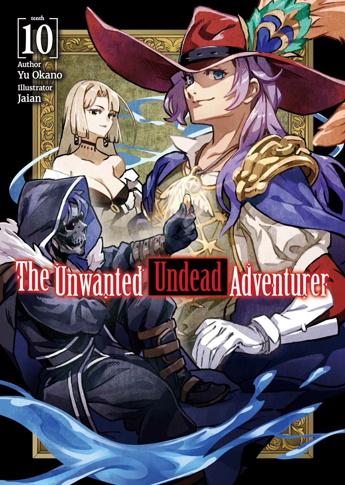
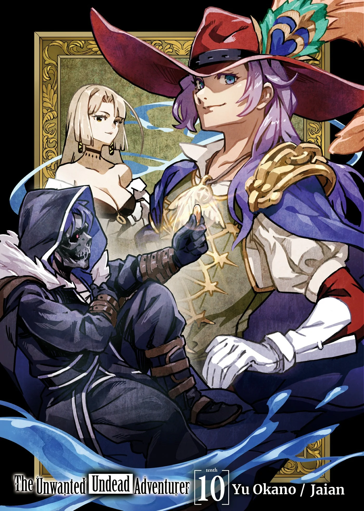
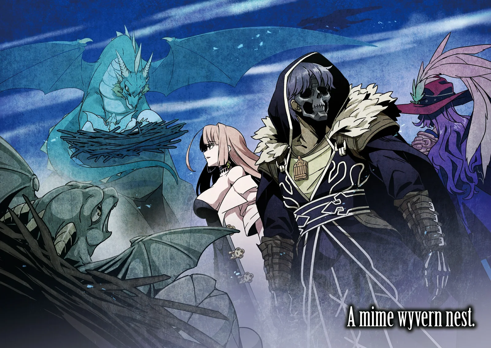
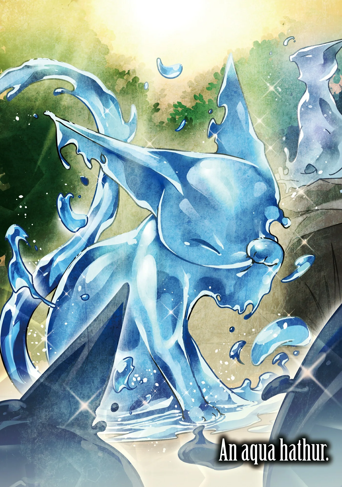
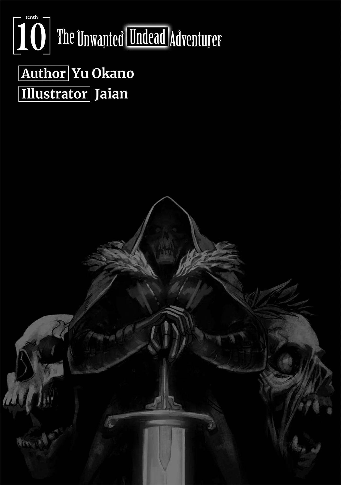
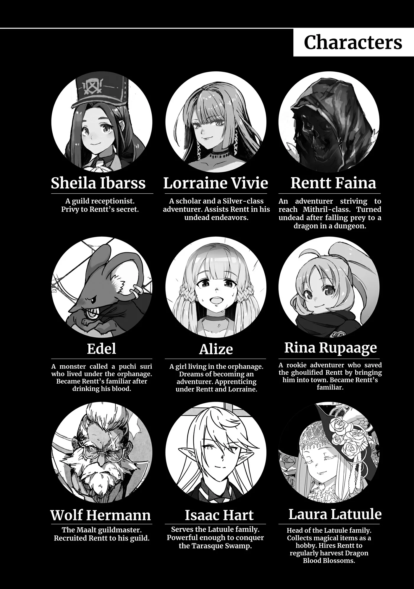
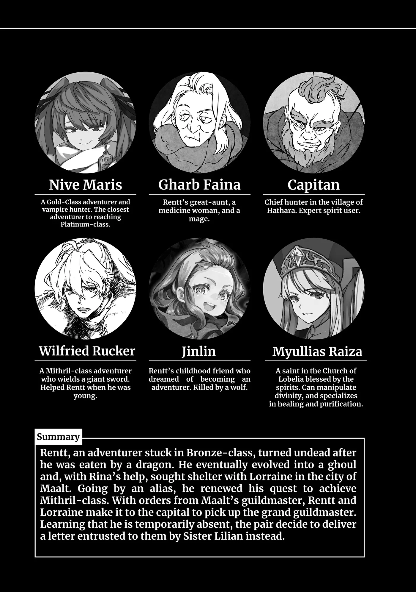
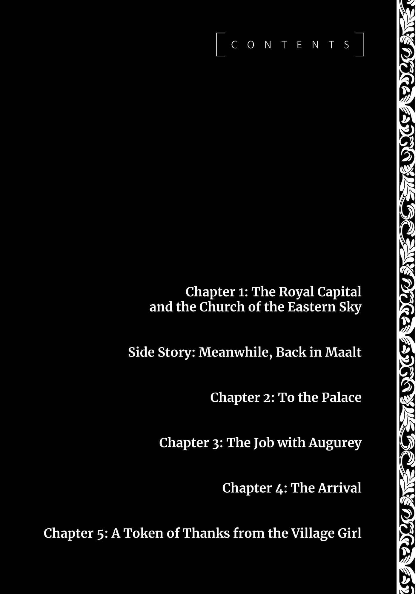

# Chương 221: Tập 10 Chương 1 - Vương Đô và Giáo Hội Đông Thiên (1)

"Đặt cạnh nơi này, Maalt đúng là trông bé tí con con," tôi vừa ngó ra ngoài xe ngắm cảnh Vistelya, vương đô của Yaaran, vừa buông một câu. Màn đêm vừa vặn buông xuống thành phố.

Vương Quốc Yaaran vốn là một xứ hẻo lánh xa xôi, nhưng kể cả thế thì vương đô vẫn rộng lớn và sầm uất hơn hẳn các đô thị địa phương khác. Hoặc cũng có thể tôi thấy nơi này lộng lẫy đến vậy chỉ vì đang đem nó so với một nơi như Maalt. Ý tôi là, Maalt dù ở tận chốn biên cương nhưng cũng đã nỗ lực hết mình rồi. Giờ đây thị trấn đã có mê cung riêng, dân cư cũng tương đối đông đúc. Nhìn chung thì đó là một nơi rất đáng sống, nhưng hễ đặt lên bàn cân với vương đô thì...

"Chuyện đó còn phải nói," Lorraine tiếp lời. "Nhưng tôi vẫn chuộng Maalt hơn Vistelya. Vistelya sầm uất thật đấy, có điều nó làm tôi nhớ về đế đô nhiều quá."

"Trước cô từng bảo ở đó xảy ra đủ thứ chuyện với cô mà. Nhưng dù sao Yaaran cũng đâu ngột ngạt bằng Đế Quốc, phải không?"

Lorraine từng nhắc chuyện hồi còn ở Đế Quốc, đứng trong hàng ngũ ưu tú của giới học giả đồng nghĩa với việc phải dính vào những trò chính trường đấu đá không dứt, khiến cô mệt mỏi rã rời. Nghiên cứu học thuật ở Đế Quốc nhìn chung được coi trọng hơn hẳn, còn ở Yaaran thì hiếm khi nghe thấy những giai thoại hào nhoáng về giới học giả. Cùng lắm Tòa Tháp và Học Viện chỉ thỉnh thoảng hục hặc cãi vã với nhau đôi chút. Với người của Tòa Tháp hay Học Viện thì thế cũng đủ căng thẳng rồi, nhưng còn xa mới bì được với những màn tranh quyền đoạt lợi của giới học thuật Đế Quốc.

Lorraine gật đầu. "Đúng thật. Maalt là ví dụ điển hình cho bầu không khí dễ thở hơn ở Yaaran. Xem ra vương đô này cũng thế."

Vương đô của Yaaran với tôi chẳng khác nào một đại đô thị khổng lồ, nhưng dưới mắt Lorraine thì nơi đây vẫn còn đôi nét mộc mạc, bình yên. Dù vậy, nếu nhờ thế mà cô thấy thoải mái, nhẹ nhõm hơn thì cũng tốt thôi. Tôi thầm cảm ơn vì Yaaran vẫn chỉ là một xứ hẻo lánh xa xôi.

"Thưa hai vị, chúng ta đã tới nơi rồi," người đánh xe cất tiếng thông báo. "Xin mời hai vị cứ vào chỗ trọ. Tôi sẽ nghỉ lại ở một nơi khác, nên khi nào sẵn sàng quay về Maalt, xin hãy liên lạc với tôi," anh ta nói thêm khi chúng tôi bước xuống xe.

Phải nói thêm là người đánh xe đưa chúng tôi đến thẳng quán trọ, nhưng anh ta và cỗ xe sẽ nghỉ lại chỗ khác. Quán trọ chúng tôi ở không có chỗ để xe, chưa kể thú kéo xe lại thuộc loại đặc biệt nên cần phải nhốt trong chuồng chuyên dụng.

Tính ra thì chuyến đi này đắt đỏ ra trò, nhưng Wolf—hay nói đúng hơn là Hội Maalt—đã bao trọn toàn bộ chi phí, thế nên tôi chẳng mất một xu một cắc nào. Đằng nào chúng tôi cũng dùng chính cỗ xe này để quay về Maalt, nên Hội chắc hẳn phải tốn thêm một khoản kha khá tiền chỗ ở phụ trội. Wolf quả thực đã rất chu đáo với chúng tôi.

"Vào thôi, Rentt," Lorraine giục, rồi hai chúng tôi cùng bước vào quán trọ.

◆◇◆◇◆

"Phòng cho hai người. Xin mời hai vị đi lối này," người tiếp tân nói.

Đợi người tiếp tân đi rồi, Lorraine mới khẽ lẩm bẩm: "Người ta chẳng buồn hỏi lấy một câu, cứ thế xếp chung cho chúng mình một phòng luôn kìa."

Giờ thì chỉ còn lại hai đứa tôi. Về phần Edel, tôi đã để nó lại Maalt. Chẳng phải tôi muốn gạt nó ra rìa, mà là vì an ninh ở Vistelya thắt chặt hơn rất nhiều. Đằng nào chúng tôi cũng sẽ vào tận vương cung, nên nếu dắt theo một con quái vật thực thụ như Edel thì dễ sinh chuyện lắm. Tôi hoàn toàn có thể vờ nhận mình là người thuần hóa quái vật, ngặt nỗi Vistelya là đô thị lớn, chẳng giống như Maalt. Vương đô không thiếu những người thuần hóa quái vật chính cống, chỉ cần họ để mắt nhìn kỹ một chút thôi là tôi dễ lộ tẩy ngay.

Nếu biết trước có ngày lên Vistelya, tôi đã hỏi cha ở Hathara cặn kẽ hơn về nghề thuần hóa quái vật rồi, dẫu sao lần tới hỏi cũng chưa muộn. Vả lại, bầy quái vật cha nuôi trong chuồng toàn loại kỳ dị, tôi cũng chẳng dám chắc mớ kiến thức học từ ông có giúp mình trông giống một người thuần hóa bình thường hay không. Thành thử nghĩ đi nghĩ lại, tôi tin mình quyết định để Edel ở nhà là hoàn toàn đúng đắn.

"Chắc trông hai đứa mình như hai anh em hoặc một cặp vợ chồng rồi," tôi đáp.

Lorraine bật cười. "Vợ chồng thì họa may, chứ anh em á? Nhìn chúng mình có nét nào giống nhau đâu."

"Cũng đúng."

Hồi tôi còn sống, mặt hai đứa đã chẳng có nét nào giống nhau, huống chi bây giờ tôi còn đeo chiếc mặt nạ đầu lâu thì lại càng khác một trời một vực. Thực tình, nếu nhân viên quán trọ mà bảo hai đứa giống nhau thì tôi mới phải lo sốt vó đấy. Chắc mẩm người ta nghĩ chúng tôi là vợ chồng rồi.

"Trông chúng mình cư xử giống vợ chồng lắm à?" tôi hỏi.

Lorraine khựng lại một thoáng, rồi bình thản đáp: "Tôi không nghĩ vậy đâu, nhưng cũng khó nói lắm. Chuyện này người ngoài nhìn vào mới thấy, chứ người trong cuộc thì biết thế nào được."

"Hay để tôi xuống bảo họ đổi thành hai phòng riêng nhé?" tôi ngỏ ý.

Lorraine nhăn mày vẻ ngán ngẩm. "Hai đứa mình ở chung một nhà suốt đấy thôi. Giờ chung một phòng thì có khác gì nhau đâu chứ?"

Bụng bảo dạ, tôi cũng định hỏi kháy xem cô không sợ tôi giở trò gì à, nhưng nghĩ lại thì Lorraine là một ma pháp sư hùng mạnh. Chỉ với một cây đũa phép, cô thừa sức xử đẹp phần lớn đàn ông trên khắp vương quốc này, tính cả tôi trong đó. Giờ thì có lẽ tôi chịu nổi vài đòn của cô thật, nhưng muốn đánh thắng cô thì vẫn là chuyện không tưởng. Vả lại đúng như cô vừa nói, bình thường hai đứa cũng ở chung một mái nhà. Tôi đành gật gù công nhận, ngủ chung một phòng trọ thì cũng có khác gì nhau đâu.

"Cũng phải. Hỏi cho biết thế thôi. Thế cô muốn nằm giường nào?"

May sao trong phòng kê hai cái giường. Lorraine chọn ngay chiếc gần cửa sổ, thành ra lúc đi ngủ tôi chỉ còn nước nằm quay mặt nhìn tường.

Dù sao thì một ngày cũng đã qua, đến lúc nghỉ ngơi để chuẩn bị cho ngày mai. Sáng ra chúng tôi phải tới Hội trước, nhưng mà... hay là đi mua quà lưu niệm trước nhỉ? Tôi tự nhủ sáng mai hẵng bàn kỹ lại với Lorraine.

◆◇◆◇◆

Đã một thời gian trôi qua kể từ lần gần nhất tôi ghé thăm Hội Vistelya, nhưng đúng như tôi nhớ, Hội Maalt hoàn toàn không có cửa so bì. Bản thân tòa nhà được xây kiên cố hơn hẳn, lại đủ rộng để đón lượng mạo hiểm giả khổng lồ đang coi vương đô là nhà. Lần trước tới đây tôi chưa kịp nhìn ngó bên trong cho kỹ, nhưng lần này tôi bắt gặp ngay mấy cánh cửa thang máy.

Nghĩ cũng phải thôi, tòa nhà cao những năm tầng, lần nào cũng cuốc bộ cầu thang thì nhọc bã người. Nếu các tầng trên hiếm khi dùng tới thì còn đỡ, đằng này tôi dám chắc phòng làm việc của Tổng Hội Trưởng nằm tít trên tầng thượng; ngày nào cũng phải leo lên tụt xuống năm tầng lầu thì đúng là cực hình.

"Tôi nghe nói Tổng Hội Trưởng của Yaaran đã khá cao tuổi rồi đấy," Lorraine cất giọng.

"Dù từng là mạo hiểm giả, nhưng ở cái tuổi ấy thì chắc chắn ông ấy không còn hành nghề nữa rồi."

Lorraine nói chẳng sai. Tôi từng nghe phong phanh rằng vị Tổng Hội Trưởng đương nhiệm đã ngồi ghế đó từ hồi Wolf mới vào Hội. Tôi cũng từng nghe chuyện ông xuất thân là mạo hiểm giả, nhưng dám chắc chuyện đó đã từ hơn năm mươi năm trước. Cho dù ông có giải nghệ từ năm ngoài ba mươi thì tới nay cũng ngót nghét hơn tám mươi tuổi rồi. Mạo hiểm giả tuy dẻo dai hơn người thường rất nhiều nhờ thể chất và Ma Lực dồi dào, nhưng bảo tám mươi tuổi vẫn còn xông pha hành nghề thì hơi khó tin.

"Nhưng quy luật nào cũng có ngoại lệ, như bà Gharb chẳng hạn. Thế nên chuyện đó không hẳn là không thể," tôi đáp.

Tôi nghĩ tới bà Gharb, bà lão làm thuốc kiêm ma pháp sư trưởng ở quê tôi. Tuổi bà đã cao nhưng trông vẫn còn gân guốc lắm. Nếu giờ bà mà hứng lên đi làm mạo hiểm giả, khéo người ta xếp thẳng bà vào Ngân Cấp ngay từ đầu, thế là lập tức qua mặt tôi luôn. Mà thôi, dẫu sao bà cũng là sư phụ tôi, thế cũng chẳng sao.

"Nói mới nhớ, đúng là vậy thật," Lorraine bảo. "Sư phụ tôi cũng thế. Tôi chắc mẩm người đó vẫn đang vui thú hưởng thụ bên Đế Quốc."

"Người mà cô từng ném đũa phép vào ấy hả?"

Lorraine cau mày. "Hồi đó tôi còn trẻ con bồng bột. Giờ thì tôi không làm thế đâu, mà có cho tiền cũng chẳng dám. Đến giờ tôi vẫn chưa quên nổi người đó đã nổi trận lôi đình thế nào..."

"Hì hì, nghe thế tôi lại muốn gặp người đó ghê."

Gặp người đó chắc chắn sẽ moi được khối chuyện hay ho về Lorraine, và có cơ hội lật ngược tình thế để chọc lại cô một phen thì còn gì bằng. Dù sao thì đợt về Hathara, dân làng cũng đã bêu sạch mấy trò xấu hổ hồi bé của tôi cho cô nghe rồi.

"Thật à? Tôi cũng muốn ghé thăm người đó, nhưng đâu phải cứ khơi khơi bước tới là gặp được ngay. Đằng nào sau này chúng mình chẳng có dịp sang Đế Quốc, lúc ấy hẵng tính."

Ngạc nhiên là Lorraine lại hào hứng với ý định đó hơn tôi tưởng. Tôi cứ đinh ninh cô sẽ giãy nảy lên không muốn tôi gặp sư phụ cô, nhưng xem chừng cô rất mực kính trọng và biết ơn người đó. Lorraine sống ở Maalt đã lâu, dù thi thoảng có về Đế Quốc nhưng cũng chẳng ở lại được bao lâu. Tính ra có khi ngót chục năm rồi cô chưa gặp lại sư phụ, nên việc cô muốn tới thăm cũng là điều dễ hiểu.

"Thế thì tôi hóng đấy nhé," tôi đùa. "À, quầy tiếp tân trống rồi kìa. Tôi qua giải quyết công việc đây."

"Vậy tôi qua đằng kia ngồi đợi," Lorraine vừa nói vừa chỉ tay về phía quầy bar nằm ngay trong sảnh Hội.

Nói cho đúng thì đó là một quầy căng tin phục vụ đồ ăn nhẹ cùng đủ loại đồ uống. Không phải sảnh Hội nào cũng có, nhưng ở đa số các nơi thì đây là hình ảnh khá quen thuộc. Thực đơn lẫn khẩu phần ăn ở đây hơi ít để có thể tính là một bữa no nê, nên chỗ này chủ yếu để mạo hiểm giả nghỉ chân giữa các chuyến làm việc hoặc ngồi đợi đồng đội—nghĩa là Lorraine đang dùng nó chuẩn chỉnh theo đúng công năng vốn có.

"Được rồi, lát gặp nhé," tôi dứt lời rồi rảo bước về phía quầy tiếp tân.

◆◇◆◇◆

"Ngài ấy đi vắng rồi sao?" tôi nghiêng đầu thắc mắc hỏi cô tiếp tân.

Người phụ nữ sau quầy điềm tĩnh đáp: "Vâng. E là lúc này ngài Jean Seebeck không có ở Hội. Chắc vài ngày nữa ngài ấy mới về."

"Nếu tôi đợi đến lúc ngài ấy về, liệu tôi có được diện kiến không?"

"Tất nhiên rồi ạ. Nếu dám chểnh mảng với người của Hội do đích thân ngài Wolf Hermann từ Maalt phái tới thì chính tôi cũng rước vạ vào thân mất. Có điều Tổng Hội Trưởng vắng mặt thì tôi cũng chịu, không làm thế nào được. Thành thật xin lỗi anh. Liệu anh có thể quay lại sau chừng năm ngày nữa được không?"

Tôi thấy cô ấy có vẻ hơi khách khí quá mức với đồng nghiệp cùng làm cho Hội, nhưng nghĩ lại cũng phải thôi. Hội Mạo Hiểm Giả tuy chung một hệ thống nhưng các chi nhánh địa phương phần lớn đều hoạt động độc lập. Với nhân viên ở Vistelya thì người từ chi nhánh Maalt tới về cơ bản cũng chẳng khác gì người lạ.

Bỏ chuyện đó qua một bên, cô ấy tỏ ra cực kỳ cung kính với Wolf, thậm chí còn gọi ông là "ngài Wolf". Lão ấy thực sự đáng để người ta kính nể đến thế cơ à? Thật luôn? Nhưng nghĩ kỹ lại thì chẳng có mấy ai làm hội trưởng cừ như ông, vừa có con mắt nhìn người tinh tường, vừa sở hữu thực lực thượng thừa của một mạo hiểm giả lão luyện; ông có lẽ chính là hình mẫu lý tưởng của một hội trưởng. Thế thì người ta kính nể cũng phải. Cơ mà Maalt vốn là chốn khỉ ho cò gáy, nên việc họ đánh giá cao Wolf đến vậy vẫn khiến tôi ngạc nhiên. Thực ra quen biết một người được trọng vọng nhường ấy cũng làm tôi thấy nở mày nở mặt đôi phần.

Dù sao đi nữa, giờ tôi chỉ còn nước chờ. Mà thế có khi lại hay, vì tôi vẫn còn cả đống việc vặt cần lo. Vốn dĩ tôi tính nếu bí thời gian quá thì bỏ bớt, ai ngờ đùng một cái lại dư dả cả mớ thời gian rảnh.

Tôi gật đầu với cô tiếp tân: "Được thôi. Vậy năm ngày nữa tôi quay lại nhé?"

"Vâng ạ. Về phần giấy tờ tài liệu, phía chúng tôi sẽ phân loại và sắp xếp trước, như vậy khi anh báo cáo sẽ thuận lợi hơn nhiều."

Số tài liệu này chính là xấp giấy tờ dày cộp mà Wolf giao cho tôi chuyển tới Hội Vistelya. Đa phần trong đó ghi chép cặn kẽ tình hình Maalt hiện giờ. Cứ ngỡ chỉ cần gửi giấy tờ là xong, nhưng có một người nắm rõ thực tế đứng ra báo cáo trực tiếp với cấp trên vẫn tốt hơn nhiều. Đó là lý do Wolf phái tôi đi, và cũng là cội nguồn cho câu nói vừa rồi của cô tiếp tân.

"Cảm ơn cô, trăm sự nhờ cả vào cô nhé. Hẹn năm ngày nữa gặp lại."

◆◇◆◇◆

"Xong nhanh thế? Việc gặp gỡ thế nào rồi?" Lorraine hỏi khi tôi bước lại gần.

"Xem chừng Tổng Hội Trưởng đi vắng rồi. Nghe bảo khoảng năm ngày nữa ông ấy mới về."

"Đi vắng ư... Mà thôi, chắc ông ấy cũng chẳng ngồi yên một chỗ mãi được. Cơ mà tôi nhớ từng nghe bảo ông ấy đâu thể rời vương đô lâu ngày đâu nhỉ..." Lorraine băn khoăn nói.

Tôi gật đầu tán thành, chợt nhớ lại những lời mình từng nghe hồi còn ở Maalt.

"Wolf từng nhắc chuyện đó thật, nhưng chắc ý ông là Tổng Hội Trưởng không thể mò tới một nơi khỉ ho cò gáy như Maalt thôi."

Đi từ Vistelya tới Maalt theo cách thông thường phải mất cỡ một tuần. Tính cả chiều đi lẫn chiều về thì một chuyến viếng thăm ngốn đứt ít nhất hai tuần lễ. Ông ấy đâu thể bỏ mặc vương đô lâu đến thế. Nhưng mấy thành phố vệ tinh gần vương đô thì đi về chỉ mất vài ngày, nên việc ông thường xuyên đảo qua đảo lại những nơi đó cũng chẳng có gì lạ.

"Ừ, anh nói cũng có lý," Lorraine khẽ gật gù. "Mà đằng nào ông ấy vắng mặt thì mình cũng chịu, chẳng làm gì được. Cơ mà ngẫm ra thế lại may, chúng ta có khối thời gian để tranh thủ giải quyết mớ việc vặt trước."

"Ừ, tôi cũng nghĩ thế."

"Việc cần làm thì có chuyển thư của Sơ Lillian tới Giáo Hội Đông Thiên, vào cung yết kiến Điện Hạ, rồi mua quà lưu niệm cho Alize với Rina. Giờ xem nào, nên bắt đầu từ việc gì trước đây..."

Lorraine nhìn sang tôi, dọ ý xem nên bắt tay vào việc nào trước.

"Chắc là đi đưa thư trước đi. Vào cung thì chẳng biết sẽ mất toi bao nhiêu thời gian, chứ đưa thư thì chỉ cần mang tới tận nơi là xong," tôi gợi ý, bụng nghĩ tốt nhất cứ giải quyết mấy việc nhẹ nhàng trước.

"Cũng đúng. Thư thì Sơ Lillian gửi cho tôi nên một mình tôi đi đưa cũng được, cơ mà chắc bên vương cung họ cũng muốn tôi có mặt."

"Chuẩn rồi. Vả lại còn một người nữa chúng ta phải lôi theo vào cung. Cần liên lạc với anh ta, nhưng cách duy nhất tôi nghĩ ra là để lại lời nhắn tại Hội này. Bằng không thì chỉ còn nước mò tới quán ruột của anh ta thôi."

Tôi đang nói tới quán rượu lần trước chúng tôi gặp Augurey khi ở đây. Nếu cứ thế ghé qua thì may ra có thể đụng mặt, nhưng để lại lời nhắn ở Hội thì hễ Augurey bước chân vào là nhận được ngay. Trái lại, dù có thể ngay ngày mai anh ta đã nhận được tin, nhưng cũng không loại trừ khả năng anh ta đang vướng một ủy thác dài ngày và chỉ nhận được khi đã xong việc trở về. Gặp trường hợp đó thì tôi và Lorraine đành vào cung mà không có anh ta vậy, nhưng thôi, chuyện tới đâu tính tới đó.

"Có khi cứ đi hỏi quanh xem có ai thấy một mạo hiểm giả ăn mặc dị hợm không, khéo lại dễ tìm ra anh ta hơn đấy."

Lorraine chỉ nói đùa thế thôi, nhưng ngẫm lại cũng có lý. Gu ăn mặc của Augurey khiến anh ta nổi bần bật giữa chốn đông người. Dù vậy, tôi vẫn muốn giữ cách đó làm giải pháp cuối cùng.

"Tìm không ra thì đành tính cách đó vậy," tôi bảo, "còn bây giờ sao chúng mình không ghé qua Giáo Hội Đông Thiên trước nhỉ? Nhà thờ nằm ở mạn đông vương đô, đúng không?"

"Ừ, chắc đúng là hướng đó rồi," Lorraine đáp.

Hai chúng tôi rời khỏi Hội rồi rảo bước tiến về phía nhà thờ.
