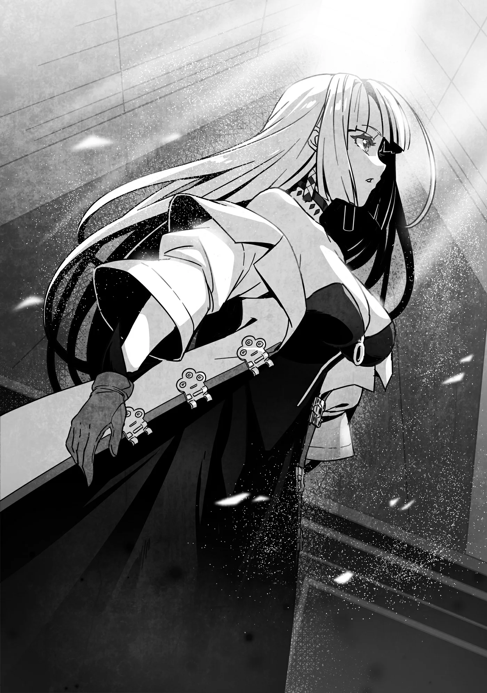

# Chương 222: Tập 10 Chương 1 - Vương Đô và Giáo Hội Đông Thiên (2)

"Nhìn chỗ này xong thấy nhà thờ ở Maalt trông chẳng khác nào túp lều xiêu vẹo," tôi lẩm bẩm khi đứng trước tòa nhà.

Lorraine gật đầu. "Cũng không lạ. Tuy Giáo Hội Đông Thiên không phải tổ chức tôn giáo giàu có gì cho cam, nhưng đây vẫn là tín ngưỡng chính của Yaaran. Nhà thờ chính ở vương đô bề thế hơn hẳn chỗ ở Maalt cũng là lẽ đương nhiên."

Tòa kiến trúc cao vút trước mặt chúng tôi với những ngọn tháp đồ sộ tỏa sáng trên cao như ngầm chứng minh những lời Lorraine vừa nói. Rất đông tín đồ đang lặng lẽ nhưng tất bật ra vào tòa nhà. Khung cảnh ở đây quả thực rất nhộn nhịp. Không hẳn là Giáo Hội Đông Thiên ở Maalt không đông, chỉ có điều ở đó họ thường xuyên bị Giáo Hội Lobelia lấn át.

Ngay tại vương đô này, Giáo Hội Lobelia cũng đang bắt đầu lan rộng tầm ảnh hưởng. Cách chỗ chúng tôi đứng không xa là nhà thờ của họ. Lúc đi tới đây chúng tôi buộc phải ngang qua đó, và cung cách truyền giáo ráo riết của họ khiến người ta thấy hơi ngợp.

"Gia nhập Giáo Hội Lobelia, quý vị chắc chắn sẽ được cứu rỗi!"

"Giáo hội chúng tôi có rất nhiều Thánh Giả, bảo đảm quý vị sẽ nhận được đủ đầy phước lành ngay trong kiếp sống này!"

"Nước Thánh của chúng tôi có giá phải chăng hơn các tín ngưỡng khác nhiều!"

Cứ đi được vài bước, chúng tôi lại gặp một lời chèo kéo kiểu đó. Tôi đã định hỏi xem họ đang truyền đạo hay đang tính chuyện buôn bán, nhưng biết rằng chỉ cần mở miệng là kiểu gì họ cũng tuôn ra thêm một tràng bất tận. Thế nên tôi đành ngó lơ cho xong.

Dù Lorraine đi ngay sát cạnh tôi, tuyệt nhiên chẳng ai buồn chèo kéo cô ấy vào Giáo Hội Lobelia. Thấy lạ lùng, tôi bèn hỏi cô ấy tại sao lại thế.

"Chắc tại nhìn mặt anh dễ dụ hơn tôi đấy," Lorraine đáp. "Họ cứ liếc nhìn về phía tôi, nhưng chỉ được vài giây là ai nấy đều lảng đi chỗ khác."

Mặt mình dễ dụ đến thế cơ à? Hồi trước khi bị rồng nuốt chửng thì có khi đúng thật. Lúc còn là con người, ai cũng bảo trông tôi vừa hiền lành vừa đáng tin. Nhưng bây giờ thì tôi dám chắc trông mình mờ ám thấy rõ. Nói đúng hơn, tôi nhìn giống kẻ chuyên đi lừa những tín đồ thật thà thì có. Dù sao thì hồi ở Maalt cũng chẳng mấy ai quấy rầy tôi như vậy, vả lại ở đó hiếm khi thấy cảnh đứng đường chèo kéo người ta bừa bãi như thế này.

Trái lại, Giáo Hội Lobelia ở vương đô này dường như đặc biệt thèm khát thêm tín đồ mới. Giáo Hội Đông Thiên chẳng mấy mặn mà với việc truyền bá đức tin, nên sự sốt sắng của Giáo Hội Lobelia đã giúp họ dần dà lấn sân ngay trên đất Yaaran. Dưới góc độ một công dân Vương Quốc Yaaran, tôi cũng mong Giáo Hội Đông Thiên nỗ lực thêm đôi chút, có điều bản thân đâu phải tín đồ mộ đạo nên kết cục ra sao tôi cũng chẳng mấy bận lòng.

Vừa miên man nghĩ tới đó thì Lorraine giục: "Thôi, đi tiếp nào Rentt. Cứ đứng trơ trơ ở đây trông khả nghi lắm."

Cô ấy bước về phía nhà thờ, tôi cũng lẳng lặng đi theo. Chúng tôi bước qua cánh cửa lớn đang mở rộng để vào bên trong tòa nhà.

◆◇◆◇◆

Bên trong Giáo Hội Đông Thiên cũng là một công trình kiến trúc ấn tượng chẳng kém gì vẻ ngoài, nhưng có lẽ do giáo lý của họ, nơi đây không hề được bài trí xa hoa hay loè loẹt. Nói vậy không có nghĩa là nó không đẹp, trái lại còn rất đẹp là đằng khác, chỉ có điều nét đẹp ở đây trầm lắng và khiêm nhường, còn các bức tượng cùng tranh tường đều tránh thói phô trương hào nhoáng mà hướng trọn về lòng thành kính.

Mọi nét trang trí đều khắc họa nhân vật và sự kiện trong kinh điển của Giáo Hội Đông Thiên, và các tín đồ đang thành tâm cầu nguyện trước từng bức tượng cùng bích họa. Ở chính giữa đại sảnh, những dãy ghế dài tít tắp đủ chỗ cho đông đảo tín đồ ngồi được xếp ngay ngắn thành từng hàng. Chạy dọc giữa các hàng ghế là lối đi trải thảm tím dẫn thẳng tới bàn thờ. Phía sau bàn thờ, ô cửa kính màu lớn khắc họa Thiên Sứ Phương Đông được giáo hội phụng thờ đang rọi ánh sáng ấm áp khắp căn phòng. Dù vậy, cả bàn thờ lẫn ô kính màu đều không nhằm phô trương sự bề thế của giáo hội, mà là sự sắp đặt có chủ ý nhằm tạo nên một bầu không khí tĩnh mịch và sùng kính.

"Tôi chẳng có ý định theo một tín ngưỡng nào, nhưng cứ ở những nơi thế này là lòng lại thấy lắng xuống," Lorraine khẽ thở dài bảo.

Giáo Hội Lobelia có ảnh hưởng rất lớn tại Đế Quốc, nhưng bản thân Lorraine lại chẳng mấy mặn mà với tôn giáo. Chắc ý cô ấy là nơi này khiến ngay cả một người như mình cũng muốn tin vào đấng tối cao, dù chỉ trong một thoáng ngắn ngủi.

Trên đời vốn có phước lành của thần linh và tinh linh, nên tôi thấy người ta đặt niềm tin vào một chỗ dựa nào đó cũng chẳng có gì sai, nhưng thực tế là phước lành lại hay được ban cho cả những kẻ chẳng mấy mặn mà với đức tin. Cả tôi lẫn Lorraine đều sở hữu Thần Lực, chiếu theo quy chuẩn của hầu hết các tổ chức tôn giáo thì cả hai chúng tôi đều được coi là Thánh Giả, nhưng nếu hỏi liệu chúng tôi có sùng kính phụng thờ vị thần tinh linh ở ngôi đền kia không thì chắc chắn câu trả lời là không. Biết ơn thì có thật, nhưng chuyện đó khác xa với lòng thần phục.

"Tôi hiểu cảm giác đó chứ," tôi lẩm bẩm, "nhưng đúng như dự liệu, vào tận một nơi thế này rồi mà người tôi vẫn chẳng hề hấn gì. Cứ tưởng khác với cái nhà thờ bé tí ở Maalt, đến một giáo đường lớn thế này thì phải có chút phản ứng gì chứ."

Lorraine quay sang nhìn tôi chăm chú.

"Đúng thật, trông anh chẳng có gì khác lạ. Mà nơi này tuy là nhà thờ nhưng cũng đâu đến mức tràn ngập Thần Lực. Vả lại có thế thật thì anh cũng là trường hợp dị biệt rồi. Một Undead lại sở hữu Thần Lực của riêng mình như anh thì có trơ trơ ra đó cũng chẳng ai lấy làm lạ."

"Ừ. Thấy nguy hiểm đến mức ấy thì ngay từ đầu tôi đã chẳng thèm bước chân vào."

Trước khi vào, ấn tượng duy nhất của tôi là tòa nhà này vừa đồ sộ vừa bề thế, chứ trong người tuyệt nhiên không thấy bất an hay sợ hãi. Mang thân xác của một Undead, nếu nhà thờ này nguy hiểm với giống loài của tôi thì chỉ cần đến gần là tôi đã phải thấy rợn ngợp hay bài xích rồi. Đằng này lúc đặt chân tới đây, tôi chẳng mảy may thấy điều gì khác thường.

Đến khi bước hẳn vào trong rồi cũng chẳng thấy động tĩnh gì xảy ra. Nghe thì có vẻ liều lĩnh, bởi ngộ nhỡ có biến thì cứu cánh duy nhất của tôi chỉ là để Lorraine kéo ra ngoài. Có điều tính đến nay tôi cũng đã ghé qua kha khá cơ sở tôn giáo, kể cả nhà nguyện ở cô nhi viện bên Maalt. Chỗ đó tuy nhỏ nhưng đã giúp tôi thăm dò phản ứng của bản thân trước các công trình thần thánh. Thành thử việc tôi cứ thế thong dong bước vào đây cũng chưa hẳn là quá liều lĩnh.

"Có điều thế chỉ chứng tỏ anh chịu được riêng cái nhà thờ này thôi. Biết đâu nhà thờ của các giáo phái khác lại tác động lên anh thì sao. Tốt nhất vẫn nên cẩn thận."

Lorraine nhắc trước để tôi khỏi chủ quan, và dĩ nhiên cô ấy nói chẳng sai. Tôi từng nghe kể mối quan hệ giữa các vị thần có thể tác động đến cán cân quyền năng giữa thần linh và người sử dụng Thần Lực. Chẳng hạn, Thánh Giả có thể được tiếp thêm sức mạnh khi đối đầu với tín đồ của một vị thần vốn đối nghịch với vị thần bảo hộ của mình. Suy cho cùng, thần linh chọn phàm nhân đâu dựa vào phẩm hạnh đạo đức, mà thuần túy là xem họ có thuận mắt người đó hay không. Đó là lý do Lorraine nhắc nhở rằng dẫu tôi bình an vô sự ở Giáo Hội Đông Thiên thì sang nhà thờ khác vẫn có thể gặp chuyện như thường.

"Ừ, phải rồi. Tôi sẽ cẩn thận. Mà gác chuyện đó lại đã, bức thư thì tính sao? Chúng ta phải đưa cho ai đây?"

Thấy tôi chuyển chủ đề, Lorraine rút bức thư trong túi ra. Thư được niêm sáp cẩn thận, bên ngoài không đề tên ai nhưng Lorraine đã được dặn trước là phải chuyển cho ai. Dù sao cô ấy cũng là người trực tiếp nhận ủy thác.

"Sơ Lillian nhờ tôi giao bức thư này cho Nữ Tu Viện Trưởng Elza của Tu Viện Yaaran thuộc Giáo Hội Đông Thiên."

"Vậy là sơ ấy gửi cho một người có chức sắc khá cao đấy chứ."

Trong Giáo Hội Đông Thiên, Tổng Viện Trưởng là phẩm trật cao nhất, tiếp theo là Tu Viện Trưởng, Phó Tu Viện Trưởng, Kinh Sĩ, vân vân, cả thảy có mười bậc. Giữa các cấp bậc còn có những phân định chi tiết hơn, nhưng đó là hệ thống phẩm trật căn bản. Người có vị thế tương đương với Đại Giáo Phụ bên Giáo Hội Lobelia, hay giáo hoàng và giáo trưởng ở các tôn giáo khác, chính là Đại Tu Viện Trưởng, thành thử Tu Viện Trưởng trong Giáo Hội Đông Thiên về cơ bản ngang hàng với hồng y hoặc giám mục. Một Tu Viện Trưởng thậm chí có ngày còn có thể thăng lên làm Tổng Viện Trưởng.

Sơ Lillian lại trực tiếp trao đổi thư từ với một người mang phẩm trật cỡ đó, chẳng lẽ địa vị của sơ ấy lại cao hơn tôi tưởng? Xưa nay sơ ấy chỉ tự giới thiệu mình là người phục vụ giáo hội chứ chưa từng nói rõ phẩm hàm cụ thể. Thông thường, người phụ trách một nhà thờ ở thị trấn cỡ Maalt khá lắm thì cũng chỉ tới bậc Kinh Sĩ. Xem ra lúc nào có dịp tôi phải hỏi thử Sơ Lillian về chuyện này mới được.

"Biết đâu chỉ là vì Giáo Hội Đông Thiên không quá nặng nề chuyện tôn ti trật tự như Giáo Hội Lobelia thì sao. Tôi nghe nói bên Giáo Hội Lobelia, muốn gửi thư tới Đại Giáo Phụ thì người ta một là phải có phẩm hàm cao, hai là phải lập công trạng lớn, ngài ấy mới thèm đoái hoài tới."

Thế thì đúng là một thái cực hoàn toàn trái ngược.

"Thế thì một đứa trẻ có chắt chiu tiền tiêu vặt để trả cước gửi thư cũng công cốc nhỉ?" tôi bảo.

"À thì, chúng vẫn gửi được chứ," Lorraine đáp, "nhưng thư từ đều qua tay cấp dưới của Đại Giáo Phụ đọc và sàng lọc trước đã. Rốt cuộc chỉ có dăm ba lá lọt được lên bàn ngài ấy. Có điều, một lá thư của trẻ nhỏ như anh bảo khéo lại có cơ hội hơn đấy. Nếu tin tức Đại Giáo Phụ đích thân đọc rồi hồi âm được truyền ra ngoài thì sẽ rất có lợi cho thanh danh của giáo hội. Bên Đế Quốc, thỉnh thoảng ghé vào mấy nhà thờ vùng quê anh sẽ thấy thư hồi đáp của Đại Giáo Phụ được đóng khung treo trang trọng trên tường đấy thôi."

"Ngẫm ra thì chuyện đó cũng chẳng hẳn là xấu... cơ mà nghe cứ thấy sực mùi toan tính sao ấy."

"Đời vốn thực tế và khắc nghiệt thế đấy. Mà thôi, quay lại chuyện bức thư đã. Tôi muốn bảo đảm Nữ Tu Viện Trưởng nhận được tận tay, chứ không đời nào muốn đưa bừa cho một tư tế vu vơ nào đó rồi để nó chìm vào quên lãng."

Lorraine nhìn quanh đại sảnh, rồi cất tiếng gọi một phụ nữ đi ngang qua trông như nữ tu. Cô ấy định nhờ người này mời Nữ Tu Viện Trưởng Elza ra gặp. Cách đơn giản nhất dĩ nhiên là cứ đưa thư cho nữ tu rồi nhờ chuyển giùm, nhưng Lorraine đã nhận việc này như một ủy thác đàng hoàng. Lòng tự tôn nghề nghiệp của mạo hiểm giả đòi hỏi cô ấy phải bảo đảm Elza nhận được tận tay bức thư. Đã thế thì cứ tùy tiện đưa thư cho một nữ tu tình cờ đi ngang qua sẽ là quá bất cẩn.

"Vâng? Tôi có thể giúp gì cho hai vị ạ? Hai vị muốn vào dâng lời cầu nguyện chăng? Hay muốn mua chút Nước Thánh? Hay là hai vị muốn quyên góp ủng hộ giáo hội ạ?"

Có lẽ nữ tu chỉ liệt kê những nhu cầu thông thường, nhưng ở câu hỏi cuối cùng, tôi vẫn nghe thoáng ra một tia hy vọng le lói trong giọng cô ấy. Tôn giáo dẫu không vì tiền tài, nhưng tổ chức tôn giáo nào muốn duy trì cũng cần đến kinh phí. Chuyện đó kể ra cũng dễ hiểu thôi.

Vả lại nhìn mấy tu sĩ đi ngang qua, ai nấy đều ăn mặc hết sức giản dị. Những tu sĩ lớn tuổi hẳn đã mặc bộ y phục của mình suốt nhiều năm trời, bởi vô số miếng vá đang che đi những chỗ rách sờn trên mặt vải. Rõ ràng họ không hề có thói quen tiêu xài hoang phí vào những thứ xa xỉ. Thấy Giáo Hội Đông Thiên chẳng mấy bận tâm đến vật chất xa hoa như vậy, tôi cũng muốn quyên góp đôi chút.

"Lát nữa trước khi về tôi sẽ quyên góp," Lorraine nói, "nhưng hôm nay chúng tôi tới đây không phải vì chuyện đó. Chúng tôi từ thị trấn Maalt đến, có mang theo bức thư của một nữ tu bên đó gửi gắm. Tôi muốn trao tận tay cho người nhận theo lời dặn. Liệu sơ có thể mời người nhận ra gặp tôi một lát được không?"

"Ôi, hai vị đã lặn lội đường sá xa xôi tới tận đây sao. Cảm ơn hai vị đã cất công mang tới. Tôi rất sẵn lòng hỗ trợ. Vậy bức thư gửi cho vị nào thế ạ? Và nếu tiện, tôi có thể mạn phép hỏi người gửi là ai không?"

"À, thứ lỗi cho tôi sơ suất. Thư này gửi cho Nữ Tu Viện Trưởng Elza, còn người gửi là Sơ Lillian ở Maalt. Tiếc là tôi không rõ phẩm trật của Sơ Lillian, bởi trước giờ chưa có dịp thuận tiện để hỏi..."

Lorraine chỉ giải thích sơ qua về ủy thác của mình, nhưng vừa nghe thấy cái tên đó, mắt người nữ tu đã trợn tròn kinh ngạc.

"T-Thư của Sơ Lillian gửi cho Mẹ Bề Trên Elza ư?! T-Tôi hiểu rồi. Tôi sẽ đi thỉnh Nữ Tu Viện Trưởng ngay lập tức! Xin hai vị vui lòng vào phòng tiếp khách đợi một lát— Này em kia! Mau dẫn hai vị khách này sang phòng tiếp khách đi!"

Người nữ tu lúc này đã cuống quýt thấy rõ, vội chặn một cô gái trẻ trông như tu sinh tập sự lại dặn dò rồi tất tả chạy đi.

Lorraine nhìn theo bóng người nữ tu với vẻ khó hiểu. "Tôi nói gì sai sao?"

Tôi lắc đầu. "Không, chắc không phải đâu. Hay thử hỏi cô gái này xem sao?"

Tôi quay sang nhìn cô tu sinh được giao dẫn đường cho chúng tôi, Lorraine cũng khẽ gật đầu đồng tình.

"Thứ lỗi vì câu hỏi đường đột nhé, nhưng em có biết gì về Nữ Tu Viện Trưởng Elza và Sơ Lillian không?" cô ấy hỏi người thiếu nữ.

"Dạ, em có biết Nữ Tu Viện Trưởng Elza ạ. Người là người cai quản Tu Viện Ephas, cũng chính là tổng bộ của Giáo Hội Đông Thiên tại Yaaran. Nhưng xin thứ lỗi, còn về Sơ Lillian... em e là mình không biết người đó. Vị ấy đến từ đâu vậy ạ?"

"Sơ ấy là một nữ tu ở Maalt."

"A, Maalt ạ. Ra là vậy. Làm nữ tu ở một nơi gian nan như thế thì người ấy hẳn phải đáng nể lắm, tiếc là em lại không biết. Xin thứ lỗi, em rất tiếc vì chẳng giúp được gì cho hai vị."

Lorraine liếc sang nhìn tôi, nhưng người ta đã không biết thì cũng đành chịu. Tôi khẽ lắc đầu.

"Tôi hiểu rồi..." Lorraine dịu giọng. "Xin lỗi vì đã hỏi em chuyện đường đột thế này nhé. Nhờ em dẫn chúng tôi tới phòng tiếp khách vậy."
