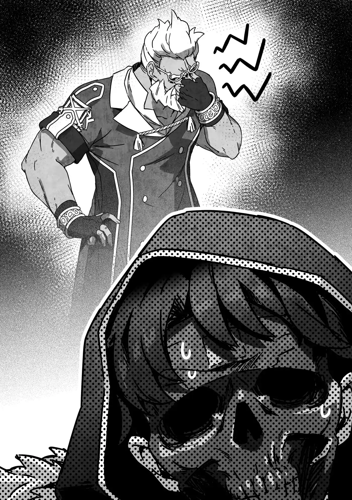

# Chương 224: Tập 10 Chương 1 - Vương Đô và Giáo Hội Đông Thiên (4)

Sơ Lillian đã mất khả năng sử dụng Thần Lực ư? Điều đầu tiên xuất hiện trong đầu tôi là chuyện sơ ấy từng mắc Bệnh Tích Tụ Chướng Khí, nhưng khi nghĩ kỹ lại những sự tình hồi đó, chính bản thân Sơ Lillian cũng chỉ biết mình mắc bệnh khi được chữa trị mà thôi. Thật kỳ lạ nếu Nữ Tu Viện Trưởng Elza, người đã lâu không nhận được tin tức từ Sơ Lillian và suốt thời gian qua luôn ở vương đô, lại biết về chuyện ấy.

Dù vậy, có lẽ cũng chẳng lạ đến thế nếu Elza thu thập thông tin bằng một cách nào đó mà bản thân Sơ Lillian không hề hay biết. Tuy nhiên, lời lẽ của Elza dường như không mang hàm ý đó. Thay vào đó, sơ ấy dường như đang ngụ ý rằng Sơ Lillian đã mất khả năng sử dụng Thần Lực từ trước khi mắc phải Bệnh Tích Tụ Chướng Khí. Điều đó sẽ giải thích lý do tại sao một Thánh Giả như Sơ Lillian, người sở hữu năng lực sử dụng Thần Lực quý giá, lại được bổ nhiệm làm người phụ trách một cô nhi viện ở Maalt, một nơi hẻo lánh bậc nhất trong số những vùng đất hẻo lánh.

"Tôi không rõ liệu hai vị có biết chuyện này không," Elza tiếp tục, "nhưng Lillian từng là một nữ tu ở Tu Viện Ephas này cho đến khoảng mười năm trước. Ban đầu cô ấy trở thành nữ tu năm mười lăm tuổi, và ngay ở độ tuổi đó, cô ấy đã sở hữu thiên phú Thần Lực vô cùng mạnh mẽ. Cô ấy từng được xem là một Thánh Giả đầy triển vọng, người sẽ gánh vác tương lai của Giáo Hội trên vai."

Hóa ra là vậy, có một lý do xác đáng đằng sau việc Sơ Lillian bị điều chuyển tới một nơi thôn quê như Maalt. À mà không, Maalt đâu phải chốn thôn quê. Nơi đó là một thành phố biên ải tương đối phồn hoa đấy chứ. Và dẫu tôi rất muốn thanh minh điều đó, nhưng Elza đâu phải người đã gọi Maalt là nơi hẻo lánh, thế nên tôi chẳng thể cất lời được.

"Vậy mà sơ ấy lại được cử tới Maalt ư?" Lorraine hỏi. "Không phải tôi muốn buông lời chê bai nơi ở của mình, nhưng so với vương đô thì Maalt chỉ là một thị trấn quê mùa. Nơi đó dường như chẳng phải chốn dành cho một Thánh Giả tài năng đến thế."

Tự đáy lòng tôi cảm thấy hơi tổn thương đôi chút khi ngay cả Lorraine cũng xem nhẹ Maalt như vậy, nhưng cô ấy đến từ Đế Quốc và là một tiểu thư thành thị chính gốc, nên tôi chẳng thể thực sự trách cô được. Hóa ra ở đây chỉ có mỗi mình tôi là chàng trai tỉnh lẻ. Tôi cảm thấy một thoáng mặc cảm tự ti khi quyết định tạm thời đứng ngoài cuộc trò chuyện.

Trái ngược với những suy nghĩ vẩn vơ trong đầu tôi, cuộc trò chuyện giữa họ vẫn tiếp diễn với chiều hướng nghiêm túc. Có lẽ tôi hơi ngớ ngẩn một chút thật. Dù sao thì đây cũng chỉ là những suy nghĩ trong đầu tôi, nên chắc tôi cũng được tha thứ nếu có đôi chút ngẫu hứng trong thế giới riêng của mình, đúng không?

"Hoàn toàn không phải vậy đâu ạ," Elza đáp lời. "Tôi nghe nói Maalt là một trong những vùng biên ải phồn thịnh hơn cả. Đặc biệt là dạo gần đây, nơi đó được xem như một vùng đất đầy hứa hẹn với sự xuất hiện của một mê cung mới. Rất nhiều người đang nói rằng trong tương lai, nơi ấy sẽ không còn bị coi là biên ải hay chốn xa xôi hẻo lánh nữa."

Elza buông lời ngợi khen Maalt với vẻ tự tin của một người xuất thân từ đô thị lớn. Tôi suýt nữa thì không kìm được nước mắt; những lời lẽ dịu dàng và khéo léo của sơ ấy như một liều thuốc xoa dịu lòng tự tôn mong manh của một kẻ quê mùa trong tôi. Ngay khoảnh khắc ấy, tôi tự nhủ rằng mình sẽ vui vẻ nhận bất cứ ủy thác nào mà Nữ Tu Viện Trưởng Elza giao phó.

Đùa vui thế thôi, chứ tôi tin chắc dự đoán của Elza là hoàn toàn chính xác. Ngay lúc này đây, chúng tôi đã thấy Tòa Tháp và Học Viện lảng vảng quanh thị trấn. Tôi không biết những phát hiện trong mê cung rốt cuộc sẽ hữu ích đến mức nào, nhưng các cuộc quan sát sẽ được tiến hành trong dài hạn. Không chỉ có vậy, một mê cung mới sinh ra là phát hiện vô cùng hiếm thấy. Nó đòi hỏi một dự án nghiên cứu quy mô lớn cần đến việc xây dựng các trung tâm nghiên cứu tiên tiến cùng các cơ sở học thuật ngay tại thành phố. Chẳng khó để hình dung mạo hiểm giả và nhân công sẽ đổ xô về thành phố trong tiến trình ấy.

Rõ ràng là thành phố sẽ bùng nổ trong tương lai, và Maalt sẽ gia nhập hàng ngũ những đô thị lớn của thế giới. Chà, tôi không biết liệu mọi chuyện có tiến xa đến mức đó hay không, nhưng hy vọng của tôi là có. Mặt khác, dù sự gia tăng dân số bắt nguồn từ những phát triển ấy mang lại nhiều lợi ích, nhưng nó cũng đi kèm những mặt trái. Thật khó để khẳng định sự phát triển chỉ đem lại điều tốt đẹp. Những con hẻm phía sau có thể trở nên nghèo nàn hơn rồi biến thành các khu ổ chuột, hoặc nhiều xung đột và tội phạm hơn có thể nảy sinh do hệ quả đó.

Hiện tại đã có những dấu hiệu manh nha cho chuyện đó. Vụ cãi vã giữa các học viên của Học Viện với người thương nhân mà chúng tôi từng thấy trước đây, cùng những vụ tranh chấp giữa các nhà nghiên cứu của Tòa Tháp với các mạo hiểm giả mà chúng tôi chứng kiến trước khi rời đi, chắc chắn mới chỉ là sự khởi đầu. Điều đó đồng nghĩa với việc Wolf sẽ ngày càng ngập trong công việc. Dẫu đó chẳng phải chuyện của tôi, nhưng tôi nghĩ mình có thể giúp ông ấy một tay đôi chút.

"Đúng như lời Mẹ Elza đã nói, việc Maalt đang ngày càng trở nên phồn thịnh là sự thật," Lorraine tiếp lời. "Tuy nhiên, điều đó có lẽ không đúng vào thời điểm Sơ Lillian được cử tới đó."

Elza gật đầu đồng tình. "Vâng, đúng là như vậy."

"Vậy thì tại sao... Không, tôi xin lỗi, tôi không có ý tò mò đời tư..."

Lorraine ngập ngừng ngưng lại, rõ ràng cảm thấy mình có thể đang săm soi vào chuyện riêng tư của Sơ Lillian, nhưng Elza đã lên tiếng giải đáp thắc mắc chưa thốt thành lời của cô.

"Không đâu, có lẽ tôi mới là người đã nói quá nhiều. Sau này tôi phải tạ lỗi với Lillian mới được. Dù vậy, tôi cảm thấy mình vẫn chưa cho hai vị một bức tranh toàn cảnh. Để nói chi tiết hơn một chút, lý do Lillian đến Maalt không phải vì bất cứ điều gì cô ấy đã làm, mà là bởi những mâu thuẫn nội bộ trong chính đức tin của chúng tôi."

Đây là câu chuyện thường tình, nhưng vốn không phải điều hay xảy ra trong Giáo Hội Đông Thiên. Hay đúng hơn, đó không phải loại chuyện bị phơi bày ra trước công chúng dẫu nó có thực sự xảy ra đi chăng nữa. Người ta thường nghe thấy chuyện đó hơn khi dính dáng đến các tôn giáo khác, nhưng mà...

Elza nói tiếp: "Đó là lý do tại sao tôi luôn cảm thấy có lỗi về chuyện này. Tôi từng cố gắng giữ liên lạc với Lillian ngay cả sau khi cô ấy rời đến Maalt, nhưng chính Lillian lại bảo rằng việc tiếp xúc với cô ấy sẽ không tốt cho tôi, rồi đến một thời điểm, cô ấy đã cắt đứt hoàn toàn mọi liên lạc. Bức thư này là tin tức đầu tiên tôi nhận được từ cô ấy sau một thời gian dài. Lát nữa tôi sẽ đọc kỹ nội dung và, nếu có thể, sẽ viết một lá thư hồi đáp cho cô ấy. Dù rất ngại làm phiền hai vị, nhưng tôi sẽ vô cùng cảm kích nếu hai vị có thể đích thân chuyển thư hồi đáp cho cô ấy. Chúng ta có thể lập thành một ủy thác chính thức thông qua Hội..."

Cuộc trò chuyện đã rẽ sang một hướng bất ngờ. Mong muốn viết thư hồi đáp cho một bức thư vừa nhận được là lẽ tự nhiên, đặc biệt nếu đó là từ một người quen đã lâu không có tin tức. Có vẻ như Sơ Lillian và Elza không chỉ đơn thuần là người quen hay cấp trên cấp dưới trong Giáo Hội, mà còn là bạn bè, thế nên việc Elza muốn gửi thư trả lời cho Sơ Lillian lại càng dễ hiểu hơn.

Điều đó dấy lên một thắc mắc. Liệu Sơ Lillian và Elza có trạc tuổi nhau không? Sơ Lillian là một phụ nữ trung niên đẫy đà trông chừng như ngoài bốn mươi, nhưng Elza lại nói chuyện như thể đã quen biết Sơ Lillian từ thuở còn là thiếu nữ trăng tròn. Tôi cố kìm nén thôi thúc muốn hỏi Elza: "Sơ bao nhiêu tuổi rồi ạ?", bởi tôi thừa biết thứ duy nhất đang đón đợi một câu hỏi như thế chính là sự đau đớn.

Tôi đã chứng kiến chuyện đó xảy ra quá nhiều lần với những người bạn mạo hiểm giả trót đặt câu hỏi tương tự với các nữ mạo hiểm giả kỳ cựu ở quán rượu. Câu trả lời họ nhận được là một hoặc hai cú đấm, rồi kết thúc bằng việc nếm trọn một họng đầy đất để nhắm cùng cốc bia. Sau khi thấy cảnh tượng ấy vài lần, tôi đã rút ra bài học đắt giá là chớ dại hỏi tuổi phụ nữ. Nói thế không có nghĩa là điều đó hoàn toàn ngăn được tôi hỏi, ngay cả lúc này đây. Có lẽ tôi cần rèn luyện tính kỷ luật nhiều hơn nữa.

Dù sao thì việc mang thư hồi đáp về... Xét việc đằng nào chúng tôi cũng sẽ quay lại Maalt, chuyện đó chẳng thành vấn đề. Chắc hẳn Lorraine cũng đồng tình, bởi cô đã liếc nhìn tôi để thăm dò trước khi đáp lời Elza.

"Nếu vậy thì chúng tôi không có vấn đề gì khi nhận ủy thác của sơ. Tôi dự định sẽ ở lại vương đô một thời gian, đồng nghĩa với việc bức thư gửi cho Sơ Lillian sẽ chỉ được chuyển đi khi tôi quay trở về. Nếu sơ thấy như vậy là chấp nhận được..."

"Vâng. Đây không phải chuyện khẩn cấp, nên như vậy là hoàn toàn ổn ạ. Vậy thì tôi sẽ liên lạc với hai vị qua Hội một khi hoàn thành bức thư. Chân thành cảm ơn hai vị đã nhận công việc này."

◆◇◆◇◆

Lorraine và tôi sau đó mỗi người quyên góp một khoản trước khi rời khỏi Tu Viện Ephas, đại tu viện thuộc phân nhánh Vương Quốc Yaaran của Giáo Hội Đông Thiên. Trong khi Lorraine thỉnh thoảng vẫn quyên góp, thì việc tôi quyên góp dưới bất kỳ hình thức nào là cực kỳ hiếm hoi, nhưng giờ đây khi cuối cùng đã có chút rủng rỉnh về tài chính, hôm nay tôi mới có thể quyên góp một lần. Tôi chỉ có thể bỏ ra vài đồng bạc, nhưng số tiền đó đủ để nuôi sống một gia đình trong một tháng, nên đó chẳng phải khoản quyên góp nhỏ. Chà, được rồi, nó đủ để mua khoảng hai mươi ổ bánh mì.

Tôi không rõ Lorraine đã quyên góp bao nhiêu, nhưng mức quyên góp trung bình của một tín đồ Giáo Hội cùng lắm chỉ là vài đồng xu đồng. Con số này tăng vọt khi mạo hiểm giả tham gia, nhưng thu nhập từ nghề mạo hiểm giả thì vào gà ra vịt, nên chuyện đó gần như là điều khó tránh khỏi. Nghề mạo hiểm giả kiếm ra tiền thật đấy, nhưng chi phí duy trì công việc này cũng vô cùng đắt đỏ. Chỉ riêng vũ khí, giáp trụ và công cụ thôi cũng đủ khiến tôi đau đầu khi tính toán ngân sách của mình. Ngay cả các mạo hiểm giả cấp thấp cũng kiếm được khoản tiền khá, nhưng đối với nhiều người trong số họ, một khi đã tính đến chi phí trang bị và bảo dưỡng thì họ thường bị lỗ vốn hơn là kiếm ra lời. Cách duy nhất để mạo hiểm giả đạt được sự ổn định tài chính là phải làm việc chăm chỉ và trở nên mạnh mẽ hơn.

Một lúc sau khi chúng tôi rời khỏi tu viện, Lorraine lên tiếng: "Vậy là giờ những việc còn lại cần làm ở vương đô chỉ là mua quà cho mọi người và vào yết kiến Điện Hạ."

"Đúng vậy, nhưng quà cáp thì tôi nghĩ có thể đợi đến lúc chúng ta chuẩn bị rời đi. Danh sách của Rina chủ yếu là những thứ nhanh hỏng..."

"Đối với thực phẩm, ma thuật có thể giúp bảo quản chúng, nhưng dẫu vậy thì tốt nhất vẫn nên chờ hẵng mua."

Cô ấy không nói đến việc thao túng thời gian và không gian, mà chỉ là dùng ma thuật để làm mát đồ vật hoặc khử ẩm. Không phải là không có thứ ma thuật thao túng không-thời gian, nhưng loại ma thuật ấy khó thi triển hơn nhiều so với các dạng thần chú khác. Nó không phải thứ dùng để sử dụng một cách tùy tiện.

Có lẽ sẽ dễ hiểu hơn về độ khó của những câu chú đó nếu tôi nói rằng Dịch chuyển tức thời về cơ bản là một dạng ma thuật thao túng không-thời gian. Ngay cả Lorraine cũng không thể dùng nó để bảo quản thức ăn. Dĩ nhiên, cô có lẽ làm được nếu có đủ sự chuẩn bị, tài nguyên và người trợ giúp, nhưng đó không phải loại công sức mà người ta sẽ bỏ ra chỉ vì mấy món quà lưu niệm tầm thường.

Cảnh tượng khoảng chục pháp sư đứng trong một ma pháp trận khổng lồ ngâm xướng câu chú trong khi trút một lượng Ma Lực khổng lồ vào một chiếc bánh ngọt hẳn sẽ khiến bất cứ ai cũng phải chỉ trích sự lãng phí ma thuật cấp cao đến dường nào. Tuy nhiên, trong Lorraine có một phần tính cách sẽ thấy thích thú khi làm điều như vậy, thế nên tôi chẳng dám chắc liệu cô có không bao giờ làm thế hay không. Nghĩ lại thì bản thân tôi cũng có phần muốn tự mình làm điều đó vào một lúc nào đấy. Quả thực có một nét thú vị riêng ở những thí nghiệm lố bịch đến mức chưa từng có ai đủ điên rồ để thử qua trước đây.

Trong lúc tôi đang mơ màng về sự lãng phí ma thuật lố bịch ấy, Lorraine tiếp tục câu chuyện.

"Chỉ còn lại buổi yết kiến Điện Hạ. Rentt, anh có nhớ mang theo tấm huân chương đó không?"

Tấm huân chương mà Lorraine nhắc tới là thứ đã được Nauss Ancro trao cho chúng tôi, ông là đội trưởng Cận Vệ Hoàng Gia Yaaran, người đã hộ tống bảo vệ công chúa khi chúng tôi giải cứu cô bé. Nó khắc họa một phần cảnh tượng trang trí trên giáp trụ của Nauss—một con kỳ lân đang dùng sừng đâm xuyên một con quái vật—vốn là một phần trong huy hiệu gia tộc của ông. Đó là một ma cụ được sử dụng như một hình thức nhận diện thân phận, và ông đã trao nó cho chúng tôi để xuất trình cho lính gác tại cổng cung điện khi chúng tôi muốn xin yết kiến công chúa. Nói đúng ra thì ông ấy chỉ cho chúng tôi mượn chứ không phải tặng đứt, nên hiển nhiên là tôi đâu thể làm mất được. Và vì cần nó cho chuyến đi này, đương nhiên là tôi phải mang theo bên mình rồi. Dù sao thì tôi cũng đinh ninh là như vậy.

"Khụ... Tôi chắc chắn là mình đã để nó ở đây..." Tôi thọc tay vào chiếc túi ma thuật của mình và nghĩ về tấm huân chương.

"Sao nghe giọng anh có vẻ chẳng chắc chắn thế?" Lorraine gặng hỏi, vẻ mặt thoáng chút lo lắng.

Ý tôi là, tôi biết mình đã cất nó vào đó, nhưng luôn có khả năng là tôi chỉ đơn giản là đã quên mất. Dẫu vậy, tôi chắc chắn mình đã cất nó vào đó—ít nhất thì cũng khá chắc là vậy. Ngay cả khi tôi còn đang bồn chồn lo lắng, tôi đã cảm nhận được sức nặng đầm tay của kim loại trong lòng bàn tay, và một làn sóng nhẹ nhõm lập tức trào dâng trong lòng tôi. Tôi rút tay ra khỏi túi, và tấm huân chương đã ở đó, nằm gọn trong lòng bàn tay tôi.

"Aha!"

"Trời đất quỷ thần ơi... Làm tôi lo thót tim một giây đấy," Lorraine nói với vẻ mặt thoáng chút ngán ngẩm, nhưng tôi vờ như không nhận thấy.

"Dù sao thì, con dấu này... Dù nhìn bao nhiêu lần thì nó vẫn trông hơi rợn người nhỉ? Tôi đoán một gia tộc sản sinh ra đội trưởng Cận Vệ Hoàng Gia cần phải phô trương võ công của mình ngay cả trong huy hiệu gia tộc."

"Phải, có lẽ đúng là vậy. Quý tộc luôn phải bận tâm đến vẻ bề ngoài. Dĩ nhiên, những kẻ không thể lấy thực lực để củng cố cho vẻ bề ngoài đó sẽ nhanh chóng bị thất sủng. Dù sao đi nữa, có thứ này thì chúng ta có thể vào cung điện rồi, nhưng chúng ta vẫn phải lo lắng về việc thân phận của anh bị bại lộ."

Lorraine đang nhắc tới lưới dò tìm dùng để kiểm tra ma vật tiến vào vương đô. Tôi đã có thể vào thành nhờ một ma cụ từ Gia tộc Latuule, nhưng khi nhắc đến hoàng cung...

"Nhưng cô chắc chắn là sẽ ổn chứ, Lorraine?"

"Đúng vậy. Tôi đã kiểm tra xem họ dùng loại ma cụ dò tìm nào trong cung điện và thậm chí còn thử nghiệm một cái lên người anh. Không cái nào phản ứng trước sự hiện diện của anh cả, nên không cần phải lo lắng thái quá. Nhưng việc chuẩn bị sẵn sàng cho mọi tình huống vẫn rất quan trọng, đó là lý do tại sao tôi đã mượn một thuộc hạ của Edel."

Điều đó khiến tôi ngạc nhiên. "Cô làm chuyện đó từ lúc nào thế?" tôi hỏi.

"Ở Maalt chứ đâu nữa. Nó đã đi cùng tôi trong cỗ xe suốt mà. Anh không nhận ra sao?"

"Giờ cô nhắc tôi mới nhớ, tôi nhớ là có thấy một con Puchi Suri ở đó, nhưng tôi cứ ngỡ nó là một con chuột hoang dã."

Lũ Puchi Suri đi lậu xe là chuyện thường thấy khi di chuyển bằng cỗ xe, nên lúc đó tôi chẳng thèm bận tâm đến nó. Vì tôi không còn cảm nhận thấy sự hiện diện của nó khi chúng tôi tới cổng thành, tôi cứ đinh ninh rằng nó đã nhảy xuống ở đâu đó dọc đường rồi.

"Không cần phải nói, nhưng ngay cả một con Puchi Suri, không giống như anh, rõ ràng là một con ma vật, và chúng ta không thể nào đường hoàng tiến vào vương đô với một con chuột trong cỗ xe được. Thêm nữa, tôi muốn xác nhận xem thiết bị của Gia tộc Latuule hiệu quả đến mức nào, nên tôi đã giao ma cụ đó cho nó và bảo nó lẻn vào vương đô trước. Giờ nó đang lảng vảng quanh khu quý tộc để bảo đảm rằng mang theo món đồ đó tiến sâu đến mức ấy vẫn an toàn. Một khi chúng ta chắc chắn về điều đó, tôi sẽ bảo nó thử vào cung điện."

Kế hoạch nghe chừng khá kín kẽ, nhưng rốt cuộc làm sao Lorraine lại có thể giao tiếp trơn tru như vậy với Edel và lũ Puchi Suri mà tôi không hề hay biết chứ?

Chắc hẳn Lorraine đã nhận ra nỗi hoang mang của tôi, vì cô nói thêm: "Tôi đã suy nghĩ rất nhiều về chuyến viếng thăm này, nên tôi cứ lẩm bẩm một mình về việc muốn xác nhận xem nó có an toàn trước hay không. Rõ ràng là Edel đã nghe thấy tôi lẩm bẩm, rồi nó dẫn thuộc hạ của mình tới trước mặt tôi. Cảm giác như thể Edel đang bảo tôi cứ việc sai bảo nó vậy. Không hẳn là chúng tôi có thể trò chuyện, nhưng nó có thể gật hoặc lắc đầu để đáp lại những điều tôi nói, thế nên khi đã xác nhận được hai bên có thể giao tiếp, tôi đã để nó đi theo hỗ trợ mình."

Thế này thì có phần hơi quá tự ý rồi đấy nhỉ? Hay có lẽ cũng chẳng sao, vì dù sao thì chuyện đó cũng là vì tôi mà.

"Nhưng Edel thì chẳng bao giờ chịu thiệt thòi đâu," Lorraine tiếp tục, "nó đã chắc chắn đòi một phần thưởng."

"Một phần thưởng ư?"

"Phải. Anh biết cái ma cụ điều chỉnh nhiệt độ ở nhà chứ? Nó cũng muốn có một cái cho tầng hầm của cô nhi viện. Đó là cái giá quá nhỏ để trả cho việc bắt chúng nhận một công việc nguy hiểm."

Edel im hơi lặng tiếng bấy lâu nay là vì nó có động cơ khác đấy à? Dù sao thì chuyện đó cũng chẳng tốn kém gì của tôi, nên tôi nghĩ thế cũng ổn.

"Tôi hiểu đầu đuôi câu chuyện rồi," tôi nói. "Nhưng ngay cả khi chuyện đó đã được giải quyết, thì cả ba chúng ta vẫn phải tới yết kiến Điện Hạ."

Lorraine gật đầu. "Đúng vậy. Chúng ta cần liên lạc với Augurey. Tôi biết địa chỉ quán trọ của anh ta. Hay chúng ta thử bắt đầu từ đó xem sao?"