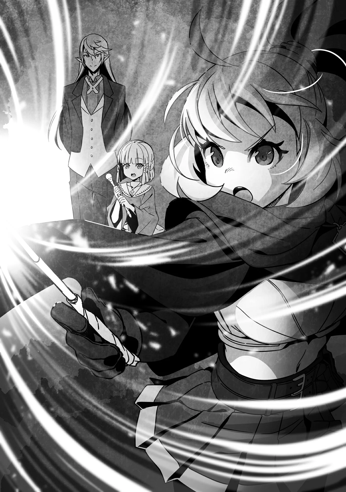

# Chương 225: Ngoại truyện Tập 10 - Trong Lúc Đó, Tại Maalt

"Hừm..."

Rina—đệ tử của Rentt và Lorraine—đang chau mày khẽ rên lên đầy tập trung, dồn toàn bộ sự chú ý vào nhiệm vụ trước mắt. Cô hiện đang có mặt tại khoảng sân trong của dinh thự Gia tộc Latuule, nằm ở một góc thành phố Maalt. Đứng cách đó không xa, Alize, cô đệ tử còn lại của Rentt và Lorraine, đang dõi theo Rina khi cô gái tập hợp Ma Lực vào cây đũa phép cầm trên tay. Khi sự tập trung đã đạt tới đỉnh điểm, Rina mở mắt và hô vang câu chú.

"Gie Vieros!"

Ngay sau đó, thứ vật chất màu nâu trông như đất cát tụ lại giữa khoảng không nơi đầu cây đũa phép, dần dà tạo thành một mũi tên lơ lửng giữa không trung. Rồi Rina làm động tác như thể đẩy nó về phía trước. Mũi tên xé gió lao đi nhanh gần như một mũi tên thông thường, bay thẳng về phía tấm bia gồm nhiều vòng tròn đồng tâm và cắm trúng vòng ngoài cùng.

"Oa," Alize lẩm bẩm sau khi mũi tên của Rina cắm vào bia.

Isaac, người đang đứng bên cạnh Alize, gật đầu tán thưởng. "Xét đến việc đây là lần đầu tiên cô thử nghiệm ma pháp rút ngắn, cô làm vậy là rất tốt rồi. Nếu muốn bắt bẻ thêm đôi chút, tôi chỉ mong cô bắn trúng gần tâm hơn một chút thôi."

Rina và Alize đang trong quá trình luyện tập ma thuật. Lorraine đã giao cho hai người một danh sách các việc cần làm trong thời gian cô và Rentt vắng nhà, và trong danh sách đó có lời nhắn rằng nếu muốn luyện tập ma pháp tấn công thì hãy nhờ Isaac hướng dẫn. Cả hai đã làm theo chỉ dẫn của người thầy và đến dinh thự Latuule để thỉnh giáo Isaac.

Khá bất ngờ là Rina và Alize đã có thể bước vào dinh thự mà không gặp phải bất kỳ trở ngại nào. Thông thường, người ta phải vượt qua một mê cung hàng rào cây mà ngay cả Rentt cũng phải chật vật mới lần ra đường, nhưng cả hai lại được phép bỏ qua thử thách đó. Điều đó cũng đồng nghĩa với việc họ không nhận được phần thưởng dành cho người vượt qua mê cung—một món ma cụ tùy chọn—nhưng vì cả hai đều chẳng hề hay biết về chuyện đó, họ đương nhiên sẽ không phàn nàn gì rồi.

Hơn nữa, xét việc Alize là một đứa trẻ đến từ cô nhi viện, việc để cô bé ở đây một mình giữa bầy Ma Cà Rồng và Undead lẽ ra có thể là một ý tồi, nhưng may mắn thay con bé hoàn toàn chẳng hay biết gì về chuyện này; cô bé không nhận ra bất kỳ điều gì bất thường khi gặp Isaac cùng những người hầu khác làm việc trong dinh thự. Dẫu vậy, đó cũng là lẽ tự nhiên, nếu xét đến việc lũ Ma Cà Rồng nơi đây đã sống nhiều năm, nhiều thập kỷ, và thậm chí có thể là hàng thế kỷ tại Maalt mà chưa từng bị bất kỳ ai phát hiện ra thân phận thực sự. Ngay cả khi được dẫn vào tận trung tâm dinh thự, người ta cũng phải sở hữu con mắt quan sát đặc biệt tinh tường—điều mà Alize chắc chắn không có—mới mong nhìn thấu được lớp vỏ bọc ngụy trang của bọn họ.

Dưới góc nhìn của Alize, cô bé chỉ đơn thuần bước vào một cơ ngơi tuyệt đẹp với vườn hoa hồng lộng lẫy cùng một đội ngũ người hầu thanh lịch và tao nhã. Dẫu các bà mẹ trên thế gian có thể phản đối việc một đứa trẻ mồ côi ở cùng một chỗ với Ma Cà Rồng, nơi đây lại chẳng có người mẹ nào hiện diện, và vì thế cũng chẳng có ai đứng ra phản đối điều đó.

Người "đàng hoàng" duy nhất biết rõ sự thật là Rina, mà bản thân cô gái cũng là một bán Ma Cà Rồng, chẳng cách xa là bao so với những cư dân Undead của dinh thự. Alize, về cơ bản, chẳng khác nào một miếng mồi ngon béo bở—một món tráng miệng để lũ Ma Cà Rồng nhâm nhi bất cứ lúc nào—thế nhưng trên thực tế sẽ chẳng có ai ở đây đi hút máu cô bé cả.

"Anh Isaac, em cũng có thể làm được như thế không ạ?" Alize hỏi.

Isaac nở nụ cười rợn người nhưng đầy tao nhã—thứ có thể đã làm lộ tẩy thân phận Ma Cà Rồng của anh ta nếu ở trước những kẻ cảnh giác hơn—rồi đáp, "Sau này thì có thể. Nhưng ngay lúc này thì khá là khó đấy."

"Tại sao lại thế ạ?"

"Những gì cô Rina vừa thi triển không phải là ma pháp ngâm xướng thông thường, mà là ma pháp rút ngắn. Nhìn chung, ma pháp được chia thành ma pháp ngâm xướng, ma pháp rút ngắn và ma pháp vô ngôn, nhưng hai loại sau độ khó sẽ tăng dần lên. Cô Alize, từ trước đến nay em mới chỉ học ma pháp ngâm xướng thôi, phải không?"

"Vâng ạ. Có phải là do em không có tài năng làm ma pháp sư không ạ?" Alize lẩm bẩm với vẻ lo âu hiện rõ trên khuôn mặt.

Isaac lắc đầu và mỉm cười trấn an cô bé.

"Không, hoàn toàn không phải vậy đâu. Vấn đề nằm ở chỗ nếu em không cẩn thận và chú ý tới lời ngâm xướng khi mới bắt đầu học ma thuật, về sau em sẽ hình thành vài thói quen kỳ quặc của một người thi triển ma pháp. Nói cách khác, ma pháp ngâm xướng cũng tương đương như các chiêu thức bài bản trong kiếm thuật. Phong cách của một kiếm sĩ phụ thuộc rất lớn vào việc họ bắt đầu bằng cách thuần thục các chiêu thức căn bản đó hay bỏ qua chúng hoàn toàn. Cách trước sẽ tạo nên một kiếm sĩ thuộc một môn phái nhất định, trong khi cách sau tạo ra một võ sĩ hoàn toàn tự mày mò học hỏi. Không hẳn là con đường nào cũng luôn tạo ra một chiến binh mạnh mẽ hơn, nhưng cách trước rõ ràng là phương pháp học tập hiệu quả hơn nhiều, chẳng phải sao?"

Alize gật đầu, lời miêu tả đó gợi lại đôi điều trong trí nhớ của cô bé.

"Nhắc mới nhớ, anh Rentt điều khiển Ma Lực giỏi lắm, nhưng Học Sĩ Lorraine lại bảo chuyện đó có điểm gì đó quái dị."

"Hừm. Tôi hiểu ý cô ấy rồi. Rentt giống như một chiến binh tự học mà tôi vừa đề cập vậy. Dẫu thế, Rentt có dự định học lại từ những điều cơ bản nhất, nên vừa giữ được những lợi thế từ phong cách tự học của mình, anh ấy cũng sẽ đạt được sự ổn định nhờ việc nắm vững chúng. Anh ấy hiểu rõ giá trị của việc thuần thục những nền tảng cơ bản."

"Đúng thế thật ạ. Anh ấy cũng đang học cùng với em từ Học Sĩ Lorraine mà."

"Giờ thì, đối với ma pháp mà cô Rina vừa sử dụng, cô ấy vốn đã thuần thục ma pháp ngâm xướng rồi. Cô ấy đang thử sức với ma pháp rút ngắn như một phần nỗ lực bước sang giai đoạn tiếp theo trong quá trình huấn luyện. Vì cô ấy có vẻ thấy ma pháp thổ hệ đặc biệt khó khăn, nên Gie Vieros cũng rất hữu ích để luyện tập loại ma pháp đó. Còn với em, cô Alize, em vẫn còn nhiều thời gian. Cứ từ từ và trước hết hãy tập trung hoàn thiện ma pháp ngâm xướng của mình đã. Tôi sẽ ở đây để đảm bảo hai cô không học phải những thói xấu từ quá trình luyện tập, nên đừng lo lắng về việc phạm sai lầm trong lúc rèn luyện nhé."

"Vâng ạ!"

Dù bề ngoài trông như thể Isaac đang dạy hai người họ cách sử dụng ma thuật, tất cả những gì anh thực sự làm chỉ là trông chừng để đảm bảo không ai làm điều gì quá nguy hiểm, đồng thời thỉnh thoảng đưa ra vài lời khuyên nhỏ. Cả hai vẫn đang học theo đúng những chỉ dẫn của Lorraine, nên xét về mặt lý thuyết thực tế và nền tảng căn bản thì cô vẫn là người thầy của họ.

Cứ như thế, hai người họ tiếp tục buổi rèn luyện...
