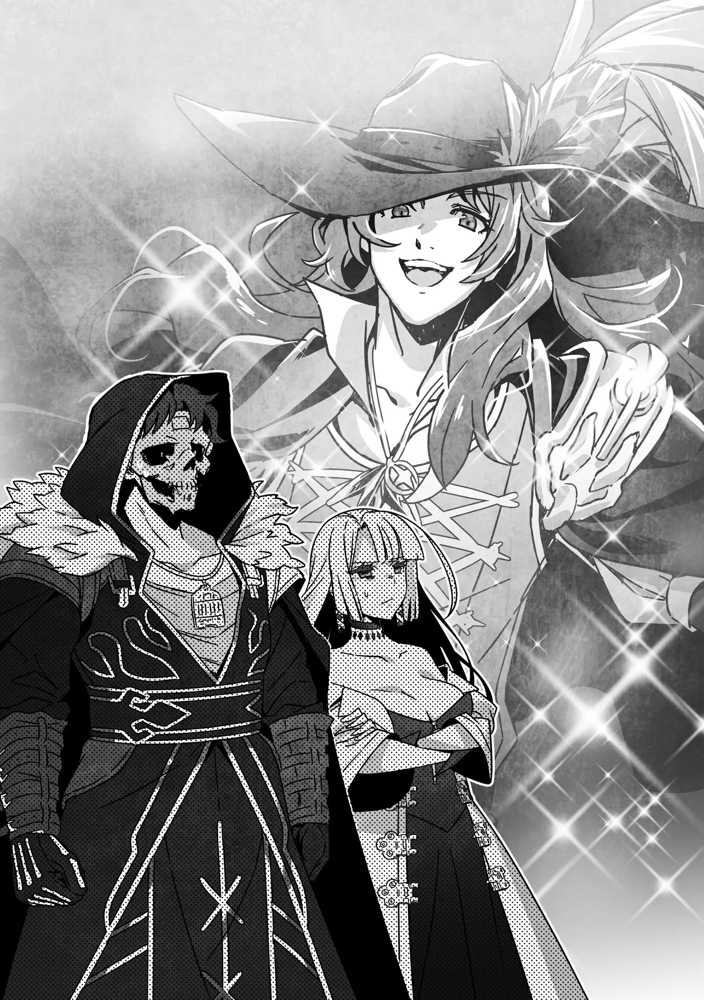

# Chương 226: Tập 10 Chương 2 - Tiến Vào Hoàng Cung (1)

"A, tới nơi rồi."

Chúng tôi dừng lại trước một quán trọ trông khá cũ kỹ, nhưng không phải kiểu xập xệ, tồi tàn. Dù đã có tuổi, quán vẫn được giữ gìn sạch sẽ, tươm tất, nhìn là biết một cơ sở làm ăn lâu năm có tiếng ở khu này.

"Biển hiệu ghi 'Quán Trọ Falcon's Rest'. Chắc là chỗ này rồi," Lorraine lẩm bẩm sau khi nhìn lại mẩu giấy Augurey đưa.

Bước vào quán, chúng tôi thấy hai vợ chồng chủ quán đang làm việc. Đứng ở quầy tiếp tân là một cô bé, chắc là con gái họ. Quán trọ kiểu này thường do cả nhà cùng làm. Dĩ nhiên, những chỗ sang trọng dành cho mạo hiểm giả cấp cao thường do các thương hội lâu năm đứng sau, nhưng những nơi quy mô cỡ này thì phần lớn đều do một gia đình tự quán xuyến.

Augurey là mạo hiểm giả Ngân Cấp, thừa sức chuyển sang chỗ đắt đỏ hơn nếu muốn, nhưng người ta thường thích ở nơi mình đã quen. Chắc anh ta đã trọ ở quán này từ trước khi lên Ngân Cấp rồi cứ thế ở lại luôn vì thấy thoải mái.

"A, chào hai vị. Hôm nay hai vị đến thuê phòng ạ?" cô bé cất tiếng hỏi khi chúng tôi bước lại gần quầy tiếp tân.

Tôi lắc đầu: "Không, chúng tôi đến tìm người. Tôi nghe nói có mạo hiểm giả tên Augurey đang trọ ở đây."

Cô bé gật đầu như thể sự xuất hiện của chúng tôi chẳng có gì lạ: "Anh Augurey ở phòng số ba ạ. Hôm nay hình như anh ấy chưa ra ngoài đâu. Hai vị có cần cháu đi gọi giúp không ạ?"

"Không cần phiền cháu đâu. Chúng tôi tự qua phòng anh ấy được chứ?"

"Dạ không sao đâu ạ, hai vị cứ tự nhiên. Phòng anh ấy ở cuối hành lang bên tay phải ạ."

Tôi và Lorraine nhìn nhau gật đầu rồi tìm đến căn phòng cô bé vừa chỉ.

Tôi gõ nhẹ lên cánh cửa gỗ.

"Hử? Khách à? Mình nhớ hôm nay đâu có hẹn với ai nhỉ..."

Chúng tôi nghe tiếng người bên trong tự lẩm bẩm, rồi cánh cửa mở toang. Tôi không khỏi nghĩ anh ta làm vậy hơi bất cẩn khi chưa biết ai đứng bên ngoài, nhưng thực tế cũng chẳng mấy ai đe dọa nổi một mạo hiểm giả, huống hồ lại là Ngân Cấp. Thế nên dù chưa hẳn là khôn ngoan, với anh ta chuyện đó cũng chẳng thành vấn đề. Nếu biết rõ đang có kẻ rình ám sát mình thì đã khác, nhưng tôi không nghĩ lúc này anh ta rơi vào cảnh đó.

Cánh cửa vừa mở, Augurey đã hiện ra trước mắt chúng tôi trong bộ dạng lòe loẹt đúng như trí nhớ của tôi. Anh ta diện bộ đồ xếp nếp rực rỡ bảy sắc cầu vồng, đầu đội mũ gắn lông công khổng lồ, bên hông đeo thanh kiếm có chuôi chạm khắc hoa văn sặc sỡ. Tóm lại là chẳng khác chút nào so với lần cuối tôi gặp.

Nhưng gạt gu ăn mặc khó hiểu sang một bên, đường nét gương mặt anh ta rất ưa nhìn, chỉ cần ăn mặc đứng đắn một chút là trông bảnh bao ngay. Anh ta còn có khí chất tao nhã khiến người ta dễ tưởng là con em quý tộc. Có điều, nhìn vào bộ cánh lúc này thì ai nấy chỉ có nước kết luận rằng đầu óc anh ta bị va đập hơi nhiều. Tại sao anh ta lại thích ăn mặc kiểu này? Đó vẫn là bí ẩn chưa ai có lời giải.

Đứng ngay khung cửa đang mở, Augurey thoáng sững người kinh ngạc. "Rentt! Cả Lorraine nữa!" anh ta reo lớn.

"Ừ, lâu rồi không gặp," tôi nói. "À mà, chắc cũng chưa lâu đến thế, nhưng đúng là đã lâu rồi chúng ta mới gặp lại nhau trong trang phục bình thường như thế này."

Lần trước gặp anh ta, chúng tôi diện đồ theo mốt thịnh hành nhất của Đế Quốc, còn lần này cả hai đều mặc bình thường, ngoại trừ chiếc mặt nạ của tôi.

Lorraine nhìn Augurey với ánh mắt thoáng vẻ ngán ngẩm: "Cái người đứng ngay trước mặt tôi đây đâu có ăn mặc bình thường..."

Augurey tỏ vẻ ngơ ngác, làm như chẳng hiểu Lorraine đang nói gì. Tôi không rõ anh ta đang đùa hay thật, nhưng nếu phải đoán thì chắc là đang giả vờ không hiểu. Trái ngược với vẻ ngoài, Augurey là người chín chắn và thông minh. Anh ta chẳng phải kẻ ngốc đến mức không nhận ra gu thời trang của mình kỳ lạ cỡ nào. Biết vậy mà vẫn ăn mặc thế này thì hẳn phải có lý do, nhưng biết đâu chỉ là sở thích cá nhân thôi, nên có gặng hỏi tiếp cũng bằng thừa.

"Hai người đúng là đến bất thình lình thật, nhưng gặp được hai người thì mừng quá. Tôi sắp cạn sạch lý do để khất lần rồi."

Giọng Augurey lộ rõ vẻ mệt mỏi khác thường, và tôi đoán được ngay nguyên nhân.

"Hoàng cung hối thúc dữ lắm đúng không?" Lorraine hỏi.

"Ừ thì cũng thế. Vào ngồi rồi nói chuyện tiếp nhé? Cứ tự nhiên đi. Phòng hơi bừa bộn một chút, nhưng vẫn đủ chỗ cho ba chúng ta ngồi tán gẫu thoải mái."

Xem ra Lorraine đoán trúng rồi. Đằng nào chúng tôi tới tìm Augurey cũng vì chuyện đó, nên tiện đà vào thẳng vấn đề luôn. Chúng tôi gật đầu rồi bước vào phòng anh ta.

◆◇◆◇◆

"Nào. Kể từ sau vụ đó cũng được một thời gian rồi nhỉ..."

Augurey dường như muốn hỏi xem chúng tôi có lý do gì mà lần lữa lâu đến vậy. Cũng dễ hiểu thôi. Trước đó chúng tôi từng bảo với Nauss Ancro rằng sẽ ghé qua sau mà không hẹn ngày cụ thể, chỉ nói cần vài ngày để thu xếp việc riêng. Nghĩ lại thì phía hoàng gia đoán chúng tôi sẽ tới yết kiến sau vài ngày cũng là lẽ đương nhiên. Mãi không thấy chúng tôi đến, họ liền quay sang giục người duy nhất trong nhóm mà họ biết đang ở vương đô. Rõ ràng chúng tôi đã đẩy Augurey vào thế khó xử.

"Ừ, chuyện đó thì cho chúng tôi xin lỗi," tôi tạ lỗi. "Chúng tôi vướng phải nhiều chuyện cần giải quyết quá."

Sau đó, tôi kể lại những chuyện xảy ra ở Maalt trong chừng mực có thể chia sẻ. Augurey vốn đã biết tôi là quái vật. Hơn nữa, anh ta cũng đã ký khế ước ràng buộc ma pháp, không được tiết lộ bất cứ điều gì gây hại cho chúng tôi nếu chưa được phép. Thế nên tôi đã kể cho anh ta nghe phần lớn sự tình. Vì chưa rõ có thể nói bao nhiêu về Gia tộc Latuule, tôi chỉ kể qua loa chỗ đó, đại khái là chúng tôi được một Ma Cà Rồng hùng mạnh giúp đỡ.

Nghe xong, Augurey có vẻ xuôi xuôi: "Xem ra hai người vướng vào rắc rối to thật. Mà nghĩ lại thì cậu vốn đã gặp đủ thứ chuyện đau đầu kể từ lúc biến thành quái vật rồi. Xảy ra cơ sự như thế thì tôi khó lòng trách hai người vì sao mãi mới chịu xuất hiện. Bên tôi tuy cũng chật vật, nhưng so với hai người thì tôi cùng lắm chỉ bị phía hoàng cung réo suốt thôi. Nghĩ cho cùng cũng chẳng phải chuyện gì to tát." Anh ta gật đầu vẻ thông cảm.

"Anh bảo họ réo là họ làm những gì thế?" tôi hỏi. Tôi muốn biết liệu họ chỉ đơn thuần giục giã hay còn đe dọa xử phạt thật. Nhìn thái độ của Augurey thì có lẽ chỉ là vế đầu.

"Cùng lắm thì họ cũng chỉ gặng hỏi xem chúng ta còn định bắt họ đợi đến bao giờ thôi," Augurey đáp. "Có điều, sứ giả đến ngày một dày hơn, và mỗi lần phải khất lần rồi để người ta ra về là tôi lại thấy áy náy hơn. Dù lần nào tôi cũng cam đoan chắc chắn sẽ dẫn hai người tới, họ vẫn cứ gặng hỏi rốt cuộc là khi nào. Cứ lặp đi lặp lại cái màn đối đáp căng thẳng ấy suýt nữa làm tôi đau cả dạ dày."

Thú thật thì nghe qua cũng chẳng dễ chịu gì. Còn chuyện nó có khiến Augurey khổ sở đến thế không lại là chuyện khác. Căng thẳng chút đỉnh thì có, nhưng Augurey là mẫu người sẵn sàng chuồn khỏi vương quốc ngay nếu thấy tình hình bắt đầu nghiêm trọng. Anh ta đâu phải kiểu người để áp lực đè nặng tới mức cùng quẫn mà đi thắt cổ. Dù vậy, chúng tôi vắng mặt quá lâu đúng là đã làm anh ta phải chịu những căng thẳng không đáng có.

"Thật sự xin lỗi anh," tôi lại tạ lỗi. "Giá mà chúng tôi làm được gì đó để bù đắp cho anh."

Tôi thấy áy náy vì để anh ta phải gánh hết chừng ấy phiền toái. Nhưng nghĩ lại, tôi chẳng hề thấy cắn rứt trước cái tội bước chân vào vương đô dưới thân phận quái vật. Dù sao thì chuyện đó tôi cũng đâu làm khác được.

Augurey mỉm cười như chỉ chờ có thế: "Ồ, thật sao?! Tôi có ngay việc hai người giúp được đây..."

Anh ta bắt đầu liệt kê một tràng các ủy thác đòi hỏi phải lập tổ đội mới nhận được, chẳng ngần ngại chút nào, cũng bởi cả hai đã quá hiểu tính nhau.

Rồi Augurey quay sang Lorraine, hỏi như thể đó là điều hiển nhiên nhất trần đời: "Lorraine, cô cũng giúp một tay chứ?"

"Xem ra tôi chẳng còn lựa chọn nào khác. Bản thân tôi cũng có phần trách nhiệm trong chuyện này. Tôi sẽ nghe yêu cầu của anh," cô nói với vẻ cam chịu.

◆◇◆◇◆

"Vậy là giờ tôi đã nhận được thù lao xứng đáng cho công sức của mình rồi nhé," Augurey mở lời.

"Tôi cứ thấy như mình vừa bị vặt sạch ấy," tôi lẩm bẩm.

"Chuyện nào ra chuyện nấy chứ, hai chuyện hoàn toàn khác nhau mà. Vấn đề là chuyện vào hoàng cung kìa. Dù chúng ta có thể dễ dàng vào cửa nhờ tấm huy chương cậu được trao, nhưng cậu có chắc cái... ừm... cơ thể đặc biệt của cậu sẽ không sao chứ? Hoàng cung có mấy thiết bị dò tìm lợi hại lắm đấy."

Augurey có vẻ thực sự lo lắng, nhưng chúng tôi đã giải quyết xong chuyện đó từ trước rồi.

"Chúng tôi đã kiểm tra mọi thiết bị dò tìm mà hoàng cung sử dụng," Lorraine đáp, "chẳng có cái nào phản ứng cả. Không có vấn đề gì hết."

Augurey cố hết sức nén nỗi kinh ngạc: "Ừm, tôi khá chắc thông tin về thiết bị hoàng cung dùng đâu phải thứ được công khai. Làm sao cô biết được chuyện đó thế?"

Anh ta phản ứng như vậy cũng dễ hiểu thôi. Xét cho cùng, Lorraine vừa tự tin khẳng định mọi chuyện đều ổn. Cô ấy đâu phải kiểu người nói chắc như đinh đóng cột khi chưa rõ ràng hay còn chút nghi ngờ nào, và dường như tôi đã quen tin tuyệt đối vào bất cứ điều gì cô ấy khẳng định là thật. Bảo đó là biểu hiện của lòng tin thì nghe hay đấy, nhưng biết đâu tôi chỉ đang đùn đẩy những chuyện hóc búa cho cô ấy rồi chẳng buồn động não nữa. Vốn hay bất cẩn vào những thời điểm then chốt, lẽ ra tôi nên thận trọng hơn mới phải. Nói đâu xa, chính vì thế mà tôi mới bị Rồng nuốt chửng đấy thôi. Dù có tự dặn phải đề phòng đến mấy, tôi vẫn cứ vô thức đặt trọn niềm tin vào Lorraine.

"Nhờ các mối quan hệ và vốn hiểu biết của một học giả," Lorraine đáp. "Dĩ nhiên, dù vậy vẫn có khả năng hiểu biết của tôi chưa hoàn toàn đầy đủ, nên tôi đang kiểm chứng lại cho chắc đây. Thực ra thì, vừa khéo tới rồi..."

"Kiểm chứng ư?" Trong lúc Augurey nghiêng đầu thắc mắc, bỗng có tiếng gõ cộc cộc lên thanh gỗ nơi khung cửa sổ. "Hôm nay tôi nhiều khách ghé thăm thật đấy. Nhưng sao lại từ lối này? Chúng ta đang ở tận tầng hai cơ mà."

Augurey nhìn chúng tôi, như ngầm hỏi xem có mở ra được không. Anh ta tỏ ra ý tứ, vì cuộc trò chuyện nãy giờ giữa chúng tôi vốn chẳng bình thường chút nào.

Tôi gật đầu. Tôi chẳng biết ai đang ở ngoài cửa sổ, nhưng nếu là khách không mời mà đến thì cứ đuổi đi là được. Lorraine cũng gật đầu, thế là Augurey bước lại mở cửa sổ ra.

"Hử? Đâu có ai ở đây...?"

"Không, có vẻ vị khách này tới tìm tôi chứ không phải anh đâu," Lorraine giải thích trong lúc tiến lại gần cửa sổ. Cô nhìn xuống góc dưới bên phải, sát mép bậu cửa, rồi khum hai bàn tay lại như đang vốc nước. Một sinh vật nhỏ liền nhảy tót vào lòng bàn tay cô.

"Một con Puchi Suri," Augurey thoáng vẻ ngạc nhiên. "Lorraine, cô bắt đầu nuôi quái vật làm thú cưng từ bao giờ thế? Ồ, khéo khi Rentt cũng nằm trong sở thích đó của cô..."

Thấy Augurey dường như đang suy diễn linh tinh, tôi vội chen ngang: "Khoan đã, khoan đã nào! Hoàn toàn không phải thế đâu!"

Augurey cười khì: "Tôi đùa thôi mà. Dù sao thì con Puchi Suri này có vẻ hoàn toàn nghe lời Lorraine nhỉ. Cô ấy thành người thuần hóa quái vật rồi à?"

Lorraine từ tốn lắc đầu rồi hất cằm về phía tôi.

"Không, đây là một trong những quyến thuộc của Rentt. Tôi chỉ mượn tạm thôi."

"Quyến thuộc à. Nghe vậy mới thấy rõ Rentt đúng là quái vật thật. Nhưng nghĩ lại thì người thuần hóa quái vật cũng sai khiến quái vật làm tay sai, nên chuyện này xem ra cũng không có gì lạ. Nghe bảo kỵ sĩ Goblin cũng dùng cách tương tự như người thuần hóa quái vật, vả lại ranh giới giữa quái vật, quyến thuộc và thú cưng vốn khá mơ hồ. Tôi nhớ hồi trước Lorraine từng nói như thế."

Trong thoáng chốc tôi suýt thán phục trước hiểu biết của Augurey, nhưng hóa ra anh ta chỉ đang nhai lại lời Lorraine từng nói.

Thông thường, điểm khác nhau giữa quyến thuộc và quái vật phục tùng là chủ nhân điều khiển quyến thuộc bằng Ma Lực của chính mình, còn người thuần hóa quái vật thì huấn luyện quái vật phục tùng nghe theo mệnh lệnh như ngựa hay thú cưng. Dù vậy, dường như người thuần hóa quái vật cũng có mối liên kết ma pháp với quái vật của họ, nên hai bên không hoàn toàn khác biệt mà chỉ khác nhau ở mức độ kiểm soát bằng Ma Lực. Ngay cả các chuyên gia cũng chưa thể phân định rạch ròi, và đây vốn là một trong những điều khó mà đưa ra định nghĩa chính xác được.

"Thế tại sao con quyến thuộc này lại gõ cửa phòng tôi... à không, gõ cửa sổ phòng tôi?"

"Nó đi kiểm chứng chuyện tôi vừa nói lúc nãy đấy," Lorraine bảo. "Rentt, anh xem nó báo kết quả thế nào?"

Lorraine phải hỏi tôi vì cô ấy không thể trực tiếp giao tiếp bằng ý nghĩ với con Puchi Suri, còn tôi thì có thể.

"Thế nào rồi?"

Tôi vừa truyền ý nghĩ ấy đi thì nhận được câu trả lời.

"Không thành vấn đề. Đã vào được tận tẩm điện của nhà vua."

Ngắn gọn và đúng trọng tâm. Có lẽ chú chuột Puchi Suri này thuộc kiểu ít lời và dứt khoát chăng? Edel trả lời thường ồn ào và mơ hồ hơn nhiều, lúc nào cũng toát ra vẻ ngang tàng như một tên cướp biển. Thật khó diễn tả thành lời vì nó đâu dùng ngôn từ, nhưng bằng cách nào đó, ý nghĩ truyền sang luôn phản ánh rõ tính cách của nó.

"Có vẻ mọi chuyện đều ổn cả," tôi nói với Lorraine.
