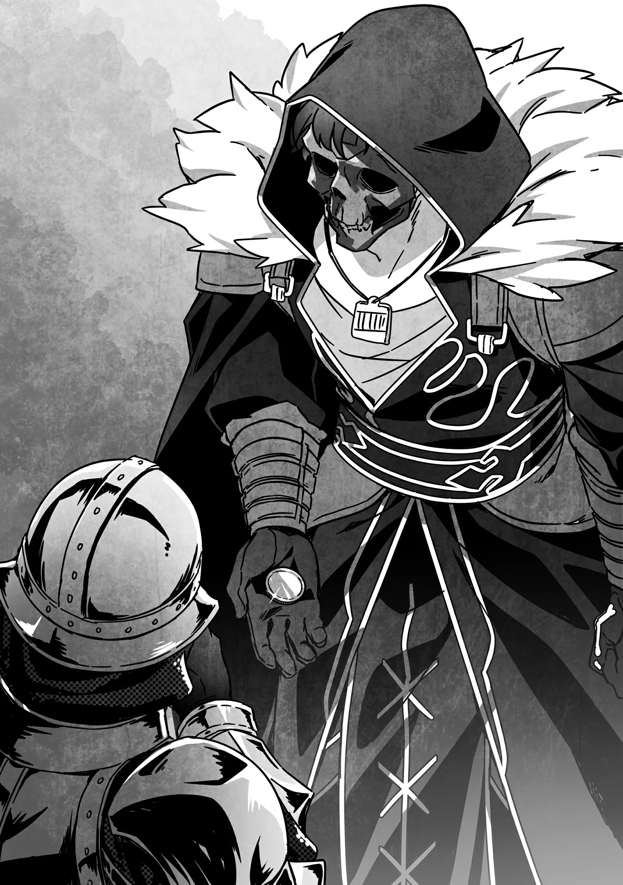

# Chương 227: Tập 10 Chương 2 - Tiến Vào Hoàng Cung (2)

"Tên tôi là Rentt."

Nghe tôi giới thiệu, một trong hai người lính đứng gác trước cây cầu đá kiên cố dẫn vào lâu đài liền nhíu mày nghi ngại. Tôi cũng chẳng trách được anh ta, bởi chắc chắn đây là lần đầu tiên anh ta nghe thấy cái tên này.

"Mấy người từ đâu tới? Đến đây có việc gì?"

Hôm nay cả Lorraine, Augurey và tôi đều có mặt ở đây. Hôm qua sau khi trò chuyện thêm đôi chút, chúng tôi đã giải tán sớm, để rồi hôm nay cùng nhau kéo tới hoàng cung.

Lúc đi từ khu bình dân sang khu quý tộc, tôi cũng có chút căng thẳng, nhưng đúng như lời đàn em của Edel báo lại, chẳng có thiết bị dò tìm nào kêu lên cả, và cả nhóm đã đến được cổng hoàng cung trót lọt. Dù lính gác trước các dinh thự quý tộc có nhìn tôi bằng ánh mắt ngờ vực, họ vốn là gia nhân phục vụ riêng cho gia tộc đó chứ không phải người của hoàng cung, nên chẳng hơi đâu bỏ vị trí để đuổi theo một kẻ qua đường chỉ hơi đáng ngờ một chút.

Chà, chắc chắn họ sẽ lập tức báo cho lính tuần tra rồi đuổi theo bắt tôi nếu tôi vừa vung vẩy vũ khí hay bắn ma pháp loạn xạ vừa gào tướng lên: "Hãy run sợ trước Undead đi! Nhân danh chúa tể Ma Cà Rồng vĩ đại Laura Latuule, ta tới đây để san phẳng thành phố này!" Dù vậy, đời nào tôi lại làm trò đó. Làm thế chẳng khác nào biến cả Vương Quốc Yaaran thành kẻ thù. Khoan đã, biến Gia tộc Latuule thành kẻ thù mới là chuyện đáng sợ hơn. Nhưng đáng sợ hơn cả là tôi còn chẳng dám chắc liệu họ có thực sự coi tôi là kẻ thù hay không nữa. Tôi cảm giác Laura có khi sẽ khúc khích cười rồi bảo: "Nếu ngài muốn chơi trò đó thì xin cứ tự nhiên. Nghe chừng thú vị đấy chứ." Còn Isaac chắc cũng sẽ vui vẻ chiều theo ý cô bé. Nghĩ đến thôi đã thấy rợn cả người.

Vả lại, tôi chẳng thể tưởng tượng nổi mình sẽ thắng họ bằng cách nào. Việc đó bất khả thi đến mức nếu đối đầu với Gia tộc Latuule là một trong những điều kiện bắt buộc, có khi tôi thà từ bỏ luôn giấc mơ thuở nhỏ trở thành mạo hiểm giả Mithril Cấp còn hơn. Đùa đấy thôi. Có khi thế thật.

Đầu óc lởn vởn mấy suy nghĩ ngớ ngẩn ấy, tôi cất lời với anh lính gác:

"Tôi là mạo hiểm giả Đồng Cấp. Tôi có việc cần yết kiến Điện Hạ, Công Chúa Jia Regina Yaaran. Tôi không đến đây để gây rối đâu. Liệu anh có thể cho tôi qua được không?"

Tôi chỉ mới nói rõ lý do mình đến đây, thế mà anh lính gác đã nhìn tôi đầy vẻ ngờ vực rồi tiếp tục gặng hỏi. Anh ta nghi ngờ cũng phải thôi, bởi xét cho cùng tôi vốn là một con quái vật, lại còn là Undead, giống loài bị căm ghét và ngờ vực nhất trong muôn vàn quái vật ở thế giới này. Trong mắt người đời, Undead hoặc là những ma pháp sư đã bán linh hồn cho quỷ dữ, hoặc là những kẻ chết đi trong nỗi phẫn uất cùng cực nên linh hồn vất vưởng không tan chỉ để trả thù. Tóm lại, chúng xấu xa đến mức cùng cực. Có điều, người lính gác đâu thể nào biết tôi là Undead được.

"Chỉ là mạo hiểm giả Đồng Cấp mà đòi tới gặp Điện Hạ sao? Tôi không bảo chuyện đó là bất khả thi, nhưng hôm nay tôi đâu nghe nói có vị khách nào như vậy đến hẹn."

Dù vẻ ngoài của tôi trông chẳng giống ai, anh ta vẫn nghiêm túc lắng nghe, đủ thấy anh ta tận tụy với công việc và chân thành với mọi người đến mức nào khi làm người đại diện cho chủ nhân. Tôi dám chắc ở khối nước khác, người ta đã gạt phắt đi rồi đuổi tôi thẳng cổ rồi. Nếu đặt mình vào vị trí của anh ta, thấy một gã trông kỳ quặc thế này tới bảo có việc cần gặp công chúa, chẳng đời nào tôi cho bước chân vào cung. Có điều, tôi vẫn còn một quân bài tẩy để xoay chuyển tình thế. Nói đúng hơn, lẽ ra ngay từ đầu tôi nên chìa thứ đó ra luôn mới phải.

Tôi bắt đầu thò tay lục lọi túi áo. Dù có mang túi ma thuật bên mình, tôi đã lấy sẵn tấm huy chương ra từ trước để phòng tình huống này, cho tiện việc chỉ cần thò tay vào là nhoáng cái rút ngay ra được.

Và thế là, tính thì nhanh đấy, nhưng tôi lại chẳng tài nào lôi được tấm huy chương ra ngay. Rõ ràng tôi nhớ mình để nó quanh đây cơ mà. Tôi tiếp tục mò mẫm, nhưng việc cứ đứng trơ ra thọc tay lục lọi túi áo rõ ràng chẳng giúp tình hình khá khẩm hơn chút nào. Bàn tay anh lính gác đã bắt đầu từ từ lần về phía chuôi kiếm bên hông.

Hỏng rồi, tệ thật đấy chứ. Phải tìm ra nó ngay, nếu không thì...

May sao ngón tay tôi vừa chạm đúng vật cần tìm, thế là tôi hào hứng rút phắt nó ra khỏi túi áo, khiến anh lính gác cũng rút kiếm ra với vẻ quyết liệt y như vậy. Chắc anh ta tưởng tôi sắp sửa lôi ra thứ vũ khí gì đó, nhưng thứ tôi đang cầm trên tay nào phải vũ khí.

"Một tấm huy chương ư?" anh lính gác buột miệng. Sau đó, anh ta tra kiếm vào bao rồi nói tiếp như thể ban nãy mình chưa từng rút vũ khí ra: "Vậy là anh được một quý tộc nào đó giới thiệu. Trò này quen quá rồi. Mấy kẻ ranh ma hay dẻo mỏ dụ dỗ mấy quý tộc nhẹ dạ chốn thôn quê trao cho tấm huy chương mang gia huy để kiếm cớ vào gặp người trong hoàng tộc. Hóa ra anh cũng là phường đó à? Khoan đã, đợi chút..."

Anh lính gác vừa nói vừa ghé mắt nhìn kỹ hơn vào tấm huy chương, rồi rốt cuộc cũng nhận ra biểu tượng gia huy khắc trên đó. Giọng anh ta bỗng vút cao lên nửa quãng tám:

"K-Khoan đã, đây là gia huy của Hầu tước xứ Ancro! Mà chiếc này lại là của riêng ngài Nauss..."

Tôi không hề nhận ra điều đó, bởi trước giờ tôi chưa từng dành thời gian ngắm nghía kỹ tấm huy chương, nhưng có vẻ biểu tượng trên ấy còn giúp nhận diện từng thành viên cụ thể trong gia tộc. Đây là lần đầu tiên tôi được tặng... À khoan, thứ này chỉ là cho mượn thôi. Dù sao đi nữa, đây cũng là lần đầu tiên có người cho tôi mượn một món đồ như thế này. Tôi chẳng biết gì về huy chương quý tộc vì trước giờ làm gì có cơ hội mà tìm hiểu.

Gia tộc lớn duy nhất quanh vùng Maalt là nhà của vị lãnh chúa cai quản nơi đó, Tử tước Lottnel, mà tôi thì đâu có quen biết gì ngài tử tước. Lần tiếp xúc nhiều nhất giữa tôi với ông ấy cũng chỉ là thỉnh thoảng dự mấy bữa tiệc do ngài tử tước tổ chức để giao lưu với giới mạo hiểm giả Maalt, rồi đứng ngắm ông ấy từ đằng xa. Ở những bữa tiệc như thế, ngài tử tước làm gì có thời gian tiếp chuyện một gã vô danh tiểu tốt Đồng Cấp như tôi, ông ấy còn bận trò chuyện với những nhân vật tầm cỡ như Hội Trưởng Wolf hay người đứng đầu các tổ chức có quan hệ mật thiết với Hội. Mà dù tôi có muốn bắt chuyện, đám tùy tùng của ông ấy chắc cũng xua tôi đi ngay.

Nói chung, tôi vốn không thuộc tầng lớp có thể qua lại thân tình với một quý tộc cỡ đó. Có điều, biết đâu sau này lại có cơ hội. Xét cho cùng, tôi nghe đâu Tử tước Lottnel qua lại rất thân thiết với Gia tộc Latuule, mà dạo này tôi lại dính dáng khá nhiều tới nhà Latuule. Cơ mà lúc này tôi cũng chẳng cần bận tâm nghĩ ngợi nhiều về chuyện đó làm gì.

"Làm sao anh... có được thứ này?"

Anh lính gác hẳn rất muốn hỏi xem tôi đã xoay xở trộm tấm huy chương này từ tay ngài Nauss bằng cách nào, nhưng rốt cuộc vẫn nuốt được lời buộc tội ấy vào trong để bình tĩnh hỏi hết câu.

"Có lần tôi tình cờ thấy Điện Hạ và ngài Nauss bị quái vật tấn công," tôi giải thích. "Tôi biết mình không thể cứ thế bỏ mặc họ nên đã lao vào ứng cứu. Hai người này lúc đó cũng đi cùng tôi."

Tôi đưa tay chỉ về phía Lorraine và Augurey.

"Ồ, hóa ra là mấy người... Phải rồi, tôi có nghe kể về các vị. Tôi cũng nghe nói các vị nhận được lời mời mà mãi chẳng thấy đâu, nên tôi quên khuấy luôn chuyện này vì cứ ngỡ các vị sẽ chẳng bao giờ tới."

Giọng anh lính gác hơi mỉa mai một chút, nhưng có vẻ anh ta nói thật lòng. Không phải ai nhận được lời mời vào hoàng cung cũng dám đến. Chẳng hạn, những kẻ có vết nhơ giấu kín trong quá khứ sẽ chẳng dại gì ló mặt ra vì sợ chân tướng bị phơi bày trước ánh sáng. Tôi cũng là một ví dụ điển hình cho chuyện đó, dẫu xét theo nghĩa đen thì chính tôi mới là "bộ xương giấu trong tủ". Nếu lỡ bị mấy thiết bị an ninh phát hiện, chắc tôi chẳng còn cách nào khác ngoài việc cắm đầu cắm cổ chạy thục mạng.

Ngoài tôi ra vẫn còn những trường hợp đỡ gay go hơn, chẳng hạn như mấy tay thương nhân từng là cướp khét tiếng, hay những mạo hiểm giả tên tuổi từng trốn khỏi gia tộc quý tộc rồi hành nghề dưới tên giả. Dù được mời vào hoàng cung có là vinh dự lớn đến đâu, những hạng người đó cũng chẳng bao giờ dám bén mảng tới. Thế nên anh lính gác mới xếp chúng tôi vào cùng một giuộc rồi quên bẵng đi. Nói thật, việc anh ta vẫn còn nhớ chút manh mối về chúng tôi ở góc nào đó trong đầu đã đáng được khen ngợi lắm rồi.

"Chúng tôi chậm trễ là có lý do riêng chứ không hề cố tình lần lữa. Chúng tôi rất muốn trực tiếp tạ lỗi với Điện Hạ và ngài Nauss. Liệu anh có thể cho chúng tôi qua được không?"

Anh lính gác gật đầu: "Được rồi. Nhưng nếu cứ để ba vị tự tiện đi vào, bên trong họ cũng sẽ lại hỏi han một thôi một hồi y như thế này mà thôi. Tôi sẽ đi cùng các vị cho tới khi tìm được người hầu dẫn đường."

Nói rồi, anh ta lịch sự dẫn chúng tôi đến tận lối vào hoàng cung.

◆◇◆◇◆

"A. Tôi nghe báo cuối cùng các cậu cũng chịu đến, quả nhiên là tới thật rồi!"

Trong lúc chúng tôi ngồi chờ tại một phòng tiếp khách cấp thấp của hoàng cung, cánh cửa bỗng bật mở, và cùng với lời chào niềm nở, một người đàn ông quen mặt bước vào: Nauss Ancro, Đội trưởng Cận Vệ Hoàng Gia của Vương Quốc Yaaran. Đó là một người đàn ông trung niên, khoác trên mình bộ giáp bạc sáng loáng từ đầu đến chân.

Tuy anh lính gác đã quay về vị trí trực, nhưng trên đường dẫn chúng tôi tới đây, anh ta đã kịp kể rằng Nauss là người đứng đầu Gia tộc Ancro và rất có uy tín trong giới quý tộc. Dù vậy, thế lực của ông không hẳn quá lớn, xét về độ nổi danh thì còn xếp sau Phó Vương kiêm Công tước Lukas Bader, Hầu tước Marcel Viesel đứng đầu phe Đệ Nhất Hoàng Tử, và Nữ Bá tước Gisel Georgiou bên phe Đệ Nhất Công Chúa. Ông không có thành tích nào quá đỗi nổi bật, nhưng lại được tiếng là người trung thành và có phẩm hạnh tốt.

Dù tôi từng nghe danh những quý tộc mà anh lính gác vừa liệt kê, tôi lại không nhớ mình từng nghe ai nhắc nhiều đến cái tên Nauss. Đám mạo hiểm giả chúng tôi tuy chuộng tự do và ghét bị trói buộc bởi quyền uy, nhưng sống trên đất nước này thì kiểu gì cũng phải dính dáng đến giới quý tộc hay thân thích của họ bằng cách này hay cách khác. Thỉnh thoảng chúng tôi vẫn đem chuyện quý tộc ra bàn tán, song tôi chẳng nhớ cái tên Nauss từng xuất hiện trong những buổi trò chuyện đó bao giờ.

Vả lại, Maalt nằm cách vương đô quá xa nên chúng tôi hiếm khi có cớ để bàn tán mấy chuyện kiểu này, họa hoằn lắm nửa năm mới nhắc tới một lần. Có điều tôi đoán Lorraine hẳn là ngoại lệ. Khi tôi liếc sang, vẻ mặt cô ấy cho thấy cô đã nắm được những điều cơ bản về Nauss từ trước. Sở dĩ cô không nói gì có lẽ vì theo lời anh lính gác kể, Nauss chẳng phải kẻ khó ưa hay đáng ngại gì cho cam. Hoặc cũng có thể Lorraine muốn để tôi tự mình quan sát và đánh giá.

Tôi không rõ về Augurey, nhưng có lẽ anh ta đã tìm hiểu về Nauss trong lúc chúng tôi còn bận bịu ở Maalt, thậm chí khéo hai người họ đã gặp nhau rồi cũng nên. Thấy Augurey chẳng hề dặn dò chúng tôi điều gì trước cuộc gặp, tôi đoán Nauss không phải người quá câu nệ lễ nghi phép tắc. Vả lại Lorraine và tôi đâu đến mức thô lỗ hay không biết điều. Nếu đi cùng mấy tay mạo hiểm giả cục mịch hơn, chắc Augurey đã phải chỉ dẫn từng ly từng tí về cách ăn nói, đi đứng trước mặt quý tộc rồi.

"Thưa ngài Ancro. Đúng như đã hứa, tôi đã đưa họ tới hoàng cung rồi đây," Augurey dõng dạc nói.

Chắc hẳn Nauss chính là người đã liên tục hối thúc Augurey về chuyến ghé thăm này. Trong khi Augurey tỏ ra đầy tự tin như thể mọi việc đều nằm trong tính toán, thì thực tế là gã chỉ giỏi phét lác để câu giờ. Ấy thế mà cử chỉ cùng giọng điệu của gã lại chẳng để lộ chút sơ hở nào, chứng tỏ Augurey là một diễn viên cừ khôi đến không ngờ. Vốn dĩ gã lúc nào cũng hay vung tay múa chân khoa trương rồi ăn nói hùng hồn như diễn viên kịch. Xét theo nghĩa đó, khéo gã chỉ đang thể hiện đúng những gì người ta trông đợi ở mình mà thôi.

"Augurey, tôi phải xin lỗi vì đã nghi ngờ cậu rồi. Cậu cũng phải thông cảm cho tôi chứ. Mọi chuyện khi ấy quá đỗi mơ hồ, từ ngày hai người họ tới nơi, nơi ăn chốn ở, cho đến cả tên tuổi của họ. Cậu hẳn không thể trách tôi khi cứ băn khoăn liệu có uẩn khúc gì đằng sau tất cả những chuyện đó."

Tùy người nghe, lời xin lỗi của Nauss có thể nghe chẳng khác nào một lời xỏ xiên bóng gió, và phần lớn thường dân lúc này chắc đã quỳ mọp xuống van xin tha thứ, thế nhưng Augurey vẫn giữ nguyên phong thái ung dung, lịch thiệp.

"Ngài nói chí phải, thưa ngài. Dù sao thì giờ hai người họ cũng đã có mặt ở đây rồi. Nếu có điều gì mờ ám, đời nào họ lại chịu tìm đến một nơi như thế này."

Thực ra tôi có cả đống điều phải giấu giếm ấy chứ. Chẳng hạn như việc tôi là một con quái vật, lại còn là Undead. Rằng tôi quen biết Ma Cà Rồng. Hay việc tôi có cách dịch chuyển tức thời tới vương đô. Tôi khá chắc chỉ riêng một điều trong số đó thôi cũng đủ để tôi lãnh án chém đầu, thậm chí còn tệ hơn, huống chi là gộp tất cả lại với nhau. Dẫu vậy, Lorraine và tôi vẫn giữ vẻ mặt tỉnh bơ, gật đầu phụ họa theo câu chuyện của hai người họ.

Nauss mỉm cười với Augurey rồi đáp: "Quả thực cậu nói rất đúng. Hoàng cung này được bố trí vô số lớp phòng hộ. Tội phạm không thể nào dễ dàng lọt vào đây được, chúng tôi thậm chí còn có cả ma cụ phát hiện ác ý. Tôi e là mình không thể tiết lộ chi tiết cụ thể, nhưng còn rất nhiều tầng bảo vệ khác cũng đang cùng hoạt động. Việc cả ba vị có mặt ở đây bất chấp những điều đó chính là bằng chứng cho thấy các vị chẳng có điều gì phải giấu giếm hay hổ thẹn cả."

Đúng là tôi không phải tội phạm, và tôi cũng chẳng có ý định hãm hại ai trong hoàng cung này. Tôi không rõ họ còn bố trí thêm những phép dò tìm nào khác, nhưng vì chúng chẳng hề phản ứng gì với tôi, nghĩa là Nauss nói đúng. Còn về phần dò tìm quái vật, chẳng hiểu vì lý do gì mà nó cũng trơ ra trước sự hiện diện của tôi.

Đó mới là vấn đề lớn nhất, nhưng đời nào chúng tôi lại mở mồm bảo: "Này, tôi là quái vật đấy, thế mà đồ dò tìm của các ông chẳng buồn réo một tiếng. Nên đổi bên cung cấp thiết bị đi thôi! Nếu liên hệ ngay hôm nay, nhà giả kim vĩ đại Lorraine Vivie sẽ rất sẵn lòng cung cấp cho quý ngài một bộ ma cụ dò tìm quái vật được chế tạo theo nguyên lý hoàn toàn mới với giá chỉ vỏn vẹn năm đồng bạch kim! Đúng vậy, chỉ năm đồng bạch kim thôi, quá hời phải không nào! Chưa hết, nếu quý ngài đặt mua ngay lúc này..."

Chúng tôi đâu phải mấy tay bán hàng rong chèo kéo ngoài phố. Nói thật, trước đây tôi cũng từng vài lần cắn câu mấy lời chào mời kiểu ấy mà rước về những thứ chẳng để làm gì. Dù vậy, cũng chẳng có vụ nào là lừa đảo quy mô lớn. Đại loại chỉ là sau khi mua về mới ngớ người nhận ra "giá đại hạ giá" thực chất cũng chỉ bằng giá ngày thường, hoặc món đồ bé hơn bình thường một chút, toàn mấy trò mánh lới vặt vãnh như thế cả.

"Đúng là vậy. Giờ thì, thưa ngài Ancro, nếu có thể thì hôm nay chúng tôi chỉ muốn ghé qua chào hỏi ngài một tiếng rồi xin phép ra về luôn," Augurey thản nhiên nói.

Nói trắng ra là gã đang dọ ý xem chúng tôi đã về được chưa. Về phía chúng tôi, nếu hóa ra họ chỉ muốn thấy mặt chúng tôi ở hoàng cung rồi cho về luôn thì nhẹ cả người, nhưng mà...

"Đâu thể làm thế được. Chúng tôi vẫn chưa kịp cảm tạ các vị đàng hoàng mà. Hơn nữa Điện Hạ vẫn luôn mong ngóng được gặp lại cả ba người. Bản thân tôi, Nauss Ancro này, chắc chắn chẳng còn mặt mũi nào mang tước vị hầu tước nếu cứ thế để các vị rời đi."

Thế là tan thành mây khói một tia hy vọng. Dĩ nhiên đây vốn là kết cục dễ đoán nhất, và bản thân Augurey cũng chẳng mong ngóng gì chuyện được thả cho về ngay, cơ mà gã quả thực rất giỏi giăng ra mấy cái bẫy đối thoại kiểu này. Về cơ bản, gã có tài gài người ta gật đầu đồng ý trước khi đối phương kịp suy nghĩ thấu đáo. Khổ nỗi chiêu ấy rõ ràng chẳng thể phát huy tác dụng với một quý tộc đã nhẵn mặt với những màn đối đáp tinh vi mỗi ngày. Chán thật chứ, bình thường chiêu đó dùng với mấy gã mạo hiểm giả đầu óc đơn giản hiệu quả lắm cơ mà!

"Ngài quá lời rồi, thưa ngài. Vậy tiếp theo chúng tôi sẽ được yết kiến Điện Hạ chứ?" Augurey hỏi.

"Đúng theo kế hoạch là vậy. Không cần phải căng thẳng đâu. Như tôi từng nói trước đây, Điện Hạ là người rất hiểu chuyện và hòa nhã."

Điều đó thấy rõ qua việc công chúa sẵn lòng cất công mời mấy mạo hiểm giả vào hoàng cung chỉ để nói lời cảm ơn. Ngặt một nỗi, dưới góc nhìn của mạo hiểm giả chúng tôi, việc phải bước chân vào chốn này lại có phần phiền toái. Song đây chỉ đơn thuần là khoảng cách biệt về thế giới quan, và chúng tôi cũng đành chịu chứ chẳng thay đổi được gì.

Nếu được thì tôi chỉ mong công chúa đại lượng cho chúng tôi về thẳng nhà, nhưng giờ thì tôi chẳng dám mơ mộng tới chuyện đó nữa rồi.

◆◇◆◇◆

Nauss khẽ gõ lên cánh cửa lớn: "Xin phép Điện Hạ. Là tôi, Nauss đây. Tôi đã đưa khách tới gặp người rồi."

Đứng gác hai bên cánh cửa là hai kỵ sĩ vạm vỡ mang giáp trụ đầy đủ. Tôi đứng thẳng đuỗn người sau lưng Nauss, cố làm ra vẻ ít gây chú ý nhất có thể. À không, khoan đã... chỉ có mỗi mình tôi làm thế. Cả Lorraine lẫn Augurey trông chẳng có vẻ gì là bối rối. Họ hoàn toàn thư thái, phong thái tự nhiên chẳng khác gì ngày thường.

Chẳng lẽ hai người họ đã quen với việc gặp gỡ hoàng tộc rồi sao? Giờ nghĩ kỹ lại, cả hai đều là mạo hiểm giả Ngân Cấp, nên chắc hẳn trong quá khứ từng trực tiếp làm việc cho các đại quý tộc rồi cũng nên. Điều đó làm tôi thấm thía khoảng cách kinh nghiệm vời vợi giữa họ và mình.

Nói là vậy chứ tôi cũng chẳng để bụng chuyện đó làm gì, chỉ là tôi thực sự cần phải sớm lên Ngân Cấp mới được. Dạo gần đây xảy ra bao nhiêu biến cố nên tôi chưa nhận đủ số lượng ủy thác cần thiết để đạt điều kiện dự kỳ thi thăng hạng, nhưng tôi nhủ bụng hễ có chút thời gian rảnh là phải cày một lèo thật nhiều ủy thác để đủ điều kiện nộp đơn. Ngay khoảnh khắc ấy, tôi đã thầm thề với lòng mình như vậy.

Tôi không dám chắc thực lực của mình có đủ đỗ kỳ thi hay không, nhưng chưa thi thì làm sao biết được. Ý tôi là, giờ đây tôi đã có thể đối phó với quái vật Ngân Cấp, thậm chí tùy tình huống còn hạ được cả quái vật Kim Cấp như Tarasque, loài vốn chỉ dành cho mạo hiểm giả từ Kim Cấp trở lên. Một phần là nhờ việc đó đòi hỏi phải chuẩn bị đặc biệt để chống lại nọc độc của nó, mà tôi thì tình cờ lại miễn nhiễm với mọi loại độc. Vì thế tôi mới nghĩ thực lực mình chắc cũng ngấp nghé tầm Ngân Cấp. Hoặc biết đâu tôi cũng chỉ mới đấu nổi quái vật Thượng Đồng Cấp mà thôi. Bản thân tôi cũng chẳng mấy tự tin vào chuyện này.

Trong lúc tôi còn đang mải băn khoăn về thực lực của mình, có tiếng người đáp lại từ phía bên kia cánh cửa:

"Nauss, vào đi."

"Vậy xin phép người," Nauss nói rồi đẩy cửa bước vào. Ông giữ cánh cửa mở và ra hiệu cho chúng tôi theo sau, thế là cả nhóm nối đuôi nhau bước vào phòng.