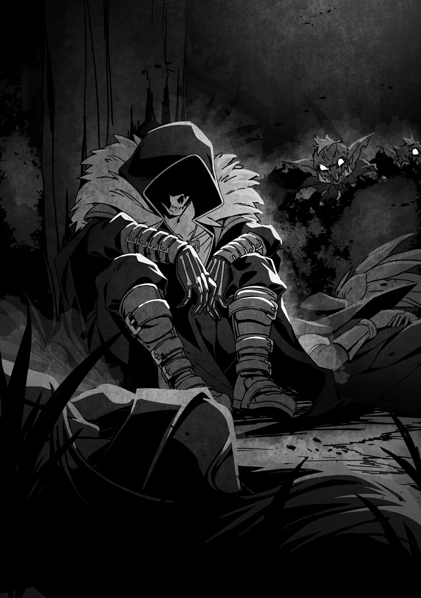

# Chương 233: Tập 10 Chương 3 - Công Việc Cùng Augurey (3)

Trong bữa tối, Lorraine kín đáo kiểm tra xem Yattul có gì bất thường không rồi kết luận rằng bác ấy có dấu hiệu bị chuốc thuốc. Tôi tuy cũng từng học nghề thầy trị liệu và có thể đoán ra loại thuốc nếu được trực tiếp xem xét triệu chứng, nhưng muốn làm thế mà không chạm vào người bác ấy thì đòi hỏi hiểu biết ma thuật rất sâu, nên Lorraine mới là người đứng ra kiểm tra.

Sau khi nghe Lorraine miêu tả tình trạng của Yattul, tôi khoanh vùng những loại thuốc có khả năng được dùng rồi lén bỏ thuốc giải tương ứng vào phần món hầm của bác ấy. Dù đó là thứ thuốc gì thì dược tính của nó cũng chẳng mạnh cho lắm, thuốc giải đi kèm cũng nhẹ và hầu như không có tác dụng phụ, nên chắc bác ấy cũng chẳng nguy hiểm gì đến tính mạng. Trừ phi bác ấy vốn mang sẵn bệnh trong người thì mới đáng lo, chứ tôi nhớ Yattul từng bảo mình được trời phú cho thể chất khỏe khoắn, xưa nay chẳng nhớ nổi mình từng ốm đau lần nào, thành thử sẽ không sao đâu.

Ăn tối xong xuôi, Lorraine và Augurey bắt đầu ngấm cơn buồn ngủ rồi gà gật.

"Hai người cứ ngủ đi. Để tôi trông đống lửa cho," tôi nói rồi đưa mắt nhìn về phía đống lửa trại Lorraine nhóm lúc nãy.

"Được rồi. Cảm ơn anh," Lorraine đáp. "Chắc dạo này bận rộn quá nên mắt tôi cứ díu cả lại. Chúc anh ngủ ngon nhé."

"Vậy tôi cũng ngủ đây," Augurey góp lời. "Có biến gì thì cứ gọi tôi dậy nhé. Có khi tôi tự tỉnh được đấy, mà cũng có khi không biết gì luôn đâu." Anh ấy nhún vai, tìm một cành cây vừa tầm kê đầu làm gối rồi ngả lưng nằm xuống.

Người cuối cùng còn thức là Yattul dường như cũng bắt đầu gà gật.

"Bác cũng ngủ đi thôi, bác Yattul."

"Đâu có được, để ông chủ phải làm thế thì tôi áy náy lắm. Lẽ ra tôi mới là người phải gác đêm..."

Bác ấy rõ ràng vẫn đang tự trách mình và cố gượng thức vì trách nhiệm. Tôi không nghĩ bác ấy tính thức trắng cả đêm, chẳng qua muốn khách đi xe được nghỉ ngơi trước mà thôi. Riêng tôi thì có thể trụ vài ngày, thậm chí cả tuần không ngủ, và đây là một trong những điểm tiện lợi nhất kể từ khi biến thành quái vật. Đổi lại, có lẽ tôi cũng mất đi nhiều cơ hội được tận hưởng cảm giác thanh thản và nghỉ ngơi trong đời, nhưng với một mạo hiểm giả thì cái lợi vẫn lớn hơn cái hại nhiều.

Lorraine và Augurey ngủ ngay không phải vì vô tâm với tôi, mà vì hai người họ thừa hiểu tôi chẳng hề hấn gì. Khổ nỗi Yattul thì làm sao biết được chuyện đó. Thấy bác ấy còn chần chừ, tôi bèn khuyên thêm vài câu giục bác ấy đi nghỉ.

"Ngày mai mà thiếu ngủ làm ảnh hưởng đến việc đánh xe thì dở lắm. Nếu bác coi trọng công việc thì cứ yên tâm đi ngủ đi, ngủ một mạch tới sáng cũng được. Đêm nay tôi sẽ thay phiên với Augurey và Lorraine, ba người chia nhau canh chừng thì chẳng vất vả gì đâu."

Thực ra tôi định thức gác cả đêm, nhưng đành nói dối một câu vô hại để bác ấy khỏi ngờ vực.

Yattul nghe tôi nói có lý bèn gật đầu, dẫu nét mặt vẫn còn đôi phần ngập ngừng.

"Ông chủ nói phải. Hôm nay người tôi cứ lú lẫn thế nào ấy, thành thật xin lỗi vì đã gây ra mớ rắc rối này. Giờ tôi đi ngủ đây, để mai còn lấy sức chuộc lỗi..."

Nói xong, bác ấy liền ngả lưng nằm xuống.

◆◇◆◇◆

Yattul tuy đã nằm xuống nhưng vẫn còn thức, chỉ đang giả vờ ngủ mà thôi. Thương nhân Yattul, hay đúng hơn là điệp viên mang mật danh "Goblin", thực chất đang hành động theo mệnh lệnh từ cấp trên. Gã nhận chỉ thị tiếp cận ba mạo hiểm giả tên Rentt, Lorraine và Augurey tại vương đô, hứa đánh xe chở họ tới điểm đến và thực hiện lời hứa đó, rồi tìm cách trừ khử cả ba ngay trên đường đi.

Tuy chẳng thèm để tâm tới tên mạo hiểm giả Đồng Cấp, tay điệp viên đã được cung cấp kha khá thông tin về hai kẻ mang cấp bậc Ngân Cấp. Gã biết đây không phải phi vụ dễ xơi, nhưng khi đào sâu hơn, gã phát hiện Augurey chỉ mới lên Ngân Cấp gần đây, còn trước đó từng mắc kẹt ở hạng Đồng Cấp tại một thị trấn hẻo lánh.

Chưa hết, gã còn biết Lorraine vốn dĩ là học giả, được trao hạng Ngân Cấp chỉ nhờ vào những cống hiến học thuật. Nói trắng ra, đối với Yattul thì cô ta rõ ràng chẳng có thực lực tương xứng với một mạo hiểm giả Ngân Cấp thực thụ.

Bản thân Goblin có bản lĩnh ngang ngửa một mạo hiểm giả Ngân Cấp và từng trừ khử không ít kẻ ở thứ hạng này, nên dù biết nhiệm vụ không dễ nuốt, nó cũng chẳng vượt quá tầm tay. Gã cũng không hề chủ quan khinh địch trước bộ ba kia mà đã chuẩn bị chu toàn mọi bề, cốt sao quét sạch mục tiêu không để lại chút tăm hơi.

Còn về mật danh Goblin, nó bắt nguồn từ năng lực đặc biệt mà gã sở hữu. Ngoại hình gã quả thật có nét giống Goblin với dáng người thấp đậm và phảng phất nét hoang dã, song cái tên ấy chủ yếu đến từ việc gã có thể sai khiến Goblin và Hobgoblin ngay từ thuở mới lọt lòng. Khả năng này tương tự như một người thuần hóa quái vật, chỉ khác là gã bộc lộ nó từ lúc sơ sinh. Cha mẹ gã từng kể họ suýt đứng tim khi thấy một con Goblin lại gần đứa bé không người trông nom rồi bắt đầu chăm sóc nó, dẫu bản thân gã chẳng còn chút ký ức nào về chuyện đó.

Ở ngôi làng nhỏ nơi gã sinh ra, năng lực ấy là chuyện hết sức dị thường, và lời đồn nhanh chóng lan đi khắp nơi. Rồi một ngày nọ, có người từ vương đô tìm đến ngỏ ý muốn nhận nuôi gã. Cha mẹ gã nhận một khoản tiền đền bù kếch xù, còn gã thì được đưa về vương đô để lớn lên trong một môi trường lý tưởng.

Thuở đầu gã chỉ sai bảo được độc một con Goblin, nhưng những năm tháng huấn luyện tại nơi ở mới đã giúp gã mài giũa năng lực đến độ khống chế được cả tá Hobgoblin đã tiến hóa. Đúng thế, vụ quái vật chặn đường trước đó chẳng hề là ngẫu nhiên; chính Goblin đã dùng năng lực đặc biệt của mình để dàn xếp tất cả. Gã còn được rèn luyện đủ ngón nghề chiến đấu cần có của một điệp viên, đồng thời tôi luyện cơ thể kháng được nhiều loại độc tố và thuốc thang khác nhau.

Dĩ nhiên gã chẳng ngây thơ đến mức nghĩ vỏn vẹn một tá Hobgoblin có thể hạ gục được hai mạo hiểm giả Ngân Cấp. Mục đích cho chúng tấn công chỉ là để thử nắn gân bộ ba. Dù đã nắm thông tin sơ bộ về thực lực của họ, kinh nghiệm mách bảo Goblin rằng chỉ có tận mắt chứng kiến mới đáng tin cậy nhất. Gã từng thấy không ít điệp viên ngậm quả đắng chỉ vì quá dựa dẫm vào tin tức được mớm sẵn từ trước.

Chính vì thế gã mới xua bầy Hobgoblin xông vào, và kết quả thực tế cho thấy sự cẩn trọng của gã hoàn toàn đúng đắn. Thông thường ngay cả một nhóm ba người cấp bậc Ngân Cấp cũng phải mất một lúc mới xử lý xong cả tá Hobgoblin, đằng này bộ ba kia dọn sạch gọn ơ, thậm chí còn thong thả mổ xác thu hoạch Ma Tinh.

Dù vẫn thấy mình đủ sức thắng nếu đối đầu trực diện, gã vẫn cần đảm bảo hoàn thành nhiệm vụ. Gã chọn nước cờ hiểm độc mà chắc thắng hơn: tước sạch khả năng kháng cự của đám mạo hiểm giả rồi mới xuống tay. May sao gã đã cố tình rẽ nhầm đường từ trước và khéo léo sắp đặt việc hạ trại qua đêm. Gã còn chuẩn bị sẵn phần lương khô tẩm thuốc ngủ loại nặng, đủ sức đánh gục cả quái vật to gấp năm lần con người.

Goblin vốn tính cho nhóm mạo hiểm giả ăn chỗ lương khô đó, đợi họ ngủ say rồi ra tay hạ sát—hay đúng hơn là để lũ Goblin giết họ—nhưng kế hoạch ấy cũng chệch hướng. Một kẻ trong nhóm lại chuẩn bị chu đáo đến kỳ lạ, lôi cả dụng cụ nấu nướng từ túi ma thuật ra nấu một nồi món hầm. Nhưng Goblin đâu dễ bỏ cuộc, gã đã lén dốc chỗ thuốc ngủ dự phòng vào nồi. Đám mạo hiểm giả ăn món hầm xong, hai kẻ Ngân Cấp quả nhiên lăn ra ngủ say như chết.

Chỉ phiền nỗi thuốc mãi vẫn chưa thấy phát huy tác dụng lên tên Đồng Cấp. Chắc tại lúc nãy vội quá nên chưa kịp bỏ đủ liều. Có điều đây cũng chỉ là vấn đề thời gian. Trước sau gì tên kia cũng gục xuống, và lúc đó gã sẽ ra tay thủ tiêu gọn gàng cả ba.

Goblin nằm im, nóng lòng chờ thuốc phát tác.

◆◇◆◇◆

Trời sáng mất rồi, Goblin thầm nghĩ khi rặng núi đằng xa bắt đầu le lói ánh rạng đông màu cam vàng.

Làm sao có thể như thế được? Câu trả lời kỳ thực hết sức đơn giản: mạo hiểm giả Đồng Cấp Rentt vốn dĩ chẳng bao giờ ngủ.

Rõ ràng tên mạo hiểm giả kia đã ăn món hầm bị hạ độc, mà liều lượng gã dốc vào thừa sức gây mê cực nặng, ấy thế mà hắn thức trắng cả đêm chẳng thèm ngáp lấy nửa cái. Goblin nín thở dõi theo, thầm đếm từng giây từng phút xem liệu hắn sẽ gục vào lúc này, lúc sau, hay chốc nữa... cứ thế cho tới khi đêm tàn.

Chuyện không tưởng đã xảy ra, và Goblin chỉ muốn hét lên đòi câu trả lời từ một ai đó, bất kỳ ai cũng được. Phải chăng gã đã không khuấy đều nồi món hầm khi vội vàng lén bỏ độc vào? Hay là Lorraine với Augurey đã húp sạch phần lớn chỗ thuốc, thành thử chẳng còn giọt nào cho Rentt?

Chuyện đó không phải không thể xảy ra, nhưng Goblin nhớ mồn một rằng... Không, gã bỗng khựng lại, ngẫm lại. Sự thật là những gì mắt thấy tay sờ, những gì có thể kiểm chứng rõ ràng. Gã phải giữ vững nguyên tắc sống đó của mình.

Rentt không hề ngủ. Đó là sự thật không thể chối cãi. Mưu kế của Goblin đã đổ sông đổ bể, song giờ gã có muốn thay đổi cũng chẳng được. Huống hồ, đó đâu phải con bài duy nhất gã nắm trong tay. Goblin chẳng tự phụ đến mức nghĩ mình có thể đơn thương độc mã giải quyết êm thấm mọi chuyện ngay từ lần ra tay đầu tiên. Thứ duy nhất có ý nghĩa là kết quả sau cùng.

Trước mắt, gã đành tạm hài lòng với chiến thắng nhỏ nhoi là ép được một kẻ trong nhóm phải thức gác cả đêm, ít nhiều cũng bào mòn được thể lực của Rentt. Bụng gã vốn muốn nhắm vào hai tên Ngân Cấp hơn, ngặt nỗi Rentt chẳng hiểu sao không hề lay người nào dậy. Goblin từng thoáng chột dạ lo bộ ba đã đánh hơi thấy điều bất thường, nhưng rồi mau chóng gạt phăng ý nghĩ đó. Nếu phát hiện ra, đời nào họ chịu để gã kè kè bên cạnh. Họ hoàn toàn có thể bỏ mặc gã làm mồi cho quái vật rồi tự mò mẫm đi tiếp. Còn chuyện vì sao Rentt không gọi đồng đội dậy thay ca, gã chỉ đoán rằng do hai kẻ kia có sức chiến đấu mạnh hơn, nên Rentt mới muốn họ được nghỉ ngơi trọn giấc.

Chuyện các mạo hiểm giả lệch cấp bậc lập đội với nhau vốn không hiếm, song kẻ bậc thấp thường sẽ tự nguyện gánh vác việc vặt quanh chỗ hạ trại để bù đắp khoảng cách về thực lực chiến đấu. Có thể do họ chịu áp lực không muốn thành gánh nặng ăn bám, hoặc thực lòng tin việc mình làm là vì lợi ích chung của cả nhóm. Đó dĩ nhiên là cách vận hành đội ngũ hiệu quả nhất, và chừng nào các thành viên còn hòa thuận thì mọi chuyện vẫn cứ êm xuôi. Đi cùng nhau càng lâu thì tổ đội càng dễ nảy sinh rạn nứt, song nhóm của Rentt xem chừng chẳng có chút bất hòa nào như thế, nên chuyện Rentt để hai người kia ngủ cũng là điều dễ hiểu.

Như để chứng thực cho suy đoán ấy, vừa thấy xe lăn bánh là Rentt liền ngả lưng xuống đánh một giấc. Cả đêm thức trắng canh chừng chắc hẳn đã vắt kiệt sức lực của hắn.

Ít ra vẫn có vài việc đi đúng kế hoạch, vả lại trước đây Goblin cũng từng thực hiện nhiều nhiệm vụ ban đầu chẳng mấy suôn sẻ, nên gã vẫn chưa quá nao núng... ít nhất là vào lúc này.

◆◇◆◇◆

"Sao rồi? Giờ tính sao đây, Rentt?" Lorraine kín đáo phủ một lớp Cách Âm Kết Giới quanh nhóm rồi hỏi.

Lớp kết giới được dựng khéo léo đến độ ngay cả tôi, vốn cực kỳ nhạy bén với Ma Lực, cũng chỉ lờ mờ cảm nhận được bức màn mỏng vô hình đang bao bọc cả nhóm. Đây quả là một ma pháp tiện lợi vì cách âm tuyệt đối cho không gian bên trong. Dĩ nhiên một ma pháp sư bình thường khó mà thi triển nổi, chúng tôi có sẵn để dùng hoàn toàn là nhờ Lorraine. Dù thế nào đi nữa, dám chắc một người bình thường sẽ chẳng mảy may nhận ra đang có kết giới bao quanh.

Bằng chứng là Yattul chẳng hề nhúc nhích lấy một ngón tay khi Lorraine cất tiếng. Nếu gã đang giả vờ làm ngơ thì đúng là đủ tài để đi làm diễn viên kịch nghệ chuyên nghiệp rồi đấy. Nhưng nhìn cái bộ dạng lén lút vụng về lúc gã bỏ thuốc vào nồi món hầm, tôi không nghĩ gã đủ bản lĩnh để vô hiệu hóa Cách Âm Kết Giới này đâu.

"Còn tính sao nữa?" tôi đáp. "Xe đang quay lại đúng tuyến đường rồi, tôi thấy cứ để thế là ổn."

Tôi tiện tay nhặt chiếc mũ trên sàn xe úp lên mặt để vờ như đang say ngủ. Tôi còn giấu luôn Bản Đồ Akasha vào bên trong, nhờ thế mà liên tục nắm rõ vị trí hiện tại của cả nhóm.

Cách đây không lâu, tôi mới phát hiện vật phẩm này không chỉ dùng để vẽ bản đồ mê cung. Trong lúc táy máy nghịch ngợm, tôi đã vô tình mở ra bản đồ thế giới. Biết đâu chừng nó còn những tính năng ẩn khác nữa, nhưng ngay cả tính năng bản đồ thế giới cũng ngốn của tôi khối thời gian mới mò ra, nên nếu còn công dụng nào khác thì chắc cũng phải tốn công tìm hiểu lắm.

Nói thêm thì tính năng bản đồ thế giới khác bản đồ mê cung ở chỗ nó hiển thị được vị trí hiện tại của chúng tôi dù tôi chưa từng đi khắp thế giới bao giờ. Có điều, cũng giống bản đồ mê cung, nó chỉ đánh dấu tên các thị trấn và khu định cư mà đích thân tôi từng đặt chân tới. Xem ra muốn dùng thành thạo bất kỳ món đồ nào cũng chẳng dễ dàng gì. Dù vậy, chừng này thôi cũng đã quá đỗi hữu dụng rồi, nhất là trong hoàn cảnh lúc này.

"Hai người bình chân như vại gớm nhỉ. Rõ ràng là gã đang làm việc cho kẻ nào đó. Theo tôi thì cứ bắt lại rồi tra khảo càng sớm càng tốt," Augurey vừa nói vừa nở nụ cười thân thiện, có điều giọng điệu châm chọc lại trái ngược hẳn với vẻ mặt ấy, tạo nên sự tương phản đến lạnh người.

Lorraine lúc nãy cũng vừa nói bằng cái giọng y hệt, khiến tôi thầm nể tài diễn kịch của cả hai. Riêng tôi thì đỡ được cái gánh nặng ấy nhờ có chiếc mũ úp trên mặt. Không phải tôi không diễn được nếu muốn, chỉ là cách giấu biểu cảm kiểu này đỡ tốn sức hơn nhiều.

"Có tra khảo gã ngay lúc này cũng chẳng lấy gì đảm bảo gã sẽ nhả hết mọi chuyện," Lorraine phản bác. "Gã mà khai nửa nạc nửa mỡ để chúng ta ôm một mớ thông tin mập mờ thì chỉ tổ rước thêm rắc rối về sau. Chúng ta cần nắm rõ tình hình hơn đã. Việc gã vẫn bám theo nhóm mình, kể cả khi đã nghi ngờ chúng ta đánh hơi thấy điều bất thường, chứng tỏ gã sắp sửa giở thêm trò mới. Tốt nhất là chờ đồng bọn của gã tự chui đầu ra. Khi ấy, dù có lỡ tay dọn bớt vài tên thì chúng ta vẫn moi được chút tin tức."

"Nhiều lúc cô làm tôi thấy ớn lạnh thật đấy, Lorraine," Augurey khẽ rùng mình thừa nhận, nhưng anh ấy không hề phản đối cách tính toán của cô ấy, chứng tỏ cũng thấy nó hoàn toàn có lý.

"Lorraine chỉ lộ đúng bản tính thôi mà. Cô ấy là kiểu học giả sẵn sàng liều cả mạng sống để theo đuổi tri thức đấy," tôi chen vào.

"Thế thì lại càng đáng sợ hơn. Nhưng tôi chẳng cãi lại lý lẽ của cô được, Lorraine à. Thôi thì cứ tiếp tục diễn kịch, làm một lũ ngây thơ dễ bị dắt mũi xem sao."
