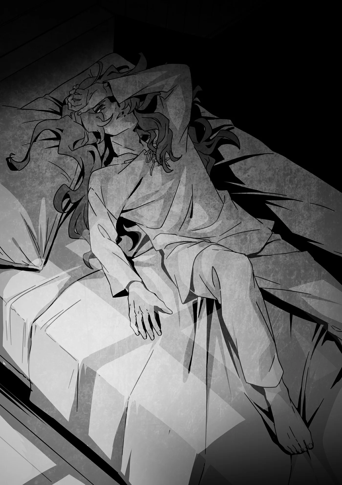

# Chương 236: Tập 10 Chương 4 - Đến Nơi (2)

Trở về quán trọ, chúng tôi ai nấy về phòng nấy. Ban đầu cả nhóm đã bảo với chủ quán là chỉ cần một phòng là đủ cho cả ba, nhưng ông ấy lại xếp cho ba phòng với cùng mức giá vì làng hẻo lánh nên phòng trống còn thừa nhiều. Vả lại, ông cũng bảo quán chẳng có phòng nào kê ba giường, nên thu xếp một phòng cho cả nhóm còn phiền hơn là cho mỗi người một phòng trống—tất cả đều được nói bằng cái giọng tỉnh rụi đặc trưng của mấy ông chủ quán trọ nơi hẻo lánh.

Vừa bước vào phòng, Augurey Ars tắt đèn rồi ngả lưng lên giường. Mắt anh vẫn nhìn rõ mọi thứ xung quanh, có lẽ vì chuyến phiêu lưu cùng đám bạn cũ khiến anh còn bồn chồn háo hức. Anh nhìn đăm đăm lên mấy vệt ố trên trần nhà. Thoạt nhìn chúng như những khuôn mặt, rồi dần hiện ra thành gương mặt của những người quen cũ. Những gương mặt ấy làm anh nhớ về quê nhà, nơi chẳng có lấy một thứ gì níu giữ chân anh.

Có thể với người khác, thị trấn ấy rất có ý nghĩa, nhưng với Augurey thì không. Anh đã quá ngán cái đám người tự phụ, khăng khăng không chịu tìm kiếm những hướng đi mới. Anh không chịu nổi cảnh tâm hồn mình dần mục ruỗng ở cái xó ấy, nên mới dứt áo làm mạo hiểm giả. Nghe chuyện này, đám người quen cũ hẳn sẽ khịt mũi coi thường, chế giễu anh chỉ rước hoài công phí sức. Nhưng Augurey chẳng thèm để bụng. Đằng nào họ cũng có hiểu cho anh đâu. À, nói thế chứ vẫn có một người hiểu.

"Ông..."

Augurey tự hỏi chẳng biết ông còn sống hay không. Ngày dứt áo ra đi, anh từng thề sẽ không bao giờ quay về chốn ấy, thế mà giờ đây, anh lại thấy có lẽ mình có thể về được.

Khi trò chuyện cùng Rentt và Lorraine, anh bắt đầu nhận ra việc hiểu rõ gốc gác của mình quan trọng đến mức nào. Ngay cả lời thề không bao giờ trở lại quê nhà ngày trước xem ra cũng giống một cái cớ để chạy trốn hơn là sự kiên định sắt đá.

Biết đâu giờ đây...

"Mình có thể về thăm ông. Đi cùng Rentt và Lorraine..." Augurey lẩm bẩm, mí mắt anh trĩu nặng dần rồi chìm hẳn vào giấc ngủ.

◆◇◆◇◆

Nghe tiếng gõ cửa, Augurey mở mắt. Thực ra anh đã thức giấc từ trước đó chốc lát, nhờ cảm nhận được có người đang tiến về phía phòng mình. Nếu không có bản năng nhạy bén ấy, anh đã chẳng thể đi xa đến thế trên con đường của một mạo hiểm giả Ngân Cấp.

Kỳ sát hạch Đồng Cấp vốn đã khó, nhưng lên tới Ngân Cấp thì độ khốc liệt vượt xa gấp bội. Đã từng có lần, ngay cả bạn đồng hành cùng Augurey đi thám hiểm mê cung cũng định trở mặt ám hại anh trong lúc ngủ say. Anh sẽ không đời nào leo lên nổi Ngân Cấp nếu thiếu đi trực giác đánh thức mình dậy ngay khi mối nguy vừa chớm xuất hiện.

Có những kẻ vượt qua mọi thử thách bằng sức mạnh cơ bắp, nhưng Augurey thì không chuộng lối đó. Anh chuẩn bị đâu ra đấy và vượt qua kỳ sát hạch Ngân Cấp theo đúng bài bản. So với những thử thách ấy, việc nhận ra một người đang bước dọc hành lang mà chẳng buồn che giấu hành tung chỉ là chuyện quá đỗi bình thường đối với anh.

Augurey trở dậy, bước lại gần cửa. Liếc qua cửa sổ, ngoài trời vẫn đen đặc, chẳng có lấy một tia sáng rạng đông. Đang giữa đêm hôm khuya khoắt thế này, dẫu trước đó có le lói chút kỳ vọng, giờ Augurey cũng chẳng mong vị khách ngoài kia là người đàng hoàng.

Augurey hết sức cảnh giác, cất tiếng hỏi qua cánh cửa: "Ai đấy?"

Anh cố giữ giọng thật bình thản, và sẽ chẳng ai nhận ra chút dao động nào trong giọng anh—họa chăng chỉ có Rentt. Augurey hình dung ra cảnh Rentt sẽ hỏi anh có đang căng thẳng không. Rentt lúc nào trông cũng như đang thả hồn trên mây hoặc chẳng bận tâm chuyện gì, nhưng thực ra luôn dõi mắt tinh tường quan sát xung quanh. Augurey biết tỏng cái tính đó của Rentt, chỉ có điều người đang đứng bên kia cửa lúc này lại không phải cậu ấy.

Thực ra, giọng vị khách không mời nghe có phần hồi hộp, nhưng lại chẳng có vẻ gì là khả nghi.

"Ừm... là em, Ferrici đây. Anh... còn nhớ em không?"

Augurey nhận ra giọng cô gái, rồi sực nhớ Ferrici trông trạc mười bảy mười tám tuổi. Anh tự hỏi liệu cô có phật ý nếu bị xem là trẻ con không. Tầm tuổi đó đã đủ để kết hôn, thậm chí ở cái làng hẻo lánh này, người ta còn mong con gái lấy chồng trong một hai năm tới. Nghĩ vậy khiến Augurey thấy gờn gợn, nhưng anh sẵn sàng tôn trọng tập tục địa phương.

Tự dặn mình rằng đang nói chuyện với một cô gái, Augurey đáp: "Lúc nãy mình nói chuyện ở quán rượu rồi nhỉ, dù tôi chẳng góp lời được bao nhiêu. Em cần tôi giúp gì à? Nếu muốn kể chuyện về lũ Phi Long thì để tôi sang gọi hai người kia dậy."

Augurey nhớ chủ quán rượu từng bảo Ferrici rành Hồ Petorama như lòng bàn tay, và qua cuộc trò chuyện với Lorraine thì quả thực cô biết vài điều cốt yếu về loài Phi Long. Anh không nghĩ Ferrici lại quay ngoắt thái độ sau khi vừa cự tuyệt những câu hỏi hết sức nhã nhặn của Lorraine, nhưng xem chừng có điều gì đó đã khiến cô đổi ý.

"Không, em... muốn nói chuyện riêng với anh cơ, Augurey. Anh mở cửa cho em được không?"

Hóa ra là cô nàng để ý mình. Augurey đâu có ảo tưởng đến mức vội vàng kết luận như thế, dẫu ở mấy làng hẻo lánh thì mạo hiểm giả cũng có giá lắm. Họ kiếm tiền nhiều hơn phần lớn những nghề khác, lại thêm mạo hiểm giả Đồng Cấp chỉ cần một tay cũng thừa sức dẹp yên hầu hết hiểm họa quanh vùng. Tính đi tính lại, mạo hiểm giả quả là đối tượng sáng giá trong mắt các cô gái thôn quê. Có điều, tính khí thô lỗ cộc cằn cùng mối nguy một đi không trở lại khiến phụ nữ nhìn họ bằng hai con mắt hoàn toàn trái ngược. Hoặc là sống chết bám lấy, hoặc là tránh xa như tránh tà. Chẳng loại trừ khả năng Ferrici thuộc phe muốn bám lấy, nhưng thời điểm này lại có vẻ sai sai.

Chí ít trong ba người bọn họ, Augurey cũng hiểu vì sao mình lại là ứng viên sáng giá nhất trong mắt một cô gái muốn tìm ý trung nhân, khi hai người còn lại là một phụ nữ và một gã quái đản đeo mặt nạ đầu lâu. Nghĩ đến việc bản thân ăn mặc sặc sỡ chẳng khác nào con công xòe đuôi, anh hoàn toàn có quyền nghi ngờ gu thẩm mỹ của bất kỳ cô nàng nào nhắm trúng mình. Dù vậy, anh cũng công nhận rằng mạo hiểm giả nói chung khá lắm thì cũng toàn phường lập dị, nên các cô gái khi đã tìm kiếm người trong giới này thì cũng sẵn lòng nhắm mắt bỏ qua vài nét kỳ quặc.

Bao ý nghĩ vẩn vơ xoay mòng mòng trong đầu, Augurey với tay về phía cửa, tự hiểu rằng có nghĩ ngợi bao nhiêu cũng vô ích chừng nào chưa mở ra. Anh xoay nắm đấm, cánh cửa khẽ kẽo kẹt mở ra.

"Ờm... em xin lỗi..."

Sau cánh cửa mở ra đầy hồi hộp đúng là Ferrici, cô gái ở quán rượu ban nãy.

"Không sao đâu. Em có chuyện quan trọng muốn nói với tôi đúng không? Cứ vào phòng đi đã."

Ferrici gật đầu, má ửng hồng, rồi lặng lẽ bước vào phòng.

◆◇◆◇◆

Bước vào phòng, Ferrici ngồi xuống mép giường nơi Augurey vừa ngả lưng ban nãy. Cô khẽ thở dài, một tiếng thở dài mà hầu hết đàn ông hẳn sẽ thấy quyến rũ đến lạ lùng. Ngay cả bộ đồ trên người cô cũng...

"Ferrici, trông em có vẻ khang khác so với lúc ở quán rượu đấy."

"A-Anh thấy thế thật sao? Ừm... Trông em thế nào hả anh?" Ferrici hỏi, chỉ khẽ ngước mắt lên nhìn anh.

Augurey thầm nhận cử chỉ ấy trông cũng đáng yêu thật. Dù vóc người hơi gầy gò vì thiếu thốn ăn uống ở làng quê, cơ thể cô rõ ràng đã hoàn toàn trổ mã như một thiếu nữ trưởng thành. Lúc này, cô lại đang ngồi ngay mép giường của một người đàn ông trong tư thế hết sức gợi cảm. Dù có vô tâm hay ngờ nghệch đến mấy cũng chẳng ai có thể bỏ qua ám hiệu này. Bộ đồ vải lanh thô sơ đã được thay bằng chiếc váy đầm vừa vặn tựa như của một tiểu thư vương đô, dù kiểu khoét vai kia có phần hơi lộ liễu nếu đặt vào một thời điểm hay nơi chốn khác.

"Tôi dám cá gã đàn ông nào trong làng nhìn thấy cũng sẽ bảo em quyến rũ lắm đấy. Trông em đẹp lắm, Ferrici."

Lời tán thưởng của Augurey làm nụ cười rạng rỡ từ từ nở trên gương mặt cô gái. Ferrici đứng dậy khỏi giường, bước lại gần anh hơn. "Thật hả anh?! Ôi, may quá. Em cứ lo là... anh sẽ nghĩ em bạo dạn quá mức." Cô nép sát vào người anh, vòng tay ôm lấy anh—cái ghì nhẹ quanh eo cho thấy rõ vóc dáng mảnh dẻ của cô.

"Bạo dạn ư? Sao em lại nghĩ thế?" Augurey hỏi.

Lại ngước mắt lên nhìn anh, cô chậm rãi nói: "Vì... em..." Một cánh tay cô rời khỏi eo Augurey. "Em sắp làm anh đau lắm đấy."

Dứt lời, cánh tay Ferrici vung mạnh trở lại, nhắm thẳng sườn Augurey. Khóe mắt anh bắt trọn một vật bằng bạc được nắm chặt trong tay cô—một con dao găm. Cô đang vung nó với ác ý rõ rành rành nhắm vào Augurey.

Ở cự ly sát sạt lại bị kìm giữ trong vòng ôm như thế, hầu hết đàn ông đều sẽ bị đâm trúng mà không kịp trở tay. Nhưng Augurey là một mạo hiểm giả, lại còn là Ngân Cấp—cấp bậc minh chứng cho tài năng xuất chúng trong giới của họ. Chỉ riêng việc mắt anh bắt kịp đường đâm chớp nhoáng của lưỡi dao đã đủ thấy đòn này còn lâu mới làm hại được anh. Gần như ngày nào Augurey cũng phải va chạm với những quái vật phóng nhanh hơn thế, hay những toán cướp bắn ma pháp lén lút từ chỗ không ai ngờ tới.

Augurey hóa giải đòn đâm liều lĩnh của cô gái khi tóm chặt lấy cổ tay cô rồi siết một lực vừa đủ làm cô đau nhói mà không để lại vết hằn, khiến con dao rơi tuột khỏi tay.

Mọi sự kháng cự của Ferrici lúc này rõ ràng là vô vọng, nhưng cô chẳng hề chịu ngoan ngoãn thúc thủ. Ngược lại, cô bắt đầu rú rít rồi giãy giụa dữ dội, chẳng còn chút dáng vẻ thiếu nữ như lúc ở quán rượu hay vừa nãy, mà y hệt một con thú dại.

Nhận ra điều gì đó bất thường ở cô gái, Augurey khẽ giật nhẹ kéo cô về phía mình khiến cô chới với, để lộ chiếc gáy thon thả. Anh nhanh như cắt chặt sống bàn tay vào cổ cô; một đòn tưởng chừng nhẹ tênh nhưng đủ để tước đi ý thức của Ferrici, làm cô đổ sụp xuống.

Augurey đỡ lấy dưới hai nách cô trước khi cô ngã nhào xuống sàn. Thấy cô đã ngất lịm hoàn toàn, anh cẩn thận đặt cô nằm lên giường. Anh rút cuộn dây thừng trong túi đồ nghề ra trói Ferrici lại, chêm thêm mấy mảnh vải vụn để dây không thắt lại vết hằn trên da. Làm thế này thì dẫu có tỉnh lại, cô cũng chẳng thể tấn công anh được nữa.

"Coi như tạm xong việc này, nhưng mà..."

Liệu cô ta có phải là Siren không? Ý nghĩ đó thoáng qua đầu Augurey. Trông thì có vẻ anh đã làm chủ tình thế, nhưng có vài điểm kỳ quặc đập ngay vào mắt. Trước hết là đòn tấn công này quá vụng về. Mỹ nhân kế là đòn hiểm xưa nay chưa bao giờ hết công hiệu, chẳng thể xem nhẹ trước tần suất đàn ông sập bẫy. Họ khó mà cưỡng lại được, bởi đó là bản tính tự nhiên rồi. Việc ngón nghề này là sở trường của Siren hoàn toàn dễ hiểu.

Nếu Augurey không đề phòng trước việc có người tiếp cận, khéo anh còn nghiêm túc nghĩ Ferrici phải lòng mình thật. Biết đâu đòn tấn công này cũng chỉ đơn giản đến thế. Nhưng nếu đó là chủ đích ngay từ đầu, Ferrici hẳn đã phải bạo dạn hơn khi ở quán rượu, ít nhất cũng phải tỏ ra đoái hoài đôi chút đến anh. Đằng này lúc ấy, cô chẳng hề có lấy một cử chỉ nào nhắm vào anh.

Thế mà giờ cô lại mò đến tận đây. Chuyện đó thật vô lý, và việc Ferrici yếu ớt đến thế cũng kỳ quặc không kém. Siren hẳn phải được huấn luyện bài bản như một điệp viên phá hoại, nghĩa là chiến lực không thể xem thường. Cô ta chí ít cũng phải đủ mạnh để một mình vượt qua quãng đường từ chỗ trong rừng nơi Rentt nghe lén bọn chúng, né tránh quái vật lẫn thảo khấu dọc đường để tới tận ngôi làng này.

Ngược lại, sức vóc của Ferrici hoàn toàn chỉ như một cô thôn nữ bình thường, còn cách cô cố đâm Augurey thì non nớt trăm phần trăm, từ tư thế cầm dao cho đến cái cách vung tay ra sau lấy đà trước khi đâm. Nếu ở vị trí của cô, Augurey chỉ việc đâm thẳng con dao tới. Đòn đó nhanh hơn mà lại thừa lực để làm rách da thủng thịt người. Cái động tác vung tay lấy đà kia hoàn toàn là thừa thãi. Anh biết Rentt hay Lorraine cũng sẽ ra tay như vậy, thế mà Ferrici lại bỏ qua một thao tác căn bản đến thế.

Augurey cứ có cảm giác Ferrici không phải là Siren. Mà nếu không phải, cớ sao cô lại tấn công anh? Chuyện đó thì anh chịu. Anh cũng có vài giả thuyết trong đầu, nhưng chẳng có gì dám chắc.

Augurey kết luận tình thế này nhất thiết phải họp bàn với nhau. Bỏ mặc Ferrici lại một mình trong phòng, dù cô có phải Siren hay không, đều quá đỗi phiêu lưu, nên Augurey vác cô lên vai rồi đi sang gõ cửa phòng Rentt và Lorraine.

◆◇◆◇◆

Hành lang quán trọ dựng chủ yếu bằng gỗ cũ, nom cũng khá ấm cúng. Mấy ngọn nến mỡ gắn trên tường tỏa ánh sáng tù mù cùng thứ mùi gây gây nồng nặc. Thứ mùi này dân làng quê với mạo hiểm giả đã quen thuộc từ lâu, nhưng Augurey đoán dân thành thị hẳn sẽ thấy hơi khó ngửi. Ở Maalt người ta cũng hay dùng nến mỡ, nhưng trên vương đô thì loại nến sáp thực vật đắt tiền lại chuộng hơn. Còn tại những nơi sang trọng như quán trọ cao cấp hay tiệm may danh tiếng, người ta thắp sáng bằng ma cụ để tránh hỏa hoạn, và dĩ nhiên chi phí tốn kém hơn nến nhiều. Augurey khoái thứ ánh sáng dịu nhẹ của nến mỡ hơn, nhưng thú thật nếu không có cái mùi gây gây kia thì tốt biết mấy. Mùi cứ bám riệt lấy quần áo.

"Mà thôi, chịu vậy chứ biết làm sao," anh lẩm bẩm một mình khi dừng trước cửa phòng Rentt.

Augurey gõ cửa.

"Ai đấy?" Một giọng đáp lại, nghe có phần cảnh giác.

◆◇◆◇◆

Tôi cảm nhận được có người đang tiến lại gần phòng mình. Đặt vào tình cảnh của tôi lúc này, nếu có ai xộc vào thì tôi thật sự khó lòng giữ nổi tính mạng, nên khi tiếng bước chân khựng lại trước cửa rồi tiếng gõ vang lên, giọng đáp của tôi có phần hơi cộc cằn.

"Ai đấy?"

Nghe thấy giọng đáp lời bên ngoài, nỗi lo trong lòng tôi mới vơi bớt. Ý tôi là, đó là một giọng nói quen thuộc.

"Tôi đây, Augurey này. Biết là khuya rồi nhưng tôi có chuyện cần bàn với cậu. Nếu được thì mở cửa cho tôi vào ngay nhé... Tôi sợ có người nhìn thấy."

Biết vị khách nửa đêm là ai khiến tôi an lòng, nhưng cái nỗi lo của Augurey nghe lạ lùng quá đỗi. Ở chốn thôn quê hẻo lánh này, chỉ cần sơ sẩy một bước là cả làng có thể biết tường tận chỉ sau một ngày, cơ mà đi lại dọc hành lang quán trọ lúc nửa đêm thì đâu đến mức bị coi là quái đản. Vậy mà giọng Augurey lại có vẻ...

Thôi kệ đi. Cửa thì tôi sẽ mở, nhưng hiển nhiên phải đánh tiếng trước với anh ấy một câu. "Được thôi, nhưng thấy cảnh trong phòng thì cấm có hoảng lên đấy. Nói trước là tôi hoàn toàn trong sạch nhé."

"Chuyện gì chứ tôi không đời nào nghi ngờ sự trong sạch của cậu. Nhưng tôi cũng phải nói trước một câu y hệt. Tôi cũng hoàn toàn trong sạch đấy."

Cuộc đối đáp ngắn ngủi ấy mách bảo tôi rằng cả hai đều vừa gặp phải chuyện rắc rối, mà nhiều khả năng còn cùng một giuộc với nhau.

Bỗng thấy nhẹ cả lòng—nghĩ cũng lạ khi rơi vào tình cảnh này, nhưng chí ít là cả hai đã ngầm hiểu ý nhau—tôi bảo: "Thế thì vào đi," rồi mở cửa.
