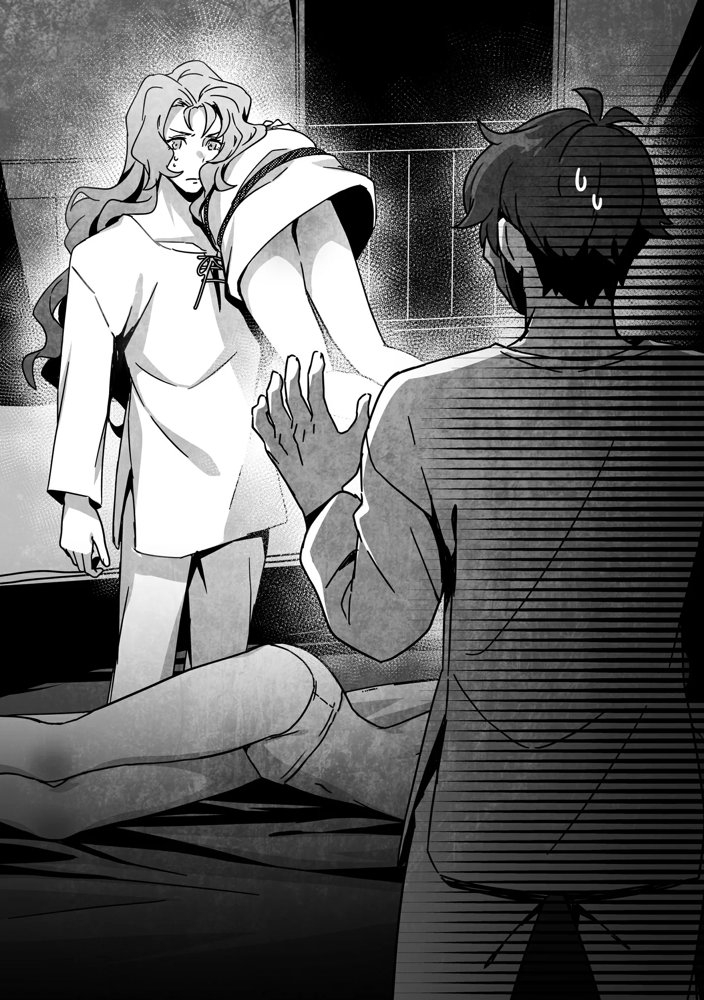

# Chương 237: Tập 10 Chương 4 - Đến Nơi (3)

"Ra vậy," Augurey bảo. "Chẳng trách cậu lại sợ người ta hiểu lầm đến thế." Anh ấy ra hiệu về phía thứ đang nằm sõng soài bên giường tôi.

"Anh cũng thế còn gì. Sao anh lại cuốn tròn cô ấy lại thế kia?" Nói chính xác hơn thì cô ấy đang bị trói gô, nhưng đó chỉ là chuyện câu chữ. Việc anh ấy chêm vải lót dưới dây thừng chứng tỏ Augurey lịch thiệp và chu đáo đến mức nào. Chẳng ai làm thế nếu chỉ đơn thuần bắt cóc cô gái rồi vác tới đây, dẫu vậy tôi cũng chưa từng nghĩ tới khả năng đó, nhất là với Augurey.

"Cậu biết rõ câu trả lời rồi còn gì? Cô ấy tấn công tôi đấy. Trông thế kia thì có vẻ bên cậu cũng gặp chuyện tương tự nhỉ."

Ánh mắt Augurey nhìn xuống thứ dưới sàn: một người phụ nữ chỉ mặc đồ lót. Dĩ nhiên khỏi phải nói, người đó tuyệt đối không phải là Lorraine. Nếu mà là cô ấy thì đã kéo theo cả đống rắc rối khác rồi, thôi tôi chẳng muốn bàn sâu làm gì.

Người phụ nữ này là một người bạn của Ferrici ở quán rượu ban nãy. Nhắc đến Ferrici mới nhớ, Augurey vừa đặt cô ấy nằm xuống giường tôi.

Để tôi giải thích đầu đuôi chuyện người bạn của Ferrici lại nằm dưới sàn phòng tôi trong bộ dạng thiếu vải thế này. Nửa đêm hôm khuya khoắt, cô ta bỗng tới gõ cửa phòng tôi, bảo có chuyện cần bàn bạc nên tôi mới cho vào. Tôi cứ ngỡ biết đâu cô ta nắm được bí mật nào đó về loài Phi Long hay vùng hồ, nhưng còn chưa kịp mở miệng hỏi han gì thì cô ta đã tự trút bỏ quần áo rồi sấn tới gạ gẫm tôi. Ngay sau đó, cô ta rút phắt một con dao ra. Tiếc cho cô ta, đâm chém tôi bằng cách thông thường thì thường chẳng mang lại kết quả như mong muốn đâu.

Tôi đã dùng Phân Liệt, chiêu thức dạo này tôi vẫn chăm chỉ luyện tập, để tách rời phần khung xương nơi người phụ nữ nhắm đâm tới, khiến mũi dao chỉ đâm vào không khí trước khi tôi đánh ngất rồi trói cô ta lại. Tôi chẳng chết được vì vài nhát dao, nhìn ngoài thì vết thương vẫn lành lại được, nhưng tôi thừa hiểu mọi thương tổn trên cơ thể mình rồi sẽ tích tụ lại. Tôi từng tận mắt thấy con Ma Cà Rồng ở mê cung mới tại Maalt dùng Phân Liệt lợi hại thế nào. Tôi chẳng dại gì để người phụ nữ này đâm trúng, dẫu tay dao của cô ta rõ ràng chỉ là dân nghiệp dư. Vừa trói xong rồi đặt cô ta xuống sàn để tính bước tiếp theo thì Augurey gõ cửa.

Tôi tóm tắt nhanh tình hình cho anh ấy nghe, rồi anh ấy cũng kể lại câu chuyện tương tự từ phía mình. Hai chúng tôi chỉ cần đưa mắt nhìn nhau là ngầm hiểu ý. Dù vậy, cả hai đều tuyệt đối không thốt ra cái tên Siren hay bất kỳ từ khóa nào. Biết đâu lại có kẻ áp tai nghe trộm sau vách tường thì sao. Giá có Lorraine ở đây thì cô ấy đã dựng được Cách Âm Kết Giới rồi, nhưng...

Nghĩ đến đó, tôi sực nhớ ra. "Nếu cả tôi lẫn anh đều bị tấn công, khéo Lorraine cũng gặp chuyện tương tự rồi đấy nhỉ?"

"Đã nhắm vào tôi với cậu thì chắc chắn là nhắm vào cả nhóm chúng ta rồi," Augurey đồng tình.

"Chúng ta nên qua xem cô ấy thế nào."

"Được thôi. Nhưng tính sao với hai người này đây?"

Chúng tôi nhìn hai người phụ nữ bị trói một lúc. Bỏ họ lại đây thì không ổn, mà vác cả hai trên vai cũng chẳng hay ho gì. Nhưng phương án để họ lại đây thì dứt khoát không được. Nếu hai người này chính là Siren hoặc đồng bọn của ả, họ sẽ chuồn mất. Còn nếu không phải, rất có thể họ sẽ bị diệt khẩu trong lúc chúng tôi vắng mặt. Dù thế nào cũng không thể để họ rời khỏi tầm mắt.

"Mang họ theo đi," tôi kết luận. "Một người vác còn một người đi trước dò đường ngoài hành lang thì chắc sẽ ổn thôi. Cùng lắm vạn bất đắc dĩ thì đành nói thật." Ý tôi là lỡ có chạm mặt chủ quán trọ hay khách trọ khác. Nói dối chuyện này chỉ tổ rước thêm phiền phức về sau.

"Người ta có tin không đấy?" Augurey hỏi.

"Tôi cũng chịu, nhưng còn cách nào khác đâu? Cầu cho đừng ai trông thấy là được." Tôi chỉ biết nói vậy thôi.

◆◇◆◇◆

"Không có ai, qua đây đi."

Sau khi ngó quanh khúc ngoặt hành lang thấy không có ai, tôi vẫy tay gọi Augurey. Mắt nhìn đêm của Augurey khá tốt, dù chẳng bằng tôi, nên anh ấy dễ dàng thấy tôi vẫy và bước lại gần. Tôi đi tới cuối dãy hành lang đó rồi lại làm như vậy lần nữa.

"Cứ thấy như chúng ta đang đi bắt cóc người ta ấy," Augurey lẩm bẩm, liếc nhìn hai cô gái trên vai.

"Chỉ còn cách này thôi. Sắp tới nơi rồi, đi nào." Tôi rẽ qua góc ngoặt, đứng trước cửa phòng Lorraine rồi vẫy tay gọi Augurey. Anh ấy vừa lê bước tiến tới thì...

Cửa phòng Lorraine mở ra. Tôi còn chưa kịp gõ, chắc là cô ấy tự mở. Lorraine thò đầu ra bảo: "Là anh à, Rentt. Đúng lúc lắm..." Đoạn cô ấy nhìn sang Augurey, người vẫn đang vác hai cô gái trẻ ăn mặc hớ hênh trên vai. "Ồ."

"Không, tôi... tôi giải thích được mà, Lorraine..." Augurey ấp úng, bối rối thấy rõ.

"Khỏi lo, tôi hiểu mà," cô ấy khẽ thở dài. "Cả hai vào đi."

Augurey lấy lại vẻ tự nhiên thường ngày khi bước vào phòng cô ấy, vai vẫn vác hai cô gái thiếu vải. Tôi ngó lại lần nữa xem ngoài hành lang có ai không rồi mới lách vào trong, cài chặt then cửa sau lưng.

◆◇◆◇◆

"Bọn tôi đoán bên cô khéo cũng tóm được một người," Augurey vừa nói vừa đặt hai cô gái trên vai xuống chiếc giường vốn đã có một người nằm sẵn. Khác với hai người bên chúng tôi, kẻ tấn công Lorraine bị khóa chặt cổ tay và cổ chân bằng những chiếc vòng ánh sáng, một ma pháp cấp rất cao theo như tôi đoán. Cả Augurey lẫn tôi đều chẳng đời nào thi triển nổi thứ ma pháp cỡ đó.

Ma pháp càng ở xa người niệm và duy trì càng lâu thì càng khó kiểm soát. Có ma cụ hỗ trợ thì còn đỡ, chứ tự thân duy trì một thuật thế này suốt thời gian dài lại khó hơn vẻ ngoài rất nhiều.

Nói cho rõ thì kẻ tấn công là một gã đàn ông. Mặt mũi khá ưa nhìn, trông hơi lạc lõng ở một ngôi làng hẻo lánh thế này. Những người có ngoại hình đẹp thường được đưa lên thành phố từ nhỏ. Không phải làm nô lệ hay gì, mà họ dễ có cơ hội học nghề hoặc được nhận nuôi hơn. Chắc ở những nơi vô pháp vô thiên thì cũng có người bị bắt làm nô lệ thật, nhưng tại Vương Quốc Yaaran, ít nhất là trên giấy tờ, chế độ nô lệ đã bị cấm. Ở đây không có chuyện buôn bán nô lệ công khai, còn những phi vụ lén lút thì họa chăng chỉ do mấy kẻ bệnh hoạn bày ra. Các đoàn kỵ sĩ và đội tuần binh đã cố hết sức, nhưng kiểu gì cũng có những tội ác lọt lưới.

"Chính xác," Lorraine bảo. "Thế nên dẫu Augurey có vác mấy cô gái thiếu vải trên vai và đi sau một người đàn ông đeo mặt nạ quái đản, tôi cũng chẳng bao giờ nghĩ có mấy kẻ buôn người đang định bắt cóc họ đem bán làm nô lệ đâu. Hơn nữa ở Vương Quốc Yaaran, dính vào nô lệ chỉ tổ rước họa vào thân chứ kiếm được bao nhiêu tiền đâu. Với hai anh, tiếp tục làm mạo hiểm giả vừa an toàn hơn mà kiếm lại bộn hơn nhiều."

Tôi chẳng rõ cô ấy đang cố an ủi chúng tôi hay muốn tỏ ý tin tưởng cả hai, dù nghe cứ như thể Augurey và tôi sẵn sàng lao vào buôn người miễn là kiếm được bộn tiền vậy. Lần này thì tôi khá chắc là Lorraine chỉ nói đùa. Dù sao thì...

"Hắn có gạ gẫm cô không?" Augurey hỏi, lờ đi lời nói đùa vừa rồi của cô ấy.

"Có. Hắn bảo có chuyện cần bàn. Tôi với hắn cũng nói được vài câu cho tới khi hắn định đè tôi xuống, thế là tôi tiện tay đánh ngất luôn bằng Gie Vieros."

Augurey rùng mình. "Khiếp thật. Đòn đó mà trúng trực diện thì đau điếng người đấy."

Gie Vieros là ma pháp cơ bản, chỉ đơn giản là bắn ra một cục đất. Chính vì thế, nó lại được xem là thước đo chuẩn xác cho thực lực của một ma pháp sư. Người tài năng như Lorraine thừa sức làm cho cục đất đó bắn thủng vài tấm kim loại. Tôi thử tưởng tượng uy lực của nó khi nã vào một gã dân làng bình thường, dù có bảnh bao hơn mức trung bình một chút.

"Này, hắn còn sống không đấy?" tôi buột miệng hỏi.

"Dĩ nhiên là còn sống rồi. Đến tôi còn biết giết người ngay đêm đầu tiên ở một ngôi làng bé tí thế này, vì bất cứ lý do gì, cũng là chuyện dại dột. Anh không thấy thế à?"

"À, ừ thì đúng thế."

"Chẳng cãi vào đâu được," Augurey góp lời.

Đó là kết luận hiển nhiên, mà dẫu không xét đến lẽ thường tình, chúng tôi vẫn còn nhiều lý do để giữ mạng cho những kẻ tấn công.

Lorraine lặng lẽ dựng Cách Âm Kết Giới rồi vào thẳng vấn đề: "Tôi nghĩ một trong số họ, hoặc cả ba người này, chính là Siren hoặc có cả Siren lẫn đồng bọn của ả. Hai anh nghĩ sao?"

Dù chúng tôi khá chắc ba người trên giường đã bất tỉnh nhân sự, Lorraine vẫn điều chỉnh ma pháp sao cho chỉ bao bọc ba người chúng tôi.

Yên tâm vì không sợ bị nghe lén, tôi đáp: "Hai bọn tôi cũng nghĩ thế. Nhưng nếu đã tóm được tới ba người thì bước đi tiếp theo lại đâm ra rối rắm đấy. Biết đâu vẫn còn những kẻ khác, và... cô có thấy chuyện này có gì đó bất thường không?"

"Có chứ. Khoảnh khắc hắn ra tay với tôi cứ như có ai vừa bật công tắc vậy. Đến tận trước lúc tấn công, trông hắn chẳng giống đang giả vờ chút nào, mà đúng hơn là..." Lorraine bỏ lửng câu nói, đưa tay xoa cằm.

"Người tấn công tôi là Ferrici đấy. Cô còn nhớ không?" Augurey chen vào.

"Cô gái người ta giới thiệu cho chúng ta ở quán rượu đúng không?"

"Phải. Cô ấy cũng lạ lắm. Ban đầu tôi không đánh ngất ngay đâu. Đến lúc bị tôi khống chế, cô ấy bắt đầu giãy giụa như thú dại, cứ như mất trí vậy. Trông chẳng giống người đang hành động theo ý mình chút nào."

Hóa ra là thế. Lorraine và tôi ra tay hạ gục kẻ tấn công khá nhanh, nhưng vẫn thấy có gì đó khang khác, như thể đối phương hoàn toàn không ý thức được việc mình đang làm. Cứ như họ là những con rối bị kẻ khác giật dây vậy. Vẫn còn quá sớm để khẳng định chắc chắn, nhưng chúng tôi phải làm cho ra nhẽ.

"Tôi không cảm nhận được ma thuật trên người họ, nhưng rất có thể là họ đang bị điều khiển đấy," Lorraine nói. "Chúng ta phải kiểm chứng giả thuyết này xem sao. Có nên gọi một người dậy không?"

"Có khi lại phát điên lên đấy," Augurey nhắc chừng.

"Chuyện đó thì chịu thôi. Mà có thế thật thì nếu không phải ma thuật, tôi cũng chẳng biết làm sao để giúp họ tỉnh lại. Khi ấy chỉ còn nước dùng vũ lực hay ma pháp đánh ngất họ lần nữa, rồi tóm sống ả Siren càng sớm càng tốt."

Cô ấy nói cũng phải.

"Thế thì chúng ta cứ vờ như chưa biết gì đi," tôi đề nghị. "Tôi không muốn để họ chạy mất đâu. Chúng ta cũng nên ra ngoài thám thính quanh làng nữa. Biết đâu còn có những người khác cũng bị biến thành thế này."

"Lỡ như cả làng đều bị thế thì sao?" Augurey lẩm bẩm.

Lorraine gật đầu bảo: "Ra thế. Chuẩn bị sân khấu. Có khi ý ả là biến cả làng này thành diễn viên."

Nghĩ vậy mà thấy gai cả người.

◆◇◆◇◆

Chúng tôi thử đủ mọi cách để đánh thức ít nhất một trong ba người, nhưng đều công cốc. Cả ma thuật lẫn sức mạnh cơ bắp đều không làm họ tỉnh lại được. Đến khi Lorraine tát hết sức bình sinh vào mặt kẻ tấn công mình, người trông có vẻ chịu đòn tốt nhất trong ba người, mà gã đàn ông còn chẳng buồn cựa quậy, Augurey và tôi chỉ biết trố mắt nhìn nhau. Cả hai nhanh chóng hiểu ra rằng dùng những cách thức thông thường để đánh thức họ chỉ tổ tốn công vô ích.

"Cú đó hơi mạnh tay rồi đấy. Vết hằn trên má hắn trông y như lá cây lymes vậy," tôi bảo. Nói thêm thì cây lymes là loài cây có lá to và mang hình dáng cỡ bàn tay người.

"Dù hắn có bị điều khiển hay không thì tôi cũng suýt bị giở trò đồi bại đấy. Tát một hai cái thì đã sao," Lorraine vặn lại. Nhưng vì không muốn chúng tôi hiểu lầm, cô ấy liền nói thêm: "Đùa vậy thôi, chứ có những thuật thôi miên mạnh đến mức phải có một cú sốc cỡ đó mới hóa giải được. Ma pháp của tôi không ăn thua nên tôi mới thử cách này. Với hai người phụ nữ kia thì đâu thể làm thế, nên tôi mới chọn hắn. Nếu hắn không dính dáng gì đến Siren, sau này giải thích rõ thì hắn sẽ thông cảm thôi."

Hóa ra cái tát của cô ấy không đơn thuần là trò xả giận bằng bạo lực. Tôi chẳng dám khẳng định chắc nịch rằng Lorraine sẽ không bao giờ làm trò đó, nhưng cô ấy vốn không phải tuýp người như vậy, nên nghe lý do này tôi thấy xuôi tai hơn hẳn.

"Thế thì tốt," tôi bảo. "Ý tôi là tình hình chẳng tốt tí nào, vì họ vẫn ngất lịm ra đấy. Tôi chỉ còn một nước tính... Phải tóm sống Siren thôi."

"Có vẻ là thế," Lorraine đồng tình. "Vấn đề là ả đang ở đâu? Ả là một trong ba người này, đang trốn trong làng, hay ở một nơi nào đó xa hơn? Thậm chí có khi ả đã cao chạy xa bay từ lâu rồi cũng nên."

Khả năng nào nghe cũng có lý, và thế thì công cuộc tìm kiếm của chúng tôi sẽ trầy trật lắm đây.

Augurey góp lời: "Tôi không nghĩ ả đã đi đâu. Chẳng đời nào ả bỏ đi mà không xem kết quả thế nào, vả lại gã Goblin vẫn còn lảng vảng ở đây. Trông có vẻ cả ba tên bọn họ bàn bạc và phối hợp với nhau. Nếu biết kế hoạch đổ bể, chắc chúng sẽ lại tụ họp lần nữa."

"Đúng vậy. Nước tệ nhất, dù ả có đi rồi thì chúng ta vẫn gặng hỏi gã Goblin về tung tích của ả được. Tôi đã đánh dấu gã rồi, nên gã đi đâu chúng ta cũng bám theo được."

"Đánh dấu" ai đó, như cách Lorraine thản nhiên buột miệng nói ra, chính là bám dấu đối phương bằng ma thuật. Khác với cách thông thường là chỉ dò tìm Ma Lực, việc đánh dấu ai đó bằng một câu thần chú đặc thù sẽ giúp ma pháp sư theo dõi họ dễ dàng hơn nhiều và ở cự ly xa hơn hẳn. Không nói thì ai cũng đoán được đây lại là một ma pháp cấp rất cao. Niệm không phát ra tiếng đã đủ khó, mà phạm vi truy vết của ma pháp còn phụ thuộc vào trình độ người niệm. Đã bảo có thể lần theo gã Goblin "bất kể" gã đi đâu, chứng tỏ Lorraine hoàn toàn tự tin có thể tìm ra gã trong một phạm vi cực kỳ rộng lớn. Một khi đã bị Lorraine tóm thóp, cô ấy sẽ rượt đối phương xuống tận đáy Địa Ngục. Nghĩ tới cảnh chính mình phải hứng trọn cơn thịnh nộ của cô ấy mà tôi thấy lạnh cả sống lưng.

"Còn một cách nữa là tra khảo gã Goblin ngay bây giờ," tôi đề xuất.

Xét việc Siren là đồng bọn, hẳn gã Goblin phải biết ả là ai và làm cách nào để đánh thức các nạn nhân khỏi cơn mê muội này. Dễ thấy đây là giải pháp nhanh gọn nhất, nhưng tôi đồ rằng cả hai người họ đều sẽ không ưng.

Như chứng thực cho suy nghĩ của tôi, Lorraine lắc đầu: "Nếu tra khảo gã bây giờ, chúng có thể đem Ferrici và những người khác ra làm con tin. Chúng ta vẫn phải vờ như chưa biết gì về mưu tính của gã Goblin. Trừ phi chấp nhận bỏ mặc các nạn nhân thì lại là chuyện khác, nhưng đó đâu phải là điều chúng ta có thể làm."

"Họ bị vạ lây cũng chỉ vì chúng ta có mặt ở đây," Augurey tiếp lời. "Tôi không nhẫn tâm đến mức mặc kệ tính mạng của họ đâu."

Thật ra tôi cũng chẳng định làm thế thật. Tôi chỉ muốn chắc chắn rằng cả nhóm đều có chung suy nghĩ mà thôi.

"Thế thì khó rồi đây," Lorraine bảo. "Hay là bắt đầu bằng việc... ra ngoài tìm thử xem? Biết đâu ả lại từ bụi cây nào nhảy bổ ra tấn công chúng ta cũng nên." Cô ấy nói đùa vậy thôi, nhưng cũng không hẳn là không có khả năng. Quanh đây thì nơi ẩn nấp duy nhất chỉ có bụi cây và mấy vạt rừng rậm.

"Chúng ta cũng phải xem tình hình những người khác trong làng nữa," Augurey tiếp lời. "Nhưng không thể bỏ ba người này ở đây được. Lorraine, cô trông chừng họ giúp nhé? Rentt với tôi sẽ ra ngoài thám thính. Nếu không thấy gì thì quay lại đây hội quân. Cô thấy sao?"

Lorraine và tôi ngẫm nghĩ một chốc rồi gật đầu đồng ý, cả hai đều hiểu lúc này chẳng còn lựa chọn nào tốt hơn.

"Tôi trông họ thì không sao, nhưng hai anh khiêng gã này sang ghế sofa được không? Hai cô gái kia mà tỉnh dậy thấy mình nằm chung giường với đàn ông thì khéo còn hoảng loạn hơn đấy," Lorraine bảo.

Ba người đang bất tỉnh nằm ngổn ngang trên giường. Tôi nghĩ bụng, vừa mở mắt ra mà thấy sát rạt mặt một người xa lạ, dù có bảnh bao đến đâu thì ai cũng phải giật bắn người.

"Chuyện nhỏ," Augurey đáp. Anh ấy xốc gã đàn ông lên lưng rồi vác ra ghế sofa.

Tôi làm việc đó cũng dễ như bỡn, nhưng tình cờ Augurey lại đứng gần hơn. Ngay cả trong giới mạo hiểm giả thì anh ấy cũng thuộc dạng vạm vỡ hơn vẻ bề ngoài nhiều, thế nên đừng bao giờ trông mặt mà bắt hình dong.

Đoạn, Augurey bỗng nghiêng đầu.

"Có chuyện gì vậy?" tôi hỏi.

"Tôi nhận ra... Ồ, thôi kệ đi. Chẳng có gì đâu," Augurey nói đầy ẩn ý rồi đặt gã đàn ông xuống.

Sau đó, chúng tôi để Lorraine ở lại trông ba người đang bất tỉnh rồi bước ra ngoài thám thính ngôi làng.
