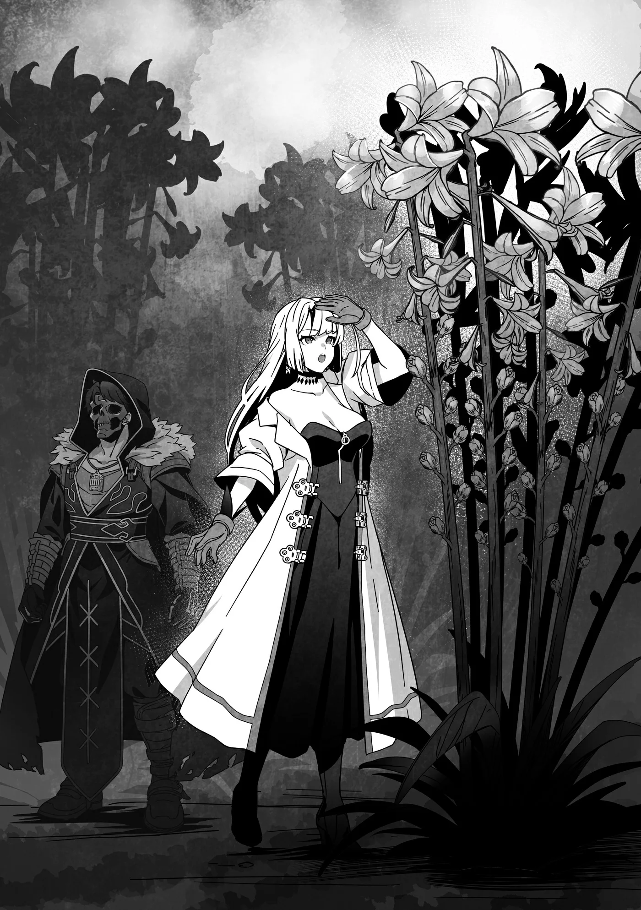
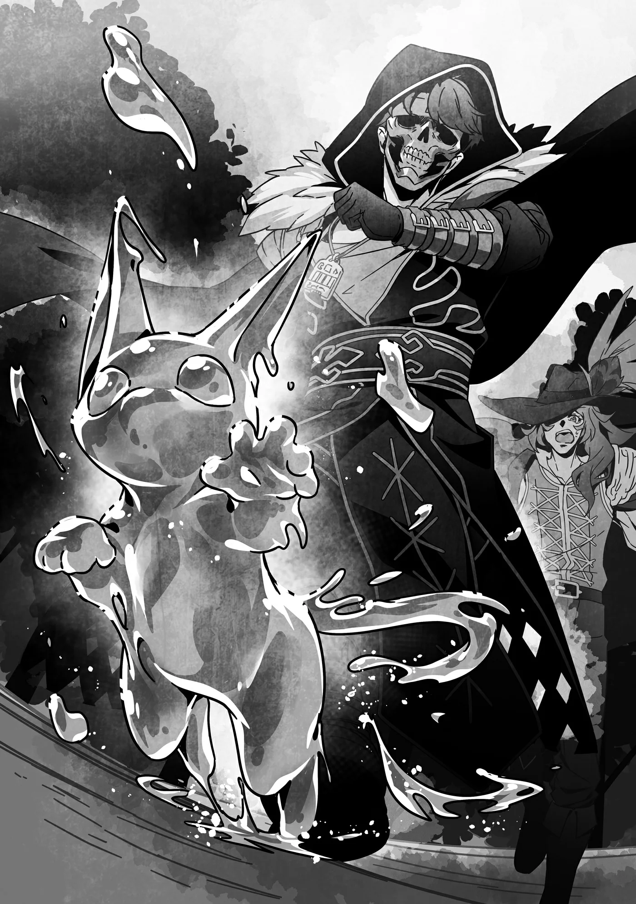

# Chương 243: Tập 10 Chương 5 - Món Quà Cảm Ơn của Cô Thôn Nữ (3)

"Ở quanh đây này," Ferrici bảo chúng tôi.

Chúng tôi theo chân cô bé, đi qua cụm tổ của bầy Phi Long Mime tới một khoảng đất trống. Cô bé từng bảo phần lớn lanh Phi Long đều mọc cách tổ một quãng, và đúng như vậy, cả nhóm ai nấy đều không khỏi trầm trồ khi bước tới một vạt lanh Phi Long rậm rạp, nhiều hơn bất cứ nơi nào tôi từng thấy.

Kích cỡ của từng cây cũng ấn tượng chẳng kém gì số lượng trước mắt. Thân cây phình to mập mạp, cuống dày dặn, hoa trổ dọc từ ngọn xuống hai bên. Đập vào mắt trước tiên là độ dày của từng thân cây; bình thường lanh Phi Long thân to bằng ngón tay cái đã được coi là phát triển hết cỡ, vậy mà ở đây cây nào cây nấy đều dày gấp mấy lần. Trong khi chiều cao trung bình của loài này thường chỉ ngang thắt lưng tôi, thì không ít cây ở đây còn mọc cao quá đầu người.

"Tôi chưa từng thấy thứ này bao giờ," Lorraine trầm trồ lẩm bẩm. Cô ấy quay sang Ferrici hỏi: "Trước giờ em vẫn bán loại này à? Đáng ra phải có người để ý rồi chứ. Ai nhìn thấy chúng hẳn cũng sẽ hỏi mọc ở đâu, và dược sư hay nhà giả kim chắc chắn sẽ lùng sục cho bằng được."

Ferrici đáp: "Em sống ở làng hẻo lánh thật, nhưng chuyện đó thì em cũng tính đến rồi. Em chỉ hái bán mấy cây nhỏ nhất ở góc đằng kia thôi." Cô bé chỉ tay về phía rìa bụi cây, nơi có những cây nhỏ hơn hẳn—cỡ như loại người ta vẫn thấy ngoài chợ, có khi còn bé hơn một chút.

"Sao chúng lại mọc to thế này được nhỉ?" Augurey hỏi.

"Em nghĩ là vì bầy Phi Long làm tổ trên tảng đá này chỉ thải phân ở đây thôi. Em nghe nói phân của chúng bón cho lanh Phi Long rất tốt, mà trên tảng đá này lại lắm Phi Long. Em từng xem qua nhiều tảng đá lơ lửng khác rồi, nhưng chẳng nơi nào cây mọc to được như ở đây."

Lorraine gật đầu. "Tự nhiên luôn có cách của nó. Ở những nơi khác có tảng đá lơ lửng cỡ này thì kết quả chắc cũng tương tự. Có khi sau này tôi phải đi tìm thêm vài chỗ xem sao," cô ấy lẩm bẩm, vẻ mặt có vẻ nghiêm túc. Bãi sinh sản của Phi Long vốn hiếm khi tìm thấy, nên nói nhẹ nhất thì chuyện đó cũng chẳng dễ dàng gì.

"Tiện đây ta hái một ít đi," tôi nói. "Dĩ nhiên là chỉ chọn mấy cây nhỏ kín đáo thôi. Nhưng em có phiền không nếu tôi lấy vài cây to về dùng riêng?"

"Không sao đâu anh," Ferrici trả lời. "Miễn là anh giữ bí mật giúp em."

◆◇◆◇◆

"Nào..." tôi lẩm bẩm, nghe chẳng khác gì một ông lão đang gượng đứng dậy khỏi ghế, rồi bước xuống khỏi lưng Phi Long.

Sau khi hái lanh Phi Long, chúng tôi quay lại chỗ mấy con Phi Long đang đậu rồi cưỡi chúng đáp xuống mặt đất.

"Được đặt chân xuống đất vững chãi sau một lúc bay lượn thấy an tâm hẳn," Augurey nhận xét. "Dù có rơi từ trên đó xuống thì ta cũng chẳng chết được."

Tảng đá lơ lửng nơi chúng tôi hái lanh nằm ngay trên mặt hồ, nên rơi xuống nước cũng không chết được. Có điều chắc chắn sẽ ướt sũng và phải bơi vào bờ. Chưa kể nếu không có Ferrici đi cùng, chúng tôi còn có thể bị bầy Phi Long xúm lại tấn công. Mạo hiểm giả bình thường khó mà sống sót nổi trong cảnh ngộ đó. Tôi thì có thể tự dang cánh bay, nhưng chưa bao giờ thử bay khi có cả đàn Phi Long bám riết sau đuôi. Nói tóm lại, đáp xuống an toàn thế này là may lắm rồi.

"Xong một việc rồi, mà lại suôn sẻ hơn mong đợi nhiều. Tiếp theo làm gì đây? Cứ thế này làm tiếp luôn chứ?" tôi hỏi.

Tôi cứ ngỡ việc này sẽ mất nhiều thời gian hơn, vì đáng ra cả nhóm phải vừa né lũ Phi Long giận dữ vừa tự mò mẫm tìm bụi lanh. Có Ferrici giúp né hết mấy chuyện đó quả là đỡ bao nhiêu việc. Mọi chuyện suôn sẻ thế này không chỉ vì em ấy sống ở đây, mà còn nhờ Siren thôi miên đám dân làng, tạo cơ hội cho chúng tôi cứu họ để rồi được Ferrici mang ơn. Có khi chúng tôi phải cảm ơn tên Goblin và đám đồng bọn mới đúng. Nghĩ lại chuyện bọn tôi vốn đã đoán trước sẽ có biến, cảm giác cứ như thể chúng tôi tự biên tự diễn vậy. Thôi, kệ đi.

"Giờ chỉ cần bắt một con Aqua Hathur với lấy ít bùn hoặc đất sét của Golem Luteum nữa thôi," Augurey bảo, "nhưng ngặt nỗi chẳng biết tìm hai con đó ở đâu. Chắc đành đi lượn quanh hồ xem sao."

Không như Phi Long, hai loài sinh vật này chẳng có nơi cư ngụ cố định.

"Em biết chỗ có Aqua Hathur đấy," Ferrici lên tiếng.

"Cái gì?!" Lorraine kêu lên, bất ngờ khi thấy Ferrici nói ra điều đó một cách thản nhiên như vậy.

Ngay cả mạo hiểm giả cũng phải mất không ít công sức mới lùng được Aqua Hathur, thế mà một cô thôn nữ bình thường lại biết chỗ sao? Dù em ấy có dị năng đặc biệt này nọ, nhưng tôi thấy gọi em ấy là "bình thường" cũng chẳng sai. Thể hình em ấy đâu có cơ bắp vạm vỡ gì, dẫu trên đường tới đây cô bé đã chứng minh sức bền của mình ăn đứt mấy cô gái nơi thành thị.

"Cũng không chắc đâu anh," cô bé nói thêm. "Hôm nọ em vừa thấy một con. Có khi nó vẫn còn ở đó."

"Thông tin đó quan trọng lắm đấy," Lorraine đáp. "Một khi Aqua Hathur đã chọn được chỗ dừng chân, chúng sẽ không đi đâu xa."

"Thế à? Tôi cứ tưởng quái vật họ mèo một ngày đi được hàng chục cây số chứ," tôi hỏi.

Kiến thức thông thường vốn là vậy, đó cũng là lý do người ta thường gióng còi báo động mỗi khi phát hiện quái vật họ mèo ở gần thị trấn. Chỉ sau một đêm, chúng thừa sức đi từ làng này sang làng khác.

Lorraine gật đầu. "Đúng là thế, nhưng Aqua Hathur gần với tinh linh hơn là họ mèo. Anh biết đấy, những sinh vật mang yếu tố tinh linh nước luôn bị thu hút bởi làn nước trong lành."

"Phải rồi," Augurey lẩm bẩm. "Một khi đã tìm được nguồn nước ưng ý, chúng sẽ chẳng đi đâu xa."

"Đúng vậy. Thế nên manh mối của Ferrici mới quý giá đến thế. Em dẫn đường giúp bọn tôi được chứ?"

Lorraine hỏi lại cho chắc vì chúng tôi sắp đi ra ngoài phạm vi mà dị năng của Ferrici bảo vệ được em ấy trước Phi Long. Là mạo hiểm giả, chúng tôi luôn đặt an nguy của Ferrici lên hàng đầu, nhưng ngay cả những mạo hiểm giả giỏi nhất thế giới cũng chẳng thể bảo đảm an toàn tuyệt đối, nên chúng tôi không thể nài ép em ấy. Tôi cứ ngỡ em ấy chỉ nói vị trí đại khái, rồi cả nhóm tự tới đó tìm.

"Được chứ. Đi lối này này," Ferrici nói rồi cứ thế cất bước.

Cả nhóm lại vội rảo bước đuổi theo em ấy.

"Em không sợ gặp nguy hiểm à?" Lorraine hỏi.

"Hôm nọ em ấy vừa đi về trót lọt mà. Chắc em ấy biết chỗ đó không đến nỗi nguy hiểm đâu," tôi nói. Tôi cũng chỉ đoán vậy thôi.

Augurey xen vào: "Đó là một lẽ, nhưng hẳn em ấy cũng tin tưởng chúng ta nữa. Không thì đã chẳng nhận lời nhanh thế."

"Lỡ có chuyện không may thì phải bảo vệ em ấy bằng được," tôi dặn. "Nhất là sau những gì vừa xảy ra."

Lorraine tán thành. "Tôi sẽ giăng một lớp chắn ma pháp thật vững. Dù có phải trả giá bằng sự an toàn của chính mình, cũng tuyệt đối không thể để em ấy sứt mẻ gì."

◆◇◆◇◆

"Ở đây thật này," tôi lẩm bẩm.

Nó ở ngay đó—một con Aqua Hathur sờ sờ trước mắt tôi. Nó trông hệt như một con mèo trong suốt, toàn thân kết tinh bằng nước. Còn hành vi thì chẳng khác nào mèo thường. Lúc này nó đang giơ chân rửa mặt.

Chưa kể ở đây còn có mấy con Aqua Hathur nữa. Chúng đang quanh quẩn bên một dòng suối nhỏ chảy ra từ khe đá. Chỗ này nằm cao hơn mặt hồ một chút, nước rỉ ra từ các kẽ nứt. Hẳn đây là một trong những mạch nước đổ vào lòng hồ.

Ai mê mèo có khi chỉ cần ngồi ngắm lũ mèo bằng nước này nằm ườn bên suối cả ngày là đã sướng rơn, nhưng bọn tôi còn có việc phải làm. Dù loài quái vật này nhìn chung vô hại, chúng tôi vẫn phải bắt sống một con. Mà như tôi đã nói đấy, chúng chỉ "nhìn chung" là vô hại thôi.

"Bắt tay vào việc thôi, cứ theo kế hoạch mà làm," tôi bảo.

Augurey chỉ vào một điểm trên tấm bản đồ anh ấy đang cầm: "Ta dồn chúng vào góc đằng kia."

"Các anh cố lên nhé!" Ferrici cổ vũ khi chúng tôi bắt đầu tiến về phía bầy Aqua Hathur.

◆◇◆◇◆

Con Aqua Hathur thấy chúng tôi tiến lại liền ngoảnh sang nhìn Augurey và tôi đúng điệu một con mèo. Rắc rối nằm ở hành động tiếp theo của nó. Tôi cảm nhận được Ma Lực trong không khí ngưng tụ lại, rồi một lưỡi đao nước mỏng manh hình thành ngay trước mặt con quái vật—và dĩ nhiên chẳng phải vì nó khát nước.

"Augurey!"

"Biết rồi!"

Chúng tôi liếc nhìn nhau rồi cùng nhào sang hai bên. Đúng lúc đó, lưỡi đao nước chém toạc một rãnh sâu hoắm trên mặt đất, chẻ đôi mấy thân cây ở cuối đường bay khiến chúng đổ ầm xuống đất.

Đòn đạn nước nhỏ bé ấy suýt nữa đã thành máy chém lấy đầu chúng tôi. Con người cũng có ma pháp tên là Yidle Swiffof với tác dụng tương tự, nhưng chậm hơn nhiều và quy mô cũng nhỏ hơn hẳn. Chưa kể, pháp sư con người cần nghỉ từ vài giây đến nửa phút giữa mỗi lần niệm, trong khi Aqua Hathur thi triển thủy ma pháp dễ như vung tay múa chân, có thể liên tục lặp lại chiêu thức trong chớp mắt.

Một loạt lưỡi đao nước sắc lẹm bay tới tấp về phía chúng tôi. Cả hai vừa né sạch vừa thu hẹp khoảng cách áp sát con Aqua Hathur. May cho bọn tôi là nó chỉ là một con thú không có đầu óc. Nghe thì hơi thiếu tế nhị, nhưng nó đâu đủ khôn để nhận ra quy luật di chuyển của chúng tôi mà bắn đón đầu. Nếu có trí khôn như người bình thường, con quái vật này hẳn sẽ là một đối thủ đáng sợ. Dù vậy nó vẫn thừa độ nguy hiểm; chỉ là đòn phép có uy lực đến đâu mà bắn trượt thì cũng bằng thừa.

"Chính là lúc này! Tôi tóm được nó rồi!"

Tôi nhảy tới trước mặt con Aqua Hathur trước khi Augurey kịp ra tay rồi vươn tay chộp lấy con quái vật nhỏ. Dĩ nhiên, Aqua Hathur cấu tạo bằng nước nên không thể tóm theo cách thông thường, nhưng chính Ma Lực đã giữ cho cơ thể nó thành hình, y như cách Ma Lực gắn kết các khớp xương của một con Khô Lâu.

Chỉ cần khống chế được Ma Lực của con Hathur là có thể nhấc nó lên—theo lý thuyết là thế. Từ lâu từng có người đặt giả thuyết và chứng minh được điều này. Nhờ công trình nghiên cứu đó, giờ mới có loại ma cụ cho phép chạm vào và tác động lên những quái vật không có thể rắn rõ ràng như Aqua Hathur. Lorraine đã đưa cho Augurey và tôi mỗi người một cặp ma cụ đeo trên tay. Kế hoạch ban đầu của chúng tôi là dùng chúng để tóm con Hathur nếu được.

"Oái! Không ăn thua rồi!"

Tôi đã chộp trúng đích, nhưng con Hathur lại trơn tuột vặn mình thoát khỏi tay tôi. Nó co cẳng chạy biến, làm cả đám Hathur đang tụ tập gần đó chạy tán loạn. Khi mục tiêu ban đầu của chúng tôi phóng vút qua chỗ Augurey, anh ấy cũng vươn tay tóm nhưng còn chẳng chạm nổi vào nó. Chẳng phải vì Augurey kém cỏi gì, mà do con Aqua Hathur quá nhanh.

Ngay cả khi đang chạy trốn, chúng vẫn không ngừng bắn đao nước. Vừa né đòn vừa bắt sống một con Hathur xem chừng là chuyện không tưởng. Nếu chỉ muốn giết con quái vật thì chẳng thiếu cách, như dùng các ma pháp diện rộng thay vì nhắm vào một mục tiêu cụ thể, nhưng... Tôi đoán đó là lý do ủy thác này cứ nằm phủ bụi cho tới khi Augurey nhận.

Nhưng mạo hiểm giả một khi đã nhận việc thì phải làm cho trót. Dù cả Augurey và tôi đều bắt hụt, đây mới chỉ là lần thử đầu tiên. Nước cờ hay nhất vẫn còn ở phía sau. Chúng tôi nhắm ngay vào một con đang bỏ chạy theo đúng hướng dự tính để bắt đầu bám theo dồn bắt.

◆◇◆◇◆

"Chị đang làm gì thế?" Ferrici hỏi Lorraine, vẻ mặt không giấu nổi thắc mắc trước những gì Lorraine đang làm.

Hai người họ đang ở một ngõ cụt tạo bởi các tảng đá, nơi Lorraine đang vẽ những ma pháp trận vô cùng phức tạp. Đầu ngón tay thon dài của cô ấy phát ra ánh sáng ma pháp lung linh, lướt thoăn thoắt trên mặt đá chẳng khác nào một danh họa đang vẽ nên kiệt tác. Có điều lúc này ma pháp trận trông vẫn chưa có gì biến chuyển, nên Ferrici thấy tò mò cũng phải.

Lorraine giải thích: "Tôi đang dệt một tấm lưới để tóm con Aqua Hathur. Nếu chỉ dùng ma pháp tôi vẫn tạo được lưới, nhưng lũ đó sẽ nhận ra ngay, chưa kể chúng chạy quá nhanh. Tôi có thể canh đúng lúc để tung lưới, nhưng làm thế này chắc ăn hơn. Dùng ma pháp trận thì có thể cài đặt cho nó tự kích hoạt ngay khi Aqua Hathur chạy qua. Bơm Ma Lực vào đống này xong là tôi tha hồ nằm chợp mắt một giấc rồi."

Tạm gác thói lười biếng chẳng buồn giấu giếm của Lorraine sang một bên, những gì cô ấy nói với Ferrici đều là thật, dù cô ấy giấu đi một điều: cô ấy không muốn mạo hiểm vừa tạo vừa điều khiển lưới ma pháp lại vừa phải duy trì lớp chắn bảo vệ Ferrici vì sợ sơ suất không lo chu toàn được cho cô bé. Mà nếu bớt việc được nhờ chịu khó chuẩn bị kỹ càng từ trước, cô ấy luôn chọn cách đó hơn là cứ ngồi thấp thỏm lo chuyện chẳng lành.

"Thế là hòm hòm rồi đấy," cô ấy đứng dậy nói. "Trận pháp xong xuôi. Giờ lùi lại xem vở kịch hài do Rentt và Augurey đóng chính thôi."

Nếu một trong hai chúng tôi mà nghe được câu này, chắc tức điên lên mất.

Lorraine và Ferrici lùi ra xa một quãng nhưng vẫn đủ gần để quan sát cái bẫy. Chẳng bao lâu sau, một con Aqua Hathur lao vút tới, đuổi sát phía sau là một người đàn ông đeo mặt nạ Khô Lâu với tà áo choàng đen bay phần phật, cùng một người nữa mặc bộ đồ hoa văn lông công sặc sỡ đến mức nhìn lâu chỉ thấy đau cả mắt.

Con Aqua Hathur không chỉ cắm đầu chạy mà còn liên tục phóng đao nước về phía sau, buộc hai kẻ đuổi theo phải liên hồi né tránh.

"Đứng lại ngay, cái con này...!"

"Chịu thua nhanh đi cho rồi!"

Khung cảnh ấy, nói nhẹ nhất thì đúng là buồn cười không chịu nổi. Tuy nhiên, màn diễn đã đi tới hồi kết khi con quái vật chạy vào ngõ cụt nơi Lorraine vừa chuẩn bị xong. Ngay khi Aqua Hathur vừa đặt chân tới, ma pháp trận liền phóng ra những vệt sáng tựa tia sét, kết thành chiếc lồng giam chặt con mèo nước thoắt ẩn thoắt hiện. Dù vậy, nó vẫn cố tìm đường thoát thân và đâm phải chấn song sét. Ánh sáng lóe lên chói mắt, con Hathur đổ gục ngay tại chỗ.

Nếu không biết chuyện Aqua Hathur khi chết sẽ không giữ được hình dạng, hẳn chúng tôi đã lo nó mất mạng rồi. Khi trở về với tự nhiên, chúng chỉ tan thành một vũng nước rồi thấm vào lòng đất. Nhờ thế, cả nhóm biết chắc con Aqua Hathur này chỉ ngất đi chứ vẫn còn sống.

"Trót lọt đấy chứ. Lại đằng đó thôi nào. Không có lồng thì Rentt với Augurey cũng chịu chết," Lorraine nói, tay xách chiếc lồng trông như vừa lấy ra từ cõi hư không. Chiếc lồng rõ ràng làm riêng cho Hathur, khác hẳn loại lồng nhốt thú thông thường. Đỉnh và đáy lồng chạm trổ hoa văn tinh xảo, còn chấn song không làm bằng kim loại mà là những vệt sét hệt như thứ vừa bẫy con Hathur trong kẽ đá.

Nói là làm, Lorraine bước tới chỗ con Aqua Hathur đang bất tỉnh, dùng bàn tay đeo găng nhấc bổng nó bỏ vào lồng. Con quái vật choàng tỉnh, ré tướng lên rồi lao đầu vào chấn song sét. Bị giật kêu tanh tách một hồi, nó mới chịu thua mà nằm im thin thít.

Luồng điện của chiếc lồng cầm tay yếu hơn nhiều so với cái bẫy trên vách đá, nhưng nhìn con Hathur lúc này vẫn thấy tội nghiệp. Dù vừa rồi nó còn liên tục phóng đao nước chí mạng về phía chúng tôi, nhưng dáng vẻ của nó lại khiến người ta vô cớ mủi lòng.

Thấy vẻ mặt đó của Ferrici, Lorraine liền nói thêm: "Con Aqua Hathur này sẽ được một quý bà ở vương đô nuôi. Nó sẽ phải đeo vòng cổ ma thuật để không niệm phép được, nhưng không bị đối xử tệ đâu. Em đừng lo."

Ferrici nghe vậy mới thở phào nhẹ nhõm.