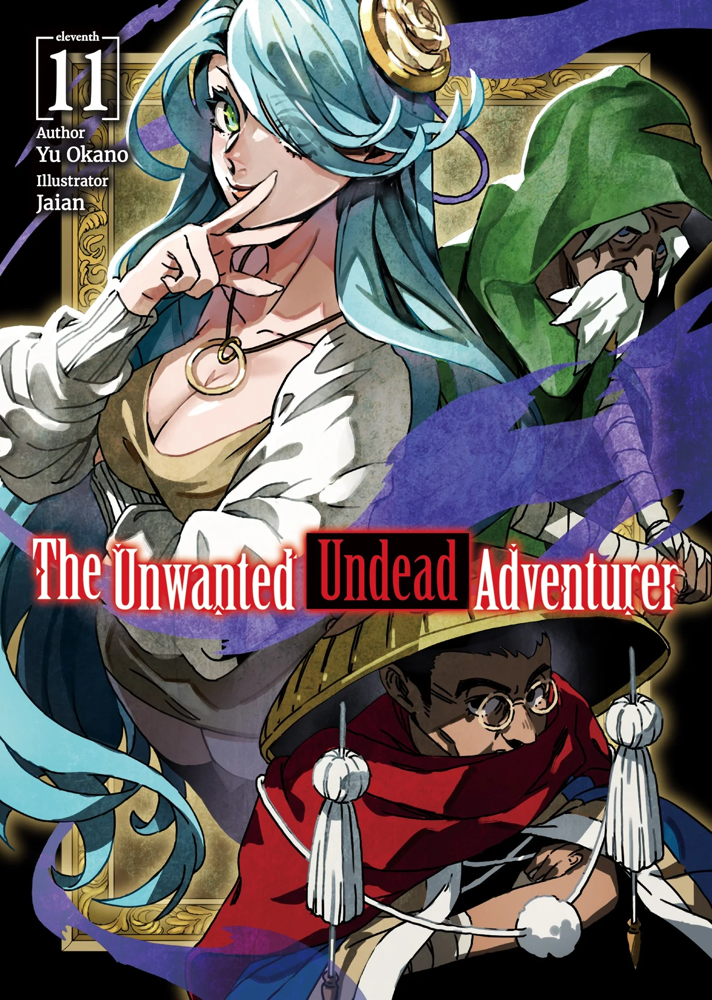
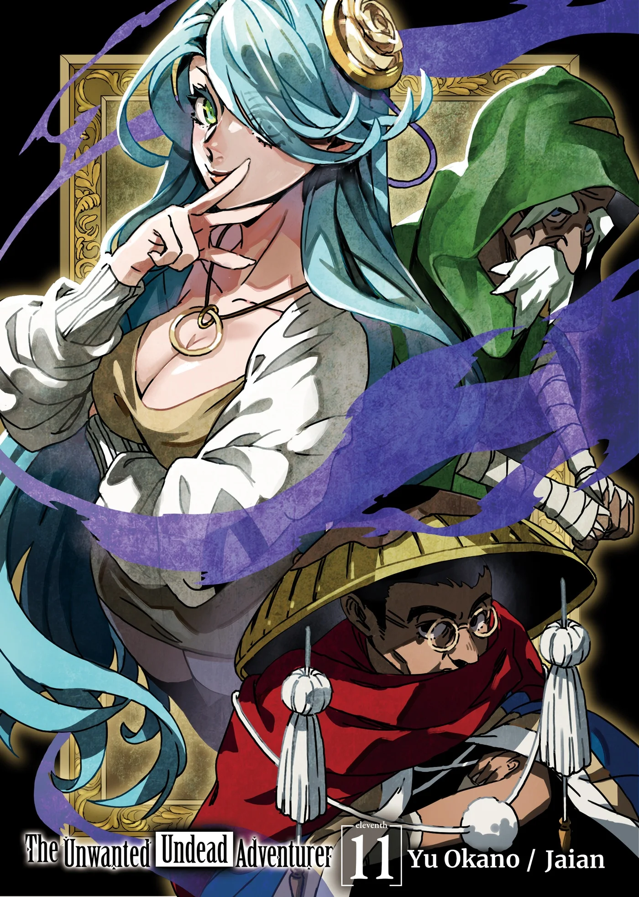
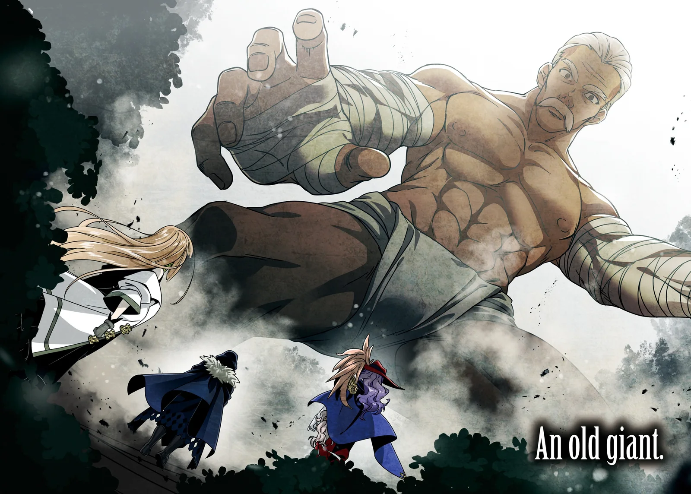
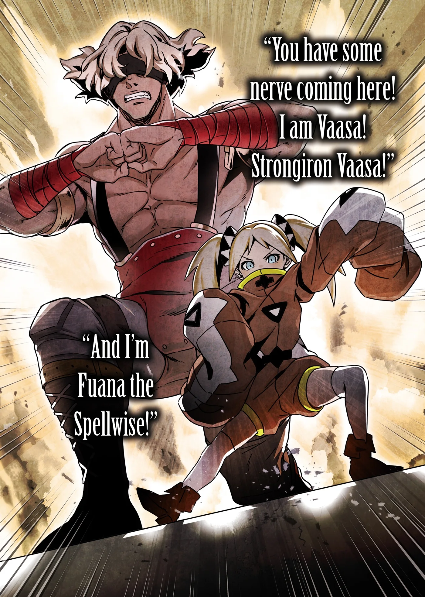
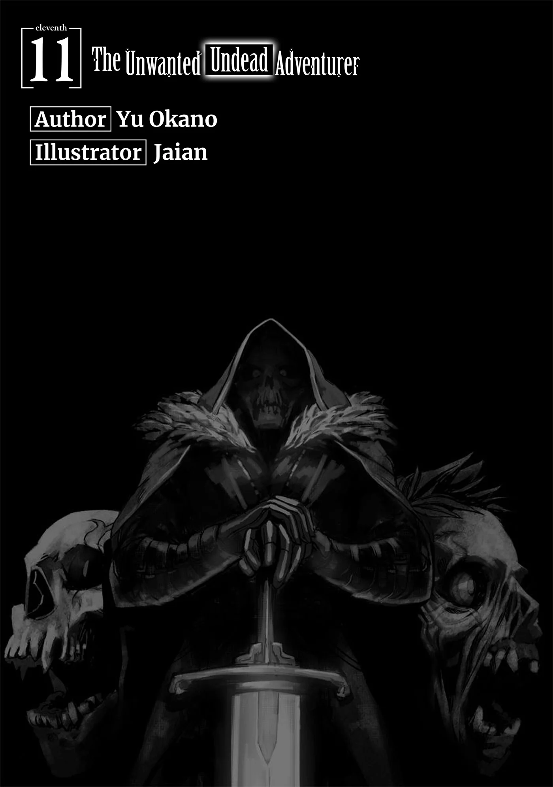
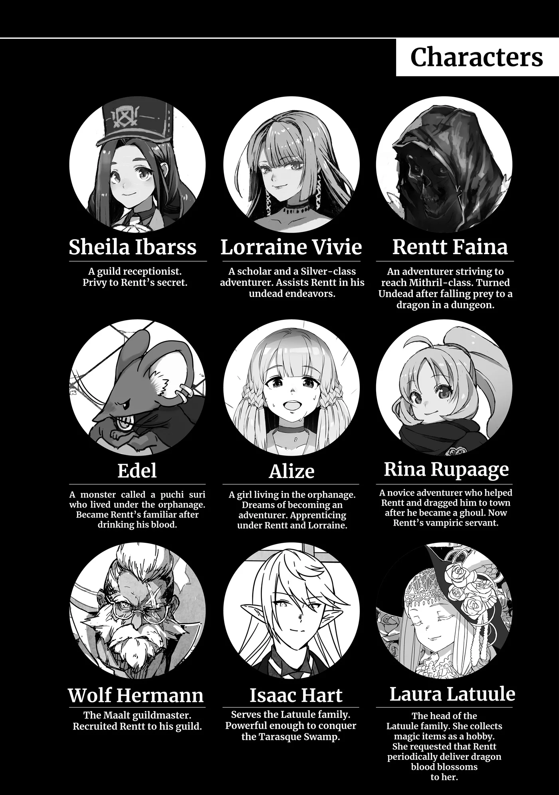
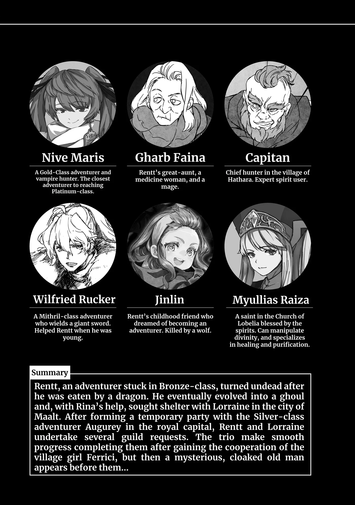
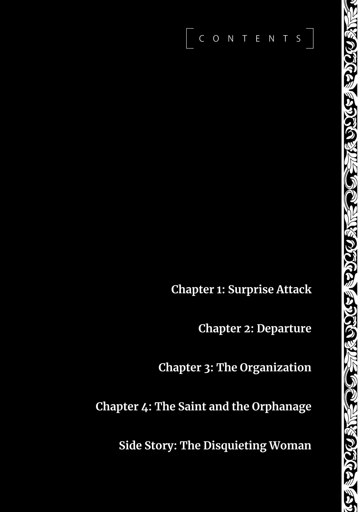

# Chương 244: Tập 11 Chương 1 - Tập Kích Bất Ngờ (1)

"Mục tiêu cuối cùng của chúng ta là Golem Luteum," Lorraine nói, vẻ mặt dở khóc dở cười. "Hai người xoay xở nổi không đấy?"

Trước mắt cô ấy, cũng tức là trước mắt chúng tôi, là đàn Golem Luteum cô ấy vừa nhắc tới. Phải, không phải một mà là cả bầy Golem, mà đâu chỉ có dăm ba con. Mấy chục con nhão nhoét đang lững thững bò quanh. Rõ là xui xẻo: chúng tôi đụng trúng cái loại ngậm đầy nước. Chỗ chúng lượn lờ lại nằm dưới đáy một vùng trũng trông như cái lòng chảo, dù tôi chẳng đoán nổi sao chúng lại làm thế.

Vì chúng không có đường thoát, nếu đến đây chỉ để săn thì chúng tôi đã có thể nhờ Lorraine dọn sạch bách bằng một câu ma pháp rồi. Có điều, mục tiêu lần này là thu thập nguyên liệu. Bùn hay đất sét của Golem Luteum chứa rất nhiều Ma Lực, là nguyên liệu giả kim quý giá, nhưng vì nó cũng rất dễ bị tác động, sơ ý để ma pháp quệt qua một chút thôi là coi như hỏng bét. Tóm lại, chúng tôi không thể trông cậy vào Lorraine, mà phải dùng Khí Lực để tấn công. Thế nên việc này đành dồn cả lên vai Augurey và tôi.

"Chỉ cần chịu khó để bùn trát đầy người thì chắc cũng chẳng vất vả lắm đâu," tôi nói.

Augurey lắc đầu. "Không, chẳng dễ ăn thế đâu. Chỉ cần lơ là một chút thôi là cậu sẽ ngạt thở đến ch—" Mặt anh ấy bừng sáng như vừa vỡ lẽ điều gì, rõ mồn một tới mức tôi gần như đọc được suy nghĩ trong đầu: Nhưng cậu đâu có cần thở nhỉ, Rentt? Tiện thật đấy!

Và anh ấy nghĩ chẳng sai; thân xác này của tôi tiện vô cùng trong những lúc thế này. Lần chạm trán Tarasque chính là một ví dụ. Còn Augurey không phải Undead nên đâu có lợi thế đó. Dù tôi chẳng ngại một mình đánh trận này, nhưng nếu Augurey không xuống cùng thì Ferrici sẽ đâm nghi. Có cô bé ở đây, chúng tôi phải tỏ ra thật tự nhiên.

"Nếu không muốn bẩn quần áo thì để tôi tự xử lý chỗ này cũng được đấy, Augurey," tôi nói. "Anh cứ đứng sẵn bên trên phòng khi tôi cần hỗ trợ là xong."

Tôi tìm đại một cái cớ cho qua chuyện, Augurey gật đầu. "Cậu có lòng thì tôi cảm ơn, nhưng để cậu ôm hết việc thì tôi áy náy lắm. Chỉ lần này thôi, tôi sẽ phá vỡ nguyên tắc của bản thân mà thay đồ khác."

Anh ấy cởi lớp áo ngoài nhét vào túi ma thuật, rồi lấy ra một bộ thường phục giản dị mặc vào. Tôi cũng cảm động trước sự quan tâm anh ấy dành cho mình, nhưng có lẽ niềm tin của Ferrici mới là thứ tác động đến quyết định đó. Chắc Augurey nghĩ nếu mình cứ khoanh tay đứng nhìn rồi đùn đẩy hết trận đánh cho tôi thì cô bé sẽ bận lòng. Xét về những chuyện ý tứ kiểu này, anh ấy vốn là người rất tinh tế.

Thế là chúng tôi đã sẵn sàng.

"Được rồi, xuống thôi," tôi nói, đi đầu trượt xuống mép lòng chảo.

Augurey theo sau tôi xuống dưới. "Nếu được thì ráng đừng làm chúng ta bị dính bẩn đấy nhé," anh ấy lầm bầm với tôi. "Tuy giản dị nhưng tôi vẫn thích bộ này lắm đấy."

Xuống đến lưng chừng vách lòng chảo, tôi cảm nhận được lũ Golem Luteum dưới đáy bắt đầu chú ý tới chúng tôi. Thân mình chúng làm bằng bùn nhão, trên đó có những hốc lõm làm mắt và miệng. Dù tôi vẫn rất ngờ vực liệu đôi mắt tối om kia có nhìn thấy được thật không, nhưng hiện tại, rõ ràng là chúng đang hướng thẳng về phía chúng tôi.

Lũ Golem Luteum bắt đầu trườn về phía chúng tôi, nhầy nhụa lướt trên mặt đất. Đến khi chạm chân xuống đáy, chúng tôi đã bị bầy quái đông áp đảo vây kín bốn bề.

"Nhìn gần trông chúng còn nhão nhoét hơn," Augurey nói, mặt ỉu xìu.

"Tôi đã bảo cứ để tôi tự lo một mình rồi mà," tôi đáp.

"Tôi nghĩ để cậu làm thế thì tôi sẽ đánh mất niềm tin của Ferrici."

"Tôi cũng đoán vậy. Mà nếu thấy sắp bị bẩn... À thôi bỏ đi. Nếu thấy chúng sắp làm anh ngạt thở thì cứ lấy tôi ra làm tấm chắn. Dù sao thì tôi đâu có cần thở."

Dù Golem Luteum có cách tấn công khá giống Slime, nhưng đối phó với chúng lại đáng sợ hơn nhiều. So với Slime, ít nhất là Slime thường, chúng khỏe hơn hẳn. Chưa kể, trong khi đòn tầm xa chủ lực của Slime là Acid Blitz, thì Golem Luteum lại có...

"Mấy thứ đó rõ ràng đang nhắm thẳng vào chúng ta nhỉ?" Augurey chỉ vào hàng loạt mũi tên đất mà lũ Golem Luteum vừa triệu hồi giữa không trung.

Mấy mũi tên đó chính là Gê Bélos, một ma pháp của loài người. Nhưng chuyện đó là bình thường với Golem Luteum, bởi chúng vốn thi triển được nhiều loại ma pháp thổ hệ khác nhau. Vì thế, lòng chảo như thế này là địa bàn hoàn hảo cho chúng; công thủ đều tùy ý. Hèn chi chúng lại tụ tập ở đây nhiều đến vậy.

"Không nhắm vào chúng ta thì nhắm vào đâu nữa chứ?" tôi nói. "Trước hết cứ tỉa bớt số lượng của chúng đã. Anh biết phải làm gì rồi đúng không?"

"Dĩ nhiên rồi. Đập vỡ hạch tâm của chúng, giống hệt như Slime thôi. Nhưng chắc phải thử vài lần mới quen tay được. Không như Slime, cơ thể lũ Golem này đâu có trong suốt."

"Chuẩn rồi đấy. Được rồi, lên thôi!"

"Được!"

Chúng tôi lao lên, luồn lách qua bầy Golem Luteum, vừa xông tới vừa đâm chém vào những hạch tâm vùi sâu trong thân thể chúng. Nếu phải tìm điểm nào đó để khen loài này, thì đó là chúng không nhanh lắm. Dĩ nhiên cũng chẳng chậm chạp gì, nhưng chuyển động của chúng hoàn toàn nằm trong tầm xử lý của chúng tôi. Dù vậy, nói thế không có nghĩa là chúng tôi được phép lơ là.

Trong lúc tôi tiếp tục giao chiến, một con Golem Luteum bỗng mở toang thân mình lao thẳng về phía tôi, rõ ràng tính nuốt trọn tôi vào trong. Bình thường đây sẽ là tình huống cực kỳ nguy hiểm, bởi nếu bị nó tóm được thì chỉ có nước ngạt thở mà chết, nhưng với tôi thì chẳng sao cả. Tôi nhảy thẳng vào trong con Golem Luteum, dễ dàng tìm thấy cái hạch tâm giờ đã lộ ra. Tôi đập nát nó, và con quái vật liền tan thành một đống bùn bình thường.

Dù cách này giúp việc săn Golem dễ hơn nhiều, nhưng với một mạo hiểm giả bình thường thì quá sức nguy hiểm. Sơ sẩy một cái là mất mạng như chơi. May mà tôi vốn đã chết rồi. Cách thông thường là đâm từ bên ngoài thì rất phiền phức, vì dẫu có lờ mờ đoán được chỗ hạch tâm, người ta vẫn phải đâm nhiều nhát mới trúng đích được. May sao tôi có thể mặc kệ chuyện đó mà dùng cách tốt nhất cho mình: lao thẳng vào trong.

Khổ nỗi, vì Augurey không thể, hay đúng hơn là chẳng hề muốn làm như thế, nên cứ mỗi lần một con Golem mở toang người ra là anh ấy lại lùi ra xa, để tôi nhảy bổ vào từ một bên đập nát hạch tâm của nó. Việc này làm tôi thấy như mình đang dùng Augurey làm mồi nhử, nhưng tôi nghĩ, ừ thì, cách nào hiệu quả là được. Vả lại thế này cũng năng suất hơn nhiều.

Số lượng Golem Luteum giảm đi nhanh chóng, ngỡ như chỉ trong chớp mắt...

"Chỉ còn đúng một con nữa thôi," tôi nói.

"Có vẻ thế." Augurey gật đầu, bước ra sau con Golem cuối cùng rồi đâm một kiếm kết thúc trận chiến. Nhìn nó tan ra xong, chúng tôi quay sang nhìn nhau, quan sát bộ dạng của đối phương. Trông chẳng đẹp đẽ gì cho cam: cả hai đều bị bùn trát kín từ đầu đến chân.

"Gột sạch đống này khỏi người càng sớm càng tốt," tôi nói.

"Dù rất muốn tắm bồn đàng hoàng," Augurey mở lời, "nhưng có lẽ tốt nhất là chúng ta cứ nhảy xuống hồ ngụp lặn một phen. Quán trọ chắc chẳng thích chúng ta bôi bùn khắp nơi đâu. Mà nhắc mới nhớ, đừng quên mục đích chúng ta tới đây đấy."

Đáy lòng chảo giờ rải rác những đống bùn, thứ mà chúng tôi vẫn phải thu gom. Lorraine và Ferrici cũng sẽ phụ một tay, thế nên ban nãy cô ấy mới có vẻ mặt dở khóc dở cười như vậy. Cô ấy không phải đánh nhau, nhưng vẫn phải chịu cảnh lấm lem. Ngạc nhiên là Ferrici lại đón nhận chuyện này khá vui vẻ; cô bé trông rất tươi tỉnh khi bám vào Lorraine bước xuống lòng chảo.

"Nghịch bùn thế này làm em nhớ hồi nhỏ ghê," cô bé nói, nhận lấy cái hộp từ tay Lorraine rồi vui vẻ xúc bùn đổ đầy vào. "Cứ như em được làm con nít lần nữa vậy!"

Nghĩ thế cũng là một cách.

Thế là cả ba chúng tôi, học theo sự lạc quan của Ferrici, chăm chỉ xúc bùn vào từng hộp, vừa làm vừa tự nhủ trong bụng rằng chuyện này cũng vui.

◆◇◆◇◆

"Vậy là chúng ta đã giải quyết xong mọi ủy thác rồi," tôi nói, lúc này đang gột rửa dưới hồ. "Xong sớm hơn tôi tưởng nhiều đấy."

Augurey đang ở dưới hồ cùng tôi gật đầu. "Cậu nói phải. Tôi từng nghĩ ít nhất cũng phải mất hai ba ngày, nên xong sớm thế này thì mừng quá. Nhưng phần lớn đều nhờ công Ferrici cả đấy chứ."

Đương nhiên cô bé không có ở đây, và Lorraine cũng vậy. Họ đang tắm rửa ở chỗ khác. Dù sao thì họ đâu thể tắm chung với chúng tôi được. Tôi nghĩ nếu mình mon men lại gần nhìn trộm, dù tôi chẳng hề có ý định đó, thì hẳn sẽ được nếm màn chào hỏi thân thiện bằng một phát ma pháp sét của Lorraine ngay. Với bộ dạng ướt sũng nước thế này, phát sét đó khéo sẽ đặt dấu chấm hết cho chuỗi ngày của tôi trên cõi đời này mất. Nếu chỉ có một mình, có lẽ Lorraine cũng chẳng bận tâm giữ kẽ lắm đâu, nhưng giờ bên cạnh cô ấy còn có Ferrici. Dù thế nào thì tôi cũng chẳng dại gì mà bén mảng tới.

"Nghĩ lại, tôi cũng chẳng biết nên bảo chúng ta may hay xui nữa," tôi nói. Tôi đang nghĩ về những chuyện ầm ĩ xảy ra ở làng đợt trước. Nếu không có chuyện đó, chúng tôi đã chẳng thể nào có được sự giúp đỡ của Ferrici. Đúng kiểu trong cái rủi lại có cái may.

"Cậu nói phải," Augurey đáp, vừa nói vừa ngắm nghía người tôi. "Với cậu thì lại càng đúng gấp đôi. Trừ nước da trắng bệch ra thì trông cậu y như người bình thường. Tôi cũng tò mò muốn biết hồi còn là Khô Lâu trông cậu thế nào đấy."

Lúc này, trừ chiếc quần lót ra thì cả Augurey và tôi đều không mặc gì, nên anh ấy nhìn rõ mồn một cả người tôi. Nhưng không giống thời còn là Khô Lâu hay Ngạ Quỷ, tôi chẳng còn phải nơm nớp lo bị ai nhìn thấy nữa. Đúng là da tôi có hơi nhợt nhạt, nhưng cũng chỉ có vậy thôi.

Tôi vẫn đeo mặt nạ, vì như mọi khi, nó nhất quyết không chịu rời ra. Tôi đang nắn đổi hình dạng mặt nạ để gột sạch lớp bùn lọt vào bên trong, lúc này nó chỉ che nửa dưới khuôn mặt. Dạo gần đây tôi thấy mình hay để kiểu này nhất. Rất tiện khi ra vào các thị trấn, vì thấy được mắt tôi thì lính gác sẽ bớt nghi ngờ và dễ cho qua hơn.

"Làm Khô Lâu chán lắm," tôi nói. "Chỉ biết đi lại lách ca lách cách thôi. Thành Ngạ Quỷ cũng chẳng khá hơn mấy, nhưng ít ra tôi cũng tìm được cách nói chuyện theo một nghĩa nào đó. Cảm giác như mình được sống lại lần nữa vậy."

"Nếu làm Ngạ Quỷ mà cũng gọi là 'sống' được," Augurey đáp. "Dù giờ tôi cũng chẳng chắc mình còn dám nói thế nữa không. Có lẽ chỉ cần có ý thức con người là đã đủ xem như một sinh mệnh rồi. Mà này, nhờ có cậu nên dạo gần đây tôi cứ nghĩ, liệu mình có thể trò chuyện với những con Ngạ Quỷ mình gặp, hay với các loài quái vật khác không."

"Thỉnh thoảng tôi cũng nghĩ tới chuyện đó, nhưng chắc là vô phương thôi."

Tôi chưa bao giờ nói chuyện tử tế được với bất kỳ con Ngạ Quỷ nào từng gặp. Tôi cũng chẳng rõ tại sao; hồi đó ý thức của tôi đã phát triển khá rõ ràng rồi. Rốt cuộc tôi và chúng khác nhau ở chỗ nào? Vì ban đầu tôi vốn là con người ư? Hay vì tôi từng bị rồng nuốt chửng? Tôi chịu chết. Mà vốn dĩ, quái vật thực sự là thứ gì cơ chứ?

Lorraine vẫn tiếp tục nghiên cứu và tìm tòi đủ kiểu, còn tôi cũng ráng hết sức vắt kiệt cái đầu chậm tiêu này theo cách của mình, nhưng cả hai vẫn chưa tìm ra lời giải cho trường hợp của tôi. Có lẽ cũng chẳng lạ, bởi xét cho cùng chúng tôi đang đi tìm lời giải thích cho sự tồn tại của loài quái vật, một câu hỏi muôn đời nay người ta vẫn luôn thắc mắc.

Lorraine là một thiên tài, nhưng lịch sử từng có biết bao bậc kỳ tài mà chưa ai làm sáng tỏ được chân tướng về quái vật, nhất là nguồn gốc của chúng vẫn chìm trong bí ẩn. Có rất nhiều giả thuyết xoay quanh chuyện đó, nhưng chưa cái nào khẳng định được điều gì chắc chắn. Tôi nghĩ cách duy nhất của chúng tôi lúc này là cứ tiếp tục tìm tòi và suy ngẫm thôi.

"Nhưng quái vật cấp cao thì nói được đấy chứ," Augurey nói. "Nghĩ ngay tới Ma Cà Rồng với Rồng Cổ Đại chẳng hạn. Nhưng có lẽ với Ngạ Quỷ, cách giao tiếp lại giống như giữa con người với loài khỉ hơn. Đúng là bí ẩn thật nhỉ?"

Tôi chẳng biết trả lời anh ấy thế nào. Tôi mong một ngày nào đó mình sẽ có câu trả lời... nhưng chẳng rõ ngày ấy liệu có bao giờ đến không.

"Xin lỗi nhé," Augurey nói. Có lẽ anh ấy nhận thấy mình vừa làm tôi hơi chùng lòng xuống.

"Tôi không có ý làm cậu phải nghĩ ngợi đâu. Chỉ là nói chuyện phiếm thôi mà."

Anh ấy nói đúng ở chỗ tôi có hơi đăm chiêu thật, nhưng cũng không đến mức làm tôi chán nản hay vỡ mộng gì về cuộc đời. Tôi chỉ đang ngẫm xem việc được sống rốt cuộc có ý nghĩa gì thôi.

"Anh đừng bận tâm," tôi nói. "Dù sao mấy chuyện này tôi vẫn nghĩ suốt ấy mà. Anh chỉ làm tôi ngẫm lại xem mọi thứ bí ẩn tới mức nào thôi."

"Vậy à? Thế thì tốt rồi. Thôi, cũng đến lúc chúng ta phải đi rồi đấy. Tôi đã sạch hết bùn chưa nhỉ?"

Augurey xoay một vòng cho tôi nhìn rõ. Thân hình anh ấy mảnh khảnh nhưng cân đối, đúng chuẩn vóc dáng của một mạo hiểm giả. Thấy anh ấy đã sạch, tôi cũng nhờ kiểm tra lại giúp mình, rồi cả hai mặc quần áo và hướng về chỗ đã hẹn trước với Lorraine.

◆◇◆◇◆

"Xem ra ai nấy đều sạch sẽ rồi đấy," Lorraine lên tiếng khi chúng tôi gặp lại nhau. Có lẽ vì ban nãy ai cũng dính đầy bùn, nên trông cô ấy lúc này gần như thành một con người mới. "Chủ quán trọ chắc chẳng còn gì để phàn nàn nữa đâu. Đi thôi chứ?"

Đường về của chúng tôi thoải mái vô cùng. Khác biệt so với lúc đi thể hiện rõ nhất khi băng qua bãi sinh sản của Phi Long Mime, bởi giờ đây chúng tôi đã bớt lo bị chúng tấn công hơn hẳn. Tuy không thể mất cảnh giác hoàn toàn, nhưng cũng chẳng đến mức lúc nào cũng nơm nớp lo âu. Chúng tôi thực sự nhờ vào Ferrici rất nhiều.

Tiếc là, dù chuyến về suôn sẻ đến tận cùng thì tốt biết mấy, nhưng đời đâu phải lúc nào cũng chiều lòng người. Khi chỉ còn một đoạn đường thẳng nữa là tới làng, chúng tôi bỗng trông thấy một thứ kỳ lạ.

"Đó là... người sao?" Ferrici hỏi.

Mấy người chúng tôi đã nhận ra từ trước khi cô bé hỏi. Mắt tôi nhìn được khá xa, còn Lorraine và Augurey thì nhận ra có biến qua những cái liếc mắt ngầm của tôi. Cả ba chúng tôi đã kín đáo chuyển hướng đi, nhưng bóng người đằng xa chẳng mất bao lâu đã điều chỉnh theo để chặn đầu chúng tôi.

Bất kể kẻ đó là ai, hành tung rõ ràng rất đáng ngờ. Dù vậy, chúng tôi buộc phải đi qua đó nếu muốn về làng. Chẳng còn cách nào khác, chúng tôi đành tiến về hướng người nọ. Phải bảo vệ Ferrici đồng nghĩa nếu có biến xảy ra thì chúng tôi sẽ phải chịu nhiều bất lợi, nhưng để cô bé đi đường khác một mình thì cũng đáng lo chẳng kém. Cả nhóm cứ đi cùng nhau là an toàn nhất.

Chúng tôi tiếp tục bước tới, và chẳng mấy chốc, "người" khả nghi nọ đã ở ngay trước mặt. Thật ra chỉ có một cách đối phó, đó là tiếp cận và bắt chuyện. Người đó khoác áo choàng, thò ra hai cánh tay gầy gò khẳng khiu, trông như một ông lão.

"Thứ lỗi cho tôi hỏi," tôi nói. "Ông ơi, có chuyện gì không ổn sao? Nếu có việc gì thì chúng tôi sẵn lòng lắng nghe—"

Chưa kịp dứt lời thì một thứ gì đó to lớn và nặng trịch đã đâm sầm vào bụng tôi.
