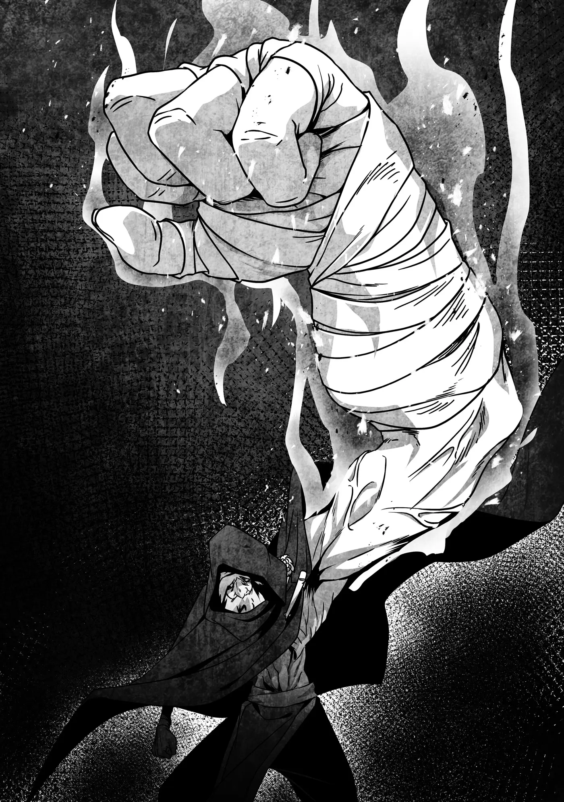

# Chương 246: Tập 11 Chương 1 - Tập Kích Bất Ngờ (3)

Suýt nữa thì tôi không kịp. Điểm nguy hiểm nhất ở ông lão này là dù cánh tay có phình to cỡ nào, tốc độ của ông ta cũng chẳng hề chậm đi. Cánh tay khổng lồ ấy vẫn vung vẩy nhẹ tênh như một phần cơ thể bình thường. Đã vậy, ông ta còn nhanh nhẹn như một chiến binh thượng thặng. Không còn nghi ngờ gì nữa, ông ta đúng là một con quái vật thực sự... dù một kẻ như tôi mà thốt ra câu đó thì hơi mỉa mai thật.

Mà, "sang thế giới bên kia theo cậu" cơ à? Augurey đôi lúc cũng hóm hỉnh ra phết. Nghĩ cảnh anh ấy cũng biến thành Undead nghe cũng vui đấy chứ. Lôi thêm cả Rina vào rồi lập Binh đoàn Rentt thì sao nhỉ? Tới lúc đó chúng tôi sẽ là một thế lực đáng gờm, có khi đủ sức đọ lại cả Binh đoàn Laura... hoặc không. Khá lắm thì cũng chỉ biến thành chư hầu dưới trướng cô bé thôi. Mà nghĩ lại thì, có một lãnh chúa phong kiến như Laura cũng đâu có tệ. Kiểu gì cô bé chẳng chia cho chư hầu đủ thứ của cải, danh tiếng lẫn binh lực.

"Khà khà, cái gì thế này? Chẳng phải ngươi là thằng nhóc bị ta đánh bay lúc nãy sao? Rentt, phải không nhỉ? Ta cứ tưởng ngươi chết rồi chứ."

Ông lão vừa tiến lại gần vừa bẻ ngón tay răng rắc. Việc ông ta không vội vàng áp sát chứng tỏ vẫn còn dè chừng tôi. Nghe giọng điệu thì có vẻ cú đánh đầu tiên ông ta nhắm thẳng vào mạng tôi thật. Mà nói cho đúng thì đòn đó đủ chết người thật. Tôi còn nguyên vẹn như mới thế này chỉ là nhờ chút lợi thế gian lận từ Phân Liệt. Không có nó, chắc chắn tôi đã toi mạng rồi.

"Rất tiếc phải làm ông thất vọng," tôi nói, "nhưng như ông thấy đấy, tôi vẫn khỏe re đây. Hoặc cũng không hẳn. Chuyện phức tạp lắm. Dù sao thì tôi vẫn đang đứng đây, thế là được rồi."

Ông lão lộ vẻ khó hiểu. "Ý ngươi là cũng chẳng lành lặn gì chứ gì? Chà, thế cũng là kỳ tích rồi đấy. Hiếm có ai trúng một đòn của ta mà còn đủ nguyên vẹn để đứng đó mở mồm nói chuyện."

"Chắc chắn rồi," tôi đáp. "Trước giờ tôi chưa từng bị nện một cú nào đau như thế. Mà chắc ông chẳng đời nào chịu bật mí mánh đó đâu nhỉ? Coi như chút quà tiễn đưa để tôi được thanh thản nhắm mắt xuôi tay ấy mà."

Dĩ nhiên là tôi chỉ nói đùa. Mục đích của tôi là câu thêm chút thời gian cho Augurey hồi phục thể lực. Ai ngờ ông lão lại đáp lời thật.

"Hừ. Có gì mà không được? Này, nhìn đi." Ông ta giơ tay lên, và không gian lại méo mó khi cánh tay phình to ngang ngửa những thân cây xung quanh.

Dù không còn là chuyện mới mẻ, tận mắt chứng kiến lại lần nữa vẫn khiến tôi giật mình. Rốt cuộc làm quái nào mà ông ta làm được như thế?

"Đấy, đơn giản thế thôi," ông lão nói.

"Ra vậy..." tôi đáp. "Tôi ngạc nhiên là ông không bị sức nặng của chính mình đè bẹp dí đấy."

"Thân thể này ta rèn luyện đâu phải để làm cảnh. Hay là làm một ván vật tay nhé? Nói cho ngươi hay, ta chưa từng thua ai bao giờ đâu."

Tôi dám chắc "rèn luyện thân thể" chỉ là cách nói giảm nói tránh, nhưng chí ít cũng thấy rõ ông lão đủ sức chống đỡ khối lượng sinh ra từ chiêu thức của mình. Không rõ ông ta dùng Khí Lực hay Ma Lực, hay đó vốn là năng lực bẩm sinh, nhưng kiểu gì thì cũng đáng kinh ngạc thật. Năng lực của ông ta cơ bản đã vượt khỏi phạm trù con người, thành thử tôi còn thấy có chút đồng cảm với ông lão này.

"Thôi cho tôi xin kiếu," tôi nói. "Tôi đâu thể đi rêu rao với thiên hạ rằng mình thua một ông già được."

"Thế cũng phải. Giờ thì, thằng nhóc đằng kia đã lại sức chưa? Ta muốn đánh tiếp chỗ dở dang đây, nếu không phiền."

Ông lão đã nhìn thấu tôi, dù tôi cũng phần nào đoán trước được. Chắc chắn ông ta đâu hùa theo vì thương hại. Đoán chừng ông ta đã tranh thủ quan sát, đánh giá tôi suốt lúc nói chuyện. Một kẻ không hề coi thường đối thủ chỉ vì mình từng hạ gục họ trước đây. Có một điều chắc chắn: trận này không dễ ăn chút nào.

"Augurey. Anh đánh tiếp được không?"

"Được chứ, nhờ cậu lén truyền cho chút Thần Lực đấy. Bị thương thì có bị, nhưng tôi vẫn xoay xở được."

Nãy giờ tôi vẫn âm thầm dùng Thần Lực trị thương cho Augurey đang nấp sau lưng. Nhờ Thần Lực của tôi vốn không quá mạnh, lại thêm chút hiểu biết về ma pháp trị liệu, tôi mới có thể truyền sang một cách kín đáo như vậy.

Xem chừng ông lão vẫn chưa phát hiện ra. Giờ là hai chọi một rồi. Nếu Augurey và tôi đồng lòng dốc sức, chắc cũng cầm cự được... nhỉ? Mà đằng nào thì chúng tôi cũng đâu còn nhiều lựa chọn.

"Vậy ta tới đây, mấy nhóc. Hy vọng các ngươi cho ta vui vẻ một chút. Đừng làm ta thất vọng đấy."

Rồi như thể gióng chuông mở màn cho trận quyết đấu, ông lão đạp mạnh xuống đất lao tới, tạo nên một tiếng nổ đinh tai nhức óc dội vang khắp bốn bề.

◆◇◆◇◆

"Oái!"

Kèm theo tiếng gió xé rít lên, ông lão bỗng chốc đã áp sát ngay trước mặt tôi. Đoán được cú vung ngang, tôi chỉ vừa kịp cúi rạp người né tránh. Cánh tay khổng lồ nặng trịch quét sạt qua ngay trên đỉnh đầu tôi.

Ngay sau đó, tôi toan lùi lại để kéo giãn khoảng cách, nhưng thể chất của ông lão vượt xa sức tưởng tượng dành cho một người trạc tuổi ông ta. Nếu không đánh trả được một đòn trước khi nhảy lùi ra, chắc chắn ông ta sẽ lại áp sát tôi ngay.

Thế nên tôi vung kiếm chém thật mạnh. Trúng vào đâu cũng được, miễn là trúng đích. Cánh tay của ông lão vẫn chưa thu nhỏ lại bình thường, thành thử nếu nhát chém trúng đích thì tình thế sẽ càng bất lợi cho ông ta.

Nghĩ thì nghĩ thế, nhưng có vẻ tính toán vụng về đó của tôi là một sai lầm. Dù lưỡi kiếm chém trúng phóc vào người ông ta...

Keng!

Nó phát ra một tiếng keng chát chúa như đập phải sắt thép rồi nảy bật ra.

"Đùa nhau à?!" tôi thốt lên.

"Rentt! Coi chừng!" Augurey hét lên.

Thấy phản lực từ cú chém khiến tôi lảo đảo mất thăng bằng trong thoáng chốc, ông lão lại vung cánh tay lao vào tôi lần nữa. Augurey đoán trước được đòn đánh liền xô tôi bật ra khỏi quỹ đạo, hệt như những gì tôi từng làm cho anh ấy trước đó.

Rầm!

Cánh tay khổng lồ nện thẳng xuống mặt đất, phát ra một tiếng nổ đinh tai và hất tung một đám bụi mù mịt. Vài thân cây chắn đường cũng bị bẻ gãy gập, dăm gỗ bắn tung tóe khắp nơi. Sức công phá khủng khiếp đến mức phát ngán.

"Ta vẫn chưa xong đâu!" Dù bụi và dăm gỗ bay mù mịt cản trở tầm nhìn, ông lão vẫn tiếp tục vung tay quất tới. Những cú vung bừa bãi, nhưng với cánh tay to cỡ đó thì chuyện đó chẳng thành vấn đề. Hẳn ông ta nghĩ làm thế còn hơn đứng chờ bụi lắng xuống.

Với người thường thì đó là quyết định đúng đắn, nhưng cơ thể Undead của tôi lại có vài ngón nghề khá hữu dụng. Đôi mắt tôi có thể nhìn thấy thân nhiệt cùng sinh khí của sinh vật sống, nên tôi vẫn thấy rõ mồn một cánh tay của ông lão mà chẳng gặp trở ngại nào. Điều đó thực ra lại khiến tôi có phần ớn lạnh, bởi nó chứng tỏ thứ tôi đang nhìn thấy đúng là cánh tay thật của ông ta. Tôi suýt nữa đã tự hỏi làm sao lại có một kẻ kỳ dị đến mức này trên đời, nhưng một kẻ như tôi thì lấy tư cách gì mà phán xét người khác chứ.

Chắc hẳn ông lão này cũng có cả một câu chuyện ly kỳ của riêng mình để kể. Nếu gặp nhau trong hoàn cảnh khác, có khi chúng tôi đã có thể ngồi đàm đạo một hồi lâu về chuyện đó. Dù sao thì trông ông ta cũng khá xởi lởi, bằng chứng là lúc tôi hỏi, ông ta đã vui vẻ phô diễn năng lực cho chúng tôi xem đấy thôi. Nhưng mà thôi, đây đâu phải lúc nghĩ tới mấy chuyện lông gà vỏ tỏi. Tôi cứ ngỡ nghĩ lan man sẽ giúp mình bình tĩnh lại, ai ngờ chẳng có tác dụng gì.

Đoán rằng Augurey không thể nhìn thấy gì giữa mớ hỗn độn này, tôi đã túm lấy anh ấy cùng chạy lòng vòng né đòn, nhưng tôi vẫn chưa biết phải làm gì tiếp theo. Tôi bắt đầu cân nhắc các phương án.

Nhát chém lúc nãy tuy bị bật ra, nhưng đó đâu phải đòn mạnh nhất tôi có thể tung ra—chỉ là một đòn bộc phát chưa dồn được toàn lực mà thôi. Tôi vẫn có thể truyền thêm nhiều Khí Lực hoặc Ma Lực vào thanh kiếm của mình. Dùng Ma Khí Dung Hợp Thuật, hay thậm chí Thần Ma Khí Dung Hợp Thuật cũng là những lựa chọn khả thi. Vế sau là con dao hai lưỡi, nhưng vế trước thì tôi nghĩ mình làm được. Chắc vậy. Có điều, nếu đến cả những chiêu đó mà cũng bị bật nảy ra thì chúng tôi toi đời là cái chắc. Tôi chợt tự hỏi liệu ông lão này có còn là con người hay không.

Dù vậy, xem chừng ông già phi thường kia chí ít vẫn phải bận tâm tới thể lực của mình, bởi tần suất ra đòn của ông ta đang thưa dần. Thấy thế, tôi liền buông Augurey xuống.

"Rentt! Tính sao đây?!"

"Để xem... Hay là— Oái!"

Rầm!

Một thân cây bay vút qua như ngọn giáo rồi cắm phập xuống nền đất gần đó. Thật khó tin là ông lão lại đang bứng cây ném về phía chúng tôi. Bụi bặm đã lắng xuống nên cả Augurey lẫn tôi đều kịp né tránh, nhưng chúng tôi tuyệt đối không thể để tình trạng này tiếp diễn. Sau khi né đòn tiếp theo, tôi sẽ—

"Thấy ngươi rồi nhé!"

Đến khi tôi kịp nhận ra thì cánh tay khổng lồ đã lao thẳng về phía mình.

Đòn này không né được rồi!

Tôi thủ sẵn kiếm, hy vọng chí ít cũng tránh được một cú đánh trực diện, nhưng lập tức nhận ra làm vậy vô ích. Chẳng còn lựa chọn nào khác, tôi dùng Phân Liệt. Cơ thể tôi tan biến hình dạng, hóa thành một màn đêm đen kịt.

"Hử?!" Ông lão nghiêng đầu. Có vẻ như cánh tay khổng lồ kia vẫn có xúc giác khá nhạy bén, bởi ông ta lộ rõ vẻ bối rối khi đòn đánh hụt mục tiêu, chỉ đánh vào khoảng không. Xem chừng cả hai chúng tôi đều hiểu rằng nếu cú vung tay đó trúng đích, tôi sẽ dính chấn thương nặng nề.

"Ngươi biến đi đâ—? À, thôi kệ!" Ông lão khựng lại một thoáng như thể đang tìm kiếm tôi, nhưng khi phát hiện ra Augurey, ông ta lập tức đổi mục tiêu. Cánh tay giáng thẳng xuống một đòn nghiền nát, nhưng Augurey đứng đủ xa để kịp thời né tránh an toàn.

Cơ hội tới rồi. Nhờ những lần luyện tập trước đó, tôi nhanh chóng tái tạo lại thân thể rồi dồn Ma Lực vào thanh kiếm. Đoạn, tôi lao vụt tới sau lưng ông lão, vung kiếm chém thẳng vào gáy ông ta.

Dĩ nhiên tôi vẫn biết kính lão đắc thọ, nhưng kẻ này đâu phải một ông già bình thường. Mà điều đó cũng được ông ta chứng minh ngay lập tức, trước cả khi tôi kịp thấy áy náy về đòn đánh của mình. Chẳng rõ nhờ kinh nghiệm trận mạc hay đơn thuần là bản năng nhạy bén, ông ta đã nhận ra tôi lao tới và quất ngược cánh tay ra sau. Khỏi phải nói, cánh tay ấy cũng đã được khổng lồ hóa.

Cú vung tay không quá nhanh, có lẽ vì phải phản xạ bột phát, nhưng cũng thừa sức bảo vệ gáy ông ta khỏi lưỡi kiếm của tôi. Rốt cuộc, thanh kiếm chém thẳng vào cánh tay ông ta. Luồng kình lực dữ dội ép nén không khí tại điểm va chạm rồi nổ bung ra ngoài bằng một tiếng rầm chấn động!

"Hự!" Không ngoài dự đoán, ông lão giật thót người, vẩy vẩy cánh tay mấy cái rồi lùi bật ra xa.

Xem chừng tôi đã tung ra được một đòn ra trò. Ông lão thu cánh tay về kích thước bình thường, và tôi thấy chỗ trúng kiếm đã bị toác miệng từ bên trong. Máu tuôn xối xả, chứng tỏ tôi đã gây được tổn thương thực sự.

"Có lẽ ta đã đánh giá thấp ngươi..." Ông lão xé một vạt áo quấn chặt quanh vết thương, rồi lẩm nhẩm niệm một câu chú ma pháp để cầm máu.

Tôi cứ ngỡ ông ta không phải ma pháp sư, nhưng hóa ra ông ta cũng lận lưng vài ngón nghề ma pháp. Thủ sẵn câu chú cầm máu đơn giản là một chuyện, nhưng việc ông ta chẳng thèm chớp mắt lấy một cái trước vết thương nặng cỡ đó mới thực sự đáng gờm.

Trông ông ta chẳng có vẻ gì là định tháo chạy, chứng tỏ vẫn còn thừa hăng hái chiến đấu. Nói cách khác, ông ta tin chắc phần thắng vẫn nằm trong tay mình.

Đồng nghĩa với việc, thật chẳng may, trận này khó lòng mà xong sớm được.

◆◇◆◇◆

"Hừm, tiếp theo nên cho các ngươi xem trò gì đây nhỉ?" ông lão lẩm bẩm.

"Ý ông là s—?"

Chưa kịp hỏi hết câu, một tiếng gọi từ phía sau đã ngắt lời tôi.

"Rentt! Augurey!"

Tôi quay lại thì thấy Lorraine. Cô ấy đang băng qua bãi đất ngổn ngang những thân cây gãy đổ cùng các hố sâu hoắm để chạy về phía chúng tôi, nét mặt sa sầm vẻ khó chịu.

"Hai người không sao chứ?" cô ấy hỏi ngay khi chạy tới.

"Như cô thấy đấy," Augurey đáp mà không ngoái lại nhìn. Trong lúc tôi quay đi, anh ấy vẫn dán chặt mắt vào ông lão. Không hẳn do anh ấy nhanh trí, mà vì chúng tôi quen biết nhau đủ lâu để phối hợp ăn ý theo bản năng, điều khiến tôi vô cùng cảm kích.

"Ra là cô nàng ma pháp sư cũng tới rồi à," ông lão nói khi thấy Lorraine. "Các ngươi chắc con bé đó ở một mình vẫn ổn chứ? Ta cũng có đồng nghiệp của mình đấy nhé, và ta không chỉ nói tới đứa bị các ngươi tóm đâu."

Rõ ràng ông ta nói thế nhằm làm chúng tôi phân tâm, nhưng chúng tôi cũng không dám chắc liệu ông ta có bịa chuyện hay không. Dù vậy, câu trả lời của Lorraine lại hết sức lạnh lùng, mang đầy vẻ khiêu khích.

"Tôi thấy chẳng có vấn đề gì cả. Bọn tôi chỉ cần giải quyết ông cho thật nhanh là xong."

Nghe giọng nói, tôi biết Lorraine vốn chẳng đành lòng để Ferrici lại một mình. Giọng cô ấy có phần bực bội, một nét hiếm thấy ở cô ấy. Có điều, ông lão lại không nhận ra.

"Hừ. Xem ra chừng đó không đủ làm các ngươi nao núng nhỉ? Các ngươi khó xơi hơn bọn ta tính toán nhiều. Chẳng trách hai đứa đồng nghiệp của ta lại không đọ nổi các ngươi. Giá mà tin tức chính xác hơn một chút!"

"Hai đồng nghiệp của ông?" tôi gặng lại. Lúc này giả ngây giả ngô cũng chẳng ích gì mấy, nhưng tôi nghĩ thử thăm dò một phen cũng đâu có hại gì.

Ông lão nhăn mũi. "Khỏi cần đóng kịch nữa... nhưng thôi, ta chiều ngươi một phen. Một đứa đồng nghiệp của ta tuy là dân có thâm niên nhưng bản lĩnh thì chẳng có gì đáng nói. Hắn nhận ra mình hợp với nghề buôn hơn, nên vốn định xong phi vụ này là giải nghệ. Còn đứa kia, dẫu có dị năng hiếm thấy nhưng lại thiếu kinh nghiệm, đâm ra kiêu ngạo quá mức. Ta vốn định coi đây là một phi vụ khó nhằn để ghìm bớt tính tự phụ của nó lại và cho nó trưởng thành hơn."

Tôi tự hỏi liệu có phải ông lão đã hoàn toàn từ bỏ vỏ bọc của mình hay không, nhưng chắc không hẳn vậy. Có lẽ ông ta chỉ thấy chẳng còn lý do gì để duy trì nó nữa thôi. Vả lại, mục tiêu của ông ta là giết sạch chúng tôi, mà người chết thì không biết nói. Trừ tôi ra, nhưng tôi là trường hợp đặc biệt rồi.

Ông lão nói tiếp: "Buồn cái là chẳng đứa nào làm nên trò trống gì. Mà cũng phải thôi, tin tức truyền xuống cho bọn ta đầy rẫy lỗ hổng."

"Truyền xuống cho các ông?" tôi buột miệng ngắt lời. Tôi không kìm lại được, bởi tôi quá đỗi nóng lòng muốn biết ai là kẻ đứng sau chỉ đạo ông ta. Ông lão liếc nhìn tôi nhưng không buồn đáp.

Xem chừng ngay cả kẻ sắp chết cũng có những chuyện không nên biết. Tôi chẳng trách ông ta, bởi đâu có gì là tuyệt đối. Lỡ như bộc bạch hết bí mật mà chúng tôi lại trốn thoát được thì ông ta to chuyện. Ông ta cẩn thận thế cũng phải, nhất là khi ông ta không hề hay biết tôi tự tin đến mức nào vào khả năng tẩu thoát của mình.

Tôi không nghĩ có nhiều kẻ đủ sức cầm chân tôi một khi đã dùng Phân Liệt. Dù vậy, bảo không có ai thì cũng không đúng, nhất là khi còn có những người như Nive. Nghề mạo hiểm giả vốn đầy rẫy những con quái vật, mà Nive mới chỉ đứng trên đỉnh của Kim Cấp. Đối phó với Phân Liệt chắc cũng dễ như ăn kẹo đối với các mạo hiểm giả Bạch Kim Cấp hay Mithril Cấp.

Đoán chừng bản lĩnh của ông lão này cũng phải ngang ngửa Kim Cấp, hoặc thậm chí còn cao hơn. Đó đâu phải kiểu nhân vật mà người ta có thể tình cờ đụng độ trên đường, nhưng khổ nỗi, chúng tôi lại đang giáp mặt một kẻ như thế ở đây.

Ông lão vẫn lải nhải: "Tin tức truyền xuống cho bọn ta bảo mục tiêu là hai kẻ Ngân Cấp bình thường cùng một tên Đồng Cấp chẳng đáng nhắc tới. Ai ngờ đối diện lại là ba đứa các ngươi. Một con quái vật ăn trọn một đòn của ta mà người ngợm vẫn lành lặn, một đấu sĩ lão luyện dắt mũi ta chạy lòng vòng suốt nửa ngày trời, cùng một ma pháp sư có thể tạo khiên chắn tức thời không cần ngâm xướng mà vẫn chặn đứng được cánh tay ta. Nếu biết ngay từ đầu ba đứa các ngươi là mục tiêu, ta đã chuẩn bị kỹ càng hơn nhiều rồi. Khoản thù lao này thực sự chẳng bõ công chút nào..."

"Vậy sao ông không chịu lỗ rồi quay về đi?" tôi hỏi, bụng bảo dạ cứ thử thăm dò xem sao.

Ông lão cười khẩy: "Bỏ ngay ý nghĩ đó đi. Bõ hay không thì việc vẫn là việc, thế nên ta vẫn sẽ lấy mạng các ngươi, dẫu có phải vắt kiệt bộ xương già này. Bằng không thì ta mất chén cơm mất."

Xét theo nghề của ông ta, cụm từ "mất chén cơm" hẳn đồng nghĩa với việc mất mạng. Thế giới ngầm quả thực là chốn khắc nghiệt. Tôi có thể thông cảm cho ông ta ở điểm đó. Dù vậy, đâu có chuyện chúng tôi nương tay. Huống hồ trước một đối thủ mạnh cỡ này, chúng tôi cũng chẳng có tư cách nương tay.

"Giờ thì, ta thấy tán gẫu thế là đủ rồi đấy. Cả ba mục tiêu đều đã tụ đủ trước mặt ta, và ta nói trước là sẽ không để một mống nào sống sót rời khỏi đây đâu."

"Ông thực sự nghĩ mọi chuyện dễ dàng thế sao?" Lorraine hỏi.

"Không. Ta sẽ không coi thường các ngươi nữa đâu. Ban nãy ta cũng đâu có đùa cợt, nhưng giờ là lúc phải nghiêm túc rồi. Mở to mắt ra mà nhìn đây! Hừm m m m!!!"

Ông lão bắt đầu gồng cứng toàn thân. Không rõ ông ta định giở trò gì, nhưng tôi biết chắc chẳng có gì tốt lành.

Dĩ nhiên ba chúng tôi đâu có tốt bụng tới mức đứng trơ mắt chờ đối phương ra chiêu. Augurey và tôi tuốt kiếm lao vụt về phía ông lão, trong khi Lorraine giơ đũa phép bắt đầu vận chuyển Ma Lực. Thế nhưng...

"Quá chậm!"

Một luồng kình áp khổng lồ bùng phát từ người ông lão, hất văng cả Augurey lẫn tôi đi, đồng thời tạo ra một luồng gió giật dữ dội cắt đứt sự tập trung của Lorraine.

"Cái quái...?"

Cơn cuồng phong dữ dội lấy ông lão làm tâm điểm đã thổi bạt chúng tôi ra một quãng khá xa. Đến khi ngoái nhìn lại, tôi nhận ra ngay tại vị trí ông ta vừa đứng giờ là một thứ gì đó to lớn khổng lồ.

Tôi không hoàn toàn bị bất ngờ; xét theo năng lực của ông lão, tôi từng nghĩ tới khả năng này. Nhưng vì trước đó ông ta chỉ phóng to tay chân, một phần trong tôi cứ ngỡ đó đã là giới hạn của ông ta rồi.

Giờ thì thực tế đã chứng minh tôi lầm to.

"Đó là...?"

"Không thể nào..."

Trái ngược với vẻ bàng hoàng lẩm bẩm của Augurey và tôi, giọng Lorraine lại hết sức rành rọt: "Hắn là một Cự Nhân. Tôi không ngờ lại đụng độ một kẻ như vậy ở cái nơi này."

Đúng thế. Trước mắt chúng tôi đích thực là một Cự Nhân bằng xương bằng thịt.